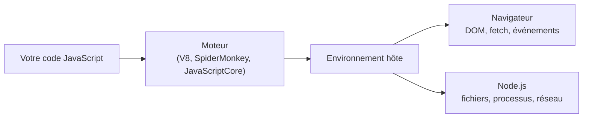

# 01 — Introduction et environnement

> **Niveau** : Débutant · **Durée** : ~2 h · **Prérequis** : aucun

Ce chapitre vous fait passer de « je n'ai rien installé » à « j'exécute mon propre code JavaScript » : dans le navigateur, dans une page web et avec Node.js. Il pose aussi le vocabulaire et les règles de syntaxe dont tous les chapitres suivants ont besoin, et explique comment lire un message d'erreur — la compétence qui vous fera gagner le plus de temps.

## Objectifs

- Situer JavaScript : ce qu'est le langage, ECMAScript, le TC39 et le rythme des nouvelles versions.
- Distinguer le langage de son environnement d'exécution (navigateur, Node.js, Deno, Bun).
- Installer Node.js (version LTS) avec un gestionnaire de versions, et préparer VS Code.
- Exécuter du code de quatre façons : console du navigateur, page HTML, fichier Node.js, REPL.
- Utiliser l'API `console` au-delà de `console.log`.
- Connaître les règles de syntaxe de base : instructions, points-virgules, commentaires, casse, mots réservés, mode strict, scripts et modules.
- Lire un message d'erreur et trouver la bonne page de documentation sur MDN.

## Sommaire

- [Qu'est-ce que JavaScript](#quest-ce-que-javascript)
- [ECMAScript, TC39 et l'évolution du langage](#ecmascript-tc39-et-lévolution-du-langage)
- [Où s'exécute JavaScript](#où-sexécute-javascript)
- [Installer l'environnement](#installer-lenvironnement)
- [Premier programme](#premier-programme)
- [L'API console](#lapi-console)
- [Syntaxe de base](#syntaxe-de-base)
- [Le mode strict](#le-mode-strict)
- [Scripts classiques et modules](#scripts-classiques-et-modules)
- [Lire un message d'erreur](#lire-un-message-derreur)
- [Utiliser MDN](#utiliser-mdn)
- [Comment suivre ce cours](#comment-suivre-ce-cours)
- [Pièges courants](#pièges-courants)
- [Bonnes pratiques](#bonnes-pratiques)
- [Résumé](#résumé)
- [Exercices](#exercices)
- [Pour aller plus loin](#pour-aller-plus-loin)

## Qu'est-ce que JavaScript

JavaScript est un langage de programmation. Né pour rendre les pages web interactives, il sert aujourd'hui presque partout :

| Usage | Exemples |
| --- | --- |
| Interfaces web | Tout site un peu interactif : formulaires, cartes, éditeurs en ligne, jeux |
| Serveurs et API | Node.js, Deno, Bun |
| Outils en ligne de commande | npm, Vite, ESLint, Prettier sont écrits en JavaScript ou TypeScript |
| Applications de bureau | Electron (VS Code, Slack, Discord) |
| Applications mobiles | React Native |
| Automatisation | Scripts, extensions de navigateur, macros de tableurs |

### Un peu d'histoire

En 1995, Brendan Eich crée chez Netscape, en une dizaine de jours, un langage destiné au navigateur Netscape Navigator. Il s'appelle d'abord Mocha, puis LiveScript, et devient **JavaScript** à la faveur d'un accord commercial avec Sun Microsystems, qui promouvait alors Java. Malgré le nom, **JavaScript n'a presque rien à voir avec Java** : la syntaxe se ressemble (accolades, `if`, `for`), le reste diffère profondément.

Pour éviter que chaque navigateur invente sa propre variante, Netscape confie le langage à l'organisme de normalisation Ecma International. La norme s'appelle **ECMAScript** (le nom « JavaScript » est une marque, détenue aujourd'hui par Oracle). En pratique, « JavaScript » désigne le langage tel que l'implémentent les moteurs, et « ECMAScript » sa spécification.

### Ses caractéristiques en quelques mots

- **Typage dynamique** : une variable n'a pas de type fixé, ce sont les valeurs qui en ont un. Le langage convertit aussi des valeurs automatiquement, ce qui surprend parfois ([chapitre 03](../03-types-et-operateurs/README.md)).
- **Compilé à la volée** : on distribue le code source ; le moteur l'analyse, puis le compile en code machine pendant l'exécution (compilation « JIT »). On n'a pas d'étape de compilation à lancer soi-même.
- **Multi-paradigme** : on peut écrire du code impératif, fonctionnel ([chapitre 06](../06-fonctions/README.md)) ou orienté objet ([chapitre 16](../16-classes/README.md)), avec un modèle objet fondé sur les prototypes ([chapitre 10](../10-objets/README.md)).
- **Un seul fil d'exécution** avec une boucle d'événements : les opérations lentes (réseau, fichiers, minuteries) ne bloquent pas le programme ([chapitre 18](../18-asynchrone/README.md)).
- **Mémoire gérée automatiquement** par un ramasse-miettes (garbage collector) : on ne libère jamais la mémoire à la main.

## ECMAScript, TC39 et l'évolution du langage

La spécification **ECMA-262** décrit le langage : sa syntaxe, ses types, et sa bibliothèque standard (`Array`, `Map`, `Promise`, `JSON`, `Math`…). Une spécification sœur, **ECMA-402**, décrit l'API d'internationalisation `Intl` (formats de dates, de nombres, de devises).

Elle est maintenue par le comité **TC39**, qui réunit les éditeurs de navigateurs, des entreprises et des membres de la communauté. Depuis 2015, une nouvelle édition paraît **chaque année en juin** : ES2015, ES2016… ES2026.

### Le processus des « stages »

Chaque nouveauté est une **proposition** qui franchit des étapes :

| Stage | Nom | Signification |
| --- | --- | --- |
| 0 | Strawperson | Une idée, pas encore étudiée par le comité |
| 1 | Proposal | Le comité accepte d'étudier le problème et les solutions possibles |
| 2 | Draft | Une solution est choisie ; un premier texte de spécification existe, le design peut encore changer |
| 2.7 | Validation | La spécification est complète et relue ; on écrit les tests et des prototypes |
| 3 | Candidate | Implémentation recommandée ; seuls des retours de terrain peuvent encore la modifier |
| 4 | Finished | Deux implémentations compatibles passent les tests officiels (Test262) : la fonctionnalité entre dans l'édition suivante |

> [!NOTE]
> Une fonctionnalité au stage 3 peut déjà être disponible dans certains navigateurs. Au stage 4, elle est figée. Dans ce cours, chaque nouveauté postérieure à ES2015 est étiquetée avec son édition (`ES2023`, `ES2026`…), et les fonctionnalités pas encore publiées sont signalées comme telles.

### Frise des versions

| Année | Édition | Ce qu'il faut retenir |
| --- | --- | --- |
| 1997 | ES1 | Première norme |
| 1999 | ES3 | Expressions régulières, `try`/`catch` : la base du Web pendant dix ans |
| 2009 | ES5 | Mode strict, `JSON`, `forEach`/`map`/`filter` |
| 2015 | ES2015 (« ES6 ») | La grande refonte : `let`/`const`, fonctions fléchées, classes, modules, promesses, gabarits de chaînes, déstructuration, `Map`/`Set` |
| 2016 → 2019 | ES2016 → ES2019 | `**`, `includes`, `async`/`await`, spread d'objets, `flat` |
| 2020 | ES2020 | `?.`, `??`, `BigInt`, `globalThis`, `import()` dynamique |
| 2021 → 2023 | ES2021 → ES2023 | `replaceAll`, `??=`, champs privés de classe, `.at()`, `toSorted` |
| 2024 → 2026 | ES2024 → ES2026 | `Object.groupBy`, méthodes ensemblistes de `Set`, helpers d'itérateurs, `Math.sumPrecise`, conversions base64 de `Uint8Array` |
| 2027 (prévu) | ES2027 | `Temporal` (dates), `using` (libération de ressources) : déjà au stage 4 |

Le détail, version par version, se trouve au [chapitre 11](../11-syntaxe-moderne/README.md). Retenez surtout que « ES6 » est l'ancien nom d'ES2015, et que le JavaScript « moderne » commence là.

## Où s'exécute JavaScript

Un programme JavaScript a besoin d'un **moteur** qui l'exécute, intégré à un **environnement hôte** qui lui donne accès au monde extérieur.

| Moteur | Utilisé par |
| --- | --- |
| V8 (Google) | Chrome, Edge, Opera, Node.js, Deno |
| SpiderMonkey (Mozilla) | Firefox |
| JavaScriptCore (Apple) | Safari, Bun |

Le langage lui-même ne sait ni afficher du texte, ni lire un fichier, ni faire une requête réseau. Ces capacités viennent de l'hôte :

| Environnement | Ce qu'il ajoute au langage | Usage typique |
| --- | --- | --- |
| Navigateur | DOM (`document`), `fetch`, `localStorage`, événements, `setTimeout`… | Interfaces web |
| Node.js | Fichiers (`node:fs`), processus (`process`), serveurs HTTP, `fetch`… | Serveurs, outils, scripts |
| Deno (version 2) | API proches du Web, TypeScript natif, permissions explicites | Serveurs, scripts |
| Bun (version 1.x) | Compatible Node.js, gestionnaire de paquets et tests intégrés, très rapide au démarrage | Serveurs, outils |



> [!TIP]
> Même `console.log` et `setTimeout` ne font pas partie d'ECMAScript : ils sont fournis par l'hôte (et normalisés ailleurs, par le WHATWG). C'est pour cela qu'un même code peut fonctionner dans Node.js et pas dans le navigateur, ou l'inverse : `document` n'existe pas dans Node.js, `process` n'existe pas dans le navigateur.

Ce cours utilise **Node.js** pour la grande majorité des exemples, et le **navigateur** pour les chapitres consacrés au DOM et aux événements (23 et 24).

## Installer l'environnement

Il vous faut trois outils : Node.js, un éditeur de code et un navigateur récent (Chrome, Edge, Firefox ou Safari, tous conviennent).

### Node.js : quelle version ?

Node.js publie une version majeure tous les six mois. Les versions paires deviennent **LTS** (*Long Term Support*) : elles sont maintenues environ trois ans et c'est elles qu'on utilise. État au 6 novembre 2026 :

| Version | Statut | Fin de vie |
| --- | --- | --- |
| **Node.js 26** « Lithium » | **Active LTS** (depuis le 28/10/2026) — **recommandée** | 30/04/2029 |
| Node.js 24 « Krypton » | Maintenance LTS | 30/04/2028 |
| Node.js 22 « Jod » | Maintenance LTS | 30/04/2027 |
| Node.js 20 et antérieures | Fin de vie : plus de correctifs de sécurité | — |

À partir de Node.js 27 (avril 2027), le projet passe à **une seule version majeure par an**, et chacune deviendra LTS. Le calendrier officiel est publié sur [github.com/nodejs/Release](https://github.com/nodejs/Release).

Tous les exemples du cours fonctionnent avec Node.js 24 ou 26. Les rares fonctionnalités qui exigent une version plus récente sont signalées.

### Installer Node.js avec un gestionnaire de versions (recommandé)

Un **gestionnaire de versions** installe Node.js dans votre dossier personnel (pas besoin de droits administrateur) et permet de changer de version d'une commande, voire automatiquement selon le projet. C'est la méthode la plus confortable dès qu'on travaille sur plusieurs projets.

| Outil | Systèmes | Remarques |
| --- | --- | --- |
| [fnm](https://github.com/Schniz/fnm) | macOS, Linux, Windows | Rapide, lit les fichiers `.node-version` et `.nvmrc` |
| [nvm](https://github.com/nvm-sh/nvm) | macOS, Linux | Le plus répandu ; sous Windows, [nvm-windows](https://github.com/coreybutler/nvm-windows) est un projet distinct |
| [mise](https://mise.jdx.dev/) | macOS, Linux, Windows | Gère aussi Python, Ruby, etc. |

> [!WARNING]
> Volta, longtemps recommandé, n'est **plus maintenu** (ses auteurs conseillent de migrer vers mise). Ne l'installez pas sur une nouvelle machine.

Exemple avec **fnm** :

```bash
# 1. Installer fnm (une seule de ces lignes, selon votre système)
brew install fnm                              # macOS (Homebrew)
winget install Schniz.fnm                     # Windows
curl -fsSL https://fnm.vercel.app/install | bash   # Linux

# 2. Brancher fnm sur votre terminal : ajoutez cette ligne à ~/.zshrc ou ~/.bashrc
#    (sous PowerShell, voir le README de fnm), puis ouvrez un nouveau terminal
eval "$(fnm env --use-on-cd)"

# 3. Installer Node.js 26 et en faire la version par défaut
fnm install 26
fnm default 26
```

Avec **nvm**, l'installation se fait par un script dont la commande exacte (qui contient le numéro de version de nvm) figure en tête de son README ; ensuite :

```bash
nvm install 26
nvm alias default 26
```

Avec **mise** : `mise use --global node@26`.

> [!TIP]
> Si vous préférez ne rien installer de plus, l'installateur officiel de [nodejs.org](https://nodejs.org/fr/download) (`.msi` sous Windows, `.pkg` sous macOS) fonctionne très bien. Choisissez la version marquée **LTS**.

Vérifiez l'installation dans un **nouveau** terminal :

```bash
node --version   # v26.x.x (ou v24.x.x)
npm --version    # npm est installé avec Node.js
```

### Un éditeur de code : VS Code

[Visual Studio Code](https://code.visualstudio.com/) est gratuit, disponible partout, et excellent pour JavaScript sans configuration. Après l'installation :

1. Ouvrez un **dossier** (Fichier → Ouvrir le dossier), pas un fichier isolé : l'éditeur comprend alors votre projet.
2. Ouvrez le **terminal intégré** avec <kbd>Ctrl</kbd>+<kbd>`</kbd> : vous y lancerez `node`.
3. Installez deux extensions (onglet Extensions, <kbd>Ctrl</kbd>/<kbd>Cmd</kbd>+<kbd>Maj</kbd>+<kbd>X</kbd>) :
   - **ESLint** : signale les erreurs probables pendant que vous tapez ;
   - **Prettier – Code formatter** : met en forme le code automatiquement. Activez « Format On Save » dans les réglages.

ESLint et Prettier se configurent projet par projet ; le [chapitre 28](../28-outillage/README.md) y revient en détail. Le débogueur intégré est présenté au [chapitre 17](../17-erreurs/README.md). D'autres éditeurs conviennent tout aussi bien (WebStorm, Zed, Neovim…).

### Un navigateur et ses outils de développement

Chaque navigateur embarque des **outils de développement** (DevTools) : inspecteur de page, console, débogueur, réseau. Pour ouvrir directement la **console** :

| Navigateur | Windows / Linux | macOS |
| --- | --- | --- |
| Chrome, Edge | <kbd>Ctrl</kbd>+<kbd>Maj</kbd>+<kbd>J</kbd> | <kbd>Cmd</kbd>+<kbd>Option</kbd>+<kbd>J</kbd> |
| Firefox | <kbd>Ctrl</kbd>+<kbd>Maj</kbd>+<kbd>K</kbd> | <kbd>Cmd</kbd>+<kbd>Option</kbd>+<kbd>K</kbd> |
| Safari | — | <kbd>Cmd</kbd>+<kbd>Option</kbd>+<kbd>C</kbd> |

<kbd>F12</kbd> ouvre les outils de développement dans la plupart des navigateurs. Dans Safari, activez-les d'abord : Réglages → Avancés → « Afficher les fonctionnalités pour les développeurs web ».

## Premier programme

### Dans la console du navigateur

C'est le moyen le plus rapide : aucune installation. Ouvrez la console sur n'importe quelle page et tapez, en validant chaque ligne avec <kbd>Entrée</kbd> :

<!-- no-run -->
```js
console.log("Bonjour !");
2 + 3 * 4
"JavaScript".toUpperCase()
```

La console affiche `Bonjour !`, puis `14`, puis `'JAVASCRIPT'`. Elle affiche aussi la **valeur de la dernière expression** saisie : c'est pour cela qu'après `console.log(...)` vous voyez `undefined` — c'est ce que *renvoie* `console.log`, pas une erreur.

Quelques commodités propres à la console :

- <kbd>Maj</kbd>+<kbd>Entrée</kbd> passe à la ligne sans exécuter, pour saisir plusieurs lignes ;
- les flèches <kbd>↑</kbd>/<kbd>↓</kbd> rappellent les saisies précédentes ;
- `await` fonctionne directement au premier niveau ;
- la console de Chrome tolère qu'on redéclare une variable `let` d'une saisie à l'autre, ce qu'un vrai programme refuserait.

> [!WARNING]
> Ne collez jamais dans la console du code que vous ne comprenez pas, même si un site ou une personne vous le demande : il s'exécute avec vos droits sur la page (vos sessions, vos données). Chrome et Firefox affichent d'ailleurs un avertissement et demandent de taper une phrase de confirmation avant d'autoriser le premier collage.

### Dans une page HTML

Pour un vrai programme, on écrit le code dans un fichier `.js` que la page HTML charge. Ce dossier contient un exemple complet : [index.html](index.html) et [script.js](script.js).

```html
<!doctype html>
<html lang="fr">
  <head>
    <meta charset="utf-8" />
    <title>Premier programme JavaScript</title>
    <script type="module" src="script.js"></script>
  </head>
  <body>
    <h1>Premier programme</h1>
    <p id="message">JavaScript n'a pas encore été exécuté.</p>
    <button type="button" id="bouton">Cliquez-moi</button>
  </body>
</html>
```

<!-- no-run -->
```js
// script.js
console.log("Bonjour depuis script.js !");

const message = document.querySelector("#message");
const bouton = document.querySelector("#bouton");

message.textContent = `Page chargée à ${new Date().toLocaleTimeString("fr-FR")}.`;

let clics = 0;

bouton.addEventListener("click", () => {
  clics += 1;
  console.log(`Clic n° ${clics}`);
  message.textContent = `Vous avez cliqué ${clics} fois.`;
});
```

Ne cherchez pas encore à tout comprendre : `document.querySelector` et `addEventListener` sont expliqués aux chapitres [23](../23-dom/README.md) et [24](../24-evenements/README.md). Retenez l'attribut `type="module"` : il charge le fichier comme un **module ES**, la forme moderne (voir [plus bas](#scripts-classiques-et-modules)). Un module s'exécute après l'analyse du HTML : les éléments de la page existent donc déjà quand le code les cherche, même si la balise `<script>` est dans le `<head>`.

**Servir la page.** Si vous ouvrez `index.html` par un double-clic (adresse en `file://`), le navigateur refuse de charger le module et la console affiche une erreur CORS : pour des raisons de sécurité, les modules doivent être servis en HTTP. Lancez un petit serveur local depuis la racine du dépôt, au choix :

```bash
npx serve 01-introduction                            # puis ouvrez http://localhost:3000
python3 -m http.server 8000 --directory 01-introduction   # puis http://localhost:8000
```

L'extension VS Code **Live Preview** (Microsoft) fait la même chose en un clic et recharge la page à chaque modification. Ouvrez ensuite la console : vous y verrez `Bonjour depuis script.js !`, puis un message à chaque clic.

### Avec Node.js

Créez un fichier `bonjour.mjs` :

```js
const prenom = "Ada";
const langages = ["JavaScript", "Python", "Rust"];

console.log(`Bonjour ${prenom} !`); // Bonjour Ada !
console.log(`Vous connaissez ${langages.length} langages.`); // Vous connaissez 3 langages.
```

Puis, dans le terminal, depuis le dossier du fichier :

```bash
node bonjour.mjs
```

Pendant que vous expérimentez, `node --watch bonjour.mjs` (stable depuis Node.js 22) relance automatiquement le programme à chaque enregistrement. <kbd>Ctrl</kbd>+<kbd>C</kbd> l'arrête.

> [!IMPORTANT]
> **Pourquoi `.mjs` ?** Node.js connaît deux systèmes de modules : les modules ES (le standard, utilisé dans ce cours) et CommonJS (l'ancien système de Node.js, avec `require`). L'extension `.mjs` force le mode « module ES ». Avec l'extension `.js`, vous obtenez le même résultat en plaçant à côté du fichier un `package.json` contenant `{ "type": "module" }`. Sans l'un ni l'autre, Node.js devine le mode d'après le contenu (présence de `import`/`export`), ce qui peut changer subtilement le comportement d'un même code. Le [chapitre 26](../26-modules/README.md) détaille tout cela.

### Le REPL de Node.js

Tapez simplement `node` dans un terminal : vous obtenez un **REPL** (*Read-Eval-Print Loop*), l'équivalent de la console du navigateur.

```text
$ node
Welcome to Node.js v26.x.x.
Type ".help" for more information.
> 0.1 + 0.2
0.30000000000000004
> const noms = ["Ada", "Alan"]
undefined
> noms.map((nom) => nom.toUpperCase())
[ 'ADA', 'ALAN' ]
> _
[ 'ADA', 'ALAN' ]
> .exit
```

Commandes utiles : `_` contient le dernier résultat, <kbd>Tab</kbd> complète les noms (essayez `Math.` puis <kbd>Tab</kbd>), `.editor` ouvre un mode multiligne (validé par <kbd>Ctrl</kbd>+<kbd>D</kbd>), `.exit` ou deux <kbd>Ctrl</kbd>+<kbd>C</kbd> pour quitter. (Le résultat surprenant de `0.1 + 0.2` est expliqué au [chapitre 08](../08-nombres-et-math/README.md).)

## L'API console

`console.log` est l'outil de débogage le plus utilisé, mais l'objet `console` offre bien plus. Les exemples ci-dessous montrent la sortie de Node.js ; celle du navigateur est plus riche (objets dépliables, couleurs) mais équivalente.

### Afficher des valeurs

```js
const prenom = "Ada";
const age = 36;

// Plusieurs arguments : séparés par une espace
console.log("Bonjour", prenom, "!", age, true, null); // Bonjour Ada ! 36 true null

// Gabarit de chaîne (template literal) : souvent plus lisible
console.log(`${prenom} a ${age} ans`); // Ada a 36 ans

// Spécificateurs de format (%s chaîne, %d entier, %o objet)
console.log("%s a %d ans", prenom, age); // Ada a 36 ans

// Les objets et tableaux sont affichés de façon structurée
console.log({ prenom, age, langages: ["JavaScript", "Python"] });
// { prenom: 'Ada', age: 36, langages: [ 'JavaScript', 'Python' ] }
```

> [!TIP]
> Pour afficher une variable avec son nom, entourez-la d'accolades : `console.log({ total })` affiche `{ total: 42 }`. C'est un raccourci d'objet ([chapitre 10](../10-objets/README.md)) bien pratique pour déboguer.

### Niveaux de messages

```js
console.info("Démarrage du traitement"); // information
console.debug("Valeur intermédiaire : 12"); // détail de débogage
console.warn("Fichier de configuration absent, valeurs par défaut utilisées");
console.error("Impossible de lire le fichier");
```

Dans le navigateur, `warn` et `error` s'affichent en jaune et en rouge et peuvent être filtrés par niveau (les messages `debug` sont souvent masqués par défaut : niveau « Verbose » dans Chrome). Dans Node.js, `warn` et `error` écrivent sur la **sortie d'erreur** (stderr) et `log`, `info`, `debug` sur la sortie standard (stdout) : on peut ainsi rediriger les erreurs séparément.

### Tableaux de données : `console.table`

```js
const notes = [
  { eleve: "Ada", maths: 18, histoire: 14 },
  { eleve: "Alan", maths: 17, histoire: 12 },
];

console.table(notes);
// ┌─────────┬────────┬───────┬──────────┐
// │ (index) │ eleve  │ maths │ histoire │
// ├─────────┼────────┼───────┼──────────┤
// │ 0       │ 'Ada'  │ 18    │ 14       │
// │ 1       │ 'Alan' │ 17    │ 12       │
// └─────────┴────────┴───────┴──────────┘

console.table(notes, ["eleve", "maths"]); // seulement ces colonnes
```

### Regrouper : `console.group`

```js
console.group("Commande n° 42");
console.log("Client : Ada");
console.group("Articles");
console.log("Clavier × 1");
console.groupEnd();
console.groupEnd();
console.log("fin");
// Commande n° 42
//   Client : Ada
//   Articles
//     Clavier × 1
// fin
```

Dans le navigateur, `console.groupCollapsed` crée un groupe replié par défaut.

### Mesurer, compter, vérifier

```js
// Mesurer une durée
console.time("boucle");
let somme = 0;
for (let i = 0; i < 1_000_000; i++) somme += i;
console.timeEnd("boucle"); // boucle: 2.153ms (la durée varie d'une exécution à l'autre)

// Compter des passages
console.count("clic"); // clic: 1
console.count("clic"); // clic: 2
console.countReset("clic");
console.count("clic"); // clic: 1

// Vérifier une condition : n'affiche rien si elle est vraie
console.assert(somme > 0, "la somme devrait être positive");
console.assert(somme < 0, "la somme est positive :", somme);
// Assertion failed: la somme est positive : 499999500000
```

`console.timeLog("boucle")` affiche une durée intermédiaire sans arrêter le chronomètre. `console.assert` **ne lance pas d'erreur** : il affiche un message et le programme continue. Pour de vrais tests, on utilise `node:assert` ([chapitre 29](../29-tests/README.md)).

### Inspecter en profondeur : `console.dir` et `console.trace`

```js
const config = { serveur: { http: { port: { valeur: 8080 } } } };

console.log(config); // { serveur: { http: { port: [Object] } } }
console.dir(config, { depth: null }); // tout l'objet, sans limite de profondeur

function charger() {
  console.trace("Qui m'a appelé ?"); // affiche la pile d'appels
}
charger();
```

Par défaut, Node.js n'affiche que deux niveaux d'imbrication et remplace la suite par `[Object]` ; l'option `depth` de `console.dir` (propre à Node.js) lève cette limite. Dans le navigateur, `console.dir` affiche un objet sous forme de liste de propriétés dépliable — utile pour voir un élément HTML comme un objet JavaScript plutôt que comme du HTML. `console.trace` affiche la pile d'appels, que nous apprenons à lire [plus bas](#lire-un-message-derreur).

## Syntaxe de base

### Instructions et expressions

Un programme est une suite d'**instructions** (*statements*), exécutées de haut en bas. Une instruction *fait* quelque chose : déclarer une variable, tester une condition, répéter une action. Une **expression** *produit une valeur* : `2 + 3`, `prenom`, `prix * quantite`, `estMajeur(age)`.

```js
const prixUnitaire = 12.5; // instruction de déclaration ; 12.5 est une expression
const quantite = 3;
const total = prixUnitaire * quantite; // l'expression prixUnitaire * quantite vaut 37.5

if (total > 30) {
  // instruction if : la condition est une expression
  console.log("Livraison offerte"); // Livraison offerte
}
```

La distinction compte : là où le langage attend une valeur (argument de fonction, membre droit d'une affectation, gabarit `${…}`), seule une expression est permise. On ne peut pas écrire `console.log(if (x) …)`, mais on peut écrire `console.log(x ? "oui" : "non")`, car l'opérateur ternaire est une expression ([chapitre 04](../04-conditions/README.md)).

### Blocs, espaces et indentation

Les accolades `{ … }` regroupent des instructions en un **bloc** (corps d'un `if`, d'une boucle, d'une fonction). Les espaces, tabulations et retours à la ligne sont ignorés par le moteur, sauf dans les chaînes et dans de rares cas présentés ci-dessous. L'indentation est donc une affaire de lisibilité : ce cours suit le style de Prettier (deux espaces, guillemets doubles, points-virgules).

### Points-virgules et insertion automatique (ASI)

Une instruction se termine par un point-virgule. S'il manque, le moteur en insère un automatiquement à certains retours à la ligne : c'est l'**ASI** (*Automatic Semicolon Insertion*). Ces deux lignes fonctionnent :

```js
const ville = "Lyon"
console.log(ville) // Lyon
```

Mais l'ASI n'insère un point-virgule **que si la ligne suivante ne peut pas prolonger l'instruction**. Une ligne qui commence par `(`, `[`, `` ` ``, `+`, `-` ou `/` est rattachée à la précédente :

<!-- no-run -->
```js
const message = "Bonjour"
[1, 2, 3].forEach((n) => console.log(n))
// Le moteur lit : const message = "Bonjour"[1, 2, 3].forEach(...)
// soit "Bonjour"[3], c'est-à-dire "j", qui n'a pas de méthode forEach :
// TypeError: "Bonjour"[(1 , 2 , 3)].forEach is not a function
```

À l'inverse, après `return`, `break` ou `continue`, un retour à la ligne **termine** l'instruction (après `throw`, il est carrément interdit : `SyntaxError: Illegal newline after throw`) :

```js
function creerUtilisateur() {
  // ❌ un point-virgule est inséré juste après return
  return
  {
    nom: "Ada";
  }
}

console.log(creerUtilisateur()); // undefined

function creerUtilisateurCorrige() {
  // ✅ l'expression commence sur la même ligne que return
  return {
    nom: "Ada",
  };
}

console.log(creerUtilisateurCorrige()); // { nom: 'Ada' }
```

Certains projets se passent de points-virgules (style « standard ») en connaissant ces règles. Ce cours les écrit toujours, et Prettier les ajoute pour vous : c'est le choix le plus sûr quand on débute.

### Commentaires

```js
// Commentaire sur une ligne : tout ce qui suit // est ignoré

/*
  Commentaire sur plusieurs lignes.
  Utile pour désactiver temporairement un bloc de code.
*/

/**
 * Commentaire de documentation (JSDoc), lu par les éditeurs.
 * @param {number} prixHt
 * @returns {number}
 */
function calculerTtc(prixHt) {
  return prixHt * 1.2; // TVA à 20 %
}

console.log(calculerTtc(100)); // 120
```

Un bon commentaire explique **pourquoi** (une règle métier, un contournement), pas *ce que* fait une ligne évidente. Le [chapitre 30](../30-commentaires-jsdoc/README.md) est consacré aux commentaires et à JSDoc. Un fichier exécutable peut aussi commencer par une ligne `#!/usr/bin/env node` (*hashbang*, ES2023), utilisée par les outils en ligne de commande ([chapitre 27](../27-nodejs/README.md)).

### Casse et identifiants

JavaScript **distingue majuscules et minuscules** : `total`, `Total` et `TOTAL` sont trois noms différents, et `console.Log` n'existe pas.

```js
const total = 10;
const Total = 20;
console.log(total, Total); // 10 20
console.log(typeof console.Log); // undefined
```

Un **identifiant** (nom de variable, de fonction…) :

- commence par une lettre, `_` ou `$`, puis peut contenir des chiffres ;
- ne contient ni espace, ni tiret (`prix-total` serait lu comme une soustraction) ;
- peut contenir des lettres accentuées ou d'autres alphabets (`const café = 1` est valide), mais ce cours s'en tient aux lettres sans accents, par convention ;
- ne peut pas être un mot réservé.

Les conventions de nommage (`camelCase`, `PascalCase`, `MAJUSCULES`) sont présentées au [chapitre 02](../02-variables/README.md).

### Mots réservés

Ces mots ont un sens pour le langage et ne peuvent pas servir de nom de variable :

| Catégorie | Mots |
| --- | --- |
| Toujours réservés | `break` `case` `catch` `class` `const` `continue` `debugger` `default` `delete` `do` `else` `enum` `export` `extends` `false` `finally` `for` `function` `if` `import` `in` `instanceof` `new` `null` `return` `super` `switch` `this` `throw` `true` `try` `typeof` `var` `void` `while` `with` |
| Réservés en mode strict (donc dans les modules) | `let` `static` `yield` `implements` `interface` `package` `private` `protected` `public` |
| Réservé dans les modules et les fonctions `async` | `await` |

D'autres mots ont un sens seulement dans certains contextes (`async`, `of`, `get`, `set`, `from`, `as`) et restent utilisables comme noms, même si c'est rarement une bonne idée. Enfin, `undefined`, `NaN` et `Infinity` ne sont pas des mots réservés mais des propriétés globales en lecture seule : ne les utilisez jamais comme noms.

## Le mode strict

Le **mode strict** (ES5) est une variante plus rigoureuse du langage : il transforme en erreurs des maladresses que JavaScript laissait passer silencieusement, et interdit quelques fonctionnalités dangereuses. On l'active en plaçant la directive `"use strict";` tout en haut d'un fichier ou d'une fonction.

Surtout, il est **automatique dans les modules ES et dans les classes**. Comme ce cours utilise des modules partout, vous êtes toujours en mode strict sans rien écrire.

| Code | Sans mode strict | En mode strict |
| --- | --- | --- |
| `total = 10;` sans déclaration | Crée une variable globale | `ReferenceError` |
| `this` dans une fonction appelée simplement | L'objet global | `undefined` |
| `"abc".longueur = 3;` | Ignoré silencieusement | `TypeError` |
| Paramètres en double : `function f(a, a) {}` | Accepté | `SyntaxError` |
| Littéral octal `010` | Vaut 8 | `SyntaxError` (écrivez `0o10`) |
| Instruction `with` | Acceptée | `SyntaxError` |

```js
// Ce bloc est un module : le mode strict est actif
try {
  totalPanier = 10; // faute de frappe ou oubli de const/let
} catch (erreur) {
  console.log(erreur.name); // ReferenceError
  console.log(erreur.message); // totalPanier is not defined
}

function quiSuisJe() {
  return this;
}
console.log(quiSuisJe()); // undefined

try {
  "abc".longueur = 3;
} catch (erreur) {
  console.log(erreur.message); // Cannot create property 'longueur' on string 'abc'
}
```

Sans mode strict, la faute de frappe `totalPanier = 10` aurait créé discrètement une variable globale : un bug très difficile à trouver. Le mode strict rend ces erreurs visibles immédiatement, ce qui est exactement ce qu'on veut.

> [!NOTE]
> Ce que vous tapez dans la console du navigateur, ou dans un `<script>` classique, n'est **pas** en mode strict. C'est pourquoi un même code peut s'y comporter différemment.

## Scripts classiques et modules

Le navigateur et Node.js savent charger un fichier JavaScript de deux façons : comme **script classique** (historique) ou comme **module ES** (ES2015, le standard actuel).

| | Script classique | Module ES |
| --- | --- | --- |
| Navigateur | `<script src="…">` | `<script type="module" src="…">` |
| Node.js | (CommonJS, système propre à Node.js) | Fichier `.mjs`, ou `.js` avec `"type": "module"` |
| Mode strict | Non, sauf `"use strict"` | Toujours |
| Variables de premier niveau | Globales, partagées entre tous les scripts de la page | Locales au fichier |
| `this` au premier niveau | L'objet global (`window`) | `undefined` |
| `import` / `export` | Interdits | Autorisés |
| `await` au premier niveau | Interdit | Autorisé (ES2022) |
| Chargement dans le navigateur | Bloque l'analyse du HTML (sauf `defer`/`async`) | Différé automatiquement |
| Exécutions | À chaque balise `<script>` | Une seule fois, même importé plusieurs fois |

```js
// Ce bloc est un module ES
console.log(this); // undefined
console.log(typeof import.meta.url); // string (l'adresse du fichier courant)

const reponse = await Promise.resolve(42); // await au premier niveau
console.log(reponse); // 42
```

Les modules ont un autre avantage décisif : chaque fichier a sa propre portée, ce qui évite les collisions de noms entre fichiers ([chapitre 02](../02-variables/README.md)). Écrivez toujours des modules ; les scripts classiques ne servent plus qu'à comprendre du code ancien. Le [chapitre 26](../26-modules/README.md) traite les modules en profondeur.

## Lire un message d'erreur

Les erreurs ne sont pas un échec : c'est le moteur qui vous dit précisément ce qui ne va pas. Prenons ce fichier `profil.mjs` :

<!-- no-run -->
```js
function afficherNom(utilisateur) {
  return utilisateur.nom.toUpperCase();
}

const utilisateurs = [{ nom: "Ada" }];
console.log(afficherNom(utilisateurs[0])); // ADA
console.log(afficherNom(utilisateurs[1]));
```

Node.js affiche :

```text
file:///home/ada/cours/profil.mjs:2
  return utilisateur.nom.toUpperCase();
                     ^

TypeError: Cannot read properties of undefined (reading 'nom')
    at afficherNom (file:///home/ada/cours/profil.mjs:2:22)
    at file:///home/ada/cours/profil.mjs:7:13
    at ModuleJob.run (node:internal/modules/esm/module_job:...)

Node.js v26.x.x
```

Lisez-le dans cet ordre :

1. **Le type et le message** : `TypeError: Cannot read properties of undefined (reading 'nom')`. On a essayé de lire la propriété `nom` de quelque chose qui vaut `undefined`.
2. **L'emplacement** : `profil.mjs:2:22`, c'est-à-dire fichier, ligne 2, colonne 22. Le caret `^` pointe l'endroit exact.
3. **La pile d'appels** (*stack trace*), de haut en bas : l'erreur s'est produite dans `afficherNom`, appelée depuis la ligne 7. Les lignes `node:internal/…` appartiennent à Node.js : ignorez-les, cherchez la première ligne qui désigne **votre** fichier.
4. **La cause** : à la ligne 7, `utilisateurs[1]` n'existe pas (le tableau n'a qu'un élément), il vaut `undefined`. On vérifie avec un `console.log(utilisateurs[1])` placé juste avant.

Remarquez que `ADA` a bien été affiché : le programme s'exécute jusqu'à l'erreur, puis s'arrête.

### Les erreurs les plus fréquentes

| Type | Quand | Exemple de message (V8 : Chrome, Node.js) |
| --- | --- | --- |
| `SyntaxError` | Le code est mal écrit : **rien** ne s'exécute, pas même les premières lignes | `Unexpected token '}'`, `Missing initializer in const declaration` |
| `ReferenceError` | Un nom n'existe pas (faute de frappe, variable hors de portée) | `prix is not defined`, `Cannot access 'prix' before initialization` |
| `TypeError` | Une opération est impossible sur cette valeur | `Cannot read properties of undefined (reading 'nom')`, `x is not a function`, `Assignment to constant variable.` |
| `RangeError` | Une valeur sort de l'intervalle permis | `Invalid array length`, `Maximum call stack size exceeded` |

Les messages varient selon le moteur : pour le même bug, Firefox écrit `can't access property "nom", utilisateur is undefined`. Le type d'erreur, lui, est toujours le même. La [référence des erreurs de MDN](https://developer.mozilla.org/fr/docs/Web/JavaScript/Reference/Errors) explique chacun de ces messages.

> [!TIP]
> Face à une erreur : lisez le message en entier, allez à la ligne indiquée, affichez les valeurs en jeu avec `console.log`, et seulement ensuite cherchez le message sur le Web. La gestion des erreurs (`try`/`catch`) et le débogueur pas à pas sont présentés au [chapitre 17](../17-erreurs/README.md).

## Utiliser MDN

[MDN Web Docs](https://developer.mozilla.org/fr/) est la référence de JavaScript et des API du Web, maintenue par Mozilla avec Google, Microsoft, Apple et la communauté. Pour trouver une page, tapez dans un moteur de recherche « mdn » suivi du nom : « mdn array at », « mdn fetch ».

Une page de référence suit toujours le même plan :

- **Syntaxe** : la forme d'appel, avec les paramètres optionnels entre crochets, par exemple `slice(debut, fin)` ;
- **Paramètres** et **valeur de retour** : ce qu'on passe, ce qu'on récupère ;
- **Exceptions** : les erreurs que la méthode peut lancer ;
- **Description** et **Exemples** : à lire, puis à essayer dans la console ;
- **Spécifications** : le lien vers le texte officiel ;
- **Compatibilité des navigateurs** : le tableau des versions qui prennent en charge la fonctionnalité, Node.js et Deno compris.

En haut de la plupart des pages, un encadré **Baseline** résume la compatibilité : « Baseline — largement disponible » signifie que la fonctionnalité marche dans tous les navigateurs principaux (Chrome, Edge, Firefox, Safari, sur ordinateur et mobile) depuis au moins deux ans et demi ; « Baseline 2025 » (par exemple) signifie qu'elle y est disponible depuis 2025 seulement. Sans badge, la fonctionnalité n'est pas encore prise en charge partout.

> [!TIP]
> Les pages françaises sont des traductions : en cas de doute, ou si une page semble incomplète, basculez en anglais avec le sélecteur de langue. La version anglaise est la référence et la plus à jour.

## Comment suivre ce cours

### Organisation

Les 32 chapitres vont des bases (01 à 06) à la mise en pratique (31 et 32). Chaque chapitre suit le même plan : objectifs, cours, pièges courants, bonnes pratiques, résumé, exercices corrigés, liens pour aller plus loin. Les exercices sont notés de ★☆☆ (application directe) à ★★★ (réflexion ou combinaison de notions).

### Conventions

```js
const prix = 19.99;
console.log(prix * 2); // 39.98 ← résultat affiché, vérifié en exécutant le code

// ❌ à éviter (avec la raison)
// ✅ la bonne pratique
```

- Les commentaires `// valeur` à droite d'un `console.log` indiquent **exactement** ce qui s'affiche. Les chaînes y sont écrites sans guillemets, comme dans le terminal (`// Ada`) ; dans les tableaux et objets, Node.js affiche des apostrophes (`[ 'a', 'b' ]`).
- Les noms de variables sont en français, sans accents, en `camelCase` ; les API standard restent en anglais.
- Les fonctionnalités récentes sont datées (`ES2024`, « Node.js 24+ »).

### Exécuter les exemples

Chaque bloc de code JavaScript est **autonome** : il ne dépend pas des blocs précédents, et il est écrit comme un **module ES**. Pour l'essayer :

1. créez un dossier d'essais, par exemple `bac-a-sable/` ;
2. collez le bloc dans un fichier `essai.mjs` (ou en `.js` avec un `package.json` contenant `{ "type": "module" }`) ;
3. lancez `node essai.mjs`, ou `node --watch essai.mjs` pour relancer à chaque modification ;
4. **modifiez-le** : changez une valeur, cassez-le volontairement, observez l'erreur.

La console du navigateur convient aussi pour la plupart des exemples, avec deux différences : on n'y écrit pas d'`import`/`export`, et elle n'est pas en mode strict (voir [plus haut](#le-mode-strict)). Les exemples qui ne fonctionnent que dans le navigateur (DOM, événements) le précisent dans le texte, de même que ceux qui produisent une erreur volontaire.

> [!TIP]
> Avant d'exécuter un exemple, **prédisez** ce qu'il va afficher. Quand la prédiction est fausse, vous venez d'apprendre quelque chose. Et tapez le code vous-même plutôt que de le copier : c'est plus lent, mais on retient bien mieux.

Si vous contribuez au cours, `node scripts/verifier-exemples.mjs` exécute tous les blocs d'un chapitre et signale ceux qui échouent (voir [CONTRIBUTING.md](../CONTRIBUTING.md)).

## Pièges courants

- **Ouvrir une page HTML en `file://` avec un module** : le module est bloqué (erreur CORS dans la console). Servez la page avec un serveur local.
- **Confondre la console et un programme** : la console affiche la valeur de chaque expression (d'où les `undefined` après `console.log`), n'est pas en mode strict et tolère des redéclarations. Le comportement réel est celui d'un fichier exécuté.
- **Utiliser une version de Node.js en fin de vie** : Node.js 20 et antérieures ne reçoivent plus de correctifs de sécurité. Vérifiez avec `node --version`.
- **Lancer un fichier `.js` contenant `import` sans `"type": "module"`** : Node.js le détecte comme module, mais un fichier `.js` sans `import` sera traité en CommonJS. Utilisez `.mjs` ou déclarez le type pour éviter les surprises.
- **Commencer une ligne par `(`, `[` ou `` ` `` sans point-virgule à la ligne précédente** : la ligne est collée à la précédente par l'ASI.
- **Mettre un retour à la ligne juste après `return`** : la fonction renvoie `undefined`.
- **S'arrêter au message d'erreur sans lire la pile d'appels** : la ligne qui plante n'est pas toujours celle qui contient le bug ; remontez la pile jusqu'à votre code.
- **Se fier à un objet affiché dans la console du navigateur** : quand on déplie un objet, la console montre son contenu *au moment où on le déplie*, pas au moment du `console.log`. Pour figer une valeur, affichez une copie : `console.log(structuredClone(objet))`.

## Bonnes pratiques

- Installez Node.js via un gestionnaire de versions (fnm, nvm, mise) et restez sur une version **LTS**.
- Écrivez des **modules ES** (`.mjs`, ou `"type": "module"`, et `<script type="module">` dans le navigateur) : mode strict, portée par fichier, `import`/`export`.
- Terminez vos instructions par des points-virgules et laissez Prettier formater le code.
- Gardez la console ouverte pendant que vous développez une page : les erreurs y apparaissent même quand la page semble fonctionner.
- Utilisez l'API `console` adaptée : `table` pour des listes d'objets, `group` pour structurer, `time` pour mesurer, `error` pour les erreurs.
- Prenez l'habitude de vérifier sur MDN la syntaxe et la compatibilité (Baseline) d'une fonctionnalité avant de l'utiliser.
- Retirez les `console.log` de débogage avant de partager votre code.

## Résumé

- JavaScript est le langage du Web, mais aussi des serveurs et des outils. Sa norme s'appelle **ECMAScript** ; le comité **TC39** publie une édition par an, en juin. Les propositions passent par les stages 0 à 4.
- « ES6 » = ES2015, la grande refonte qui marque le début du JavaScript moderne.
- Le **moteur** (V8, SpiderMonkey, JavaScriptCore) exécute le langage ; l'**environnement hôte** (navigateur, Node.js, Deno, Bun) fournit les API : DOM, fichiers, réseau, et même `console`.
- Utilisez **Node.js 26 LTS** (ou 24), installé de préférence avec fnm, nvm ou mise.
- Quatre façons d'exécuter du code : console du navigateur, page HTML avec `<script type="module">` servie en HTTP, `node fichier.mjs`, REPL `node`.
- `console` offre `log`, `info`, `warn`, `error`, `table`, `group`, `time`, `count`, `assert`, `dir`, `trace`.
- JavaScript distingue la casse ; les points-virgules sont insérés automatiquement **seulement** dans certains cas : écrivez-les.
- Les **modules** sont toujours en **mode strict**, ont leur propre portée et permettent `import`/`export` et `await` au premier niveau.
- Un message d'erreur donne un **type**, un **message**, un **emplacement** et une **pile d'appels** : lisez-les dans cet ordre.
- Les exemples du cours sont des modules autonomes : enregistrez-les en `.mjs` et lancez `node`.

## Exercices

### Exercice 1 — Bonjour, partout (★☆☆)

Affichez « Bonjour, je m'appelle … et j'apprends JavaScript » avec votre prénom, de trois façons : dans la console du navigateur, dans un fichier `bonjour.mjs` exécuté avec Node.js, puis dans le REPL. Vérifiez au passage la version de Node.js installée.

<details>
<summary>Solution</summary>

```js
const prenom = "Ada";
console.log(`Bonjour, je m'appelle ${prenom} et j'apprends JavaScript`);
// Bonjour, je m'appelle Ada et j'apprends JavaScript
```

Le même code fonctionne dans les trois environnements. Dans la console et le REPL, vous verrez en plus `undefined` : c'est la valeur renvoyée par `console.log`, affichée automatiquement. La version de Node.js s'obtient avec `node --version` dans le terminal, ou avec `process.version` dans le REPL.

</details>

### Exercice 2 — Un inventaire lisible (★☆☆)

Voici l'inventaire d'une petite librairie. Affichez-le sous forme de tableau avec seulement les colonnes `titre` et `stock`, puis affichez, dans un groupe intitulé « Alertes », un avertissement (`console.warn`) pour chaque livre dont le stock est inférieur à 3.

```js
const livres = [
  { titre: "Le Petit Prince", auteur: "Saint-Exupéry", stock: 12 },
  { titre: "L'Étranger", auteur: "Camus", stock: 2 },
  { titre: "Les Misérables", auteur: "Hugo", stock: 0 },
];
```

<details>
<summary>Solution</summary>

```js
const livres = [
  { titre: "Le Petit Prince", auteur: "Saint-Exupéry", stock: 12 },
  { titre: "L'Étranger", auteur: "Camus", stock: 2 },
  { titre: "Les Misérables", auteur: "Hugo", stock: 0 },
];

console.table(livres, ["titre", "stock"]);

console.group("Alertes");
for (const livre of livres) {
  if (livre.stock < 3) {
    console.warn(`Stock bas pour « ${livre.titre} » : ${livre.stock}`);
  }
}
console.groupEnd();
// Alertes
//   Stock bas pour « L'Étranger » : 2
//   Stock bas pour « Les Misérables » : 0
```

Le second argument de `console.table` filtre les colonnes. La boucle `for…of` parcourt le tableau ([chapitre 05](../05-boucles/README.md)). Dans Node.js, les messages de `console.warn` partent sur la sortie d'erreur : `node exercice.mjs 2> /dev/null` les fait disparaître, preuve qu'ils ne sont pas sur la sortie standard.

</details>

### Exercice 3 — Le point-virgule manquant (★★☆)

Ce programme devrait afficher « Total : 30 » puis les nombres 10 et 20, mais il plante. Expliquez pourquoi, puis corrigez-le de deux façons différentes.

<!-- no-run -->
```js
const total = 10 + 20
console.log("Total : " + total)
const prix = [10, 20]
(prix).forEach((p) => console.log(p))
```

<details>
<summary>Solution</summary>

La quatrième ligne commence par `(` : l'ASI n'insère pas de point-virgule à la fin de la ligne 3, et le moteur lit une seule instruction, `const prix = [10, 20](prix).forEach(…)`. Il essaie donc d'**appeler** le tableau comme une fonction, avec `prix` pour argument… alors que `prix` est justement en cours de création. Résultat : `ReferenceError: Cannot access 'prix' before initialization` (cette « zone morte temporelle » est expliquée au [chapitre 02](../02-variables/README.md)). Le message ne parle pas de point-virgule : c'est ce qui rend ce bug si déroutant.

```js
// Correction 1 : des points-virgules partout (le style de ce cours)
const total = 10 + 20;
console.log("Total : " + total); // Total : 30
const prix = [10, 20];
prix.forEach((p) => console.log(p)); // 10 puis 20
```

```js
// Correction 2 : supprimer les parenthèses inutiles qui posaient problème
const total = 10 + 20
console.log("Total : " + total) // Total : 30
const prix = [10, 20]
prix.forEach((p) => console.log(p)) // 10 puis 20
```

La première correction est préférable : elle protège aussi contre les prochaines lignes commençant par `(`, `[` ou `` ` ``.

</details>

### Exercice 4 — Enquête sur une erreur (★★☆)

On exécute ce fichier `panier.mjs` :

<!-- no-run -->
```js
const panier = [
  { article: "Stylo", prix: 1.5, quantite: 4 },
  { article: "Cahier", prix: 3, quantite: 2 },
];

function sousTotal(ligne) {
  return ligne.prix * ligne.quantite;
}

function totalPanier(lignes) {
  let total = 0;
  for (let i = 0; i <= lignes.length; i++) {
    total += sousTotal(lignes[i]);
  }
  return total;
}

console.log(totalPanier(panier));
```

Node.js affiche `TypeError: Cannot read properties of undefined (reading 'prix')` avec la pile `at sousTotal (panier.mjs:7:16)`, `at totalPanier (panier.mjs:13:14)`, `at panier.mjs:18:13`. Dans quelle fonction l'erreur se produit-elle ? Où se trouve réellement le bug ? Corrigez-le.

<details>
<summary>Solution</summary>

L'erreur se **produit** dans `sousTotal` (ligne 7) : `ligne` vaut `undefined`. Mais `sousTotal` n'y est pour rien ; en remontant la pile, on arrive à l'appel de la ligne 13, dans `totalPanier`. La boucle utilise `i <= lignes.length` : pour un tableau de 2 éléments, `i` prend les valeurs 0, 1 **et 2**, et `lignes[2]` vaut `undefined`. C'est l'erreur classique du « décalage d'un » (*off-by-one*).

```js
const panier = [
  { article: "Stylo", prix: 1.5, quantite: 4 },
  { article: "Cahier", prix: 3, quantite: 2 },
];

function sousTotal(ligne) {
  return ligne.prix * ligne.quantite;
}

function totalPanier(lignes) {
  let total = 0;
  for (let i = 0; i < lignes.length; i++) {
    // ✅ < au lieu de <=
    total += sousTotal(lignes[i]);
  }
  return total;
}

console.log(totalPanier(panier)); // 12
```

Une boucle `for…of` aurait évité le problème en ne manipulant aucun indice ([chapitre 05](../05-boucles/README.md)). Retenez la méthode : la ligne où l'erreur éclate n'est pas forcément celle du bug ; la pile d'appels indique où remonter.

</details>

### Exercice 5 — Chronométrer deux algorithmes (★★☆)

Voici une fonction qui teste si un nombre est premier en essayant tous les diviseurs de 2 à `n - 1`. Utilisez `console.time`/`console.timeEnd` pour mesurer le temps nécessaire pour compter les nombres premiers entre 2 et 20 000, et vérifiez avec `console.assert` que vous en trouvez bien 2 262. Écrivez ensuite une version qui s'arrête à la racine carrée de `n`, et comparez les durées.

<!-- no-run -->
```js
function estPremierLent(n) {
  for (let diviseur = 2; diviseur < n; diviseur++) {
    if (n % diviseur === 0) return false;
  }
  return n >= 2;
}
```

<details>
<summary>Solution</summary>

```js
function estPremierLent(n) {
  for (let diviseur = 2; diviseur < n; diviseur++) {
    if (n % diviseur === 0) return false;
  }
  return n >= 2;
}

function estPremierRapide(n) {
  for (let diviseur = 2; diviseur * diviseur <= n; diviseur++) {
    if (n % diviseur === 0) return false;
  }
  return n >= 2;
}

function compterPremiers(estPremier, max) {
  let nombre = 0;
  for (let n = 2; n <= max; n++) {
    if (estPremier(n)) nombre++;
  }
  return nombre;
}

console.time("lent");
const resultatLent = compterPremiers(estPremierLent, 20_000);
console.timeEnd("lent"); // lent: 24.368ms (variable)

console.time("rapide");
const resultatRapide = compterPremiers(estPremierRapide, 20_000);
console.timeEnd("rapide"); // rapide: 0.594ms (variable)

console.assert(resultatLent === 2262, "résultat lent faux :", resultatLent); // rien
console.assert(resultatRapide === resultatLent, "les deux versions divergent"); // rien
console.log(resultatRapide); // 2262
```

Si `n` a un diviseur supérieur à sa racine carrée, il en a forcément un inférieur : s'arrêter dès que `diviseur * diviseur > n` suffit, et le gain est spectaculaire (plusieurs dizaines de fois plus rapide ici). Les durées dépendent de la machine ; c'est leur rapport qui compte. Les deux `console.assert` n'affichent rien, ce qui signifie que les conditions sont vraies. Évitez tout affichage *dans* la boucle mesurée : `console.log` est lent et fausserait la mesure.

</details>

### Exercice 6 — Script ou module ? (★★★)

Sans l'exécuter, prédisez ce qu'affiche ce code **(a)** collé dans la console du navigateur (script classique, mode non strict), puis **(b)** exécuté avec `node exercice.mjs`. Vérifiez ensuite vos prédictions.

<!-- no-run -->
```js
function contexte() {
  return typeof this;
}

console.log(contexte());

try {
  compteur = 1;
  console.log("compteur créé :", compteur);
} catch (erreur) {
  console.log("erreur :", erreur.name);
}

console.log(typeof compteur);
```

<details>
<summary>Solution</summary>

**(a) Console du navigateur (mode non strict)** :

```text
object
compteur créé : 1
number
```

`this` vaut l'objet global `window` dans une fonction appelée simplement, d'où `object`. L'affectation à une variable jamais déclarée crée silencieusement une variable globale `compteur`.

**(b) Module ES dans Node.js (mode strict)** :

```js
function contexte() {
  return typeof this;
}

console.log(contexte()); // undefined

try {
  compteur = 1;
  console.log("compteur créé :", compteur);
} catch (erreur) {
  console.log("erreur :", erreur.name); // erreur : ReferenceError
}

console.log(typeof compteur); // undefined
```

En mode strict, `this` vaut `undefined` dans une fonction appelée simplement, et l'affectation à une variable non déclarée lance une `ReferenceError`. La dernière ligne affiche `undefined` sans erreur : `typeof` est le seul opérateur qui accepte un nom inexistant. Moralité : le même code donne des résultats différents selon le mode ; écrivez des modules pour obtenir le comportement le plus sûr.

</details>

## Pour aller plus loin

- [MDN — Qu'est-ce que JavaScript ?](https://developer.mozilla.org/fr/docs/Learn_web_development/Core/Scripting/What_is_JavaScript)
- [MDN — Guide JavaScript](https://developer.mozilla.org/fr/docs/Web/JavaScript/Guide)
- [MDN — API console](https://developer.mozilla.org/fr/docs/Web/API/console)
- [MDN — Mode strict](https://developer.mozilla.org/fr/docs/Web/JavaScript/Reference/Strict_mode)
- [MDN — Les modules JavaScript](https://developer.mozilla.org/fr/docs/Web/JavaScript/Guide/Modules)
- [MDN — Référence des erreurs JavaScript](https://developer.mozilla.org/fr/docs/Web/JavaScript/Reference/Errors)
- [TC39 — Le processus de normalisation](https://tc39.es/process-document/) et [les propositions en cours](https://github.com/tc39/proposals)
- [Node.js — Téléchargement et calendrier des versions](https://nodejs.org/fr/about/previous-releases)
- [Chrome DevTools — Console](https://developer.chrome.com/docs/devtools/console?hl=fr)
- [web.dev — Baseline](https://web.dev/baseline?hl=fr)

---

[Sommaire](../README.md#sommaire) · [Chapitre suivant →](../02-variables/README.md)
