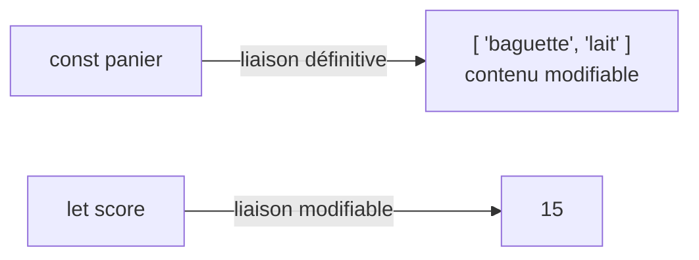
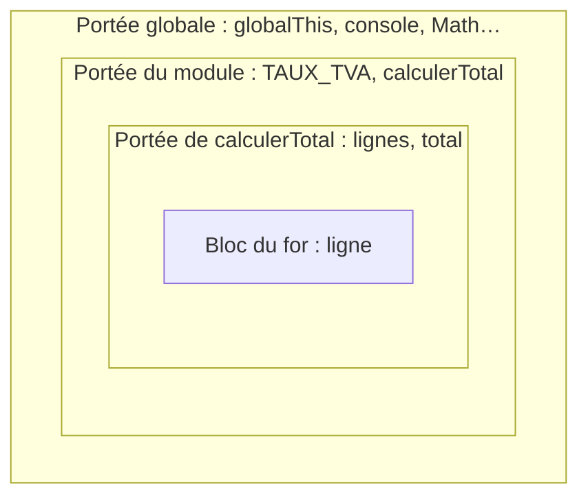

# 02 — Variables, déclarations et portées

> **Niveau** : Débutant · **Durée** : ~2 h 30 · **Prérequis** : [Introduction et environnement](../01-introduction/README.md)

Une variable donne un nom à une valeur pour pouvoir la réutiliser. Rien de plus simple en apparence, et pourtant beaucoup de bugs JavaScript viennent de là : une variable qu'on croit constante et qui change, une variable lue avant d'exister, un nom visible là où il ne devrait pas l'être. Ce chapitre explique précisément ce que font `const`, `let` et `var`, où un nom est visible (sa **portée**) et à partir de quand on peut l'utiliser (**hoisting** et **zone morte temporelle**).

## Objectifs

- Déclarer une variable avec `const` ou `let`, et savoir laquelle choisir.
- Distinguer déclaration, initialisation et affectation.
- Distinguer **réassigner** une variable et **muter** la valeur qu'elle désigne.
- Déterminer la portée d'un nom : bloc, fonction, module ou globale.
- Expliquer le hoisting et la zone morte temporelle (TDZ), et prédire les erreurs qui en découlent.
- Reconnaître les pièges de `var` et moderniser du code ancien.
- Nommer ses variables de façon claire et conventionnelle.

## Sommaire

- [Pourquoi des variables](#pourquoi-des-variables)
- [Déclarer avec const, let et var](#déclarer-avec-const-let-et-var)
- [Déclaration, initialisation, affectation](#déclaration-initialisation-affectation)
- [Réassignation ou mutation](#réassignation-ou-mutation)
- [Les portées](#les-portées)
- [Le hoisting](#le-hoisting)
- [La zone morte temporelle](#la-zone-morte-temporelle)
- [Les pièges de var](#les-pièges-de-var)
- [let dans les boucles](#let-dans-les-boucles)
- [Nommer ses variables](#nommer-ses-variables)
- [Pièges courants](#pièges-courants)
- [Bonnes pratiques](#bonnes-pratiques)
- [Résumé](#résumé)
- [Exercices](#exercices)
- [Pour aller plus loin](#pour-aller-plus-loin)

## Pourquoi des variables

Imaginez le calcul d'une facture sans variables :

```js
console.log(3 * 12.5 + 2 * 4.9 + (3 * 12.5 + 2 * 4.9) * 0.2); // 56.76
```

Le calcul est répété, illisible, et changer un prix oblige à le modifier à deux endroits. Avec des variables, chaque valeur a un nom qui dit ce qu'elle représente :

```js
const prixCahier = 12.5;
const prixStylo = 4.9;
const TAUX_TVA = 0.2;

const totalHt = 3 * prixCahier + 2 * prixStylo;
const totalTtc = totalHt * (1 + TAUX_TVA);

console.log(totalHt); // 47.3
console.log(totalTtc); // 56.76
```

Une variable est une **liaison** (*binding*) entre un **nom** et une **valeur**. Plutôt qu'une boîte qui *contient* la valeur, représentez-vous une **étiquette** attachée à une valeur : cette image rendra la différence entre réassignation et mutation évidente un peu plus loin.

## Déclarer avec const, let et var

JavaScript propose trois mots-clés pour déclarer une variable. Deux sont modernes (ES2015), le troisième est historique.

### const : une liaison qu'on ne réassigne pas

```js
const prenom = "Ada";
const anneeNaissance = 1815;
const langages = ["JavaScript", "Python"];

console.log(prenom, anneeNaissance, langages); // Ada 1815 [ 'JavaScript', 'Python' ]
```

Une variable `const` doit recevoir sa valeur **au moment de sa déclaration**, et ne peut plus jamais être liée à une autre valeur :

<!-- no-run -->
```js
const ville = "Lyon";
ville = "Paris"; // ❌ TypeError: Assignment to constant variable.

const pays; // ❌ SyntaxError: Missing initializer in const declaration
```

`const` ne signifie **pas** que la valeur est figée : un tableau `const` peut recevoir de nouveaux éléments (voir [Réassignation ou mutation](#réassignation-ou-mutation)). Il signifie que le **nom** désignera toujours la même valeur.

### let : une liaison réassignable

```js
let score = 0;
score = score + 10;
score += 5; // raccourci pour score = score + 5

console.log(score); // 15

let messageErreur; // déclarée sans valeur
console.log(messageErreur); // undefined
messageErreur = "Mot de passe trop court";
console.log(messageErreur); // Mot de passe trop court
```

On réserve `let` aux variables dont la valeur **doit** changer : un compteur, un accumulateur, un état qui évolue.

### var : l'ancienne façon

Avant ES2015, `var` était le seul mot-clé disponible. Vous le croiserez dans du code ancien, des tutoriels datés ou des réponses de forum :

```js
var compteur = 0;
compteur += 1;
console.log(compteur); // 1
```

`var` fonctionne, mais il a des règles de portée et de hoisting différentes, source de bugs que `let` et `const` ont été créés pour éviter (voir [Les pièges de var](#les-pièges-de-var)). **N'utilisez plus `var` dans du code neuf.**

### Une instruction, plusieurs variables

On peut déclarer plusieurs variables dans une même instruction, séparées par des virgules :

```js
let largeur = 1920,
  hauteur = 1080;
console.log(largeur * hauteur); // 2073600
```

C'est permis, mais une déclaration par ligne est plus lisible et plus simple à modifier : c'est le style de ce cours. Pour extraire plusieurs valeurs d'un tableau ou d'un objet d'un coup (`const [a, b] = …`), on utilise la **déstructuration**, présentée au [chapitre 11](../11-syntaxe-moderne/README.md).

### Comparatif

| | `const` | `let` | `var` |
| --- | --- | --- | --- |
| Portée | Bloc | Bloc | Fonction (ou globale) |
| Réassignation | ❌ | ✅ | ✅ |
| Redéclaration dans la même portée | ❌ `SyntaxError` | ❌ `SyntaxError` | ✅ silencieuse |
| Initialisation obligatoire | ✅ | ❌ (vaut `undefined`) | ❌ (vaut `undefined`) |
| Utilisable avant la déclaration | ❌ zone morte (`ReferenceError`) | ❌ zone morte (`ReferenceError`) | ✅ mais vaut `undefined` |
| Crée une propriété de `globalThis` (script classique) | ❌ | ❌ | ✅ |
| À utiliser | **Par défaut** | Quand la valeur doit changer | Jamais dans du code neuf |

> [!TIP]
> **La règle** : `const` par défaut ; `let` quand vous devez réassigner ; jamais `var`. Lire `const`, c'est savoir d'un coup d'œil que ce nom ne changera pas jusqu'à la fin du bloc. Lire `let`, c'est être prévenu qu'il faut suivre ses changements.

> [!NOTE]
> Il existe aussi `using` et `await using`, qui déclarent une ressource libérée automatiquement en fin de bloc (fichier, connexion…). Cette fonctionnalité est au stage 4, prévue pour ES2027, et déjà disponible dans Node.js 24+, Chrome et Edge 134+ et Firefox 141+ (pas encore dans Safari stable en novembre 2026). Elle est présentée au [chapitre 17](../17-erreurs/README.md).

## Déclaration, initialisation, affectation

Trois mots que l'on confond souvent :

- **déclarer**, c'est créer le nom dans une portée (`let total`) ;
- **initialiser**, c'est lui donner sa première valeur ;
- **affecter** (ou assigner), c'est lui donner une valeur avec l'opérateur `=`.

```js
let total; // déclaration ; initialisée automatiquement à undefined
total = 100; // affectation
total = 120; // réaffectation (réassignation)

const remise = 15; // déclaration et initialisation en une seule instruction

console.log(total - remise); // 105
```

Un `let` déclaré sans valeur est initialisé à `undefined` à l'endroit de sa déclaration. Avant cette ligne, il existe déjà mais n'est **pas initialisé du tout** : y accéder lance une erreur (c'est la [zone morte temporelle](#la-zone-morte-temporelle)).

> [!IMPORTANT]
> Ne confondez pas les deux messages d'erreur :
> - `ReferenceError: total is not defined` : le nom `total` **n'existe pas** dans les portées visibles (faute de frappe, variable déclarée ailleurs) ;
> - `ReferenceError: Cannot access 'total' before initialization` : le nom existe, mais on l'utilise **avant** sa ligne de déclaration.
>
> Et une variable qui « vaut `undefined` » est une variable qui existe : ce n'est pas une erreur.

### Initialiser au plus près de l'usage

Déclarez une variable à l'endroit où vous en avez besoin, avec sa valeur, plutôt qu'en haut de la fonction « au cas où » :

```js
const commandes = [
  { client: "Ada", montant: 120 },
  { client: "Alan", montant: 80 },
];

// ❌ déclarée trop tôt, sans valeur, puis remplie plus bas
let meilleureCommande;
// ... trente lignes plus tard ...
meilleureCommande = commandes[0];

// ✅ déclarée là où on la calcule, en const
const montantTotal = commandes[0].montant + commandes[1].montant;
console.log(meilleureCommande.client, montantTotal); // Ada 200
```

Une variable déclarée près de son usage a une portée plus petite, se lit sans faire défiler le code, et peut le plus souvent être une `const`.

## Réassignation ou mutation

C'est la distinction la plus importante du chapitre :

- **réassigner**, c'est attacher le **nom** à une autre valeur : `panier = [...]` ;
- **muter**, c'est modifier **la valeur elle-même**, sans toucher au nom : `panier.push(...)`.

`const` interdit la réassignation, **pas la mutation** :

```js
const panier = ["pain"];

panier.push("lait"); // ✅ mutation : on modifie le tableau
panier[0] = "baguette"; // ✅ mutation
console.log(panier); // [ 'baguette', 'lait' ]

try {
  panier = ["fromage"]; // ❌ réassignation : interdite avec const
} catch (erreur) {
  console.log(erreur.message); // Assignment to constant variable.
}

const utilisateur = { nom: "Ada", age: 36 };
utilisateur.age = 37; // ✅ mutation d'une propriété
console.log(utilisateur); // { nom: 'Ada', age: 37 }
```

Avec l'image de l'étiquette : `const` colle l'étiquette pour de bon sur une valeur, mais si cette valeur est un objet ou un tableau, son contenu peut toujours changer.



### Les valeurs primitives ne se mutent pas

Les nombres, chaînes, booléens et autres valeurs **primitives** ([chapitre 03](../03-types-et-operateurs/README.md)) sont immuables : aucune opération ne les modifie, elles produisent toujours une nouvelle valeur. Pour « changer » une chaîne, il faut donc réassigner :

```js
let nom = "ada";
nom.toUpperCase(); // crée une nouvelle chaîne... qui est perdue
console.log(nom); // ada

nom = nom.toUpperCase(); // réassignation : il faut let
console.log(nom); // ADA

const titre = "chapitre";
const titreMajuscule = titre.toUpperCase(); // ou une nouvelle const
console.log(titreMajuscule); // CHAPITRE
```

### Deux noms, une seule valeur

Comme une variable est une étiquette, deux variables peuvent désigner **le même** objet. Une mutation faite par l'une est alors visible par l'autre :

```js
const original = { titre: "Brouillon" };
const alias = original; // pas de copie : deux étiquettes sur le même objet

alias.titre = "Version finale";
console.log(original.titre); // Version finale

let a = 10;
let b = a; // les primitives sont copiées
b = 20;
console.log(a); // 10
```

Cette différence entre primitives et objets est introduite au [chapitre 03](../03-types-et-operateurs/README.md) et approfondie au [chapitre 10](../10-objets/README.md), qui montre aussi comment copier un objet (`structuredClone`, spread).

### Empêcher la mutation

Pour qu'un objet ne puisse vraiment plus changer, il faut le geler avec `Object.freeze`. Le gel est **superficiel** : les objets imbriqués restent modifiables.

```js
const configuration = Object.freeze({
  langue: "fr",
  serveur: { port: 8080 },
});

try {
  configuration.langue = "en";
} catch (erreur) {
  console.log(erreur.message); // Cannot assign to read only property 'langue' of object '#<Object>'
}

configuration.serveur.port = 3000; // l'objet imbriqué n'est pas gelé
console.log(configuration.serveur.port); // 3000
```

(L'erreur n'est levée qu'en mode strict, donc dans un module ; en mode non strict, la modification est ignorée en silence.) `Object.freeze` et ses cousins sont détaillés au [chapitre 10](../10-objets/README.md).

## Les portées

La **portée** (*scope*) d'un nom, c'est la région du code où ce nom est visible. Elle est déterminée par l'endroit où le nom est **écrit** dans le code source, pas par l'ordre d'exécution : on parle de **portée lexicale**. JavaScript a quatre niveaux de portée.

### Portée de bloc

Un **bloc** est une zone entre accolades : corps d'un `if`, d'une boucle, ou bloc isolé. Les variables `let` et `const` (et les `class`) déclarées dans un bloc n'existent que dans ce bloc :

```js
const temperature = 32;

if (temperature > 30) {
  const message = "Canicule";
  let conseil = "Buvez de l'eau";
  console.log(message, "-", conseil); // Canicule - Buvez de l'eau
}

console.log(typeof message); // undefined (message n'existe pas ici)

for (let i = 0; i < 2; i++) {
  console.log(i); // 0 puis 1
}
console.log(typeof i); // undefined
```

On peut même créer un bloc isolé pour limiter la durée de vie de variables intermédiaires :

```js
{
  const largeur = 4;
  const longueur = 5;
  console.log(`Surface : ${largeur * longueur} m²`); // Surface : 20 m²
}
// largeur et longueur n'encombrent pas la suite du fichier
```

Dans un module (ou en mode strict), une **déclaration de fonction** écrite dans un bloc est elle aussi locale à ce bloc.

### Portée de fonction

Tout ce qui est déclaré dans une fonction — paramètres compris — est invisible depuis l'extérieur :

```js
function calculerMoyenne(notes) {
  let somme = 0;
  for (const note of notes) {
    somme += note;
  }
  const moyenne = somme / notes.length;
  return moyenne;
}

console.log(calculerMoyenne([12, 15, 18])); // 15
console.log(typeof somme, typeof moyenne, typeof notes); // undefined undefined undefined
```

C'est la frontière que `var` respecte (avec celle du module) : une variable `var` déclarée dans une fonction est locale à la fonction, mais traverse les blocs (`if`, `for`) qu'elle contient.

### Portée de module

Chaque **module ES** (fichier `.mjs`, fichier chargé avec `<script type="module">` ou en `"type": "module"`) a sa propre portée. Une variable déclarée au premier niveau d'un module, même avec `var`, n'est visible que dans ce fichier. Pour la partager, il faut l'**exporter** explicitement, et l'autre fichier doit l'**importer** :

<!-- no-run -->
```js
// fichier tva.mjs
const TAUX_TVA = 0.2; // privé au module : invisible ailleurs
let appels = 0; // privé aussi

export function ajouterTva(prixHt) {
  appels += 1;
  return prixHt * (1 + TAUX_TVA);
}
```

<!-- no-run -->
```js
// fichier main.mjs
import { ajouterTva } from "./tva.mjs";

console.log(ajouterTva(100)); // 120
console.log(typeof TAUX_TVA); // undefined : non exporté, donc invisible
```

C'est un progrès considérable : deux fichiers peuvent utiliser le même nom de variable sans se gêner, et ce qui est partagé est visible dans les `import`. Les modules sont détaillés au [chapitre 26](../26-modules/README.md).

### Portée globale et globalThis

La portée **globale** englobe toutes les autres. On y trouve les objets fournis par le langage et par l'hôte : `console`, `Math`, `JSON`, `setTimeout`, et dans le navigateur `document` ou `window`. Tous sont des propriétés de l'**objet global**.

Cet objet porte des noms différents selon l'environnement : `window` (ou `self`) dans le navigateur, `global` dans Node.js, `self` dans un Web Worker. Depuis ES2020, **`globalThis`** le désigne partout :

```js
console.log(globalThis.Math === Math); // true
console.log(typeof globalThis.setTimeout); // function

// Tester la présence d'une API sans risquer de ReferenceError
const estNavigateur = typeof globalThis.document !== "undefined";
console.log(estNavigateur); // false (dans Node.js)
```

Dans un module, vos propres variables de premier niveau **ne deviennent pas** globales :

```js
var ancienne = 1;
const moderne = 2;

console.log(globalThis.ancienne); // undefined (portée du module)
console.log(globalThis.moderne); // undefined
```

Dans un **script classique** (console du navigateur, `<script>` sans `type="module"`), c'est différent. Essayez dans la console :

<!-- no-run -->
```js
var ancienne = 1;
let moderne = 2;
function direBonjour() {}

console.log(window.ancienne); // 1 : var crée une propriété de l'objet global
console.log(typeof window.direBonjour); // function : les déclarations de fonction aussi
console.log(window.moderne); // undefined : let, const et class n'en créent pas
console.log(moderne); // 2 : mais moderne reste visible dans tous les scripts de la page
```

Dans un script classique, toutes les variables de premier niveau sont partagées par **tous** les scripts de la page : deux bibliothèques qui déclarent la même variable se marchent dessus. C'est la raison d'être historique des modules.

> [!WARNING]
> Créer des variables globales volontairement (`globalThis.configuration = …`) est presque toujours une mauvaise idée : n'importe quel code peut les modifier, et on ne sait plus d'où vient une valeur. Partagez ce qui doit l'être par `export`/`import`.

### La chaîne des portées

Les portées s'emboîtent. Pour trouver la valeur d'un nom, le moteur cherche d'abord dans la portée courante, puis dans la portée qui l'englobe, et ainsi de suite jusqu'à la portée globale. S'il ne trouve rien : `ReferenceError: … is not defined`.

```js
const TAUX_TVA = 0.2; // portée du module

function calculerTotal(lignes) {
  // portée de la fonction : lignes, total
  let total = 0;
  for (const ligne of lignes) {
    // portée du bloc for : ligne
    total += ligne.prix * (1 + TAUX_TVA); // TAUX_TVA trouvé deux niveaux plus haut
  }
  return Math.round(total * 100) / 100; // Math trouvé dans la portée globale
}

console.log(calculerTotal([{ prix: 10 }, { prix: 4.5 }])); // 17.4
```



La recherche ne va que **vers l'extérieur** : une fonction voit les variables des portées qui l'entourent, jamais celles des fonctions qu'elle appelle ni des blocs qu'elle contient. Et une fonction garde l'accès aux variables de sa portée d'origine même quand elle est exécutée ailleurs, plus tard : c'est le principe des **closures**, traitées en profondeur au [chapitre 06](../06-fonctions/README.md).

### Le masquage (shadowing)

Une variable déclarée dans une portée intérieure peut porter le même nom qu'une variable extérieure. Elle la **masque** : à l'intérieur, seul le nom intérieur est visible.

```js
const message = "global";

function afficher() {
  const message = "local"; // masque la variable du module
  console.log(message); // local
}

afficher();
console.log(message); // global : la variable extérieure n'a pas changé
```

Le masquage est parfois voulu (un paramètre `nom` dans une fonction alors qu'un `nom` existe ailleurs), mais il trompe facilement le lecteur. Quand ce n'est pas nécessaire, choisissez un autre nom. Un piège classique :

```js
let total = 0;
const prix = [10, 20, 30];

for (const p of prix) {
  let total = 0; // ❌ masque le total extérieur : on additionne dans une variable locale
  total += p;
}

console.log(total); // 0 au lieu de 60
```

Une seule combinaison est interdite : déclarer avec `let` ou `const` un nom qu'une déclaration `var` d'un bloc intérieur ferait « remonter » dans la même portée.

<!-- no-run -->
```js
function exemple() {
  let quantite = 1;
  {
    var quantite = 2; // ❌ SyntaxError: Identifier 'quantite' has already been declared
  }
}
```

## Le hoisting

Avant d'exécuter le code d'une portée, le moteur parcourt toutes ses **déclarations** et crée les noms correspondants. Tout se passe comme si les déclarations étaient « remontées » (*hoisted*) en haut de leur portée. Mais selon le mot-clé, le nom créé est utilisable immédiatement… ou pas.

| Déclaration | Créée en début de portée | Valeur avant la ligne de déclaration |
| --- | --- | --- |
| `function nom() {}` | ✅ | La fonction complète : on peut l'appeler avant |
| `var nom` | ✅ | `undefined` |
| `let nom`, `const nom` | ✅ | Non initialisée : `ReferenceError` (zone morte) |
| `class Nom {}` | ✅ | Non initialisée : `ReferenceError` (zone morte) |
| `import … from` | ✅ (en tête du module) | Déjà disponible (voir [chapitre 26](../26-modules/README.md)) |

### Les déclarations de fonction

Une déclaration de fonction est créée **avec son corps** : on peut l'appeler avant sa définition dans le fichier.

```js
console.log(formaterPrix(12.5)); // 12,50 €

function formaterPrix(montant) {
  return `${montant.toFixed(2).replace(".", ",")} €`;
}
```

C'est pratique pour placer le code principal en haut d'un fichier et les fonctions utilitaires en bas.

### var : remontée et initialisée à undefined

```js
console.log(ville); // undefined : pas d'erreur, mais pas encore de valeur
var ville = "Lyon";
console.log(ville); // Lyon
```

Le moteur traite ce code comme s'il était écrit ainsi :

<!-- no-run -->
```js
var ville; // déclaration remontée, initialisée à undefined
console.log(ville); // undefined
ville = "Lyon"; // l'affectation reste à sa place
console.log(ville); // Lyon
```

Seule la **déclaration** remonte, jamais l'**affectation**. Lire une variable `var` avant son affectation ne déclenche aucune erreur : le programme continue avec `undefined`, et le bug apparaît plus loin, loin de sa cause.

### Expressions de fonction et fonctions fléchées

Une fonction stockée dans une variable suit les règles de **la variable**, pas celles des déclarations de fonction :

```js
try {
  saluer("Ada");
} catch (erreur) {
  console.log(erreur.message); // Cannot access 'saluer' before initialization
}

const saluer = (nom) => `Bonjour ${nom}`;
console.log(saluer("Ada")); // Bonjour Ada
```

Avec `var`, l'erreur est plus déroutante encore :

```js
try {
  direAuRevoir();
} catch (erreur) {
  console.log(erreur.message); // direAuRevoir is not a function
}

var direAuRevoir = function () {
  return "Au revoir";
};
```

`direAuRevoir` existe (elle vaut `undefined`), mais `undefined` n'est pas une fonction. Les différentes façons de définir une fonction sont comparées au [chapitre 06](../06-fonctions/README.md).

## La zone morte temporelle

Les variables `let` et `const` (et les classes) sont bien créées en début de portée, mais elles restent **non initialisées** jusqu'à ce que l'exécution atteigne leur ligne de déclaration. Entre le début de la portée et cette ligne s'étend la **zone morte temporelle** (*Temporal Dead Zone*, TDZ). Toute lecture ou écriture dans cette zone lance une `ReferenceError`.

```js
{
  // début de la zone morte de "taille"
  try {
    console.log(taille);
  } catch (erreur) {
    console.log(erreur.message); // Cannot access 'taille' before initialization
  }
  const taille = 180; // fin de la zone morte
  console.log(taille); // 180
}
```

### La preuve que let est hoisté

Si `let` n'était pas remonté du tout, le code suivant lirait la variable extérieure et afficherait `10`. Or il échoue : la variable intérieure existe dès le début du bloc et masque déjà l'extérieure, sans être initialisée.

```js
const prix = 10;

{
  try {
    console.log(prix); // la variable "prix" du bloc existe déjà, mais en zone morte
  } catch (erreur) {
    console.log(erreur.message); // Cannot access 'prix' before initialization
  }
  const prix = 20;
  console.log(prix); // 20
}
```

### Temporelle, pas spatiale

La zone morte dépend du **moment de l'exécution**, pas de la position dans le texte. Une fonction peut mentionner une variable déclarée plus bas, à condition d'être **appelée** après l'initialisation :

```js
function afficherVersion() {
  return `Version ${VERSION}`; // VERSION est écrite plus bas dans le fichier
}

const VERSION = "2.1.0";
console.log(afficherVersion()); // Version 2.1.0 : appelée après l'initialisation, tout va bien
```

Si l'on appelait `afficherVersion()` avant la ligne `const VERSION`, on obtiendrait la `ReferenceError`.

### Quelques cas moins évidents

```js
// typeof ne protège pas de la zone morte
try {
  console.log(typeof plusTard);
  let plusTard = 1;
} catch (erreur) {
  console.log(erreur.name); // ReferenceError
}
console.log(typeof nomInexistant); // undefined : un nom jamais déclaré, lui, ne lève pas d'erreur

// Une variable ne peut pas s'utiliser dans sa propre initialisation
try {
  const compteur = compteur + 1;
} catch (erreur) {
  console.log(erreur.message); // Cannot access 'compteur' before initialization
}

// Les paramètres par défaut sont évalués de gauche à droite
function creerRectangle(largeur = hauteur, hauteur = 10) {
  return { largeur, hauteur };
}
try {
  creerRectangle();
} catch (erreur) {
  console.log(erreur.message); // Cannot access 'hauteur' before initialization
}
console.log(creerRectangle(5)); // { largeur: 5, hauteur: 10 }

// Les classes aussi ont une zone morte
try {
  new Produit();
} catch (erreur) {
  console.log(erreur.message); // Cannot access 'Produit' before initialization
}
class Produit {}
```

### Pourquoi une zone morte ?

Avec `var`, lire une variable trop tôt donne `undefined` en silence. La zone morte transforme ce bug silencieux en erreur immédiate, à l'endroit exact du problème. Elle garantit aussi qu'une `const` n'est jamais observée avec deux valeurs différentes (`undefined` puis sa vraie valeur). Le message `Cannot access '…' before initialization` signifie donc presque toujours : « déplacez la déclaration plus haut, ou l'appel plus bas ».

## Les pièges de var

Vous n'écrirez plus de `var`, mais vous en lirez. Voici ce qui le rend dangereux.

### Redéclaration silencieuse

```js
var utilisateur = "Ada";
// ... beaucoup de code plus loin ...
var utilisateur = "Alan"; // aucune erreur : la première valeur est écrasée
console.log(utilisateur); // Alan
```

Avec `let` ou `const`, la seconde déclaration est une `SyntaxError` : le moteur refuse d'exécuter le fichier, et le conflit est découvert immédiatement.

### Pas de portée de bloc

```js
function verifierStock(quantite) {
  if (quantite > 0) {
    var etat = "disponible";
  }
  return etat; // var a « fui » du bloc if
}

console.log(verifierStock(3)); // disponible
console.log(verifierStock(0)); // undefined
```

Avec `let`, `etat` serait inaccessible hors du `if` (`ReferenceError`), ce qui révèle le défaut de conception : le cas `quantite <= 0` n'est pas traité.

```js
function verifierStock(quantite) {
  const etat = quantite > 0 ? "disponible" : "épuisé"; // ✅ chaque cas est explicite
  return etat;
}

console.log(verifierStock(0)); // épuisé
```

### Remontée à undefined

Déjà vu plus haut : une `var` utilisée avant son affectation vaut `undefined` au lieu de déclencher une erreur.

### Propriété de l'objet global

Dans un script classique, une `var` de premier niveau devient une propriété de `window` et peut écraser une propriété existante. Dans un navigateur, cette ligne, exécutée dans un script classique, remplace le nom de la fenêtre et casse tout code qui s'en sert :

<!-- no-run -->
```js
var name = 42; // window.name est une propriété du navigateur : elle devient la chaîne "42"
console.log(typeof name); // string
```

### Les variables globales implicites

En mode non strict, affecter une valeur à un nom jamais déclaré **crée** une variable globale. Une simple faute de frappe suffit :

<!-- no-run -->
```js
// Script classique, mode non strict
function calculerRemise(prix) {
  let remise = 0;
  if (prix > 100) {
    remis = prix * 0.1; // faute de frappe : "remis" au lieu de "remise"
  }
  return prix - remise;
}

console.log(calculerRemise(200)); // 200 au lieu de 180, sans la moindre erreur
console.log(window.remis); // 20 : une variable globale a été créée au passage
```

Dans un module (mode strict), la ligne fautive lance `ReferenceError: remis is not defined`, et le bug est trouvé immédiatement. C'est l'une des meilleures raisons d'écrire des modules ([chapitre 01](../01-introduction/README.md)).

## let dans les boucles

Ce dernier piège de `var` mérite une section : il a fait perdre des heures à des générations de développeurs.

```js
// ❌ Avec var : une seule variable i, partagée par tous les tours de boucle
for (var i = 0; i < 3; i++) {
  setTimeout(() => console.log("var :", i), 0);
}
// var : 3
// var : 3
// var : 3
```

`setTimeout` exécute la fonction **plus tard**, quand la boucle est terminée ([chapitre 21](../21-timers/README.md)). Les trois fonctions lisent alors la même variable `i`, qui vaut 3.

```js
// ✅ Avec let : une nouvelle variable i à chaque tour
for (let i = 0; i < 3; i++) {
  setTimeout(() => console.log("let :", i), 0);
}
// let : 0
// let : 1
// let : 2
```

Avec `let` dans l'en-tête d'un `for`, le moteur crée **une nouvelle liaison `i` à chaque itération**, initialisée avec la valeur de la fin du tour précédent. Chaque fonction se souvient de « son » `i`. Le lien entre fonctions et variables capturées (les closures) est expliqué au [chapitre 06](../06-fonctions/README.md).

### const dans for…of, mais pas dans for classique

Dans `for…of` et `for…in`, chaque tour crée aussi une nouvelle liaison : on peut (et on doit, sauf réassignation dans le corps) utiliser `const`.

```js
const fruits = ["pomme", "poire"];

for (const fruit of fruits) {
  console.log(fruit.toUpperCase()); // POMME puis POIRE
}

// Mais un for classique réassigne son compteur : const échoue au deuxième tour
try {
  for (const i = 0; i < 3; i++) {
    console.log("tour", i); // tour 0
  }
} catch (erreur) {
  console.log(erreur.message); // Assignment to constant variable.
}
```

Les boucles sont le sujet du [chapitre 05](../05-boucles/README.md).

## Nommer ses variables

Un code est lu bien plus souvent qu'il n'est écrit. Un bon nom évite un commentaire ; un mauvais nom en exige trois.

### Les règles (imposées par le langage)

- Un nom commence par une lettre, `_` ou `$`, puis peut contenir des chiffres.
- Pas d'espace, pas de tiret, pas de mot réservé (`class`, `new`, `delete`…, voir le [chapitre 01](../01-introduction/README.md)).
- La casse compte : `prix` et `Prix` sont deux variables différentes.

### Les conventions (partagées par la communauté)

| Convention | Pour | Exemples |
| --- | --- | --- |
| `camelCase` | Variables, fonctions, paramètres, méthodes | `prixTotal`, `nombreArticles`, `calculerTva` |
| `PascalCase` | Classes et constructeurs | `Utilisateur`, `PanierAchat` |
| `MAJUSCULES_AVEC_TIRETS_BAS` | Constantes « de configuration », connues avant l'exécution | `TAUX_TVA`, `DELAI_MAX_MS`, `URL_API` |

Toutes les `const` ne s'écrivent pas en majuscules : `const total = calculerTotal(panier)` reste en `camelCase`, car sa valeur est *calculée*. Les majuscules signalent une valeur fixée en dur dans le code, qu'on pourrait vouloir ajuster un jour.

### Des noms qui disent ce qu'ils contiennent

```js
// ❌ des noms qui obligent à deviner
const d = 30;
const tmp = ["Ada", "Alan"];
const flag = true;
const data = { n: "Ada" };

// ✅ des noms qui se lisent comme une phrase
const delaiExpirationJours = 30;
const nomsParticipants = ["Ada", "Alan"];
const estConnecte = true;
const profil = { nom: "Ada" };

console.log(d === delaiExpirationJours, tmp.length, flag, data.n === profil.nom); // true 2 true true
```

Quelques habitudes qui aident :

- **Booléens** : préfixe `est`, `a`, `peut`, `doit` (`estValide`, `aDesErreurs`, `peutModifier`). En anglais : `is`, `has`, `can`, `should`.
- **Tableaux et collections** : un pluriel (`utilisateurs`, `commandesEnAttente`) ; l'élément d'une boucle au singulier (`for (const utilisateur of utilisateurs)`).
- **Unités** dans le nom quand elles comptent : `delaiMs`, `tailleKo`, `prixHt`, `dureeSecondes`.
- **Fonctions** : un verbe (`calculerTotal`, `chargerProfil`, `estPair`).
- **Pas d'abréviations obscures** (`nbArtPnr`) ; les noms d'une lettre sont réservés aux portées minuscules (`i` dans une boucle courte, `x`/`y` pour des coordonnées).
- **Une langue par projet** : ce cours nomme en français sans accents ; beaucoup d'équipes nomment en anglais. Ne mélangez pas (`userPrenom`).

Vous verrez aussi des noms commençant par `_` (`_cache`) : c'est une ancienne convention pour dire « privé, ne pas toucher », sans aucun effet réel. Les vrais champs privés s'écrivent avec `#` dans les classes ([chapitre 16](../16-classes/README.md)) ; et dans un module, il suffit de ne pas exporter.

## Pièges courants

- **Croire que `const` rend une valeur immuable** : un tableau ou un objet `const` reste modifiable. Seul le nom est fixé ; pour figer l'objet, utilisez `Object.freeze` (gel superficiel).
- **Réassigner une `const`** : `TypeError: Assignment to constant variable.` Si la valeur doit changer, c'est une `let`.
- **Utiliser une variable avant sa déclaration** : `Cannot access '…' before initialization`. Déplacez la déclaration plus haut ou l'appel plus bas.
- **Confondre « not defined » et `undefined`** : la première est une erreur (le nom n'existe pas), la seconde une valeur.
- **Masquer une variable sans le vouloir** : un `let total` dans une boucle crée une nouvelle variable au lieu de modifier celle de l'extérieur.
- **Utiliser `var` dans une boucle avec du code différé** : toutes les fonctions voient la dernière valeur du compteur. Utilisez `let`.
- **Écrire `for (const i = 0; …; i++)`** : le compteur d'un `for` classique est réassigné ; il faut `let`. En revanche, `for (const x of …)` est correct.
- **Oublier `const`/`let`** : dans un module, `ReferenceError` ; dans un script classique, une variable globale créée en silence.
- **Supposer qu'une variable de premier niveau est globale** : dans un module, elle est locale au fichier. Pour partager une valeur, exportez-la.

## Bonnes pratiques

- `const` par défaut, `let` seulement si la variable doit être réassignée, jamais `var` dans du code neuf.
- Déclarez chaque variable au plus près de son utilisation, avec sa valeur initiale.
- Gardez les portées petites : une variable utile dans un seul bloc est déclarée dans ce bloc.
- Écrivez des modules : chaque fichier a sa portée, et les dépendances sont explicites (`import`/`export`).
- N'ajoutez rien à l'objet global ; utilisez `globalThis` pour *détecter* une API (`typeof globalThis.document`).
- Évitez de masquer une variable extérieure, sauf si c'est voulu et évident.
- Donnez des noms précis : un verbe pour une fonction, un pluriel pour une collection, un préfixe `est`/`a`/`peut` pour un booléen, l'unité quand elle compte.
- Préférez une nouvelle `const` à la réassignation d'une `let` quand c'est possible : `const prixTtc = prixHt * 1.2` plutôt que `prix = prix * 1.2`.

## Résumé

- Une variable est une **liaison** entre un nom et une valeur ; imaginez une étiquette, pas une boîte.
- `const` : liaison définitive, initialisation obligatoire. `let` : liaison réassignable. `var` : ancienne syntaxe, à éviter.
- `const` interdit la **réassignation**, pas la **mutation** : le contenu d'un objet ou d'un tableau `const` peut changer. Les primitives, elles, ne se mutent jamais.
- La **portée** d'un nom est lexicale : bloc (`let`, `const`, `class`), fonction (tout, y compris `var`), module (le premier niveau d'un fichier module), globale (`globalThis`).
- Le moteur résout un nom en remontant la **chaîne des portées** vers l'extérieur ; une variable intérieure peut en **masquer** une extérieure.
- **Hoisting** : toutes les déclarations sont créées en début de portée. Les fonctions déclarées sont utilisables tout de suite, les `var` valent `undefined`, les `let`/`const`/`class` sont en **zone morte** jusqu'à leur ligne.
- La **zone morte temporelle** dépend du moment de l'exécution ; elle transforme les lectures prématurées en `ReferenceError` explicites.
- Dans un script classique, les `var` et fonctions de premier niveau deviennent des propriétés de l'objet global ; dans un module, rien ne devient global.
- `for (let i …)` crée une nouvelle variable par tour ; `for (const x of …)` aussi.
- Nommez en `camelCase`, les classes en `PascalCase`, les constantes de configuration en `MAJUSCULES`.

## Exercices

### Exercice 1 — const ou let ? (★☆☆)

Remplacez chaque `var` par `const` ou `let`, en choisissant `const` chaque fois que c'est possible.

<!-- no-run -->
```js
var nomBoutique = "La Bonne Pâte";
var articles = ["farine", "levure"];
var total = 0;
var prixFarine = 2.4;
var prixLevure = 0.9;

articles.push("sel");
total = total + prixFarine;
total = total + prixLevure;

console.log(nomBoutique, articles, total);
```

<details>
<summary>Solution</summary>

```js
const nomBoutique = "La Bonne Pâte";
const articles = ["farine", "levure"]; // const : le tableau est muté, pas réassigné
let total = 0; // let : réassignée deux fois
const prixFarine = 2.4;
const prixLevure = 0.9;

articles.push("sel");
total = total + prixFarine;
total = total + prixLevure;

console.log(nomBoutique, articles, total); // La Bonne Pâte [ 'farine', 'levure', 'sel' ] 3.3
```

Seul `total` est réassigné. `articles` est **muté** par `push`, ce que `const` autorise. On pourrait même se passer du `let` : `const total = prixFarine + prixLevure;`.

</details>

### Exercice 2 — Qui voit quoi ? (★☆☆)

Pour chaque `console.log` marqué d'un numéro, indiquez s'il affiche une valeur (laquelle ?) ou s'il lance une erreur. Vérifiez ensuite en exécutant le code (remplacez les lignes qui échouent par un `typeof` pour continuer).

<!-- no-run -->
```js
const auteur = "Victor Hugo";

function presenter() {
  const titre = "Les Misérables";
  if (titre.length > 5) {
    const annee = 1862;
    console.log(auteur, titre, annee); // (1)
  }
  console.log(annee); // (2)
}

presenter();
console.log(titre); // (3)
```

<details>
<summary>Solution</summary>

- **(1)** affiche `Victor Hugo Les Misérables 1862` : depuis le bloc du `if`, on voit `annee` (même bloc), `titre` (fonction englobante) et `auteur` (module).
- **(2)** lance `ReferenceError: annee is not defined` : `annee` est une `const` du bloc `if`, invisible après l'accolade fermante.
- **(3)** lancerait aussi `ReferenceError: titre is not defined` : `titre` est locale à la fonction. (L'exécution s'est de toute façon arrêtée à l'erreur (2).)

```js
const auteur = "Victor Hugo";

function presenter() {
  const titre = "Les Misérables";
  if (titre.length > 5) {
    const annee = 1862;
    console.log(auteur, titre, annee); // Victor Hugo Les Misérables 1862
  }
  console.log(typeof annee); // undefined
}

presenter();
console.log(typeof titre); // undefined
```

</details>

### Exercice 3 — Prédire le hoisting (★★☆)

Qu'affiche ce programme ? Répondez ligne par ligne avant de l'exécuter.

```js
console.log(typeof calculer); // (1)
console.log(resultat); // (2)

var resultat = calculer(4);
console.log(resultat); // (3)

function calculer(n) {
  return n * facteur;
}

var facteur = 3;
console.log(calculer(4)); // (4)
```

<details>
<summary>Solution</summary>

```text
function
undefined
NaN
12
```

- **(1)** `function` : une déclaration de fonction est remontée avec son corps.
- **(2)** `undefined` : `var resultat` est remontée, mais pas son affectation.
- **(3)** `NaN` : au moment de `calculer(4)`, `facteur` existe (remontée) mais vaut encore `undefined`, et `4 * undefined` donne `NaN` (*Not a Number*, voir le [chapitre 03](../03-types-et-operateurs/README.md)). Aucune erreur n'est levée : le bug passe inaperçu.
- **(4)** `12` : cette fois `facteur` vaut 3.

Avec `const` à la place des deux `var`, la ligne (2) lancerait `ReferenceError: Cannot access 'resultat' before initialization`, et en la retirant, la ligne `const resultat = calculer(4)` échouerait sur `facteur` : le bug serait signalé au lieu de produire un `NaN` silencieux.

</details>

### Exercice 4 — Réassignation ou mutation ? (★★☆)

Parmi les lignes numérotées, lesquelles lancent une erreur ? Que contient `equipe` à la fin ?

<!-- no-run -->
```js
const equipe = { nom: "Les Lynx", membres: ["Ada"] };
const capitaine = "Ada";

equipe.membres.push("Alan"); // (1)
equipe.nom = "Les Lynx bleus"; // (2)
equipe = { nom: "Autre", membres: [] }; // (3)
capitaine.toUpperCase(); // (4)
capitaine = capitaine.toUpperCase(); // (5)
Object.freeze(equipe);
equipe.membres.push("Grace"); // (6)
equipe.nom = "Gelée"; // (7)
```

<details>
<summary>Solution</summary>

- **(1)**, **(2)** : mutations, autorisées.
- **(3)** : réassignation d'une `const` → `TypeError: Assignment to constant variable.`
- **(4)** : aucune erreur… et aucun effet : `toUpperCase` renvoie une nouvelle chaîne, ignorée ici.
- **(5)** : réassignation d'une `const` → `TypeError`.
- **(6)** : aucune erreur ! `Object.freeze` est superficiel : le tableau `membres` n'est pas gelé.
- **(7)** : `TypeError: Cannot assign to read only property 'nom'` (en mode strict, donc dans un module).

```js
const equipe = { nom: "Les Lynx", membres: ["Ada"] };

equipe.membres.push("Alan");
equipe.nom = "Les Lynx bleus";
Object.freeze(equipe);
equipe.membres.push("Grace");

try {
  equipe.nom = "Gelée";
} catch (erreur) {
  console.log(erreur.name); // TypeError
}

console.log(equipe); // { nom: 'Les Lynx bleus', membres: [ 'Ada', 'Alan', 'Grace' ] }
```

</details>

### Exercice 5 — Le compte à rebours qui ne compte pas (★★☆)

Ce code devrait afficher `3`, `2`, `1` à une seconde d'intervalle (un message par seconde), mais il affiche trois fois `0`. Expliquez pourquoi, puis corrigez-le en changeant **un seul mot**.

```js
for (var secondes = 3; secondes > 0; secondes--) {
  setTimeout(() => console.log(secondes), (4 - secondes) * 1000);
}
// 0
// 0
// 0
```

<details>
<summary>Solution</summary>

Avec `var`, il n'existe qu'**une** variable `secondes` pour toute la boucle (portée de fonction ou de module). Les trois fonctions passées à `setTimeout` s'exécutent après la fin de la boucle, et lisent toutes cette même variable, qui vaut alors `0` (la valeur qui a fait échouer le test `secondes > 0`).

```js
for (let secondes = 3; secondes > 0; secondes--) {
  setTimeout(() => console.log(secondes), (4 - secondes) * 1000);
}
// 3 (après 1 s)
// 2 (après 2 s)
// 1 (après 3 s)
```

Avec `let`, chaque tour de boucle a sa propre variable `secondes`, et chaque fonction mémorise la sienne.

</details>

### Exercice 6 — Le menu du jour (★★★)

Ce module plante. Trouvez les **trois** problèmes liés aux déclarations, expliquez chacun, et corrigez le code pour qu'il affiche `Menu du jour : soupe, gratin, tarte (3 plats)`.

<!-- no-run -->
```js
console.log(formaterMenu(plats));

const plats = ["soupe", "gratin"];

function formaterMenu(liste) {
  const nombre = liste.length;
  if (nombre > 0) {
    const texte = `Menu du jour : ${liste.join(", ")}`;
  }
  return `${texte} (${nombre} plats)`;
}

plats = [...plats, "tarte"];
```

<details>
<summary>Solution</summary>

1. **Zone morte** : `formaterMenu(plats)` est appelée à la ligne 1, alors que `plats` est une `const` déclarée ligne 3 → `ReferenceError: Cannot access 'plats' before initialization`. La fonction, elle, est bien disponible (déclaration remontée) : c'est son argument qui pose problème.
2. **Portée de bloc** : `texte` est déclarée dans le bloc du `if` ; elle n'existe plus à la ligne du `return` → `ReferenceError: texte is not defined`.
3. **Réassignation d'une `const`** : `plats = [...]` → `TypeError`. Et même corrigée, cette ligne arriverait après l'affichage.

```js
function formaterMenu(liste) {
  const nombre = liste.length;
  const texte = nombre > 0 ? `Menu du jour : ${liste.join(", ")}` : "Pas de menu aujourd'hui";
  return `${texte} (${nombre} plats)`;
}

const plats = ["soupe", "gratin"];
plats.push("tarte"); // mutation plutôt que réassignation : const suffit

console.log(formaterMenu(plats)); // Menu du jour : soupe, gratin, tarte (3 plats)
```

On a déplacé l'appel après les déclarations, sorti `texte` du bloc (en traitant au passage le cas d'un menu vide, que le code d'origine ignorait), et remplacé la réassignation par une mutation. Une autre option aurait été `let plats` avec la réassignation `plats = [...plats, "tarte"]` (le spread `...` est présenté au [chapitre 11](../11-syntaxe-moderne/README.md)).

</details>

### Exercice 7 — Moderniser du code ancien (★★★)

Réécrivez cette fonction écrite en 2012 avec `let`/`const`, en réduisant au maximum la portée de chaque variable, sans changer son résultat.

```js
function statistiques(temperatures) {
  var i, t, min, max, somme, moyenne;
  min = temperatures[0];
  max = temperatures[0];
  somme = 0;
  for (i = 0; i < temperatures.length; i++) {
    t = temperatures[i];
    if (t < min) min = t;
    if (t > max) max = t;
    somme = somme + t;
  }
  moyenne = somme / temperatures.length;
  return "min " + min + ", max " + max + ", moyenne " + moyenne;
}

console.log(statistiques([12, 18, 9, 21])); // min 9, max 21, moyenne 15
```

<details>
<summary>Solution</summary>

```js
function statistiques(temperatures) {
  let min = temperatures[0];
  let max = temperatures[0];
  let somme = 0;

  for (const temperature of temperatures) {
    if (temperature < min) min = temperature;
    if (temperature > max) max = temperature;
    somme += temperature;
  }

  const moyenne = somme / temperatures.length;
  return `min ${min}, max ${max}, moyenne ${moyenne}`;
}

console.log(statistiques([12, 18, 9, 21])); // min 9, max 21, moyenne 15
```

- Les déclarations groupées en tête de fonction (style imposé autrefois par le hoisting de `var`) sont remplacées par des déclarations au plus près de l'usage.
- `i` et `t` disparaissent au profit d'un `for…of` dont la variable `temperature` est une `const` limitée au corps de la boucle.
- `min`, `max` et `somme` sont réassignées : `let`. `moyenne` ne l'est pas : `const`.
- Le gabarit de chaîne remplace les concaténations.

Pour aller plus loin, `Math.min(...temperatures)` et `reduce` rendraient la fonction encore plus courte ([chapitres 08](../08-nombres-et-math/README.md) et [09](../09-tableaux/README.md)).

</details>

## Pour aller plus loin

- [MDN — `const`](https://developer.mozilla.org/fr/docs/Web/JavaScript/Reference/Statements/const)
- [MDN — `let` (dont la zone morte temporelle)](https://developer.mozilla.org/fr/docs/Web/JavaScript/Reference/Statements/let)
- [MDN — `var`](https://developer.mozilla.org/fr/docs/Web/JavaScript/Reference/Statements/var)
- [MDN — Hoisting (glossaire)](https://developer.mozilla.org/fr/docs/Glossary/Hoisting)
- [MDN — Portée (glossaire)](https://developer.mozilla.org/fr/docs/Glossary/Scope)
- [MDN — `globalThis`](https://developer.mozilla.org/fr/docs/Web/JavaScript/Reference/Global_Objects/globalThis)
- [MDN — Grammaire et types : déclarations](https://developer.mozilla.org/fr/docs/Web/JavaScript/Guide/Grammar_and_types)
- [javascript.info — Variables](https://fr.javascript.info/variables) et [Le vieux « var »](https://fr.javascript.info/var)

---

[← Introduction et environnement](../01-introduction/README.md) · [Sommaire](../README.md#sommaire) · [Types et opérateurs →](../03-types-et-operateurs/README.md)
