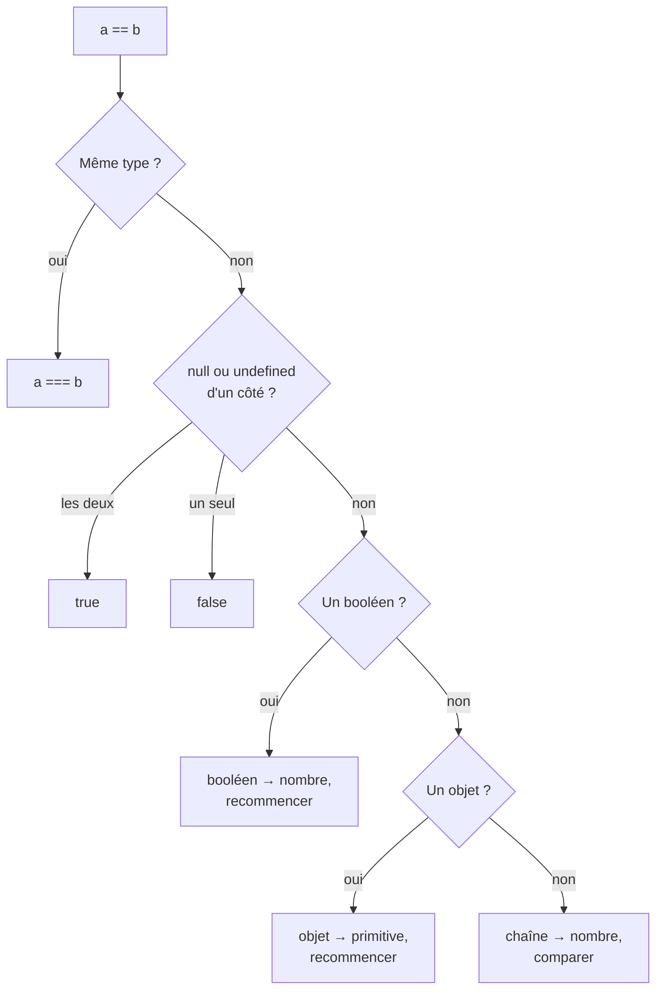

# 03 — Types et opérateurs

> **Niveau** : Débutant · **Durée** : ~3 h · **Prérequis** : [Variables, déclarations et portées](../02-variables/README.md)

Pourquoi `"5" + 3` donne-t-il `"53"` alors que `"5" - 3` donne `2` ? Pourquoi `typeof null` vaut-il `"object"` ? Pourquoi `0.1 + 0.2 === 0.3` est-il faux, et `NaN === NaN` aussi ? Ces surprises ont toutes une explication logique, à condition de connaître les **types** de JavaScript et les règles de **conversion** que les opérateurs appliquent. Ce chapitre les présente une fois pour toutes, avec la liste complète des opérateurs du langage et leur ordre de priorité.

## Objectifs

- Citer les sept types primitifs et les distinguer des objets.
- Utiliser `typeof` en connaissant ses pièges, et choisir le bon test pour chaque type.
- Expliquer la différence entre copie d'une valeur et partage d'une référence.
- Distinguer `undefined` et `null`, et savoir lequel utiliser.
- Prévoir le résultat des conversions explicites et implicites (vers nombre, chaîne, booléen, primitive).
- Choisir entre `===`, `==` et `Object.is`.
- Utiliser les opérateurs arithmétiques, d'affectation, de comparaison et les autres opérateurs, en tenant compte de leur priorité.

## Sommaire

- [Les types de JavaScript](#les-types-de-javascript)
- [typeof et ses pièges](#typeof-et-ses-pièges)
- [Valeurs et références](#valeurs-et-références)
- [undefined et null](#undefined-et-null)
- [Conversions de types](#conversions-de-types)
- [Égalité stricte, égalité lâche et Object.is](#égalité-stricte-égalité-lâche-et-objectis)
- [Opérateurs arithmétiques](#opérateurs-arithmétiques)
- [Opérateurs d'affectation](#opérateurs-daffectation)
- [Opérateurs de comparaison](#opérateurs-de-comparaison)
- [Autres opérateurs](#autres-opérateurs)
- [Priorité et associativité](#priorité-et-associativité)
- [Opérateurs binaires](#opérateurs-binaires)
- [Pièges courants](#pièges-courants)
- [Bonnes pratiques](#bonnes-pratiques)
- [Résumé](#résumé)
- [Exercices](#exercices)
- [Pour aller plus loin](#pour-aller-plus-loin)

## Les types de JavaScript

### Typage dynamique

En JavaScript, ce sont les **valeurs** qui ont un type, pas les variables. Une même variable `let` peut contenir un nombre, puis une chaîne :

```js
let reponse = 42;
console.log(typeof reponse); // number

reponse = "quarante-deux";
console.log(typeof reponse); // string
```

C'est le **typage dynamique** : le type n'est vérifié qu'à l'exécution, au moment où une opération en a besoin. Le langage est aussi **faiblement typé** : quand une opération reçoit un type inattendu, il essaie de convertir la valeur plutôt que de lever une erreur. D'où tout l'intérêt de connaître ces conversions. (Pour vérifier les types *avant* l'exécution, on peut ajouter des annotations JSDoc ou passer à TypeScript : voir les chapitres [28](../28-outillage/README.md) et [30](../30-commentaires-jsdoc/README.md).)

### Les sept types primitifs

Une valeur **primitive** est une valeur simple et **immuable**. Il en existe sept types :

| Type | Exemples | `typeof` | À savoir |
| --- | --- | --- | --- |
| `undefined` | `undefined` | `"undefined"` | « Pas de valeur » : variable non initialisée, propriété absente |
| `null` | `null` | `"object"` (!) | « Absence voulue de valeur » |
| `boolean` | `true`, `false` | `"boolean"` | Résultat des comparaisons |
| `number` | `42`, `-3.14`, `1e6`, `NaN`, `Infinity` | `"number"` | Entiers et décimaux sont un seul type (flottants 64 bits) — [chapitre 08](../08-nombres-et-math/README.md) |
| `bigint` | `9007199254740993n` | `"bigint"` | Entiers de taille arbitraire (ES2020) |
| `string` | `"Ada"`, `'Ada'`, `` `Ada` `` | `"string"` | Texte, immuable — [chapitre 07](../07-chaines/README.md) |
| `symbol` | `Symbol("id")` | `"symbol"` | Identifiant unique, surtout comme clé d'objet (ES2015) — [chapitre 10](../10-objets/README.md) |

```js
const nonDefini = undefined;
const vide = null;
const actif = true;
const prix = 19.99;
const population = 8_100_000_000n; // les _ séparent les chiffres (ES2021), le n final crée un BigInt
const prenom = "Ada";
const identifiant = Symbol("id");

console.log(typeof prix, typeof population, typeof identifiant); // number bigint symbol
console.log(Symbol("id") === Symbol("id")); // false : chaque symbole est unique
console.log(2 ** 53 === 2 ** 53 + 1); // true : au-delà de 2⁵³, un number perd en précision
console.log(2n ** 53n === 2n ** 53n + 1n); // false : un BigInt reste exact
```

### Les objets

**Tout ce qui n'est pas primitif est un objet** : objets littéraux, tableaux, fonctions, dates, expressions régulières, `Map`, `Set`, erreurs… Un objet est une collection de propriétés, **mutable**, et manipulée par **référence**.

```js
const livre = { titre: "Dune", pages: 412 }; // objet littéral
const notes = [12, 15, 18]; // tableau
const doubler = (n) => n * 2; // fonction
const aujourdhui = new Date(); // date
const motif = /^\d+$/; // expression régulière

console.log(typeof livre, typeof notes, typeof doubler); // object object function
console.log(typeof aujourdhui, typeof motif); // object object
```

La spécification compte donc huit types : les sept primitifs et `Object`. Les tableaux, fonctions ou dates ne sont pas des types à part : ce sont des sortes d'objets.

### Les primitives ont des méthodes… empruntées

Si les primitives ne sont pas des objets, comment `"ada".toUpperCase()` peut-il fonctionner ? Quand on accède à une propriété d'une primitive, le moteur crée un **objet enveloppe** temporaire (`String`, `Number`, `Boolean`, `BigInt`, `Symbol`), appelle la méthode, puis le jette.

```js
const nom = "ada";
console.log(nom.toUpperCase()); // ADA : méthode de String.prototype
console.log(nom.length); // 3
console.log((3.14159).toFixed(2)); // 3.14 : méthode de Number.prototype
console.log(nom); // ada : la primitive n'a pas changé

// ❌ Ne créez jamais d'enveloppes vous-même
const enveloppe = new String("ada");
console.log(typeof enveloppe); // object
console.log(enveloppe === "ada"); // false : un objet n'est jamais === à une primitive
console.log(Boolean(new Boolean(false))); // true : tout objet est « vrai », même celui-ci
```

`String(x)`, `Number(x)` et `Boolean(x)` **sans** `new` sont en revanche très utiles : ce sont les fonctions de conversion présentées [plus bas](#conversions-de-types). `null` et `undefined` n'ont pas d'enveloppe : `null.toString()` lance une `TypeError`.

## typeof et ses pièges

`typeof` renvoie une chaîne qui décrit le type d'une valeur :

| Expression | Résultat | Remarque |
| --- | --- | --- |
| `typeof undefined` | `"undefined"` | |
| `typeof null` | `"object"` | Erreur historique, conservée pour ne pas casser le Web |
| `typeof true` | `"boolean"` | |
| `typeof 42`, `typeof NaN` | `"number"` | `NaN` (*Not a Number*) est… un nombre |
| `typeof 42n` | `"bigint"` | |
| `typeof "texte"` | `"string"` | |
| `typeof Symbol()` | `"symbol"` | |
| `typeof function () {}`, `typeof class {}` | `"function"` | Les fonctions sont des objets, mais `typeof` les distingue |
| `typeof {}`, `typeof []`, `typeof new Date()` | `"object"` | Tous les autres objets |
| `typeof nomJamaisDeclare` | `"undefined"` | Pas d'erreur, contrairement à une simple lecture |

```js
console.log(typeof null); // object
console.log(typeof []); // object
console.log(typeof NaN); // number
console.log(typeof typeof 42); // string : typeof renvoie toujours une chaîne
console.log(typeof variableInconnue); // undefined
```

Trois pièges à retenir :

1. **`typeof null === "object"`** : un test `typeof x === "object"` laisse passer `null`. Ajoutez `x !== null`.
2. **Les tableaux sont des `"object"`** : utilisez `Array.isArray`.
3. **`typeof` lève une erreur en zone morte** : sur une variable `let`/`const` pas encore initialisée, `typeof` lance une `ReferenceError` ([chapitre 02](../02-variables/README.md)).

### Tester un type correctement

| Pour tester… | Utilisez | Pas |
| --- | --- | --- |
| `null` | `x === null` | `typeof x === "object"` |
| `undefined` | `x === undefined` | `x == undefined` (accepte aussi `null`) |
| `null` **ou** `undefined` | `x == null` ou `x ?? valeurParDefaut` | `!x` (rejette aussi `0`, `""`…) |
| Un nombre utilisable | `typeof x === "number" && Number.isFinite(x)` | `typeof x === "number"` seul (accepte `NaN`) |
| `NaN` | `Number.isNaN(x)` | `x === NaN` (toujours faux), `isNaN(x)` (convertit d'abord) |
| Une chaîne, un booléen, un BigInt | `typeof x === "string"`, etc. | |
| Une fonction | `typeof x === "function"` | |
| Un tableau | `Array.isArray(x)` | `typeof x`, `x instanceof Array` (échoue entre fenêtres/iframes) |
| Un objet « non nul » | `typeof x === "object" && x !== null` | `typeof x === "object"` |
| Une date, une `Map`… | `x instanceof Date`, `x instanceof Map` | |
| Une erreur | `Error.isError(x)` (ES2026) ou `x instanceof Error` | |

```js
const valeurs = [null, [1, 2], NaN, "12", new Date(0), new TypeError("oups")];

console.log(valeurs.map((v) => typeof v));
// [ 'object', 'object', 'number', 'string', 'object', 'object' ]

console.log(valeurs[0] === null); // true
console.log(Array.isArray(valeurs[1])); // true
console.log(Number.isNaN(valeurs[2])); // true
console.log(Number.isNaN(valeurs[3])); // false : "12" n'est pas NaN
console.log(isNaN("abc")); // true : isNaN convertit d'abord "abc" en nombre (NaN)
console.log(valeurs[4] instanceof Date); // true
console.log(Error.isError(valeurs[5])); // true

// L'étiquette interne, utile pour du débogage
console.log(Object.prototype.toString.call(null)); // [object Null]
console.log(Object.prototype.toString.call([])); // [object Array]
```

> [!NOTE]
> `Error.isError` (ES2026) reconnaît une vraie erreur même venue d'un autre contexte (iframe, module `vm`), là où `instanceof Error` échoue. En novembre 2026, elle est disponible dans Node.js 24.3+, Chrome et Edge 134+ et Firefox 138+, mais pas encore dans Safari stable (statut « disponibilité limitée » sur MDN) : côté navigateur, gardez `instanceof Error` ou un polyfill (core-js).

## Valeurs et références

Voici la différence la plus importante entre primitives et objets.

**Une primitive est copiée.** Affecter une primitive à une autre variable, ou la passer à une fonction, copie la valeur. Les deux variables sont indépendantes.

**Un objet est partagé.** Une variable ne contient pas l'objet lui-même mais une **référence** vers lui. Affecter un objet copie la référence : les deux variables désignent alors **le même** objet.

```js
// Primitives : copie
let prixInitial = 100;
let prixSolde = prixInitial;
prixSolde = 80;
console.log(prixInitial, prixSolde); // 100 80

// Objets : partage
const commande = { statut: "en attente" };
const memeCommande = commande;
memeCommande.statut = "expédiée";
console.log(commande.statut); // expédiée

// Une fonction reçoit une copie de la référence : elle peut muter l'objet
function annuler(c) {
  c.statut = "annulée";
}
annuler(commande);
console.log(commande.statut); // annulée
```

Conséquence directe sur les comparaisons : deux objets sont égaux **seulement s'ils sont le même objet**, quel que soit leur contenu.

```js
console.log("abc" === "abc"); // true : les primitives se comparent par valeur
console.log({ a: 1 } === { a: 1 }); // false : deux objets distincts
console.log([] === []); // false

const point = { x: 1 };
const memePoint = point;
console.log(point === memePoint); // true : même référence
```

Comparer deux objets par leur contenu, les copier en surface ou en profondeur (`structuredClone`) : tout cela est traité au [chapitre 10](../10-objets/README.md).

## undefined et null

Les deux représentent une absence de valeur, avec une nuance d'intention.

**`undefined`** est l'absence *par défaut*, celle que le langage produit tout seul :

```js
let resultat;
const utilisateur = { nom: "Ada" };
function sansRetour() {}
function saluer(prenom) {
  return prenom;
}

console.log(resultat); // undefined : variable déclarée sans valeur
console.log(utilisateur.age); // undefined : propriété absente
console.log(sansRetour()); // undefined : fonction sans return
console.log(saluer()); // undefined : argument non fourni
console.log([1, 2][5]); // undefined : case inexistante
```

**`null`** est une absence *voulue*, écrite explicitement par un développeur ou renvoyée par une API pour dire « il n'y a rien » :

```js
const resultatRecherche = "JavaScript".match(/Python/);
console.log(resultatRecherche); // null : aucune correspondance

let utilisateurConnecte = null; // personne n'est connecté pour l'instant
console.log(utilisateurConnecte); // null
```

Leurs comportements diffèrent sur plusieurs points :

| | `undefined` | `null` |
| --- | --- | --- |
| `typeof` | `"undefined"` | `"object"` |
| `Number(…)` | `NaN` | `0` |
| Dans `JSON.stringify` (propriété) | Propriété omise | Conservée : `null` |
| Déclenche un paramètre par défaut | ✅ | ❌ |
| `x == null` | `true` | `true` |

```js
const avecDefaut = (couleur = "bleu") => couleur;
console.log(avecDefaut(undefined)); // bleu
console.log(avecDefaut(null)); // null : null est une valeur fournie

console.log(JSON.stringify({ a: undefined, b: null })); // {"b":null}
console.log(null + 1, undefined + 1); // 1 NaN

// ?? remplace null ET undefined (mais pas 0 ni "")
console.log(null ?? "inconnu", undefined ?? "inconnu", 0 ?? "inconnu"); // inconnu inconnu 0
```

> [!TIP]
> **Convention** : laissez `undefined` au langage, et utilisez `null` quand vous voulez dire explicitement « pas de valeur » (une propriété réinitialisée, un résultat introuvable). Pour tester « absent », `x == null` couvre les deux cas, ou mieux, utilisez `??` et `?.` ([chapitre 04](../04-conditions/README.md)).

## Conversions de types

Une **conversion** (ou coercition) transforme une valeur d'un type en un autre. Elle est **explicite** quand vous l'écrivez (`Number(texte)`), **implicite** quand un opérateur la fait pour vous (`texte * 2`). Dans les deux cas, ce sont les mêmes règles, décrites par la spécification sous les noms **ToNumber**, **ToString**, **ToBoolean** et **ToPrimitive**.

### Conversions explicites

```js
// Vers un nombre
console.log(Number("42")); // 42
console.log(Number("3.14")); // 3.14
console.log(Number("42px")); // NaN : la chaîne entière doit être un nombre
console.log(parseInt("42px", 10)); // 42 : lit le début de la chaîne, en base 10
console.log(parseFloat("3.14 €")); // 3.14
console.log(+"42"); // 42 : le + unaire convertit aussi

// Vers une chaîne
console.log(String(42)); // 42
console.log(String(null)); // null
console.log((255).toString(16)); // ff : en base 16
console.log(`${3 * 4}`); // 12 : un gabarit convertit en chaîne

// Vers un booléen
console.log(Boolean("texte")); // true
console.log(Boolean(0)); // false
console.log(!!"texte"); // true : double négation, même effet

// Vers un BigInt
console.log(BigInt("12345678901234567890")); // 12345678901234567890n
console.log(BigInt(42)); // 42n
```

`parseInt`, `parseFloat`, l'arrondi et le formatage des nombres sont détaillés au [chapitre 08](../08-nombres-et-math/README.md). Passez toujours la base à `parseInt` (`parseInt(texte, 10)`) : sans elle, une chaîne commençant par `0x` est lue en hexadécimal.

### ToNumber : vers un nombre

| Valeur | Résultat | Règle |
| --- | --- | --- |
| `undefined` | `NaN` | |
| `null` | `0` | |
| `true` / `false` | `1` / `0` | |
| `""`, `"   "`, `"\n"` | `0` | Une chaîne vide ou blanche vaut 0 (piège !) |
| `"  12  "` | `12` | Les espaces autour sont ignorés |
| `"12px"`, `"3,14"`, `"1_000"` | `NaN` | Un seul caractère invalide suffit ; la virgule n'est pas un séparateur décimal |
| `"0x1F"`, `"0b101"`, `"0o17"` | `31`, `5`, `15` | Préfixes hexadécimal, binaire, octal |
| `"1e3"`, `"Infinity"` | `1000`, `Infinity` | |
| `[]` | `0` | Via ToPrimitive : `[]` → `""` → 0 |
| `[5]` | `5` | `[5]` → `"5"` → 5 |
| `[1, 2]`, `{}` | `NaN` | `"1,2"` et `"[object Object]"` ne sont pas des nombres |
| `12n` | `12` | Seulement avec `Number(…)` ; le `+` unaire lève une `TypeError` |
| `Symbol()` | `TypeError` | Un symbole ne se convertit jamais en nombre |

```js
console.log(Number(""), Number("  12  "), Number("3,14")); // 0 12 NaN
console.log(Number(null), Number(undefined), Number(true)); // 0 NaN 1
console.log(Number([]), Number([5]), Number([1, 2]), Number({})); // 0 5 NaN NaN
console.log(Number("0x1F"), Number("1e3")); // 31 1000
```

> [!WARNING]
> `Number("")` vaut `0`, pas `NaN`. Un champ de formulaire vide converti avec `Number` passe donc pour la valeur 0. Testez la chaîne vide à part avant de convertir.

### ToString : vers une chaîne

| Valeur | Résultat |
| --- | --- |
| `undefined`, `null` | `"undefined"`, `"null"` |
| `true` | `"true"` |
| `42`, `-0`, `1e21`, `1e-7` | `"42"`, `"0"`, `"1e+21"`, `"1e-7"` |
| `12n` | `"12"` (sans le `n`) |
| `[1, [2, 3]]`, `[]`, `[null]` | `"1,2,3"`, `""`, `""` (éléments joints par des virgules, `null`/`undefined` deviennent vides) |
| `{}` | `"[object Object]"` |
| `Symbol("id")` | `"Symbol(id)"` avec `String(…)` uniquement ; `TypeError` en conversion implicite |

```js
console.log(String([1, [2, 3]])); // 1,2,3
console.log(String({ nom: "Ada" })); // [object Object]
console.log(String(-0)); // 0
console.log(String(Symbol("id"))); // Symbol(id)

try {
  console.log(`Clé : ${Symbol("id")}`);
} catch (erreur) {
  console.log(erreur.message); // Cannot convert a Symbol value to a string
}
```

Le fameux `[object Object]` affiché dans une page signifie presque toujours qu'on a inséré un objet entier dans une chaîne au lieu d'une de ses propriétés. Pour afficher un objet lisiblement, utilisez `JSON.stringify(objet)` ([chapitre 25](../25-json-et-stockage/README.md)).

### ToBoolean : vrai ou faux

La conversion en booléen est la plus simple : seules **huit valeurs** sont « fausses » (*falsy*), toutes les autres sont « vraies » (*truthy*).

| Valeurs falsy |
| --- |
| `false`, `0`, `-0`, `0n`, `""`, `null`, `undefined`, `NaN` |

```js
console.log(Boolean(""), Boolean(" "), Boolean("0"), Boolean("false")); // false true true true
console.log(Boolean([]), Boolean({}), Boolean(0n)); // true true false
```

`"0"`, `"false"`, `[]` et `{}` sont **truthy**. Cette conversion a lieu dans chaque `if`, `while`, `&&`, `||`, `!` et opérateur ternaire ; ses conséquences pratiques sont étudiées au [chapitre 04](../04-conditions/README.md).

### ToPrimitive : d'un objet vers une primitive

Quand un objet doit devenir un nombre ou une chaîne (dans `obj + 1`, `` `${obj}` ``, `obj > 3`…), le moteur le convertit d'abord en primitive. Il le fait selon un **indice** (*hint*) qui dit ce qu'on attend :

- `"string"` (gabarit, `String(obj)`) : il appelle d'abord `obj.toString()`, puis `obj.valueOf()` si le premier ne donne pas une primitive ;
- `"number"` (`*`, `-`, `<`, `+obj`…) : d'abord `valueOf()`, puis `toString()` ;
- `"default"` (`+` binaire, `==`) : comme `"number"` pour la plupart des objets… sauf les **dates**, qui se comportent comme `"string"`.

Pour un objet ordinaire, `valueOf()` renvoie l'objet lui-même (pas une primitive), donc c'est `toString()` qui l'emporte : d'où `"[object Object]"`. On peut personnaliser ces méthodes :

```js
const prix = {
  valueOf() {
    return 42;
  },
  toString() {
    return "quarante-deux euros";
  },
};

console.log(prix * 2); // 84 : indice "number" → valueOf
console.log(prix + 1); // 43 : indice "default" → valueOf
console.log(`${prix}`); // quarante-deux euros : indice "string" → toString

const date = new Date(0);
console.log(typeof (date + 1)); // string : pour une date, "default" se comporte comme "string"
console.log(date - 1); // -1 : la soustraction demande un nombre (le timestamp, ici 0)
```

Pour contrôler la conversion d'un coup, définissez la méthode `Symbol.toPrimitive` (ES2015), qui reçoit l'indice :

```js
const temperature = {
  celsius: 21,
  [Symbol.toPrimitive](indice) {
    if (indice === "number") return this.celsius;
    return `${this.celsius} °C`; // "string" et "default"
  },
};

console.log(+temperature); // 21
console.log(temperature * 2); // 42
console.log(`Il fait ${temperature}`); // Il fait 21 °C
console.log(temperature + "!"); // 21 °C!
```

En pratique, on définit rarement ces méthodes ; mais connaître ToPrimitive permet d'expliquer toutes les « bizarreries » qui suivent.

### Où les conversions implicites se produisent

| Contexte | Conversion | Exemple |
| --- | --- | --- |
| `+` binaire, si un des opérandes (après ToPrimitive) est une chaîne | Vers chaîne, puis concaténation | `"5" + 3` → `"53"` |
| `+` binaire sinon | Vers nombre | `true + 1` → `2` |
| `-`, `*`, `/`, `%`, `**`, `+` et `-` unaires | Vers nombre | `"5" - 3` → `2` |
| `<`, `>`, `<=`, `>=` | Vers nombre, sauf si les deux sont des chaînes | `"10" < 9` → `false` |
| `==`, `!=` | Selon un algorithme dédié ([plus bas](#lalgorithme-de-)) | `"1" == 1` → `true` |
| `if`, `while`, `!`, `&&`, `||`, `? :` | Vers booléen | `if ("0")` → exécuté |
| Gabarit `` `${…}` ``, `String(…)` | Vers chaîne | `` `${[1, 2]}` `` → `"1,2"` |

```js
console.log("5" + 3); // 53 : une chaîne d'un côté → concaténation
console.log("5" - 3); // 2 : la soustraction n'existe que pour les nombres
console.log("3" * "4"); // 12
console.log("10" / 4); // 2.5
console.log("abc" * 2); // NaN
console.log(true + 1); // 2
console.log(null + 1); // 1 : null → 0
console.log(undefined + 1); // NaN : undefined → NaN
console.log(1 + 2 + "3"); // 33 : de gauche à droite, 1 + 2 = 3, puis 3 + "3"
console.log("1" + 2 + 3); // 123 : "1" + 2 = "12", puis "12" + 3
console.log("5" + 5 - 5); // 50 : "55" - 5
```

### Les cas célèbres, expliqués

Ces exemples circulent pour se moquer de JavaScript. Avec les règles ci-dessus, chacun s'explique en une ligne :

```js
console.log([] + []); // (chaîne vide) : [] → "" ; "" + "" → ""
console.log([] + {}); // [object Object] : "" + "[object Object]"
console.log([1, 2] + [3]); // 1,23 : "1,2" + "3"
console.log(+[]); // 0 : [] → "" → 0
console.log(+{}); // NaN : "[object Object]" → NaN
console.log("3" - -"3"); // 6 : 3 - (-3)
console.log("b" + "a" + +"a" + "a"); // baNaNa : +"a" vaut NaN, converti en "NaN"
console.log(0.1 + 0.2); // 0.30000000000000004 : arrondi binaire (chapitre 08)
console.log(1 < 2 < 3); // true : (1 < 2) → true → 1, puis 1 < 3
console.log(3 > 2 > 1); // false : (3 > 2) → true → 1, puis 1 > 1
```

> [!NOTE]
> Dans la console du navigateur, `{} + []` tapé seul affiche `0` : en début de ligne, `{}` est lu comme un **bloc vide**, et il reste `+[]`. Entre parenthèses, `({} + [])` donne bien `"[object Object]"`.

### BigInt et Symbol ne se mélangent pas

Les conversions implicites ont deux exceptions volontaires. Un `BigInt` ne se mélange jamais à un `number` dans un calcul, car l'un ou l'autre perdrait de la précision ; un `Symbol` refuse toute conversion implicite.

```js
try {
  console.log(10n + 1);
} catch (erreur) {
  console.log(erreur.message); // Cannot mix BigInt and other types, use explicit conversions
}

console.log(10n + BigInt(1)); // 11n : conversion explicite
console.log(Number(10n) + 1); // 11
console.log(7n / 2n); // 3n : la division de BigInt est entière
console.log(2n > 1, 2n == 2, 2n === 2); // true true false : les comparaisons, elles, sont permises
```

## Égalité stricte, égalité lâche et Object.is

JavaScript a trois façons de tester l'égalité. Une seule doit être votre réflexe.

### L'égalité stricte ===

`a === b` vaut `true` si `a` et `b` ont **le même type et la même valeur**, sans aucune conversion. Pour les objets : s'ils sont **le même objet**. `!==` est son contraire.

```js
console.log(5 === 5); // true
console.log("5" === 5); // false : types différents
console.log(null === undefined); // false
console.log({} === {}); // false : deux objets différents

// Les deux seules particularités
console.log(NaN === NaN); // false : NaN n'est égal à rien, même pas à lui-même
console.log(0 === -0); // true
```

### L'égalité lâche ==

`a == b` convertit les opérandes avant de les comparer, selon l'algorithme suivant.

#### L'algorithme de ==

1. Même type → comparaison stricte (`===`).
2. `null == undefined` → `true` ; `null` ou `undefined` comparé à **n'importe quoi d'autre** → `false`.
3. Nombre et chaîne → la chaîne est convertie en nombre.
4. Un booléen → il est d'abord converti en nombre (`true` → 1, `false` → 0), puis on recommence.
5. Objet et primitive → l'objet est converti en primitive (ToPrimitive), puis on recommence.
6. BigInt et nombre ou chaîne → comparaison des valeurs mathématiques.



Le résultat est souvent contre-intuitif :

```js
console.log("1" == 1); // true : "1" → 1
console.log("" == 0); // true : "" → 0
console.log("0" == false); // true : false → 0, puis "0" → 0
console.log("" == false); // true
console.log(true == "true"); // false : true → 1, "true" → NaN
console.log([] == false); // true : false → 0, [] → "" → 0
console.log([] == ![]); // true : ![] vaut false (un tableau est truthy), puis comme ci-dessus
console.log([1, 2] == "1,2"); // true
console.log(null == 0); // false : null n'est égal qu'à undefined
console.log(null == undefined); // true
console.log(NaN == NaN); // false
```

> [!IMPORTANT]
> Utilisez **toujours `===` et `!==`**. La seule exception couramment admise est `x == null`, qui teste en une fois « `null` ou `undefined` » ; même dans ce cas, `x === null || x === undefined` ou l'opérateur `??` sont plus explicites. ESLint signale les autres usages de `==` avec sa règle `eqeqeq` ([chapitre 28](../28-outillage/README.md)).

### Object.is

`Object.is(a, b)` (ES2015) applique l'égalité **SameValue** : comme `===`, mais `NaN` est égal à `NaN`, et `0` est différent de `-0`.

```js
console.log(Object.is(NaN, NaN)); // true
console.log(Object.is(0, -0)); // false
console.log(Object.is("a", "a")); // true
console.log(Object.is({}, {})); // false : toujours l'identité pour les objets

// includes, Map et Set utilisent une variante, SameValueZero :
// NaN est égal à NaN, mais 0 et -0 sont égaux
console.log([NaN].includes(NaN)); // true
console.log([NaN].indexOf(NaN)); // -1 : indexOf utilise ===
console.log(new Set([NaN, NaN, 0, -0]).size); // 2
```

### Comparatif

| Comparaison | `==` | `===` | `Object.is` |
| --- | --- | --- | --- |
| `"1"` et `1` | `true` | `false` | `false` |
| `0` et `false` | `true` | `false` | `false` |
| `null` et `undefined` | `true` | `false` | `false` |
| `NaN` et `NaN` | `false` | `false` | `true` |
| `0` et `-0` | `true` | `true` | `false` |
| `{}` et `{}` | `false` | `false` | `false` |
| **À utiliser** | Jamais (sauf `== null`) | **Par défaut** | Cas rares : `NaN`, `-0` |

## Opérateurs arithmétiques

| Opérateur | Rôle | Exemple | Résultat |
| --- | --- | --- | --- |
| `+` | Addition (ou concaténation) | `7 + 2` | `9` |
| `-` | Soustraction | `7 - 2` | `5` |
| `*` | Multiplication | `7 * 2` | `14` |
| `/` | Division (jamais entière) | `7 / 2` | `3.5` |
| `%` | Reste de la division | `7 % 2` | `1` |
| `**` | Puissance (ES2016) | `7 ** 2` | `49` |
| `-x`, `+x` | Opposé, conversion en nombre | `-"7"` | `-7` |
| `++`, `--` | Incrément, décrément de 1 | `x++` | |

### Division par zéro, NaN et Infinity

Les calculs sur des `number` ne lèvent jamais d'erreur : ils produisent des valeurs spéciales.

```js
console.log(5 / 0); // Infinity
console.log(-5 / 0); // -Infinity
console.log(0 / 0); // NaN
console.log("abc" * 3); // NaN
console.log(NaN + 1); // NaN : NaN contamine tous les calculs
```

Un `NaN` inattendu signifie presque toujours qu'une valeur non numérique (`undefined`, une chaîne invalide) s'est glissée dans un calcul. Remontez jusqu'à la première opération qui l'a produit. Les flottants, l'imprécision de `0.1 + 0.2` et les entiers sûrs sont traités au [chapitre 08](../08-nombres-et-math/README.md).

### Le reste %

`%` donne le **reste** de la division entière. Son signe est celui du **premier** opérande : ce n'est donc pas le « modulo » mathématique pour les nombres négatifs.

```js
console.log(17 % 5); // 2
console.log(10 % 2 === 0); // true : 10 est pair
console.log(5.5 % 2); // 1.5 : fonctionne aussi avec des décimaux
console.log(-7 % 3); // -1 (et non 2)

// Modulo toujours positif, utile pour « tourner » dans une liste
const moduloPositif = (n, m) => ((n % m) + m) % m;
const jours = ["lun", "mar", "mer", "jeu", "ven", "sam", "dim"];
console.log(jours[moduloPositif(0 - 1, 7)]); // dim : la veille de lundi
console.log(jours[moduloPositif(5 + 10, 7)]); // mar : 10 jours après samedi
```

### La puissance **

```js
console.log(2 ** 10); // 1024
console.log(2 ** -1); // 0.5
console.log(9 ** 0.5); // 3 : racine carrée
console.log(2 ** 3 ** 2); // 512 : associatif à droite, 2 ** (3 ** 2)
console.log((-2) ** 2); // 4
```

Écrire `-2 ** 2` est une `SyntaxError` : le langage refuse de deviner si vous voulez `(-2) ** 2` (4) ou `-(2 ** 2)` (-4). Mettez des parenthèses.

### Incrément et décrément

`x++` et `++x` ajoutent tous deux 1 à `x`. La différence porte sur la **valeur de l'expression** : la forme postfixe (`x++`) renvoie l'ancienne valeur, la forme préfixe (`++x`) la nouvelle.

```js
let compteur = 5;
console.log(compteur++); // 5 : renvoie l'ancienne valeur, puis incrémente
console.log(compteur); // 6
console.log(++compteur); // 7 : incrémente, puis renvoie la nouvelle valeur

let stock = 3;
stock--;
console.log(stock); // 2
```

Utilisés seuls sur une ligne (`i++`), les deux formes sont équivalentes. Évitez de les glisser au milieu d'expressions plus grandes : `total = prix[i++] * ++quantite` est un nid à bugs. Beaucoup de projets préfèrent d'ailleurs `x += 1`, plus explicite.

## Opérateurs d'affectation

### Affectation simple et chaînée

L'affectation `=` est une **expression** : elle renvoie la valeur affectée, et s'évalue de **droite à gauche**.

```js
let largeur;
let hauteur;
largeur = hauteur = 100; // hauteur = 100, puis largeur = (valeur de hauteur = 100)
console.log(largeur, hauteur); // 100 100
```

> [!WARNING]
> `let a = b = 0;` ne déclare **que** `a`. L'affectation `b = 0` vise une variable `b` non déclarée : `ReferenceError` dans un module, variable globale créée en silence dans un script classique. Écrivez deux déclarations.

### Affectations composées

`x op= y` est un raccourci pour `x = x op y` :

```js
let total = 100;
total += 20; // 120
total -= 5; // 115
total *= 2; // 230
total /= 10; // 23
total %= 5; // 3
total **= 3; // 27
console.log(total); // 27

let message = "Bonjour";
message += ", Ada"; // += concatène aussi les chaînes
console.log(message); // Bonjour, Ada

let saisie = "3";
saisie += 2; // ❌ "3" + 2 → "32" : convertissez la saisie d'abord
console.log(saisie); // 32
```

Les opérateurs binaires ont aussi leur forme composée : `&=`, `|=`, `^=`, `<<=`, `>>=`, `>>>=`.

### Affectations logiques : &&=, ||=, ??=

Ces trois opérateurs (ES2021) n'affectent **que si nécessaire** :

| Opérateur | Équivalent | Affecte si `x` est… |
| --- | --- | --- |
| `x ||= y` | `x || (x = y)` | falsy |
| `x &&= y` | `x && (x = y)` | truthy |
| `x ??= y` | `x ?? (x = y)` | `null` ou `undefined` |

```js
const options = { theme: null, taille: 0, langue: "fr" };

options.theme ??= "sombre"; // null → affecté
options.taille ??= 14; // 0 n'est ni null ni undefined → inchangé
options.langue ||= "en"; // "fr" est truthy → inchangé
console.log(options); // { theme: 'sombre', taille: 0, langue: 'fr' }

let nomAffiche = "";
nomAffiche ||= "Anonyme"; // "" est falsy → affecté
console.log(nomAffiche); // Anonyme

let remise = 10;
remise &&= remise * 2; // 10 est truthy → doublée
console.log(remise); // 20
```

`??=` est le plus sûr pour les valeurs par défaut : il préserve `0`, `""` et `false`, qui sont souvent des valeurs légitimes. La différence avec `x = x || y` n'est pas qu'esthétique : quand l'affectation n'est pas nécessaire, elle **n'a pas lieu du tout**.

```js
const reglages = {
  get volume() {
    return 7;
  },
  set volume(valeur) {
    console.log("écriture de", valeur);
  },
};

reglages.volume ||= 5; // rien : volume vaut 7 (truthy), aucune écriture
reglages.volume = reglages.volume || 5; // écriture de 7 : affectation inutile mais réelle

const LIMITE = 100;
LIMITE ??= 50; // pas d'erreur : LIMITE n'est pas null, aucune affectation n'est tentée
console.log(LIMITE); // 100
```

## Opérateurs de comparaison

`<`, `>`, `<=`, `>=` renvoient un booléen. Leur comportement dépend des types :

- **deux nombres** : comparaison numérique ;
- **deux chaînes** : comparaison caractère par caractère, selon les codes Unicode (UTF-16) ;
- **sinon** : conversion en nombres, puis comparaison numérique.

```js
console.log(10 > 9); // true
console.log("10" > "9"); // false : comparaison de chaînes, "1" < "9"
console.log("10" > 9); // true : un nombre d'un côté → "10" devient 10
console.log("abc" < "abd"); // true : premier caractère différent : "c" < "d"
console.log("ab" < "abc"); // true : un préfixe est plus petit
console.log("Z" < "a"); // true : toutes les majuscules précèdent les minuscules
console.log("é" > "z"); // true : les lettres accentuées viennent après "z"
```

Pour trier des chaînes comme un humain (`"é"` près de `"e"`, sans distinguer la casse), utilisez `localeCompare` ou `Intl.Collator` ([chapitre 07](../07-chaines/README.md)) :

```js
console.log("é".localeCompare("z", "fr")); // -1 : "é" avant "z" en français
console.log(["zèbre", "Écureuil", "abeille"].sort()); // [ 'abeille', 'zèbre', 'Écureuil' ]
console.log(["zèbre", "Écureuil", "abeille"].sort((a, b) => a.localeCompare(b, "fr")));
// [ 'abeille', 'Écureuil', 'zèbre' ]
```

Deux pièges avec les valeurs spéciales :

```js
// NaN rend toute comparaison fausse
console.log(NaN < 1, NaN > 1, NaN <= NaN); // false false false

// null est converti en 0 par <, >, <=, >=… mais pas par ==
console.log(null > 0, null == 0, null >= 0); // false false true
console.log(undefined < 1, undefined > 1); // false false : undefined → NaN
```

Comparer des nombres saisis au clavier ? Convertissez-les d'abord : `"10" > "9"` donne `false`. Et pour des intervalles, écrivez `min <= x && x <= max`, jamais `min <= x <= max` (voir les cas célèbres plus haut).

## Autres opérateurs

### Les opérateurs logiques (aperçu)

`&&`, `||`, `!` et `??` sont présentés en détail au [chapitre 04](../04-conditions/README.md). Retenez dès maintenant que `&&`, `||` et `??` ne renvoient pas forcément un booléen, mais **l'un de leurs opérandes**, et qu'ils n'évaluent le second que si nécessaire (court-circuit) :

```js
console.log("Ada" || "Anonyme"); // Ada : premier opérande truthy
console.log("" || "Anonyme"); // Anonyme
console.log(0 ?? 10); // 0 : ?? ne remplace que null et undefined
console.log(1 && "suite"); // suite
console.log(!"texte"); // false : ! renvoie toujours un booléen
```

L'opérateur conditionnel `condition ? a : b` (ternaire) et le chaînage optionnel `?.` sont aussi au [chapitre 04](../04-conditions/README.md) ; `new` est expliqué au [chapitre 16](../16-classes/README.md).

### in : la propriété existe-t-elle ?

`"cle" in objet` vaut `true` si l'objet possède la propriété, **y compris** par héritage (prototype) :

```js
const produit = { nom: "Lampe", prix: 0 };

console.log("prix" in produit); // true, même si le prix vaut 0
console.log("stock" in produit); // false
console.log("toString" in produit); // true : héritée de Object.prototype
console.log(Object.hasOwn(produit, "toString")); // false : seulement les propriétés propres (ES2022)

const lettres = ["a", "b"];
console.log(1 in lettres, 2 in lettres); // true false : indices d'un tableau
```

`in` ne fonctionne que sur des objets : `"a" in "abc"` lance une `TypeError`. Pour chercher dans une chaîne ou un tableau, utilisez `includes`. Dans les classes, `#champ in objet` teste la présence d'un champ privé ([chapitre 16](../16-classes/README.md)).

### instanceof : de quelle classe ?

`objet instanceof Constructeur` vaut `true` si `Constructeur.prototype` se trouve dans la chaîne de prototypes de l'objet ([chapitre 10](../10-objets/README.md)) :

```js
console.log([] instanceof Array); // true
console.log([] instanceof Object); // true : un tableau est aussi un objet
console.log(new Date() instanceof Date); // true
console.log("abc" instanceof String); // false : une primitive n'est l'instance de rien
console.log(Object.create(null) instanceof Object); // false : objet sans prototype
```

### delete : supprimer une propriété

`delete objet.cle` retire une propriété d'un objet et renvoie `true` (même si elle n'existait pas). Il **ne supprime pas des variables** (c'est une `SyntaxError` en mode strict) et ne libère pas directement de mémoire.

```js
const fiche = { nom: "Ada", motDePasse: "secret" };
delete fiche.motDePasse;
console.log(fiche); // { nom: 'Ada' }

const valeurs = [1, 2, 3];
delete valeurs[1]; // ❌ laisse un trou dans le tableau
console.log(valeurs, valeurs.length); // [ 1, <1 empty item>, 3 ] 3

try {
  const gele = Object.freeze({ id: 1 });
  delete gele.id;
} catch (erreur) {
  console.log(erreur.message); // Cannot delete property 'id' of #<Object>
}
```

Pour retirer un élément d'un tableau, utilisez `splice`, `filter` ou `toSpliced` ([chapitre 09](../09-tableaux/README.md)). Pour produire une copie d'objet sans une propriété, la déstructuration avec reste est plus propre ([chapitre 11](../11-syntaxe-moderne/README.md)).

### void : toujours undefined

`void expression` évalue l'expression et renvoie `undefined`. On le rencontre surtout dans du code ancien (`href="javascript:void(0)"`) ou minifié (`void 0`, plus court que `undefined`).

```js
console.log(void 0); // undefined
console.log(void "n'importe quoi"); // undefined
```

### La virgule

L'opérateur virgule évalue ses opérandes de gauche à droite et renvoie le dernier. Son seul usage raisonnable est dans l'en-tête d'une boucle `for` :

```js
for (let debut = 0, fin = 6; debut < fin; debut += 2, fin -= 2) {
  console.log(debut, fin); // 0 6, puis 2 4
}

const x = (1, 2, 3); // ❌ illisible : vaut 3
console.log(x); // 3
```

Ne confondez pas avec les virgules qui séparent les arguments d'une fonction ou les éléments d'un tableau : ce sont de simples séparateurs.

## Priorité et associativité

Dans `2 + 3 * 4`, la multiplication est faite d'abord : elle a une **priorité** (*précédence*) plus haute. Quand deux opérateurs ont la même priorité, l'**associativité** décide : de gauche à droite pour la plupart (`10 - 4 - 3` = `(10 - 4) - 3` = 3), de droite à gauche pour `**`, l'affectation et le ternaire.

Du plus prioritaire au moins prioritaire (simplifié) :

| Priorité | Opérateurs | Associativité |
| --- | --- | --- |
| 1 | `( … )` groupement | — |
| 2 | `.` `?.` `[ ]` appel `( )` `new X()` | gauche à droite |
| 3 | `x++` `x--` | — |
| 4 | `!` `~` `+x` `-x` `++x` `--x` `typeof` `void` `delete` `await` | droite à gauche |
| 5 | `**` | **droite à gauche** |
| 6 | `*` `/` `%` | gauche à droite |
| 7 | `+` `-` | gauche à droite |
| 8 | `<<` `>>` `>>>` | gauche à droite |
| 9 | `<` `<=` `>` `>=` `in` `instanceof` | gauche à droite |
| 10 | `==` `!=` `===` `!==` | gauche à droite |
| 11 | `&` puis `^` puis `\|` | gauche à droite |
| 12 | `&&` | gauche à droite |
| 13 | `\|\|` `??` | gauche à droite |
| 14 | `? :` `=` `+=` `&&=` `\|\|=` `??=`… `=>` `yield` | **droite à gauche** |
| 15 | `,` | gauche à droite |

```js
console.log(2 + 3 * 4); // 14
console.log((2 + 3) * 4); // 20
console.log(10 - 4 - 3); // 3 : gauche à droite
console.log(2 ** 3 ** 2); // 512 : droite à gauche
console.log(typeof 1 + 2); // number2 : (typeof 1) + 2
console.log(typeof (1 + 2)); // number
console.log(!0 + 1); // 2 : (!0) + 1 → true + 1
console.log(1 + 2 > 2 && "ok"); // ok : ((1 + 2) > 2) && "ok"
```

Les pièges les plus fréquents viennent des opérateurs unaires, très prioritaires :

```js
const valeur = "texte";

// ❌ ! s'applique avant instanceof : (!valeur) instanceof String → false instanceof String
console.log(!valeur instanceof String); // false
// ✅
console.log(!(valeur instanceof String)); // true

const panier = { total: 0 };
// ❌ (!"total") in panier → false in panier → cherche la propriété "false"
console.log(!"total" in panier); // false
// ✅
console.log(!("total" in panier)); // false : la propriété existe bien
```

Le langage interdit même certains mélanges ambigus : `-2 ** 2` et `a ?? b || c` sont des `SyntaxError`. Il faut écrire `(-2) ** 2` et `(a ?? b) || c` (ou `a ?? (b || c)`).

> [!TIP]
> Personne ne connaît ce tableau par cœur. La règle pratique : `*` avant `+`, comparaisons avant `&&`, `&&` avant `||`, et des **parenthèses dès qu'il y a un doute**. Elles ne coûtent rien et rendent l'intention évidente pour le lecteur.

## Opérateurs binaires

Les opérateurs **bit à bit** travaillent sur la représentation binaire des nombres, convertis pour l'occasion en **entiers signés de 32 bits**. On les rencontre peu dans du code applicatif, mais ils sont utiles pour manipuler des drapeaux, des couleurs ou des protocoles binaires.

| Opérateur | Nom | Exemple | Résultat |
| --- | --- | --- | --- |
| `a & b` | ET | `5 & 3` (`101 & 011`) | `1` (`001`) |
| `a \| b` | OU | `5 \| 3` | `7` (`111`) |
| `a ^ b` | OU exclusif | `5 ^ 3` | `6` (`110`) |
| `~a` | NON | `~5` | `-6` |
| `a << n` | Décalage à gauche | `1 << 4` | `16` |
| `a >> n` | Décalage à droite (garde le signe) | `-16 >> 2` | `-4` |
| `a >>> n` | Décalage à droite (remplit de zéros) | `-1 >>> 0` | `4294967295` |

Exemple typique : des permissions stockées dans un seul nombre, chaque bit représentant un droit.

```js
const LECTURE = 0b001; // 1
const ECRITURE = 0b010; // 2
const EXECUTION = 0b100; // 4

let droits = LECTURE | ECRITURE; // combiner : 0b011
console.log(droits); // 3
console.log((droits & ECRITURE) !== 0); // true : a le droit d'écriture
console.log((droits & EXECUTION) !== 0); // false

droits &= ~ECRITURE; // retirer un droit
console.log(droits.toString(2)); // 1
droits ^= EXECUTION; // basculer un droit
console.log(droits.toString(2)); // 101
```

Vous verrez aussi `x | 0` ou `~~x` pour tronquer un nombre. C'est une astuce fragile : la conversion en 32 bits fausse les grands nombres. Préférez `Math.trunc` ([chapitre 08](../08-nombres-et-math/README.md)).

```js
console.log(~~3.7, Math.trunc(3.7)); // 3 3
console.log(2 ** 32 + 5 | 0); // 5 : ❌ les bits au-delà de 32 sont perdus
console.log(Math.trunc(2 ** 32 + 5)); // 4294967301 ✅
```

## Pièges courants

- **Additionner des saisies** : les valeurs d'un formulaire ou de `process.argv` sont des chaînes ; `"10" + "5"` vaut `"105"`. Convertissez avec `Number` et vérifiez le résultat avec `Number.isNaN`.
- **`Number("")` vaut `0`** : un champ vide n'est pas détecté comme invalide. Testez la chaîne vide à part.
- **Tester un objet avec `typeof x === "object"`** : `null` passe le test. Ajoutez `x !== null` ; pour un tableau, `Array.isArray`.
- **Comparer à `NaN` avec `===`** : toujours faux. Utilisez `Number.isNaN`.
- **Utiliser `isNaN` au lieu de `Number.isNaN`** : `isNaN("abc")` vaut `true` car il convertit d'abord.
- **Utiliser `==`** : `"" == 0`, `"0" == false` et `[] == false` sont tous vrais. Utilisez `===`.
- **Comparer des objets avec `===`** en espérant comparer leur contenu : seule l'identité compte.
- **Comparer des nombres stockés en chaînes** : `"10" < "9"` est vrai. Convertissez d'abord.
- **Écrire `min < x < max`** : la première comparaison donne un booléen, converti en 0 ou 1. Écrivez `min < x && x < max`.
- **Mélanger `BigInt` et `number`** : `TypeError`. Convertissez explicitement l'un des deux.
- **Supposer que `%` est un modulo** : `-7 % 3` vaut `-1`. Utilisez `((n % m) + m) % m`.
- **Oublier la priorité des opérateurs unaires** : `!a instanceof B` et `typeof a + b` ne font pas ce qu'on croit. Mettez des parenthèses.
- **Écrire `let a = b = 0`** : `b` n'est pas déclarée.
- **Voir `[object Object]` dans un affichage** : un objet entier a été converti en chaîne. Affichez une propriété ou `JSON.stringify(objet)`.

## Bonnes pratiques

- Utilisez `===` et `!==` partout ; `== null` uniquement si c'est la convention de votre projet.
- Convertissez **explicitement** et **tôt** les données qui entrent dans votre programme (saisies, paramètres d'URL, fichiers) : `Number(…)`, `String(…)`, `Boolean(…)`, puis validez (`Number.isNaN`, `Number.isFinite`).
- Choisissez le bon test de type : `Array.isArray`, `x === null`, `Number.isNaN`, `typeof x === "function"`, `instanceof` pour les classes.
- Réservez `null` aux absences voulues et laissez `undefined` au langage ; utilisez `??` et `??=` pour les valeurs par défaut.
- N'utilisez jamais `new String`, `new Number` ou `new Boolean`.
- Évitez les opérateurs qui font deux choses à la fois (`x++` dans une expression, affectations dans une condition, virgule hors d'un `for`).
- Ajoutez des parenthèses dès que la priorité n'est pas évidente.
- Préférez `Math.trunc` aux astuces binaires (`| 0`, `~~`) pour tronquer.

## Résumé

- Sept types **primitifs** (`undefined`, `null`, `boolean`, `number`, `bigint`, `string`, `symbol`), immuables et copiés par valeur ; tout le reste est **objet**, mutable et partagé par référence.
- `typeof` renvoie le type sous forme de chaîne, avec deux pièges : `typeof null === "object"` et `typeof [] === "object"`.
- Deux objets ne sont égaux (`===`) que s'ils sont **le même** objet.
- `undefined` : absence par défaut, produite par le langage. `null` : absence voulue. `??` traite les deux.
- Les conversions suivent quatre règles : **ToNumber** (`""` → 0, `"12px"` → `NaN`, `null` → 0, `undefined` → `NaN`), **ToString** (`[1, 2]` → `"1,2"`, `{}` → `"[object Object]"`), **ToBoolean** (huit valeurs falsy) et **ToPrimitive** (`valueOf`/`toString`/`Symbol.toPrimitive`).
- Le `+` concatène dès qu'une chaîne est présente ; `-`, `*`, `/`, `%`, `**` convertissent toujours en nombre.
- `===` compare sans conversion ; `==` convertit selon un algorithme piégeux ; `Object.is` distingue `-0` et reconnaît `NaN`.
- `%` est un reste (signe du premier opérande), `**` est associatif à droite, `x++` renvoie l'ancienne valeur.
- `&&=`, `||=` et `??=` n'affectent que si nécessaire ; `??=` préserve `0`, `""` et `false`.
- Les chaînes se comparent selon les codes Unicode : utilisez `localeCompare` pour un ordre naturel.
- `in` teste une propriété (héritage compris), `instanceof` la chaîne de prototypes, `delete` retire une propriété d'objet.
- En cas de doute sur la priorité des opérateurs : des parenthèses.

## Exercices

### Exercice 1 — Le bon typeof (★☆☆)

Prédisez le résultat de chaque ligne, puis vérifiez.

<!-- no-run -->
```js
typeof 3.14;
typeof "3.14";
typeof null;
typeof [3, 14];
typeof (() => 3.14);
typeof NaN;
typeof 314n;
typeof typeof 3.14;
typeof variableQuiNExistePas;
```

<details>
<summary>Solution</summary>

```js
console.log(typeof 3.14); // number
console.log(typeof "3.14"); // string
console.log(typeof null); // object : l'erreur historique
console.log(typeof [3, 14]); // object : un tableau est un objet
console.log(typeof (() => 3.14)); // function
console.log(typeof NaN); // number
console.log(typeof 314n); // bigint
console.log(typeof typeof 3.14); // string : typeof renvoie toujours une chaîne
console.log(typeof variableQuiNExistePas); // undefined : pas d'erreur
```

</details>

### Exercice 2 — Un typeof plus précis (★☆☆)

Écrivez une fonction `typeDetaille(valeur)` qui renvoie la même chose que `typeof`, sauf : `"null"` pour `null`, `"array"` pour un tableau, `"nan"` pour `NaN` et `"date"` pour une date.

<details>
<summary>Solution</summary>

```js
function typeDetaille(valeur) {
  if (valeur === null) return "null";
  if (Array.isArray(valeur)) return "array";
  if (Number.isNaN(valeur)) return "nan";
  if (valeur instanceof Date) return "date";
  return typeof valeur;
}

console.log(typeDetaille(null)); // null
console.log(typeDetaille([1, 2])); // array
console.log(typeDetaille(0 / 0)); // nan
console.log(typeDetaille(new Date())); // date
console.log(typeDetaille({})); // object
console.log(typeDetaille("NaN")); // string : Number.isNaN ne convertit pas
```

L'ordre des tests compte : `null` d'abord (sinon `typeof` dirait `"object"`), et `Number.isNaN` plutôt que `isNaN`, qui aurait répondu `"nan"` pour la chaîne `"NaN"` (et pour toute chaîne non numérique).

</details>

### Exercice 3 — Prédire les conversions (★★☆)

Prédisez chaque résultat **et son type**, en nommant la règle appliquée.

<!-- no-run -->
```js
"7" * "6";
"7" + 6;
7 + 6 + "5";
"7" - "abc";
true + true;
[] + 1;
[2] * [3];
null + "1";
"" - 1;
+"  42\n";
```

<details>
<summary>Solution</summary>

```js
console.log("7" * "6"); // 42 (number) : * convertit en nombres
console.log("7" + 6); // 76 (string) : une chaîne → concaténation
console.log(7 + 6 + "5"); // 135 (string) : 7 + 6 = 13, puis 13 + "5"
console.log("7" - "abc"); // NaN (number) : "abc" → NaN
console.log(true + true); // 2 (number) : true → 1
console.log([] + 1); // 1 (string) : [] → "" (ToPrimitive), puis "" + 1 → "1"
console.log([2] * [3]); // 6 (number) : [2] → "2" → 2, [3] → 3
console.log(null + "1"); // null1 (string) : "1" est une chaîne → String(null) + "1"
console.log("" - 1); // -1 (number) : "" → 0
console.log(+"  42\n"); // 42 (number) : les blancs autour sont ignorés
```

Le piège le plus subtil est `[] + 1` : le résultat s'affiche `1`, mais c'est la **chaîne** `"1"` (vérifiez avec `typeof ([] + 1)`). ToPrimitive transforme d'abord le tableau en chaîne vide, et dès qu'une chaîne est présente, `+` concatène.

</details>

### Exercice 4 — La calculatrice qui concatène (★★☆)

Cette fonction reçoit deux saisies d'un formulaire (toujours des chaînes) et doit renvoyer leur somme. Corrigez-la, puis faites-lui renvoyer `null` si l'une des saisies n'est pas un nombre valide (y compris une saisie vide).

```js
function additionner(saisieA, saisieB) {
  return saisieA + saisieB;
}

console.log(additionner("10", "5")); // 105 ❌
```

<details>
<summary>Solution</summary>

```js
function versNombre(saisie) {
  if (saisie.trim() === "") return NaN; // Number("") vaudrait 0
  return Number(saisie);
}

function additionner(saisieA, saisieB) {
  const a = versNombre(saisieA);
  const b = versNombre(saisieB);
  if (!Number.isFinite(a) || !Number.isFinite(b)) return null;
  return a + b;
}

console.log(additionner("10", "5")); // 15
console.log(additionner(" 2.5 ", "0.5")); // 3
console.log(additionner("10", "")); // null
console.log(additionner("10", "cinq")); // null
console.log(additionner("1e3", "1")); // 1001
```

`Number.isFinite` rejette d'un coup `NaN`, `Infinity` et `-Infinity`, et ne convertit pas son argument. La chaîne vide est traitée à part, car `Number("")` vaut `0` : sans ce test, un champ oublié passerait pour un zéro. Selon le besoin, on pourrait aussi refuser la notation `1e3` (le [chapitre 14](../14-regex/README.md) montre comment valider un format précis).

</details>

### Exercice 5 — == ou === ? (★★☆)

Pour chaque paire, donnez le résultat de `==` puis de `===`. Expliquez les cas où `==` donne `true`.

<!-- no-run -->
```js
0 == "";
"1" == [1];
null == false;
undefined == null;
NaN == "NaN";
"true" == true;
```

<details>
<summary>Solution</summary>

```js
console.log(0 == "", 0 === ""); // true false : "" → 0
console.log("1" == [1], "1" === [1]); // true false : [1] → "1" (ToPrimitive)
console.log(null == false, null === false); // false false : null n'est == qu'à undefined
console.log(undefined == null, undefined === null); // true false : la règle spéciale
console.log(NaN == "NaN", NaN === "NaN"); // false false : NaN n'est égal à rien
console.log("true" == true, "true" === true); // false false : true → 1, "true" → NaN
```

Remarquez `null == false` : beaucoup s'attendent à `true` parce que `null` est falsy. Mais `==` ne passe **pas** par ToBoolean : la règle 2 de l'algorithme (`null` n'est égal qu'à `undefined`) s'applique avant. Être falsy et être `== false` sont deux choses différentes, ce qui est une raison de plus de ne pas utiliser `==`.

</details>

### Exercice 6 — L'horloge circulaire (★★☆)

Écrivez une fonction `ajouterHeures(heure, decalage)` qui renvoie l'heure (de 0 à 23) obtenue en ajoutant `decalage` heures (positif ou négatif) à `heure`. Par exemple, `ajouterHeures(22, 5)` vaut `3` et `ajouterHeures(2, -5)` vaut `21`.

<details>
<summary>Solution</summary>

```js
function ajouterHeures(heure, decalage) {
  return (((heure + decalage) % 24) + 24) % 24;
}

console.log(ajouterHeures(22, 5)); // 3
console.log(ajouterHeures(2, -5)); // 21
console.log(ajouterHeures(10, 48)); // 10
console.log(ajouterHeures(0, -100)); // 20
```

Avec seulement `(heure + decalage) % 24`, `ajouterHeures(2, -5)` donnerait `-3`, car le reste garde le signe du premier opérande. Ajouter 24 puis reprendre le reste ramène tout résultat dans l'intervalle [0, 23]. C'est le même calcul que `moduloPositif` vu dans le cours.

</details>

### Exercice 7 — Réimplémenter Object.is (★★★)

Écrivez une fonction `memeValeur(a, b)` qui renvoie exactement le même résultat que `Object.is(a, b)`, sans utiliser `Object.is`. Indices : seuls deux cas diffèrent de `===` ; et `1 / -0` vaut `-Infinity`.

<details>
<summary>Solution</summary>

```js
function memeValeur(a, b) {
  if (a === b) {
    // === confond 0 et -0 : on les distingue par le signe de 1 / x
    return a !== 0 || 1 / a === 1 / b;
  }
  // === dit que NaN !== NaN : NaN est la seule valeur différente d'elle-même
  return a !== a && b !== b;
}

const paires = [
  [NaN, NaN],
  [0, -0],
  [-0, -0],
  [1, 1],
  ["1", 1],
  [{}, {}],
  [null, undefined],
];

for (const [a, b] of paires) {
  console.log(memeValeur(a, b) === Object.is(a, b)); // true (7 fois)
}
```

- Si `a === b` est vrai, la seule exception est le couple `0`/`-0` : `1 / 0` vaut `Infinity` et `1 / -0` vaut `-Infinity`, ce qui permet de les distinguer. Pour tout autre `a`, `a !== 0` suffit à répondre `true`.
- Si `a === b` est faux, la seule exception est `NaN`, et `x !== x` n'est vrai que pour `NaN`.

C'est à peu près ainsi que l'on écrivait les *polyfills* de `Object.is` avant ES2015. (La boucle utilise la déstructuration `[a, b]`, présentée au [chapitre 11](../11-syntaxe-moderne/README.md).)

</details>

### Exercice 8 — Un montant qui sait s'afficher (★★★)

Créez une fonction `creerMontant(centimes)` qui renvoie un objet tel que :

- dans un calcul (`montant * 2`, `montant > 1000`), il se comporte comme son nombre de **centimes** ;
- dans un gabarit de chaîne ou avec `String(…)`, il s'affiche en euros au format français : `"12,50 €"`.

<details>
<summary>Solution</summary>

```js
function creerMontant(centimes) {
  return {
    centimes,
    [Symbol.toPrimitive](indice) {
      if (indice === "string") {
        return `${(this.centimes / 100).toFixed(2).replace(".", ",")} €`;
      }
      return this.centimes; // "number" et "default"
    },
  };
}

const prix = creerMontant(1250);

console.log(`Prix : ${prix}`); // Prix : 12,50 €
console.log(String(prix)); // 12,50 €
console.log(prix * 2); // 2500
console.log(prix > 1000); // true
console.log(prix + creerMontant(250)); // 1500 : "default" → les centimes
console.log(prix + " TTC"); // 1250 TTC : attention, + utilise l'indice "default"
```

`Symbol.toPrimitive` reçoit l'indice demandé par l'opération. La dernière ligne rappelle un piège : le `+` binaire demande l'indice `"default"`, même avec une chaîne de l'autre côté ; pour obtenir l'affichage en euros, il faut passer par un gabarit ou `String(prix)`. Pour un vrai formatage monétaire, `Intl.NumberFormat` est plus robuste que `toFixed` ([chapitre 08](../08-nombres-et-math/README.md)), et manipuler des centimes entiers évite les erreurs d'arrondi des flottants.

</details>

## Pour aller plus loin

- [MDN — Structures de données et types en JavaScript](https://developer.mozilla.org/fr/docs/Web/JavaScript/Guide/Data_structures)
- [MDN — `typeof`](https://developer.mozilla.org/fr/docs/Web/JavaScript/Reference/Operators/typeof)
- [MDN — Coercition de types (glossaire)](https://developer.mozilla.org/fr/docs/Glossary/Type_coercion) et [conversion en primitive](https://developer.mozilla.org/en-US/docs/Web/JavaScript/Guide/Data_structures#primitive_coercion)
- [MDN — Égalité en JavaScript : `==`, `===`, `Object.is`](https://developer.mozilla.org/fr/docs/Web/JavaScript/Guide/Equality_comparisons_and_sameness)
- [MDN — Expressions et opérateurs](https://developer.mozilla.org/fr/docs/Web/JavaScript/Guide/Expressions_and_operators)
- [MDN — Précédence des opérateurs](https://developer.mozilla.org/fr/docs/Web/JavaScript/Reference/Operators/Operator_precedence)
- [MDN — `Symbol.toPrimitive`](https://developer.mozilla.org/fr/docs/Web/JavaScript/Reference/Global_Objects/Symbol/toPrimitive)
- [ECMAScript — Abstract Equality Comparison (`IsLooselyEqual`)](https://tc39.es/ecma262/#sec-islooselyequal)

---

[← Variables, déclarations et portées](../02-variables/README.md) · [Sommaire](../README.md#sommaire) · [Conditions →](../04-conditions/README.md)
