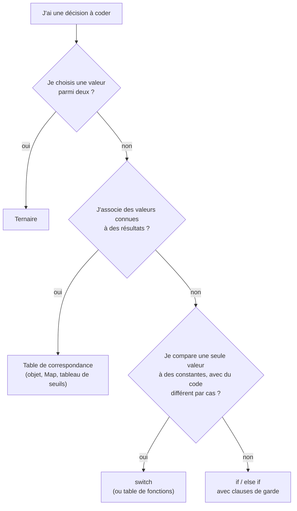

# 04 — Conditions

> **Niveau** : Débutant · **Durée** : ~2 h 30 · **Prérequis** : [Variables](../02-variables/README.md), [Types et opérateurs](../03-types-et-operateurs/README.md)

Un programme utile réagit à ce qu'il reçoit : un panier vide ne se paie pas, un mot de passe trop court est refusé, un client fidèle obtient une remise. Ce chapitre présente tous les outils de décision de JavaScript (`if`, `switch`, ternaire, opérateurs logiques, `??`, `?.`), puis les techniques qui gardent ces décisions lisibles quand elles se multiplient : clauses de garde, tables de correspondance et conditions nommées.

## Objectifs

- Écrire des branchements avec `if`, `else if`, `else` et `switch`, et choisir la structure adaptée.
- Prévoir la valeur booléenne de n'importe quelle valeur (truthy et falsy).
- Utiliser `&&`, `||`, `!`, `??` et `?.` en connaissant leur valeur de retour et le court-circuit.
- Remplacer une pyramide de `if` imbriqués par des clauses de garde.
- Remplacer un long `switch` par une table de correspondance (objet ou `Map`).
- Rendre lisible une condition complexe en la nommant, en la découpant ou en l'inversant.

## Sommaire

- [if, else if et else](#if-else-if-et-else)
- [Rappel : comparer des valeurs](#rappel--comparer-des-valeurs)
- [Valeurs truthy et falsy](#valeurs-truthy-et-falsy)
- [Les opérateurs logiques](#les-opérateurs-logiques)
- [La coalescence des nuls](#la-coalescence-des-nuls)
- [Le chaînage optionnel](#le-chaînage-optionnel)
- [L'opérateur ternaire](#lopérateur-ternaire)
- [L'instruction switch](#linstruction-switch)
- [Clauses de garde et retour anticipé](#clauses-de-garde-et-retour-anticipé)
- [Tables de correspondance](#tables-de-correspondance)
- [Rendre lisibles les conditions complexes](#rendre-lisibles-les-conditions-complexes)
- [Choisir la bonne structure](#choisir-la-bonne-structure)
- [Et demain : le pattern matching](#et-demain--le-pattern-matching)
- [Pièges courants](#pièges-courants)
- [Bonnes pratiques](#bonnes-pratiques)
- [Résumé](#résumé)
- [Exercices](#exercices)
- [Pour aller plus loin](#pour-aller-plus-loin)

## if, else if et else

### La forme de base

`if` exécute un bloc seulement si sa condition est vraie ; `else` (facultatif) fournit le bloc à exécuter sinon.

```js
const montantPanier = 72;

if (montantPanier >= 50) {
  console.log("Livraison offerte"); // Livraison offerte
} else {
  console.log("Livraison : 4,90 €");
}
```

La condition entre parenthèses peut être n'importe quelle expression : JavaScript la **convertit en booléen** avant de décider (voir [truthy et falsy](#valeurs-truthy-et-falsy)). `if (montantPanier >= 50)` reçoit déjà un booléen, mais `if (nom)` ou `if (liste.length)` sont aussi valides.

### Des accolades, sauf pour une ligne

Les accolades sont facultatives quand le bloc ne contient qu'une instruction. Ne profitez pas de cette tolérance dès que l'instruction passe à la ligne : une ligne ajoutée plus tard « dans le `if` », avec la même indentation, se retrouve en réalité en dehors.

<!-- prettier-ignore -->
```js
const estAdmin = false;
const actions = [];

// ❌ L'indentation ment : seule la première instruction dépend du if
if (estAdmin)
  actions.push("lire les journaux");
  actions.push("supprimer le compte"); // exécuté pour tout le monde !

console.log(actions); // [ 'supprimer le compte' ]

// ✅ Avec accolades, l'intention est sans ambiguïté
const actionsSures = [];
if (estAdmin) {
  actionsSures.push("lire les journaux");
  actionsSures.push("supprimer le compte");
}
console.log(actionsSures); // []
```

La seule tolérance raisonnable est une instruction **courte, écrite sur la même ligne** que le `if`, typiquement une sortie : `if (!utilisateur) return null;`, `if (ligne === "") continue;`. Rien ne peut alors s'y glisser par erreur.

> [!NOTE]
> Ce n'est pas un risque théorique : la faille « goto fail » d'Apple (2014, CVE-2014-1266), qui désactivait la vérification des certificats TLS, venait d'une ligne dupliquée sous un `if` sans accolades : la copie, pourtant indentée, s'exécutait toujours. Un formateur comme Prettier rend ce piège visible en réalignant l'indentation, et la règle ESLint `curly` impose les accolades (voir [Outillage](../28-outillage/README.md)).

### Enchaîner les cas avec else if

`else if` n'est pas un mot-clé à part : c'est un `else` dont le bloc est un autre `if`. Les conditions sont testées **dans l'ordre** et seul le premier bloc dont la condition est vraie s'exécute.

```js
function mention(note) {
  if (note >= 16) {
    return "Très bien";
  } else if (note >= 14) {
    return "Bien";
  } else if (note >= 12) {
    return "Assez bien";
  } else if (note >= 10) {
    return "Passable";
  } else {
    return "Ajourné";
  }
}

console.log(mention(17)); // Très bien
console.log(mention(13.5)); // Assez bien
console.log(mention(8)); // Ajourné
```

L'ordre compte. Si l'on teste `note >= 10` en premier, un 17 s'arrête dès ce test :

```js
function mentionBoguee(note) {
  if (note >= 10) {
    return "Passable"; // ❌ capture aussi 14, 16, 20…
  } else if (note >= 16) {
    return "Très bien"; // jamais atteint
  }
  return "Ajourné";
}

console.log(mentionBoguee(17)); // Passable
```

Règle simple : pour des seuils, allez du plus restrictif au moins restrictif.

### if est une instruction, pas une expression

`if` ne produit pas de valeur : impossible d'écrire `const tarif = if (…) …`. Pour choisir une valeur, on utilise l'[opérateur ternaire](#lopérateur-ternaire), une fonction qui `return`, ou une variable déclarée avec `let` avant le `if` :

```js
const age = 15;

let tarif;
if (age < 18) {
  tarif = 6;
} else {
  tarif = 10;
}
console.log(tarif); // 6

// Souvent plus lisible : une expression ternaire et une constante
const tarifBillet = age < 18 ? 6 : 10;
console.log(tarifBillet); // 6
```

Les variables déclarées avec `let` ou `const` **dans** un bloc `if` n'existent que dans ce bloc (portée de bloc, voir [Variables](../02-variables/README.md)).

## Rappel : comparer des valeurs

Les opérateurs de comparaison et les règles d'égalité sont détaillés au chapitre [Types et opérateurs](../03-types-et-operateurs/README.md). Pour écrire des conditions, retenez ceci :

| Opérateur         | Signification                                                             | Exemple                |
| ----------------- | ------------------------------------------------------------------------- | ---------------------- |
| `===` / `!==`     | égal / différent, **sans conversion de type**                             | `age === 18`           |
| `<` `<=` `>` `>=` | comparaison d'ordre (nombres, ou chaînes dans l'ordre des unités de code) | `stock > 0`            |
| `==` / `!=`       | égalité avec conversion : à éviter, sauf l'idiome `x == null`             | `"0" == 0` vaut `true` |

Trois pièges reviennent sans cesse dans les conditions :

```js
// 1. On ne chaîne pas les comparaisons comme en mathématiques
const temperature = 25;
// (0 <= 25) donne true, puis true <= 10 donne… true
console.log(0 <= temperature <= 10); // true ❌
console.log(0 <= temperature && temperature <= 10); // false ✅

// 2. Des chaînes se comparent caractère par caractère, pas comme des nombres
console.log("10" < "9"); // true ("1" vient avant "9")
console.log(Number("10") < Number("9")); // false

// 3. NaN n'est égal à rien, pas même à lui-même
const saisie = Number("douze");
console.log(saisie === NaN); // false
console.log(Number.isNaN(saisie)); // true
```

Les objets et les tableaux se comparent **par référence** : `[] === []` vaut `false`, car ce sont deux tableaux distincts (voir [Objets](../10-objets/README.md)).

## Valeurs truthy et falsy

Quand une valeur non booléenne est utilisée comme condition, JavaScript la convertit en booléen. Une valeur qui devient `false` est dite **falsy**, une valeur qui devient `true` est dite **truthy**.

### Les huit valeurs falsy

La liste est courte et mérite d'être connue par cœur :

| Valeur             | Type      |
| ------------------ | --------- |
| `false`            | booléen   |
| `0` et `-0`        | nombre    |
| `0n`               | BigInt    |
| `""` (chaîne vide) | chaîne    |
| `null`             | null      |
| `undefined`        | undefined |
| `NaN`              | nombre    |

```js
console.log(Boolean(false)); // false
console.log(Boolean(0)); // false
console.log(Boolean(-0)); // false
console.log(Boolean(0n)); // false
console.log(Boolean("")); // false
console.log(Boolean(null)); // false
console.log(Boolean(undefined)); // false
console.log(Boolean(NaN)); // false
```

Seule curiosité hors liste : l'objet `document.all` des navigateurs, laissé falsy pour la compatibilité avec de très vieux sites. Vous ne le croiserez pas dans du code moderne.

### Tout le reste est truthy

Y compris des valeurs qui « ont l'air » vides ou fausses :

```js
console.log(Boolean("0")); // true  (chaîne non vide)
console.log(Boolean("false")); // true  (chaîne non vide)
console.log(Boolean(" ")); // true  (une espace n'est pas une chaîne vide)
console.log(Boolean([])); // true  (tout objet est truthy, même vide)
console.log(Boolean({})); // true
console.log(Boolean(-1)); // true  (tout nombre sauf 0, -0 et NaN)
console.log(Boolean(Infinity)); // true
```

### Quand s'appuyer sur la truthiness

Tester la truthiness est pratique pour vérifier qu'une valeur **existe** : un objet présent, une chaîne non vide. C'est un piège dès que `0`, `""` ou `false` sont des valeurs **légitimes**.

```js
function afficherStock(quantite) {
  // ❌ 0 est falsy : un stock nul est confondu avec « inconnu »
  if (!quantite) {
    return "Stock inconnu";
  }
  return `${quantite} en stock`;
}
console.log(afficherStock(0)); // Stock inconnu

function afficherStockCorrige(quantite) {
  // ✅ On teste exactement le cas « absent »
  if (quantite === undefined || quantite === null) {
    return "Stock inconnu";
  }
  return `${quantite} en stock`;
}
console.log(afficherStockCorrige(0)); // 0 en stock
```

Pour un tableau, la truthiness ne dit rien : un tableau vide est truthy. Testez sa longueur.

```js
const resultats = [];

if (resultats) {
  console.log("Affiché, même pour une liste vide"); // Affiché, même pour une liste vide
}

if (resultats.length === 0) {
  console.log("Aucun résultat"); // Aucun résultat
}
```

Pour obtenir explicitement un booléen, `Boolean(valeur)` est plus lisible que la double négation `!!valeur`, qui fait la même chose.

## Les opérateurs logiques

### Et, ou, non

| `a`     | `b`     | `a && b` (et) | `a \|\| b` (ou) | `!a` (non) |
| ------- | ------- | ------------- | --------------- | ---------- |
| `true`  | `true`  | `true`        | `true`          | `false`    |
| `true`  | `false` | `false`       | `true`          | `false`    |
| `false` | `true`  | `false`       | `true`          | `true`     |
| `false` | `false` | `false`       | `false`         | `true`     |

```js
const age = 25;
const aLePermis = true;
const estAccompagne = false;

if (age >= 18 && aLePermis) {
  console.log("Peut louer une voiture"); // Peut louer une voiture
}

if (aLePermis || estAccompagne) {
  console.log("Peut conduire"); // Peut conduire
}

if (!estAccompagne) {
  console.log("Conduit seul"); // Conduit seul
}
```

### Ils renvoient un des opérandes

Contrairement à beaucoup d'autres langages, `&&` et `||` ne renvoient pas forcément un booléen : ils renvoient **l'un de leurs opérandes**.

- `a && b` renvoie `a` si `a` est falsy, sinon `b`.
- `a || b` renvoie `a` si `a` est truthy, sinon `b`.
- `!a` renvoie toujours un vrai booléen.

```js
console.log("Alice" && 42); // 42
console.log(0 && 42); // 0
console.log("" || "anonyme"); // anonyme
console.log("Alice" || "anonyme"); // Alice
console.log(null || undefined); // undefined
console.log(!"Alice"); // false
```

### Le court-circuit

Dès que le résultat est connu, l'opérande de droite **n'est pas évalué** : si `a` est falsy, `a && b` ne regarde pas `b` ; si `a` est truthy, `a || b` non plus.

```js
function tester(nom, resultat) {
  console.log(`évaluation de ${nom}`);
  return resultat;
}

const r1 = tester("A", false) && tester("B", true);
// évaluation de A        ← B n'est jamais évalué
console.log(r1); // false

const r2 = tester("C", true) || tester("D", false);
// évaluation de C        ← D n'est jamais évalué
console.log(r2); // true
```

Le court-circuit est ce qui rend sûre une expression comme `liste.length > 0 && liste[0].actif` : la partie droite n'est évaluée que si la liste n'est pas vide. Il permet aussi d'écrire `estConnecte && afficherMenu()`. Cette forme est courante (en JSX notamment), mais pour déclencher une action, un `if` reste plus explicite.

### Valeurs par défaut avec ||, et sa limite

Avant ES2020, `||` servait à fournir une valeur par défaut :

```js
function saluer(nom) {
  const affichage = nom || "invité";
  return `Bonjour, ${affichage} !`;
}

console.log(saluer("Marie")); // Bonjour, Marie !
console.log(saluer()); // Bonjour, invité !
console.log(saluer("")); // Bonjour, invité !
```

Cela fonctionne tant que toutes les valeurs falsy doivent être remplacées. Pour un volume réglé à `0` ou une option mise à `false`, c'est un bogue : c'est le rôle de [`??`](#la-coalescence-des-nuls).

### Priorité et parenthèses

`!` est prioritaire sur `&&`, lui-même prioritaire sur `||`. Ainsi `a || b && c` se lit `a || (b && c)`. Dès que `&&` et `||` se mélangent, mettez des parenthèses : elles ne coûtent rien et suppriment le doute (Prettier les ajoute d'ailleurs automatiquement).

```js
const estAdmin = false;
const estAuteur = true;
const articlePublie = false;

// « admin, ou bien auteur d'un article publié » :
// c'est ainsi que se lit estAdmin || estAuteur && articlePublie
console.log(estAdmin || (estAuteur && articlePublie)); // false

// « admin ou auteur, et dans tous les cas article publié » :
// une autre règle, qui exige d'autres parenthèses
console.log((estAdmin || estAuteur) && articlePublie); // false
```

### Les lois de De Morgan

Nier une condition composée inverse l'opérateur :

- `!(a && b)` équivaut à `!a || !b`
- `!(a || b)` équivaut à `!a && !b`

Elles servent à réécrire une négation difficile à lire :

```js
const stock = 3;
const estArchive = false;

// « ni épuisé ni archivé », écrit avec une négation globale
const disponible1 = !(stock === 0 || estArchive);

// La même condition, réécrite avec De Morgan
const disponible2 = stock !== 0 && !estArchive;

console.log(disponible1, disponible2); // true true
```

## La coalescence des nuls

L'opérateur `??` (ES2020) renvoie l'opérande de droite **seulement si celui de gauche vaut `null` ou `undefined`**. Les autres valeurs falsy (`0`, `""`, `false`, `NaN`) sont conservées.

| Valeur de `x` | `x \|\| "défaut"` | `x ?? "défaut"` |
| ------------- | ----------------- | --------------- |
| `0`           | `"défaut"`        | `0`             |
| `""`          | `"défaut"`        | `""`            |
| `false`       | `"défaut"`        | `false`         |
| `NaN`         | `"défaut"`        | `NaN`           |
| `null`        | `"défaut"`        | `"défaut"`      |
| `undefined`   | `"défaut"`        | `"défaut"`      |

C'est l'outil adapté aux options et aux réglages :

```js
function creerLecteur(options = {}) {
  return {
    volume: options.volume ?? 50,
    lectureAuto: options.lectureAuto ?? true,
    titre: options.titre ?? "Sans titre",
  };
}

console.log(creerLecteur({ volume: 0, lectureAuto: false }));
// { volume: 0, lectureAuto: false, titre: 'Sans titre' }

console.log(creerLecteur());
// { volume: 50, lectureAuto: true, titre: 'Sans titre' }
```

Avec `||`, le volume `0` serait devenu `50` et `lectureAuto: false` serait devenu `true`.

> [!TIP]
> Choisissez consciemment : `??` quand seule l'**absence** de valeur doit être remplacée, `||` quand **toute** valeur falsy doit l'être (par exemple une chaîne vide saisie par l'utilisateur à remplacer par un libellé).

Deux règles complètent le tableau :

- `??` court-circuite comme `||` : la partie droite n'est évaluée que si nécessaire.
- On ne peut pas mélanger `??` avec `&&` ou `||` sans parenthèses : le langage refuse de deviner la priorité.

<!-- no-run -->

```js
const a = null;
const b = 0;

const x = a || b ?? 10; // ❌ SyntaxError: Unexpected token '??'
const y = (a || b) ?? 10; // ✅ 0
```

L'affectation logique `??=` (ES2021) est un raccourci pour « affecter seulement si la variable vaut `null` ou `undefined` » : `reglages.langue ??= "fr"`. Elle est présentée avec ses cousines `||=` et `&&=` au chapitre [Types et opérateurs](../03-types-et-operateurs/README.md).

## Le chaînage optionnel

Lire une propriété de `null` ou `undefined` lève une `TypeError`. C'est l'erreur la plus fréquente en JavaScript :

```js
const commande = { id: 42, client: { nom: "Inès", adresse: null } };

try {
  console.log(commande.client.adresse.ville);
} catch (erreur) {
  console.log(erreur.message); // Cannot read properties of null (reading 'ville')
}
```

Le chaînage optionnel `?.` (ES2020) s'arrête et renvoie `undefined` si la valeur à sa gauche est `null` ou `undefined`, au lieu de lever une erreur.

```js
const commande = { id: 42, client: { nom: "Inès", adresse: null } };

console.log(commande.client.adresse?.ville); // undefined
console.log(commande.livreur?.nom); // undefined

// Combiné à ??, il fournit une valeur de repli
console.log(commande.client.adresse?.ville ?? "Ville inconnue"); // Ville inconnue
```

### Trois formes

| Forme               | Usage                                  |
| ------------------- | -------------------------------------- |
| `obj?.prop`         | propriété                              |
| `obj?.[expression]` | propriété calculée, élément de tableau |
| `fonction?.(args)`  | appel, seulement si la fonction existe |

```js
const utilisateurs = [{ nom: "Léa", roles: ["admin"] }];

console.log(utilisateurs[3]?.nom); // undefined
console.log(utilisateurs[0]?.roles?.[0]); // admin

function telecharger(fichier, options = {}) {
  // Le rappel est facultatif : on ne l'appelle que s'il est fourni
  options.surProgression?.(100);
  return `${fichier} téléchargé`;
}

console.log(telecharger("rapport.pdf")); // rapport.pdf téléchargé

const afficherProgression = (p) => console.log(`${p} %`);
console.log(telecharger("photo.jpg", { surProgression: afficherProgression }));
// 100 %
// photo.jpg téléchargé
```

### Le court-circuit porte sur toute la chaîne

Si la valeur à gauche de `?.` est nulle, **toute la suite de la chaîne** est ignorée. En revanche, chaque `.` ordinaire reste strict :

```js
const visiteur = null;
// Rien après ?. n'est évalué
console.log(visiteur?.profil.adresse.ville); // undefined

const membre = { profil: undefined };
try {
  console.log(membre?.profil.adresse);
} catch (erreur) {
  console.log(erreur.message); // Cannot read properties of undefined (reading 'adresse')
}
console.log(membre?.profil?.adresse); // undefined
```

### Limites et bon usage

On ne peut pas affecter à travers un chaînage optionnel :

<!-- no-run -->

```js
const config = {};
config.theme?.couleur = "bleu"; // ❌ SyntaxError: Invalid left-hand side in assignment
```

Surtout, `?.` ne doit servir que là où l'absence est **normale**. Le semer partout transforme une erreur franche en `undefined` silencieux qui ressurgit trois fonctions plus loin.

```js
function libelleFacture(facture) {
  // ❌ Une facture sans client est un bogue : ?. le masquerait
  // return `Facture de ${facture?.client?.nom}`;

  // ✅ Le client est obligatoire ; seule la société est facultative
  const societe = facture.client.societe?.nom ?? "particulier";
  return `Facture de ${facture.client.nom} (${societe})`;
}

console.log(libelleFacture({ client: { nom: "Hugo" } })); // Facture de Hugo (particulier)
```

## L'opérateur ternaire

`condition ? valeurSiVrai : valeurSiFaux` est une **expression** : elle produit une valeur, et peut donc apparaître dans une affectation, un `return`, un argument ou un gabarit de chaîne.

```js
const nombreArticles = 1;
console.log(`${nombreArticles} article${nombreArticles > 1 ? "s" : ""}`); // 1 article

const estConnecte = true;
const libelleBouton = estConnecte ? "Se déconnecter" : "Se connecter";
console.log(libelleBouton); // Se déconnecter
```

Réservez-le au **choix d'une valeur**. Pour déclencher des actions, écrivez un `if` :

<!-- no-run -->

```js
// ❌ Effets de bord cachés dans une expression
estMajeur ? ouvrirCompte() : (notifierParent(), refuser());

// ✅
if (estMajeur) {
  ouvrirCompte();
} else {
  notifierParent();
  refuser();
}
```

### Ternaires enchaînés

Enchaîner des ternaires est possible ; Prettier les indente pour faire apparaître la structure :

```js
function categorie(age) {
  return age < 12
    ? "enfant"
    : age < 18
      ? "adolescent"
      : age < 65
        ? "adulte"
        : "senior";
}

console.log(categorie(15)); // adolescent
```

Au-delà de deux niveaux, la même logique est souvent plus lisible avec des `return` successifs :

```js
function categorie(age) {
  if (age < 12) return "enfant";
  if (age < 18) return "adolescent";
  if (age < 65) return "adulte";
  return "senior";
}

console.log(categorie(70)); // senior
```

C'est l'usage typique de la tolérance vue [plus haut](#des-accolades-sauf-pour-une-ligne) : un `return` court, sur la même ligne que son `if`.

## L'instruction switch

`switch` compare **une** valeur à une liste de cas. Il est adapté quand plusieurs valeurs connues déclenchent chacune un traitement différent.

```js
function decrireJour(jour) {
  switch (jour) {
    case "samedi":
    case "dimanche":
      return "week-end";
    case "mercredi":
      return "milieu de semaine";
    case "lundi":
    case "mardi":
    case "jeudi":
    case "vendredi":
      return "jour ouvré";
    default:
      return "jour inconnu";
  }
}

console.log(decrireJour("dimanche")); // week-end
console.log(decrireJour("jeudi")); // jour ouvré
console.log(decrireJour("Jeudi")); // jour inconnu
```

### Comparaison stricte

`switch` compare avec `===` : aucune conversion de type. Une valeur lue dans un formulaire ou une URL est une chaîne, et ne correspondra pas à un `case` numérique.

```js
function libelleNiveau(niveau) {
  switch (niveau) {
    case 1:
      return "débutant";
    case 2:
      return "intermédiaire";
    default:
      return "inconnu";
  }
}

const saisie = "2"; // une valeur de formulaire est toujours une chaîne
console.log(libelleNiveau(saisie)); // inconnu
console.log(libelleNiveau(Number(saisie))); // intermédiaire
```

### break et le passage au cas suivant

Une fois un `case` atteint, l'exécution **continue dans les cas suivants** jusqu'à un `break`, un `return` ou la fin du `switch`. C'est ce qui permet de regrouper plusieurs cas (comme `"samedi"` et `"dimanche"` ci-dessus), mais c'est aussi la source d'un bogue classique :

```js
function droits(role) {
  const liste = [];
  switch (role) {
    case "admin":
      liste.push("supprimer");
    // ❌ break oublié : l'exécution « tombe » dans le cas suivant
    case "editeur":
      liste.push("modifier");
      break;
    case "lecteur":
      liste.push("lire");
      break;
  }
  return liste;
}

console.log(droits("editeur")); // [ 'modifier' ]
console.log(droits("admin")); // [ 'supprimer', 'modifier' ]
```

Ici, l'admin hérite du droit « modifier », peut-être volontairement… ou non. Si le passage est **voulu**, signalez-le par un commentaire `// falls through` (reconnu par la règle ESLint `no-fallthrough`) ; sinon, terminez chaque cas par `break` ou `return`. Dans une fonction, `return` règle la question d'office, ce qui rend les `switch` « un cas, un `return` » particulièrement sûrs.

### default

`default` s'exécute si aucun `case` ne correspond. Il peut techniquement se placer n'importe où, mais mettez-le à la fin, et prévoyez-le presque toujours : une valeur inattendue doit produire un comportement explicite (valeur par défaut ou erreur), pas un silence.

### Déclarer des variables dans un case

Tous les `case` partagent **le même bloc**. Deux `const` de même nom dans deux cas différents provoquent une erreur :

<!-- no-run -->

```js
switch (forme.type) {
  case "cercle":
    const aire = Math.PI * forme.rayon ** 2;
    return aire;
  case "carre":
    const aire = forme.cote ** 2; // ❌ SyntaxError: Identifier 'aire' has already been declared
    return aire;
}
```

La solution : donner à chaque cas son propre bloc avec des accolades.

```js
function aire(forme) {
  switch (forme.type) {
    case "cercle": {
      const surface = Math.PI * forme.rayon ** 2;
      return Math.round(surface * 100) / 100;
    }
    case "carre": {
      const surface = forme.cote ** 2;
      return surface;
    }
    default:
      throw new Error(`Forme inconnue : ${forme.type}`);
  }
}

console.log(aire({ type: "cercle", rayon: 2 })); // 12.57
console.log(aire({ type: "carre", cote: 3 })); // 9
```

### switch (true)

On rencontre parfois `switch (true)` pour tester des intervalles : chaque `case` contient une condition, et le premier qui vaut `true` l'emporte.

```js
function categorieImc(imc) {
  switch (true) {
    case imc < 18.5:
      return "insuffisance pondérale";
    case imc < 25:
      return "corpulence normale";
    case imc < 30:
      return "surpoids";
    default:
      return "obésité";
  }
}

console.log(categorieImc(22.4)); // corpulence normale
```

Cela fonctionne, mais une suite de `if … return` dit la même chose sans détourner `switch` de son rôle. Réservez `switch` à la comparaison d'une valeur à des constantes.

## Clauses de garde et retour anticipé

Quand chaque vérification ajoute un niveau d'imbrication, le traitement principal finit enfoui au centre d'une pyramide, et chaque `else` se retrouve loin du `if` auquel il répond :

```js
// ❌ Code en pyramide
function expedier(commande) {
  if (commande) {
    if (commande.articles.length > 0) {
      if (commande.adresse) {
        if (commande.payee) {
          return `Commande ${commande.id} expédiée`;
        } else {
          return "Paiement en attente";
        }
      } else {
        return "Adresse manquante";
      }
    } else {
      return "Panier vide";
    }
  } else {
    return "Aucune commande";
  }
}

const sansAdresse = { id: 7, articles: ["livre"], adresse: null, payee: true };
console.log(expedier(sansAdresse)); // Adresse manquante
```

Une **clause de garde** traite d'abord les cas particuliers et sort immédiatement. Le cas nominal se lit ensuite à plat, sans `else` :

```js
// ✅ Clauses de garde
function expedier(commande) {
  if (!commande) return "Aucune commande";
  if (commande.articles.length === 0) return "Panier vide";
  if (!commande.adresse) return "Adresse manquante";
  if (!commande.payee) return "Paiement en attente";

  return `Commande ${commande.id} expédiée`;
}

const sansAdresse = { id: 7, articles: ["livre"], adresse: null, payee: true };
const complete = { id: 8, articles: ["stylo"], adresse: "Lyon", payee: true };
console.log(expedier(sansAdresse)); // Adresse manquante
console.log(expedier(complete)); // Commande 8 expédiée
```

Chaque ligne se lit comme une règle métier, l'ordre des vérifications est explicite, et ajouter une règle ne demande qu'une ligne.

### Retourner ou lever une erreur ?

Une garde peut **retourner** (le cas est prévu : rien à faire, valeur par défaut) ou **lever une erreur** (l'appelant a fourni des données invalides). Ne retournez pas un objet `Error` : l'appelant devrait penser à le tester, et l'oubliera.

```js
function calculerRemise(montant, pourcentage) {
  // Données invalides : on lève une erreur
  if (typeof montant !== "number" || montant < 0) {
    throw new RangeError(`Montant invalide : ${montant}`);
  }
  // Cas prévu : pas de remise, on retourne tout de suite
  if (!pourcentage) return montant;

  return montant * (1 - pourcentage / 100);
}

console.log(calculerRemise(80, 25)); // 60
console.log(calculerRemise(80)); // 80

try {
  calculerRemise(-5, 10);
} catch (erreur) {
  console.log(erreur.message); // Montant invalide : -5
}
```

Le choix entre lever et retourner, ainsi que les erreurs personnalisées, sont développés au chapitre [Erreurs](../17-erreurs/README.md). Dans une boucle, la clause de garde s'écrit avec `continue` (voir [Boucles](../05-boucles/README.md)).

## Tables de correspondance

### Remplacer un switch qui associe des valeurs

Beaucoup de `switch` ne font qu'associer une valeur à une autre :

```js
// ❌ Douze lignes pour une simple association
function emojiMeteo(temps) {
  switch (temps) {
    case "soleil":
      return "☀️";
    case "nuages":
      return "☁️";
    case "pluie":
      return "🌧️";
    case "neige":
      return "❄️";
    default:
      return "❓";
  }
}

console.log(emojiMeteo("pluie")); // 🌧️
```

Un objet exprime la même chose sous forme de **données** : l'association est visible d'un coup d'œil, et elle peut être enrichie, exportée ou chargée depuis un fichier sans toucher à la logique.

```js
// ✅ Une table de correspondance
const EMOJIS_METEO = {
  soleil: "☀️",
  nuages: "☁️",
  pluie: "🌧️",
  neige: "❄️",
};

function emojiMeteo(temps) {
  return EMOJIS_METEO[temps] ?? "❓";
}

console.log(emojiMeteo("neige")); // ❄️
console.log(emojiMeteo("grêle")); // ❓
```

### Le piège des propriétés héritées

Un objet littéral hérite des propriétés de `Object.prototype` (voir [Objets](../10-objets/README.md)). Si la clé vient de l'extérieur (URL, formulaire, fichier), certaines valeurs donnent un résultat absurde :

```js
const TAUX_TVA = { normal: 0.2, intermediaire: 0.1, reduit: 0.055 };

function taux(categorie) {
  return TAUX_TVA[categorie] ?? TAUX_TVA.normal;
}

console.log(taux("reduit")); // 0.055
console.log(taux("inconnue")); // 0.2
console.log(taux("toString")); // [Function: toString] ❌
```

Trois parades, de la plus simple à la plus robuste :

```js
const TAUX_TVA = { normal: 0.2, intermediaire: 0.1, reduit: 0.055 };

// 1. Vérifier que la clé appartient bien à l'objet (ES2022)
function taux(categorie) {
  return Object.hasOwn(TAUX_TVA, categorie)
    ? TAUX_TVA[categorie]
    : TAUX_TVA.normal;
}
console.log(taux("toString")); // 0.2

// 2. Créer l'objet sans prototype
const TAUX_SANS_PROTO = Object.assign(Object.create(null), TAUX_TVA);
console.log(TAUX_SANS_PROTO["toString"] ?? 0.2); // 0.2

// 3. Utiliser une Map, faite pour les associations clé → valeur
const TAUX_MAP = new Map(Object.entries(TAUX_TVA));
console.log(TAUX_MAP.get("toString") ?? 0.2); // 0.2
```

### Map : des clés de n'importe quel type

Les clés d'un objet sont toujours des chaînes (ou des symboles) : `{ 404: … }` stocke la clé `"404"`. Une `Map` accepte des clés de tout type et n'a pas de propriétés héritées ; c'est le bon choix pour une table construite dynamiquement (voir [Collections](../12-collections/README.md)).

```js
const MESSAGES_HTTP = new Map([
  [200, "OK"],
  [201, "Créé"],
  [404, "Introuvable"],
  [500, "Erreur du serveur"],
]);

function messageHttp(statut) {
  return MESSAGES_HTTP.get(statut) ?? `Statut ${statut}`;
}

console.log(messageHttp(404)); // Introuvable
console.log(messageHttp(418)); // Statut 418
```

### Une table de fonctions

Les valeurs d'une table peuvent être des fonctions : chaque clé désigne alors un comportement. C'est une version légère du patron de conception « stratégie ».

```js
const OPERATIONS = {
  "+": (a, b) => a + b,
  "-": (a, b) => a - b,
  "*": (a, b) => a * b,
  "/": (a, b) => a / b,
};

function calculer(a, operateur, b) {
  if (!Object.hasOwn(OPERATIONS, operateur)) {
    throw new Error(`Opérateur inconnu : ${operateur}`);
  }
  return OPERATIONS[operateur](a, b);
}

console.log(calculer(6, "*", 7)); // 42
console.log(calculer(10, "/", 4)); // 2.5
```

Ajouter l'opérateur `%` revient à ajouter une ligne dans la table, sans toucher à `calculer`.

### Une table d'intervalles

Pour des seuils, une table **ordonnée** remplace la chaîne de `else if`. La méthode `find` (voir [Tableaux](../09-tableaux/README.md)) renvoie le premier élément qui satisfait la condition, ou `undefined` :

```js
const MENTIONS = [
  { min: 16, libelle: "Très bien" },
  { min: 14, libelle: "Bien" },
  { min: 12, libelle: "Assez bien" },
  { min: 10, libelle: "Passable" },
];

function mention(note) {
  return MENTIONS.find((m) => note >= m.min)?.libelle ?? "Ajourné";
}

console.log(mention(15)); // Bien
console.log(mention(9.5)); // Ajourné
```

> [!TIP]
> Figez les tables qui ne doivent pas changer avec `Object.freeze(TABLE)` : une modification accidentelle est alors ignorée, ou lève une erreur en mode strict (donc dans les modules).

## Rendre lisibles les conditions complexes

Une condition se lit beaucoup plus souvent qu'elle ne s'écrit. Voici une règle d'éligibilité réaliste, d'abord écrite d'un bloc :

```js
const client = {
  age: 34,
  pays: "FR",
  commandes: 12,
  bloque: false,
  abonnement: { actif: true },
};

// ❌ Correct, mais il faut tout déchiffrer pour comprendre
if (
  client.age >= 18 &&
  !client.bloque &&
  (client.commandes >= 10 || (client.abonnement && client.abonnement.actif)) &&
  ["FR", "BE", "CH", "LU"].indexOf(client.pays) !== -1
) {
  console.log("Remise fidélité"); // Remise fidélité
}
```

### 1. Nommer les sous-conditions

Une constante booléenne bien nommée sert de commentaire exécutable :

```js
const client = {
  age: 34,
  pays: "FR",
  commandes: 12,
  bloque: false,
  abonnement: { actif: true },
};
const PAYS_FRANCOPHONES = ["FR", "BE", "CH", "LU"];

const estMajeur = client.age >= 18;
const estFidele = client.commandes >= 10 || client.abonnement?.actif === true;
const estDansLaZone = PAYS_FRANCOPHONES.includes(client.pays);

if (estMajeur && !client.bloque && estFidele && estDansLaZone) {
  console.log("Remise fidélité"); // Remise fidélité
}
```

Au passage, `?.` a remplacé `client.abonnement && client.abonnement.actif`, et `includes` (ES2016) a remplacé `indexOf(…) !== -1`.

### 2. Extraire un prédicat

Quand la règle est réutilisée ou testée, elle mérite une fonction dont le nom commence par `est`, `a`, `peut`… et qui renvoie un booléen. Les clauses de garde s'y appliquent naturellement :

```js
const PAYS_FRANCOPHONES = ["FR", "BE", "CH", "LU"];

function estEligibleRemiseFidelite(client) {
  if (client.age < 18 || client.bloque) return false;
  if (!PAYS_FRANCOPHONES.includes(client.pays)) return false;
  return client.commandes >= 10 || client.abonnement?.actif === true;
}

const nouveau = { age: 34, pays: "FR", commandes: 2, bloque: false };
const habitue = { age: 41, pays: "BE", commandes: 15, bloque: false };
console.log(estEligibleRemiseFidelite(nouveau)); // false
console.log(estEligibleRemiseFidelite(habitue)); // true
```

### 3. Retourner la condition elle-même

Une condition est déjà un booléen : inutile de l'emballer.

```js
// ❌
function estMajeurVerbeux(age) {
  if (age >= 18) {
    return true;
  } else {
    return false;
  }
}

// ✅
const estMajeur = (age) => age >= 18;

console.log(estMajeurVerbeux(20), estMajeur(20)); // true true
```

De même, `if (estValide === true)` s'écrit `if (estValide)`, et `if (estValide === false)` s'écrit `if (!estValide)` (quand la variable est bien un booléen).

### 4. Préférer les formulations positives

Les doubles négations demandent un effort de lecture inutile. Nommez vos booléens positivement et appliquez De Morgan pour éliminer les `!` en cascade :

<!-- no-run -->

```js
// ❌
if (!estDesactive && !(!aDesDroits || estExpire)) { … }

// ✅ Mêmes cas, sans négation imbriquée
const estActif = !estDesactive;
if (estActif && aDesDroits && !estExpire) { … }
```

### 5. Écrire les intervalles dans l'ordre de lecture

`min <= x && x <= max` se lit comme « x est entre min et max » ; `x >= min && max >= x` dit la même chose de façon bien plus obscure.

```js
const heure = 14;
const estOuvert = 9 <= heure && heure < 18;
console.log(estOuvert); // true
```

### 6. Tester l'appartenance à une liste avec includes

```js
const extension = "png";

// ❌ Répétitif et facile à casser
const estImage1 =
  extension === "png" ||
  extension === "jpg" ||
  extension === "webp" ||
  extension === "avif";

// ✅
const EXTENSIONS_IMAGE = ["png", "jpg", "webp", "avif"];
const estImage2 = EXTENSIONS_IMAGE.includes(extension);

console.log(estImage1, estImage2); // true true
```

Pour une très longue liste testée souvent, un `Set` et sa méthode `has` sont plus rapides (voir [Collections](../12-collections/README.md)).

## Choisir la bonne structure



| Besoin                                                      | Outil                                                   |
| ----------------------------------------------------------- | ------------------------------------------------------- |
| Exécuter un bloc si une condition est vraie                 | `if`                                                    |
| Plusieurs cas exclusifs aux conditions variées              | `if` / `else if`, ou clauses de garde dans une fonction |
| Choisir une valeur entre deux                               | ternaire `? :`                                          |
| Valeur par défaut si `null`/`undefined`                     | `??`                                                    |
| Valeur par défaut si falsy                                  | `\|\|`                                                  |
| Accéder à une propriété peut-être absente                   | `?.`                                                    |
| Une valeur comparée à des constantes, un traitement par cas | `switch`                                                |
| Associer des clés à des valeurs ou à des fonctions          | objet, `Map`                                            |
| Classer selon des seuils                                    | tableau ordonné + `find`                                |

## Et demain : le pattern matching

Plusieurs langages (Rust, Python, C#…) proposent un _pattern matching_ qui généralise `switch` : on compare la **forme** d'une valeur (propriétés, longueur d'un tableau, type) et on extrait des morceaux au passage. Une [proposition TC39](https://github.com/tc39/proposal-pattern-matching) existe pour JavaScript, avec un mot-clé `match` qui serait une expression.

<!-- no-run -->

```js
// Syntaxe provisoire de la proposition : aucun moteur ne l'exécute aujourd'hui
const message = match (reponse) {
  when { status: 200, let corps }: afficher(corps);
  when { status: 404 }: "Introuvable";
  default: "Erreur inattendue";
};
```

La proposition est au **stage 1** (novembre 2026) : le problème est jugé digne d'intérêt, mais la syntaxe peut encore changer du tout au tout, et rien ne garantit qu'elle aboutisse. N'en tenez pas compte pour vos projets ; les outils de ce chapitre couvrent tous les besoins.

## Pièges courants

**Affecter au lieu de comparer.** `if (x = 10)` affecte 10 à `x`, puis teste 10, qui est truthy : la condition est toujours vraie. Utilisez `===` ; ESLint signale ce cas (`no-cond-assign`).

**Comparer à plusieurs valeurs d'un coup.** `fruit === "pomme" || "poire"` se lit `(fruit === "pomme") || "poire"` : si le fruit n'est pas une pomme, l'expression vaut `"poire"`, qui est truthy.

```js
const fruit = "kiwi";

if (fruit === "pomme" || "poire") {
  // ❌ affiché pour un kiwi
  console.log("Pomme ou poire ?!"); // Pomme ou poire ?!
}

if (["pomme", "poire"].includes(fruit)) {
  console.log("Pomme ou poire"); // jamais affiché ✅
}
```

**Chaîner des comparaisons.** `0 <= x <= 10` est toujours vrai (voir le [rappel](#rappel--comparer-des-valeurs)). Écrivez `0 <= x && x <= 10`.

**Oublier qu'un tableau vide est truthy.** `if (liste)` est vrai pour `[]`. Testez `liste.length > 0`.

**Utiliser `||` quand `0`, `""` ou `false` sont valides.** Utilisez `??`.

**Oublier `break` dans un `switch`.** L'exécution passe au cas suivant. Terminez chaque cas par `break` ou `return`.

**Comparer une chaîne à un nombre dans un `switch`.** `switch` utilise `===` : convertissez d'abord la valeur (`Number(saisie)`).

**Tester `typeof x === "object"` pour « x est un objet ».** `typeof null` vaut aussi `"object"`. Écrivez `x !== null && typeof x === "object"`.

**Abuser de `?.`.** Il masque les données manquantes qui devraient être présentes. Utilisez-le pour ce qui est réellement facultatif.

**Lire une clé externe dans un objet littéral.** `table["constructor"]` renvoie une fonction héritée. Utilisez `Object.hasOwn` ou une `Map`.

## Bonnes pratiques

- Mettez des accolades dès qu'un bloc ne tient pas sur la ligne de son `if` (tolérance : une instruction courte sur la même ligne, typiquement `return`, `continue` ou `throw`).
- Comparez avec `===` et `!==`.
- Traitez les cas particuliers en premier, avec des clauses de garde, puis écrivez le cas nominal sans imbrication.
- Choisissez `??` pour les valeurs par défaut, `||` seulement quand toute valeur falsy doit être remplacée.
- Réservez `?.` à ce qui peut légitimement manquer.
- Utilisez le ternaire pour choisir une valeur, `if` pour déclencher des actions ; évitez plus de deux niveaux de ternaires.
- Remplacez les `switch` qui associent des valeurs par des tables de correspondance.
- Nommez les conditions complexes (constantes booléennes ou prédicats `estXxx`).
- Prévoyez toujours le cas « autre » : `else`, `default` ou valeur de repli.
- Laissez Prettier et ESLint (`curly`, `eqeqeq`, `no-fallthrough`, `no-cond-assign`) attraper les erreurs mécaniques.

## Résumé

- `if`/`else if`/`else` teste les conditions dans l'ordre et exécute le premier bloc dont la condition est vraie.
- Toute valeur est convertie en booléen dans une condition. Il y a huit valeurs falsy : `false`, `0`, `-0`, `0n`, `""`, `null`, `undefined`, `NaN`. Tout le reste est truthy, y compris `"0"`, `[]` et `{}`.
- `&&` et `||` renvoient un de leurs opérandes et court-circuitent ; `!` renvoie un booléen.
- `??` remplace seulement `null` et `undefined` ; `?.` interrompt une chaîne d'accès sur `null` ou `undefined`.
- Le ternaire est une expression qui choisit une valeur.
- `switch` compare avec `===` et continue d'un cas au suivant sans `break` ; donnez un bloc `{}` aux cas qui déclarent des variables.
- Les clauses de garde aplatissent le code ; les tables de correspondance transforment des branchements en données.
- Une condition complexe devient lisible quand on la nomme, la découpe et la formule positivement.

## Exercices

### Exercice 1 — Tarif selon l'âge (★☆☆)

Écrivez une fonction `tarifCinema(age)` qui renvoie le prix d'une place : 5 € avant 14 ans, 7,50 € de 14 à 25 ans inclus, 11 € de 26 à 64 ans, 8 € à partir de 65 ans. Si `age` n'est pas un nombre positif, la fonction lève une `RangeError`.

<details>
<summary>Solution</summary>

```js
function tarifCinema(age) {
  if (typeof age !== "number" || Number.isNaN(age) || age < 0) {
    throw new RangeError(`Âge invalide : ${age}`);
  }
  if (age < 14) return 5;
  if (age <= 25) return 7.5;
  if (age < 65) return 11;
  return 8;
}

console.log(tarifCinema(10)); // 5
console.log(tarifCinema(25)); // 7.5
console.log(tarifCinema(40)); // 11
console.log(tarifCinema(70)); // 8

try {
  tarifCinema("douze");
} catch (erreur) {
  console.log(erreur.message); // Âge invalide : douze
}
```

La garde d'entrée élimine d'abord les valeurs invalides (`Number.isNaN` est nécessaire car `typeof NaN` vaut `"number"`). Les seuils sont ensuite testés du plus petit au plus grand : chaque `return` sort de la fonction, donc aucun `else` n'est nécessaire, et chaque test n'a besoin que d'une borne.

</details>

### Exercice 2 — Truthy ou falsy ? (★☆☆)

Sans exécuter le code, dites quelles lignes affichent quelque chose.

<!-- no-run -->

```js
if (0) console.log("a");
if ("0") console.log("b");
if ([]) console.log("c");
if ("") console.log("d");
if (" ") console.log("e");
if (null ?? "x") console.log("f");
if (NaN) console.log("g");
if (0n) console.log("h");
if ({} && 0) console.log("i");
if (-1) console.log("j");
```

<details>
<summary>Solution</summary>

Les lignes `b`, `c`, `e`, `f` et `j` s'affichent.

```js
const valeurs = {
  a: 0,
  b: "0",
  c: [],
  d: "",
  e: " ",
  f: null ?? "x",
  g: NaN,
  h: 0n,
  i: {} && 0,
  j: -1,
};

const affichees = Object.keys(valeurs).filter((cle) => Boolean(valeurs[cle]));
console.log(affichees); // [ 'b', 'c', 'e', 'f', 'j' ]
```

- `"0"` et `" "` sont des chaînes **non vides**, donc truthy.
- `[]` est un objet, donc truthy.
- `null ?? "x"` vaut `"x"`, truthy.
- `{} && 0` : `{}` est truthy, donc `&&` renvoie l'opérande de droite, `0`, falsy.
- `0`, `""`, `NaN` et `0n` font partie des huit valeurs falsy.

</details>

### Exercice 3 — Corriger des valeurs par défaut (★★☆)

Cette fonction prépare la configuration d'une minuterie. Trouvez les bogues avec l'appel proposé, puis corrigez-la. Le titre vide doit, lui, être remplacé par `"Minuterie"`.

<!-- no-run -->

```js
function configurerMinuterie(options) {
  return {
    duree: options.duree || 60,
    son: options.son || true,
    repetitions: options.repetitions || 1,
    titre: options.titre || "Minuterie",
  };
}

const options = { duree: 0, son: false, repetitions: 0, titre: "" };
console.log(configurerMinuterie(options));
// attendu : { duree: 0, son: false, repetitions: 0, titre: 'Minuterie' }
```

<details>
<summary>Solution</summary>

Avec `||`, `0` et `false` sont falsy : la durée devient 60, le son `true` et les répétitions 1. On utilise `??` pour ces trois options, et l'on garde volontairement `||` pour le titre, puisqu'une chaîne vide doit être remplacée. Le paramètre par défaut `options = {}` évite aussi une `TypeError` si la fonction est appelée sans argument.

```js
function configurerMinuterie(options = {}) {
  return {
    duree: options.duree ?? 60,
    son: options.son ?? true,
    repetitions: options.repetitions ?? 1,
    titre: options.titre || "Minuterie", // "" doit être remplacé : || est voulu
  };
}

const options = { duree: 0, son: false, repetitions: 0, titre: "" };
console.log(configurerMinuterie(options));
// { duree: 0, son: false, repetitions: 0, titre: 'Minuterie' }

console.log(configurerMinuterie());
// { duree: 60, son: true, repetitions: 1, titre: 'Minuterie' }
```

</details>

### Exercice 4 — Aplatir une pyramide (★★☆)

Réécrivez cette fonction avec des clauses de garde, sans changer son comportement.

<!-- no-run -->

```js
function peutReserver(utilisateur, salle, nombrePersonnes) {
  if (utilisateur) {
    if (utilisateur.actif) {
      if (salle.disponible) {
        if (nombrePersonnes <= salle.capacite) {
          return { ok: true };
        } else {
          return { ok: false, raison: "Capacité dépassée" };
        }
      } else {
        return { ok: false, raison: "Salle indisponible" };
      }
    } else {
      return { ok: false, raison: "Compte inactif" };
    }
  } else {
    return { ok: false, raison: "Connexion requise" };
  }
}
```

<details>
<summary>Solution</summary>

Chaque `else` devient une garde, dans le même ordre que l'original : l'ordre des vérifications fait partie du comportement (un utilisateur absent doit produire « Connexion requise », même si la salle est aussi indisponible). Une petite fonction `refus` évite de répéter la forme de l'objet.

```js
const refus = (raison) => ({ ok: false, raison });

function peutReserver(utilisateur, salle, nombrePersonnes) {
  if (!utilisateur) return refus("Connexion requise");
  if (!utilisateur.actif) return refus("Compte inactif");
  if (!salle.disponible) return refus("Salle indisponible");
  if (nombrePersonnes > salle.capacite) return refus("Capacité dépassée");

  return { ok: true };
}

const salle = { disponible: true, capacite: 8 };
console.log(peutReserver(null, salle, 4));
// { ok: false, raison: 'Connexion requise' }
console.log(peutReserver({ actif: true }, salle, 12));
// { ok: false, raison: 'Capacité dépassée' }
console.log(peutReserver({ actif: true }, salle, 6)); // { ok: true }
```

Notez l'inversion de la dernière condition : `nombrePersonnes <= salle.capacite` menait au succès, donc la garde teste son contraire, `nombrePersonnes > salle.capacite`.

</details>

### Exercice 5 — Année bissextile (★★☆)

Une année est bissextile si elle est divisible par 4, sauf si elle est divisible par 100, à moins qu'elle ne soit aussi divisible par 400. Écrivez `estBissextile(annee)` en une seule expression lisible, puis vérifiez-la sur 1900, 2000, 2024 et 2026.

<details>
<summary>Solution</summary>

```js
function estBissextile(annee) {
  const divisiblePar = (n) => annee % n === 0;
  return (divisiblePar(4) && !divisiblePar(100)) || divisiblePar(400);
}

console.log(estBissextile(1900)); // false
console.log(estBissextile(2000)); // true
console.log(estBissextile(2024)); // true
console.log(estBissextile(2026)); // false
```

La petite fonction `divisiblePar` rend la règle lisible presque mot pour mot. Les parenthèses autour du `&&` ne sont pas nécessaires (`&&` est prioritaire sur `||`), mais elles montrent la structure de la règle : « (divisible par 4 et pas par 100) ou divisible par 400 ».

</details>

### Exercice 6 — Du switch à la table (★★☆)

Remplacez ce `switch` par une table de correspondance. La fonction doit continuer à lever une erreur pour une devise inconnue, y compris pour `"toString"`.

<!-- no-run -->

```js
function symboleDevise(code) {
  switch (code) {
    case "EUR":
      return "€";
    case "USD":
      return "$";
    case "GBP":
      return "£";
    case "JPY":
      return "¥";
    case "CHF":
      return "CHF";
    default:
      throw new Error(`Devise inconnue : ${code}`);
  }
}
```

<details>
<summary>Solution</summary>

```js
const SYMBOLES_DEVISES = new Map([
  ["EUR", "€"],
  ["USD", "$"],
  ["GBP", "£"],
  ["JPY", "¥"],
  ["CHF", "CHF"],
]);

function symboleDevise(code) {
  const symbole = SYMBOLES_DEVISES.get(code);
  if (symbole === undefined) {
    throw new Error(`Devise inconnue : ${code}`);
  }
  return symbole;
}

console.log(symboleDevise("GBP")); // £

for (const code of ["XYZ", "toString"]) {
  try {
    symboleDevise(code);
  } catch (erreur) {
    console.log(erreur.message);
  }
}
// Devise inconnue : XYZ
// Devise inconnue : toString
```

Une `Map` n'a pas de propriétés héritées : `get("toString")` renvoie `undefined`. Avec un objet littéral, il faudrait tester `Object.hasOwn(table, code)`. Pour un affichage réel de montants, `Intl.NumberFormat` gère les symboles et leur position (voir [Nombres et Math](../08-nombres-et-math/README.md)).

</details>

### Exercice 7 — Frais de port (★★★)

Écrivez `fraisDePort({ zone, poids, montant, express })` qui applique ces règles, et renvoie un montant arrondi au centime :

1. Un colis de plus de 30 kg est refusé (`RangeError`), une zone inconnue aussi (`Error`).
2. Tarif de base par zone : `france` 4,90 €, `europe` 9,90 €, `monde` 19,90 €.
3. Au-delà de 5 kg, chaque kilo entamé coûte 1,50 € de plus.
4. La livraison standard est offerte en France à partir de 60 € d'achats.
5. L'express double le tarif et n'est jamais offert.

Utilisez une table de correspondance, des clauses de garde et des conditions nommées.

<details>
<summary>Solution</summary>

```js
const TARIFS_ZONE = new Map([
  ["france", 4.9],
  ["europe", 9.9],
  ["monde", 19.9],
]);
const POIDS_MAX = 30;
const POIDS_INCLUS = 5;
const PRIX_KILO_SUPPLEMENTAIRE = 1.5;
const SEUIL_GRATUITE = 60;

function fraisDePort({ zone, poids, montant, express = false }) {
  if (poids > POIDS_MAX) {
    throw new RangeError(
      `Colis trop lourd : ${poids} kg (maximum ${POIDS_MAX} kg)`,
    );
  }
  const tarifBase = TARIFS_ZONE.get(zone);
  if (tarifBase === undefined) {
    throw new Error(`Zone inconnue : ${zone}`);
  }

  const estOffert = !express && zone === "france" && montant >= SEUIL_GRATUITE;
  if (estOffert) return 0;

  const kilosSupplementaires = Math.max(0, Math.ceil(poids - POIDS_INCLUS));
  const tarif = tarifBase + kilosSupplementaires * PRIX_KILO_SUPPLEMENTAIRE;
  const tarifFinal = express ? tarif * 2 : tarif;

  return Math.round(tarifFinal * 100) / 100;
}

const urgent = { zone: "france", poids: 2, montant: 75, express: true };
console.log(fraisDePort({ zone: "france", poids: 2, montant: 75 })); // 0
console.log(fraisDePort(urgent)); // 9.8
console.log(fraisDePort({ zone: "europe", poids: 7.2, montant: 30 })); // 14.4
console.log(fraisDePort({ zone: "monde", poids: 5, montant: 200 })); // 19.9

try {
  fraisDePort({ zone: "lune", poids: 1, montant: 10 });
} catch (erreur) {
  console.log(erreur.message); // Zone inconnue : lune
}
```

Points à remarquer :

- Les **constantes nommées** (`POIDS_MAX`, `SEUIL_GRATUITE`…) évitent les « nombres magiques » et regroupent les règles modifiables en tête de fichier.
- Les **gardes** traitent d'abord les refus, puis la gratuité, avant le calcul.
- `estOffert` nomme la règle 4 et la règle 5 en une seule condition.
- `Math.max(0, …)` évite un supplément négatif pour un colis de moins de 5 kg ; `Math.ceil` compte chaque kilo entamé (7,2 kg donnent 3 kilos supplémentaires).
- L'arrondi final corrige les imprécisions des nombres à virgule (voir [Nombres et Math](../08-nombres-et-math/README.md)). En production, on calcule plutôt en centimes entiers.

</details>

## Pour aller plus loin

- [MDN — if...else](https://developer.mozilla.org/fr/docs/Web/JavaScript/Reference/Statements/if...else)
- [MDN — switch](https://developer.mozilla.org/fr/docs/Web/JavaScript/Reference/Statements/switch)
- [MDN — Opérateur conditionnel (ternaire)](https://developer.mozilla.org/fr/docs/Web/JavaScript/Reference/Operators/Conditional_operator)
- [MDN — Falsy](https://developer.mozilla.org/fr/docs/Glossary/Falsy) et [Truthy](https://developer.mozilla.org/fr/docs/Glossary/Truthy)
- [MDN — Opérateur de coalescence des nuls (??)](https://developer.mozilla.org/fr/docs/Web/JavaScript/Reference/Operators/Nullish_coalescing)
- [MDN — Chaînage optionnel (?.)](https://developer.mozilla.org/fr/docs/Web/JavaScript/Reference/Operators/Optional_chaining)
- [MDN — Précédence des opérateurs](https://developer.mozilla.org/fr/docs/Web/JavaScript/Reference/Operators/Operator_precedence)
- [Proposition TC39 Pattern Matching](https://github.com/tc39/proposal-pattern-matching)

---

[← Types et opérateurs](../03-types-et-operateurs/README.md) · [Sommaire](../README.md#sommaire) · [Boucles →](../05-boucles/README.md)
