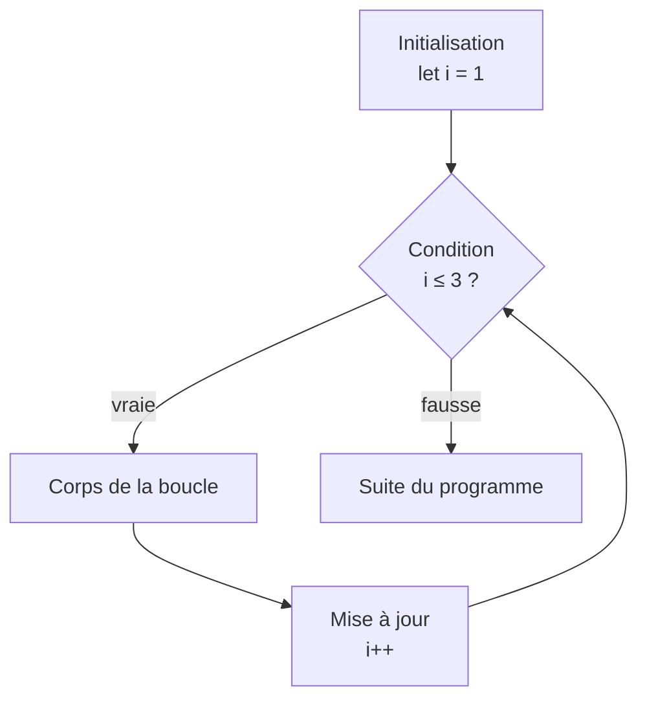

# 05 — Boucles

> **Niveau** : Débutant · **Durée** : ~2 h 30 · **Prérequis** : [Variables](../02-variables/README.md), [Conditions](../04-conditions/README.md)

Parcourir les lignes d'une commande, relancer une connexion jusqu'à ce qu'elle réussisse, lire un fichier ligne par ligne : dès qu'une action se répète, il faut une boucle. JavaScript en propose plusieurs, chacune taillée pour une situation. Ce chapitre les présente toutes, explique comment choisir, et détaille les pièges qui produisent les bogues les plus tenaces : boucle infinie, décalage d'un, tableau modifié pendant son parcours.

## Objectifs

- Écrire des boucles `for`, `while` et `do…while` et prévoir exactement leur nombre de tours.
- Parcourir tableaux, chaînes, `Map`, `Set` et objets avec `for…of`, avec ou sans indice.
- Expliquer pourquoi `for…in` ne convient pas aux tableaux.
- Contrôler une boucle avec `break`, `continue` et les étiquettes.
- Éviter les pièges classiques : boucle infinie, décalage d'un, modification pendant le parcours, closures.
- Choisir entre une boucle et une méthode de tableau, et savoir ce qui compte vraiment pour la performance.

## Sommaire

- [La boucle for](#la-boucle-for)
- [La boucle while](#la-boucle-while)
- [La boucle do…while](#la-boucle-dowhile)
- [La boucle for…of](#la-boucle-forof)
- [La boucle for…in](#la-boucle-forin)
- [break, continue et étiquettes](#break-continue-et-étiquettes)
- [Boucles imbriquées](#boucles-imbriquées)
- [Boucles et closures](#boucles-et-closures)
- [Un aperçu de l'itération asynchrone](#un-aperçu-de-litération-asynchrone)
- [Boucles ou méthodes de tableau ?](#boucles-ou-méthodes-de-tableau-)
- [Performance : ce qui compte vraiment](#performance--ce-qui-compte-vraiment)
- [Choisir la bonne boucle](#choisir-la-bonne-boucle)
- [Pièges courants](#pièges-courants)
- [Bonnes pratiques](#bonnes-pratiques)
- [Résumé](#résumé)
- [Exercices](#exercices)
- [Pour aller plus loin](#pour-aller-plus-loin)

## La boucle for

### Anatomie

La boucle `for` réunit sur une ligne les trois ingrédients d'un comptage : une **initialisation**, une **condition** et une **mise à jour**.

```js
for (let i = 1; i <= 3; i++) {
  console.log(`Tour ${i}`);
}
// Tour 1
// Tour 2
// Tour 3
```

L'ordre d'exécution est toujours le même :



1. L'initialisation s'exécute **une seule fois**.
2. La condition est testée **avant chaque tour** : si elle est fausse dès le départ, le corps ne s'exécute jamais.
3. La mise à jour s'exécute **après chaque tour**, puis la condition est de nouveau testée.

Déclarez le compteur avec `let` : il n'existe que dans la boucle. Avec `const`, la première mise à jour échoue.

<!-- no-run -->

```js
for (const i = 0; i < 3; i++) {} // ❌ TypeError: Assignment to constant variable.
```

### Compter autrement

Le compteur peut descendre, avancer par pas, ou il peut y en avoir deux :

```js
// À rebours
for (let i = 3; i > 0; i--) {
  console.log(i);
}
console.log("Partez !");
// 3
// 2
// 1
// Partez !

// Par pas de 2
const anneesPaires = [];
for (let annee = 2020; annee <= 2026; annee += 2) {
  anneesPaires.push(annee);
}
console.log(anneesPaires); // [ 2020, 2022, 2024, 2026 ]
```

Deux indices qui se rapprochent, l'un depuis le début, l'autre depuis la fin, permettent par exemple de tester un palindrome :

```js
function estPalindrome(mot) {
  for (let i = 0, j = mot.length - 1; i < j; i++, j--) {
    if (mot[i] !== mot[j]) return false;
  }
  return true;
}

console.log(estPalindrome("kayak")); // true
console.log(estPalindrome("canoë")); // false
```

Chacune des trois parties est facultative. `for (;;)` est une boucle sans fin, dont on sort avec `break` ; on lui préfère généralement un `while` à la condition explicite.

### Parcourir un tableau par indice

Les indices d'un tableau vont de `0` à `length - 1`. La condition s'écrit donc avec `<`, jamais avec `<=` :

```js
const etapes = ["Préchauffer le four", "Mélanger", "Enfourner"];

for (let i = 0; i < etapes.length; i++) {
  console.log(`${i + 1}. ${etapes[i]}`);
}
// 1. Préchauffer le four
// 2. Mélanger
// 3. Enfourner
```

Le `for` classique reste utile quand on a besoin de l'indice pour autre chose que lire la valeur : comparer avec l'élément voisin, avancer par pas, parcourir à l'envers. Pour simplement lire chaque valeur, [`for…of`](#la-boucle-forof) est plus direct.

## La boucle while

`while` répète un bloc **tant qu'une condition est vraie**. On l'utilise quand le nombre de tours n'est pas connu à l'avance.

```js
// En combien d'années un capital double-t-il à 3 % par an ?
let capital = 1000;
let annees = 0;

while (capital < 2000) {
  capital *= 1.03;
  annees++;
}

console.log(annees); // 24
console.log(capital.toFixed(2)); // 2032.79
```

Autre usage typique : consommer une file de tâches jusqu'à ce qu'elle soit vide.

```js
const file = ["laver", "sécher", "plier"];

while (file.length > 0) {
  const tache = file.shift(); // retire et renvoie le premier élément
  console.log(`En cours : ${tache}`);
}
// En cours : laver
// En cours : sécher
// En cours : plier

console.log(file.length); // 0
```

Le corps doit faire évoluer quelque chose dont dépend la condition (`capital`, `file.length`) ; sinon la boucle ne s'arrête jamais. Quand la fin dépend d'un facteur extérieur, ajoutez un garde-fou :

```js
const MAX_TENTATIVES = 5;
let tentatives = 0;
let connecte = false;

function essayerDeSeConnecter(numero) {
  return numero === 3; // simulation : la 3e tentative réussit
}

while (!connecte && tentatives < MAX_TENTATIVES) {
  tentatives++;
  connecte = essayerDeSeConnecter(tentatives);
}

console.log(connecte, tentatives); // true 3
```

Le chapitre [async/await](../20-async-await/README.md) montre la version réaliste de ce motif, avec un délai croissant entre les tentatives.

## La boucle do…while

`do…while` teste sa condition **après** le corps : celui-ci s'exécute donc **au moins une fois**. C'est utile quand la condition porte sur un résultat produit par le corps lui-même, par exemple redemander une saisie tant qu'elle est invalide.

```js
// Simulation de saisies successives d'un utilisateur
const saisies = ["", "douze", "12"];

let saisie;
let essais = 0;
do {
  saisie = saisies[essais];
  essais++;
} while (Number.isNaN(Number.parseInt(saisie, 10)));

console.log(`« ${saisie} » accepté après ${essais} essais`);
// « 12 » accepté après 3 essais
```

Comparez avec `while`, qui peut ne jamais exécuter son corps :

```js
let n = 10;

while (n < 5) {
  console.log("while :", n); // jamais affiché
}

do {
  console.log("do…while :", n); // do…while : 10
} while (n < 5);
```

En pratique, `do…while` est rare : la plupart des boucles s'écrivent plus naturellement avec `for`, `for…of` ou `while`.

## La boucle for…of

`for…of` (ES2015) parcourt les **valeurs** de tout objet **itérable** : tableaux, chaînes, `Map`, `Set`, `arguments`, `NodeList` du DOM, générateurs… C'est la boucle à utiliser par défaut pour lire une collection.

```js
const couleurs = ["rouge", "vert", "bleu"];

for (const couleur of couleurs) {
  console.log(couleur);
}
// rouge
// vert
// bleu
```

La variable peut être déclarée avec `const` : chaque tour crée une nouvelle variable, qui n'est jamais réaffectée dans le corps.

### Obtenir aussi l'indice

La méthode `entries()` produit des paires `[indice, valeur]`, que l'on déstructure directement (la déstructuration est détaillée au chapitre [Syntaxe moderne](../11-syntaxe-moderne/README.md)) :

```js
const podium = ["Léa", "Malik", "Zoé"];

for (const [indice, nom] of podium.entries()) {
  console.log(`${indice + 1}e : ${nom}`);
}
// 1e : Léa
// 2e : Malik
// 3e : Zoé
```

### Les chaînes

Une chaîne est itérable caractère par caractère. Contrairement à l'accès par indice, `for…of` parcourt les **points de code** Unicode : un émoji n'est pas coupé en deux.

```js
const message = "Bon 🍕";

console.log(message.length); // 6 : l'émoji occupe deux unités de code

for (const caractere of message) {
  console.log(caractere);
}
// B
// o
// n
//
// 🍕
```

Certains symboles visibles sont pourtant formés de plusieurs points de code (drapeaux, familles d'émojis, lettres accentuées décomposées). Pour les compter comme on les voit, il faut `Intl.Segmenter`, présenté au chapitre [Chaînes de caractères](../07-chaines/README.md).

### Map et Set

Une `Map` produit des paires `[clé, valeur]`, un `Set` ses valeurs, dans l'ordre d'insertion (voir [Collections](../12-collections/README.md)) :

```js
const stocks = new Map([
  ["pommes", 12],
  ["poires", 0],
  ["kiwis", 7],
]);

for (const [fruit, quantite] of stocks) {
  console.log(`${fruit} : ${quantite}`);
}
// pommes : 12
// poires : 0
// kiwis : 7

const etiquettes = new Set(["bio", "local", "bio", "promo"]);
for (const etiquette of etiquettes) {
  console.log(etiquette);
}
// bio
// local
// promo
```

### Les objets ne sont pas itérables

Un objet littéral n'est pas itérable : `for…of` lève une erreur.

```js
const commande = { id: 42, total: 59.9 };

try {
  for (const valeur of commande) {
    console.log(valeur);
  }
} catch (erreur) {
  console.log(erreur.message); // commande is not iterable
}
```

Pour parcourir un objet, on passe par `Object.keys()`, `Object.values()` ou `Object.entries()`, qui renvoient des tableaux de ses propriétés **propres** (voir [Objets](../10-objets/README.md)) :

```js
const prix = { cafe: 2.2, the: 2.5, chocolat: 3 };

for (const [boisson, montant] of Object.entries(prix)) {
  console.log(`${boisson} : ${montant.toFixed(2)} €`);
}
// cafe : 2.20 €
// the : 2.50 €
// chocolat : 3.00 €

let total = 0;
for (const montant of Object.values(prix)) {
  total += montant;
}
console.log(total); // 7.7
```

Rendre ses propres objets itérables (`Symbol.iterator`, générateurs) est l'objet du chapitre [Itérateurs et générateurs](../13-iterateurs-generateurs/README.md).

## La boucle for…in

`for…in` parcourt les **noms des propriétés énumérables** d'un objet, sous forme de chaînes, y compris celles **héritées** de son prototype.

```js
const utilisateur = { prenom: "Inès", ville: "Nantes", age: 31 };

for (const cle in utilisateur) {
  console.log(`${cle} = ${utilisateur[cle]}`);
}
// prenom = Inès
// ville = Nantes
// age = 31
```

Depuis ES2020, l'ordre de parcours est spécifié : d'abord les clés qui ressemblent à des indices (`"0"`, `"1"`…) dans l'ordre croissant, puis les autres clés dans leur ordre de création.

### Pourquoi l'éviter sur les tableaux

Sur un tableau, `for…in` donne les indices… sous forme de **chaînes**, et il inclut toute propriété ajoutée au tableau :

```js
const notes = [12, 15];
notes.commentaire = "trimestre 1"; // une propriété qui n'est pas un élément

for (const i in notes) {
  console.log(i, typeof i, i + 1);
}
// 0 string 01          ← "0" + 1 donne "01", pas 1
// 1 string 11
// commentaire string commentaire1

for (const note of notes) {
  console.log(note); // seulement 12 puis 15
}
```

Il parcourrait aussi une méthode énumérable ajoutée à `Array.prototype` par une vieille bibliothèque. Pour un tableau, utilisez `for…of`, un `for` classique ou une méthode de tableau.

### Propriétés héritées

Sur un objet qui hérite d'un autre, `for…in` remonte la chaîne de prototypes (voir [Objets](../10-objets/README.md)) :

```js
const reglagesParDefaut = { langue: "fr", theme: "clair" };
const reglages = Object.create(reglagesParDefaut); // hérite des défauts
reglages.theme = "sombre";

for (const cle in reglages) {
  console.log(cle, Object.hasOwn(reglages, cle) ? "(propre)" : "(héritée)");
}
// theme (propre)
// langue (héritée)

console.log(Object.keys(reglages)); // [ 'theme' ]
```

C'est parfois ce que l'on veut, souvent non. `Object.keys`/`values`/`entries` ne renvoient que les propriétés propres ; c'est le choix par défaut. Si vous gardez `for…in`, filtrez avec `Object.hasOwn(objet, cle)` (ES2022), qui remplace l'ancien `Object.prototype.hasOwnProperty.call(objet, cle)`.

## break, continue et étiquettes

### break : sortir de la boucle

`break` interrompt immédiatement la boucle. C'est utile dès qu'on a trouvé ce qu'on cherchait :

```js
const produits = [
  { nom: "clavier", stock: 4 },
  { nom: "souris", stock: 0 },
  { nom: "écran", stock: 0 },
];

let premierEnRupture = null;
for (const produit of produits) {
  if (produit.stock === 0) {
    premierEnRupture = produit.nom;
    break; // inutile de regarder la suite
  }
}

console.log(premierEnRupture); // souris
```

Dans une fonction, `return` fait la même chose en plus court, puisqu'il quitte à la fois la boucle et la fonction :

```js
function premierEnRupture(produits) {
  for (const produit of produits) {
    if (produit.stock === 0) return produit.nom;
  }
  return null;
}

console.log(premierEnRupture([{ nom: "câble", stock: 3 }])); // null
```

### continue : passer au tour suivant

`continue` abandonne le tour en cours et passe au suivant. C'est la [clause de garde](../04-conditions/README.md) des boucles : on écarte d'abord les éléments à ignorer, puis on traite les autres sans imbrication.

```js
const lignes = ["# commentaire", "nom=Alice", "", "ville=Lille"];
const config = {};

for (const ligne of lignes) {
  if (ligne === "" || ligne.startsWith("#")) continue;

  const [cle, valeur] = ligne.split("=");
  config[cle] = valeur;
}

console.log(config); // { nom: 'Alice', ville: 'Lille' }
```

### Étiquettes pour les boucles imbriquées

`break` et `continue` ne concernent que la boucle **la plus proche**. Pour agir sur une boucle extérieure, on la nomme avec une **étiquette** :

```js
// Trouver le premier siège libre d'une salle (X = occupé, _ = libre)
const salle = [
  ["X", "X", "X"],
  ["X", "_", "X"],
  ["_", "_", "_"],
];

let place = null;
recherche: for (let rang = 0; rang < salle.length; rang++) {
  for (let siege = 0; siege < salle[rang].length; siege++) {
    if (salle[rang][siege] === "_") {
      place = { rang, siege };
      break recherche; // sort des deux boucles d'un coup
    }
  }
}

console.log(place); // { rang: 1, siege: 1 }
```

`continue etiquette` fonctionne de la même façon et passe au tour suivant de la boucle étiquetée. Les étiquettes sont légitimes mais rares ; extraire la recherche dans une fonction et utiliser `return` donne souvent un code plus clair :

```js
function premierSiegeLibre(salle) {
  for (const [rang, sieges] of salle.entries()) {
    for (const [siege, etat] of sieges.entries()) {
      if (etat === "_") return { rang, siege };
    }
  }
  return null;
}

console.log(premierSiegeLibre([["X", "_"]])); // { rang: 0, siege: 1 }
```

### break dans un switch dans une boucle

Dans un `switch`, `break` sort du `switch`, **pas** de la boucle qui l'entoure :

```js
const evenements = ["clic", "clic", "fin", "clic"];
let clics = 0;

for (const evenement of evenements) {
  switch (evenement) {
    case "clic":
      clics++;
      break;
    case "fin":
      break; // ❌ ne sort que du switch : la boucle continue
  }
}

console.log(clics); // 3, alors qu'on voulait s'arrêter à « fin » (2)
```

Pour sortir de la boucle, utilisez une étiquette (`break boucle`), un `return` dans une fonction, ou remplacez le `switch` par un `if`.

## Boucles imbriquées

Une boucle dans une boucle parcourt toutes les combinaisons. C'est naturel pour une grille ou un tableau à deux dimensions :

```js
const lignes = [];

for (let ligne = 1; ligne <= 3; ligne++) {
  const cases = [];
  for (let colonne = 1; colonne <= 4; colonne++) {
    cases.push(String(ligne * colonne).padStart(3));
  }
  lignes.push(cases.join(""));
}

console.log(lignes.join("\n"));
//   1  2  3  4
//   2  4  6  8
//   3  6  9 12
```

### Attention au coût

Le nombre de tours est le **produit** des tailles : 3 × 4 = 12 ici, mais 10 000 × 10 000 = 100 millions pour deux listes de 10 000 éléments. Le piège est souvent caché : `includes` ou `indexOf` dans une boucle sont eux-mêmes des boucles.

```js
const inscrits = ["ana", "bruno", "chloe", "diego"];
const presents = ["chloe", "eva", "ana"];

// ❌ includes reparcourt « inscrits » à chaque tour : n × m comparaisons
const communs1 = [];
for (const nom of presents) {
  if (inscrits.includes(nom)) communs1.push(nom);
}

// ✅ Un Set répond en temps quasi constant : n + m opérations
const ensembleInscrits = new Set(inscrits);
const communs2 = [];
for (const nom of presents) {
  if (ensembleInscrits.has(nom)) communs2.push(nom);
}

console.log(communs1, communs2); // [ 'chloe', 'ana' ] [ 'chloe', 'ana' ]
```

Sur quatre éléments, la différence est invisible ; sur des dizaines de milliers, elle sépare une réponse instantanée d'une page figée (voir [Performance](#performance--ce-qui-compte-vraiment)). Le chapitre [Tableaux](../09-tableaux/README.md) revient sur ces questions de complexité.

## Boucles et closures

Une fonction créée dans une boucle « se souvient » des variables qu'elle utilise (c'est une **closure**, étudiée au chapitre [Fonctions](../06-fonctions/README.md)). La façon dont le compteur est déclaré change alors tout.

```js
// ❌ var : une seule variable i, partagée par tous les tours
for (var i = 0; i < 3; i++) {
  setTimeout(() => console.log("var :", i), 0);
}

// ✅ let : une nouvelle variable j à chaque tour
for (let j = 0; j < 3; j++) {
  setTimeout(() => console.log("let :", j), 0);
}
// var : 3
// var : 3
// var : 3
// let : 0
// let : 1
// let : 2
```

Les rappels de `setTimeout` s'exécutent après la fin des boucles. Avec `var`, il n'existe qu'une variable `i`, qui vaut 3 à ce moment-là. Avec `let`, la spécification crée une **nouvelle liaison à chaque tour**, initialisée avec la valeur du tour précédent : chaque rappel capture la sienne.

Avant ES2015, on contournait le problème avec une fonction immédiatement invoquée (IIFE) qui recevait `i` en paramètre. Avec `let`, ce n'est plus nécessaire ; c'est une raison de plus de ne jamais utiliser `var` (voir [Variables](../02-variables/README.md)).

## Un aperçu de l'itération asynchrone

Une boucle `for…of` peut contenir `await` (dans une fonction `async` ou au niveau supérieur d'un module). Chaque tour attend alors la fin du précédent : les opérations sont **séquentielles**.

```js
import { setTimeout as attendre } from "node:timers/promises";

async function envoyer(message) {
  await attendre(50); // simule un appel réseau
  return `« ${message} » envoyé`;
}

for (const message of ["bonjour", "ça va ?", "à bientôt"]) {
  console.log(await envoyer(message));
}
// « bonjour » envoyé
// « ça va ? » envoyé
// « à bientôt » envoyé
```

`for await…of` (ES2018) va plus loin : il parcourt un **itérable asynchrone**, dont chaque valeur arrive plus tard. Par exemple, l'interface `readline` de Node.js fournit les lignes d'un fichier au fur et à mesure de sa lecture, sans le charger entièrement en mémoire :

```js
import { createReadStream } from "node:fs";
import { writeFile } from "node:fs/promises";
import { createInterface } from "node:readline";

await writeFile("journal.txt", "connexion\nachat\ndéconnexion\n");

const lignes = createInterface({ input: createReadStream("journal.txt") });
let numero = 0;
for await (const ligne of lignes) {
  numero++;
  console.log(`${numero} : ${ligne}`);
}
// 1 : connexion
// 2 : achat
// 3 : déconnexion
```

> [!WARNING]
> `forEach` n'attend pas les fonctions `async` qu'on lui passe : `tableau.forEach(async (x) => await …)` lance tout en même temps et continue sans attendre. Utilisez `for…of` pour du séquentiel, `Promise.all` pour du parallèle. Ces motifs (séquentiel, parallèle, concurrence limitée) sont détaillés au chapitre [async/await](../20-async-await/README.md).

## Boucles ou méthodes de tableau ?

Les tableaux disposent de méthodes qui encapsulent les boucles les plus courantes : `map` (transformer), `filter` (sélectionner), `reduce` (agréger), `find`, `some`, `every`… Elles sont présentées en détail au chapitre [Tableaux](../09-tableaux/README.md). Voici la même tâche écrite de trois façons :

```js
const commandes = [
  { client: "Ana", total: 120, statut: "payee" },
  { client: "Bruno", total: 45, statut: "annulee" },
  { client: "Chloé", total: 310, statut: "payee" },
  { client: "Diego", total: 80, statut: "payee" },
];

// 1. for classique
const gros1 = [];
for (let i = 0; i < commandes.length; i++) {
  if (commandes[i].statut === "payee" && commandes[i].total >= 100) {
    gros1.push(commandes[i].client);
  }
}

// 2. for…of
const gros2 = [];
for (const commande of commandes) {
  if (commande.statut === "payee" && commande.total >= 100) {
    gros2.push(commande.client);
  }
}

// 3. Méthodes de tableau
const gros3 = commandes
  .filter((c) => c.statut === "payee" && c.total >= 100)
  .map((c) => c.client);

console.log(gros1, gros2, gros3);
// [ 'Ana', 'Chloé' ] [ 'Ana', 'Chloé' ] [ 'Ana', 'Chloé' ]
```

La troisième version dit **ce que** l'on veut (« les clients des commandes payées d'au moins 100 € ») plutôt que **comment** le calculer, et ne manipule aucun tableau intermédiaire à la main. Les boucles gardent l'avantage dès que le contrôle du déroulement compte.

|                               | `for`              | `for…of`        | `forEach`                          | `map`, `filter`, `reduce`…                           |
| ----------------------------- | ------------------ | --------------- | ---------------------------------- | ---------------------------------------------------- |
| Indice disponible             | oui                | via `entries()` | oui (2e argument)                  | oui (2e argument)                                    |
| `break` / `continue`          | oui                | oui             | non                                | non (`find`, `some`, `every` s'arrêtent d'eux-mêmes) |
| `await` attendu à chaque tour | oui                | oui             | **non**                            | non                                                  |
| Produit un résultat           | non                | non             | non (`undefined`)                  | oui                                                  |
| Fonctionne sur                | ce qui a un indice | tout itérable   | tableaux, `Map`, `Set`, `NodeList` | tableaux                                             |

Une précision sur `forEach` : `return` dans son rappel ne fait que passer à l'élément suivant, comme un `continue`. Il n'existe aucun moyen propre de l'interrompre.

```js
const vus = [];
[1, 2, 3, 4].forEach((n) => {
  if (n === 2) return; // passe seulement à l'élément suivant
  vus.push(n);
});
console.log(vus); // [ 1, 3, 4 ]
```

En résumé :

- pour **transformer, filtrer ou agréger** un tableau, préférez les méthodes ;
- pour **chercher** un élément, `find`, `findIndex`, `some` ou `includes` ;
- pour **sortir tôt**, enchaîner des opérations **asynchrones** une à une, ou parcourir un itérable qui n'est pas un tableau, utilisez `for…of` ;
- pour un **comptage** ou un parcours qui manipule les indices, utilisez `for`.

> [!TIP]
> Les **Iterator helpers** (ES2025, disponibles dans Node.js 22+ et dans les navigateurs depuis 2025) apportent `map`, `filter`, `take`… aux itérateurs, de façon **paresseuse** : rien n'est calculé au-delà du nécessaire. Par exemple, `tableau.values().filter(estPair).take(2).toArray()` s'arrête dès les deux premiers résultats. Ils sont présentés au chapitre [Itérateurs et générateurs](../13-iterateurs-generateurs/README.md).

## Performance : ce qui compte vraiment

### Les micro-optimisations d'hier

On trouve encore, dans d'anciens articles (et dans d'anciennes versions de ce cours), des conseils comme ceux-ci :

<!-- no-run -->

```js
// Conseils datés : ne les appliquez pas par réflexe
for (let i = 0, n = tableau.length; i < n; i++) {} // mettre length en cache
for (let i = tableau.length - 1; i >= 0; i--) {} // boucler à l'envers
for (let i = 0; i < n; ++i) {} // préférer ++i à i++
const resultats = new Array(source.length); // pré-allouer le tableau
// … et « dérouler » la boucle à la main, 4 éléments par tour
```

Ils datent de l'époque où les moteurs JavaScript **interprétaient** le code ligne à ligne. Aujourd'hui, V8 (Chrome, Node.js, Deno), SpiderMonkey (Firefox) et JavaScriptCore (Safari, Bun) compilent à la volée (JIT) les boucles exécutées souvent, et appliquent eux-mêmes ce genre de transformations. Résultat :

- la différence, quand elle existe, est noyée dans le coût du travail fait **dans** la boucle ;
- ces formes sont plus difficiles à lire, et certaines changent le comportement : mettre `length` en cache donne un résultat faux si le tableau change pendant la boucle ;
- certaines sont même contre-productives : `new Array(n)` crée un tableau « à trous », que V8 optimise moins bien qu'un tableau rempli au fur et à mesure.

Écrivez la boucle la plus lisible. Ne la retouchez pour la performance qu'après avoir **mesuré** un problème.

### Ce qui fait vraiment la différence

1. **La complexité de l'algorithme.** Passer de n × m opérations à n + m (un `Set` au lieu d'un `includes` dans une boucle, comme [plus haut](#attention-au-coût)) change tout ; gagner quelques pour cent sur un `i++` ne change rien.
2. **Le travail répété inutilement.** Ce qui ne dépend pas du tour (une expression régulière, un `JSON.parse`, une recherche dans le DOM) se calcule **avant** la boucle.
3. **Le DOM.** Dans le navigateur, modifier la page à chaque tour peut provoquer de coûteux recalculs de mise en page ; on regroupe les modifications (voir [DOM](../23-dom/README.md)).
4. **Les attentes en série.** Un `await` dans une boucle sur des opérations indépendantes les enchaîne une à une ; `Promise.all` les lance ensemble (voir [async/await](../20-async-await/README.md)).

Pour mesurer, `performance.now()` suffit pour une première idée :

```js
const N = 10_000;
const inscrits = Array.from({ length: N }, (_, i) => `membre${i}`);
const presents = Array.from({ length: N }, (_, i) => `membre${i * 2}`);

function compterAvecIncludes() {
  let communs = 0;
  for (const nom of presents) {
    if (inscrits.includes(nom)) communs++;
  }
  return communs;
}

function compterAvecSet() {
  const ensemble = new Set(inscrits);
  let communs = 0;
  for (const nom of presents) {
    if (ensemble.has(nom)) communs++;
  }
  return communs;
}

for (const methode of [compterAvecIncludes, compterAvecSet]) {
  const debut = performance.now();
  const resultat = methode();
  const duree = (performance.now() - debut).toFixed(1);
  console.log(`${methode.name} : ${resultat} communs en ${duree} ms`);
}
// Les durées varient selon la machine ; l'écart, lui, est de plusieurs
// dizaines de fois en faveur du Set.
```

Pour des comparaisons fiables, utilisez le profileur des DevTools ou une bibliothèque de mesure comme [tinybench](https://github.com/tinylibs/tinybench) ou [mitata](https://github.com/evanwashere/mitata), qui répètent les mesures et tiennent compte du temps de « chauffe » du JIT.

## Choisir la bonne boucle

| Situation                                                              | Choix                                                     |
| ---------------------------------------------------------------------- | --------------------------------------------------------- |
| Lire chaque valeur d'un tableau, d'une chaîne, d'une `Map`, d'un `Set` | `for…of`                                                  |
| Besoin de l'indice en plus de la valeur                                | `for…of` + `entries()`, ou `for`                          |
| Compter, avancer par pas, parcourir à l'envers, manier deux indices    | `for`                                                     |
| Répéter tant qu'une condition est vraie, nombre de tours inconnu       | `while`                                                   |
| Exécuter le corps au moins une fois                                    | `do…while`                                                |
| Parcourir les propriétés d'un objet                                    | `for…of` + `Object.entries()` (ou `Object.keys`/`values`) |
| Transformer, filtrer, agréger un tableau                               | `map`, `filter`, `reduce`…                                |
| Traiter des opérations asynchrones l'une après l'autre                 | `for…of` + `await`, ou `for await…of`                     |
| Parcourir les propriétés héritées d'un objet (rare)                    | `for…in`                                                  |

## Pièges courants

**La boucle infinie.** La condition ne devient jamais fausse : compteur qui va dans le mauvais sens (`i--` au lieu de `i++`), variable jamais mise à jour dans un `while`, ou test d'égalité exacte sur des nombres à virgule :

<!-- no-run -->

```js
// ❌ 0.1 n'est pas représentable exactement : x passe de 0.9999999999999999
// à 1.0999999999999999 sans jamais valoir 1
for (let x = 0; x !== 1; x += 0.1) {}

// ✅ Une comparaison d'ordre, ou mieux, un compteur entier
for (let x = 0; x < 1; x += 0.1) {}
for (let i = 0; i < 10; i++) {
  const x = i / 10;
}
```

**Le décalage d'un.** `i <= tableau.length` fait un tour de trop et lit `tableau[tableau.length]`, qui vaut `undefined`. Les indices vont de `0` à `length - 1`.

**Modifier un tableau pendant qu'on le parcourt.** Supprimer un élément décale tous les suivants : l'élément qui prend sa place est sauté.

```js
const nombres = [1, 2, 2, 3, 4, 4, 5];

// ❌ Après chaque splice, l'élément suivant prend l'indice i… et i avance
for (let i = 0; i < nombres.length; i++) {
  if (nombres[i] % 2 === 0) nombres.splice(i, 1);
}
console.log(nombres); // [ 1, 2, 3, 4, 5 ] : un 2 et un 4 ont survécu

// ✅ Construire un nouveau tableau
const impairs = [1, 2, 2, 3, 4, 4, 5].filter((n) => n % 2 !== 0);
console.log(impairs); // [ 1, 3, 5 ]

// ✅ Ou, s'il faut modifier le tableau sur place, le parcourir à l'envers
const enPlace = [1, 2, 2, 3, 4, 4, 5];
for (let i = enPlace.length - 1; i >= 0; i--) {
  if (enPlace[i] % 2 === 0) enPlace.splice(i, 1);
}
console.log(enPlace); // [ 1, 3, 5 ]
```

À l'inverse, ajouter des éléments pendant un `for…of` les fait parcourir aussi, car l'itérateur relit la longueur à chaque tour : un `push` inconditionnel crée une boucle infinie.

**`for…in` sur un tableau.** Les indices sont des chaînes (`"0" + 1` vaut `"01"`) et les propriétés supplémentaires sont parcourues. Utilisez `for…of`.

**`for…of` sur un objet.** `TypeError: … is not iterable`. Utilisez `Object.entries(objet)`.

**`break` dans un `switch`.** Il ne sort que du `switch`. Utilisez une étiquette ou un `return`.

**`var` et les rappels.** Tous les rappels créés dans une boucle `for (var …)` voient la même variable. Utilisez `let`.

**`await` dans `forEach`.** Il n'est pas attendu. Utilisez `for…of` ou `Promise.all`.

## Bonnes pratiques

- Utilisez `for…of` par défaut pour parcourir une collection, et `const` pour sa variable.
- Réservez le `for` classique aux cas où l'indice sert vraiment (pas, sens, voisins, deux indices).
- Pour transformer, filtrer ou agréger un tableau, préférez `map`, `filter`, `reduce` et leurs cousines.
- Parcourez les objets avec `Object.entries`, `Object.keys` ou `Object.values` plutôt qu'avec `for…in`.
- Écartez les cas à ignorer en début de tour avec `continue`, et sortez dès que possible avec `break` ou `return`.
- Extrayez une recherche dans des boucles imbriquées dans une fonction qui `return` plutôt que de multiplier les étiquettes.
- Assurez-vous que chaque `while` fait progresser sa condition ; ajoutez un nombre maximal de tours quand la fin dépend de l'extérieur.
- Ne modifiez pas la structure d'un tableau pendant que vous le parcourez : créez-en un nouveau, ou parcourez-le à l'envers.
- Méfiez-vous des boucles cachées (`includes`, `indexOf`, `find`) à l'intérieur d'une boucle : un `Set` ou une `Map` font souvent mieux.
- Écrivez d'abord le code le plus lisible ; optimisez seulement ce que vous avez mesuré.

## Résumé

- `for` regroupe initialisation, condition (testée avant chaque tour) et mise à jour (après chaque tour) ; il convient aux comptages et aux parcours par indice.
- `while` répète tant qu'une condition est vraie ; `do…while` exécute son corps au moins une fois.
- `for…of` parcourt les valeurs de tout itérable (tableaux, chaînes par point de code, `Map`, `Set`…) ; `entries()` fournit l'indice. Les objets ne sont pas itérables : passez par `Object.entries()`.
- `for…in` parcourt les clés énumérables, héritées comprises, sous forme de chaînes : à éviter sur les tableaux.
- `break` sort de la boucle, `continue` passe au tour suivant, une étiquette cible une boucle extérieure ; dans une fonction, `return` est souvent le plus clair.
- Avec `let`, chaque tour d'un `for` a sa propre variable : les closures capturent la bonne valeur.
- `await` dans `for…of` traite les éléments un par un ; `for await…of` parcourt les itérables asynchrones ; `forEach` n'attend rien.
- La performance d'une boucle dépend de ce qu'elle fait (complexité, travail répété, DOM), pas de la façon d'écrire son compteur.

## Exercices

### Exercice 1 — FizzBuzz (★☆☆)

Pour les nombres de 1 à 15, produisez une liste où chaque multiple de 3 est remplacé par `"Fizz"`, chaque multiple de 5 par `"Buzz"`, et chaque multiple de 3 et de 5 par `"FizzBuzz"`. Affichez le résultat sur une ligne, séparé par des espaces.

<details>
<summary>Solution</summary>

```js
function fizzBuzz(n) {
  if (n % 15 === 0) return "FizzBuzz";
  if (n % 3 === 0) return "Fizz";
  if (n % 5 === 0) return "Buzz";
  return String(n);
}

const resultats = [];
for (let n = 1; n <= 15; n++) {
  resultats.push(fizzBuzz(n));
}

console.log(resultats.join(" "));
// 1 2 Fizz 4 Buzz Fizz 7 8 Fizz Buzz 11 Fizz 13 14 FizzBuzz
```

Le cas « multiple de 3 et de 5 » (donc de 15) doit être testé **en premier**, sinon `n % 3 === 0` l'intercepte. La boucle commence à 1 et utilise `<=` parce qu'on compte de 1 à 15 inclus, et non des indices de tableau. Séparer le calcul (`fizzBuzz`) de la boucle rend chaque partie plus simple à lire et à tester.

</details>

### Exercice 2 — Statistiques de notes (★☆☆)

Écrivez `statistiques(notes)` qui renvoie `{ moyenne, min, max }` en un seul parcours avec `for…of`, sans `Math.min`, `Math.max` ni `reduce`. Pour un tableau vide, la fonction renvoie `null`.

<details>
<summary>Solution</summary>

```js
function statistiques(notes) {
  if (notes.length === 0) return null;

  let somme = 0;
  let min = Infinity;
  let max = -Infinity;

  for (const note of notes) {
    somme += note;
    if (note < min) min = note;
    if (note > max) max = note;
  }

  return { moyenne: somme / notes.length, min, max };
}

console.log(statistiques([12, 15, 9, 18])); // { moyenne: 13.5, min: 9, max: 18 }
console.log(statistiques([])); // null
```

Initialiser `min` à `Infinity` et `max` à `-Infinity` garantit que la première note remplace les deux valeurs. La garde de départ évite une division par zéro (`0 / 0` donnerait `NaN`).

</details>

### Exercice 3 — Compter les voyelles (★★☆)

Écrivez `compterVoyelles(texte)` qui compte les voyelles d'un texte, accentuées ou non, majuscules comprises. Testez-la sur `"Une forêt enchantée"`.

<details>
<summary>Solution</summary>

```js
const VOYELLES = new Set("aeiouyàâäéèêëîïôöùûüÿ");

function compterVoyelles(texte) {
  let total = 0;
  for (const caractere of texte.normalize("NFC").toLowerCase()) {
    if (VOYELLES.has(caractere)) total++;
  }
  return total;
}

console.log(compterVoyelles("Une forêt enchantée")); // 8
console.log(compterVoyelles("RYTHME")); // 2 (le y compte)
```

- Une chaîne est itérable : `new Set("aeiou…")` construit l'ensemble de ses caractères, et `for…of` parcourt le texte caractère par caractère.
- `toLowerCase()` permet de ne lister que les minuscules.
- `normalize("NFC")` recompose les lettres accentuées écrites en deux points de code (`e` + accent combinant), pour qu'elles correspondent à celles de l'ensemble (voir [Chaînes de caractères](../07-chaines/README.md)).
- `Set.has` est plus rapide que `includes` sur une chaîne, même si la différence est ici négligeable.

</details>

### Exercice 4 — Premier doublon (★★☆)

Écrivez `premierDoublon(valeurs)` qui renvoie la première valeur rencontrée pour la **deuxième** fois, ou `undefined` s'il n'y en a pas. La fonction doit s'arrêter dès qu'elle trouve.

<details>
<summary>Solution</summary>

```js
function premierDoublon(valeurs) {
  const dejaVues = new Set();
  for (const valeur of valeurs) {
    if (dejaVues.has(valeur)) return valeur;
    dejaVues.add(valeur);
  }
  return undefined;
}

console.log(premierDoublon(["fr", "de", "it", "de", "fr"])); // de
console.log(premierDoublon([3, 1, 4, 1, 5, 9, 2, 6, 5])); // 1
console.log(premierDoublon([1, 2, 3])); // undefined
```

`return` interrompt la boucle dès le premier doublon. Le `Set` mémorise les valeurs déjà rencontrées : chaque test est quasi instantané, alors qu'une recherche avec `indexOf` dans la partie déjà parcourue rendrait l'algorithme quadratique.

</details>

### Exercice 5 — Retirer sans rien oublier (★★☆)

Ce code doit retirer **sur place** les produits en rupture de stock (d'autres parties du programme utilisent le même tableau), mais il en oublie. Expliquez pourquoi, puis corrigez-le.

<!-- no-run -->

```js
const catalogue = [
  { nom: "stylo", stock: 0 },
  { nom: "gomme", stock: 0 },
  { nom: "règle", stock: 5 },
  { nom: "compas", stock: 0 },
];

for (let i = 0; i < catalogue.length; i++) {
  if (catalogue[i].stock === 0) {
    catalogue.splice(i, 1);
  }
}
// attendu : [ { nom: 'règle', stock: 5 } ]
```

<details>
<summary>Solution</summary>

Quand `splice(0, 1)` retire le stylo, la gomme glisse à l'indice 0 ; puis `i` passe à 1 et la gomme n'est jamais examinée. Le résultat contient encore la gomme. Parcourir le tableau **à l'envers** règle le problème : une suppression ne décale que des éléments déjà examinés.

```js
const catalogue = [
  { nom: "stylo", stock: 0 },
  { nom: "gomme", stock: 0 },
  { nom: "règle", stock: 5 },
  { nom: "compas", stock: 0 },
];

for (let i = catalogue.length - 1; i >= 0; i--) {
  if (catalogue[i].stock === 0) {
    catalogue.splice(i, 1);
  }
}

console.log(catalogue); // [ { nom: 'règle', stock: 5 } ]
```

Si la modification sur place n'est pas indispensable, `catalogue.filter((p) => p.stock > 0)` est plus simple et ne touche pas au tableau d'origine.

</details>

### Exercice 6 — La suite de Syracuse (★★★)

Partant d'un entier `n` strictement positif, la suite de Syracuse divise `n` par 2 s'il est pair, et le remplace par `3n + 1` s'il est impair ; on s'arrête en atteignant 1. Écrivez `dureeDeVol(n)`, qui renvoie le nombre d'étapes nécessaires pour atteindre 1, puis trouvez l'entier inférieur à 100 dont la durée de vol est la plus longue.

<details>
<summary>Solution</summary>

```js
function dureeDeVol(n) {
  let etapes = 0;
  while (n !== 1) {
    n = n % 2 === 0 ? n / 2 : 3 * n + 1;
    etapes++;
  }
  return etapes;
}

console.log(dureeDeVol(6)); // 8 (6 → 3 → 10 → 5 → 16 → 8 → 4 → 2 → 1)

let record = { depart: 1, etapes: 0 };
for (let depart = 1; depart < 100; depart++) {
  const etapes = dureeDeVol(depart);
  if (etapes > record.etapes) {
    record = { depart, etapes };
  }
}

console.log(record); // { depart: 97, etapes: 118 }
```

- `while` convient à `dureeDeVol`, car on ignore combien d'étapes il faudra ; `for` convient à la recherche, qui parcourt un intervalle connu.
- Le paramètre `n` est réaffecté dans la fonction : c'est sans effet pour l'appelant, car un nombre est passé par valeur.
- On n'a jamais prouvé que la suite atteint toujours 1 (c'est la célèbre conjecture de Syracuse) ; elle a été vérifiée pour des nombres gigantesques, mais une boucle `while` sur une condition non démontrée mérite en général un garde-fou.

</details>

### Exercice 7 — Deux nombres pour une somme (★★★)

Écrivez `trouverPaire(nombres, cible)` qui renvoie les indices `[i, j]` (avec `i < j`) des deux premiers nombres dont la somme vaut `cible`, ou `null`. Écrivez d'abord une version avec deux boucles imbriquées, puis une version en un seul parcours.

<details>
<summary>Solution</summary>

```js
// Version 1 : toutes les paires, environ n² / 2 tours
function trouverPaireNaif(nombres, cible) {
  for (let i = 0; i < nombres.length; i++) {
    for (let j = i + 1; j < nombres.length; j++) {
      if (nombres[i] + nombres[j] === cible) return [i, j];
    }
  }
  return null;
}

// Version 2 : un seul parcours, en mémorisant les nombres déjà vus
function trouverPaire(nombres, cible) {
  const indiceDe = new Map(); // nombre → indice où il a été vu
  for (const [j, nombre] of nombres.entries()) {
    const complement = cible - nombre;
    if (indiceDe.has(complement)) return [indiceDe.get(complement), j];
    if (!indiceDe.has(nombre)) indiceDe.set(nombre, j);
  }
  return null;
}

console.log(trouverPaireNaif([2, 7, 11, 15], 9)); // [ 0, 1 ]
console.log(trouverPaire([2, 7, 11, 15], 9)); // [ 0, 1 ]
console.log(trouverPaire([3, 2, 4], 6)); // [ 1, 2 ]
console.log(trouverPaire([1, 2, 3], 10)); // null
```

- Dans la version naïve, `j` démarre à `i + 1` : on ne compare pas un nombre avec lui-même ni deux fois la même paire. Le `return` sort des deux boucles d'un coup, sans étiquette.
- La version 2 se demande, pour chaque nombre, si son **complément** (`cible - nombre`) a déjà été vu. La `Map` répond en temps quasi constant : on passe d'environ n² / 2 tours à n tours, soit 5 000 fois moins de travail pour 10 000 nombres.
- Pour `[3, 2, 4]` et la cible 6, la version 2 ne renvoie pas `[0, 0]` : le 3 n'est ajouté à la `Map` qu'**après** la recherche de son complément.

</details>

## Pour aller plus loin

- [MDN — Boucles et itération](https://developer.mozilla.org/fr/docs/Web/JavaScript/Guide/Loops_and_iteration)
- [MDN — for...of](https://developer.mozilla.org/fr/docs/Web/JavaScript/Reference/Statements/for...of)
- [MDN — for...in](https://developer.mozilla.org/fr/docs/Web/JavaScript/Reference/Statements/for...in)
- [MDN — label](https://developer.mozilla.org/fr/docs/Web/JavaScript/Reference/Statements/label)
- [MDN — for await...of](https://developer.mozilla.org/fr/docs/Web/JavaScript/Reference/Statements/for-await...of)
- [MDN — Protocoles d'itération](https://developer.mozilla.org/fr/docs/Web/JavaScript/Reference/Iteration_protocols)
- [V8 — Elements kinds in V8](https://v8.dev/blog/elements-kinds) (pourquoi les tableaux « à trous » sont plus lents)

---

[← Conditions](../04-conditions/README.md) · [Sommaire](../README.md#sommaire) · [Fonctions →](../06-fonctions/README.md)
