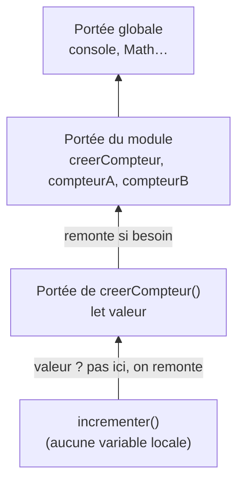
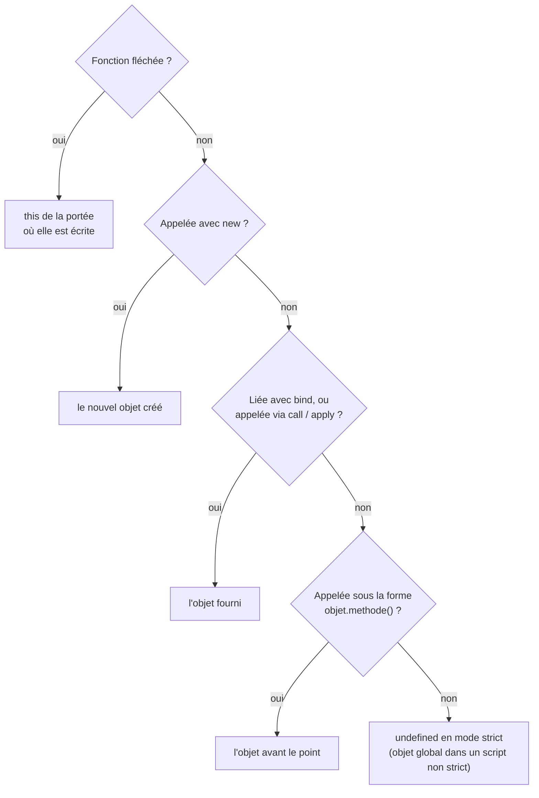

# 06 — Fonctions

> **Niveau** : Débutant à intermédiaire · **Durée** : ~4 h · **Prérequis** : [Variables](../02-variables/README.md), [Conditions](../04-conditions/README.md), [Boucles](../05-boucles/README.md)

Une fonction donne un nom à un calcul, permet de le réutiliser et de le tester isolément. En JavaScript, elle est aussi une **valeur** comme une autre : on peut la ranger dans une variable, la passer en argument, la renvoyer depuis une autre fonction. C'est ce qui rend possibles les closures, les callbacks, la composition, et une bonne partie du JavaScript moderne. La première moitié du chapitre pose les bases ; la seconde (closures, `this`, fonctions d'ordre supérieur, mémoïsation) est ce qui sépare l'usage hésitant de la vraie aisance.

## Objectifs

- Créer une fonction de quatre façons (déclaration, expression, fléchée, méthode) et choisir la bonne.
- Utiliser les paramètres par défaut, les paramètres du reste et un objet d'options.
- Expliquer la portée lexicale et ce qu'une closure capture, et s'en servir pour encapsuler un état.
- Écrire des fonctions d'ordre supérieur : recevoir et renvoyer des fonctions.
- Distinguer fonction pure et effet de bord, et écrire une fonction récursive qui ne fait pas exploser la pile.
- Prévoir la valeur de `this` selon la façon dont une fonction est appelée, et la fixer avec `bind` ou une fonction fléchée.
- Composer, curryfier et mémoïser des fonctions.

## Sommaire

- [Définir et appeler une fonction](#définir-et-appeler-une-fonction)
- [Quatre façons de créer une fonction](#quatre-façons-de-créer-une-fonction)
- [Les fonctions sont des valeurs](#les-fonctions-sont-des-valeurs)
- [Paramètres](#paramètres)
- [Valeurs de retour](#valeurs-de-retour)
- [Hissage des fonctions](#hissage-des-fonctions)
- [Portée lexicale](#portée-lexicale)
- [Les closures](#les-closures)
- [Fonctions d'ordre supérieur et callbacks](#fonctions-dordre-supérieur-et-callbacks)
- [Fonctions pures et effets de bord](#fonctions-pures-et-effets-de-bord)
- [La récursion](#la-récursion)
- [Les IIFE, un héritage](#les-iife-un-héritage)
- [Le mot-clé this](#le-mot-clé-this)
- [Composer des fonctions](#composer-des-fonctions)
- [Application partielle et currying](#application-partielle-et-currying)
- [La mémoïsation](#la-mémoïsation)
- [D'autres sortes de fonctions](#dautres-sortes-de-fonctions)
- [Pièges courants](#pièges-courants)
- [Bonnes pratiques](#bonnes-pratiques)
- [Résumé](#résumé)
- [Exercices](#exercices)
- [Pour aller plus loin](#pour-aller-plus-loin)

## Définir et appeler une fonction

Sans fonction, le même calcul se recopie partout où il sert, avec le risque de corriger une copie et d'oublier les autres :

```js
// ❌ La même formule, recopiée
const prixLivre = 15 * 1.055;
const prixCasque = 80 * 1.2;
const prixCahier = 3 * 1.2;
console.log(prixLivre, prixCasque, prixCahier); // 15.825 96 3.5999999999999996
```

Une fonction nomme ce calcul une fois pour toutes :

```js
// ✅ Le calcul a un nom, et une seule définition
function prixTTC(prixHT, taux = 0.2) {
  return Math.round(prixHT * (1 + taux) * 100) / 100;
}

console.log(prixTTC(15, 0.055)); // 15.83
console.log(prixTTC(80)); // 96
console.log(prixTTC(3)); // 3.6
```

Un peu de vocabulaire :

- `prixHT` et `taux` sont les **paramètres** : des variables locales qui reçoivent les valeurs transmises.
- `15` et `0.055` sont les **arguments** : les valeurs transmises lors de l'**appel** `prixTTC(15, 0.055)`.
- `return` renvoie le résultat à l'appelant et termine la fonction.

Les parenthèses déclenchent l'appel : `prixTTC` désigne la fonction elle-même, `prixTTC(80)` l'exécute.

## Quatre façons de créer une fonction

### La déclaration de fonction

```js
function saluer(prenom) {
  return `Bonjour, ${prenom} !`;
}

console.log(saluer("Maya")); // Bonjour, Maya !
```

C'est la forme la plus classique. Une déclaration est **hissée** : on peut l'appeler avant la ligne où elle apparaît (voir [Hissage](#hissage-des-fonctions)).

### L'expression de fonction

Une fonction peut aussi être créée au milieu d'une expression, puis rangée dans une variable :

```js
const saluer = function (prenom) {
  return `Bonjour, ${prenom} !`;
};

console.log(saluer("Noé")); // Bonjour, Noé !
console.log(saluer.name); // saluer (nom déduit de la variable)
```

Une expression de fonction peut porter son propre nom. Ce nom n'est visible qu'**à l'intérieur** de la fonction ; il sert à la récursion et apparaît dans les traces d'erreur :

```js
const factorielle = function fact(n) {
  return n <= 1 ? 1 : n * fact(n - 1);
};

console.log(factorielle(5)); // 120
console.log(typeof fact); // undefined : le nom n'existe pas à l'extérieur
```

### La fonction fléchée

La fonction fléchée (ES2015) est une syntaxe plus courte, très utilisée pour les petites fonctions et les callbacks.

```js
// Corps en bloc : return obligatoire
const aire = (largeur, hauteur) => {
  const surface = largeur * hauteur;
  return surface;
};

// Corps en expression : la valeur est renvoyée implicitement
const perimetre = (largeur, hauteur) => 2 * (largeur + hauteur);

// Un seul paramètre : les parenthèses sont facultatives (Prettier les ajoute)
const doubler = (n) => n * 2;

// Aucun paramètre
const lancerDe = () => Math.floor(Math.random() * 6) + 1;

// Renvoyer un objet littéral : il faut l'entourer de parenthèses
const creerPoint = (x, y) => ({ x, y });

console.log(aire(3, 4), perimetre(3, 4), doubler(21)); // 12 14 42
console.log(creerPoint(1, 2)); // { x: 1, y: 2 }
console.log(lancerDe() >= 1); // true
```

Une fléchée n'est pas qu'un raccourci : elle se comporte différemment d'une fonction classique sur plusieurs points.

|                       | `function`                                        | fléchée                                             |
| --------------------- | ------------------------------------------------- | --------------------------------------------------- |
| `this` propre         | oui, dépend de l'appel                            | non : reprend celui de l'endroit où elle est écrite |
| Objet `arguments`     | oui                                               | non                                                 |
| Utilisable avec `new` | oui                                               | non (`TypeError: … is not a constructor`)           |
| Hissée                | oui pour une déclaration, non pour une expression | non (c'est toujours une expression)                 |

La question de `this` est développée [plus loin](#le-mot-clé-this) ; c'est elle qui décide le plus souvent entre les deux formes.

### La méthode

Une fonction rangée dans un objet est une **méthode**. La syntaxe raccourcie (ES2015) est la forme à privilégier :

```js
const panier = {
  articles: ["pain", "lait"],
  // Syntaxe raccourcie
  compter() {
    return this.articles.length;
  },
  // Forme ancienne, équivalente
  vider: function () {
    this.articles = [];
  },
};

console.log(panier.compter()); // 2
panier.vider();
console.log(panier.compter()); // 0
```

Dans une méthode, `this` désigne l'objet sur lequel elle est appelée. Les objets et leurs méthodes sont détaillés au chapitre [Objets](../10-objets/README.md), et les classes au chapitre [Classes](../16-classes/README.md).

### Laquelle choisir ?

| Besoin                                          | Forme conseillée                                                                          |
| ----------------------------------------------- | ----------------------------------------------------------------------------------------- |
| Fonction nommée d'un module, utilitaire         | déclaration `function`, ou `const nom = (…) => …` (choisissez une convention et tenez-la) |
| Callback court (`map`, `filter`, `setTimeout`…) | fléchée                                                                                   |
| Fonction d'un objet qui utilise `this`          | méthode raccourcie `nom() { … }`                                                          |
| Fonction utilisée avec `new`                    | une [classe](../16-classes/README.md)                                                     |

### Le constructeur Function, à éviter

`new Function("a", "b", "return a + b")` fabrique une fonction à partir de **chaînes de caractères**. Comme `eval`, c'est une mauvaise idée :

- si la chaîne provient d'un utilisateur, c'est une porte ouverte à l'injection de code ;
- les politiques de sécurité des pages web (CSP) l'interdisent, sauf à autoriser `'unsafe-eval'` ;
- la fonction créée ne voit **pas** les variables locales qui l'entourent, seulement la portée globale ;
- le code, caché dans une chaîne, échappe à l'éditeur, à ESLint et à Prettier.

```js
const taux = 0.2; // variable du module, pas globale
const calculerTVA = new Function("prix", "return prix * taux");

try {
  calculerTVA(100);
} catch (erreur) {
  console.log(erreur.message); // taux is not defined
}
```

Il n'y a pratiquement aucune raison d'y recourir dans du code applicatif.

## Les fonctions sont des valeurs

On dit que les fonctions sont des « citoyens de première classe » : tout ce qu'on fait avec un nombre ou une chaîne, on peut le faire avec une fonction.

```js
// Les ranger dans une variable, un tableau, un objet
const crier = (texte) => texte.toUpperCase();
const chuchoter = (texte) => texte.toLowerCase();
const styles = { crier, chuchoter };
const pipeline = [crier, (t) => `${t} !`];

// Les passer en argument
function appliquer(texte, transformation) {
  return transformation(texte);
}

console.log(appliquer("Bonjour", styles.chuchoter)); // bonjour
console.log(appliquer("Bonjour", pipeline[0])); // BONJOUR

// En renvoyer depuis une autre fonction
function creerSuffixeur(suffixe) {
  return (texte) => texte + suffixe;
}
const ajouterPoint = creerSuffixeur(".");
console.log(ajouterPoint("Fin")); // Fin.

console.log(typeof crier); // function
```

Une fonction est d'ailleurs un objet, avec quelques propriétés utiles :

```js
const calculer = (a, b) => a + b;
const outils = { formater() {} };

console.log(calculer.name, outils.formater.name); // calculer formater

// length : nombre de paramètres avant le premier défaut ou reste
console.log(((a, b) => {}).length); // 2
console.log(((a, b = 2, c) => {}).length); // 1
console.log(((...valeurs) => {}).length); // 0
```

Ces trois capacités (ranger, passer, renvoyer) fondent les [fonctions d'ordre supérieur](#fonctions-dordre-supérieur-et-callbacks), la [composition](#composer-des-fonctions) et la [mémoïsation](#la-mémoïsation).

## Paramètres

### Arguments manquants ou en trop

JavaScript ne vérifie pas le nombre d'arguments. Un paramètre sans argument vaut `undefined` ; un argument en trop est ignoré (sauf par `arguments` et les paramètres du reste).

```js
function decrire(nom, age) {
  return `${nom} (${age} ans)`;
}

console.log(decrire("Lina")); // Lina (undefined ans)
console.log(decrire("Lina", 28, "Paris")); // Lina (28 ans)
```

Il n'y a pas non plus de surcharge : impossible de définir deux versions d'une fonction selon le nombre ou le type des arguments. Dans un module, deux déclarations de même nom sont d'ailleurs une erreur de syntaxe (`Identifier 'f' has already been declared`) ; dans un ancien script, la seconde remplaçait silencieusement la première.

### Valeurs par défaut

Un paramètre peut recevoir une valeur par défaut (ES2015), utilisée quand l'argument vaut **`undefined`** (absent ou explicitement `undefined`). `null` ne déclenche **pas** le défaut.

```js
function saluer(nom = "invité") {
  return `Bonjour, ${nom}`;
}

console.log(saluer()); // Bonjour, invité
console.log(saluer(undefined)); // Bonjour, invité
console.log(saluer(null)); // Bonjour, null
```

La valeur par défaut est une **expression évaluée à chaque appel** où elle sert. Elle peut utiliser les paramètres précédents, et un `[]` par défaut est un tableau neuf à chaque fois :

```js
function creerRectangle(largeur, hauteur = largeur) {
  return { largeur, hauteur };
}
console.log(creerRectangle(4)); // { largeur: 4, hauteur: 4 }

function ajouterEtiquette(etiquette, liste = []) {
  liste.push(etiquette);
  return liste;
}
console.log(ajouterEtiquette("urgent")); // [ 'urgent' ]
console.log(ajouterEtiquette("client")); // [ 'client' ] : pas d'accumulation
```

Cette évaluation paresseuse permet un idiome pour les paramètres obligatoires :

```js
function requis(nom) {
  throw new TypeError(`Le paramètre « ${nom} » est obligatoire`);
}

function envoyerCourriel(destinataire = requis("destinataire"), sujet = "") {
  return `À ${destinataire} : ${sujet}`;
}

console.log(envoyerCourriel("eva@exemple.fr", "Réunion")); // À eva@exemple.fr : Réunion
try {
  envoyerCourriel();
} catch (erreur) {
  console.log(erreur.message); // Le paramètre « destinataire » est obligatoire
}
```

### Paramètres du reste

Un paramètre précédé de `...` (ES2015) récupère **tous les arguments restants** dans un vrai tableau. Il doit être le dernier paramètre.

```js
function moyenne(...notes) {
  if (notes.length === 0) return null;
  let somme = 0;
  for (const note of notes) {
    somme += note;
  }
  return somme / notes.length;
}

console.log(moyenne(12, 15, 18)); // 15
console.log(moyenne()); // null

function journaliser(niveau, ...messages) {
  return `[${niveau.toUpperCase()}] ${messages.join(" ")}`;
}
console.log(journaliser("info", "Serveur", "démarré")); // [INFO] Serveur démarré
```

Ne confondez pas avec la **décomposition** (spread), qui utilise la même syntaxe **à l'appel** pour étaler un tableau en arguments séparés :

```js
const notes = [12, 15, 18];
console.log(Math.max(...notes)); // 18
```

Les deux sont détaillés au chapitre [Syntaxe moderne](../11-syntaxe-moderne/README.md).

### L'objet arguments, historique

Avant ES2015, on accédait aux arguments via l'objet `arguments`, disponible dans toute fonction classique (pas dans les fléchées). Ce n'est **pas** un tableau : il n'a ni `map`, ni `filter`.

```js
function ancienneSomme() {
  console.log(Array.isArray(arguments), typeof arguments.map); // false undefined
  let total = 0;
  for (let i = 0; i < arguments.length; i++) {
    total += arguments[i];
  }
  return total;
}

console.log(ancienneSomme(1, 2, 3)); // 6
```

Vous le croiserez dans du code ancien ; dans du code neuf, utilisez les paramètres du reste.

### Un objet d'options

Au-delà de trois paramètres, l'appel devient illisible : que signifie `creerCompte("Ali", true, false, 3)` ? On regroupe alors les paramètres dans un **objet**, déstructuré dans la signature avec des valeurs par défaut :

```js
// ❌ Que veulent dire true, false et 3 ?
// creerCompte("Ali", true, false, 3);

// ✅ Chaque option est nommée à l'appel
function creerCompte(nom, { admin = false, actif = true, essais = 3 } = {}) {
  return { nom, admin, actif, essais };
}

console.log(creerCompte("Ali", { admin: true }));
// { nom: 'Ali', admin: true, actif: true, essais: 3 }
console.log(creerCompte("Bea"));
// { nom: 'Bea', admin: false, actif: true, essais: 3 }
```

Le `= {}` final permet d'appeler la fonction sans objet du tout. L'ordre des options n'a plus d'importance, et en ajouter une ne casse aucun appel existant.

### Passage par valeur… d'une référence

Les arguments sont toujours **copiés** dans les paramètres. Pour une valeur primitive, la fonction travaille donc sur une copie. Pour un objet, c'est la **référence** qui est copiée : la fonction peut modifier l'objet partagé, mais réaffecter le paramètre ne change rien pour l'appelant (voir [Types et opérateurs](../03-types-et-operateurs/README.md)).

```js
function augmenter(nombre) {
  nombre += 1;
  return nombre;
}
let total = 5;
augmenter(total);
console.log(total); // 5 : la fonction a modifié sa copie

function renommer(utilisateur) {
  utilisateur.nom = "Zoé"; // modifie l'objet partagé
}
function remplacer(utilisateur) {
  utilisateur = { nom: "Max" }; // ne change que la variable locale
}

const membre = { nom: "Léa" };
renommer(membre);
console.log(membre.nom); // Zoé
remplacer(membre);
console.log(membre.nom); // Zoé
```

Modifier un objet reçu en argument est un **effet de bord** souvent surprenant pour l'appelant ; c'est l'objet de la section sur les [fonctions pures](#fonctions-pures-et-effets-de-bord).

## Valeurs de retour

`return` termine la fonction et renvoie une valeur. Une fonction sans `return`, ou avec un `return;` vide, renvoie `undefined`.

```js
function afficher(message) {
  console.log(message); // Bonjour
}

const resultat = afficher("Bonjour");
console.log(resultat); // undefined
```

`return` peut apparaître plusieurs fois, notamment dans des [clauses de garde](../04-conditions/README.md) qui traitent les cas particuliers en premier.

### Renvoyer plusieurs valeurs

Une fonction ne renvoie qu'une valeur, mais cette valeur peut être un objet ou un tableau, que l'appelant déstructure :

```js
// Un objet : chaque valeur est nommée (à privilégier)
function statistiques(valeurs) {
  return { min: Math.min(...valeurs), max: Math.max(...valeurs) };
}
const { min, max } = statistiques([4, 8, 15, 16, 23, 42]);
console.log(min, max); // 4 42

// Un tableau : l'ordre fait sens, l'appelant choisit les noms
function diviserAvecReste(dividende, diviseur) {
  return [Math.floor(dividende / diviseur), dividende % diviseur];
}
const [quotient, reste] = diviserAvecReste(17, 5);
console.log(quotient, reste); // 3 2
```

### Le piège du retour à la ligne

JavaScript insère automatiquement un point-virgule après un `return` suivi d'un retour à la ligne. Ce qui suit n'est jamais renvoyé :

<!-- prettier-ignore -->
```js
function creerReponse() {
  return
  {
    statut: "ok"
  };
}

console.log(creerReponse()); // undefined
```

Le bloc qui suit est lu comme un bloc d'instructions indépendant (où `statut:` est une étiquette !). Gardez l'accolade ouvrante **sur la même ligne** que `return`. Prettier réécrit d'ailleurs ce code en `return;` suivi du bloc, ce qui rend le bogue visible.

## Hissage des fonctions

Avant d'exécuter un bloc de code, le moteur enregistre toutes ses **déclarations**. Une déclaration de fonction est disponible en entier dès le début de sa portée : c'est le **hissage** (_hoisting_), présenté pour les variables au chapitre [Variables](../02-variables/README.md).

```js
// Appel avant la déclaration : ça fonctionne
console.log(aireDisque(3)); // 28.27

function aireDisque(rayon) {
  return Math.round(Math.PI * rayon ** 2 * 100) / 100;
}
```

Cela permet d'écrire un fichier « de haut en bas » : la logique principale d'abord, les fonctions utilitaires ensuite.

Une expression de fonction ou une fléchée rangée dans une `const` n'est utilisable qu'**après** sa ligne : avant, la constante est dans sa zone morte temporelle (TDZ).

```js
try {
  tripler(2);
} catch (erreur) {
  console.log(erreur.message); // Cannot access 'tripler' before initialization
}

const tripler = (n) => n * 3;
console.log(tripler(2)); // 6
```

Avec `var`, l'erreur serait `TypeError: tripler is not a function`, car la variable existe déjà mais vaut `undefined`.

Dernier détail : en mode strict (donc dans les modules et les classes), une déclaration de fonction placée dans un bloc `{ … }` n'existe que dans ce bloc. Dans un script non strict, des règles de compatibilité historiques la rendent visible à l'extérieur, de façon peu prévisible. Raison de plus pour écrire des modules.

## Portée lexicale

Chaque fonction crée une **portée** : ses paramètres et ses variables locales n'existent qu'à l'intérieur. Une fonction voit les variables des portées qui l'**entourent dans le code source**, mais l'inverse est faux.

```js
const devise = "€"; // portée du module

function formaterPrix(montant) {
  const arrondi = montant.toFixed(2); // portée de formaterPrix
  return `${arrondi} ${devise}`; // devise est visible : portée englobante
}

console.log(formaterPrix(4.5)); // 4.50 €
console.log(typeof arrondi); // undefined : arrondi n'existe pas ici
```

Pour trouver une variable, le moteur cherche dans la portée courante, puis dans la portée englobante, et ainsi de suite jusqu'à la portée globale : c'est la **chaîne de portées**. La première variable trouvée l'emporte, ce qui permet à une variable locale d'en **masquer** une plus extérieure de même nom.

« Lexicale » signifie que cette chaîne dépend de l'endroit où la fonction est **écrite**, pas de celui d'où elle est **appelée** :

```js
const langue = "fr";

function saluer() {
  return langue === "fr" ? "Bonjour" : "Hello";
}

function saluerEnAnglais() {
  const langue = "en"; // locale à saluerEnAnglais
  return saluer(); // saluer ne voit pas cette variable
}

console.log(saluerEnAnglais()); // Bonjour
```

`saluer` a été écrite au niveau du module : elle voit le `langue` du module, quel que soit l'endroit d'où on l'appelle. Pour lui transmettre une autre langue, il faut un paramètre.

## Les closures

### Une fonction qui se souvient

Une **closure** (ou fermeture) est une fonction accompagnée de l'environnement dans lequel elle a été créée. Concrètement : une fonction garde accès aux variables de sa portée englobante **même après que cette portée a fini de s'exécuter**.

```js
function creerCompteur() {
  let valeur = 0; // variable locale à creerCompteur

  return function incrementer() {
    valeur++;
    return valeur;
  };
}

const compteurA = creerCompteur();
const compteurB = creerCompteur();

console.log(compteurA()); // 1
console.log(compteurA()); // 2
console.log(compteurA()); // 3
console.log(compteurB()); // 1 : chaque appel de creerCompteur a sa propre variable
```

Normalement, `valeur` disparaîtrait à la fin de `creerCompteur`. Mais la fonction renvoyée y fait référence : tant que `compteurA` existe, sa variable `valeur` existe aussi. Chaque appel de `creerCompteur` crée une **nouvelle** portée, donc un compteur indépendant.



### Une closure capture des variables, pas des valeurs

La closure ne fait pas une photo des valeurs au moment de sa création : elle garde un lien vers les **variables** elles-mêmes, et voit leurs modifications.

```js
let tauxRemise = 0.1;
const appliquerRemise = (prix) => prix * (1 - tauxRemise);

console.log(appliquerRemise(100)); // 90
tauxRemise = 0.25;
console.log(appliquerRemise(100)); // 75 : la closure lit la valeur actuelle
```

C'est aussi ce qui explique le piège classique des boucles `for (var …)`, où tous les callbacks partagent une seule variable (voir [Boucles et closures](../05-boucles/README.md)).

### Usage 1 : un état privé

Une closure permet de cacher une donnée : seules les fonctions renvoyées peuvent y toucher, et seulement comme elles l'ont prévu.

```js
function creerCompteBancaire(soldeInitial) {
  let solde = soldeInitial; // inaccessible de l'extérieur

  return {
    deposer(montant) {
      if (montant <= 0) throw new RangeError("Montant invalide");
      solde += montant;
      return solde;
    },
    retirer(montant) {
      if (montant > solde) throw new RangeError("Solde insuffisant");
      solde -= montant;
      return solde;
    },
    consulter() {
      return solde;
    },
  };
}

const compte = creerCompteBancaire(100);
compte.deposer(50);
compte.retirer(30);
console.log(compte.consulter()); // 120
console.log(compte.solde); // undefined : pas de propriété solde
```

Les classes offrent aujourd'hui une autre façon d'obtenir des données privées, les champs `#prive` (voir [Classes](../16-classes/README.md)).

### Usage 2 : des fabriques de fonctions

Une fonction qui en renvoie une autre permet de **configurer une fois, utiliser souvent** :

```js
function creerValidateurLongueur(min, max) {
  return (texte) => min <= texte.length && texte.length <= max;
}

const estPseudoValide = creerValidateurLongueur(3, 16);
const estTweetValide = creerValidateurLongueur(1, 280);

console.log(estPseudoValide("al")); // false
console.log(estPseudoValide("alice_92")); // true
console.log(estTweetValide("Bonjour !")); // true
```

Même idée pour un journal préfixé, ou pour ne créer qu'une fois un objet coûteux :

```js
function creerJournal(prefixe) {
  let numero = 0;
  return (message) => `${prefixe} #${++numero} ${message}`;
}

const journalApi = creerJournal("[api]");
console.log(journalApi("démarrage")); // [api] #1 démarrage
console.log(journalApi("requête reçue")); // [api] #2 requête reçue

// Le formateur Intl est créé une seule fois, puis réutilisé par la closure
function creerFormateurPourcentage(langue) {
  const formateur = new Intl.NumberFormat(langue, { style: "percent" });
  return (valeur) => formateur.format(valeur);
}
const pourcentage = creerFormateurPourcentage("en-US");
console.log(pourcentage(0.256)); // 26%
```

### Closures et mémoire

Ce qu'une closure référence reste en mémoire tant que la closure elle-même est accessible. C'est voulu, mais cela peut retenir beaucoup de données sans qu'on y pense, par exemple dans un écouteur d'événement qui n'est jamais retiré.

```js
function creerResume(mesures) {
  // ❌ La closure garderait tout le tableau en vie pour ne lire qu'une valeur
  // return () => `Dernière mesure : ${mesures.at(-1)}`;

  // ✅ On ne capture que ce qui sert
  const derniere = mesures.at(-1);
  return () => `Dernière mesure : ${derniere}`;
}

const mesures = Array.from({ length: 100_000 }, (_, i) => i);
const resume = creerResume(mesures);
console.log(resume()); // Dernière mesure : 99999
```

Les moteurs ne conservent que les variables réellement utilisées par des closures. Mais dans V8 notamment, les closures nées dans une même fonction partagent un même environnement : une grosse variable utilisée par l'une reste en vie tant que l'autre existe. En cas de doute, le profileur mémoire des DevTools tranche.

## Fonctions d'ordre supérieur et callbacks

Une **fonction d'ordre supérieur** reçoit une fonction en argument, en renvoie une, ou les deux. La fonction passée en argument s'appelle un **callback** (ou fonction de rappel). Vous en utilisez déjà :

```js
const prix = [12, 5, 40, 8];

// sort, map et filter reçoivent un callback
const tries = prix.toSorted((a, b) => a - b);
const avecTVA = prix.map((p) => p * 1.2);
const petits = prix.filter((p) => p < 10);

console.log(tries); // [ 5, 8, 12, 40 ]
console.log(avecTVA); // [ 14.399999999999999, 6, 48, 9.6 ]
console.log(petits); // [ 5, 8 ]
```

Ces méthodes sont détaillées au chapitre [Tableaux](../09-tableaux/README.md). Ce qui compte ici, c'est l'idée : la méthode fournit la **mécanique** (parcourir, trier), le callback fournit la **décision** (comment comparer, quoi garder).

### Écrire ses propres fonctions d'ordre supérieur

```js
// Recevoir une fonction : la stratégie de calcul est un paramètre
function totalPanier(articles, calculerPrix) {
  let total = 0;
  for (const article of articles) {
    total += calculerPrix(article);
  }
  return total;
}

const articles = [
  { nom: "livre", prix: 20, quantite: 2 },
  { nom: "stylo", prix: 2, quantite: 5 },
];

const prixNormal = (a) => a.prix * a.quantite;
const prixSoldes = (a) => a.prix * a.quantite * 0.8;

console.log(totalPanier(articles, prixNormal)); // 50
console.log(totalPanier(articles, prixSoldes)); // 40

// Renvoyer une fonction : entourer une fonction existante
function tracer(fonction) {
  return (...args) => {
    const resultat = fonction(...args);
    console.log(`${fonction.name}(${args.length} arguments) → ${resultat}`);
    return resultat;
  };
}

const totalTrace = tracer(totalPanier);
const total = totalTrace(articles, prixSoldes);
// totalPanier(2 arguments) → 40
console.log(total); // 40
```

`tracer` est un **décorateur** au sens large : il renvoie une version enrichie d'une fonction, sans la modifier. Les `debounce` et `throttle` du chapitre [Timers](../21-timers/README.md), ou le `memoiser` de ce chapitre, suivent le même modèle.

### Callbacks synchrones et asynchrones

Le callback de `map` est appelé **immédiatement**, pendant l'appel de `map`. Celui de `setTimeout` ou d'un écouteur d'événement est appelé **plus tard**, quand l'événement survient :

```js
console.log("1. avant");
setTimeout(() => console.log("3. callback asynchrone"), 0);
[1].forEach(() => console.log("2. callback synchrone"));
// 1. avant
// 2. callback synchrone
// 3. callback asynchrone
```

Ce fonctionnement, et pourquoi le délai `0` ne passe pas devant le code synchrone, est expliqué au chapitre [Comprendre l'asynchrone](../18-asynchrone/README.md).

### Passer la fonction, pas son résultat

<!-- no-run -->

```js
// ❌ afficherAlerte() est appelée tout de suite ; setTimeout reçoit undefined
setTimeout(afficherAlerte(), 1000);

// ✅ On passe la fonction elle-même
setTimeout(afficherAlerte, 1000);

// ✅ Ou une fléchée, s'il faut des arguments
setTimeout(() => afficherAlerte("Session expirée"), 1000);
```

### Attention aux arguments supplémentaires

Les méthodes de tableau passent **trois** arguments à leur callback : l'élément, son indice et le tableau. Une fonction qui accepte un second paramètre optionnel peut mal l'interpréter :

```js
console.log(["1", "2", "3"].map(parseInt)); // [ 1, NaN, NaN ]
```

`map` appelle `parseInt("2", 1)`, puis `parseInt("3", 2)` : l'indice est pris pour la base de numération ! Écrivez explicitement l'appel voulu :

```js
console.log(["1", "2", "3"].map((texte) => Number.parseInt(texte, 10))); // [ 1, 2, 3 ]
console.log(["1", "2", "3"].map(Number)); // [ 1, 2, 3 ]
```

## Fonctions pures et effets de bord

Une fonction est **pure** si :

1. elle renvoie toujours le même résultat pour les mêmes arguments ;
2. elle n'a aucun **effet de bord** observable : elle ne modifie ni ses arguments, ni une variable extérieure, et n'interagit pas avec le monde (console, réseau, fichiers, DOM).

```js
// Pure
const ttc = (prixHT, taux) => prixHT * (1 + taux);

// Impure : dépend d'une variable extérieure qui peut changer
let tauxCourant = 0.2;
const ttcCourant = (prixHT) => prixHT * (1 + tauxCourant);

// Impure : résultat différent à chaque appel
const horodater = (message) => `${new Date().toISOString()} ${message}`;

console.log(ttc(100, 0.2)); // 120
console.log(ttcCourant(100)); // 120… tant que personne ne modifie tauxCourant
```

Les fonctions pures sont faciles à **tester** (pas de contexte à préparer), à **comprendre** (tout passe par les paramètres et le résultat), à **réutiliser** et à [mémoïser](#la-mémoïsation).

### Ne pas modifier ses arguments

L'effet de bord le plus sournois est la modification d'un objet reçu, qui appartient à l'appelant :

```js
// ❌ Modifie le panier de l'appelant
function ajouterArticle(panier, article) {
  panier.articles.push(article);
  return panier;
}

// ✅ Renvoie un nouveau panier, l'original est intact
function ajouterArticlePur(panier, article) {
  return { ...panier, articles: [...panier.articles, article] };
}

const panier = { client: "Ana", articles: ["pain"] };
const nouveauPanier = ajouterArticlePur(panier, "lait");

console.log(panier.articles); // [ 'pain' ]
console.log(nouveauPanier.articles); // [ 'pain', 'lait' ]
```

Certaines méthodes de tableau modifient le tableau sur lequel on les appelle (`sort`, `reverse`, `splice`, `push`…). ES2023 a ajouté des équivalents qui renvoient une copie : `toSorted`, `toReversed`, `toSpliced` et `with` (voir [Tableaux](../09-tableaux/README.md)).

```js
const notes = [14, 9, 17];
const triees = notes.toSorted((a, b) => a - b);
console.log(triees, notes); // [ 9, 14, 17 ] [ 14, 9, 17 ]
```

### Un cœur pur, des effets en périphérie

Un programme sans effet de bord ne sert à rien : il faut bien afficher, enregistrer, envoyer. L'objectif n'est pas de les supprimer, mais de les **isoler** : les calculs dans des fonctions pures, les effets dans une fine couche qui les appelle.

```js
// Cœur pur : facile à tester
function construireFacture(lignes, taux) {
  const totalHT = lignes.reduce((somme, l) => somme + l.prix * l.quantite, 0);
  return { totalHT, totalTTC: Math.round(totalHT * (1 + taux) * 100) / 100 };
}

// Périphérie : l'effet de bord (ici, l'affichage) est concentré à un endroit
const facture = construireFacture([{ prix: 19.9, quantite: 2 }], 0.2);
console.log(`Total TTC : ${facture.totalTTC} €`); // Total TTC : 47.76 €
```

## La récursion

### Le principe

Une fonction **récursive** s'appelle elle-même. Elle a toujours deux parties :

- un **cas de base**, qui renvoie directement un résultat ;
- un **cas récursif**, qui ramène le problème à une version plus petite de lui-même.

```js
function factorielle(n) {
  if (n <= 1) return 1; // cas de base
  return n * factorielle(n - 1); // cas récursif
}

console.log(factorielle(5)); // 120 (5 × 4 × 3 × 2 × 1)
```

Sans cas de base, ou si le cas récursif ne s'en rapproche pas, la fonction s'appelle à l'infini.

### Quand la récursion est naturelle

La récursion brille sur les **structures arborescentes**, où chaque élément contient des éléments du même type : menus, arborescences de fichiers, commentaires imbriqués, DOM, JSON.

```js
const menu = {
  titre: "Boutique",
  sousMenus: [
    { titre: "Livres", sousMenus: [{ titre: "Romans" }, { titre: "BD" }] },
    { titre: "Musique" },
  ],
};

function afficherMenu(noeud, profondeur = 0) {
  console.log(`${"  ".repeat(profondeur)}- ${noeud.titre}`);
  for (const sousMenu of noeud.sousMenus ?? []) {
    afficherMenu(sousMenu, profondeur + 1);
  }
}

afficherMenu(menu);
// - Boutique
//   - Livres
//     - Romans
//     - BD
//   - Musique
```

Le cas de base est implicite : un menu sans sous-menus ne déclenche aucun appel récursif.

### La limite de la pile d'appels

Chaque appel en cours occupe une place dans la **pile d'appels** (_call stack_). Celle-ci a une taille limitée : quelques milliers à quelques dizaines de milliers d'appels imbriqués selon le moteur et la taille de chaque appel. Au-delà, le moteur lève une `RangeError`.

```js
function somme(n) {
  return n === 0 ? 0 : n + somme(n - 1);
}

console.log(somme(1000)); // 500500

try {
  somme(100_000);
} catch (erreur) {
  console.log(erreur instanceof RangeError, erreur.message);
  // true Maximum call stack size exceeded
}
```

> [!NOTE]
> ES2015 a spécifié l'optimisation des **appels terminaux** (_proper tail calls_), qui permettrait une récursion sans limite quand l'appel récursif est la dernière opération. Seul JavaScriptCore, le moteur de Safari, l'implémente ; V8 (Chrome, Node.js) et SpiderMonkey (Firefox) ne l'ont jamais fait. Ne comptez pas dessus.

Pour une profondeur importante ou inconnue, on transforme la récursion en **boucle**. Une simple boucle suffit pour une suite linéaire ; pour un arbre, on gère soi-même une **pile** de nœuds à visiter :

```js
// Somme de 1 à n : une boucle remplace la récursion
function sommeIterative(n) {
  let total = 0;
  for (let i = 1; i <= n; i++) {
    total += i;
  }
  return total;
}
console.log(sommeIterative(100_000)); // 5000050000

// Parcours d'arbre avec une pile explicite
function compterTitres(racine) {
  let nombre = 0;
  const aVisiter = [racine];
  while (aVisiter.length > 0) {
    const noeud = aVisiter.pop();
    nombre++;
    aVisiter.push(...(noeud.sousMenus ?? []));
  }
  return nombre;
}

const menu = {
  titre: "Boutique",
  sousMenus: [
    { titre: "Livres", sousMenus: [{ titre: "BD" }] },
    { titre: "Jeux" },
  ],
};
console.log(compterTitres(menu)); // 4
```

Retenez : récursion pour les arbres de profondeur raisonnable (une arborescence de fichiers, un menu), boucle pour les longues suites et les profondeurs imprévisibles (données venant de l'extérieur).

## Les IIFE, un héritage

Une **IIFE** (_Immediately Invoked Function Expression_) est une fonction exécutée aussitôt créée :

```js
const compteur = (() => {
  let valeur = 0; // privée
  return {
    incrementer: () => ++valeur,
    lire: () => valeur,
  };
})();

compteur.incrementer();
compteur.incrementer();
console.log(compteur.lire()); // 2
```

Avant ES2015, c'était le seul moyen d'obtenir une portée privée : `var` n'avait pas de portée de bloc et les modules n'existaient pas. On s'en servait pour isoler un script (le « module pattern »), ou pour figer la valeur d'une variable de boucle.

Aujourd'hui, chaque besoin a sa solution native :

| Besoin d'hier                        | Solution moderne                                                      |
| ------------------------------------ | --------------------------------------------------------------------- |
| Isoler les variables d'un script     | les [modules ES](../26-modules/README.md), qui ont leur propre portée |
| Une portée temporaire                | un simple bloc `{ … }` avec `let`/`const`                             |
| Figer une variable de boucle         | `let` dans la boucle                                                  |
| Utiliser `await` au niveau supérieur | le _top-level await_ des modules                                      |

Vous croiserez encore des IIFE dans du code ancien et dans le code généré par les outils de build ; inutile d'en écrire.

## Le mot-clé this

### Le problème

`this` est une valeur que reçoit chaque fonction classique **au moment de son appel**. La même fonction peut donc recevoir un `this` différent selon **la façon dont elle est appelée** :

```js
function decrire() {
  return `${this.titulaire} : ${this.solde} €`;
}

const compteNora = { titulaire: "Nora", solde: 120, decrire };
const compteSami = { titulaire: "Sami", solde: 15, decrire };

console.log(compteNora.decrire()); // Nora : 120 €
console.log(compteSami.decrire()); // Sami : 15 €
```

Cinq règles suffisent à prévoir sa valeur.

### Règle 1 — appel de méthode : l'objet avant le point

Quand une fonction est appelée sous la forme `objet.methode()`, `this` vaut `objet`. C'est ce qui s'est passé ci-dessus. Ce qui compte, c'est l'**appel**, pas l'endroit où la fonction a été définie.

### Règle 2 — appel simple : undefined

Appelée seule, `fonction()`, une fonction classique reçoit `this === undefined` en mode strict (donc dans les modules et les classes). Dans un ancien script non strict, elle recevrait l'objet global (`window` dans un navigateur), ce qui masquait les erreurs.

C'est la source du bogue le plus courant avec `this` : la **méthode perdue**. Dès qu'on sépare la méthode de son objet, l'appel devient un appel simple.

```js
const compte = {
  titulaire: "Nora",
  decrire() {
    return `Compte de ${this.titulaire}`;
  },
};

const decrire = compte.decrire; // on extrait la fonction…
try {
  decrire(); // …puis on l'appelle seule : this vaut undefined
} catch (erreur) {
  console.log(erreur.message); // Cannot read properties of undefined (reading 'titulaire')
}
```

Le cas le plus fréquent est la méthode passée en **callback** :

```js
const journal = {
  lignes: [],
  ajouter(message) {
    this.lignes.push(message);
  },
};

try {
  ["démarrage", "connexion"].forEach(journal.ajouter); // ❌ méthode perdue
} catch (erreur) {
  console.log(erreur.message); // Cannot read properties of undefined (reading 'lignes')
}

// ✅ Solution 1 : une fléchée qui appelle la méthode sur son objet
["démarrage", "connexion"].forEach((m) => journal.ajouter(m));

// ✅ Solution 2 : une copie liée avec bind (voir règle 3)
["arrêt"].forEach(journal.ajouter.bind(journal));

console.log(journal.lignes); // [ 'démarrage', 'connexion', 'arrêt' ]
```

Même problème avec `setTimeout(objet.methode, 1000)` ou `bouton.addEventListener("click", objet.methode)`. Dans ce dernier cas, `this` ne vaut pas `undefined` mais l'**élément HTML** sur lequel l'écouteur est installé (voir [Événements](../24-evenements/README.md)) : ce n'est pas davantage l'objet attendu.

### Règle 3 — call, apply et bind : this explicite

Toute fonction possède trois méthodes qui fixent `this` (sans effet sur une fléchée, voir la règle 5) :

- `fn.call(objet, a, b)` appelle `fn` immédiatement avec `this = objet` ;
- `fn.apply(objet, [a, b])` fait de même, avec les arguments dans un tableau ;
- `fn.bind(objet, a)` **ne l'appelle pas** : elle renvoie une **nouvelle fonction** dont le `this` est fixé définitivement, et dont les premiers arguments peuvent être préremplis.

```js
function presenter(salutation, ponctuation) {
  return `${salutation}, je suis ${this.prenom}${ponctuation}`;
}

const alice = { prenom: "Alice" };

console.log(presenter.call(alice, "Bonjour", " !")); // Bonjour, je suis Alice !
console.log(presenter.apply(alice, ["Salut", "."])); // Salut, je suis Alice.

const presenterAlice = presenter.bind(alice, "Coucou");
console.log(presenterAlice(" :)")); // Coucou, je suis Alice :)

// Une fonction liée l'est pour de bon : un second bind n'y change rien
const tentative = presenterAlice.bind({ prenom: "Bob" });
console.log(tentative("…")); // Coucou, je suis Alice…
```

`apply` servait surtout à passer un tableau d'arguments : `Math.max.apply(null, notes)`. La décomposition l'a remplacé : `Math.max(...notes)`.

### Règle 4 — new : le nouvel objet

Appelée avec `new`, une fonction classique reçoit comme `this` un objet tout neuf, qu'elle initialise et qui est renvoyé automatiquement :

```js
function Point(x, y) {
  this.x = x;
  this.y = y;
}

console.log(new Point(2, 3)); // Point { x: 2, y: 3 }
```

C'est le mécanisme sur lequel reposent les classes ; on écrit aujourd'hui `class Point { … }` (voir [Classes](../16-classes/README.md)).

### Règle 5 — les fonctions fléchées n'ont pas de this

Une fléchée n'a pas de `this` à elle : elle utilise celui de la portée où elle est **écrite**, comme n'importe quelle autre variable. `call`, `apply` et `bind` ne peuvent pas le changer. C'est exactement ce qu'il faut pour un callback écrit **dans** une méthode :

```js
const minuteur = {
  nom: "Cuisson",
  demarrer() {
    // La fléchée reprend le this de demarrer, c'est-à-dire minuteur
    setTimeout(() => {
      console.log(`${this.nom} : terminé`);
    }, 10);
  },
};

minuteur.demarrer(); // Cuisson : terminé
```

Et c'est exactement ce qu'il ne faut **pas** pour une méthode : une fléchée définie dans un littéral d'objet reprend le `this` du code qui l'entoure, pas l'objet.

```js
const mauvais = {
  nom: "Mauvais",
  // ❌ Le this d'ici est celui du module, qui vaut undefined
  quiSuisJe: () => this,
  // ✅ Méthode classique
  quiSuisJeVraiment() {
    return this.nom;
  },
};

console.log(mauvais.quiSuisJe()); // undefined
console.log(mauvais.quiSuisJeVraiment()); // Mauvais
```

### Comment trouver this



Au niveau supérieur d'un fichier, `this` vaut `undefined` dans un module ES, l'objet global (`window`) dans un script classique du navigateur, et `module.exports` dans un fichier CommonJS de Node.js. Pour désigner l'objet global, utilisez `globalThis` (voir [Variables](../02-variables/README.md)).

## Composer des fonctions

Transformer une donnée en plusieurs étapes conduit vite à des appels imbriqués, qui se lisent de l'intérieur vers l'extérieur :

```js
const sansAccents = (texte) =>
  texte.normalize("NFD").replace(/\p{Diacritic}/gu, "");
const enMinuscules = (texte) => texte.toLowerCase();
const avecTirets = (texte) =>
  texte
    .trim()
    .replace(/[^a-z0-9]+/g, "-")
    .replace(/^-|-$/g, "");

// Trois étapes, à lire à l'envers
console.log(avecTirets(enMinuscules(sansAccents("  Crème brûlée à l'été ! "))));
// creme-brulee-a-l-ete
```

**Composer**, c'est fabriquer une nouvelle fonction qui enchaîne les étapes. La fonction utilitaire `pipe` les applique de gauche à droite, dans l'ordre de lecture :

```js
const pipe =
  (...fonctions) =>
  (valeurInitiale) =>
    fonctions.reduce((valeur, fonction) => fonction(valeur), valeurInitiale);

const sansAccents = (texte) =>
  texte.normalize("NFD").replace(/\p{Diacritic}/gu, "");
const enMinuscules = (texte) => texte.toLowerCase();
const avecTirets = (texte) =>
  texte
    .trim()
    .replace(/[^a-z0-9]+/g, "-")
    .replace(/^-|-$/g, "");

const slugifier = pipe(sansAccents, enMinuscules, avecTirets);

console.log(slugifier("  Crème brûlée à l'été ! ")); // creme-brulee-a-l-ete
console.log(slugifier("Les Misérables (tome 1)")); // les-miserables-tome-1
```

`reduce` (voir [Tableaux](../09-tableaux/README.md)) fait passer la valeur dans chaque fonction tour à tour. Sa sœur `compose` applique les fonctions de droite à gauche, comme en mathématiques (`f ∘ g`) ; c'est la même idée, avec `reduceRight`.

Chaque étape est une petite fonction pure, testable seule et réutilisable ; le pipeline se lit comme une recette. Pour que la composition fonctionne, chaque fonction doit prendre **un seul argument** : c'est là qu'interviennent l'application partielle et le currying.

> [!NOTE]
> Un opérateur de pipeline natif, de la forme `valeur |> f(%)`, est proposé au TC39 depuis des années ; il est toujours au **stage 2** (novembre 2026) et sa forme peut changer. En attendant, `pipe` et le chaînage de méthodes (`texte.trim().toLowerCase()`) jouent ce rôle.

## Application partielle et currying

### L'application partielle

Appliquer partiellement une fonction, c'est fixer **une partie** de ses arguments pour obtenir une fonction qui attend les autres. `bind` le fait (avec `null` comme `this` quand il ne sert pas), mais une fléchée est souvent plus claire :

```js
function calculerPrix(taux, remise, prixHT) {
  return Math.round(prixHT * (1 - remise) * (1 + taux) * 100) / 100;
}

// Avec bind : taux et remise fixés
const prixSoldesFrance = calculerPrix.bind(null, 0.2, 0.3);

// Avec une fléchée : même résultat, intention plus visible
const prixNormalFrance = (prixHT) => calculerPrix(0.2, 0, prixHT);

console.log(prixSoldesFrance(100)); // 84
console.log(prixNormalFrance(100)); // 120
console.log([10, 25, 40].map(prixSoldesFrance)); // [ 8.4, 21, 33.6 ]
```

L'ordre des paramètres compte : on place en premier ceux qu'on fixe le plus souvent (la configuration), et en dernier la donnée qui varie.

### Le currying

**Curryfier** une fonction, c'est la transformer en une suite de fonctions à un seul argument : `f(a, b, c)` devient `f(a)(b)(c)`. Avec les fléchées, l'écriture est directe :

```js
const estPlusGrandQue = (seuil) => (valeur) => valeur > seuil;
const aPourStatut = (statut) => (commande) => commande.statut === statut;

const commandes = [
  { id: 1, total: 30, statut: "payee" },
  { id: 2, total: 120, statut: "payee" },
  { id: 3, total: 75, statut: "annulee" },
];

const payees = commandes.filter(aPourStatut("payee"));
const totaux = payees.map((c) => c.total);
console.log(totaux.filter(estPlusGrandQue(50))); // [ 120 ]
```

Chaque prédicat se configure en une ligne et se branche directement dans `filter`. L'exercice 7 construit une fonction `curry` générique, qui curryfie n'importe quelle fonction.

N'en abusez pas : `calculer(a)(b)(c)` partout rend le code plus difficile à lire pour qui n'en a pas l'habitude. Le currying sert quand il simplifie vraiment les appels, comme ici avec les callbacks.

## La mémoïsation

### Le problème

Certaines fonctions pures sont coûteuses et appelées plusieurs fois avec les mêmes arguments. L'exemple d'école est la suite de Fibonacci écrite naïvement, qui recalcule sans cesse les mêmes valeurs :

```js
let appels = 0;
function fibonacci(n) {
  appels++;
  return n < 2 ? n : fibonacci(n - 1) + fibonacci(n - 2);
}

console.log(fibonacci(25), appels); // 75025 242785
```

Près de 250 000 appels pour un résultat qui n'en demande que 26 : `fibonacci(23)` est calculé 2 fois, `fibonacci(20)` 8 fois, `fibonacci(2)` plus de 46 000 fois.

### Mémoïser, c'est mettre en cache

**Mémoïser** une fonction, c'est mémoriser le résultat de chaque appel pour le renvoyer directement la fois suivante. Une fonction d'ordre supérieur et une closure sur une `Map` suffisent :

```js
function memoiser(fonction) {
  const cache = new Map(); // capturé par la closure, propre à cette fonction
  return (argument) => {
    if (!cache.has(argument)) {
      cache.set(argument, fonction(argument));
    }
    return cache.get(argument);
  };
}

let calculs = 0;
const fibonacci = memoiser((n) => {
  calculs++;
  return n < 2 ? n : fibonacci(n - 1) + fibonacci(n - 2);
});

console.log(fibonacci(25), calculs); // 75025 26
console.log(fibonacci(78)); // 8944394323791464 (instantané)
```

Le point crucial : l'appel récursif passe par `fibonacci`, c'est-à-dire par la version **mémoïsée**. Si l'on mémoïsait après coup une fonction qui s'appelle elle-même directement, seul l'appel extérieur profiterait du cache :

```js
function memoiser(fonction) {
  const cache = new Map();
  return (argument) => {
    if (!cache.has(argument)) cache.set(argument, fonction(argument));
    return cache.get(argument);
  };
}

let appels = 0;
function fibonacciNaif(n) {
  appels++;
  return n < 2 ? n : fibonacciNaif(n - 1) + fibonacciNaif(n - 2);
}

const fibonacciCache = memoiser(fibonacciNaif); // ❌ la récursion contourne le cache
fibonacciCache(25);
console.log(appels); // 242785
fibonacciCache(25);
console.log(appels); // 242785 : seul le deuxième appel identique est gratuit
fibonacciCache(26);
console.log(appels); // 635620 : fibonacci(26) recalcule tout
```

### Quand mémoïser, et avec quelles précautions

La mémoïsation n'a de sens que si :

- la fonction est **pure** : mettre en cache une fonction qui lit l'heure ou une variable extérieure renverrait des résultats périmés ;
- le calcul coûte plus cher que la recherche dans le cache ;
- les mêmes arguments reviennent réellement.

Trois précautions :

- **La clé.** Une `Map` compare les clés par identité : deux objets ou deux tableaux égaux en contenu sont deux clés différentes. Pour plusieurs arguments, on construit une clé, par exemple `JSON.stringify(args)`, en sachant ses limites : l'ordre des propriétés compte (`{ a: 1, b: 2 }` et `{ b: 2, a: 1 }` donnent deux clés), `undefined` et les fonctions deviennent `null` dans un tableau (`f(undefined)`, `f(null)` et `f(() => {})` partagent donc la même clé), les `Map` et les `Set` deviennent `{}`.
- **La taille.** Le cache grossit sans limite. Pour une fonction appelée avec des arguments très variés, limitez sa taille (l'exercice 6 le fait) ou utilisez une stratégie LRU (voir [Collections](../12-collections/README.md)).
- **Les objets en clé.** Pour associer un résultat à un objet sans l'empêcher d'être libéré par le ramasse-miettes, utilisez une `WeakMap` (voir [Collections](../12-collections/README.md)).

## D'autres sortes de fonctions

Trois familles de fonctions ont leur propre chapitre :

- les **fonctions génératrices** `function*`, qui produisent une suite de valeurs à la demande avec `yield` : [Itérateurs et générateurs](../13-iterateurs-generateurs/README.md) ;
- les **fonctions asynchrones** `async function`, qui renvoient une promesse et peuvent attendre avec `await` : [Promesses](../19-promises/README.md) et [async/await](../20-async-await/README.md) ;
- les **classes**, qui remplacent les fonctions constructeurs : [Classes](../16-classes/README.md).

```js
function* compteARebours(depart) {
  for (let n = depart; n > 0; n--) yield n;
}

async function chargerProfil() {
  return { nom: "Ada" }; // une fonction async renvoie toujours une promesse
}

console.log([...compteARebours(3)]); // [ 3, 2, 1 ]
console.log(await chargerProfil()); // { nom: 'Ada' }
```

## Pièges courants

**Oublier `return` dans une fléchée à corps en bloc.** Avec des accolades, le retour implicite disparaît :

```js
const doublerA = (n) => {
  n * 2; // ❌ calculé puis jeté
};
const doublerB = (n) => n * 2; // ✅

console.log(doublerA(4), doublerB(4)); // undefined 8
```

**Renvoyer un objet littéral sans parenthèses.** Les accolades sont lues comme un bloc :

<!-- prettier-ignore -->
```js
const creerA = (nom) => { nom: nom }; // ❌ bloc contenant l'étiquette « nom: »
const creerB = (nom) => ({ nom }); // ✅

console.log(creerA("Ada"), creerB("Ada")); // undefined { nom: 'Ada' }
```

**Passer à la ligne après `return`.** Le point-virgule automatique fait renvoyer `undefined` (voir [plus haut](#le-piège-du-retour-à-la-ligne)).

**Appeler au lieu de passer.** `setTimeout(f(), 1000)` appelle `f` tout de suite. Écrivez `setTimeout(f, 1000)`.

**Perdre `this`.** Une méthode passée en callback (`forEach(objet.methode)`, `setTimeout(objet.methode)`) perd son objet. Utilisez une fléchée ou `bind`.

**Utiliser une fléchée comme méthode.** Elle ne reçoit pas l'objet comme `this`. Utilisez la syntaxe `methode() { … }`.

**Passer une fonction à plusieurs paramètres à `map`.** `["1", "2"].map(parseInt)` reçoit l'indice comme deuxième argument. Écrivez la fléchée explicite.

**Compter sur un défaut pour `null`.** Les valeurs par défaut ne s'appliquent qu'à `undefined`.

**Modifier les arguments reçus.** L'appelant voit ses objets changer. Renvoyez de nouveaux objets.

**Appeler une `const` fonction avant sa définition.** `ReferenceError` (zone morte temporelle). Déplacez l'appel, ou utilisez une déclaration `function`.

**Récursion trop profonde.** Au-delà de quelques milliers de niveaux, `RangeError: Maximum call stack size exceeded`. Passez à une boucle.

**Mémoïser une fonction impure.** Le cache renvoie des résultats périmés.

## Bonnes pratiques

- Donnez aux fonctions des noms de verbes qui disent ce qu'elles font (`calculerTotal`, `envoyerFacture`), et aux prédicats des noms en `est…`, `a…`, `peut…`.
- Une fonction, une responsabilité : si son nom contient « et », découpez-la.
- Gardez peu de paramètres ; au-delà de trois, ou pour des booléens, utilisez un objet d'options.
- Préférez les fonctions pures ; concentrez les effets de bord (affichage, réseau, DOM) dans quelques fonctions clairement identifiées.
- Ne modifiez pas les objets reçus en argument ; renvoyez-en de nouveaux.
- Traitez les cas particuliers en tête avec des clauses de garde, et levez une erreur pour les arguments invalides.
- Utilisez des fléchées pour les callbacks, des méthodes raccourcies pour les objets qui utilisent `this`.
- Remplacez `arguments` par les paramètres du reste, les IIFE par des modules et des blocs, `apply` par la décomposition.
- N'utilisez jamais `new Function` ni `eval` sur des données externes.
- Documentez les fonctions publiques avec JSDoc (`@param`, `@returns`) : l'éditeur affiche alors l'aide à chaque appel (voir [Commentaires et JSDoc](../30-commentaires-jsdoc/README.md)).

## Résumé

- Une fonction se crée par déclaration (hissée), expression, fléchée ou méthode. Les fléchées n'ont ni `this`, ni `arguments`, et ne s'utilisent pas avec `new`.
- Les fonctions sont des valeurs : on les range, on les passe, on les renvoie.
- Un paramètre absent vaut `undefined` ; les valeurs par défaut ne remplacent que `undefined` et sont évaluées à chaque appel ; `...reste` regroupe les arguments restants dans un vrai tableau.
- Les arguments sont copiés, mais pour un objet c'est la référence qui l'est : la fonction peut modifier l'objet de l'appelant.
- La portée est lexicale : une fonction voit les variables de l'endroit où elle est écrite.
- Une closure garde accès aux variables de sa portée de création, même après la fin de celle-ci ; elle capture des variables, pas des valeurs. Elle sert à créer des états privés et des fabriques de fonctions.
- Une fonction d'ordre supérieur reçoit ou renvoie des fonctions ; un callback est une fonction passée en argument, appelée tout de suite ou plus tard.
- Une fonction pure ne dépend que de ses arguments et n'a pas d'effet de bord.
- Une fonction récursive a un cas de base ; la pile d'appels est limitée, et seul Safari optimise les appels terminaux.
- `this` dépend de l'appel : objet avant le point, `undefined` pour un appel simple en mode strict, objet fourni à `call`/`apply`/`bind`, nouvel objet avec `new` ; une fléchée reprend le `this` englobant.
- Composer (`pipe`), appliquer partiellement et curryfier permettent d'assembler de petites fonctions ; mémoïser met en cache les résultats d'une fonction pure.

## Exercices

### Exercice 1 — Prédire l'affichage (★☆☆)

Sans exécuter ce code, dites ce qu'affichent les trois `console.log`.

<!-- no-run -->

```js
let message = "global";

function lire() {
  return message;
}

function test() {
  let message = "local";
  return lire();
}

function creerCompteur() {
  let n = 0;
  return () => ++n;
}

const a = creerCompteur();
const b = creerCompteur();
a();
a();

console.log(test());
console.log(a(), b());
console.log(typeof plusTard, typeof aussiPlusTard);

function plusTard() {}
var aussiPlusTard = () => {};
```

<details>
<summary>Solution</summary>

```js
let message = "global";

function lire() {
  return message;
}

function test() {
  let message = "local";
  return lire();
}

function creerCompteur() {
  let n = 0;
  return () => ++n;
}

const a = creerCompteur();
const b = creerCompteur();
a();
a();

console.log(test()); // global
console.log(a(), b()); // 3 1
console.log(typeof plusTard, typeof aussiPlusTard); // function undefined

function plusTard() {}
var aussiPlusTard = () => {};
```

- `test()` renvoie `"global"` : `lire` a été écrite au niveau du module et voit le `message` du module. La variable locale de `test` ne la concerne pas (portée **lexicale**).
- `a` et `b` ont chacun leur propre `n`. `a` a déjà été appelé deux fois : le troisième appel renvoie 3 ; `b` renvoie 1.
- `plusTard` est une déclaration, hissée entièrement : `"function"`. `aussiPlusTard` est une variable `var`, hissée mais encore `undefined` à ce moment. (Avec `const`, `typeof` aurait levé une `ReferenceError`.)

</details>

### Exercice 2 — Une moyenne souple (★☆☆)

Écrivez une fonction fléchée `moyenne` qui accepte un nombre quelconque de notes en arguments (`moyenne(12, 15)`), ignore celles qui ne sont pas des nombres finis, et renvoie le résultat arrondi à deux décimales, ou `null` s'il n'y a aucune note valide.

<details>
<summary>Solution</summary>

```js
const moyenne = (...notes) => {
  const valides = notes.filter((note) => Number.isFinite(note));
  if (valides.length === 0) return null;

  let somme = 0;
  for (const note of valides) {
    somme += note;
  }
  return Math.round((somme / valides.length) * 100) / 100;
};

console.log(moyenne(12, 15, 18)); // 15
console.log(moyenne(12, "abs", 13, NaN, 14.5)); // 13.17
console.log(moyenne()); // null
```

Le paramètre du reste `...notes` reçoit un vrai tableau, sur lequel `filter` fonctionne directement. `Number.isFinite` écarte d'un coup les chaînes, `NaN` et `Infinity`. Le corps comporte plusieurs instructions : la fléchée a donc besoin d'un bloc et d'un `return` explicite.

</details>

### Exercice 3 — Un compteur configurable (★★☆)

Écrivez `creerCompteur({ depart = 0, pas = 1 } = {})` qui renvoie un objet doté des méthodes `incrementer()`, `decrementer()`, `reinitialiser()` et `valeur()`. La valeur courante ne doit pas être modifiable de l'extérieur.

<details>
<summary>Solution</summary>

```js
function creerCompteur({ depart = 0, pas = 1 } = {}) {
  let valeurCourante = depart;

  return {
    incrementer() {
      valeurCourante += pas;
      return valeurCourante;
    },
    decrementer() {
      valeurCourante -= pas;
      return valeurCourante;
    },
    reinitialiser() {
      valeurCourante = depart;
      return valeurCourante;
    },
    valeur() {
      return valeurCourante;
    },
  };
}

const visites = creerCompteur();
visites.incrementer();
visites.incrementer();
console.log(visites.valeur()); // 2

const score = creerCompteur({ depart: 100, pas: 10 });
score.decrementer();
console.log(score.valeur()); // 90
console.log(score.reinitialiser()); // 100

score.valeurCourante = 9999; // crée une propriété sans rapport
console.log(score.valeur()); // 100
```

Les quatre méthodes sont des closures qui partagent la même variable `valeurCourante`, invisible de l'extérieur : affecter `score.valeurCourante` crée simplement une nouvelle propriété sur l'objet, sans toucher à la variable. `depart` et `pas`, issus de l'objet d'options, sont eux aussi capturés : `reinitialiser` sait toujours à quelle valeur revenir.

</details>

### Exercice 4 — Une seule fois (★★☆)

Écrivez `uneFois(fonction)` qui renvoie une nouvelle fonction : au premier appel, elle appelle `fonction` avec les arguments reçus et mémorise le résultat ; aux appels suivants, elle renvoie ce résultat sans rappeler `fonction`. Exemple d'usage : une initialisation qui ne doit jamais être faite deux fois.

<details>
<summary>Solution</summary>

```js
function uneFois(fonction) {
  let dejaAppelee = false;
  let resultat;

  return function (...args) {
    if (!dejaAppelee) {
      dejaAppelee = true;
      resultat = fonction.apply(this, args);
    }
    return resultat;
  };
}

let connexions = 0;
const seConnecter = uneFois((utilisateur) => {
  connexions++;
  return `Connecté en tant que ${utilisateur}`;
});

console.log(seConnecter("ada")); // Connecté en tant que ada
console.log(seConnecter("bob")); // Connecté en tant que ada
console.log(connexions); // 1
```

- `dejaAppelee` et `resultat` vivent dans la closure : chaque fonction créée par `uneFois` a les siens.
- On utilise un booléen plutôt que de tester `resultat === undefined`, car la fonction d'origine peut très bien renvoyer `undefined`.
- La fonction renvoyée est une fonction classique, pas une fléchée, et transmet son `this` avec `fonction.apply(this, args)` : `uneFois` fonctionne ainsi aussi pour envelopper une méthode.
- `dejaAppelee` passe à `true` **avant** l'appel : si `fonction` rappelle, directement ou non, la version enveloppée, elle ne sera pas exécutée deux fois.

</details>

### Exercice 5 — Le panier qui perd la tête (★★☆)

Ce code lève une erreur. Expliquez pourquoi, puis proposez deux corrections différentes de `ajouterPlusieurs`.

<!-- no-run -->

```js
const panier = {
  articles: [],
  ajouter(article) {
    this.articles.push(article);
  },
  ajouterPlusieurs(liste) {
    liste.forEach(this.ajouter);
  },
};

panier.ajouterPlusieurs(["pain", "lait"]);
// TypeError: Cannot read properties of undefined (reading 'articles')
```

<details>
<summary>Solution</summary>

`this.ajouter` est passée à `forEach` comme une simple fonction, séparée de son objet. `forEach` l'appelle ensuite comme un appel simple : en mode strict, `this` vaut `undefined`, et `this.articles` lève une erreur. C'est une **méthode perdue**.

```js
const panier = {
  articles: [],
  ajouter(article) {
    this.articles.push(article);
  },
  // Correction 1 : une fléchée, qui reprend le this de ajouterPlusieurs
  ajouterPlusieurs(liste) {
    liste.forEach((article) => this.ajouter(article));
  },
  // Correction 2 : une copie liée avec bind
  ajouterPlusieursBis(liste) {
    liste.forEach(this.ajouter.bind(this));
  },
};

panier.ajouterPlusieurs(["pain", "lait"]);
panier.ajouterPlusieursBis(["œufs"]);
console.log(panier.articles); // [ 'pain', 'lait', 'œufs' ]
```

Dans `ajouterPlusieurs`, appelée sous la forme `panier.ajouterPlusieurs(…)`, `this` vaut `panier`. La fléchée n'a pas de `this` propre : elle utilise celui-là, puis appelle `this.ajouter(article)` sous forme de méthode. `bind(this)` produit une fonction dont le `this` est fixé à `panier`, quel que soit l'appel. (Une troisième possibilité, propre à `forEach`, `map`, `filter`… : leur second argument fixe le `this` du callback, `liste.forEach(this.ajouter, this)`.)

</details>

### Exercice 6 — Mémoïser avec une taille limitée (★★★)

Écrivez `memoiser(fonction, { cle, tailleMax })` :

- `cle(...args)` calcule la clé du cache (par défaut, le premier argument) ;
- le cache ne dépasse jamais `tailleMax` entrées (par défaut 100) : quand il est plein, l'entrée **la moins récemment utilisée** est supprimée.

Indice : une `Map` conserve l'ordre d'insertion, et `map.keys().next().value` donne sa première clé.

<details>
<summary>Solution</summary>

```js
function memoiser(
  fonction,
  { cle = (premier) => premier, tailleMax = 100 } = {},
) {
  const cache = new Map();

  return function (...args) {
    const k = cle(...args);

    if (cache.has(k)) {
      const valeur = cache.get(k);
      cache.delete(k); // on la replace en fin de Map :
      cache.set(k, valeur); // elle devient la plus récente
      return valeur;
    }

    const resultat = fonction.apply(this, args);
    cache.set(k, resultat);
    if (cache.size > tailleMax) {
      cache.delete(cache.keys().next().value); // la plus ancienne
    }
    return resultat;
  };
}

let calculs = 0;
const distance = memoiser(
  (x, y) => {
    calculs++;
    return Math.hypot(x, y);
  },
  { cle: (x, y) => `${x},${y}`, tailleMax: 2 },
);

console.log(distance(3, 4)); // 5
console.log(distance(3, 4)); // 5 (depuis le cache)
console.log(distance(6, 8)); // 10
console.log(distance(3, 4)); // 5 (depuis le cache, redevient la plus récente)
console.log(distance(5, 12)); // 13 : le cache est plein, « 6,8 » est supprimée
console.log(distance(6, 8)); // 10 (recalculée)
console.log(calculs); // 4
```

- La clé `${x},${y}` distingue `(3, 4)` de `(4, 3)` ; avec la clé par défaut (premier argument), ces deux appels se confondraient.
- Supprimer puis réinsérer une clé la place en dernière position de la `Map` : la **première** clé est donc toujours la moins récemment utilisée. C'est le principe d'un cache LRU (_Least Recently Used_), étudié au chapitre [Collections](../12-collections/README.md).
- `fonction.apply(this, args)` transmet `this` et tous les arguments, pour que `memoiser` puisse aussi envelopper une méthode.

</details>

### Exercice 7 — Curryfier n'importe quelle fonction (★★★)

Écrivez `curry(fonction)` qui renvoie une version curryfiée de `fonction` : tant qu'elle n'a pas reçu autant d'arguments que `fonction.length`, elle renvoie une fonction qui attend la suite. Les arguments peuvent arriver un par un ou par groupes.

<details>
<summary>Solution</summary>

```js
function curry(fonction) {
  return function curryfiee(...args) {
    if (args.length >= fonction.length) {
      return fonction(...args);
    }
    return (...suite) => curryfiee(...args, ...suite);
  };
}

const volume = (longueur, largeur, hauteur) => longueur * largeur * hauteur;
const volumeCurry = curry(volume);

console.log(volumeCurry(2)(3)(4)); // 24
console.log(volumeCurry(2, 3)(4)); // 24
console.log(volumeCurry(2)(3, 4)); // 24
console.log(volumeCurry(2, 3, 4)); // 24

const largeur2 = volumeCurry(2);
const base2x3 = largeur2(3);
console.log([1, 5, 10].map((h) => base2x3(h))); // [ 6, 30, 60 ]

// ❌ map transmet aussi l'indice : largeur2(1, 0) calcule volume(2, 1, 0)
console.log([1, 5, 10].map(largeur2)); // [ 0, 10, 40 ]
```

- `fonction.length` donne le nombre de paramètres attendus (3 pour `volume`). Attention : il ne compte ni les paramètres avec valeur par défaut, ni le reste ; `curry` ne convient pas à ces fonctions.
- `curryfiee` accumule les arguments à chaque appel : tant qu'il en manque, elle renvoie une fléchée qui se rappelle elle-même avec les anciens et les nouveaux arguments. Le nom de l'expression de fonction (`curryfiee`) sert justement à cette récursion.
- Chaque fonction intermédiaire est indépendante : `largeur2` peut servir à fabriquer plusieurs autres fonctions partielles.
- La dernière ligne montre le piège déjà vu avec `parseInt` : `map` appelle son callback avec l'élément, l'indice et le tableau. `largeur2` reçoit donc assez d'arguments d'un coup, et l'indice devient la hauteur. Une fléchée explicite, comme à la ligne précédente, évite le problème.

</details>

### Exercice 8 — Taille d'une arborescence (★★★)

Une arborescence de fichiers est représentée par des nœuds `{ nom, taille }` (fichiers) ou `{ nom, enfants }` (dossiers). Écrivez :

1. `tailleTotale(noeud)`, récursive, qui additionne la taille de tous les fichiers ;
2. `tailleTotaleIterative(noeud)`, sans récursion, avec une pile explicite ;
3. vérifiez que la version itérative supporte une arborescence profonde de 100 000 niveaux, contrairement à la récursive.

<details>
<summary>Solution</summary>

```js
const projet = {
  nom: "projet",
  enfants: [
    { nom: "README.md", taille: 2 },
    {
      nom: "src",
      enfants: [
        { nom: "index.js", taille: 12 },
        { nom: "utils", enfants: [{ nom: "dates.js", taille: 5 }] },
      ],
    },
    { nom: "logo.png", taille: 40 },
  ],
};

// 1. Récursive : la taille d'un dossier est la somme de celles de ses enfants
function tailleTotale(noeud) {
  if (noeud.enfants === undefined) return noeud.taille; // cas de base : un fichier
  let total = 0;
  for (const enfant of noeud.enfants) {
    total += tailleTotale(enfant);
  }
  return total;
}

// 2. Itérative : une pile des nœuds restant à visiter
function tailleTotaleIterative(racine) {
  let total = 0;
  const pile = [racine];
  while (pile.length > 0) {
    const noeud = pile.pop();
    if (noeud.enfants === undefined) {
      total += noeud.taille;
    } else {
      pile.push(...noeud.enfants);
    }
  }
  return total;
}

console.log(tailleTotale(projet)); // 59
console.log(tailleTotaleIterative(projet)); // 59

// 3. Une arborescence de 100 000 dossiers imbriqués, avec un fichier au fond
let profond = { nom: "fond.txt", taille: 1 };
for (let i = 0; i < 100_000; i++) {
  profond = { nom: `dossier${i}`, enfants: [profond] };
}

console.log(tailleTotaleIterative(profond)); // 1
try {
  tailleTotale(profond);
} catch (erreur) {
  console.log(erreur.message); // Maximum call stack size exceeded
}
```

- La version récursive suit exactement la définition : un fichier a sa taille, un dossier la somme de ses enfants. Elle est la plus lisible.
- La version itérative remplace la pile d'appels du moteur, limitée, par un tableau, limité seulement par la mémoire. L'ordre de visite change (le dernier enfant empilé est visité en premier), mais la somme, elle, est identique.
- `pile.push(...noeud.enfants)` étale les enfants en arguments ; pour un dossier contenant des centaines de milliers d'entrées, une boucle `for…of` avec `push` serait plus sûre, car le nombre d'arguments d'un appel est lui aussi limité.

</details>

## Pour aller plus loin

- [MDN — Fonctions (guide)](https://developer.mozilla.org/fr/docs/Web/JavaScript/Guide/Functions)
- [MDN — Fonctions fléchées](https://developer.mozilla.org/fr/docs/Web/JavaScript/Reference/Functions/Arrow_functions)
- [MDN — Paramètres par défaut](https://developer.mozilla.org/fr/docs/Web/JavaScript/Reference/Functions/Default_parameters) et [paramètres du reste](https://developer.mozilla.org/fr/docs/Web/JavaScript/Reference/Functions/rest_parameters)
- [MDN — Closures](https://developer.mozilla.org/fr/docs/Web/JavaScript/Guide/Closures)
- [MDN — this](https://developer.mozilla.org/fr/docs/Web/JavaScript/Reference/Operators/this)
- [MDN — Function.prototype.bind](https://developer.mozilla.org/fr/docs/Web/JavaScript/Reference/Global_Objects/Function/bind)
- [Proposition TC39 — opérateur de pipeline](https://github.com/tc39/proposal-pipeline-operator)
- [Eloquent JavaScript, chapitres 3 et 5](https://eloquentjavascript.net/03_functions.html) (en anglais) : fonctions et fonctions d'ordre supérieur

---

[← Boucles](../05-boucles/README.md) · [Sommaire](../README.md#sommaire) · [Chaînes de caractères →](../07-chaines/README.md)
