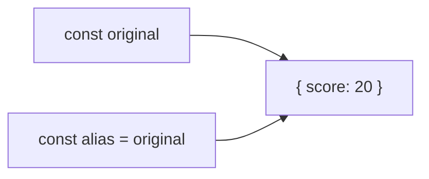
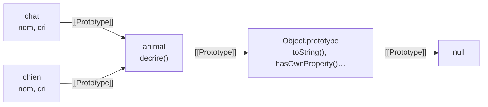

# 10 — Objets

> **Niveau** : Débutant à avancé · **Durée** : ~4 h · **Prérequis** : [Fonctions](../06-fonctions/README.md), [Tableaux](../09-tableaux/README.md)

En JavaScript, tout ce qui n'est pas une valeur primitive est un objet : les tableaux, les fonctions, les dates, les erreurs… Comprendre les objets, c'est comprendre comment le langage range, partage et hérite des données. Ce chapitre part des bases (créer, lire, parcourir), insiste sur ce qui provoque le plus de bugs (les références et les copies), puis ouvre le capot : descripteurs, getters/setters, prototypes, `Proxy`. Il se termine par une faille de sécurité propre à JavaScript, la pollution de prototype. Il prépare directement le chapitre [Classes](../16-classes/README.md).

## Objectifs

- Créer, lire, modifier et parcourir des objets avec les écritures modernes
- Distinguer une **référence** d'une **copie**, et choisir entre copie superficielle et `structuredClone`
- Transformer un objet avec `Object.entries` et `Object.fromEntries`
- Protéger un objet avec `Object.freeze`, des descripteurs et des getters/setters
- Expliquer la **chaîne de prototypes** et créer un objet avec `Object.create`
- Intercepter les opérations sur un objet avec `Proxy` et `Reflect`
- Reconnaître et empêcher une **pollution de prototype**

## Sommaire

- [Pourquoi des objets](#pourquoi-des-objets)
- [Créer un objet littéral](#créer-un-objet-littéral)
- [Lire et écrire des propriétés](#lire-et-écrire-des-propriétés)
- [Tester l'existence d'une propriété](#tester-lexistence-dune-propriété)
- [Méthodes et this](#méthodes-et-this)
- [Parcourir un objet](#parcourir-un-objet)
- [Transformer un objet](#transformer-un-objet)
- [Références et mutations](#références-et-mutations)
- [Copier un objet](#copier-un-objet)
- [Comparer des objets](#comparer-des-objets)
- [Fusionner des objets](#fusionner-des-objets)
- [Immutabilité](#immutabilité)
- [Descripteurs de propriétés](#descripteurs-de-propriétés)
- [Getters et setters](#getters-et-setters)
- [Prototypes](#prototypes)
- [Objets-dictionnaires](#objets-dictionnaires)
- [Symboles comme clés](#symboles-comme-clés)
- [Proxy et Reflect](#proxy-et-reflect)
- [Pollution de prototype](#pollution-de-prototype)
- [Pièges courants](#pièges-courants)
- [Bonnes pratiques](#bonnes-pratiques)
- [Résumé](#résumé)
- [Exercices](#exercices)
- [Pour aller plus loin](#pour-aller-plus-loin)

## Pourquoi des objets

Imaginez un programme qui gère des clients avec des variables séparées : `nomClient1`, `emailClient1`, `villeClient1`, `nomClient2`… Impossible de passer « un client » à une fonction ou de les ranger dans une liste. Un **objet** regroupe des valeurs liées sous un même nom, chacune repérée par une **clé** :

```js
const client = {
  nom: "Alice Martin",
  email: "alice@exemple.fr",
  ville: "Lyon",
};

console.log(client.nom); // Alice Martin
console.log(client); // { nom: 'Alice Martin', email: 'alice@exemple.fr', ville: 'Lyon' }
```

On utilise les objets de deux façons, et il est utile de savoir laquelle on pratique :

| Usage | Exemple | Les clés sont… | Outil adapté |
| --- | --- | --- | --- |
| **Enregistrement** : une « fiche » à la structure connue | un utilisateur, une commande, une configuration | fixes, écrites dans le code | un objet |
| **Dictionnaire** : une association clé → valeur | un compteur de mots, un cache, des traductions | dynamiques, souvent issues des données | une [`Map`](../12-collections/README.md), ou un objet sans prototype (voir [Objets-dictionnaires](#objets-dictionnaires)) |

## Créer un objet littéral

```js
const utilisateur = {
  prenom: "Alice",
  age: 31,
  "date-inscription": "2026-01-15", // clé qui n'est pas un identifiant : guillemets obligatoires
  adresse: { ville: "Lyon", codePostal: "69001" }, // objet imbriqué
  roles: ["lecteur", "editeur"],
  saluer() {
    return `Bonjour, je suis ${this.prenom}.`;
  }, // virgule finale autorisée
};

console.log(utilisateur.saluer()); // Bonjour, je suis Alice.
console.log(utilisateur.adresse.ville); // Lyon
```

### Les clés sont des chaînes (ou des symboles)

Une clé d'objet est toujours une **chaîne** ou un **symbole**. Toute autre valeur est convertie en chaîne : `1` devient `"1"`, `true` devient `"true"`… et un objet devient `"[object Object]"`, ce qui donne des bugs déroutants :

```js
const notes = { 1: "un", true: "vrai" };
console.log(Object.keys(notes)); // [ '1', 'true' ]
console.log(notes["1"] === notes[1]); // true

const a = { id: 1 };
const b = { id: 2 };
const cache = {};
cache[a] = "données de a";
cache[b] = "données de b"; // ❌ écrase la précédente : même clé "[object Object]"
console.log(cache); // { '[object Object]': 'données de b' }
```

Pour associer des valeurs à des objets, utilisez une [`Map`](../12-collections/README.md) ou une `WeakMap`.

### Raccourcis d'écriture (ES2015)

```js
const nom = "Lampe";
const prix = 39;
const devise = "EUR";

const produit = {
  nom, // raccourci pour nom: nom
  prix,
  [`prix_${devise}`]: prix, // clé calculée
  decrire() {
    // méthode raccourcie, au lieu de decrire: function () { … }
    return `${this.nom} : ${this.prix} ${devise}`;
  },
};

console.log(produit); // { nom: 'Lampe', prix: 39, prix_EUR: 39, decrire: [Function: decrire] }
console.log(produit.decrire()); // Lampe : 39 EUR
```

Ces raccourcis sont détaillés au chapitre [Syntaxe moderne](../11-syntaxe-moderne/README.md). N'écrivez pas `new Object()` : le littéral `{}` fait la même chose, en plus lisible.

## Lire et écrire des propriétés

### Point ou crochets

```js
const produit = { nom: "Lampe", prix: 39, "code-barre": "3760123456789" };

console.log(produit.nom); // Lampe
console.log(produit["code-barre"]); // 3760123456789 (caractère spécial : crochets obligatoires)

const champ = "prix";
console.log(produit[champ]); // 39 (clé contenue dans une variable)
console.log(produit.champ); // undefined ❌ cherche une propriété nommée « champ »
```

Le **point** est la forme normale. Les **crochets** servent quand la clé est calculée, contenue dans une variable, ou n'est pas un identifiant valide.

### Propriété absente, chaînage optionnel et valeur par défaut

Lire une propriété qui n'existe pas donne `undefined`, sans erreur. Mais lire une propriété **de** `undefined` lève une `TypeError` : c'est l'erreur la plus fréquente en JavaScript. Le chaînage optionnel `?.` (ES2020) et `??` (voir [Conditions](../04-conditions/README.md)) règlent la question :

```js
const produit = { nom: "Lampe" };

console.log(produit.couleur); // undefined

try {
  console.log(produit.fournisseur.pays);
} catch (erreur) {
  console.log(erreur.message); // Cannot read properties of undefined (reading 'pays')
}

console.log(produit.fournisseur?.pays); // undefined
console.log(produit.stock ?? 0); // 0
```

### Ajouter, modifier, supprimer

```js
const tache = { titre: "Écrire le rapport" };

tache.terminee = false; // ajout
tache.titre = "Relire le rapport"; // modification
tache.priorite = "haute";
delete tache.priorite; // suppression

console.log(tache); // { titre: 'Relire le rapport', terminee: false }
console.log("priorite" in tache); // false
```

`delete` retire la propriété elle-même ; lui affecter `undefined` la garde, avec la valeur `undefined` (elle apparaît encore dans `Object.keys`). Pour obtenir un objet **sans** certaines propriétés sans toucher à l'original, la déstructuration avec reste est plus sûre :

```js
const compte = { email: "ana@exemple.fr", motDePasse: "s3cr3t", role: "admin" };

const { motDePasse, ...comptePublic } = compte;

console.log(comptePublic); // { email: 'ana@exemple.fr', role: 'admin' }
console.log(Object.keys(compte).length); // 3 : l'original est intact
```

## Tester l'existence d'une propriété

Trois façons, trois réponses différentes :

```js
const parametres = { theme: "sombre", police: undefined };

// 1. Comparer à undefined : ne distingue pas « absente » et « vaut undefined »
console.log(parametres.police !== undefined); // false (pourtant la clé existe)

// 2. L'opérateur in : propriétés propres ET héritées
console.log("police" in parametres); // true
console.log("toString" in parametres); // true (héritée de Object.prototype)

// 3. Object.hasOwn (ES2022) : propriétés propres uniquement
console.log(Object.hasOwn(parametres, "police")); // true
console.log(Object.hasOwn(parametres, "toString")); // false
```

| Test | Propriété propre | Propriété héritée | Propriété qui vaut `undefined` |
| --- | --- | --- | --- |
| `obj.cle !== undefined` | oui | oui | **non** |
| `"cle" in obj` | oui | **oui** | oui |
| `Object.hasOwn(obj, "cle")` | oui | non | oui |

`Object.hasOwn` remplace l'ancien `obj.hasOwnProperty("cle")`, qui échoue sur les objets sans prototype et peut être masqué par une propriété du même nom :

```js
const dictionnaire = Object.create(null); // objet sans prototype
dictionnaire.chat = "cat";

try {
  dictionnaire.hasOwnProperty("chat");
} catch (erreur) {
  console.log(erreur.message); // dictionnaire.hasOwnProperty is not a function
}
console.log(Object.hasOwn(dictionnaire, "chat")); // true

const piege = { hasOwnProperty: () => true };
console.log(piege.hasOwnProperty("nimporte")); // true ❌
console.log(Object.hasOwn(piege, "nimporte")); // false ✅
```

## Méthodes et this

Une **méthode** est une propriété dont la valeur est une fonction. À l'intérieur, `this` désigne l'objet **sur lequel la méthode est appelée** (ce qui se trouve avant le point au moment de l'appel). Les règles complètes de `this` sont au chapitre [Fonctions](../06-fonctions/README.md) ; retenez deux pièges.

```js
const minuteur = {
  secondes: 90,
  formater() {
    return `${Math.floor(this.secondes / 60)} min ${this.secondes % 60} s`;
  },
  // ❌ une fléchée n'a pas son propre this : elle prend celui du code englobant
  formaterFleche: () => this,
};

console.log(minuteur.formater()); // 1 min 30 s
console.log(minuteur.formaterFleche()); // undefined (le this d'un module)

// ❌ Une méthode détachée de son objet perd son this
const formater = minuteur.formater;
try {
  formater();
} catch (erreur) {
  console.log(erreur.message); // Cannot read properties of undefined (reading 'secondes')
}

// ✅ bind fixe le this
const formaterLie = minuteur.formater.bind(minuteur);
console.log(formaterLie()); // 1 min 30 s
```

Règle pratique : **méthodes en écriture raccourcie** (`formater() { … }`), **fléchées pour les rappels** à l'intérieur des méthodes (elles héritent alors du bon `this`).

## Parcourir un objet

### `Object.keys`, `Object.values`, `Object.entries`

Ces trois fonctions retournent un **tableau** des propriétés **propres** et **énumérables** à clé chaîne : on peut ensuite utiliser toutes les méthodes du chapitre [Tableaux](../09-tableaux/README.md).

```js
const stock = { pommes: 12, poires: 0, kiwis: 7 };

console.log(Object.keys(stock)); // [ 'pommes', 'poires', 'kiwis' ]
console.log(Object.values(stock)); // [ 12, 0, 7 ]
console.log(Object.entries(stock)); // [ [ 'pommes', 12 ], [ 'poires', 0 ], [ 'kiwis', 7 ] ]

for (const [fruit, quantite] of Object.entries(stock)) {
  console.log(`${fruit} : ${quantite}`);
}
// pommes : 12
// poires : 0
// kiwis : 7

const total = Object.values(stock).reduce((somme, q) => somme + q, 0);
console.log(total); // 19
console.log(Object.keys(stock).length); // 3 (nombre de propriétés)
console.log(Object.keys({}).length === 0); // true (tester un objet vide)
```

Un objet ordinaire **n'est pas itérable** : `for (const x of stock)` lève une `TypeError` (« stock is not iterable »). Passez par `Object.entries` (ES2017) ou utilisez une `Map`.

### `for…in` et les propriétés héritées

`for…in` parcourt les clés énumérables, **y compris celles héritées du prototype**. C'est rarement ce qu'on veut ; préférez `Object.keys` / `Object.entries`.

```js
const base = { partagee: true };
const objet = Object.create(base); // objet hérite de base (voir Prototypes)
objet.propre = 1;

for (const cle in objet) {
  console.log(cle);
}
// propre
// partagee  ← héritée

console.log(Object.keys(objet)); // [ 'propre' ]
```

### L'ordre des propriétés

L'ordre de parcours est défini par la spécification, et il réserve une surprise :

1. d'abord les clés qui ressemblent à des **indices entiers** (`"0"`, `"1"`, `"42"`…), par ordre **croissant** ;
2. puis les autres clés chaînes, dans l'**ordre d'insertion** ;
3. les symboles sont à part (ignorés par `Object.keys`).

```js
const objet = { b: 1, 2: "deux", a: 2, 1: "un", "-1": "moins un" };
console.log(Object.keys(objet)); // [ '1', '2', 'b', 'a', '-1' ]

// Conséquence : des indicatifs téléphoniques comme clés sont réordonnés
const indicatifs = { 33: "France", 1: "États-Unis", 49: "Allemagne" };
console.log(Object.values(indicatifs)); // [ 'États-Unis', 'France', 'Allemagne' ]
```

Si l'ordre d'insertion compte et que les clés peuvent être numériques, utilisez une `Map`.

### Toutes les clés, y compris cachées

| Fonction | Clés chaînes énumérables | Non énumérables | Symboles | Héritées |
| --- | --- | --- | --- | --- |
| `Object.keys/values/entries` | oui | non | non | non |
| `for…in` | oui | non | non | **oui** |
| `Object.getOwnPropertyNames` | oui | oui | non | non |
| `Object.getOwnPropertySymbols` | non | — | oui | non |
| `Reflect.ownKeys` | oui | oui | oui | non |

## Transformer un objet

Les objets n'ont pas de méthodes `map` ou `filter`. Le motif standard : **objet → tableau de paires → méthodes de tableau → objet**, avec `Object.entries` et `Object.fromEntries` (ES2019).

```js
const prixHT = { cafe: 2, the: 2.5, chocolat: 3 };

// « map » : appliquer la TVA à chaque valeur
const prixTTC = Object.fromEntries(
  Object.entries(prixHT).map(([article, prix]) => [
    article,
    Math.round(prix * 1.2 * 100) / 100,
  ]),
);
console.log(prixTTC); // { cafe: 2.4, the: 3, chocolat: 3.6 }

// « filter » : garder certaines propriétés
const abordables = Object.fromEntries(Object.entries(prixHT).filter(([, prix]) => prix < 3));
console.log(abordables); // { cafe: 2, the: 2.5 }

// Inverser clés et valeurs
const codes = { FR: "France", IT: "Italie" };
console.log(Object.fromEntries(Object.entries(codes).map(([code, pays]) => [pays, code]))); // { France: 'FR', Italie: 'IT' }
```

`Object.fromEntries` accepte n'importe quel itérable de paires : un tableau, une `Map`, des `URLSearchParams`…

```js
console.log(Object.fromEntries(new URLSearchParams("q=javascript&page=2"))); // { q: 'javascript', page: '2' }
console.log(Object.fromEntries(new Map([["x", 1], ["y", 2]]))); // { x: 1, y: 2 }
```

Deux utilitaires qu'on réécrit dans tous les projets :

```js
// Ne garder que certaines clés
const choisir = (objet, cles) =>
  Object.fromEntries(
    cles.filter((cle) => Object.hasOwn(objet, cle)).map((cle) => [cle, objet[cle]]),
  );

// Tout garder sauf certaines clés
const omettre = (objet, cles) =>
  Object.fromEntries(Object.entries(objet).filter(([cle]) => !cles.includes(cle)));

const utilisateur = { id: 7, nom: "Ana", email: "ana@exemple.fr", motDePasse: "x" };
console.log(choisir(utilisateur, ["id", "nom", "inexistante"])); // { id: 7, nom: 'Ana' }
console.log(omettre(utilisateur, ["motDePasse"])); // { id: 7, nom: 'Ana', email: 'ana@exemple.fr' }
```

## Références et mutations

C'est **la** notion à maîtriser. Une variable ne contient pas un objet : elle contient une **référence** vers lui (son « adresse »). Copier la variable copie la référence, pas l'objet.



```js
const original = { score: 10 };
const alias = original; // même objet, deux noms

alias.score = 20;
console.log(original.score); // 20
console.log(alias === original); // true
```

Il en va de même quand on passe un objet à une fonction : la fonction reçoit une copie de la **référence**. Elle peut donc **modifier** l'objet de l'appelant, mais pas le **remplacer** :

```js
function augmenter(joueur) {
  joueur.score += 5; // modifie l'objet partagé
}

function remplacer(joueur) {
  joueur = { score: 0 }; // réassigne la variable locale seulement
}

const joueur = { score: 10 };
augmenter(joueur);
console.log(joueur.score); // 15
remplacer(joueur);
console.log(joueur.score); // 15
```

Et `const` n'y change rien : il interdit de réassigner la variable, pas de modifier l'objet (voir [Variables](../02-variables/README.md)). Pour empêcher les modifications, voir [Immutabilité](#immutabilité).

Une fonction qui modifie les objets qu'elle reçoit a un **effet de bord** : c'est parfois voulu, mais c'est une source classique de bugs (un composant qui modifie l'état d'un autre, un cache corrompu…). Par défaut, retournez un nouvel objet plutôt que de modifier celui reçu.

## Copier un objet

### Copie superficielle : spread et `Object.assign`

```js
const original = { nom: "Ana", preferences: { theme: "sombre" } };

const copie1 = { ...original }; // spread (ES2018)
const copie2 = Object.assign({}, original);

copie1.nom = "Léa";
console.log(original.nom); // Ana : la propriété de premier niveau est indépendante

copie1.preferences.theme = "clair";
console.log(original.preferences.theme); // clair ❌ l'objet imbriqué est PARTAGÉ
console.log(copie2.preferences === original.preferences); // true
```

Une copie **superficielle** crée un nouvel objet mais copie les **références** des valeurs : les objets imbriqués restent partagés.

Différences entre les deux :

- le spread **crée** toujours un nouvel objet ; `Object.assign(cible, …sources)` **modifie** la cible (utile pour mettre à jour un objet existant) et déclenche ses setters ;
- tous deux copient les propriétés propres énumérables (symboles compris), **évaluent les getters** et ignorent le prototype.

Pour une copie fidèle (getters, propriétés non énumérables, prototype), passez par les descripteurs (voir [Descripteurs de propriétés](#descripteurs-de-propriétés)) :

```js
const source = {
  prenom: "Ana",
  get majuscules() {
    return this.prenom.toUpperCase();
  },
};

const copieSpread = { ...source };
console.log(Object.getOwnPropertyDescriptor(copieSpread, "majuscules").get); // undefined : le getter a été évalué une fois
copieSpread.prenom = "Léa";
console.log(copieSpread.majuscules); // ANA ❌ valeur figée

const copieFidele = Object.create(
  Object.getPrototypeOf(source),
  Object.getOwnPropertyDescriptors(source),
);
copieFidele.prenom = "Léa";
console.log(copieFidele.majuscules); // LÉA ✅ le getter est conservé
```

### Copie profonde : `structuredClone`

`structuredClone(valeur)` copie récursivement toute la structure. Elle ne fait pas partie d'ECMAScript mais du standard HTML ; elle est disponible dans tous les navigateurs depuis 2022 (Baseline 2022), dans Node.js (17+), Deno et Bun.

```js
const commande = {
  id: 42,
  creeLe: new Date("2026-11-06T10:00:00Z"),
  lignes: [{ produit: "Lampe", quantite: 2 }],
  tags: new Set(["urgent"]),
  options: new Map([["emballage", "cadeau"]]),
};
commande.self = commande; // référence circulaire

const copie = structuredClone(commande);

copie.lignes[0].quantite = 5;
console.log(commande.lignes[0].quantite); // 2 : totalement indépendant
console.log(copie.creeLe instanceof Date); // true : les Date restent des Date
console.log(copie.tags.has("urgent")); // true
console.log(copie.self === copie); // true : les cycles sont reproduits
```

Elle prend en charge les objets et tableaux simples, `Date`, `RegExp`, `Map`, `Set`, `Error`, `ArrayBuffer` et tableaux typés, `Blob`/`File` (navigateur)… Ses **limites** :

```js
// 1. Les fonctions (et donc les méthodes) ne sont pas clonables
try {
  structuredClone({ calculer() {} });
} catch (erreur) {
  console.log(erreur.name); // DataCloneError
}

// 2. Le prototype est perdu : une instance de classe devient un objet simple
class Point {
  constructor(x, y) {
    this.x = x;
    this.y = y;
  }
  norme() {
    return Math.hypot(this.x, this.y);
  }
}
const clone = structuredClone(new Point(3, 4));
console.log(clone); // { x: 3, y: 4 }
console.log(clone instanceof Point); // false

// 3. Getters évalués ; clés symboles et propriétés non énumérables ignorées
const id = Symbol("id");
const source = { [id]: 1, get calcule() { return 2; } };
Object.defineProperty(source, "cachee", { value: 3, enumerable: false });
console.log(structuredClone(source)); // { calcule: 2 }
```

Les nœuds du DOM ne sont pas clonables non plus (utilisez `node.cloneNode(true)`).

### Et `JSON.parse(JSON.stringify(x))` ?

C'était l'astuce de copie profonde avant `structuredClone`. Elle perd beaucoup d'informations : les `Date` deviennent des chaînes, `undefined` et les fonctions disparaissent, `NaN` et `Infinity` deviennent `null`, `Map` et `Set` deviennent `{}`, et une référence circulaire lève une erreur.

```js
const donnees = { date: new Date(0), absent: undefined, ratio: NaN, ensemble: new Set([1]) };

console.log(JSON.parse(JSON.stringify(donnees))); // { date: '1970-01-01T00:00:00.000Z', ratio: null, ensemble: {} }
console.log(structuredClone(donnees));
// {
//   date: 1970-01-01T00:00:00.000Z,
//   absent: undefined,
//   ratio: NaN,
//   ensemble: Set(1) { 1 }
// }
```

Réservez JSON à la sérialisation (envoyer, stocker), voir [JSON et stockage](../25-json-et-stockage/README.md).

| | Spread / `Object.assign` | `structuredClone` | `JSON.parse(JSON.stringify())` |
| --- | --- | --- | --- |
| Profondeur | 1 niveau | complète | complète |
| `Date`, `Map`, `Set`, `RegExp` | référence partagée | copiés fidèlement | abîmés |
| Références circulaires | partagées | reproduites | **erreur** |
| Fonctions, méthodes | référence partagée | **erreur** | supprimées |
| Prototype (classes) | perdu | perdu | perdu |
| Getters | évalués | évalués | évalués |

## Comparer des objets

`===` (et `==`) comparent les **références** : deux objets distincts ne sont jamais égaux, même avec un contenu identique.

```js
const a = { x: 1 };
const b = { x: 1 };
const c = a;

console.log(a === b); // false
console.log(a === c); // true
```

Pour comparer le contenu, il faut parcourir les propriétés. Une **égalité superficielle** (premier niveau) suffit souvent, par exemple pour savoir si un état a changé :

```js
function egalSuperficiel(a, b) {
  const clesA = Object.keys(a);
  const clesB = Object.keys(b);
  return (
    clesA.length === clesB.length &&
    clesA.every((cle) => Object.hasOwn(b, cle) && Object.is(a[cle], b[cle]))
  );
}

console.log(egalSuperficiel({ x: 1, y: 2 }, { y: 2, x: 1 })); // true
console.log(egalSuperficiel({ x: { z: 1 } }, { x: { z: 1 } })); // false : objets imbriqués distincts
```

Pour une **égalité profonde**, Node.js fournit `util.isDeepStrictEqual` (et `assert.deepStrictEqual` pour les tests, voir [Tests](../29-tests/README.md)). Dans le navigateur, écrivez-la (exercice 4) ou utilisez une bibliothèque.

```js
import { isDeepStrictEqual } from "node:util";

console.log(isDeepStrictEqual({ x: { z: [1, 2] } }, { x: { z: [1, 2] } })); // true

// ❌ Comparer des JSON dépend de l'ordre des clés
console.log(JSON.stringify({ a: 1, b: 2 }) === JSON.stringify({ b: 2, a: 1 })); // false
```

## Fusionner des objets

Avec le spread, les propriétés sont copiées dans l'ordre : **la dernière gagne**. C'est le motif classique des options par défaut :

```js
const defauts = { theme: "clair", langue: "fr", taillePolice: 16 };
const choixUtilisateur = { theme: "sombre", taillePolice: 18 };

const config = { ...defauts, ...choixUtilisateur };
console.log(config); // { theme: 'sombre', langue: 'fr', taillePolice: 18 }
```

Deux limites à connaître :

```js
const defauts = { theme: "clair", notifications: { email: true, sms: false } };

// 1. La fusion est superficielle : l'objet imbriqué est remplacé, pas fusionné
const choix = { notifications: { sms: true } };
console.log({ ...defauts, ...choix }.notifications); // { sms: true } ← email a disparu

// ✅ Fusionner explicitement le niveau imbriqué
const config = {
  ...defauts,
  ...choix,
  notifications: { ...defauts.notifications, ...choix.notifications },
};
console.log(config.notifications); // { email: true, sms: true }

// 2. Une valeur undefined écrase aussi la valeur par défaut
console.log({ ...defauts, ...{ theme: undefined } }.theme); // undefined
```

Une fonction de fusion profonde générique est utile, mais c'est exactement le genre de code qui ouvre la porte à la [pollution de prototype](#pollution-de-prototype) : lisez cette section avant d'en écrire une.

## Immutabilité

### Trois niveaux de protection

| | Ajouter | Supprimer | Modifier une valeur | Test |
| --- | --- | --- | --- | --- |
| `Object.preventExtensions(obj)` | non | oui | oui | `Object.isExtensible` |
| `Object.seal(obj)` | non | non | oui | `Object.isSealed` |
| `Object.freeze(obj)` | non | non | non | `Object.isFrozen` |

Ces fonctions modifient l'objet et le retournent ; l'opération est définitive.

> [!IMPORTANT]
> Que se passe-t-il quand on tente quand même de modifier ? En **mode strict** (tous les modules ES, toutes les classes, et tout fichier commençant par `"use strict"`), une **`TypeError`** est levée. En mode non strict (vieux scripts), la modification est **ignorée en silence**, ce qui est bien pire : le bug passe inaperçu.

```js
// Ce bloc est un module ES : mode strict
const config = Object.freeze({ api: "https://api.exemple.fr", delai: 5000 });

try {
  config.delai = 100;
} catch (erreur) {
  console.log(erreur.message); // Cannot assign to read only property 'delai' of object '#<Object>'
}

try {
  config.debug = true;
} catch (erreur) {
  console.log(erreur.message); // Cannot add property debug, object is not extensible
}

console.log(config.delai); // 5000
console.log(Object.isFrozen(config)); // true

const scelle = Object.seal({ x: 1 });
scelle.x = 2; // autorisé
try {
  delete scelle.x;
} catch (erreur) {
  console.log(erreur.message); // Cannot delete property 'x' of #<Object>
}
console.log(scelle); // { x: 2 }
```

`Object.freeze` sert aussi à créer des **énumérations** et des constantes partagées :

```js
const Statut = Object.freeze({
  BROUILLON: "brouillon",
  PUBLIE: "publie",
  ARCHIVE: "archive",
});

console.log(Object.values(Statut)); // [ 'brouillon', 'publie', 'archive' ]
```

### Un gel superficiel

`freeze` ne gèle que le **premier niveau** : les objets imbriqués restent modifiables.

```js
const reglages = Object.freeze({ couleurs: { fond: "blanc" }, langues: ["fr"] });

reglages.couleurs.fond = "noir"; // aucune erreur
reglages.langues.push("en"); // aucune erreur
console.log(reglages); // { couleurs: { fond: 'noir' }, langues: [ 'fr', 'en' ] }
```

Pour geler en profondeur, il faut parcourir récursivement les valeurs (exercice 6).

### Mettre à jour sans muter

Dans un code qui traite les données comme immuables (gestion d'état d'une interface, réducteurs, historique d'annulation), on ne modifie pas un objet : on crée **une nouvelle version** qui partage tout ce qui n'a pas changé.

```js
const etat = {
  utilisateur: { nom: "Ana", preferences: { theme: "clair", langue: "fr" } },
  panier: [{ id: 1, quantite: 1 }],
};

const nouvelEtat = {
  ...etat,
  utilisateur: {
    ...etat.utilisateur,
    preferences: { ...etat.utilisateur.preferences, theme: "sombre" },
  },
};

console.log(etat.utilisateur.preferences.theme); // clair : l'ancienne version est intacte
console.log(nouvelEtat.utilisateur.preferences.theme); // sombre
console.log(nouvelEtat.panier === etat.panier); // true : la partie inchangée est partagée
```

Comparer deux versions devient alors instantané (`ancien !== nouveau` signifie « quelque chose a changé »). Pour les tableaux, les méthodes non mutantes du chapitre [Tableaux](../09-tableaux/README.md) (`toSorted`, `with`, `map`…) jouent le même rôle.

## Descripteurs de propriétés

Chaque propriété possède, en plus de sa valeur, des **attributs** qui règlent son comportement. On les lit avec `Object.getOwnPropertyDescriptor` :

```js
const livre = { titre: "Dune" };

console.log(Object.getOwnPropertyDescriptor(livre, "titre"));
// { value: 'Dune', writable: true, enumerable: true, configurable: true }

console.log(Object.getOwnPropertyDescriptor([1, 2, 3], "length"));
// { value: 3, writable: true, enumerable: false, configurable: false }
```

| Attribut | Signification | Par défaut (littéral) | Par défaut (`defineProperty`) |
| --- | --- | --- | --- |
| `value` | la valeur | — | `undefined` |
| `writable` | la valeur peut être modifiée | `true` | **`false`** |
| `enumerable` | visible dans `Object.keys`, `for…in`, spread, JSON | `true` | **`false`** |
| `configurable` | peut être supprimée ou reconfigurée | `true` | **`false`** |

Le descripteur de `length` explique pourquoi `Object.keys([1, 2, 3])` ne contient pas `"length"` : elle n'est pas énumérable.

### `Object.defineProperty`

`Object.defineProperty(objet, cle, descripteur)` crée ou modifie une propriété avec des attributs précis. Attention : les attributs **omis valent `false`**.

```js
const produit = { nom: "Lampe" };

// Propriété cachée : invisible dans les parcours, la copie et le JSON
Object.defineProperty(produit, "idInterne", { value: "x-9f2" });

console.log(produit.idInterne); // x-9f2
console.log(produit); // { nom: 'Lampe' }
console.log(Object.keys(produit)); // [ 'nom' ]
console.log(JSON.stringify(produit)); // {"nom":"Lampe"}

// Elle est aussi en lecture seule et non supprimable (writable et configurable valent false)
try {
  produit.idInterne = "autre";
} catch (erreur) {
  console.log(erreur.message); // Cannot assign to read only property 'idInterne' of object '#<Object>'
}

// Une constante visible mais non modifiable
Object.defineProperty(produit, "tva", { value: 0.2, enumerable: true });
console.log(produit); // { nom: 'Lampe', tva: 0.2 }
```

`Object.defineProperties(objet, { cle1: {…}, cle2: {…} })` en définit plusieurs d'un coup, et `Object.getOwnPropertyDescriptors(objet)` (ES2017) les lit toutes. `Object.freeze` n'est rien d'autre qu'un raccourci : il passe `configurable` (et `writable`, pour les propriétés qui ont une valeur) à `false` sur toutes les propriétés propres, puis interdit les ajouts.

Une propriété peut aussi être un **accesseur** : à la place de `value`/`writable`, son descripteur contient `get` et/ou `set`. C'est la section suivante.

## Getters et setters

Un **getter** est une propriété calculée à chaque lecture ; un **setter** est une fonction appelée à chaque écriture. Vus de l'extérieur, ils se lisent et s'écrivent comme des propriétés ordinaires.

```js
const temperature = {
  celsius: 20,
  get fahrenheit() {
    return this.celsius * 1.8 + 32;
  },
  set fahrenheit(valeur) {
    this.celsius = (valeur - 32) / 1.8;
  },
};

console.log(temperature.fahrenheit); // 68
temperature.fahrenheit = 212;
console.log(temperature.celsius); // 100
console.log(temperature); // { celsius: 100, fahrenheit: [Getter/Setter] }
```

### Valider une écriture

Un setter peut refuser une valeur incorrecte. Il faut alors stocker la donnée **ailleurs** que dans la propriété elle-même :

```js
const compte = {
  _solde: 0, // convention « usage interne » ; dans une classe, préférez un champ privé #solde
  get solde() {
    return this._solde;
  },
  set solde(valeur) {
    if (!Number.isFinite(valeur) || valeur < 0) {
      throw new RangeError(`Solde invalide : ${valeur}`);
    }
    this._solde = valeur;
  },
};

compte.solde = 150;
console.log(compte.solde); // 150

try {
  compte.solde = -20;
} catch (erreur) {
  console.log(erreur.message); // Solde invalide : -20
}
console.log(compte.solde); // 150
```

Le « vrai » secret n'existe qu'avec les champs privés des [classes](../16-classes/README.md) ou une fermeture (closure) : `_solde` reste accessible à qui le veut.

> [!WARNING]
> Un setter qui écrit dans **sa propre propriété** s'appelle lui-même à l'infini : `set nom(v) { this.nom = v; }` provoque `RangeError: Maximum call stack size exceeded`. Utilisez un autre nom de stockage.

### Getter paresseux (calcul mis en cache)

Un getter peut se **remplacer lui-même** par une propriété ordinaire après le premier calcul : le travail coûteux n'est fait qu'une fois, et seulement si on en a besoin.

```js
let calculs = 0;

const rapport = {
  lignes: [12, 7, 30],
  get statistiques() {
    calculs++;
    const total = this.lignes.reduce((a, b) => a + b, 0);
    const valeur = { total, moyenne: total / this.lignes.length };
    Object.defineProperty(this, "statistiques", { value: valeur }); // remplace le getter
    return valeur;
  },
};

console.log(rapport.statistiques.total); // 49
console.log(rapport.statistiques.moyenne.toFixed(2)); // 16.33
console.log(calculs); // 1 : le calcul n'a eu lieu qu'une fois
```

Les getters se définissent aussi avec `Object.defineProperty(obj, "cle", { get() {…}, set(v) {…} })` et dans les classes (`get nom() {…}`).

## Prototypes

### Le lien caché

Chaque objet possède un lien interne, noté `[[Prototype]]`, vers un autre objet (ou `null`) : son **prototype**. Quand on lit une propriété absente de l'objet, JavaScript la cherche dans le prototype, puis dans le prototype du prototype, et ainsi de suite : c'est la **chaîne de prototypes**. C'est le mécanisme d'héritage du langage, et c'est ce que les [classes](../16-classes/README.md) utilisent sous le capot.

```js
const objet = { a: 1 };

console.log(objet.toString()); // [object Object] : toString n'est pas dans objet…
console.log(Object.hasOwn(objet, "toString")); // false
console.log(Object.getPrototypeOf(objet) === Object.prototype); // true : …mais dans son prototype
console.log(Object.getPrototypeOf(Object.prototype)); // null : fin de la chaîne
```

### `Object.create` : choisir le prototype

`Object.create(prototype)` crée un objet vide dont le prototype est celui qu'on indique :

```js
const animal = {
  decrire() {
    return `${this.nom} fait « ${this.cri} ».`;
  },
};

const chat = Object.create(animal);
chat.nom = "Mistigri";
chat.cri = "miaou";

const chien = Object.create(animal);
chien.nom = "Rex";
chien.cri = "ouaf";

console.log(chat.decrire()); // Mistigri fait « miaou ».
console.log(chien.decrire()); // Rex fait « ouaf ».
console.log(Object.getPrototypeOf(chat) === animal); // true
console.log(Object.hasOwn(chat, "decrire")); // false : héritée, pas copiée
console.log(animal.isPrototypeOf(chien)); // true
```



La méthode `decrire` existe **une seule fois** en mémoire et elle est partagée ; `this` désigne l'objet sur lequel on l'appelle (`chat` ou `chien`), pas `animal`.

### Lecture dans la chaîne, écriture sur l'objet

La **lecture** remonte la chaîne ; l'**écriture** crée (ou modifie) une propriété **propre**, qui masque celle du prototype sans la toucher :

```js
const animal = {
  cri: "…",
  amis: [],
};
const chat = Object.create(animal);

chat.cri = "miaou"; // propriété propre : masque animal.cri
console.log(chat.cri, animal.cri); // miaou …

// ❌ Mais MODIFIER un objet hérité modifie celui du prototype, partagé par tous
chat.amis.push("Rex");
const autreChat = Object.create(animal);
console.log(autreChat.amis); // [ 'Rex' ]
```

Ne mettez donc sur un prototype que des **méthodes** (et des constantes), jamais d'état modifiable : chaque instance doit avoir ses propres données.

### Fonctions constructeurs et propriété `prototype`

Avant les classes (ES2015), on créait des « types » avec une fonction appelée par `new`. Toute fonction ordinaire possède une propriété `prototype` ; `new F()` crée un objet dont le `[[Prototype]]` est `F.prototype`.

```js
function Personne(nom) {
  this.nom = nom; // données propres à chaque instance
}
Personne.prototype.saluer = function () {
  return `Bonjour, je suis ${this.nom}.`; // méthode partagée
};

const alice = new Personne("Alice");

console.log(alice.saluer()); // Bonjour, je suis Alice.
console.log(Object.getPrototypeOf(alice) === Personne.prototype); // true
console.log(alice instanceof Personne); // true
console.log(alice); // Personne { nom: 'Alice' }
```

`instanceof` ne vérifie rien d'autre que : « `Personne.prototype` se trouve-t-il dans la chaîne de prototypes d'`alice` ? ». Une `class Personne { … }` produit exactement cette structure, avec une syntaxe plus claire et quelques garde-fous : c'est le sujet du chapitre [Classes](../16-classes/README.md).

Attention au vocabulaire : `Personne.prototype` est une **propriété** de la fonction (le futur prototype de ses instances) ; le prototype **d'un objet** est son lien `[[Prototype]]`, qu'on lit avec `Object.getPrototypeOf`.

### Les objets natifs aussi

```js
console.log(Object.getPrototypeOf([]) === Array.prototype); // true
console.log(Object.getPrototypeOf(Array.prototype) === Object.prototype); // true
console.log(Object.hasOwn(Array.prototype, "map")); // true : map est héritée par tous les tableaux
console.log(Object.getPrototypeOf(function () {}) === Function.prototype); // true
```

### `__proto__`, `setPrototypeOf` et autres écritures à éviter

- **`obj.__proto__`** est un vieil accesseur hérité d'`Object.prototype`, conservé pour la compatibilité : utilisez `Object.getPrototypeOf` et `Object.setPrototypeOf`. La syntaxe `{ __proto__: proto, … }` **dans un littéral**, en revanche, est standard et sûre : elle fixe le prototype à la création, comme `Object.create`.
- **`Object.setPrototypeOf(obj, proto)`** change le prototype d'un objet existant ; c'est lent (les moteurs perdent leurs optimisations sur cet objet). Fixez le prototype à la création.
- **Ne modifiez jamais les prototypes natifs** (`Array.prototype.dernier = …`). Votre ajout peut entrer en conflit avec une bibliothèque ou une future méthode standard : en 2018, la méthode prévue `Array.prototype.flatten` a dû être renommée `flat` parce qu'une vieille bibliothèque très répandue (MooTools) avait déjà ajouté sa propre version.

```js
const proto = { saluer() { return "salut"; } };
const objet = { __proto__: proto, nom: "Ana" }; // ✅ littéral : standard

console.log(objet.saluer()); // salut
console.log(Object.keys(objet)); // [ 'nom' ] : __proto__ n'est pas une propriété
```

## Objets-dictionnaires

Utiliser un objet ordinaire `{}` comme dictionnaire, avec des clés venant des données, a un défaut : il **hérite** des propriétés d'`Object.prototype` (`constructor`, `toString`, `hasOwnProperty`, `__proto__`…). Un compteur de mots naïf le montre :

```js
const texte = "le constructor du pont a construit le pont";

const compteurs = {};
for (const mot of texte.split(" ")) {
  compteurs[mot] = (compteurs[mot] || 0) + 1;
}

console.log(compteurs.le); // 2
console.log(compteurs.constructor); // function Object() { [native code] }1 ❌
```

`compteurs.constructor` existait déjà (héritée) : `compteurs["constructor"] || 0` a renvoyé la fonction `Object`, convertie en chaîne puis concaténée avec `1`. Et la clé `"__proto__"` est encore plus piégeuse : l'affecter ne crée pas de propriété mais tente de changer le prototype.

```js
const normal = {};
normal["__proto__"] = "valeur";
console.log(Object.keys(normal)); // [] : rien n'a été stocké

const sansPrototype = Object.create(null);
sansPrototype["__proto__"] = "valeur";
console.log(Object.keys(sansPrototype)); // [ '__proto__' ] : une clé comme une autre
```

Deux solutions :

1. **`Object.create(null)`** : un objet **sans prototype**, donc sans aucune propriété héritée. C'est ce que retourne `Object.groupBy`. Il n'a pas de méthodes (`toString`, `hasOwnProperty`) : utilisez les fonctions statiques (`Object.keys`, `Object.hasOwn`).
2. **Une `Map`**, conçue pour cet usage : clés de tout type, taille avec `size`, itération directe, aucune clé héritée. Voir [Collections](../12-collections/README.md).

```js
const texte = "le constructor du pont a construit le pont";

const compteurs = Object.create(null);
for (const mot of texte.split(" ")) {
  compteurs[mot] = (compteurs[mot] ?? 0) + 1;
}
console.log(compteurs.constructor); // 1 ✅
console.log(compteurs);
// [Object: null prototype] {
//   le: 2,
//   constructor: 1,
//   du: 1,
//   pont: 2,
//   a: 1,
//   construit: 1
// }

const compteursMap = new Map();
for (const mot of texte.split(" ")) {
  compteursMap.set(mot, (compteursMap.get(mot) ?? 0) + 1);
}
console.log(compteursMap.get("constructor")); // 1 ✅
```

## Symboles comme clés

Un **symbole** (`Symbol("description")`, ES2015) est une valeur primitive **unique** : deux symboles ne sont jamais égaux, même avec la même description. Utilisé comme clé, il crée une propriété qui ne peut entrer en collision avec aucune autre et qui reste discrète : `Object.keys`, `for…in` et `JSON.stringify` l'ignorent.

```js
const ID = Symbol("id");

const utilisateur = { nom: "Alice", [ID]: 42 };

console.log(utilisateur[ID]); // 42
console.log(Object.keys(utilisateur)); // [ 'nom' ]
console.log(JSON.stringify(utilisateur)); // {"nom":"Alice"}
console.log(Object.getOwnPropertySymbols(utilisateur)); // [ Symbol(id) ]
console.log(Reflect.ownKeys(utilisateur)); // [ 'nom', Symbol(id) ]
console.log(Symbol("id") === ID); // false : chaque symbole est unique
```

Usage typique : une bibliothèque qui attache une métadonnée à des objets qui ne lui appartiennent pas, sans risque d'écraser une propriété de l'utilisateur. Ce n'est pas un mécanisme de confidentialité (`Reflect.ownKeys` les liste).

### Les symboles bien connus (aperçu)

Le langage définit des symboles prédéfinis qui permettent de **personnaliser le comportement** d'un objet vis-à-vis des opérations natives :

| Symbole | Personnalise | Chapitre |
| --- | --- | --- |
| `Symbol.iterator` | `for…of`, spread, déstructuration | [Itérateurs et générateurs](../13-iterateurs-generateurs/README.md) |
| `Symbol.asyncIterator` | `for await…of` | [Itérateurs et générateurs](../13-iterateurs-generateurs/README.md) |
| `Symbol.toPrimitive` | la conversion en nombre ou en chaîne | ci-dessous |
| `Symbol.toStringTag` | le résultat de `Object.prototype.toString` | ci-dessous |
| `Symbol.dispose`, `Symbol.asyncDispose` | `using` / `await using` (ES2027) | [Erreurs](../17-erreurs/README.md) |

```js
const montant = {
  valeur: 42.5,
  devise: "EUR",
  [Symbol.toPrimitive](indication) {
    return indication === "number" ? this.valeur : `${this.valeur} ${this.devise}`;
  },
  get [Symbol.toStringTag]() {
    return "Montant";
  },
};

console.log(`${montant}`); // 42.5 EUR
console.log(montant * 2); // 85
console.log(Object.prototype.toString.call(montant)); // [object Montant]

const playlist = {
  titres: ["Intro", "Refrain", "Final"],
  *[Symbol.iterator]() {
    yield* this.titres;
  },
};
console.log([...playlist]); // [ 'Intro', 'Refrain', 'Final' ]
```

## Proxy et Reflect

### Intercepter les opérations

Un `Proxy` (ES2015) enveloppe un objet **cible** et intercepte les opérations qu'on fait dessus (lire, écrire, supprimer, tester avec `in`, lister les clés…). Chaque interception est une fonction appelée **piège** (*trap*), regroupée dans un objet **gestionnaire** (*handler*).

```js
const cible = { nom: "Alice", age: 31 };

const espion = new Proxy(cible, {
  get(objet, cle, recepteur) {
    console.log(`lecture de ${String(cle)}`);
    return Reflect.get(objet, cle, recepteur); // comportement normal
  },
});

console.log(espion.nom);
// lecture de nom
// Alice
```

`Reflect` (ES2015) fournit, sous forme de fonctions, le **comportement par défaut** de chaque opération, avec exactement les mêmes paramètres que le piège correspondant. Dans un piège, on l'appelle pour « laisser faire » après avoir ajouté son propre traitement.

| Piège | Intercepte | Équivalent `Reflect` |
| --- | --- | --- |
| `get` | `obj.cle`, `obj[cle]` | `Reflect.get` |
| `set` | `obj.cle = v` | `Reflect.set` |
| `has` | `cle in obj` | `Reflect.has` |
| `deleteProperty` | `delete obj.cle` | `Reflect.deleteProperty` |
| `ownKeys` | `Object.keys`, `Reflect.ownKeys`, `for…in` | `Reflect.ownKeys` |
| `defineProperty` | `Object.defineProperty` | `Reflect.defineProperty` |
| `getOwnPropertyDescriptor` | `Object.getOwnPropertyDescriptor` | `Reflect.getOwnPropertyDescriptor` |
| `apply`, `construct` | appel d'une fonction, `new` | `Reflect.apply`, `Reflect.construct` |

`Reflect` est aussi utile en dehors des proxys : ses fonctions retournent un **booléen** au lieu de lever une erreur (`Reflect.defineProperty` contre `Object.defineProperty`), et `Reflect.ownKeys` liste toutes les clés propres, symboles compris.

### Exemple : détecter les fautes de frappe

```js
function strict(objet) {
  return new Proxy(objet, {
    get(cible, cle, recepteur) {
      if (typeof cle === "string" && !(cle in cible)) {
        throw new ReferenceError(`Propriété inconnue : ${cle}`);
      }
      return Reflect.get(cible, cle, recepteur);
    },
  });
}

const config = strict({ urlApi: "https://api.exemple.fr", delai: 5000 });

console.log(config.delai); // 5000
try {
  console.log(config.dalai);
} catch (erreur) {
  console.log(erreur.message); // Propriété inconnue : dalai
}
```

Sans proxy, `config.dalai` aurait silencieusement renvoyé `undefined`.

### Exemple : valider les écritures

Le piège `set` doit retourner `true` si l'écriture est acceptée. S'il retourne `false`, une `TypeError` est levée en mode strict ; lever soi-même une erreur explicite est plus clair.

```js
const profil = new Proxy(
  { nom: "Ana", age: 30 },
  {
    set(cible, cle, valeur, recepteur) {
      if (cle === "age" && (!Number.isInteger(valeur) || valeur < 0)) {
        throw new TypeError(`Âge invalide : ${valeur}`);
      }
      return Reflect.set(cible, cle, valeur, recepteur);
    },
  },
);

profil.age = 31;
console.log(profil.age); // 31

try {
  profil.age = "trente";
} catch (erreur) {
  console.log(erreur.message); // Âge invalide : trente
}
```

### Exemple : observer les changements

C'est le principe de la réactivité de frameworks comme Vue.js (depuis sa version 3) : le proxy prévient quand une donnée change, ce qui permet de mettre l'affichage à jour automatiquement.

```js
function observer(objet, auChangement) {
  return new Proxy(objet, {
    set(cible, cle, valeur, recepteur) {
      const ancienne = cible[cle];
      const resultat = Reflect.set(cible, cle, valeur, recepteur);
      if (ancienne !== valeur) auChangement(cle, ancienne, valeur);
      return resultat;
    },
  });
}

const etat = observer({ compteur: 0 }, (cle, avant, apres) => {
  console.log(`${cle} : ${avant} → ${apres}`);
});

etat.compteur++; // compteur : 0 → 1
etat.compteur += 10; // compteur : 1 → 11
etat.compteur = 11; // (aucun affichage : valeur identique)
```

### Limites

- **Coût** : chaque opération passe par une fonction. Réservez les proxys aux objets de configuration, aux couches d'abstraction, au débogage, pas aux boucles critiques.
- **Identité** : `proxy !== cible`. Un `Set` ou une `WeakMap` qui contient l'un ne reconnaît pas l'autre.
- **Champs privés** : une méthode de classe qui lit un champ `#prive` échoue si on l'appelle sur un proxy (`TypeError: Cannot read private member…`), car le proxy n'est pas l'instance.
- `Proxy.revocable(cible, gestionnaire)` crée un proxy qu'on peut désactiver définitivement (utile pour donner un accès temporaire).

## Pollution de prototype

La **pollution de prototype** (*prototype pollution*) est une vulnérabilité propre à JavaScript : un attaquant parvient à **ajouter des propriétés à `Object.prototype`**, et donc à tous les objets du programme. Selon le code, cela permet de contourner une vérification (`if (utilisateur.estAdmin)`), de planter le serveur, voire d'exécuter du code. Des bibliothèques très utilisées en ont été victimes, par exemple jQuery (`$.extend`, CVE-2019-11358) et Lodash (`defaultsDeep`, CVE-2019-10744).

### Comment cela arrive

Le scénario typique : une fonction de **fusion profonde** (ou de copie, ou d'affectation par chemin `"a.b.c"`) appliquée à des données venant de l'extérieur (corps JSON d'une requête, paramètres d'URL, fichier importé).

```js
// ❌ Fusion profonde naïve
function fusionnerProfond(cible, source) {
  for (const cle in source) {
    if (typeof source[cle] === "object" && source[cle] !== null) {
      cible[cle] ??= {};
      fusionnerProfond(cible[cle], source[cle]);
    } else {
      cible[cle] = source[cle];
    }
  }
  return cible;
}

// Données envoyées par un attaquant
const charge = JSON.parse(
  '{ "preferences": { "theme": "sombre" }, "__proto__": { "estAdmin": true } }',
);

const parametres = fusionnerProfond({}, charge);
console.log(parametres.preferences.theme); // sombre

const visiteur = { nom: "inconnu" };
console.log(visiteur.estAdmin); // true ❌ TOUS les objets sont touchés
```

Que s'est-il passé ? `JSON.parse` crée une propriété **ordinaire** nommée `"__proto__"`. La fusion la parcourt, lit `cible["__proto__"]`… qui désigne `Object.prototype` (via l'ancien accesseur), puis y copie `estAdmin`. Le chemin `"constructor"` → `"prototype"` mène au même endroit (`cible.constructor.prototype === Object.prototype`).

### Se protéger

1. **Refuser les clés dangereuses** (`__proto__`, `constructor`, `prototype`) dans tout code qui copie ou fusionne récursivement des données externes.
2. **Ne parcourir que les propriétés propres** (`Object.keys` plutôt que `for…in`) et ne descendre que dans des objets **propres** de la cible (`Object.hasOwn`).
3. **Utiliser des structures sans prototype** pour les données à clés dynamiques : `Object.create(null)` ou une `Map`.
4. **Valider les données à la frontière** avec un schéma (Zod, Valibot… voir [JSON et stockage](../25-json-et-stockage/README.md)) : les clés inattendues sont rejetées avant d'atteindre votre logique.
5. **En défense supplémentaire** : `Object.freeze(Object.prototype)` au démarrage de l'application (peut casser de vieilles bibliothèques qui modifient les prototypes), ou l'option de Node.js `--disable-proto=delete` qui supprime l'accesseur `__proto__` (elle ne bloque pas le chemin `constructor.prototype`).

```js
const CLES_INTERDITES = new Set(["__proto__", "constructor", "prototype"]);

const estObjetSimple = (valeur) =>
  typeof valeur === "object" && valeur !== null && !Array.isArray(valeur);

// ✅ Fusion profonde sûre : retourne un nouvel objet et ne descend
// que dans des propriétés propres
function fusionnerProfondSur(cible, source) {
  const resultat = { ...cible };
  for (const cle of Object.keys(source)) {
    if (CLES_INTERDITES.has(cle)) continue;
    const valeur = source[cle];
    resultat[cle] =
      estObjetSimple(valeur) && Object.hasOwn(resultat, cle) && estObjetSimple(resultat[cle])
        ? fusionnerProfondSur(resultat[cle], valeur)
        : estObjetSimple(valeur)
          ? fusionnerProfondSur({}, valeur)
          : valeur;
  }
  return resultat;
}

const attaque1 = JSON.parse('{ "__proto__": { "estAdmin": true } }');
const attaque2 = JSON.parse('{ "constructor": { "prototype": { "estAdmin": true } } }');
fusionnerProfondSur({}, attaque1);
fusionnerProfondSur({}, attaque2);
console.log({}.estAdmin); // undefined ✅

const defauts = { theme: "clair", notifications: { email: true, sms: false } };
const choix = JSON.parse('{ "notifications": { "sms": true } }');
console.log(fusionnerProfondSur(defauts, choix)); // { theme: 'clair', notifications: { email: true, sms: true } }
console.log(defauts.notifications.sms); // false : les défauts ne sont pas modifiés
```

> [!TIP]
> Avant d'écrire une fonction de fusion profonde, demandez-vous si vous en avez besoin : le spread explicite niveau par niveau (voir [Fusionner des objets](#fusionner-des-objets)) est plus lisible et sans risque, et `structuredClone` couvre la copie profonde.

## Pièges courants

- **Croire qu'affecter copie** : `const b = a` partage l'objet. Utilisez le spread (un niveau) ou `structuredClone` (profond).
- **La copie superficielle et les objets imbriqués** : `{ ...a }` partage `a.preferences`.
- **Comparer des objets avec `===`** : seules les références sont comparées.
- **Utiliser un objet comme clé d'objet** : il devient `"[object Object]"`. Utilisez une `Map`.
- **`obj.cle` au lieu de `obj[cle]`** quand la clé est dans une variable.
- **`for…in` sur un objet qui hérite** : les propriétés héritées énumérables apparaissent.
- **Compter l'ordre des clés numériques** : elles sont triées avant les autres.
- **`obj.hasOwnProperty(…)`** sur un objet sans prototype ou qui redéfinit la méthode : utilisez `Object.hasOwn`.
- **Une fléchée comme méthode** : elle n'a pas son propre `this`.
- **Une méthode détachée** (`const f = obj.methode`) : `this` est perdu.
- **`Object.freeze` est superficiel**, et dans un vieux script non strict les modifications refusées passent en silence.
- **`Object.defineProperty` met `writable`, `enumerable` et `configurable` à `false` par défaut.**
- **Un setter qui écrit dans sa propre propriété** : récursion infinie.
- **Un état modifiable (tableau, objet) sur un prototype** : il est partagé par toutes les instances.
- **`structuredClone` sur des instances de classe** : le prototype et les méthodes sont perdus.
- **Fusionner récursivement des données externes sans filtrer `__proto__`** : pollution de prototype.

## Bonnes pratiques

- Créez vos objets avec des **littéraux** et les raccourcis modernes ; donnez-leur une **forme stable** (mêmes propriétés, dès la création) plutôt que d'ajouter et de supprimer des propriétés au fil de l'eau.
- Pour un **dictionnaire** à clés dynamiques, préférez une `Map` (ou `Object.create(null)`).
- Testez l'existence avec **`Object.hasOwn`** ; lisez prudemment avec **`?.`** et **`??`**.
- Parcourez avec **`Object.entries`** et transformez avec **`Object.fromEntries`**.
- Par défaut, **ne modifiez pas** les objets reçus : retournez une nouvelle version (spread).
- Copiez en profondeur avec **`structuredClone`**, pas avec JSON.
- Gelez les **constantes partagées** (`Object.freeze`) et écrivez vos modules en mode strict (c'est automatique avec ESM).
- Réservez les **getters/setters** aux valeurs calculées et à la validation ; les **proxys** aux cas où rien d'autre ne convient.
- Ne modifiez **jamais** les prototypes natifs.
- Traitez toute donnée externe comme hostile : **validez-la**, et filtrez `__proto__`, `constructor`, `prototype` dans les fonctions récursives.

## Résumé

- Un objet associe des **clés** (chaînes ou symboles) à des valeurs ; accès par `.cle` ou `[expression]` ; `?.` et `??` pour les propriétés incertaines.
- `in` voit les propriétés héritées, `Object.hasOwn` (ES2022) seulement les propriétés propres.
- `Object.keys/values/entries` retournent des tableaux ; `Object.fromEntries` reconstruit un objet ; les clés entières sont parcourues en premier, par ordre croissant.
- Les variables contiennent des **références** : affecter ou passer un objet ne le copie pas, et `===` compare les références.
- Copie superficielle : spread, `Object.assign` ; copie profonde : `structuredClone` (sans fonctions ni prototypes).
- `preventExtensions` < `seal` < `freeze`, tous superficiels ; en mode strict, une modification refusée lève une `TypeError`.
- Chaque propriété a un **descripteur** (`writable`, `enumerable`, `configurable`, ou `get`/`set`).
- Les objets héritent via la **chaîne de prototypes** ; `Object.create(proto)` choisit le prototype ; les classes reposent sur ce mécanisme.
- `Object.create(null)` donne un dictionnaire sans propriétés héritées ; les symboles créent des clés uniques et discrètes.
- `Proxy` intercepte les opérations, `Reflect` fournit leur comportement par défaut.
- La pollution de prototype vient de fusions ou copies récursives de données externes : filtrez les clés dangereuses et validez les entrées.

## Exercices

### Exercice 1 — Inventaire (★☆☆)

```js
const stock = { pommes: 12, poires: 0, kiwis: 7, mangues: 0 };
console.log(Object.keys(stock).length); // 4
```

Calculez le nombre total de fruits, la liste des fruits en rupture (quantité 0), et affichez une ligne `"pommes : 12"` par fruit en stock.

<details>
<summary>Solution</summary>

```js
const stock = { pommes: 12, poires: 0, kiwis: 7, mangues: 0 };

const total = Object.values(stock).reduce((somme, q) => somme + q, 0);
console.log(total); // 19

const ruptures = Object.entries(stock)
  .filter(([, quantite]) => quantite === 0)
  .map(([fruit]) => fruit);
console.log(ruptures); // [ 'poires', 'mangues' ]

for (const [fruit, quantite] of Object.entries(stock)) {
  if (quantite > 0) console.log(`${fruit} : ${quantite}`);
}
// pommes : 12
// kiwis : 7
```

`Object.values` suffit pour le total. Pour les ruptures, on a besoin des clés **et** des valeurs : `Object.entries`, puis `filter` (la virgule initiale de `[, quantite]` ignore la clé) et `map` pour ne garder que le nom.

</details>

### Exercice 2 — La copie qui n'en est pas une (★☆☆)

Ce code doit créer un profil invité à partir d'un modèle, sans modifier le modèle. Expliquez pourquoi le modèle est modifié, puis corrigez de deux façons.

```js
const modele = { role: "invite", preferences: { langue: "fr", notifications: true } };

const invite = { ...modele };
invite.preferences.notifications = false;

console.log(modele.preferences.notifications); // false ❌
```

<details>
<summary>Solution</summary>

Le spread fait une copie **superficielle** : `invite.preferences` et `modele.preferences` désignent le même objet.

```js
const modele = { role: "invite", preferences: { langue: "fr", notifications: true } };

// Correction 1 : copie profonde
const invite1 = structuredClone(modele);
invite1.preferences.notifications = false;

// Correction 2 : copier explicitement le niveau imbriqué qu'on modifie
const invite2 = { ...modele, preferences: { ...modele.preferences, notifications: false } };

console.log(modele.preferences.notifications); // true
console.log(invite1.preferences.notifications, invite2.preferences.notifications); // false false
```

La seconde correction est la plus courante dans du code « immuable » : on ne recopie que ce qui change. `structuredClone` est plus simple quand on va modifier la copie en plusieurs endroits.

</details>

### Exercice 3 — `transformerValeurs` et `filtrerObjet` (★★☆)

Écrivez deux utilitaires génériques :

- `transformerValeurs(objet, fonction)` retourne un nouvel objet dont chaque valeur est `fonction(valeur, cle)` ;
- `filtrerObjet(objet, predicat)` retourne un nouvel objet ne gardant que les propriétés pour lesquelles `predicat(valeur, cle)` est vrai.

Utilisez-les pour appliquer une remise de 10 % à un catalogue puis ne garder que les articles à moins de 20 €.

<details>
<summary>Solution</summary>

```js
const transformerValeurs = (objet, fonction) =>
  Object.fromEntries(
    Object.entries(objet).map(([cle, valeur]) => [cle, fonction(valeur, cle)]),
  );

const filtrerObjet = (objet, predicat) =>
  Object.fromEntries(Object.entries(objet).filter(([cle, valeur]) => predicat(valeur, cle)));

const catalogue = { livre: 18, lampe: 35, stylo: 4, sac: 22 };

const remise = transformerValeurs(catalogue, (prix) => Math.round(prix * 0.9 * 100) / 100);
console.log(remise); // { livre: 16.2, lampe: 31.5, stylo: 3.6, sac: 19.8 }

const petitsPrix = filtrerObjet(remise, (prix) => prix < 20);
console.log(petitsPrix); // { livre: 16.2, stylo: 3.6, sac: 19.8 }

console.log(catalogue.livre); // 18 : l'original est intact
```

Les deux fonctions suivent le même motif : `entries` → méthode de tableau → `fromEntries`. Passer aussi la clé au rappel les rend plus polyvalentes (par exemple `filtrerObjet(obj, (_, cle) => !cle.startsWith("_"))`).

</details>

### Exercice 4 — Égalité profonde (★★☆)

Écrivez `egalProfond(a, b)` qui compare récursivement des valeurs primitives, des tableaux et des objets simples. `NaN` doit être égal à `NaN`, l'ordre des clés ne doit pas compter, et un tableau ne doit pas être égal à un objet.

<details>
<summary>Solution</summary>

```js
function egalProfond(a, b) {
  if (Object.is(a, b)) return true;
  if (typeof a !== "object" || typeof b !== "object" || a === null || b === null) return false;
  if (Array.isArray(a) !== Array.isArray(b)) return false;

  const clesA = Object.keys(a);
  const clesB = Object.keys(b);
  if (clesA.length !== clesB.length) return false;

  return clesA.every((cle) => Object.hasOwn(b, cle) && egalProfond(a[cle], b[cle]));
}

console.log(egalProfond({ x: 1, y: [1, { z: NaN }] }, { y: [1, { z: NaN }], x: 1 })); // true
console.log(egalProfond({ x: 1 }, { x: 1, y: undefined })); // false
console.log(egalProfond([1, 2], { 0: 1, 1: 2 })); // false
console.log(egalProfond(null, {})); // false
console.log(egalProfond("a", "a")); // true
```

`Object.is` traite les primitives (y compris `NaN`) et le cas « même référence ». Ensuite, deux objets sont égaux s'ils ont le même nombre de clés et si chaque clé de l'un existe dans l'autre avec une valeur égale en profondeur. Cette version ne gère ni les cycles, ni `Date`, `Map` ou `Set` : c'est pourquoi on utilise `util.isDeepStrictEqual` en production dans Node.

</details>

### Exercice 5 — Compte bancaire (★★☆)

Écrivez `creerCompte(titulaire)` qui retourne un objet avec :

- `titulaire` (propriété ordinaire) ;
- `solde` : un **getter** en lecture seule (pas de setter) ;
- `deposer(montant)` et `retirer(montant)` qui lèvent une `RangeError` pour un montant non positif ou un retrait supérieur au solde ;
- `historique` : un tableau des opérations, **non énumérable** (absent du JSON).

<details>
<summary>Solution</summary>

```js
function creerCompte(titulaire) {
  let solde = 0; // variable de la fermeture : inaccessible de l'extérieur

  const verifier = (montant) => {
    if (!Number.isFinite(montant) || montant <= 0) {
      throw new RangeError(`Montant invalide : ${montant}`);
    }
  };

  const compte = {
    titulaire,
    get solde() {
      return solde;
    },
    deposer(montant) {
      verifier(montant);
      solde += montant;
      this.historique.push({ type: "dépôt", montant });
    },
    retirer(montant) {
      verifier(montant);
      if (montant > solde) throw new RangeError("Solde insuffisant");
      solde -= montant;
      this.historique.push({ type: "retrait", montant });
    },
  };

  Object.defineProperty(compte, "historique", { value: [] }); // non énumérable, non réassignable
  return compte;
}

const compte = creerCompte("Ana");
compte.deposer(100);
compte.retirer(30);

console.log(compte.solde); // 70
console.log(JSON.stringify(compte)); // {"titulaire":"Ana","solde":70}
console.log(compte.historique.length); // 2

try {
  compte.retirer(500);
} catch (erreur) {
  console.log(erreur.message); // Solde insuffisant
}

try {
  compte.solde = 1_000_000;
} catch (erreur) {
  console.log(erreur.constructor.name); // TypeError : getter sans setter
}
console.log(compte.solde); // 70
```

Le solde vit dans une **fermeture** (voir [Fonctions](../06-fonctions/README.md)) : seul le getter peut le lire, seules les méthodes peuvent le modifier. Affecter une propriété qui n'a qu'un getter lève une `TypeError` en mode strict. `JSON.stringify` évalue le getter `solde` (énumérable) mais ignore `historique`, défini par `defineProperty` donc non énumérable par défaut.

</details>

### Exercice 6 — Gel profond (★★★)

Écrivez `gelerProfondement(valeur)` qui gèle un objet et, récursivement, tous les objets et tableaux qu'il contient. La fonction doit supporter les références circulaires sans boucler indéfiniment.

<details>
<summary>Solution</summary>

```js
function gelerProfondement(valeur) {
  if (typeof valeur !== "object" || valeur === null || Object.isFrozen(valeur)) {
    return valeur;
  }
  Object.freeze(valeur); // geler AVANT de descendre : un cycle s'arrêtera sur isFrozen
  for (const cle of Reflect.ownKeys(valeur)) {
    gelerProfondement(valeur[cle]);
  }
  return valeur;
}

const config = { serveur: { port: 8080, hotes: ["a.exemple.fr"] }, debug: false };
config.serveur.parent = config; // cycle
gelerProfondement(config);

try {
  config.serveur.hotes.push("b.exemple.fr");
} catch (erreur) {
  console.log(erreur.message); // Cannot add property 1, object is not extensible
}

try {
  config.serveur.port = 80;
} catch (erreur) {
  console.log(erreur.message); // Cannot assign to read only property 'port' of object '#<Object>'
}

console.log(Object.isFrozen(config.serveur.hotes)); // true
```

Le test `Object.isFrozen` en tête de fonction a deux rôles : ne pas refaire le travail, et **casser les cycles**, puisque l'objet est gelé avant qu'on explore ses enfants. `Reflect.ownKeys` inclut les clés symboles et non énumérables. Limite : un objet déjà gelé n'est pas exploré ; si ses enfants ne le sont pas, ils restent modifiables (une version plus stricte utiliserait un `WeakSet` des objets visités, voir [Collections](../12-collections/README.md)).

</details>

### Exercice 7 — Affectation par chemin, en sécurité (★★★)

Écrivez `definirChemin(objet, chemin, valeur)` qui affecte une valeur à un chemin comme `"profil.adresse.ville"`, en créant les objets intermédiaires manquants. La fonction doit être **immunisée contre la pollution de prototype** : un chemin contenant `__proto__`, `constructor` ou `prototype` doit lever une erreur.

<details>
<summary>Solution</summary>

```js
const SEGMENTS_INTERDITS = new Set(["__proto__", "constructor", "prototype"]);

function definirChemin(objet, chemin, valeur) {
  const segments = chemin.split(".");
  if (segments.some((s) => s === "" || SEGMENTS_INTERDITS.has(s))) {
    throw new Error(`Chemin refusé : ${chemin}`);
  }

  let courant = objet;
  for (const segment of segments.slice(0, -1)) {
    // Ne descendre que dans une propriété PROPRE qui est un objet
    const suivant = courant[segment];
    if (!Object.hasOwn(courant, segment) || typeof suivant !== "object" || suivant === null) {
      courant[segment] = {};
    }
    courant = courant[segment];
  }
  courant[segments.at(-1)] = valeur;
  return objet;
}

const donnees = {};
definirChemin(donnees, "profil.adresse.ville", "Lyon");
definirChemin(donnees, "profil.age", 31);
console.log(donnees); // { profil: { adresse: { ville: 'Lyon' }, age: 31 } }

for (const chemin of ["__proto__.estAdmin", "constructor.prototype.estAdmin", "a..b"]) {
  try {
    definirChemin({}, chemin, true);
  } catch (erreur) {
    console.log(erreur.message);
  }
}
// Chemin refusé : __proto__.estAdmin
// Chemin refusé : constructor.prototype.estAdmin
// Chemin refusé : a..b

console.log({}.estAdmin); // undefined
```

Deux protections se complètent : la liste de segments interdits bloque les attaques connues, et `Object.hasOwn` garantit qu'on ne descend jamais dans une propriété **héritée** (comme `toString` ou `constructor`), même pour un nom auquel on n'aurait pas pensé.

</details>

### Exercice 8 — Indices négatifs avec un Proxy (★★★)

Écrivez `avecIndicesNegatifs(tableau)` qui retourne un proxy permettant de lire **et d'écrire** avec des indices négatifs : `t[-1]` désigne le dernier élément, `t[-2]` l'avant-dernier… Les autres opérations (`length`, `push`, `map`…) doivent continuer à fonctionner normalement.

<details>
<summary>Solution</summary>

```js
function avecIndicesNegatifs(tableau) {
  const convertir = (cible, cle) => {
    if (typeof cle === "string" && /^-\d+$/.test(cle)) {
      return String(cible.length + Number(cle));
    }
    return cle;
  };

  return new Proxy(tableau, {
    get(cible, cle, recepteur) {
      return Reflect.get(cible, convertir(cible, cle), recepteur);
    },
    set(cible, cle, valeur, recepteur) {
      return Reflect.set(cible, convertir(cible, cle), valeur, recepteur);
    },
  });
}

const lettres = avecIndicesNegatifs(["a", "b", "c"]);

console.log(lettres[-1]); // c
console.log(lettres[-3]); // a
lettres[-1] = "z";
console.log(lettres[2]); // z
lettres.push("d");
console.log(lettres[-1]); // d
console.log(lettres.length); // 4
console.log(lettres.map((l) => l.toUpperCase())); // [ 'A', 'B', 'Z', 'D' ]
```

Les clés de propriétés arrivent toujours dans les pièges sous forme de **chaînes** (ou de symboles) : `lettres[-1]` donne la clé `"-1"`. On ne convertit que les chaînes qui représentent un entier négatif, et on délègue tout le reste à `Reflect`, ce qui préserve `length`, les méthodes et les symboles (comme `Symbol.iterator`). Dans du code réel, `tableau.at(-1)` (ES2022) répond au besoin de lecture sans proxy.

</details>

## Pour aller plus loin

- [MDN — Utiliser les objets](https://developer.mozilla.org/fr/docs/Web/JavaScript/Guide/Working_with_objects)
- [MDN — Object](https://developer.mozilla.org/fr/docs/Web/JavaScript/Reference/Global_Objects/Object) : toutes les méthodes statiques
- [MDN — structuredClone](https://developer.mozilla.org/fr/docs/Web/API/Window/structuredClone) et [l'algorithme de clonage structuré](https://developer.mozilla.org/fr/docs/Web/API/Web_Workers_API/Structured_clone_algorithm) (types pris en charge)
- [MDN — Héritage et chaîne de prototypes](https://developer.mozilla.org/fr/docs/Web/JavaScript/Guide/Inheritance_and_the_prototype_chain)
- [MDN — Proxy](https://developer.mozilla.org/fr/docs/Web/JavaScript/Reference/Global_Objects/Proxy) et [Reflect](https://developer.mozilla.org/fr/docs/Web/JavaScript/Reference/Global_Objects/Reflect)
- [MDN — Prototype pollution](https://developer.mozilla.org/en-US/docs/Web/Security/Attacks/Prototype_pollution) et [OWASP — Prototype Pollution Prevention Cheat Sheet](https://cheatsheetseries.owasp.org/cheatsheets/Prototype_Pollution_Prevention_Cheat_Sheet.html)

---

[← Tableaux](../09-tableaux/README.md) · [Sommaire](../README.md#sommaire) · [Syntaxe moderne →](../11-syntaxe-moderne/README.md)
