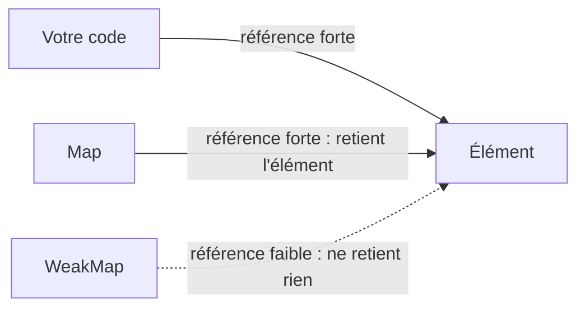

# 12 — Collections : Map, Set et références faibles

> **Niveau** : Intermédiaire · **Durée** : ~2 h 30 · **Prérequis** : [Tableaux](../09-tableaux/README.md), [Objets](../10-objets/README.md), [Syntaxe moderne](../11-syntaxe-moderne/README.md)

Les objets et les tableaux savent presque tout faire, mais pas toujours bien : un objet convertit ses clés en chaînes, un tableau doit être parcouru en entier pour savoir s'il contient une valeur. `Map` et `Set` (ES2015) sont des collections spécialisées qui corrigent ces défauts, et leurs cousines `WeakMap`, `WeakSet` et `WeakRef` permettent d'associer des données à des objets sans empêcher le ramasse-miettes de faire son travail. Ce chapitre couvre aussi les nouveautés récentes : méthodes ensemblistes de `Set` (ES2025) et `getOrInsert` (ES2026).

## Objectifs

- Choisir entre objet, tableau, `Map` et `Set` selon le besoin
- Utiliser l'API de `Map` : ajout, lecture, suppression, itération, conversions, `Map.groupBy`
- Simplifier le motif « lire ou initialiser » avec `getOrInsert` et `getOrInsertComputed` (ES2026), ou leur équivalent portable
- Dédoublonner et tester l'appartenance efficacement avec `Set`, et combiner des ensembles avec les méthodes ES2025
- Associer des données à des objets sans fuite mémoire avec `WeakMap` et `WeakSet`
- Expliquer le rôle de `WeakRef` et `FinalizationRegistry`, et pourquoi il faut les éviter la plupart du temps
- Écrire des recettes classiques : compteur de fréquences, cache LRU, graphe

## Sommaire

- [Pourquoi d'autres collections ?](#pourquoi-dautres-collections-)
- [Map](#map)
- [Set](#set)
- [WeakMap et WeakSet](#weakmap-et-weakset)
- [WeakRef et FinalizationRegistry](#weakref-et-finalizationregistry)
- [Objet, Map, tableau ou Set : comment choisir](#objet-map-tableau-ou-set--comment-choisir)
- [Recettes](#recettes)
- [Pièges courants](#pièges-courants)
- [Bonnes pratiques](#bonnes-pratiques)
- [Résumé](#résumé)
- [Exercices](#exercices)
- [Pour aller plus loin](#pour-aller-plus-loin)

## Pourquoi d'autres collections ?

Utiliser un objet comme dictionnaire (des clés arbitraires associées à des valeurs) pose plusieurs problèmes :

```js
// 1. Les clés sont converties en chaînes
const reponses = {};
reponses[1] = "nombre";
reponses["1"] = "chaîne"; // écrase la précédente
console.log(Object.keys(reponses)); // ["1"]

// 2. Un objet utilisé comme clé devient "[object Object]"
const ana = { id: 1 };
const bilal = { id: 2 };
const notes = {};
notes[ana] = 15;
notes[bilal] = 8;
console.log(notes); // { "[object Object]": 8 }

// 3. Des clés « existent » déjà, héritées du prototype
const dictionnaire = {};
console.log("constructor" in dictionnaire, typeof dictionnaire.toString); // true function

// 4. Les clés qui ressemblent à des entiers passent devant, triées
const ordre = { b: 1, 2: "deux", a: 2, 1: "un" };
console.log(Object.keys(ordre)); // ["1", "2", "b", "a"]
```

Il faut aussi compter les clés soi-même (`Object.keys(obj).length`), et les clés venant de l'extérieur exposent à la **pollution de prototype** (voir [plus bas](#objet-map-tableau-ou-set--comment-choisir)). Du côté des tableaux, tester l'appartenance avec `includes` oblige à parcourir tous les éléments.

| Besoin | Défaut de l'objet ou du tableau | Solution |
| --- | --- | --- |
| Clés de tout type | clés converties en chaînes | `Map` |
| Pas de clés parasites | propriétés héritées du prototype | `Map` |
| Ordre d'insertion fiable | clés entières réordonnées | `Map`, `Set` |
| Taille immédiate | `Object.keys(obj).length` | `.size` |
| Valeurs uniques, test rapide | doublons possibles, `includes` en O(n) | `Set` |
| Données liées à la durée de vie d'un objet | fuite mémoire avec une `Map` | `WeakMap`, `WeakSet` |

## Map

Une `Map` associe des **clés de n'importe quel type** à des valeurs, et retient l'ordre d'insertion.

### Créer et manipuler une Map

```js
const capitales = new Map();

capitales.set("France", "Paris");
capitales.set("Japon", "Tokyo").set("Brésil", "Brasília"); // set renvoie la Map : chaînable

console.log(capitales.get("Japon")); // Tokyo
console.log(capitales.get("Italie")); // undefined
console.log(capitales.has("France")); // true
console.log(capitales.size); // 3

console.log(capitales.delete("Brésil")); // true
console.log(capitales.delete("Brésil")); // false
capitales.clear();
console.log(capitales.size); // 0
```

On peut aussi partir d'un itérable de paires `[clé, valeur]` : un tableau de paires, `Object.entries(objet)` ou une autre `Map` (copie superficielle).

```js
const traductions = new Map([
  ["fr", "Bonjour"],
  ["en", "Hello"],
]);
const depuisObjet = new Map(Object.entries({ rouge: "#f00", vert: "#0f0" }));
const copie = new Map(traductions);

console.log(traductions.get("en"), depuisObjet.get("vert"), copie.size); // Hello #0f0 2
console.log(copie === traductions); // false
```

| Membre | Rôle | Renvoie |
| --- | --- | --- |
| `set(cle, valeur)` | ajoute ou remplace une entrée | la `Map` |
| `get(cle)` | lit une valeur | la valeur ou `undefined` |
| `has(cle)` | teste la présence d'une clé | booléen |
| `delete(cle)` | supprime une entrée | `true` si elle existait |
| `clear()` | vide la `Map` | `undefined` |
| `size` | nombre d'entrées (propriété, pas méthode) | nombre |
| `keys()`, `values()`, `entries()` | itérateurs sur les clés, valeurs, paires | itérateur |
| `forEach((valeur, cle) => …)` | parcourt les entrées | `undefined` |
| `getOrInsert`, `getOrInsertComputed` (ES2026) | lit, ou insère puis renvoie | la valeur |

> [!NOTE]
> `get` renvoie `undefined` aussi bien pour une clé absente que pour une clé associée à `undefined`. Si cette valeur est possible, testez avec `has`.

### Des clés de n'importe quel type

Les clés sont comparées avec l'algorithme **SameValueZero** : comme `===`, sauf que `NaN` est égal à lui-même. Les objets sont donc comparés **par référence**.

```js
const visites = new Map();
const accueil = { url: "/" };

visites.set(accueil, 120);
console.log(visites.get(accueil)); // 120
console.log(visites.get({ url: "/" })); // undefined

const melange = new Map([
  [NaN, "pas un nombre"],
  [1, "nombre"],
  ["1", "chaîne"],
  [true, "booléen"],
]);
console.log(melange.get(NaN), melange.get(1), melange.get("1"), melange.size); // pas un nombre nombre chaîne 4
```

Pour indexer par une **valeur composée** (des coordonnées, un couple d'identifiants), construisez une clé textuelle :

```js
const grille = new Map();
const cleCase = (x, y) => `${x},${y}`;

grille.set(cleCase(2, 3), "trésor");
console.log(grille.get(cleCase(2, 3))); // trésor
console.log(grille.has(cleCase(3, 2))); // false
```

### L'ordre d'insertion

Une `Map` se parcourt dans l'ordre d'insertion des clés. Mettre à jour une clé existante **ne change pas** sa position ; la supprimer puis la réinsérer la place **à la fin**. Cette propriété est la base du cache LRU présenté dans les [recettes](#recettes).

```js
const etapes = new Map([
  ["a", 1],
  ["b", 2],
  ["c", 3],
]);

etapes.set("a", 10); // mise à jour : "a" reste en tête
console.log([...etapes.keys()]); // ["a", "b", "c"]

etapes.delete("a");
etapes.set("a", 10); // réinsertion : "a" passe en dernier
console.log([...etapes.keys()]); // ["b", "c", "a"]
```

### Parcourir une Map

`for…of` produit des paires `[clé, valeur]`, qu'on déstructure. `keys()`, `values()` et `entries()` renvoient des **itérateurs** ([chapitre 13](../13-iterateurs-generateurs/README.md)), pas des tableaux. `forEach` reçoit **la valeur en premier**.

```js
const prix = new Map([
  ["café", 2.5],
  ["thé", 3],
  ["chocolat", 3.5],
]);

for (const [boisson, montant] of prix) {
  console.log(`${boisson} : ${montant} €`);
}
// café : 2.5 €
// thé : 3 €
// chocolat : 3.5 €

prix.forEach((montant, boisson) => {
  if (montant > 3) console.log(`${boisson} est le plus cher`); // chocolat est le plus cher
});

console.log(prix.keys().length); // undefined : un itérateur n'a pas de length
console.log([...prix.keys()]); // ["café", "thé", "chocolat"]
console.log(Array.from(prix.values()).length); // 3
```

Depuis ES2025, les itérateurs ont leurs propres méthodes (`map`, `filter`, `reduce`, `toArray`…, voir le [chapitre 13](../13-iterateurs-generateurs/README.md)) : on peut traiter les valeurs d'une `Map` sans tableau intermédiaire.

```js
const prix = new Map([
  ["café", 2.5],
  ["thé", 3],
  ["chocolat", 3.5],
]);

console.log(prix.values().reduce((total, montant) => total + montant, 0)); // 9
console.log(prix.keys().filter((nom) => nom.length > 4).toArray()); // ["chocolat"]
```

Ajouter des entrées pendant un parcours est permis (elles seront visitées), et une entrée supprimée avant d'avoir été atteinte est sautée. C'est défini par la spécification, mais difficile à relire : préférez construire une nouvelle `Map`.

### Convertir une Map

```js
const stock = { pommes: 12, poires: 4 };

const carte = new Map(Object.entries(stock)); // objet → Map
const retour = Object.fromEntries(carte); // Map → objet
const paires = [...carte]; // Map → tableau de paires

console.log(retour); // { pommes: 12, poires: 4 }
console.log(paires); // [["pommes", 12], ["poires", 4]]

// JSON ne connaît pas les Map : une Map devient un objet vide !
console.log(JSON.stringify(carte)); // {}
console.log(JSON.stringify(Object.fromEntries(carte))); // {"pommes":12,"poires":4}
console.log(JSON.stringify([...carte])); // [["pommes",12],["poires",4]]

// Aller-retour fidèle avec un tableau de paires
const relue = new Map(JSON.parse(JSON.stringify([...carte])));
console.log(relue.get("poires")); // 4
```

`Object.fromEntries` convertit les clés en chaînes : une `Map` dont les clés sont des objets ou des nombres perd de l'information. Le format « tableau de paires » conserve les nombres et les booléens. Enfin, `structuredClone` sait copier une `Map` en profondeur ([chapitre 25](../25-json-et-stockage/README.md)).

Pour **transformer** une `Map`, on construit une nouvelle `Map` à partir de paires transformées :

```js
const prixHT = new Map([
  ["café", 2.5],
  ["thé", 3],
  ["chocolat", 3.5],
]);

const prixTTC = new Map([...prixHT].map(([nom, ht]) => [nom, Math.round(ht * 1.2 * 100) / 100]));
console.log(prixTTC); // Map(3) { "café" => 3, "thé" => 3.6, "chocolat" => 4.2 }

// Avec les Iterator helpers (ES2025), sans tableau intermédiaire
const chers = new Map(prixHT.entries().filter(([, montant]) => montant >= 3));
console.log([...chers.keys()]); // ["thé", "chocolat"]

// Trier une Map : trier ses paires
const parPrixDecroissant = new Map([...prixHT].sort(([, a], [, b]) => b - a));
console.log([...parPrixDecroissant.keys()]); // ["chocolat", "thé", "café"]
```

### Regrouper avec `Map.groupBy`

`Map.groupBy` (ES2024) range les éléments d'un itérable dans une `Map` selon la clé renvoyée par une fonction. Son cousin `Object.groupBy` est présenté au [chapitre 9](../09-tableaux/README.md) ; préférez `Map.groupBy` quand les clés ne sont **pas des chaînes** ou quand vous voulez l'API de `Map`.

```js
const commandes = [
  { id: 1, client: "Ana", total: 40 },
  { id: 2, client: "Bilal", total: 15 },
  { id: 3, client: "Ana", total: 25 },
];

const parClient = Map.groupBy(commandes, (commande) => commande.client);
console.log(parClient.get("Ana").map((c) => c.id)); // [1, 3]
console.log([...parClient.keys()]); // ["Ana", "Bilal"]

// Des objets comme clés : impossible avec Object.groupBy
const site = { nom: "Site web" };
const appli = { nom: "Appli mobile" };
const taches = [
  { titre: "Maquette", projet: site },
  { titre: "Tests", projet: appli },
  { titre: "Mise en ligne", projet: site },
];

const parProjet = Map.groupBy(taches, (tache) => tache.projet);
console.log(parProjet.get(site).length); // 2
```

### Lire ou initialiser : `getOrInsert` et `getOrInsertComputed`

Un motif revient sans cesse : « si la clé n'existe pas, crée sa valeur, puis utilise-la ».

```js
const parInitiale = new Map();

for (const mot of ["avion", "bateau", "autobus", "vélo"]) {
  const initiale = mot[0];
  if (!parInitiale.has(initiale)) parInitiale.set(initiale, []);
  parInitiale.get(initiale).push(mot);
}

console.log(parInitiale.get("a")); // ["avion", "autobus"]
```

ES2026 ajoute deux méthodes à `Map` et `WeakMap` qui font cela en un appel :

- `getOrInsert(cle, valeurParDefaut)` renvoie la valeur existante, ou insère `valeurParDefaut` puis la renvoie ;
- `getOrInsertComputed(cle, fabrique)` fait de même, mais n'appelle `fabrique(cle)` **que si la clé manque**.

<!-- no-run -->
```js
const parInitiale = new Map();

for (const mot of ["avion", "bateau", "autobus", "vélo"]) {
  parInitiale.getOrInsert(mot[0], []).push(mot);
}

console.log(parInitiale.get("a")); // ["avion", "autobus"]
console.log(parInitiale.size); // 3
```

Avec `getOrInsert`, l'argument est évalué **à chaque appel**, même si la clé existe déjà (ici, un tableau vide est créé à chaque tour puis jeté). Quand la valeur par défaut coûte cher, utilisez `getOrInsertComputed` :

<!-- no-run -->
```js
const profils = new Map();

function chargerProfil(id) {
  return profils.getOrInsertComputed(id, (cle) => {
    console.log(`construction du profil ${cle}`);
    return { id: cle, preferences: {} };
  });
}

chargerProfil(42); // construction du profil 42
chargerProfil(42); // (rien : déjà présent)
console.log(chargerProfil(42) === chargerProfil(42)); // true
console.log(profils.size); // 1
```

**Disponibilité (novembre 2026)** : Chrome 145+, Firefox 144+, Safari 26.2+ (Baseline 2026), Node.js 26+. Ces méthodes sont **absentes de Node 24**. Pour un code qui doit tourner partout, une petite fonction suffit (ou le polyfill de `core-js`) :

```js
function obtenirOuCreer(map, cle, fabrique) {
  if (!map.has(cle)) map.set(cle, fabrique(cle));
  return map.get(cle);
}

const parInitiale = new Map();
for (const mot of ["avion", "bateau", "autobus", "vélo"]) {
  obtenirOuCreer(parInitiale, mot[0], () => []).push(mot);
}

console.log(parInitiale); // Map(3) { "a" => ["avion", "autobus"], "b" => ["bateau"], "v" => ["vélo"] }
```

Pour un simple **compteur**, `get` suivi de `??` reste le plus lisible :

```js
const compteur = new Map();
for (const lettre of "abracadabra") {
  compteur.set(lettre, (compteur.get(lettre) ?? 0) + 1);
}
console.log(compteur.get("a"), compteur.get("b")); // 5 2
```

## Set

Un `Set` est un ensemble de **valeurs uniques**, parcouru dans l'ordre d'insertion.

### Créer et manipuler un Set

```js
const tags = new Set(["js", "css"]);

tags.add("html").add("js"); // "js" est déjà présent : ignoré
console.log(tags.size); // 3
console.log(tags.has("css")); // true

tags.delete("css");
console.log([...tags]); // ["js", "html"]
```

L'unicité utilise le même algorithme SameValueZero que les clés de `Map` : `NaN` n'est présent qu'une fois, `0` et `-0` sont identiques, et deux objets distincts restent distincts même s'ils ont le même contenu.

```js
const valeurs = new Set([1, "1", NaN, NaN, 0, -0]);
console.log(valeurs.size); // 4

const points = new Set([{ x: 0 }, { x: 0 }]);
console.log(points.size); // 2
```

### Dédoublonner

Le dédoublonnage d'un tableau de primitives tient en une ligne, et conserve l'ordre de **première** apparition :

```js
const villes = ["Lyon", "Paris", "Lyon", "Nice", "Paris"];
console.log([...new Set(villes)]); // ["Lyon", "Paris", "Nice"]
```

Pour des objets, on dédoublonne **par clé**. Selon que l'on veut garder la première ou la dernière occurrence :

```js
const inscriptions = [
  { email: "ana@exemple.fr", jour: "lundi" },
  { email: "bilal@exemple.fr", jour: "mardi" },
  { email: "ana@exemple.fr", jour: "jeudi" },
];

// Première occurrence : un Set des clés déjà vues
const dejaVus = new Set();
const premieres = inscriptions.filter(({ email }) => {
  if (dejaVus.has(email)) return false;
  dejaVus.add(email);
  return true;
});
console.log(premieres.map((i) => i.jour)); // ["lundi", "mardi"]

// Dernière occurrence : une Map indexée par la clé (chaque set écrase la valeur)
const dernieres = [...new Map(inscriptions.map((i) => [i.email, i])).values()];
console.log(dernieres.map((i) => i.jour)); // ["jeudi", "mardi"]
```

### Tester l'appartenance rapidement

`tableau.includes(x)` compare `x` à chaque élément : c'est un coût proportionnel à la taille du tableau, O(n). `set.has(x)` utilise une table de hachage et répond en temps **constant en moyenne**, O(1). La différence devient énorme quand on teste beaucoup de valeurs :

```js
const motsInterdits = ["spam", "arnaque", "gratuit", "urgent"];
const messages = ["offre gratuit urgent", "réunion demain", "spam spam"];

// ❌ includes dans une boucle : messages × mots × motsInterdits comparaisons
const signalesLent = messages.filter((m) => m.split(" ").some((mot) => motsInterdits.includes(mot)));

// ✅ un Set construit une fois, puis des tests en temps constant
const interdits = new Set(motsInterdits);
const signales = messages.filter((m) => m.split(" ").some((mot) => interdits.has(mot)));

console.log(signales); // ["offre gratuit urgent", "spam spam"]
console.log(signalesLent.length === signales.length); // true
```

Avec 4 mots interdits, la différence est invisible. Avec 10 000 messages de 20 mots et une liste de 5 000 mots interdits, la version `includes` fait jusqu'à un milliard de comparaisons, la version `Set` environ 200 000 recherches. Le [chapitre 9](../09-tableaux/README.md) revient sur cette question de complexité.

### Parcourir un Set

```js
const couleurs = new Set(["rouge", "vert", "bleu"]);

for (const couleur of couleurs) console.log(couleur);
// rouge
// vert
// bleu

console.log(couleurs.keys === couleurs.values); // true
console.log(couleurs.entries().next().value); // ["rouge", "rouge"]
```

Un `Set` n'a pas de clés distinctes de ses valeurs : `keys()` est un alias de `values()`, et `entries()` produit des paires `[valeur, valeur]`. Ces méthodes existent pour que `Set` et `Map` aient la même forme d'API. `forEach((valeur) => …)` est aussi disponible.

### Les méthodes ensemblistes (ES2025)

ES2025 a ajouté à `Set` les opérations classiques de la théorie des ensembles. Elles **ne modifient pas** les ensembles d'origine : elles renvoient un nouveau `Set` ou un booléen.

| Méthode | Résultat | Notation |
| --- | --- | --- |
| `a.union(b)` | éléments présents dans `a` ou dans `b` | A ∪ B |
| `a.intersection(b)` | éléments communs | A ∩ B |
| `a.difference(b)` | éléments de `a` absents de `b` | A ∖ B |
| `a.symmetricDifference(b)` | éléments présents dans un seul des deux | A Δ B |
| `a.isSubsetOf(b)` | tous les éléments de `a` sont-ils dans `b` ? | A ⊆ B |
| `a.isSupersetOf(b)` | `a` contient-il tous les éléments de `b` ? | A ⊇ B |
| `a.isDisjointFrom(b)` | `a` et `b` n'ont-ils aucun élément commun ? | A ∩ B = ∅ |

```js
const requises = new Set(["lire", "écrire", "publier"]);
const ana = new Set(["lire", "écrire", "commenter"]);

console.log(ana.intersection(requises)); // Set(2) { "lire", "écrire" }
console.log(requises.difference(ana)); // Set(1) { "publier" }
console.log(ana.union(requises)); // Set(4) { "lire", "écrire", "commenter", "publier" }
console.log(ana.symmetricDifference(requises)); // Set(2) { "commenter", "publier" }

console.log(requises.isSubsetOf(ana)); // false
console.log(new Set(["lire"]).isSubsetOf(ana)); // true
console.log(ana.isSupersetOf(new Set(["lire", "écrire"]))); // true
console.log(ana.isDisjointFrom(new Set(["administrer"]))); // true
```

Un usage très concret : **comparer deux versions d'une liste** pour savoir ce qui a été ajouté ou retiré.

```js
const avant = new Set(["ana", "bilal", "chloé"]);
const apres = new Set(["bilal", "chloé", "dmitri"]);

console.log([...apres.difference(avant)]); // ["dmitri"]
console.log([...avant.difference(apres)]); // ["ana"]
console.log([...avant.intersection(apres)]); // ["bilal", "chloé"]
```

L'argument doit ressembler à un ensemble : un objet avec `size`, `has()` et `keys()`. Un `Set` convient, une `Map` aussi (ses clés sont utilisées), mais **pas un tableau** :

```js
const roles = new Set(["lecteur"]);

try {
  roles.union(["admin"]);
} catch (erreur) {
  console.log(erreur.name); // TypeError
}

console.log(roles.union(new Set(["admin"]))); // Set(2) { "lecteur", "admin" }
```

> [!WARNING]
> Ne vous fiez pas à l'ordre des éléments renvoyés par `intersection` : pour être efficace, la méthode parcourt **le plus petit** des deux ensembles, si bien que l'ordre peut être celui de l'argument. Triez le résultat si l'ordre compte.

```js
const grand = new Set([1, 2, 3, 4]);
const petit = new Set([3, 2, 1]);

console.log([...grand.intersection(petit)]); // [3, 2, 1]
console.log([...grand.union(petit)]); // [1, 2, 3, 4]
```

**Disponibilité** : Baseline 2024 (Chrome 122, Firefox 127, Safari 17), Node.js 22+. Pour un environnement plus ancien, l'intersection s'écrit `new Set([...a].filter((x) => b.has(x)))`.

## WeakMap et WeakSet

### Le problème : des données attachées à des objets

Le ramasse-miettes (_garbage collector_) libère un objet quand plus rien d'**atteignable** ne le référence. Or une entrée de `Map` est une référence comme une autre : tant que la `Map` existe, ses clés restent en mémoire. Associer des données à des objets éphémères (des éléments du DOM, des requêtes, des objets fournis par une bibliothèque) avec une `Map` provoque donc une **fuite mémoire** : les objets ne sont jamais libérés.

Une `WeakMap` tient ses clés par une **référence faible** : elle ne les empêche pas d'être libérées, et quand une clé disparaît, son entrée disparaît avec elle.



Quand votre code ne référence plus l'élément, la `Map` le garde en vie ; la `WeakMap`, non.

### API et contraintes

- Les clés doivent être des **objets** ou des **symboles non enregistrés** (créés avec `Symbol()`, pas avec `Symbol.for()`, ES2023). Une primitive lève une `TypeError`.
- Méthodes : `set`, `get`, `has`, `delete`, plus `getOrInsert` et `getOrInsertComputed` en ES2026.
- **Pas de `size`, pas d'itération, pas de `clear`** : le contenu dépend du passage du ramasse-miettes, dont le moment est imprévisible. Le langage refuse donc d'exposer quoi que ce soit qui en dépende.

```js
const meta = new WeakMap();
const fichier = { nom: "rapport.pdf" };

meta.set(fichier, { ouvertures: 3 });
console.log(meta.get(fichier)); // { ouvertures: 3 }
console.log(meta.has({ nom: "rapport.pdf" })); // false

try {
  meta.set("rapport.pdf", {});
} catch (erreur) {
  console.log(erreur.name); // TypeError
}

console.log(meta.size, typeof meta.keys); // undefined undefined
```

### Cas d'usage : un cache par objet

Mémoïser un calcul coûteux par objet, sans retenir les objets indéfiniment :

```js
const cacheTotaux = new WeakMap();

function totalCommande(commande) {
  if (cacheTotaux.has(commande)) return cacheTotaux.get(commande);
  console.log(`calcul du total de ${commande.id}`);
  const total = commande.lignes.reduce((somme, { prix, quantite }) => somme + prix * quantite, 0);
  cacheTotaux.set(commande, total);
  return total;
}

const commande = { id: "C-1", lignes: [{ prix: 12, quantite: 2 }, { prix: 5, quantite: 1 }] };
const premier = totalCommande(commande); // calcul du total de C-1
const second = totalCommande(commande); // (aucun message : résultat en cache)
console.log(premier, second); // 29 29
```

Ce cache suppose que l'objet **ne change pas** : si l'on modifie `commande.lignes`, le total mémorisé devient faux. Il se marie donc très bien avec les mises à jour immuables du [chapitre 11](../11-syntaxe-moderne/README.md), où chaque modification produit un nouvel objet.

### Cas d'usage : des métadonnées sur des objets qui ne vous appartiennent pas

Avant les champs privés `#` (ES2022, [chapitre 16](../16-classes/README.md)), les `WeakMap` servaient à stocker les données privées d'une classe. Aujourd'hui, leur usage principal est d'attacher des informations à des objets que l'on ne contrôle pas, comme des éléments du DOM :

<!-- no-run -->
```js
const etatBoutons = new WeakMap();

for (const bouton of document.querySelectorAll("button")) {
  etatBoutons.set(bouton, { clics: 0 });
  bouton.addEventListener("click", () => {
    const etat = etatBoutons.get(bouton);
    etat.clics++;
    bouton.title = `${etat.clics} clic(s)`;
  });
}
// Un bouton retiré de la page et oublié par le code est libéré, avec son entrée.
```

### WeakSet : marquer des objets

Un `WeakSet` contient des objets (ou des symboles non enregistrés) sans les retenir. Il sert à **marquer** : « cet objet a été validé », « cet objet est en cours de traitement ».

```js
const commandesValidees = new WeakSet();

function valider(commande) {
  if (!commande.lignes?.length) throw new Error("Commande vide");
  commandesValidees.add(commande);
  return commande;
}

function expedier(commande) {
  if (!commandesValidees.has(commande)) throw new Error("Commande non validée");
  return `Commande ${commande.id} expédiée`;
}

const commande = valider({ id: "C-7", lignes: [{ produit: "Lampe" }] });
console.log(expedier(commande)); // Commande C-7 expédiée

try {
  expedier({ id: "C-8", lignes: [] });
} catch (erreur) {
  console.log(erreur.message); // Commande non validée
}
```

Autre usage classique : détecter un **cycle** pendant un parcours récursif (un objet qui se contient lui-même, directement ou non). On marque les objets du chemin en cours, et on les retire en remontant : ainsi, un objet simplement **partagé** par deux branches n'est pas pris pour un cycle.

```js
function contientCycle(valeur, cheminEnCours = new WeakSet()) {
  if (typeof valeur !== "object" || valeur === null) return false;
  if (cheminEnCours.has(valeur)) return true;
  cheminEnCours.add(valeur);
  const trouve = Object.values(valeur).some((enfant) => contientCycle(enfant, cheminEnCours));
  cheminEnCours.delete(valeur);
  return trouve;
}

const parent = { nom: "parent" };
parent.enfant = { nom: "enfant", parent };
console.log(contientCycle(parent)); // true

const partage = { valeur: 1 };
console.log(contientCycle({ gauche: partage, droite: partage })); // false
```

Ici un `Set` fonctionnerait aussi ; le `WeakSet` exprime simplement que l'ensemble ne doit retenir aucun objet. C'est le même mécanisme qui permet à `JSON.stringify` de signaler « Converting circular structure to JSON ».

## WeakRef et FinalizationRegistry

> [!WARNING]
> Notions avancées. Ces API (ES2021) dépendent du ramasse-miettes, dont le comportement n'est **pas spécifié** : le moment où un objet est libéré varie selon le moteur et la mémoire disponible, et peut ne jamais arriver. La proposition qui les a introduites recommande elle-même de les éviter si possible. Ne leur confiez jamais une logique nécessaire au bon fonctionnement du programme.

### WeakRef

Une `WeakRef` est une référence faible vers **un** objet (ou un symbole non enregistré). `deref()` renvoie l'objet s'il existe encore, sinon `undefined`.

```js
let image = { nom: "photo.jpg", pixels: new Uint8Array(1024) };
const ref = new WeakRef(image);

console.log(ref.deref()?.nom); // photo.jpg

image = null; // plus aucune référence forte : l'objet PEUT être libéré… un jour
```

Une fois que `deref()` a renvoyé l'objet, le moteur le garde en vie au moins jusqu'à la fin de la tâche synchrone en cours. Appelez donc `deref()` **une fois**, rangez le résultat dans une variable locale, et ne supposez pas qu'il sera encore là après un `await`.

### FinalizationRegistry

Un `FinalizationRegistry` permet de demander à être prévenu **après** qu'un objet a été libéré :

- `new FinalizationRegistry(rappel)` crée le registre ;
- `registre.register(cible, valeurTenue, jeton?)` surveille `cible` ; après sa libération, `rappel(valeurTenue)` sera **peut-être** appelé ;
- `registre.unregister(jeton)` annule la surveillance.

`valeurTenue` ne peut pas être la cible elle-même (sinon elle ne serait jamais libérée). Le rappel peut ne jamais être appelé, par exemple si le programme se termine avant.

### Exemple : un cache qui ne retient pas ses valeurs

Le cas d'usage typique est un cache de gros objets reconstructibles (images décodées, fichiers analysés) : on veut les réutiliser tant qu'ils existent, sans empêcher leur libération si la mémoire manque.

```js
class CacheFaible {
  #entrees = new Map();
  #registre = new FinalizationRegistry((cle) => {
    // L'entrée a peut-être été remplacée entre-temps : on vérifie avant de supprimer
    if (!this.#entrees.get(cle)?.deref()) this.#entrees.delete(cle);
  });

  set(cle, valeur) {
    this.#entrees.set(cle, new WeakRef(valeur));
    this.#registre.register(valeur, cle);
  }

  get(cle) {
    return this.#entrees.get(cle)?.deref();
  }
}

const cache = new CacheFaible();
cache.set("logo", { largeur: 512, pixels: new Uint8Array(512 * 512) });
console.log(cache.get("logo")?.largeur); // 512
```

Pour observer le ramasse-miettes, il faut pouvoir le déclencher : Node expose `globalThis.gc()` avec l'option `--expose-gc`. Ce programme s'exécute aussi sans l'option, mais `gc` n'existe pas alors et l'objet est généralement encore en mémoire à la fin :

```js
const registre = new FinalizationRegistry((etiquette) => console.log(`finalisé : ${etiquette}`));
let ref;

(function creer() {
  const gros = { donnees: new Array(1_000_000).fill(0) };
  ref = new WeakRef(gros);
  registre.register(gros, "gros objet");
})();

console.log("avant :", ref.deref() !== undefined); // avant : true
await new Promise((resoudre) => setTimeout(resoudre, 0)); // laisse finir la tâche en cours
globalThis.gc?.();
await new Promise((resoudre) => setTimeout(resoudre, 50));
console.log("après :", ref.deref() === undefined ? "libéré" : "encore là");

// Avec `node --expose-gc fichier.js`, on observe généralement :
//   avant : true / finalisé : gros objet / après : libéré
// Sans l'option : avant : true / après : encore là
```

Même avec `--expose-gc`, rien ne garantit cet ordre : c'est une démonstration, pas un comportement sur lequel s'appuyer.

**Quand les utiliser ?** Pour des caches de gros objets reconstructibles, ou comme filet de sécurité pour signaler une ressource oubliée (un fichier non fermé). La libération normale d'une ressource doit rester **explicite** : méthode `close()`, `try…finally` ou `using` ([chapitre 17](../17-erreurs/README.md)). Et pour limiter la mémoire d'un cache, un cache LRU à taille bornée est souvent plus simple et plus prévisible.

## Objet, Map, tableau ou Set : comment choisir

| Besoin | Choix |
| --- | --- |
| Un enregistrement à forme fixe, connue à l'avance (utilisateur, configuration) | objet |
| Des données à envoyer ou stocker en JSON telles quelles | objet ou tableau |
| Une liste ordonnée, avec doublons possibles, accès par index, tri | tableau |
| Un dictionnaire dont les clés viennent de l'extérieur (saisies, identifiants) | `Map` |
| Des clés qui ne sont pas des chaînes (objets, nombres à garder tels quels) | `Map` |
| Beaucoup d'ajouts et de suppressions, besoin de la taille | `Map` |
| Des valeurs uniques, des tests d'appartenance fréquents | `Set` |
| Des opérations d'ensembles (union, différence…) | `Set` |
| Des données liées à des objets dont vous ne contrôlez pas la durée de vie | `WeakMap` |
| Marquer des objets sans les retenir | `WeakSet` |

Un argument de **sécurité** plaide aussi pour `Map` dès que les clés viennent de l'utilisateur. Avec un objet, la clé `"__proto__"` ne crée pas une entrée : elle **remplace le prototype**. C'est le point de départ des attaques par pollution de prototype ([chapitre 10](../10-objets/README.md)).

```js
const cleSaisie = "__proto__"; // imaginez une clé venant d'un formulaire ou d'un JSON

const preferences = {};
preferences[cleSaisie] = { admin: true };
console.log(Object.keys(preferences)); // []
console.log(preferences.admin); // true : hérité du nouveau prototype !

const preferencesSures = new Map();
preferencesSures.set(cleSaisie, { admin: true });
console.log(preferencesSures.size, preferencesSures.get("admin")); // 1 undefined
```

Si un objet est nécessaire (pour le JSON par exemple), créez-le avec `Object.create(null)`, qui n'a pas de prototype.

## Recettes

### Compteur de fréquences

```js
function frequences(elements) {
  const compteur = new Map();
  for (const element of elements) {
    compteur.set(element, (compteur.get(element) ?? 0) + 1);
  }
  return compteur;
}

const texte = "le chat et le chien et le poisson";
const parMot = frequences(texte.split(" "));

console.log(parMot.get("le"), parMot.get("chat")); // 3 1

const plusFrequents = [...parMot].sort(([, a], [, b]) => b - a).slice(0, 2);
console.log(plusFrequents); // [["le", 3], ["et", 2]]
```

### Cache LRU

Un cache LRU (_Least Recently Used_) garde un nombre limité d'entrées et évince **la moins récemment utilisée**. L'ordre d'insertion d'une `Map` le rend presque gratuit : chaque lecture réinsère l'entrée à la fin, donc la première clé est toujours la plus ancienne.

```js
class CacheLRU {
  #capacite;
  #entrees = new Map();

  constructor(capacite) {
    this.#capacite = capacite;
  }

  get(cle) {
    if (!this.#entrees.has(cle)) return undefined;
    const valeur = this.#entrees.get(cle);
    this.#entrees.delete(cle);
    this.#entrees.set(cle, valeur); // devient la plus récente
    return valeur;
  }

  set(cle, valeur) {
    this.#entrees.delete(cle);
    this.#entrees.set(cle, valeur);
    if (this.#entrees.size > this.#capacite) {
      const plusAncienne = this.#entrees.keys().next().value;
      this.#entrees.delete(plusAncienne);
    }
    return this;
  }

  get cles() {
    return [...this.#entrees.keys()];
  }
}

const cache = new CacheLRU(2);
cache.set("a", 1).set("b", 2);
cache.get("a"); // "a" devient la plus récente
cache.set("c", 3); // capacité dépassée : "b" est évincée

console.log(cache.cles); // ["a", "c"]
console.log(cache.get("b")); // undefined
```

Toutes les opérations sont en temps constant en moyenne. C'est l'implémentation de référence en JavaScript, utilisée (en plus complet) par des paquets comme `lru-cache`.

### Graphe d'adjacence

Un graphe se représente naturellement par une `Map` qui associe à chaque sommet le `Set` de ses voisins.

```js
function creerGraphe(aretes) {
  const graphe = new Map();
  for (const [a, b] of aretes) {
    if (!graphe.has(a)) graphe.set(a, new Set());
    if (!graphe.has(b)) graphe.set(b, new Set());
    graphe.get(a).add(b);
    graphe.get(b).add(a); // graphe non orienté
  }
  return graphe;
}

// Parcours en largeur : tous les sommets atteignables depuis « depart »
function accessibles(graphe, depart) {
  const vus = new Set([depart]);
  const file = [depart];
  while (file.length > 0) {
    const sommet = file.shift();
    for (const voisin of graphe.get(sommet) ?? []) {
      if (!vus.has(voisin)) {
        vus.add(voisin);
        file.push(voisin);
      }
    }
  }
  return vus;
}

const amities = creerGraphe([
  ["Ana", "Bilal"],
  ["Bilal", "Chloé"],
  ["Dmitri", "Emma"],
]);

console.log(amities.get("Bilal")); // Set(2) { "Ana", "Chloé" }
console.log([...accessibles(amities, "Ana")]); // ["Ana", "Bilal", "Chloé"]
console.log(accessibles(amities, "Ana").isDisjointFrom(accessibles(amities, "Emma"))); // true
```

`file.shift()` coûte O(n) sur un tableau ; c'est sans importance pour quelques milliers de sommets. Pour de très grands graphes, avancez plutôt un index de lecture dans le tableau.

## Pièges courants

**Utiliser les crochets au lieu de `set`/`get`.** `map[cle] = valeur` crée une propriété ordinaire sur l'objet `Map`, pas une entrée :

```js
const reglages = new Map();
reglages["theme"] = "sombre"; // ❌ propriété de l'objet, pas une entrée
console.log(reglages.size, reglages.get("theme")); // 0 undefined

reglages.set("theme", "sombre"); // ✅
console.log(reglages.size, reglages.get("theme")); // 1 sombre
```

**Chercher une clé objet par son contenu.** `map.get({ id: 1 })` ne retrouve jamais une entrée créée avec un autre objet `{ id: 1 }` : gardez la référence d'origine, ou utilisez une clé textuelle (`"1"`, `` `${x},${y}` ``).

**Sérialiser une `Map` avec `JSON.stringify`.** Le résultat est `"{}"`. Convertissez d'abord avec `Object.fromEntries` ou `[...map]`.

**Construire une `Map` depuis un objet.** `new Map({ a: 1 })` lève `TypeError: object is not iterable`. Écrivez `new Map(Object.entries(objet))`.

**Inverser les arguments de `forEach`.** `map.forEach((valeur, cle) => …)` : la valeur vient en premier, comme pour les tableaux.

**Appeler `size` comme une méthode.** `map.size()` lève une `TypeError` : c'est une propriété.

**Traiter un itérateur comme un tableau.** `map.keys()[0]` et `map.keys().length` valent `undefined`. Convertissez avec `[...map.keys()]`, ou utilisez les Iterator helpers.

**Construire un `Set` à partir d'une chaîne.** `new Set("banane")` donne les lettres `{ "b", "a", "n", "e" }`. Pour un ensemble contenant la chaîne : `new Set(["banane"])`.

**Attendre qu'un `Set` dédoublonne des objets par contenu.** Deux objets identiques en apparence restent deux éléments ; dédoublonnez par clé.

**Passer un tableau aux méthodes ensemblistes.** `set.union([1, 2])` lève une `TypeError` ; enveloppez l'argument dans `new Set(…)`.

**Évaluer une valeur par défaut coûteuse avec `getOrInsert`.** `map.getOrInsert(cle, calculCouteux())` exécute le calcul même si la clé existe : utilisez `getOrInsertComputed(cle, () => calculCouteux())`.

**Compter sur le ramasse-miettes.** Une `WeakMap` n'est pas un cache à durée de vie maîtrisée, et un rappel de `FinalizationRegistry` peut ne jamais être appelé.

## Bonnes pratiques

- Utilisez un **objet** pour un enregistrement à forme fixe, une **`Map`** pour un dictionnaire aux clés variables, un **`Set`** pour des valeurs uniques.
- Convertissez un tableau en `Set` **une fois** avant de faire de nombreux tests d'appartenance.
- Dédoublonnez les primitives avec `[...new Set(tableau)]`, les objets par clé (`Set` des clés vues ou `Map` indexée).
- Préférez les méthodes ensemblistes ES2025 aux combinaisons de `filter` et `has` : elles disent ce qu'elles font.
- Pour « lire ou initialiser », utilisez `getOrInsertComputed` si vos cibles le permettent (Node 26+, Baseline 2026), sinon une petite fonction utilitaire.
- Pour attacher des données à des objets que vous ne possédez pas, utilisez une `WeakMap` ; pour vos propres classes, des champs privés `#`.
- Gardez `WeakRef` et `FinalizationRegistry` pour de rares cas d'optimisation, toujours avec une libération explicite à côté.
- Pensez à la sérialisation : une `Map` ou un `Set` doit être converti avant `JSON.stringify`.

## Résumé

- Un objet utilisé comme dictionnaire convertit ses clés en chaînes, hérite de clés du prototype et réordonne les clés entières. `Map` et `Set` n'ont pas ces défauts et connaissent leur `size`.
- `Map` : `set` (chaînable), `get`, `has`, `delete`, `clear`, `size` ; clés de tout type comparées par SameValueZero (objets par référence) ; parcours dans l'ordre d'insertion, en paires `[clé, valeur]`.
- Conversions : `new Map(Object.entries(obj))`, `Object.fromEntries(map)`, `[...map]`. `JSON.stringify(map)` donne `"{}"`.
- `Map.groupBy` (ES2024) regroupe par clé de tout type ; `getOrInsert` et `getOrInsertComputed` (ES2026, Node 26+) remplacent le motif `has`/`set`/`get`.
- `Set` : valeurs uniques, `add`, `has`, `delete` ; dédoublonnage avec `[...new Set(x)]` ; `has` en temps constant ; méthodes ensemblistes ES2025 (`union`, `intersection`, `difference`, `symmetricDifference`, `isSubsetOf`, `isSupersetOf`, `isDisjointFrom`) qui renvoient de nouveaux ensembles.
- `WeakMap` et `WeakSet` ne retiennent pas leurs clés (objets ou symboles non enregistrés), ne sont pas itérables et n'ont pas de `size` : parfaits pour des métadonnées et des caches liés à la durée de vie d'objets.
- `WeakRef` et `FinalizationRegistry` exposent le ramasse-miettes, dont le comportement n'est pas garanti : à réserver aux cas avancés.

## Exercices

### Exercice 1 — Dépouiller un vote (★☆☆)

Écrivez `depouiller(bulletins)` qui reçoit un tableau de noms et renvoie une `Map` nom → nombre de voix, puis `gagnant(resultats)` qui renvoie le nom ayant le plus de voix (le premier arrivé en cas d'égalité).

<details>
<summary>Solution</summary>

```js
function depouiller(bulletins) {
  const resultats = new Map();
  for (const nom of bulletins) {
    resultats.set(nom, (resultats.get(nom) ?? 0) + 1);
  }
  return resultats;
}

function gagnant(resultats) {
  let meilleur;
  let meilleuresVoix = -1;
  for (const [nom, voix] of resultats) {
    if (voix > meilleuresVoix) {
      meilleur = nom;
      meilleuresVoix = voix;
    }
  }
  return meilleur;
}

const resultats = depouiller(["Ana", "Bilal", "Ana", "Chloé", "Bilal", "Ana"]);
console.log(resultats); // Map(3) { "Ana" => 3, "Bilal" => 2, "Chloé" => 1 }
console.log(gagnant(resultats)); // Ana
console.log(gagnant(depouiller(["Zoé", "Yann"]))); // Zoé
```

L'ordre d'insertion de la `Map` est l'ordre de première apparition des noms ; la comparaison stricte `>` garde donc le premier arrivé en cas d'égalité.

</details>

### Exercice 2 — Nuage de tags (★☆☆)

À partir d'une liste d'articles possédant chacun un tableau `tags`, renvoyez la liste des tags **distincts**, triée par ordre alphabétique français, sans tenir compte de la casse (`"JS"` et `"js"` sont le même tag, à afficher en minuscules).

```js
const articles = [
  { titre: "A", tags: ["JS", "Web"] },
  { titre: "B", tags: ["web", "Éditeur"] },
  { titre: "C", tags: ["css", "js"] },
];
```

<details>
<summary>Solution</summary>

```js
const articles = [
  { titre: "A", tags: ["JS", "Web"] },
  { titre: "B", tags: ["web", "Éditeur"] },
  { titre: "C", tags: ["css", "js"] },
];

function tagsDistincts(articles) {
  const tags = new Set(articles.flatMap((article) => article.tags.map((tag) => tag.toLowerCase())));
  return [...tags].sort((a, b) => a.localeCompare(b, "fr"));
}

console.log(tagsDistincts(articles)); // ["css", "éditeur", "js", "web"]
```

`flatMap` aplatit les tableaux de tags, le `Set` élimine les doublons après normalisation de la casse, et `localeCompare` trie correctement les lettres accentuées (`"éditeur"` se place avec les « e », pas après le « z »).

</details>

### Exercice 3 — Suivi des abonnés (★★☆)

Avec les méthodes ensemblistes, écrivez `bilan(semaine1, semaine2)` qui reçoit deux tableaux d'identifiants et renvoie un objet contenant : les `nouveaux` (présents seulement en semaine 2), les `partis` (seulement en semaine 1), les `fideles` (dans les deux), et le `tauxRetention` (part des abonnés de la semaine 1 encore présents, en pourcentage arrondi).

<details>
<summary>Solution</summary>

```js
function bilan(semaine1, semaine2) {
  const avant = new Set(semaine1);
  const apres = new Set(semaine2);
  const fideles = avant.intersection(apres);
  return {
    nouveaux: [...apres.difference(avant)],
    partis: [...avant.difference(apres)],
    fideles: [...fideles].sort(),
    tauxRetention: avant.size === 0 ? 0 : Math.round((fideles.size / avant.size) * 100),
  };
}

console.log(bilan(["ana", "bilal", "chloé", "dmitri"], ["bilal", "dmitri", "emma"]));
// { nouveaux: ["emma"], partis: ["ana", "chloé"], fideles: ["bilal", "dmitri"], tauxRetention: 50 }
```

Les tableaux sont convertis en `Set` une seule fois (ce qui élimine aussi d'éventuels doublons). Le résultat de `intersection` est trié, car son ordre n'est pas garanti. Le cas `avant.size === 0` évite une division par zéro.

</details>

### Exercice 4 — Familles d'anagrammes (★★☆)

Deux mots sont anagrammes s'ils contiennent les mêmes lettres (« chien » et « niche »). Écrivez `familles(mots)` qui renvoie un tableau des groupes d'anagrammes comportant **au moins deux mots**. Utilisez une `Map` dont la clé est la « signature » du mot (ses lettres triées). Proposez une version avec `Map.groupBy` et une avec `getOrInsertComputed` (ou son équivalent portable).

<details>
<summary>Solution</summary>

```js
const signature = (mot) => [...mot.toLowerCase()].sort().join("");

// Version 1 : Map.groupBy (ES2024)
function familles(mots) {
  return [...Map.groupBy(mots, signature).values()].filter((groupe) => groupe.length >= 2);
}

// Version 2 : remplissage manuel, avec l'équivalent portable de getOrInsertComputed
function obtenirOuCreer(map, cle, fabrique) {
  if (!map.has(cle)) map.set(cle, fabrique(cle));
  return map.get(cle);
}

function famillesManuel(mots) {
  const groupes = new Map();
  for (const mot of mots) {
    obtenirOuCreer(groupes, signature(mot), () => []).push(mot);
    // Node 26+ : groupes.getOrInsertComputed(signature(mot), () => []).push(mot);
  }
  return [...groupes.values()].filter((groupe) => groupe.length >= 2);
}

const mots = ["chien", "niche", "chine", "soir", "rois", "table", "orsi"];
console.log(familles(mots)); // [["chien", "niche", "chine"], ["soir", "rois", "orsi"]]
console.log(famillesManuel(mots)); // [["chien", "niche", "chine"], ["soir", "rois", "orsi"]]
```

La signature transforme chaque mot en une clé textuelle commune à tous ses anagrammes (`"cehin"` pour « chien »). `Map.groupBy` fait tout le travail en une ligne ; la version manuelle montre le motif « lire ou initialiser » que `getOrInsertComputed` rend natif.

</details>

### Exercice 5 — Mémoïser par objet (★★☆)

Écrivez `memoiserParObjet(fonction)` qui renvoie une version mémoïsée d'une fonction prenant **un objet** en argument : le résultat est calculé une seule fois par objet et stocké dans une `WeakMap`. Vérifiez avec un compteur d'appels que deux objets au contenu identique sont calculés séparément.

<details>
<summary>Solution</summary>

```js
function memoiserParObjet(fonction) {
  const cache = new WeakMap();
  return (objet) => {
    if (!cache.has(objet)) cache.set(objet, fonction(objet));
    return cache.get(objet);
  };
}

let appels = 0;
const surface = memoiserParObjet(({ largeur, hauteur }) => {
  appels++;
  return largeur * hauteur;
});

const salon = { largeur: 5, hauteur: 4 };
console.log(surface(salon), surface(salon)); // 20 20
console.log(appels); // 1

const copieDuSalon = { largeur: 5, hauteur: 4 };
console.log(surface(copieDuSalon)); // 20
console.log(appels); // 2
```

La `WeakMap` compare les clés par référence : `copieDuSalon` est un autre objet, donc un nouveau calcul. Quand `salon` ne sera plus utilisé ailleurs, son résultat pourra être libéré avec lui, ce qu'une `Map` empêcherait.

</details>

### Exercice 6 — Cache LRU avec expiration (★★★)

Étendez le cache LRU des recettes :

- chaque entrée expire `dureeVie` millisecondes après son ajout (une entrée expirée se comporte comme absente et est supprimée) ;
- le cache tient des statistiques `{ succes, echecs }` ;
- pour pouvoir tester sans attendre, l'horloge est **injectée** : le constructeur reçoit une fonction `maintenant` (par défaut `Date.now`).

<details>
<summary>Solution</summary>

```js
class CacheExpirant {
  #capacite;
  #dureeVie;
  #maintenant;
  #entrees = new Map();
  #stats = { succes: 0, echecs: 0 };

  constructor({ capacite, dureeVie, maintenant = Date.now }) {
    this.#capacite = capacite;
    this.#dureeVie = dureeVie;
    this.#maintenant = maintenant;
  }

  get(cle) {
    const entree = this.#entrees.get(cle);
    if (!entree || entree.expireA <= this.#maintenant()) {
      this.#entrees.delete(cle);
      this.#stats.echecs++;
      return undefined;
    }
    this.#entrees.delete(cle);
    this.#entrees.set(cle, entree);
    this.#stats.succes++;
    return entree.valeur;
  }

  set(cle, valeur) {
    this.#entrees.delete(cle);
    this.#entrees.set(cle, { valeur, expireA: this.#maintenant() + this.#dureeVie });
    if (this.#entrees.size > this.#capacite) {
      this.#entrees.delete(this.#entrees.keys().next().value);
    }
    return this;
  }

  get stats() {
    return { ...this.#stats };
  }
}

let horloge = 0;
const cache = new CacheExpirant({ capacite: 2, dureeVie: 1000, maintenant: () => horloge });

cache.set("a", "A").set("b", "B");
console.log(cache.get("a")); // A
horloge = 500;
cache.set("c", "C"); // "b" est la moins récemment utilisée : évincée
console.log(cache.get("b")); // undefined
horloge = 1200; // "a" (ajoutée à 0) a expiré, "c" (ajoutée à 500) expire à 1500
console.log(cache.get("a"), cache.get("c")); // undefined C
console.log(cache.stats); // { succes: 2, echecs: 2 }
```

Injecter l'horloge rend le comportement **déterministe** : le test n'attend pas et ne dépend pas de la vitesse de la machine. C'est une technique que l'on retrouve au [chapitre 29](../29-tests/README.md) avec les faux timers. Le getter `stats` renvoie une copie pour que l'appelant ne puisse pas modifier les compteurs internes.

</details>

### Exercice 7 — Itinéraire dans le métro (★★★)

Écrivez `itineraire(lignes, depart, arrivee)` qui renvoie le trajet comportant **le moins de stations** sous forme de tableau, ou `null` s'il n'existe pas. `lignes` est un objet dont chaque valeur est la liste ordonnée des stations d'une ligne (deux stations consécutives sont reliées dans les deux sens). Utilisez un graphe `Map<station, Set<station>>`, un parcours en largeur, et une `Map` des prédécesseurs pour reconstruire le chemin.

```js
const lignes = {
  ligne1: ["Château", "Gare", "Opéra", "Port"],
  ligne2: ["Université", "Opéra", "Stade"],
  ligne3: ["Gare", "Marché", "Stade"],
};
```

<details>
<summary>Solution</summary>

```js
function construireGraphe(lignes) {
  const graphe = new Map();
  const relier = (a, b) => {
    if (!graphe.has(a)) graphe.set(a, new Set());
    graphe.get(a).add(b);
  };
  for (const stations of Object.values(lignes)) {
    for (let i = 0; i < stations.length - 1; i++) {
      relier(stations[i], stations[i + 1]);
      relier(stations[i + 1], stations[i]);
    }
  }
  return graphe;
}

function itineraire(lignes, depart, arrivee) {
  const graphe = construireGraphe(lignes);
  if (!graphe.has(depart) || !graphe.has(arrivee)) return null;

  const predecesseurs = new Map([[depart, null]]);
  const file = [depart];
  for (let i = 0; i < file.length; i++) {
    const station = file[i];
    if (station === arrivee) break;
    for (const voisine of graphe.get(station)) {
      if (!predecesseurs.has(voisine)) {
        predecesseurs.set(voisine, station);
        file.push(voisine);
      }
    }
  }

  if (!predecesseurs.has(arrivee)) return null;
  const chemin = [];
  for (let station = arrivee; station !== null; station = predecesseurs.get(station)) {
    chemin.unshift(station);
  }
  return chemin;
}

const lignes = {
  ligne1: ["Château", "Gare", "Opéra", "Port"],
  ligne2: ["Université", "Opéra", "Stade"],
  ligne3: ["Gare", "Marché", "Stade"],
  ligne4: ["Aéroport", "Zone industrielle"],
};

console.log(itineraire(lignes, "Château", "Stade")); // ["Château", "Gare", "Opéra", "Stade"]
console.log(itineraire(lignes, "Université", "Port")); // ["Université", "Opéra", "Port"]
console.log(itineraire(lignes, "Port", "Aéroport")); // null
console.log(itineraire(lignes, "Gare", "Gare")); // ["Gare"]
```

Le parcours en largeur visite les stations par distance croissante depuis le départ : la première fois qu'on atteint une station, c'est par le plus court chemin. La `Map` des prédécesseurs sert à la fois de « déjà vu » et de fil d'Ariane pour remonter de l'arrivée au départ. La boucle avance un index au lieu d'appeler `shift()`, ce qui garde chaque étape en temps constant.

</details>

## Pour aller plus loin

- [MDN — Map](https://developer.mozilla.org/fr/docs/Web/JavaScript/Reference/Global_Objects/Map)
- [MDN — Set](https://developer.mozilla.org/fr/docs/Web/JavaScript/Reference/Global_Objects/Set) (dont les méthodes ensemblistes)
- [MDN — Map.prototype.getOrInsertComputed()](https://developer.mozilla.org/en-US/docs/Web/JavaScript/Reference/Global_Objects/Map/getOrInsertComputed)
- [MDN — WeakMap](https://developer.mozilla.org/fr/docs/Web/JavaScript/Reference/Global_Objects/WeakMap) et [WeakSet](https://developer.mozilla.org/fr/docs/Web/JavaScript/Reference/Global_Objects/WeakSet)
- [MDN — WeakRef](https://developer.mozilla.org/fr/docs/Web/JavaScript/Reference/Global_Objects/WeakRef) et [FinalizationRegistry](https://developer.mozilla.org/fr/docs/Web/JavaScript/Reference/Global_Objects/FinalizationRegistry)
- [MDN — Collections avec clés](https://developer.mozilla.org/fr/docs/Web/JavaScript/Guide/Keyed_collections)
- [Proposition TC39 Upsert](https://github.com/tc39/proposal-upsert) (`getOrInsert`)

---

[← Chapitre précédent](../11-syntaxe-moderne/README.md) · [Sommaire](../README.md#sommaire) · [Chapitre suivant →](../13-iterateurs-generateurs/README.md)
