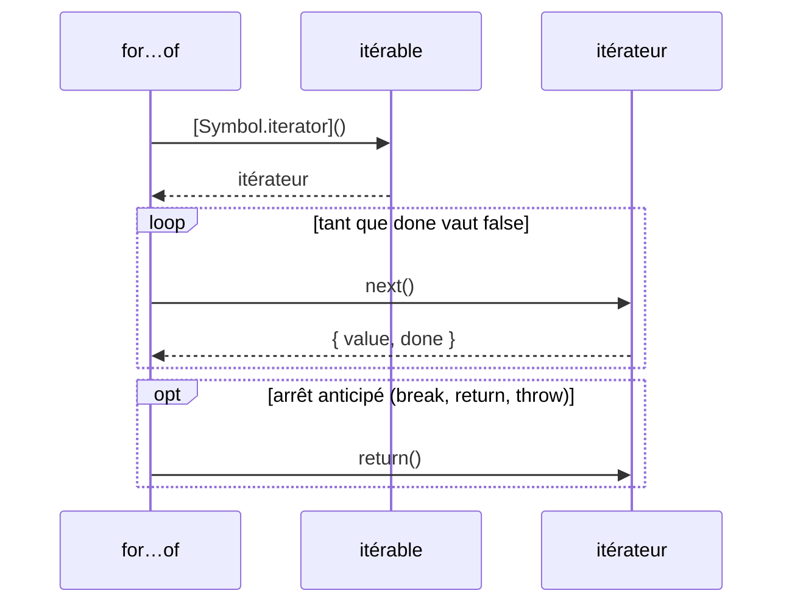
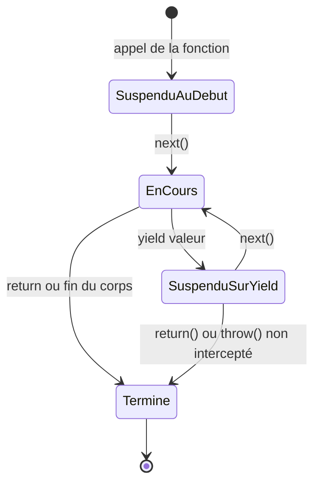

# 13 — Itérateurs et générateurs

> **Niveau** : Intermédiaire à avancé · **Durée** : ~3 h · **Prérequis** : [Boucles](../05-boucles/README.md), [Fonctions](../06-fonctions/README.md), [Collections](../12-collections/README.md) ; pour la partie asynchrone, [Promesses](../19-promises/README.md)

`for…of`, le spread, la déstructuration, `Array.from` ou `new Map(…)` fonctionnent avec des tableaux, des chaînes, des `Map`, des `Set`… parce que tous reposent sur un même contrat : le **protocole d'itération**. Le comprendre permet de rendre vos propres objets itérables, de produire des données **à la demande** avec les générateurs (séquences infinies, gros fichiers, pages d'une API), et d'utiliser les Iterator helpers d'ES2025 et `Iterator.concat` d'ES2026.

## Objectifs

- Expliquer les protocoles itérable et itérateur, et ce que font `for…of`, le spread et la déstructuration en coulisses
- Rendre un objet ou une classe itérable avec `Symbol.iterator`
- Écrire des générateurs (`function*`, `yield`, `yield*`) et piloter leur exécution (`next`, `return`, `throw`)
- Construire des séquences paresseuses, y compris infinies, sans saturer la mémoire
- Transformer des itérateurs avec les Iterator helpers (ES2025) et les enchaîner avec `Iterator.concat` (ES2026)
- Consommer des données asynchrones avec les générateurs asynchrones et `for await…of` (pagination d'API, fichiers, flux)

## Sommaire

- [Un protocole commun](#un-protocole-commun)
- [Les protocoles itérable et itérateur](#les-protocoles-itérable-et-itérateur)
- [Itérables natifs et consommateurs](#itérables-natifs-et-consommateurs)
- [Rendre une classe itérable](#rendre-une-classe-itérable)
- [Les générateurs](#les-générateurs)
- [Séquences infinies et évaluation paresseuse](#séquences-infinies-et-évaluation-paresseuse)
- [Les Iterator helpers (ES2025)](#les-iterator-helpers-es2025)
- [Iterator.concat (ES2026)](#iteratorconcat-es2026)
- [Itérateurs et générateurs asynchrones](#itérateurs-et-générateurs-asynchrones)
- [Cas d'usage réels](#cas-dusage-réels)
- [Ce qui arrive](#ce-qui-arrive)
- [Pièges courants](#pièges-courants)
- [Bonnes pratiques](#bonnes-pratiques)
- [Résumé](#résumé)
- [Exercices](#exercices)
- [Pour aller plus loin](#pour-aller-plus-loin)

## Un protocole commun

La même boucle fonctionne sur des structures très différentes :

```js
function lister(collection) {
  const elements = [];
  for (const element of collection) elements.push(element);
  return elements.join(" | ");
}

console.log(lister(["a", "b"])); // a | b
console.log(lister("été")); // é | t | é
console.log(lister(new Set([1, 2]))); // 1 | 2
console.log(lister(new Map([["clé", "valeur"]]))); // clé,valeur
```

`for…of` ne connaît ni les tableaux ni les `Map` : il sait seulement demander à un objet « donne-moi tes éléments, un par un ». Tout objet qui sait répondre à cette demande est **itérable**, et peut donc être parcouru, étalé, déstructuré, converti en tableau… Les objets ordinaires ne le sont pas :

```js
try {
  for (const x of { a: 1 }) console.log(x);
} catch (erreur) {
  console.log(erreur.name); // TypeError (message : « … is not iterable »)
}

// Pour un objet, on parcourt une vue itérable : Object.keys, values ou entries
for (const [cle, valeur] of Object.entries({ a: 1 })) console.log(cle, valeur); // a 1
```

## Les protocoles itérable et itérateur

Deux rôles se répartissent le travail (ES2015) :

- un **itérateur** est un objet doté d'une méthode `next()` qui renvoie, à chaque appel, un objet `{ value, done }` ; `done: true` signale la fin ;
- un **itérable** est un objet doté d'une méthode `[Symbol.iterator]()` qui renvoie **un nouvel itérateur**.

On peut piloter un itérateur à la main :

```js
const lettres = ["a", "b"];
const iterateur = lettres[Symbol.iterator]();

console.log(iterateur.next()); // { value: "a", done: false }
console.log(iterateur.next()); // { value: "b", done: false }
console.log(iterateur.next()); // { value: undefined, done: true }
```

`for…of` fait exactement cela, et un peu plus : s'il s'arrête **avant la fin** (`break`, `return`, exception), il appelle la méthode `return()` de l'itérateur, si elle existe, pour lui permettre de libérer ses ressources.



### Écrire un itérable à la main

```js
const compteARebours = {
  depart: 3,
  [Symbol.iterator]() {
    let courant = this.depart;
    return {
      next() {
        if (courant > 0) return { value: courant--, done: false };
        return { value: undefined, done: true };
      },
    };
  },
};

console.log([...compteARebours]); // [3, 2, 1]
console.log(Math.max(...compteARebours)); // 3

const [premier, deuxieme] = compteARebours;
console.log(premier, deuxieme); // 3 2
```

Chaque appel à `[Symbol.iterator]()` crée un itérateur neuf, avec son propre compteur : l'objet peut être parcouru autant de fois qu'on veut.

### La méthode `return()` : être prévenu d'un arrêt anticipé

```js
const capteur = {
  [Symbol.iterator]() {
    let mesure = 0;
    return {
      next() {
        mesure++;
        return { value: mesure * 10, done: mesure > 5 };
      },
      return() {
        console.log("capteur libéré");
        return { value: undefined, done: true };
      },
    };
  },
};

for (const valeur of capteur) {
  if (valeur === 20) break; // capteur libéré
}

const [premiere] = capteur; // capteur libéré
console.log(premiere); // 10

console.log([...capteur]); // [10, 20, 30, 40, 50]
```

La déstructuration aussi appelle `return()` quand elle n'a pas besoin de tous les éléments. Le dernier spread, lui, va jusqu'au bout (`done: true`) : aucun arrêt anticipé, donc pas d'appel.

## Itérables natifs et consommateurs

| Itérable natif | Ce qu'il produit |
| --- | --- |
| `Array`, tableaux typés | les éléments |
| `String` | les **points de code** (un émoji simple est un seul élément) |
| `Map` | des paires `[clé, valeur]` |
| `Set` | les valeurs |
| `arguments` | les arguments de la fonction |
| objets générateurs | les valeurs produites par `yield` |
| `str.matchAll(regex)` | les correspondances ([chapitre 14](../14-regex/README.md)) |
| `segmenter.segment(texte)` (`Intl.Segmenter`) | les segments (graphèmes, mots, phrases) |
| `URLSearchParams`, `Headers`, `FormData` | des paires `[nom, valeur]` ([chapitre 22](../22-fetch-http/README.md)) |
| `NodeList` (navigateur) | les nœuds du DOM ([chapitre 23](../23-dom/README.md)) |

| Consommateur | Exemple |
| --- | --- |
| boucle `for…of` | `for (const x of iterable)` |
| spread | `[...iterable]`, `f(...iterable)` |
| déstructuration de tableau | `const [a, b] = iterable;` |
| conversions | `Array.from(iterable, fn)`, `new Map(iterable)`, `new Set(iterable)`, `Object.fromEntries(iterable)` |
| combinateurs de promesses | `Promise.all(iterable)`, `allSettled`, `any`, `race` |
| délégation | `yield* iterable` |
| ES2025 / ES2026 | `Iterator.from(iterable)`, `Iterator.concat(…)`, `Array.fromAsync(iterable)` |

```js
const message = "Bonjour le monde, bonjour à tous";

const mots = new Intl.Segmenter("fr", { granularity: "word" }).segment(message);
console.log([...mots].filter((s) => s.isWordLike).length); // 6

const majuscules = [...message.matchAll(/\b\p{Lu}/gu)].map((m) => m.index);
console.log(majuscules); // [0]

const params = new URLSearchParams("tri=prix&page=2");
console.log(Object.fromEntries(params)); // { tri: "prix", page: "2" }
```

### `keys()`, `values()`, `entries()` renvoient des itérateurs

Sur les tableaux, les `Map` et les `Set`, ces méthodes ne renvoient pas des tableaux mais des **itérateurs** : des vues paresseuses, parcourues une seule fois.

```js
const podium = ["Ana", "Bilal", "Chloé"];

for (const [index, nom] of podium.entries()) {
  console.log(`${index + 1}. ${nom}`);
}
// 1. Ana
// 2. Bilal
// 3. Chloé

const vue = podium.values();
console.log([...vue]); // ["Ana", "Bilal", "Chloé"]
console.log([...vue]); // [] : l'itérateur est épuisé
```

Les itérateurs natifs sont eux-mêmes itérables (leur `[Symbol.iterator]()` renvoie `this`), ce qui permet de les passer à `for…of`. Mais ils ne servent qu'**une fois** : seul l'itérable d'origine (`podium`) peut être reparcouru.

## Rendre une classe itérable

Il suffit de définir une méthode `[Symbol.iterator]()`. Voici une version « à la main » d'un intervalle de nombres, comparable à `range` en Python :

```js
class Intervalle {
  constructor(debut, fin, pas = 1) {
    this.debut = debut;
    this.fin = fin;
    this.pas = pas;
  }

  [Symbol.iterator]() {
    let courant = this.debut;
    const { fin, pas } = this;
    return {
      next() {
        if (courant > fin) return { value: undefined, done: true };
        const valeur = courant;
        courant += pas;
        return { value: valeur, done: false };
      },
    };
  }
}

const notes = new Intervalle(0, 20, 5);
console.log([...notes]); // [0, 5, 10, 15, 20]
console.log(Array.from(new Intervalle(1, 3), (n) => n * n)); // [1, 4, 9]

for (const n of new Intervalle(1, 3)) console.log(n);
// 1
// 2
// 3
```

Cela fonctionne, mais l'état de l'itération (`courant`) et la forme `{ value, done }` sont gérés à la main. La section suivante montre qu'un **générateur** fait la même chose en trois lignes.

## Les générateurs

### `function*` et `yield`

Une fonction génératrice (ES2015) se déclare avec `function*`. L'appeler **n'exécute pas son corps** : elle renvoie un **objet générateur**, qui est à la fois un itérateur et un itérable. Chaque `next()` exécute le corps jusqu'au prochain `yield`, qui **suspend** la fonction et livre une valeur.

```js
function* etapesCommande() {
  console.log("début");
  yield "panier";
  console.log("reprise");
  yield "paiement";
  return "terminé";
}

const generateur = etapesCommande(); // n'affiche rien
console.log(generateur.next());
// début
// { value: "panier", done: false }
console.log(generateur.next());
// reprise
// { value: "paiement", done: false }
console.log(generateur.next()); // { value: "terminé", done: true }
console.log(generateur.next()); // { value: undefined, done: true }
```

La fonction garde ses variables locales entre deux `next()` : c'est ce qui la distingue d'une fonction ordinaire, qui repart de zéro à chaque appel.



`for…of` et le spread **ignorent** la valeur du `return` : ils s'arrêtent dès que `done` vaut `true`.

```js
function* etapes() {
  yield "panier";
  yield "paiement";
  return "terminé";
}

console.log([...etapes()]); // ["panier", "paiement"]
```

Les formes possibles : déclaration `function* nom() {}`, expression `const f = function* () {}`, méthode `*nom() {}` dans un objet ou une classe, et version asynchrone `async function*` (plus bas). Il n'existe **pas** de générateur fléché.

### Rendre une classe itérable avec un générateur

Une méthode génératrice `*[Symbol.iterator]()` renvoie un nouveau générateur à chaque parcours : la classe reste itérable autant de fois qu'on veut.

```js
class Intervalle {
  constructor(debut, fin, pas = 1) {
    Object.assign(this, { debut, fin, pas });
  }

  *[Symbol.iterator]() {
    for (let n = this.debut; n <= this.fin; n += this.pas) yield n;
  }
}

const heures = new Intervalle(8, 18, 2);
console.log([...heures]); // [8, 10, 12, 14, 16, 18]
console.log([...heures].length); // 6
```

### Déléguer avec `yield*`

`yield* iterable` produit, un par un, tous les éléments d'un autre itérable (tableau, chaîne, autre générateur), puis continue. C'est l'outil idéal pour composer des générateurs et parcourir des structures **récursives**.

```js
function* entete() {
  yield "<html>";
  yield "<body>";
}

function* page(contenu) {
  yield* entete();
  yield* contenu; // n'importe quel itérable
  yield "</body>";
  yield "</html>";
}

console.log([...page(["<h1>Titre</h1>", "<p>Texte</p>"])].join("")); // <html><body><h1>Titre</h1><p>Texte</p></body></html>
```

Parcourir une arborescence de fichiers :

```js
const projet = {
  nom: "src",
  enfants: [
    { nom: "index.js", taille: 120 },
    {
      nom: "utils",
      enfants: [
        { nom: "dates.js", taille: 300 },
        { nom: "nombres.js", taille: 80 },
      ],
    },
  ],
};

function* fichiers(noeud, dossier = "") {
  const chemin = `${dossier}${noeud.nom}`;
  if (!noeud.enfants) {
    yield { chemin, taille: noeud.taille };
    return;
  }
  for (const enfant of noeud.enfants) yield* fichiers(enfant, `${chemin}/`);
}

console.log([...fichiers(projet)].map((f) => f.chemin)); // ["src/index.js", "src/utils/dates.js", "src/utils/nombres.js"]
```

`yield*` a aussi une valeur : celle du `return` du générateur délégué.

```js
function* sousTache() {
  yield "étape A";
  return "résultat de la sous-tâche";
}

function* tache() {
  const resultat = yield* sousTache();
  yield resultat;
}

console.log([...tache()]); // ["étape A", "résultat de la sous-tâche"]
```

### Dialoguer avec un générateur : `next(valeur)`, `return()`, `throw()`

`yield` est une **expression** : sa valeur est l'argument du `next()` suivant. Un générateur peut donc recevoir des données. L'argument du **premier** `next()` est ignoré, car aucun `yield` n'attend encore.

```js
function* moyenneCourante() {
  let total = 0;
  let nombre = 0;
  let moyenne;
  while (true) {
    const valeur = yield moyenne;
    total += valeur;
    nombre++;
    moyenne = total / nombre;
  }
}

const moyenne = moyenneCourante();
moyenne.next(); // démarre le générateur jusqu'au premier yield
console.log(moyenne.next(10).value); // 10
console.log(moyenne.next(20).value); // 15
console.log(moyenne.next(6).value); // 12
```

Deux autres méthodes pilotent un générateur de l'extérieur :

- `return(valeur)` le **termine** comme si un `return` était exécuté à l'endroit du `yield` : les blocs `finally` s'exécutent ;
- `throw(erreur)` **lève** l'erreur à l'endroit du `yield` : le générateur peut l'intercepter avec `try…catch` et continuer.

```js
function* lecteur() {
  console.log("ouverture du fichier");
  try {
    yield "ligne 1";
    yield "ligne 2";
    yield "ligne 3";
  } finally {
    console.log("fermeture du fichier");
  }
}

for (const ligne of lecteur()) {
  console.log(ligne);
  if (ligne === "ligne 2") break;
}
// ouverture du fichier
// ligne 1
// ligne 2
// fermeture du fichier

const autre = lecteur();
autre.next(); // ouverture du fichier
console.log(autre.return("abandon"));
// fermeture du fichier
// { value: "abandon", done: true }
```

C'est une garantie précieuse : un `break` dans `for…of` appelle `return()`, qui exécute le `finally`. Le nettoyage d'un générateur se place donc dans un `finally`.

```js
function* tolerant() {
  while (true) {
    try {
      yield "en attente";
    } catch (erreur) {
      console.log(`erreur reçue : ${erreur.message}`);
    }
  }
}

const g = tolerant();
g.next();
console.log(g.throw(new Error("délai dépassé")).value);
// erreur reçue : délai dépassé
// en attente
```

> [!NOTE]
> Cette communication bidirectionnelle est rarement utile dans le code d'application. Elle a surtout servi, avant ES2017, à construire `async`/`await` à partir de générateurs et de promesses (la bibliothèque `co`). Aujourd'hui, utilisez `async`/`await` ([chapitre 20](../20-async-await/README.md)).

### Un générateur ne sert qu'une fois

```js
function* deuxNombres() {
  yield 1;
  yield 2;
}

const nombres = deuxNombres();
console.log([...nombres]); // [1, 2]
console.log([...nombres]); // []

console.log([...deuxNombres()], [...deuxNombres()]); // [1, 2] [1, 2]
```

Pour reparcourir, rappelez la fonction génératrice, ou exposez un objet itérable dont la méthode `*[Symbol.iterator]()` crée un nouveau générateur à chaque fois (comme `Intervalle`).

## Séquences infinies et évaluation paresseuse

Un générateur ne calcule une valeur **que lorsqu'on la demande**. Il peut donc décrire une séquence sans fin, tant que le consommateur s'arrête de lui-même.

```js
function* entiersDepuis(n = 0) {
  while (true) yield n++;
}

function* fibonacci() {
  let [a, b] = [0, 1];
  while (true) {
    yield a;
    [a, b] = [b, a + b];
  }
}

function* identifiants(prefixe) {
  let numero = 1;
  while (true) yield `${prefixe}-${String(numero++).padStart(4, "0")}`;
}

// Prendre les n premiers éléments de n'importe quel itérable
function* prendre(iterable, n) {
  if (n <= 0) return;
  for (const element of iterable) {
    yield element;
    if (--n === 0) return; // le return ferme proprement la source
  }
}

console.log([...prendre(fibonacci(), 10)]); // [0, 1, 1, 2, 3, 5, 8, 13, 21, 34]

const ids = identifiants("CMD");
console.log(ids.next().value, ids.next().value); // CMD-0001 CMD-0002

for (const n of entiersDepuis(1)) {
  if (n * n > 50) {
    console.log(n); // 8
    break;
  }
}
```

> [!WARNING]
> Ne consommez jamais une séquence infinie **en entier** : `[...fibonacci()]`, `Array.from(entiersDepuis())` ou `Math.max(...fibonacci())` ne se terminent pas et finissent par saturer la mémoire. Limitez toujours avec `break`, `prendre` ou `.take(n)`.

La paresse est utile bien au-delà des séquences infinies : un générateur qui lit un gros fichier, parcourt une base de données ou une API ne charge que ce qui est réellement consommé.

## Les Iterator helpers (ES2025)

Les tableaux ont `map`, `filter`, `reduce`… mais pas les itérateurs, jusqu'à ES2025. Il fallait convertir en tableau (ce qui consomme tout, impossible pour une séquence infinie) ou écrire ses propres générateurs comme `prendre`. ES2025 ajoute ces méthodes sur `Iterator.prototype`, dont héritent **tous les itérateurs natifs** : itérateurs de tableaux, de `Map` et de `Set`, de chaînes, résultats de `matchAll`, et objets générateurs.

| Méthode | Renvoie | Équivalent tableau | Comportement |
| --- | --- | --- | --- |
| `map(fn)` | itérateur | `map` | paresseux |
| `filter(fn)` | itérateur | `filter` | paresseux |
| `take(n)` | itérateur | `slice(0, n)` | paresseux, ferme la source après `n` éléments |
| `drop(n)` | itérateur | `slice(n)` | paresseux |
| `flatMap(fn)` | itérateur | `flatMap` | paresseux ; `fn` doit renvoyer un itérable ou un itérateur (pas une chaîne) |
| `reduce(fn, init)` | valeur | `reduce` | consomme tout |
| `toArray()` | tableau | — | consomme tout |
| `forEach(fn)` | `undefined` | `forEach` | consomme tout |
| `some(fn)`, `every(fn)`, `find(fn)` | valeur | idem | s'arrête dès que la réponse est connue, et ferme la source |

Les fonctions reçoivent `(valeur, index)`, où `index` compte les éléments déjà vus.

```js
function* entiersDepuis(n = 0) {
  while (true) yield n++;
}

const carresPairs = entiersDepuis(1)
  .filter((n) => n % 2 === 0)
  .map((n) => n * n)
  .take(5)
  .toArray();
console.log(carresPairs); // [4, 16, 36, 64, 100]

const stock = new Map([
  ["pommes", 12],
  ["poires", 0],
  ["kiwis", 7],
  ["figues", 0],
]);
const enRupture = stock
  .entries()
  .filter(([, quantite]) => quantite === 0)
  .map(([fruit]) => fruit)
  .toArray();
console.log(enRupture); // ["poires", "figues"]

console.log(stock.values().reduce((total, q) => total + q, 0)); // 19
console.log(["a", "b", "c"].values().map((lettre, i) => `${i}:${lettre}`).toArray()); // ["0:a", "1:b", "2:c"]
```

### Paresseux : chaque élément traverse toute la chaîne

Une chaîne de méthodes de tableau traite **toutes** les données à chaque étape, en créant un tableau intermédiaire à chaque fois. Une chaîne d'Iterator helpers fait passer **chaque élément** par toutes les étapes avant de demander le suivant, sans tableau intermédiaire :

```js
const journalTableau = [];
[1, 2, 3]
  .map((n) => (journalTableau.push(`map ${n}`), n * 10))
  .filter((n) => (journalTableau.push(`filter ${n}`), n > 10));
console.log(journalTableau); // ["map 1", "map 2", "map 3", "filter 10", "filter 20", "filter 30"]

const journalIterateur = [];
[1, 2, 3]
  .values()
  .map((n) => (journalIterateur.push(`map ${n}`), n * 10))
  .filter((n) => (journalIterateur.push(`filter ${n}`), n > 10))
  .toArray();
console.log(journalIterateur); // ["map 1", "filter 10", "map 2", "filter 20", "map 3", "filter 30"]
```

Conséquence : quand on cherche peu de résultats dans beaucoup de données, la version paresseuse s'arrête **dès qu'elle a trouvé**.

```js
function* entiersDepuis(n = 0) {
  while (true) yield n++;
}

let calculsTableau = 0;
const trouveTableau = Array.from({ length: 100_000 }, (_, i) => i)
  .map((n) => {
    calculsTableau++;
    return n * n;
  })
  .find((n) => n > 50);

let calculsIterateur = 0;
const trouveIterateur = entiersDepuis(0)
  .map((n) => {
    calculsIterateur++;
    return n * n;
  })
  .find((n) => n > 50);

console.log(trouveTableau, calculsTableau); // 64 100000
console.log(trouveIterateur, calculsIterateur); // 64 9
```

### `Iterator.from` : donner les helpers à n'importe quel itérateur

Un itérateur écrit à la main (un simple objet avec `next()`) n'hérite pas d'`Iterator.prototype`. `Iterator.from` l'enveloppe ; il accepte aussi tout itérable, y compris une chaîne.

```js
const tirage = {
  graine: 7,
  next() {
    this.graine = (this.graine * 31 + 11) % 100;
    return { value: this.graine, done: false };
  },
};

console.log(Iterator.from(tirage).take(4).toArray()); // [28, 79, 60, 71]
console.log(Iterator.from("abc").map((c) => c.toUpperCase()).toArray()); // ["A", "B", "C"]
```

### Ce que les helpers ne sont pas

- **Pas un remplacement des méthodes de tableau.** Sur un tableau, écrivez `tableau.map(…)`, pas `tableau.values().map(…).toArray()`. Les helpers servent quand la source **est déjà un itérateur** (entrées de `Map`, générateur, séquence infinie ou très grande).
- **Pas réutilisables.** Un helper renvoie un itérateur, épuisé après un parcours.
- **Pas indexables.** Il n'y a ni `length`, ni `at`, ni `sort`, ni `reverse` : il faudrait tout consommer. Convertissez avec `toArray()` quand vous en avez besoin.
- **Pas asynchrones.** Les Async Iterator helpers sont encore au stage 2 (novembre 2026) ; pour l'instant, on écrit ses utilitaires asynchrones à la main ([voir plus bas](#écrire-ses-propres-utilitaires-asynchrones)).

```js
const pairs = [1, 2, 3, 4].values().filter((n) => n % 2 === 0);
console.log(pairs.toArray()); // [2, 4]
console.log(pairs.toArray()); // []

function* mots() {
  yield "un";
  yield "deux";
  yield "trois";
}

const source = mots();
console.log(source.find((mot) => mot.startsWith("d"))); // deux
console.log(source.next()); // { value: undefined, done: true }
```

Le dernier exemple montre un effet de `find`, `some`, `every` et `take` : dès qu'ils ont leur réponse, ils **ferment** l'itérateur source en appelant sa méthode `return()`. Un générateur est alors terminé, et ses blocs `finally` s'exécutent. (Les itérateurs de tableaux n'ont pas de méthode `return()` : eux ne sont pas fermés et pourraient continuer.)

**Disponibilité** : Baseline 2025 (Chrome 122, Firefox 131, Safari 18.4), Node.js 22+.

## `Iterator.concat` (ES2026)

Pour enchaîner plusieurs sources, `[...a, ...b, ...c]` construit un tableau complet et consomme tout, ce qui est coûteux et impossible si une source est infinie. `Iterator.concat(a, b, c)` (ES2026) renvoie un itérateur **paresseux** qui parcourt chaque itérable à son tour, sans rien copier.

<!-- no-run -->
```js
const urgentes = ["serveur en panne"];
const normales = new Set(["mise à jour", "sauvegarde"]);
function* plusTard() {
  yield "nettoyage";
  yield "archivage";
}

const toutes = Iterator.concat(urgentes, normales, plusTard());
console.log(toutes.take(3).toArray()); // ["serveur en panne", "mise à jour", "sauvegarde"]

// Le résultat a tous les helpers
console.log(Iterator.concat([1, 2], [3]).map((n) => n * 10).toArray()); // [10, 20, 30]
```

Les arguments doivent être des **objets itérables** : une chaîne primitive lève une `TypeError` (écrivez `[..."abc"]` ou `Iterator.from("abc")`), et un itérateur écrit à la main sans `[Symbol.iterator]` doit d'abord passer par `Iterator.from`.

**Disponibilité (novembre 2026)** : Chrome 146+, Firefox 147+, Safari 26.4+ (Baseline 2026), Node.js 26+. Absent de Node 24. L'équivalent portable est un générateur de trois lignes, qui bénéficie lui aussi des helpers :

```js
function* concatener(...iterables) {
  for (const iterable of iterables) yield* iterable;
}

function* plusTard() {
  yield "nettoyage";
  yield "archivage";
}

const toutes = concatener(["serveur en panne"], new Set(["mise à jour"]), plusTard());
console.log(toutes.filter((tache) => tache.includes("a")).toArray()); // ["serveur en panne", "nettoyage", "archivage"]
```

## Itérateurs et générateurs asynchrones

### Le problème : des données qui arrivent avec le temps

Un itérateur synchrone doit fournir sa valeur **immédiatement**. Or beaucoup de données arrivent au fil du temps : les pages d'une API, les lignes d'un fichier en cours de lecture, les morceaux d'une réponse réseau, des événements. Le **protocole d'itération asynchrone** (ES2018) répond à ce besoin :

- un **itérable asynchrone** possède une méthode `[Symbol.asyncIterator]()` ;
- son itérateur a une méthode `next()` qui renvoie une **promesse** de `{ value, done }`.

### `for await…of`

`for await…of` attend chaque promesse avant de passer à l'élément suivant. Il s'utilise dans une fonction `async`, ou au niveau supérieur d'un module ES. Il accepte aussi un itérable synchrone : chaque élément est alors attendu (`await`) à son tour.

```js
const attendre = (ms, valeur) => new Promise((resoudre) => setTimeout(() => resoudre(valeur), ms));

for await (const valeur of [attendre(30, "a"), attendre(10, "b"), "c"]) {
  console.log(valeur);
}
// a
// b
// c
```

L'ordre est celui du tableau, pas celui de la résolution : `"b"` est prêt avant `"a"`, mais il est livré après.

> [!WARNING]
> N'utilisez pas `for await…of` sur un tableau de promesses **déjà lancées** : si une promesse échoue avant que la boucle ne l'ait atteinte, son rejet est considéré comme non géré et Node arrête le programme, même si la boucle est dans un `try…catch`. Pour des promesses déjà lancées, utilisez `Promise.all` ou `Promise.allSettled` ([chapitre 19](../19-promises/README.md)). `for await…of` est fait pour les sources qui produisent leurs valeurs **à la demande**.

<!-- no-run -->
```js
const attendre = (ms, valeur) => new Promise((resoudre) => setTimeout(() => resoudre(valeur), ms));

try {
  // ❌ le rejet survient pendant qu'on attend la première promesse : rejet non géré, le processus s'arrête
  for await (const v of [attendre(100, "lent"), Promise.reject(new Error("rapide"))]) console.log(v);
} catch (erreur) {
  console.log("jamais atteint");
}
```

### Les générateurs asynchrones

Un générateur asynchrone (`async function*`, ES2018) combine les deux mécanismes : on peut y utiliser `await` **et** `yield`. Son objet est un itérable asynchrone.

```js
const attendre = (ms) => new Promise((resoudre) => setTimeout(resoudre, ms));

async function* tic(nombre, intervalle) {
  for (let i = 1; i <= nombre; i++) {
    await attendre(intervalle);
    yield `tic ${i}`;
  }
}

for await (const message of tic(3, 10)) console.log(message);
// tic 1
// tic 2
// tic 3
```

### Exemple : parcourir une API paginée

Une API renvoie rarement tous ses résultats d'un coup : elle les découpe en pages. Un générateur asynchrone masque cette pagination et présente un **flux continu d'éléments**. Comme il est paresseux, il ne demande une nouvelle page que lorsque le consommateur en a besoin. L'API est simulée ici pour que l'exemple soit exécutable :

```js
const PRODUITS = Array.from({ length: 7 }, (_, i) => ({ id: i + 1, nom: `Produit ${i + 1}` }));

async function chargerPage(numero, taille = 3) {
  await new Promise((resoudre) => setTimeout(resoudre, 10)); // latence réseau simulée
  console.log(`(requête de la page ${numero})`);
  const debut = (numero - 1) * taille;
  const suivante = debut + taille < PRODUITS.length ? numero + 1 : null;
  return { elements: PRODUITS.slice(debut, debut + taille), suivante };
}

async function* tousLesProduits() {
  let page = 1;
  while (page !== null) {
    const { elements, suivante } = await chargerPage(page);
    yield* elements;
    page = suivante;
  }
}

for await (const produit of tousLesProduits()) {
  console.log(produit.nom);
  if (produit.id === 4) break; // la page 3 ne sera jamais demandée
}
// (requête de la page 1)
// Produit 1
// Produit 2
// Produit 3
// (requête de la page 2)
// Produit 4

const tous = await Array.fromAsync(tousLesProduits()); // 3 requêtes
console.log(tous.length); // 7
```

`Array.fromAsync` (ES2026, [chapitre 20](../20-async-await/README.md)) rassemble un itérable asynchrone dans un tableau. Avec une vraie API, le générateur s'écrit de la même façon. Par exemple, l'API de GitHub indique l'URL de la page suivante dans l'en-tête `Link` :

<!-- no-run -->
```js
async function* depotsGitHub(url) {
  while (url) {
    const reponse = await fetch(url, { headers: { Accept: "application/vnd.github+json" } });
    if (!reponse.ok) throw new Error(`HTTP ${reponse.status}`);
    yield* await reponse.json();
    url = /<([^>]+)>;\s*rel="next"/.exec(reponse.headers.get("link") ?? "")?.[1];
  }
}

for await (const depot of depotsGitHub("https://api.github.com/orgs/nodejs/repos?per_page=100")) {
  console.log(depot.full_name);
}
```

### Lire un fichier ligne par ligne (Node.js)

Le module `node:readline` fournit un itérable asynchrone des lignes d'un flux : le fichier est lu par morceaux, jamais chargé en entier en mémoire, quelle que soit sa taille ([chapitre 27](../27-nodejs/README.md)).

```js
import { createReadStream } from "node:fs";
import { writeFile } from "node:fs/promises";
import { createInterface } from "node:readline";

await writeFile("journal.txt", "INFO démarrage\nERREUR disque plein\nINFO requête\nERREUR délai dépassé\n");

const lignes = createInterface({ input: createReadStream("journal.txt"), crlfDelay: Infinity });

const erreurs = [];
for await (const ligne of lignes) {
  if (ligne.startsWith("ERREUR")) erreurs.push(ligne.slice("ERREUR ".length));
}
console.log(erreurs); // ["disque plein", "délai dépassé"]
```

### Flux et événements

Les `ReadableStream` (API Streams, présente dans les navigateurs et dans Node) sont des itérables asynchrones. C'est le cas du corps d'une réponse `fetch`, qu'on peut lire morceau par morceau ([chapitre 22](../22-fetch-http/README.md)). Côté navigateurs, l'itération des flux est Baseline 2026 (Safari 27 a été le dernier à l'ajouter) ; Node la propose depuis longtemps.

```js
const flux = new ReadableStream({
  start(controleur) {
    controleur.enqueue("Bon");
    controleur.enqueue("jour");
    controleur.close();
  },
});

let texte = "";
for await (const morceau of flux) texte += morceau;
console.log(texte); // Bonjour
```

Dans Node, `events.on` transforme une série d'événements en itérable asynchrone ; l'option `close` indique quel événement termine la boucle :

```js
import { EventEmitter, on } from "node:events";

const boutique = new EventEmitter();
setTimeout(() => {
  boutique.emit("commande", "C-1", 40);
  boutique.emit("commande", "C-2", 15);
  boutique.emit("fermeture");
}, 10);

for await (const [id, total] of on(boutique, "commande", { close: ["fermeture"] })) {
  console.log(`${id} : ${total} €`);
}
console.log("boutique fermée");
// C-1 : 40 €
// C-2 : 15 €
// boutique fermée
```

### Écrire ses propres utilitaires asynchrones

En attendant les Async Iterator helpers, quelques générateurs asynchrones de quelques lignes couvrent l'essentiel. Ils acceptent n'importe quel itérable, synchrone ou asynchrone, puisque `for await…of` accepte les deux.

```js
async function* transformer(source, fonction) {
  for await (const element of source) yield await fonction(element);
}

async function* prendreAsync(source, n) {
  if (n <= 0) return;
  for await (const element of source) {
    yield element;
    if (--n === 0) return;
  }
}

async function* parPaquets(source, taille) {
  let paquet = [];
  for await (const element of source) {
    paquet.push(element);
    if (paquet.length === taille) {
      yield paquet;
      paquet = [];
    }
  }
  if (paquet.length > 0) yield paquet;
}

async function* mesures() {
  for (let i = 1; i <= 7; i++) {
    await new Promise((resoudre) => setTimeout(resoudre, 5));
    yield i;
  }
}

const doubles = transformer(mesures(), async (n) => n * 2);
console.log(await Array.fromAsync(prendreAsync(doubles, 3))); // [2, 4, 6]
console.log(await Array.fromAsync(parPaquets(mesures(), 3))); // [[1, 2, 3], [4, 5, 6], [7]]
```

`parPaquets` est typiquement utilisé pour insérer des données en base par lots de 100 ou 1 000 plutôt qu'une par une.

## Cas d'usage réels

| Situation | Outil |
| --- | --- |
| Parcourir une structure maison (arbre, liste chaînée, grille, graphe) | `*[Symbol.iterator]()` et `yield*` |
| Générer des identifiants, des dates successives, des combinaisons | générateur infini et `.take(n)` |
| Chercher les premiers résultats dans un très grand ensemble | Iterator helpers (paresseux) |
| Filtrer ou transformer les entrées d'une `Map` ou d'un `Set` | `map.entries().filter(…)` |
| Enchaîner plusieurs sources sans copie | `Iterator.concat` ou `yield*` |
| Lire un gros fichier ou un flux sans tout charger | `for await…of` sur `readline` ou un `ReadableStream` |
| Parcourir une API paginée | générateur asynchrone |
| Traiter par lots | générateur `parPaquets` (et bientôt `.chunks(n)`) |
| Analyser un texte (découpage en jetons) | générateur qui produit les jetons un par un (exercice 6) |

## Ce qui arrive

Plusieurs propositions concernant les itérateurs ont atteint le **stage 4** en 2026 et feront partie d'ES2027 (situation en novembre 2026) :

| Proposition | Méthodes | Disponibilité |
| --- | --- | --- |
| Joint iteration | `Iterator.zip(iterables, options)`, `Iterator.zipKeyed(objet, options)` | Chrome 153+, Firefox 148+ ; pas dans Node 26 |
| Iterator chunking | `.chunks(taille)`, `.windows(taille, "only-full" \| "allow-partial")` | Firefox 154+ |
| Iterator includes | `.includes(valeur)` | Chrome 154+, Firefox 154+ |
| Iterator join | `.join(separateur)` | Chrome 153+, Firefox 154+ |

<!-- no-run -->
```js
const noms = ["Ana", "Bilal", "Chloé"];
const scores = [12, 9, 15];

console.log(Iterator.zip([noms, scores]).toArray()); // [["Ana", 12], ["Bilal", 9], ["Chloé", 15]]
console.log(Iterator.zipKeyed({ nom: noms, score: scores }).toArray()[0]); // { nom: "Ana", score: 12 } (objet sans prototype)

console.log([1, 2, 3, 4, 5].values().chunks(2).toArray()); // [[1, 2], [3, 4], [5]]
console.log([1, 2, 3, 4].values().windows(2).toArray()); // [[1, 2], [2, 3], [3, 4]]

console.log(new Set([1, 2, 3]).values().includes(2)); // true
console.log(new Map([["a", 1], ["b", 2]]).keys().join("-")); // a-b
```

Par défaut, `Iterator.zip` s'arrête avec l'itérable le plus court (`mode: "shortest"`) ; les modes `"longest"` (avec une option `padding`) et `"strict"` (erreur si les longueurs diffèrent) sont aussi disponibles.

Plus loin dans le processus, au **stage 2** : les **Async Iterator helpers** (les mêmes méthodes pour les itérateurs asynchrones) et `Iterator.range(debut, fin, pas)`.

## Pièges courants

**Itérer sur un objet ordinaire.** `for (const x of objet)` lève `TypeError: … is not iterable`. Parcourez `Object.keys`, `Object.values` ou `Object.entries`.

**Réutiliser un itérateur épuisé.** Un générateur, un `map.keys()`, un résultat de helper ne se parcourent qu'une fois ; le second parcours est vide, **sans erreur**. Reparcourez l'itérable d'origine ou rappelez la fonction génératrice.

**Traiter un itérateur comme un tableau.** `map.values().length`, `generateur[0]` ou `iterateur.at(-1)` n'existent pas. Convertissez avec `[...it]` ou `.toArray()`.

**Consommer une séquence infinie en entier.** Spread, `Array.from`, `toArray()` ou `reduce` sur un générateur infini ne se terminent jamais. Placez toujours un `.take(n)` ou un `break`.

**Croire qu'appeler un générateur l'exécute.** `etapes()` ne fait rien tant qu'on n'appelle pas `next()` (ou qu'on ne parcourt pas le résultat). Un générateur qui ne fait que des effets de bord, sans être parcouru, ne fait rien du tout.

**Attendre la valeur du `return` dans `for…of`.** Elle est ignorée par `for…of`, le spread et `Array.from`. Seuls `next()` et `yield*` la voient.

**Oublier que `find`, `some`, `every` et `take` ferment la source.** Après `generateur.find(…)`, le générateur est terminé : on ne peut pas « continuer après le résultat ». Un `break` dans `for…of` a le même effet. Pour pouvoir reprendre là où l'on s'est arrêté, appelez `next()` vous-même.

**Renvoyer une chaîne depuis `flatMap`.** `iterateur.flatMap((x) => "ab")` lève une `TypeError` : renvoyez un tableau ou un itérateur (`[..."ab"]`).

**`for await…of` sur des promesses déjà lancées.** Un rejet précoce n'est pas intercepté et arrête le processus. Utilisez `Promise.all` / `Promise.allSettled`.

**Utiliser `Iterator.concat` ou `Iterator.zip` sans vérifier la cible.** Ils sont absents de Node 24 (et `zip` de Node 26) : prévoyez l'équivalent avec un générateur.

## Bonnes pratiques

- Rendez vos structures de données **itérables** (`*[Symbol.iterator]()`) plutôt que d'exposer un tableau interne : l'appelant peut utiliser `for…of`, le spread, la déstructuration, sans connaître votre implémentation.
- Écrivez les itérateurs avec des **générateurs** : c'est plus court et le moteur gère l'état et la forme `{ value, done }`.
- Placez le nettoyage d'un générateur dans un **`finally`** : il s'exécute même si le consommateur s'arrête en cours de route.
- Gardez les tableaux et leurs méthodes pour les données **petites et déjà en mémoire** ; passez aux itérateurs paresseux pour les données grandes, infinies ou produites à la demande.
- Sur une `Map` ou un `Set`, utilisez les Iterator helpers (`map.entries().filter(…)`) plutôt que de créer un tableau intermédiaire.
- Encapsulez la pagination, la lecture par morceaux ou le flux d'événements dans un **générateur asynchrone** : le reste du code n'a qu'un `for await…of` à écrire.
- Pour les API récentes (`Iterator.concat`, `Iterator.zip`, `chunks`), vérifiez la disponibilité ou fournissez un générateur équivalent.

## Résumé

- Un **itérable** possède `[Symbol.iterator]()`, qui renvoie un **itérateur** ; un itérateur possède `next()`, qui renvoie `{ value, done }`. `for…of`, le spread, la déstructuration, `Array.from`, `new Map/Set` et `Promise.all` reposent tous sur ce protocole.
- Un arrêt anticipé (`break`, `return`, exception, déstructuration partielle) appelle `return()` sur l'itérateur.
- Tableaux, chaînes (par points de code), `Map`, `Set`, `arguments`, `matchAll`, `Intl.Segmenter`, `URLSearchParams`… sont itérables ; les objets ordinaires ne le sont pas.
- Un **générateur** (`function*`) renvoie un objet itérateur ; chaque `next()` exécute le corps jusqu'au prochain `yield`. `yield*` délègue à un autre itérable ; `return()` et `throw()` pilotent le générateur ; le `finally` garantit le nettoyage. Un générateur ne se parcourt qu'une fois.
- Les générateurs sont **paresseux** : ils permettent des séquences infinies, à condition de toujours limiter la consommation.
- Les **Iterator helpers** (ES2025) ajoutent `map`, `filter`, `take`, `drop`, `flatMap`, `reduce`, `toArray`, `forEach`, `some`, `every`, `find` à tous les itérateurs, de façon paresseuse ; `Iterator.from` enveloppe un itérateur quelconque. `Iterator.concat` (ES2026, Node 26+) enchaîne plusieurs itérables.
- Les **itérables asynchrones** (`Symbol.asyncIterator`, `async function*`, `for await…of`) traitent des données qui arrivent avec le temps : pages d'API, lignes de fichier, flux, événements.
- ES2027 apportera `Iterator.zip`, `chunks`/`windows`, `includes` et `join` ; les helpers asynchrones sont au stage 2.

## Exercices

### Exercice 1 — Une playlist itérable (★☆☆)

Écrivez une classe `Playlist` qui stocke des morceaux `{ titre, duree }` (durée en secondes) avec une méthode `ajouter(titre, duree)` chaînable. Rendez-la itérable : le parcours doit produire les **titres**. Vérifiez qu'on peut la parcourir deux fois et l'étaler.

<details>
<summary>Solution</summary>

```js
class Playlist {
  #morceaux = [];

  ajouter(titre, duree) {
    this.#morceaux.push({ titre, duree });
    return this;
  }

  *[Symbol.iterator]() {
    for (const { titre } of this.#morceaux) yield titre;
  }
}

const soiree = new Playlist().ajouter("Intro", 95).ajouter("Danse", 210).ajouter("Final", 180);

console.log([...soiree]); // ["Intro", "Danse", "Final"]
console.log([...soiree].length); // 3

const [ouverture] = soiree;
console.log(ouverture); // Intro
```

La méthode génératrice crée un nouveau générateur à chaque parcours : la playlist est réutilisable. Le tableau interne reste privé (`#morceaux`) ; on n'expose que ce qu'on veut parcourir.

</details>

### Exercice 2 — Un `plage` à la Python (★☆☆)

Écrivez un générateur `plage(debut, fin, pas = 1)` qui produit les nombres de `debut` (inclus) à `fin` (exclu). Il doit accepter un pas négatif (`plage(5, 0, -2)` donne 5, 3, 1) et lever une `RangeError` si le pas vaut 0. Bonus : si on l'appelle avec un seul argument, `plage(n)` produit 0 à n − 1.

<details>
<summary>Solution</summary>

```js
function* plage(debut, fin, pas = 1) {
  if (fin === undefined) [debut, fin] = [0, debut];
  if (pas === 0) throw new RangeError("Le pas ne peut pas valoir 0");
  for (let n = debut; pas > 0 ? n < fin : n > fin; n += pas) yield n;
}

console.log([...plage(5)]); // [0, 1, 2, 3, 4]
console.log([...plage(2, 10, 3)]); // [2, 5, 8]
console.log([...plage(5, 0, -2)]); // [5, 3, 1]
console.log([...plage(3, 3)]); // []

try {
  [...plage(0, 10, 0)];
} catch (erreur) {
  console.log(erreur.name); // RangeError
}
```

La condition de la boucle dépend du signe du pas. Remarquez que l'erreur n'est levée qu'au **premier `next()`** (ici au moment du spread), pas lors de l'appel `plage(0, 10, 0)` : le corps d'un générateur ne s'exécute qu'à la demande.

</details>

### Exercice 3 — Découper en paquets (★★☆)

Écrivez un générateur `parPaquets(iterable, taille)` qui regroupe les éléments d'un itérable **synchrone** en tableaux de `taille` éléments (le dernier peut être plus court). Il doit fonctionner sur une source **infinie** combinée avec `.take()`.

<details>
<summary>Solution</summary>

```js
function* parPaquets(iterable, taille) {
  if (!Number.isInteger(taille) || taille < 1) throw new RangeError("taille invalide");
  let paquet = [];
  for (const element of iterable) {
    paquet.push(element);
    if (paquet.length === taille) {
      yield paquet;
      paquet = [];
    }
  }
  if (paquet.length > 0) yield paquet;
}

function* entiersDepuis(n) {
  while (true) yield n++;
}

console.log([...parPaquets(["a", "b", "c", "d", "e"], 2)]); // [["a", "b"], ["c", "d"], ["e"]]
console.log(parPaquets(entiersDepuis(1), 3).take(2).toArray()); // [[1, 2, 3], [4, 5, 6]]
console.log([...parPaquets("abc", 5)]); // [["a", "b", "c"]]
```

Le générateur ne lit la source que lorsqu'on lui demande un paquet : avec une source infinie, `.take(2)` s'arrête après six éléments et ferme le générateur. C'est exactement ce que fera la méthode standard `.chunks(taille)` d'ES2027.

</details>

### Exercice 4 — Statistiques d'une arborescence (★★☆)

Reprenez la structure `projet` de la section `yield*` (dossiers avec `enfants`, fichiers avec `taille`). Écrivez un générateur `parcourir(noeud, profondeur = 0)` qui produit **tous les nœuds** (dossiers compris) sous la forme `{ nom, profondeur, taille }` (`taille` vaut `undefined` pour un dossier). Puis, avec les Iterator helpers uniquement (sans tableau intermédiaire), calculez : la taille totale des fichiers, le premier fichier de plus de 200 octets, et la profondeur maximale.

<details>
<summary>Solution</summary>

```js
const projet = {
  nom: "src",
  enfants: [
    { nom: "index.js", taille: 120 },
    {
      nom: "utils",
      enfants: [
        { nom: "dates.js", taille: 300 },
        { nom: "nombres.js", taille: 80 },
      ],
    },
  ],
};

function* parcourir(noeud, profondeur = 0) {
  yield { nom: noeud.nom, profondeur, taille: noeud.taille };
  for (const enfant of noeud.enfants ?? []) yield* parcourir(enfant, profondeur + 1);
}

const tailleTotale = parcourir(projet)
  .filter((n) => n.taille !== undefined)
  .reduce((total, n) => total + n.taille, 0);

const gros = parcourir(projet).find((n) => n.taille > 200);

const profondeurMax = parcourir(projet).reduce((max, n) => Math.max(max, n.profondeur), 0);

console.log(tailleTotale); // 500
console.log(gros.nom); // dates.js
console.log(profondeurMax); // 2
console.log(parcourir(projet).map((n) => `${"  ".repeat(n.profondeur)}${n.nom}`).toArray().join("\n"));
// src
//   index.js
//   utils
//     dates.js
//     nombres.js
```

Chaque calcul rappelle `parcourir(projet)`, car un générateur ne se parcourt qu'une fois. `find` s'arrête au premier fichier trouvé, sans visiter le reste de l'arbre.

</details>

### Exercice 5 — Nombres premiers à la demande (★★☆)

Écrivez un générateur infini `premiers()` qui produit les nombres premiers dans l'ordre (2, 3, 5, 7…). Pour tester un candidat, ne divisez que par les premiers déjà trouvés inférieurs ou égaux à sa racine carrée. Ensuite, avec les helpers : affichez les 10 premiers nombres premiers, puis les 5 premiers nombres premiers supérieurs à 1 000.

<details>
<summary>Solution</summary>

```js
function* premiers() {
  const trouves = [];
  for (let candidat = 2; ; candidat++) {
    const estPremier = trouves
      .values()
      .filter((p) => p * p <= candidat)
      .every((p) => candidat % p !== 0);
    if (estPremier) {
      trouves.push(candidat);
      yield candidat;
    }
  }
}

console.log(premiers().take(10).toArray()); // [2, 3, 5, 7, 11, 13, 17, 19, 23, 29]
console.log(premiers().filter((p) => p > 1000).take(5).toArray()); // [1009, 1013, 1019, 1021, 1031]
```

Le générateur garde en mémoire les premiers déjà trouvés : c'est l'état local qui survit entre deux `yield`. Le filtre `p * p <= candidat` est appliqué paresseusement : `every` s'arrête dès qu'un diviseur est trouvé. (On pourrait aussi arrêter le parcours dès que `p * p > candidat`, car `trouves` est trié ; c'est une optimisation possible.)

</details>

### Exercice 6 — Un analyseur lexical (★★★)

Écrivez un générateur `jetons(expression)` qui découpe une expression arithmétique en jetons `{ type, valeur }`, avec les types `"nombre"` (entiers ou décimaux, valeur numérique), `"operateur"` (`+ - * /`) et `"parenthese"`. Les espaces sont ignorés ; un caractère inconnu lève une `SyntaxError` indiquant sa position. Le générateur doit pouvoir être interrompu à tout moment (pas de découpage complet préalable).

<details>
<summary>Solution</summary>

```js
function* jetons(expression) {
  let i = 0;
  while (i < expression.length) {
    const caractere = expression[i];
    if (caractere === " ") {
      i++;
    } else if ("+-*/".includes(caractere)) {
      yield { type: "operateur", valeur: caractere };
      i++;
    } else if ("()".includes(caractere)) {
      yield { type: "parenthese", valeur: caractere };
      i++;
    } else if (/\d/.test(caractere)) {
      const nombre = /^\d+(\.\d+)?/.exec(expression.slice(i))[0];
      yield { type: "nombre", valeur: Number(nombre) };
      i += nombre.length;
    } else {
      throw new SyntaxError(`Caractère inattendu « ${caractere} » à la position ${i}`);
    }
  }
}

console.log([...jetons("12 + (3.5*4)")].map((j) => j.valeur)); // [12, "+", "(", 3.5, "*", 4, ")"]
console.log(jetons("7 * 2").filter((j) => j.type === "nombre").map((j) => j.valeur).toArray()); // [7, 2]

// Interruption : seuls les jetons demandés sont analysés, l'erreur plus loin n'est jamais atteinte
console.log(jetons("1 + 2 # erreur").take(3).toArray().length); // 3

try {
  [...jetons("1 + 2 # erreur")];
} catch (erreur) {
  console.log(erreur.message); // Caractère inattendu « # » à la position 6
}
```

Un analyseur lexical produit naturellement ses résultats **un par un** : le générateur exprime cela directement, sans tableau intermédiaire, et l'analyseur syntaxique qui le consomme peut s'arrêter à la première erreur. L'exemple avec `.take(3)` montre que le texte après le troisième jeton n'est même pas examiné.

</details>

### Exercice 7 — Une source paginée générique (★★★)

Écrivez un générateur asynchrone `paginer(chargerPage)` qui reçoit une fonction asynchrone `chargerPage(curseur)` renvoyant `{ elements, curseurSuivant }` (le premier appel reçoit `undefined`, et `curseurSuivant` vaut `null` sur la dernière page). Il doit produire les éléments un par un. Ensuite, sur une API simulée de 10 utilisateurs paginés par 4 :

1. récupérez les 5 premiers utilisateurs **actifs** en comptant le nombre de pages réellement chargées ;
2. récupérez tous les noms avec `Array.fromAsync`.

<details>
<summary>Solution</summary>

```js
async function* paginer(chargerPage) {
  let curseur;
  do {
    const { elements, curseurSuivant } = await chargerPage(curseur);
    yield* elements;
    curseur = curseurSuivant;
  } while (curseur !== null);
}

async function* filtrerAsync(source, predicat) {
  for await (const element of source) if (predicat(element)) yield element;
}

async function* prendreAsync(source, n) {
  if (n <= 0) return;
  for await (const element of source) {
    yield element;
    if (--n === 0) return;
  }
}

// API simulée : 10 utilisateurs, un sur trois inactif, pages de 4
const UTILISATEURS = Array.from({ length: 10 }, (_, i) => ({ nom: `U${i + 1}`, actif: i % 3 !== 2 }));
let pagesChargees = 0;

async function chargerPage(curseur = 0) {
  await new Promise((resoudre) => setTimeout(resoudre, 5));
  pagesChargees++;
  const suivant = curseur + 4;
  return {
    elements: UTILISATEURS.slice(curseur, suivant),
    curseurSuivant: suivant < UTILISATEURS.length ? suivant : null,
  };
}

const actifs = prendreAsync(filtrerAsync(paginer(chargerPage), (u) => u.actif), 5);
console.log((await Array.fromAsync(actifs)).map((u) => u.nom)); // ["U1", "U2", "U4", "U5", "U7"]
console.log(pagesChargees); // 2

pagesChargees = 0;
const noms = await Array.fromAsync(paginer(chargerPage), (u) => u.nom);
console.log(noms.length, pagesChargees); // 10 3
```

Le cinquième utilisateur actif (`U7`) est sur la deuxième page : grâce à la paresse de toute la chaîne, la troisième page n'est jamais demandée. `prendreAsync` termine par un `return`, ce qui ferme `filtrerAsync` puis `paginer` en cascade. Le second argument d'`Array.fromAsync` est une fonction de transformation, comme pour `Array.from`.

</details>

## Pour aller plus loin

- [MDN — Protocoles d'itération](https://developer.mozilla.org/fr/docs/Web/JavaScript/Reference/Iteration_protocols)
- [MDN — Itérateurs et générateurs (guide)](https://developer.mozilla.org/fr/docs/Web/JavaScript/Guide/Iterators_and_generators)
- [MDN — `function*`](https://developer.mozilla.org/fr/docs/Web/JavaScript/Reference/Statements/function*) et [`async function*`](https://developer.mozilla.org/fr/docs/Web/JavaScript/Reference/Statements/async_function*)
- [MDN — Iterator (helpers)](https://developer.mozilla.org/en-US/docs/Web/JavaScript/Reference/Global_Objects/Iterator)
- [MDN — Iterator.concat()](https://developer.mozilla.org/en-US/docs/Web/JavaScript/Reference/Global_Objects/Iterator/concat)
- [MDN — for await...of](https://developer.mozilla.org/fr/docs/Web/JavaScript/Reference/Statements/for-await...of)
- [Node.js — events.on](https://nodejs.org/docs/latest/api/events.html#eventsonemitter-eventname-options) et [readline](https://nodejs.org/docs/latest/api/readline.html)
- Propositions TC39 : [joint iteration](https://github.com/tc39/proposal-joint-iteration), [iterator chunking](https://github.com/tc39/proposal-iterator-chunking), [async iterator helpers](https://github.com/tc39/proposal-async-iterator-helpers)

---

[← Chapitre précédent](../12-collections/README.md) · [Sommaire](../README.md#sommaire) · [Chapitre suivant →](../14-regex/README.md)
