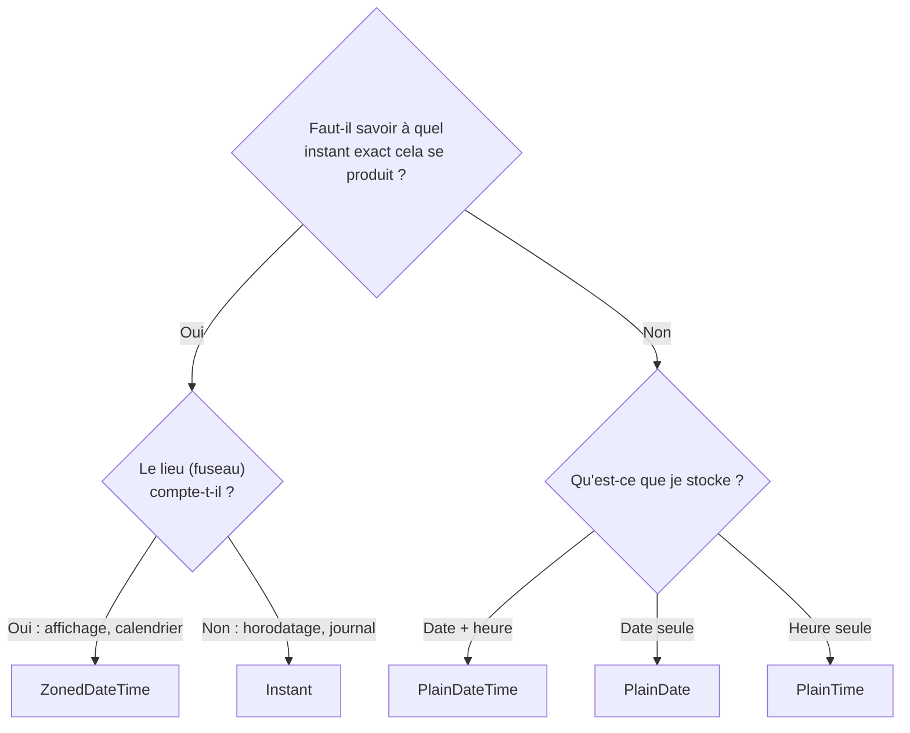

# 15 — Dates et heures

> **Niveau** : Intermédiaire · **Durée** : ~3 h · **Prérequis** : [Nombres et Math](../08-nombres-et-math/README.md), [Objets](../10-objets/README.md)

Afficher « il y a 3 minutes », calculer une échéance à 30 jours, planifier une réunion entre Paris et Tokyo : les dates sont partout, et c'est l'un des domaines où les bugs sont les plus sournois (fuseaux horaires, heure d'été, mois numérotés à partir de 0…). Ce chapitre vous apprend à utiliser correctement l'objet historique `Date`, à formater pour les humains avec `Intl`, puis à passer à **Temporal**, la nouvelle API standard qui corrige les défauts de `Date`.

## Objectifs

- Distinguer un instant, une date civile, une heure murale et un fuseau horaire, et choisir la bonne représentation.
- Créer, lire, modifier, comparer et sérialiser des objets `Date` sans tomber dans les pièges classiques (mois 0-11, chaînes ambiguës, mutation).
- Calculer des écarts et ajouter du temps en tenant compte de l'heure d'été.
- Formater dates, durées et temps relatifs dans n'importe quelle langue avec `Intl.DateTimeFormat`, `Intl.RelativeTimeFormat` et `Intl.DurationFormat`.
- Utiliser Temporal (`PlainDate`, `ZonedDateTime`, `Instant`, `Duration`…) et l'activer partout grâce à un polyfill.
- Choisir entre API native et bibliothèque (date-fns, Day.js, Luxon), et savoir pourquoi Moment.js est à éviter.
- Stocker et échanger des dates de manière fiable (UTC, ISO 8601, fuseau IANA).

## Sommaire

- [Quatre façons de parler du temps](#quatre-façons-de-parler-du-temps)
- [L'objet Date](#lobjet-date)
- [Formater pour les humains avec Intl](#formater-pour-les-humains-avec-intl)
- [Temporal, l'API moderne](#temporal-lapi-moderne)
- [Bibliothèques](#bibliothèques)
- [Stocker, échanger, tester](#stocker-échanger-tester)
- [Recettes](#recettes)
- [Pièges courants](#pièges-courants)
- [Bonnes pratiques](#bonnes-pratiques)
- [Résumé](#résumé)
- [Exercices](#exercices)
- [Pour aller plus loin](#pour-aller-plus-loin)

## Quatre façons de parler du temps

Avant d'écrire la moindre ligne de code, il faut savoir **de quoi** on parle. « Le 6 novembre 2026 à 14 h 30 » peut désigner des choses très différentes :

| Notion | Exemple | Ce que c'est |
| --- | --- | --- |
| **Instant** | horodatage d'un log, d'un paiement | un point unique sur la ligne du temps, le même pour toute la planète |
| **Date civile** | anniversaire, jour férié, date d'échéance | un jour du calendrier, sans heure ni fuseau |
| **Heure murale** | « le réveil sonne à 7 h » | ce qu'affiche une horloge, sans date ni fuseau |
| **Date et heure dans un fuseau** | rendez-vous chez le dentiste à Lyon | une heure murale + une date + un lieu, ce qui permet de retrouver l'instant |

Quelques termes reviennent sans cesse :

- **UTC** (temps universel coordonné) : l'heure de référence mondiale, sans heure d'été.
- **Décalage** (*offset*) : l'écart avec UTC à un instant donné, par exemple `+01:00` à Paris en hiver et `+02:00` en été.
- **Fuseau horaire** : une **région** qui suit les mêmes règles (décalage et heure d'été), identifiée par un nom IANA comme `Europe/Paris` ou `America/Toronto`. Un fuseau n'est pas un décalage : `Europe/Paris` vaut tantôt `+01:00`, tantôt `+02:00`, et ses règles peuvent changer par décision politique.
- **ISO 8601** : le format d'échange standard, `2026-11-06T14:30:00+01:00`. Sa variante récente **RFC 9557** ajoute le fuseau entre crochets : `2026-11-06T14:30:00+01:00[Europe/Paris]`.
- **Epoch Unix** : le 1er janvier 1970 à 00:00:00 UTC, l'origine à partir de laquelle on compte les instants en (milli)secondes.

> [!IMPORTANT]
> Une grande partie des bugs de dates vient d'une confusion entre ces notions : stocker un anniversaire comme un instant (il change de jour selon le fuseau), ou un rendez-vous futur comme un instant UTC (il se décale si les règles d'heure d'été changent). Demandez-vous toujours : « je manipule un instant, une date civile ou une heure dans un lieu précis ? »

## L'objet Date

`Date` existe depuis la première version de JavaScript (1995, copié sur `java.util.Date`), et il en a gardé les défauts. Il reste toutefois incontournable : toutes les API (`fetch`, `JSON`, DOM, bibliothèques) l'utilisent encore.

> [!NOTE]
> Plusieurs exemples de cette section dépendent du **fuseau local** de la machine. Ils commencent par `process.env.TZ = "Europe/Paris";` : cette ligne, propre à Node.js, fixe le fuseau du processus pour que vous obteniez exactement les résultats indiqués en commentaire. Dans un navigateur, supprimez-la : les résultats suivront alors votre propre fuseau.

### Une Date est un nombre

Malgré son nom, une `Date` ne contient ni année, ni mois, ni fuseau : elle contient **un seul nombre**, les millisecondes écoulées depuis l'epoch Unix. C'est donc un **instant**. L'année, l'heure, etc. sont recalculées à la demande, soit en heure locale, soit en UTC.

```js
const epoch = new Date(0);
console.log(epoch.toISOString()); // 1970-01-01T00:00:00.000Z

const lancement = new Date("2026-11-06T13:30:00Z");
console.log(lancement.getTime()); // 1793971800000
console.log(lancement.valueOf()); // 1793971800000 (même chose)

// L'instant présent, sans créer d'objet
console.log(typeof Date.now()); // number

// Une Date couvre ±100 millions de jours autour de 1970
console.log(new Date(8.64e15).toISOString()); // +275760-09-13T00:00:00.000Z
console.log(new Date(8.64e15 + 1).getTime()); // NaN
```

Retenez cette image : **un nombre (UTC) + deux « lunettes »** pour le lire, l'heure locale (`getHours()`) et UTC (`getUTCHours()`). `Date` ne sait rien faire d'autre : pas de fuseau arbitraire, pas de date sans heure.

### Créer une date

Il existe quatre façons de créer une `Date` :

```js
process.env.TZ = "Europe/Paris";

// 1. Maintenant
const maintenant = new Date();

// 2. À partir d'un timestamp en millisecondes
const depuisTimestamp = new Date(1793971800000);
console.log(depuisTimestamp.toISOString()); // 2026-11-06T13:30:00.000Z

// 3. À partir d'une chaîne ISO 8601 (voir la section suivante)
const depuisChaine = new Date("2026-11-06T14:30:00+01:00");
console.log(depuisChaine.toISOString()); // 2026-11-06T13:30:00.000Z

// 4. À partir de composants, en HEURE LOCALE — le mois va de 0 à 11 !
const depuisComposants = new Date(2026, 10, 6, 14, 30); // 10 = novembre
console.log(depuisComposants.toString());
// Fri Nov 06 2026 14:30:00 GMT+0100 (Central European Standard Time)
```

Le mois numéroté de 0 (janvier) à 11 (décembre) est le piège le plus célèbre de JavaScript, alors que le jour, lui, va de 1 à 31. Pire : les valeurs hors limites ne provoquent pas d'erreur, elles **débordent** silencieusement sur l'unité suivante.

```js
process.env.TZ = "Europe/Paris";

// ❌ On voulait le 15 décembre 2026…
console.log(new Date(2026, 12, 15).toDateString()); // Fri Jan 15 2027

// Le débordement fonctionne aussi pour les jours
console.log(new Date(2026, 0, 32).toDateString()); // Sun Feb 01 2026

// … ce qui donne une astuce : le jour 0 est le dernier jour du mois précédent
console.log(new Date(2026, 2, 0).getDate()); // 28 (février 2026 a 28 jours)
```

Pour créer un instant à partir de composants **UTC**, utilisez `Date.UTC()`, qui renvoie un timestamp :

```js
const finAnneeUtc = new Date(Date.UTC(2026, 11, 31, 23, 59, 59));
console.log(finAnneeUtc.toISOString()); // 2026-12-31T23:59:59.000Z
```

> [!WARNING]
> `Date()` appelé **sans** `new` ne crée pas d'objet : il renvoie l'heure courante sous forme de chaîne. Écrivez toujours `new Date(…)`.

### Lire une chaîne de date

Hormis les sorties de `toString()` et `toUTCString()`, le seul format dont l'interprétation est garantie par la norme est un sous-ensemble d'**ISO 8601** : `AAAA-MM-JJTHH:mm:ss.sssZ` et ses formes abrégées. Et même là, une règle surprend tout le monde :

| Chaîne | Interprétée en | Exemple |
| --- | --- | --- |
| date seule | **UTC** | `"2026-11-06"` → minuit UTC |
| date + heure **sans** décalage | **heure locale** | `"2026-11-06T14:30"` |
| date + heure + `Z` ou `±HH:mm` | l'instant exact indiqué | `"2026-11-06T14:30:00+01:00"` |

```js
process.env.TZ = "America/New_York";

// Date seule : minuit UTC… soit la veille au soir à New York !
const echeance = new Date("2026-11-06");
console.log(echeance.toISOString()); // 2026-11-06T00:00:00.000Z
console.log(echeance.getDate()); // 5

// Date + heure sans décalage : heure locale
console.log(new Date("2026-11-06T14:30").toISOString()); // 2026-11-06T19:30:00.000Z

// Avec décalage explicite : aucune ambiguïté
console.log(new Date("2026-11-06T14:30:00+01:00").toISOString()); // 2026-11-06T13:30:00.000Z
```

Tout autre format (`"06/11/2026"`, `"November 6, 2026"`, `"2026-11-06 14:30"` avec une espace…) est laissé à l'appréciation du moteur. Contrairement à une idée reçue, la langue de l'utilisateur n'entre pas en jeu : V8 (Chrome, Node.js) lit toujours `"06/11/2026"` comme le **11 juin**, à l'américaine.

```js
process.env.TZ = "Europe/Paris";

// ❌ Formats non standard : résultat propre à chaque moteur
console.log(new Date("06/11/2026").toDateString()); // Thu Jun 11 2026 (dans V8)

// ✅ Format français : découpez vous-même
function lireDateFr(texte) {
  const [jour, mois, annee] = texte.split("/").map(Number);
  return new Date(annee, mois - 1, jour);
}
console.log(lireDateFr("06/11/2026").toDateString()); // Fri Nov 06 2026
```

`Date.parse(chaine)` applique les mêmes règles mais renvoie directement le timestamp (ou `NaN`).

### Dates invalides

Une chaîne illisible ne lève pas d'exception : elle produit une **date invalide**, dont le timestamp vaut `NaN`. Le bug se propage alors en silence… jusqu'à `toISOString()`, qui, lui, lève une `RangeError`.

```js
const bizarre = new Date("n'importe quoi");
console.log(String(bizarre)); // Invalid Date
console.log(bizarre.getTime()); // NaN
console.log(bizarre.getFullYear()); // NaN

try {
  bizarre.toISOString();
} catch (erreur) {
  console.log(erreur.name); // RangeError
}

function estDateValide(valeur) {
  return valeur instanceof Date && !Number.isNaN(valeur.getTime());
}
console.log(estDateValide(bizarre)); // false
console.log(estDateValide(new Date("2026-11-06"))); // true
```

> [!WARNING]
> Ne comptez pas sur `Date` pour **valider** une saisie. V8 accepte `"2026-02-30"` et le transforme silencieusement en 2 mars, et `new Date(2026, 1, 30)` déborde de la même façon. Pour valider, vérifiez que les composants relus sont ceux que vous avez fournis (voir l'[exercice 3](#exercice-3--valider-une-date-saisie-)) ou utilisez Temporal, qui rejette ces dates.

```js
console.log(new Date("2026-02-30").toISOString()); // 2026-03-02T00:00:00.000Z (dans V8)
```

### Lire les composants

Chaque composant a deux accesseurs : l'un en heure locale, l'autre en UTC.

| Local | UTC | Valeur |
| --- | --- | --- |
| `getFullYear()` | `getUTCFullYear()` | année sur 4 chiffres |
| `getMonth()` | `getUTCMonth()` | **0 à 11** |
| `getDate()` | `getUTCDate()` | jour du mois, 1 à 31 |
| `getDay()` | `getUTCDay()` | jour de la semaine, **0 = dimanche** à 6 = samedi |
| `getHours()`, `getMinutes()`, `getSeconds()`, `getMilliseconds()` | `getUTCHours()`… | heure, minutes… |
| `getTime()` | — | timestamp (identique partout) |
| `getTimezoneOffset()` | — | écart local → UTC, en minutes, **signe inversé** |

```js
process.env.TZ = "Europe/Paris";

const rendezVous = new Date("2026-11-06T13:30:00Z");

console.log(rendezVous.getFullYear()); // 2026
console.log(rendezVous.getMonth()); // 10 (novembre)
console.log(rendezVous.getDate()); // 6
console.log(rendezVous.getDay()); // 5 (vendredi)
console.log(rendezVous.getHours()); // 14 (heure de Paris)
console.log(rendezVous.getUTCHours()); // 13
console.log(rendezVous.getTimezoneOffset()); // -60 (Paris est en avance d'1 h sur UTC)

const jours = ["dimanche", "lundi", "mardi", "mercredi", "jeudi", "vendredi", "samedi"];
console.log(jours[rendezVous.getDay()]); // vendredi
```

> [!TIP]
> Ne confondez pas `getDate()` (jour du mois) et `getDay()` (jour de la semaine). Et oubliez `getYear()` : cette méthode obsolète renvoie l'année moins 1900.

### Modifier une date

Les setters (`setFullYear`, `setMonth`, `setDate`, `setHours`…, et leurs variantes `setUTC…`) **modifient l'objet en place** et renvoient le nouveau timestamp. Ils acceptent aussi le débordement, ce qui rend l'ajout de jours très simple.

```js
process.env.TZ = "Europe/Paris";

const date = new Date(2026, 10, 6, 14, 30);

date.setDate(date.getDate() + 30); // + 30 jours, le changement de mois est géré
console.log(date.toDateString()); // Sun Dec 06 2026

date.setHours(9, 0, 0, 0); // heures, minutes, secondes, millisecondes en un appel
console.log(date.toString()); // Sun Dec 06 2026 09:00:00 GMT+0100 (Central European Standard Time)
```

Cette **mutabilité** est dangereuse : une fonction qui reçoit une date peut la modifier dans le dos de l'appelant. Travaillez toujours sur une copie.

```js
process.env.TZ = "Europe/Paris";

// ❌ Modifie la date de l'appelant
function ajouterJoursMutant(date, jours) {
  date.setDate(date.getDate() + jours);
  return date;
}

// ✅ Copie, puis modifie la copie
function ajouterJours(date, jours) {
  const copie = new Date(date); // new Date(uneDate) copie l'instant
  copie.setDate(copie.getDate() + jours);
  return copie;
}

const commande = new Date(2026, 10, 6);
const livraison = ajouterJours(commande, 3);
console.log(commande.toDateString()); // Fri Nov 06 2026 (intacte)
console.log(livraison.toDateString()); // Mon Nov 09 2026

ajouterJoursMutant(commande, 3);
console.log(commande.toDateString()); // Mon Nov 09 2026 (modifiée !)
```

### Convertir en chaîne

| Méthode | Résultat | Usage |
| --- | --- | --- |
| `toISOString()` | `2026-11-06T13:30:00.000Z` (toujours UTC) | stockage, échange, journaux |
| `toJSON()` | identique à `toISOString()` | appelée par `JSON.stringify` |
| `toString()` | heure locale, en anglais, avec fuseau | débogage |
| `toDateString()`, `toTimeString()` | moitié de `toString()` | débogage |
| `toUTCString()` | `Fri, 06 Nov 2026 13:30:00 GMT` | en-têtes HTTP |
| `toLocaleString()`, `toLocaleDateString()`, `toLocaleTimeString()` | format adapté à une langue | affichage (voir [Intl](#formater-pour-les-humains-avec-intl)) |

```js
const paiement = new Date(Date.UTC(2026, 10, 6, 13, 30));

console.log(paiement.toISOString()); // 2026-11-06T13:30:00.000Z
console.log(paiement.toUTCString()); // Fri, 06 Nov 2026 13:30:00 GMT
console.log(JSON.stringify({ paiement })); // {"paiement":"2026-11-06T13:30:00.000Z"}

// Le chemin inverse n'est pas automatique : JSON.parse rend une chaîne
const relu = JSON.parse('{"paiement":"2026-11-06T13:30:00.000Z"}');
console.log(typeof relu.paiement); // string
console.log(new Date(relu.paiement).getTime() === paiement.getTime()); // true
```

La réhydratation automatique des dates avec un *reviver* est traitée au chapitre [JSON et stockage](../25-json-et-stockage/README.md).

> [!WARNING]
> `toISOString().slice(0, 10)` donne la date **UTC**, pas la date locale : à Paris, un instant à 0 h 30 du 7 novembre donne encore `"2026-11-06"`. Pour obtenir la date locale au format `AAAA-MM-JJ`, utilisez les getters locaux (voir [Recettes](#recettes)) ou Temporal.

### Comparer et trier

Les opérateurs `<`, `>`, `<=`, `>=` et la soustraction convertissent les dates en nombres : ils fonctionnent. En revanche, `===` compare des **références** d'objets.

```js
const a = new Date("2026-11-06T10:00:00Z");
const b = new Date("2026-11-06T10:00:00Z");
const c = new Date("2026-12-25T10:00:00Z");

console.log(a < c); // true
console.log(a === b); // false ❌ deux objets distincts
console.log(a.getTime() === b.getTime()); // true ✅

// Trier du plus ancien au plus récent
const dates = [c, a, new Date("2026-01-01T00:00:00Z")];
const triees = dates.toSorted((x, y) => x - y); // toSorted : ES2023
console.log(triees.map((d) => d.toISOString().slice(0, 10))); // [ '2026-01-01', '2026-11-06', '2026-12-25' ]

// La plus récente
const plusRecente = new Date(Math.max(...dates));
console.log(plusRecente.toISOString()); // 2026-12-25T10:00:00.000Z
```

### Calculer des écarts et ajouter du temps

La différence entre deux dates est un nombre de millisecondes. Pour l'exprimer en jours, heures, etc., on divise :

```js
const MS_PAR_SECONDE = 1000;
const MS_PAR_MINUTE = 60 * MS_PAR_SECONDE;
const MS_PAR_HEURE = 60 * MS_PAR_MINUTE;
const MS_PAR_JOUR = 24 * MS_PAR_HEURE;

const debut = new Date("2026-11-01T08:00:00Z");
const fin = new Date("2026-11-15T18:45:30Z");
const ecart = fin - debut;

console.log(ecart); // 1248330000

const jours = Math.floor(ecart / MS_PAR_JOUR);
const heures = Math.floor((ecart % MS_PAR_JOUR) / MS_PAR_HEURE);
const minutes = Math.floor((ecart % MS_PAR_HEURE) / MS_PAR_MINUTE);
const secondes = Math.floor((ecart % MS_PAR_MINUTE) / MS_PAR_SECONDE);
console.log(`${jours} j ${heures} h ${minutes} min ${secondes} s`); // 14 j 10 h 45 min 30 s
```

Pour **ajouter** du temps, deux techniques coexistent et ne donnent pas toujours le même résultat :

- ajouter des **millisecondes** au timestamp : parfait pour une durée « physique » (une session expire dans 30 minutes) ;
- utiliser les **setters** (`setDate(getDate() + n)`, `setMonth(getMonth() + n)`) : parfait pour une durée « calendaire » (le même jour, une semaine plus tard).

La différence apparaît avec l'heure d'été.

### Heure d'été : un jour ne dure pas toujours 24 heures

En France, la nuit du 28 au 29 mars 2026, les horloges passent de 2 h à 3 h : le dimanche 29 mars ne dure que **23 heures**. Le 25 octobre 2026, il en dure 25.

```js
process.env.TZ = "Europe/Paris";

const samediMidi = new Date(2026, 2, 28, 12, 0); // samedi 28 mars 2026, 12 h

// + 24 heures « physiques »
const plus24h = new Date(samediMidi.getTime() + 24 * 60 * 60 * 1000);
console.log(plus24h.getHours()); // 13 (!)

// + 1 jour « calendaire »
const plus1Jour = new Date(samediMidi);
plus1Jour.setDate(plus1Jour.getDate() + 1);
console.log(plus1Jour.getHours()); // 12

// Le dimanche 29 mars dure 23 heures
const dimanche = new Date(2026, 2, 29);
const lundi = new Date(2026, 2, 30);
console.log((lundi - dimanche) / (60 * 60 * 1000)); // 23

// Une heure qui n'existe pas est décalée en avant
console.log(new Date(2026, 2, 29, 2, 30).getHours()); // 3
```

Conséquence : pour compter des **jours calendaires** entre deux dates, ne divisez pas un écart local par 86 400 000 en espérant tomber juste. Travaillez en UTC (`Date.UTC`), où il n'y a pas d'heure d'été, et arrondissez :

```js
process.env.TZ = "Europe/Paris";

// ❌ 23 heures au lieu de 24 : le calcul tombe à côté
const dimanche = new Date(2026, 2, 29);
const lundi = new Date(2026, 2, 30);
console.log(Math.floor((lundi - dimanche) / 86_400_000)); // 0

// ✅ On compare les dates civiles en UTC
function joursEntre(dateA, dateB) {
  const utcA = Date.UTC(dateA.getFullYear(), dateA.getMonth(), dateA.getDate());
  const utcB = Date.UTC(dateB.getFullYear(), dateB.getMonth(), dateB.getDate());
  return Math.round((utcB - utcA) / 86_400_000);
}
console.log(joursEntre(dimanche, lundi)); // 1
console.log(joursEntre(new Date(2026, 10, 6), new Date(2026, 11, 25))); // 49
```

### Les limites de Date

Vous l'avez constaté, `Date` cumule les défauts :

- **mutable** : un setter modifie l'objet partagé ;
- **mois de 0 à 11**, jours de la semaine commençant le dimanche ;
- seulement **deux fuseaux** : celui de la machine et UTC. Impossible de demander « quelle heure est-il à Tokyo ? » autrement qu'en formatant (avec `Intl`) ;
- **pas de date sans heure** : un anniversaire devient un instant, qui change de jour selon le fuseau ;
- **pas de durée** : on jongle avec des millisecondes ;
- **lecture laxiste** : formats non standard dépendants du moteur, dates impossibles acceptées ;
- précision limitée à la **milliseconde**.

C'est pour corriger tout cela que Temporal a été conçu. Mais avant, voyons comment **afficher** une date correctement : c'est le rôle d'`Intl`, qui fonctionne aussi avec Temporal.

## Formater pour les humains avec Intl

L'API d'internationalisation `Intl` connaît les conventions de centaines de langues et de régions (ordre jour/mois, noms des mois, format 24 h…) ainsi que tous les fuseaux IANA. Elle évite d'écrire (et de maintenir) des tableaux de noms de mois.

### Intl.DateTimeFormat

On crée un **formateur** avec une locale et des options, puis on l'applique à autant de dates que nécessaire. Les raccourcis `toLocaleDateString()` & co. acceptent les mêmes arguments, mais recréent un formateur à chaque appel : préférez un formateur réutilisé dans une boucle. Les options `dateStyle` et `timeStyle` datent d'ECMA-402 2021 et sont largement disponibles.

```js
const instant = new Date("2026-11-06T13:30:45Z");

// dateStyle / timeStyle : "full", "long", "medium", "short"
const complet = new Intl.DateTimeFormat("fr-FR", {
  dateStyle: "full",
  timeStyle: "short",
  timeZone: "Europe/Paris",
});
console.log(complet.format(instant)); // vendredi 6 novembre 2026 à 14:30

const court = new Intl.DateTimeFormat("fr-FR", {
  dateStyle: "short",
  timeZone: "Europe/Paris",
});
console.log(court.format(instant)); // 06/11/2026

// Même instant, autres langues et autres fuseaux
const options = { dateStyle: "medium", timeStyle: "short" };
console.log(instant.toLocaleString("en-US", { ...options, timeZone: "America/New_York" })); // Nov 6, 2026, 8:30 AM
console.log(instant.toLocaleString("de-DE", { ...options, timeZone: "Europe/Berlin" })); // 06.11.2026, 14:30
console.log(instant.toLocaleString("ja-JP", { ...options, timeZone: "Asia/Tokyo" })); // 2026/11/06 22:30
```

> [!IMPORTANT]
> Sans option `timeZone`, `Intl` utilise le fuseau de la machine. Côté serveur, ce fuseau est souvent UTC : précisez toujours `timeZone` quand le résultat doit correspondre à l'heure d'un lieu précis.

### Options détaillées et fuseaux

Au lieu des styles prédéfinis, on peut choisir chaque composant. Les deux approches ne se mélangent pas : combiner `dateStyle` et `hour` lève une `TypeError`.

| Option | Valeurs |
| --- | --- |
| `weekday` | `"long"` (vendredi), `"short"` (ven.), `"narrow"` (V) |
| `year` | `"numeric"` (2026), `"2-digit"` (26) |
| `month` | `"numeric"`, `"2-digit"`, `"long"` (novembre), `"short"` (nov.), `"narrow"` |
| `day`, `hour`, `minute`, `second` | `"numeric"`, `"2-digit"` |
| `hourCycle` | `"h23"` (0-23), `"h12"` (1-12, avec AM/PM)… |
| `timeZone` | un nom IANA : `"Europe/Paris"`, `"UTC"`… |
| `timeZoneName` | `"short"`, `"long"`, `"shortOffset"`, `"longGeneric"`… |

```js
const instant = new Date("2026-11-06T13:30:45Z");

const lisible = new Intl.DateTimeFormat("fr-FR", {
  weekday: "long",
  day: "numeric",
  month: "long",
  hour: "2-digit",
  minute: "2-digit",
  timeZone: "Europe/Paris",
});
console.log(lisible.format(instant)); // vendredi 6 novembre à 14:30

const avecFuseau = new Intl.DateTimeFormat("fr-FR", {
  hour: "numeric",
  minute: "2-digit",
  timeZone: "Europe/Paris",
  timeZoneName: "long",
});
console.log(avecFuseau.format(instant)); // 14:30 heure normale d’Europe centrale

// Format 24 h même en anglais américain
const us24 = new Intl.DateTimeFormat("en-US", {
  hour: "numeric",
  minute: "2-digit",
  hourCycle: "h23",
  timeZone: "Europe/Paris",
});
console.log(us24.format(instant)); // 14:30

// Le fuseau de l'utilisateur et la liste des fuseaux connus
console.log(typeof Intl.DateTimeFormat().resolvedOptions().timeZone); // string (ex. "Europe/Paris")
console.log(Intl.supportedValuesOf("timeZone").includes("Asia/Tokyo")); // true
```

> [!NOTE]
> Les chaînes produites par `Intl` peuvent contenir des espaces insécables (` `, ` `) et leur forme exacte peut évoluer avec les versions des données de localisation (CLDR). Elles servent à **afficher**, jamais à comparer ou à stocker.

### formatToParts et formatRange

`formatToParts()` renvoie les morceaux du résultat : idéal pour styliser une partie (le jour en gras) ou construire un format personnalisé sans bricoler la chaîne. `formatRange()` (ECMA-402 2021) formate un intervalle en factorisant ce qui est commun.

```js
const instant = new Date("2026-11-06T13:30:45Z");
const format = new Intl.DateTimeFormat("fr-FR", {
  dateStyle: "short",
  timeZone: "Europe/Paris",
});

const parties = format.formatToParts(instant);
console.log(parties.map((p) => p.type).join(",")); // day,literal,month,literal,year

// Construire AAAA-MM-JJ dans un fuseau donné
const valeurs = Object.fromEntries(parties.map((p) => [p.type, p.value]));
console.log(`${valeurs.year}-${valeurs.month}-${valeurs.day}`); // 2026-11-06

// Intervalles
const jour = new Intl.DateTimeFormat("fr-FR", {
  day: "numeric",
  month: "long",
  timeZone: "Europe/Paris",
});
const debut = new Date("2026-11-06T09:00:00Z");
const fin = new Date("2026-11-08T17:00:00Z");
console.log(jour.formatRange(debut, fin)); // 6–8 novembre

const heure = new Intl.DateTimeFormat("fr-FR", {
  hour: "numeric",
  minute: "2-digit",
  timeZone: "Europe/Paris",
});
console.log(heure.formatRange(debut, new Date("2026-11-06T11:00:00Z"))); // 10:00 – 12:00
```

### Intl.RelativeTimeFormat

Pour les formulations relatives (« hier », « dans 3 semaines », « il y a 5 minutes »), `Intl.RelativeTimeFormat` (ECMA-402 2020, largement disponible) prend une valeur et une unité. Avec `numeric: "auto"`, il utilise les mots courants quand ils existent.

```js
const relatif = new Intl.RelativeTimeFormat("fr", { numeric: "auto" });

console.log(relatif.format(-1, "day")); // hier
console.log(relatif.format(2, "day")); // après-demain
console.log(relatif.format(0, "day")); // aujourd’hui
console.log(relatif.format(-1, "week")); // la semaine dernière
console.log(relatif.format(3, "week")); // dans 3 semaines
console.log(relatif.format(-5, "minute")); // il y a 5 minutes

// Par défaut (numeric: "always"), toujours un nombre
console.log(new Intl.RelativeTimeFormat("fr").format(-1, "day")); // il y a 1 jour
```

Il ne calcule pas l'écart à votre place : c'est à vous de choisir l'unité adaptée (voir la recette [Il y a…](#il-y-a-temps-relatif-automatique)).

### Intl.DurationFormat

`Intl.DurationFormat` (ECMA-402 2025) formate une **durée** : « 1 heure et 30 minutes », « 1 h 30 min », « 1:30:05 ». Il est **Baseline 2025** (Chrome 129+, Firefox 136+, Safari 16.4+) et disponible depuis Node.js 23.

```js
const duree = { hours: 1, minutes: 30, seconds: 5 };

console.log(new Intl.DurationFormat("fr", { style: "long" }).format(duree)); // 1 heure, 30 minutes et 5 secondes
console.log(new Intl.DurationFormat("fr", { style: "short" }).format(duree)); // 1 h, 30 min et 5 s
console.log(new Intl.DurationFormat("fr", { style: "narrow" }).format(duree)); // 1h 30min 5s
console.log(new Intl.DurationFormat("fr", { style: "digital" }).format(duree)); // 1:30:05

// Les unités à zéro sont omises (sauf en style "digital")
console.log(new Intl.DurationFormat("fr", { style: "long" }).format({ days: 2, hours: 0, minutes: 15 })); // 2 jours et 15 minutes
```

L'objet passé utilise les noms d'unités au pluriel (`years`, `months`, `weeks`, `days`, `hours`, `minutes`, `seconds`, `milliseconds`…) ; c'est exactement la forme d'une `Temporal.Duration`, dont la méthode `toLocaleString()` s'appuie sur `Intl.DurationFormat`.

## Temporal, l'API moderne

### Pourquoi une nouvelle API

Corriger `Date` était impossible sans casser le Web. TC39 a donc conçu une API entièrement nouvelle, rangée dans l'espace de noms global `Temporal`. Ses principes répondent un à un aux défauts de `Date` :

- **immuable** : chaque opération renvoie un nouvel objet ;
- **un type par notion** : date seule, heure seule, date et heure, instant, date dans un fuseau, durée ;
- **mois de 1 à 12**, lundi = 1 et dimanche = 7 ;
- **tous les fuseaux IANA** et l'heure d'été gérée explicitement ;
- **lecture stricte** : seuls ISO 8601 / RFC 9557 sont acceptés, et une date impossible lève une `RangeError` ;
- **durées** de première classe et arithmétique calendaire correcte (fin de mois, années bissextiles) ;
- précision à la **nanoseconde** et prise en charge d'autres calendriers (japonais, hébreu, islamique…).

### Disponibilité en novembre 2026

Temporal a atteint le **stage 4** en mars 2026 et figurera dans **ES2027**. État au 6 novembre 2026 (source : MDN et caniuse) :

| Environnement | Temporal |
| --- | --- |
| Firefox | depuis la version 139 (mai 2025) |
| Chrome, Edge | depuis la version 144 |
| Safari (macOS, iOS) | **non** : seulement dans Safari Technology Preview |
| Node.js | depuis la version 26, la LTS recommandée (activé par défaut ; absent de Node 24 et 22) |
| Deno | depuis la version 2.7 |

MDN le classe donc en **disponibilité limitée** (pas encore Baseline) : environ 72 % des internautes ont un navigateur compatible. Tant que Safari ne l'a pas livré, une application web publique doit charger un **polyfill**.

> [!NOTE]
> Les exemples Temporal de ce chapitre utilisent le global `Temporal` : ils fonctionnent tels quels dans Chrome, Firefox ou Node.js 26, mais pas dans Node.js 24. Ils sont donc exclus de la vérification automatique du cours ; leurs résultats ont été vérifiés avec `temporal-polyfill`.

### Utiliser Temporal dès aujourd'hui

Deux polyfills de référence existent :

| Paquet | Version (nov. 2026) | Caractéristiques |
| --- | --- | --- |
| [`temporal-polyfill`](https://github.com/fullcalendar/temporal-polyfill) | 1.0 | léger (≈ 20 ko compressé), conforme à la spécification, utilise l'implémentation native si elle existe |
| [`@js-temporal/polyfill`](https://github.com/js-temporal/temporal-polyfill) | 0.5 | maintenu par les auteurs de la proposition, plus volumineux, version 0.x |

```bash
npm install temporal-polyfill
```

Trois façons de l'utiliser :

<!-- no-run -->
```js
// 1. Installer le global Temporal (le natif est conservé s'il existe)
import "temporal-polyfill/global";
console.log(Temporal.Now.plainDateISO().toString());

// 2. Import local, sans toucher au global (« ponyfill »)
import { Temporal } from "temporal-polyfill";

// 3. Chargement conditionnel : rien n'est téléchargé dans les navigateurs compatibles
if (!globalThis.Temporal) {
  await import("temporal-polyfill/global");
}
```

> [!TIP]
> Le point d'entrée par défaut de `temporal-polyfill` ne gère que les calendriers ISO 8601 et grégorien, ce qui suffit dans l'immense majorité des cas. Pour les autres calendriers, importez `temporal-polyfill/full`. Avec TypeScript, les types globaux s'obtiennent avec `temporal-polyfill/types/global`.

### Choisir le bon type

Temporal propose un type pour chaque notion vue en début de chapitre. Le préfixe `Plain` signifie « sans fuseau horaire » : c'est une valeur d'agenda, pas un instant.

| Type | Exemple de chaîne | Pour représenter |
| --- | --- | --- |
| `Temporal.Instant` | `2026-11-06T13:30:00Z` | un instant exact (horodatage) |
| `Temporal.ZonedDateTime` | `2026-11-06T14:30:00+01:00[Europe/Paris]` | un événement dans un lieu (réunion, vol) |
| `Temporal.PlainDateTime` | `2026-11-06T14:30:00` | date et heure murales sans lieu |
| `Temporal.PlainDate` | `2026-11-06` | une date civile (anniversaire, échéance) |
| `Temporal.PlainTime` | `14:30:00` | une heure murale (horaire d'ouverture) |
| `Temporal.PlainYearMonth` | `2026-11` | un mois (expiration de carte bancaire) |
| `Temporal.PlainMonthDay` | `12-25` | un jour récurrent (Noël) |
| `Temporal.Duration` | `P1DT2H30M` | une durée |
| `Temporal.Now` | — | l'heure courante, dans chacun des types |



### Créer et lire

Chaque type se crée avec sa méthode statique `from()` (à partir d'une chaîne ou d'un objet), avec son constructeur, ou via `Temporal.Now`.

<!-- no-run -->
```js
// À partir d'une chaîne ISO
const echeance = Temporal.PlainDate.from("2026-11-06");

// À partir d'un objet : le mois va de 1 à 12 !
const noel = Temporal.PlainDate.from({ year: 2026, month: 12, day: 25 });

// Avec le constructeur
const ouverture = new Temporal.PlainTime(9, 0);

// L'instant présent, dans le type voulu
const aujourdhui = Temporal.Now.plainDateISO(); // date du jour, fuseau local
const maintenant = Temporal.Now.zonedDateTimeISO("Asia/Tokyo"); // date et heure à Tokyo
const horodatage = Temporal.Now.instant();
console.log(Temporal.Now.timeZoneId()); // fuseau de la machine, ex. "Europe/Paris"

// Lire les composants : de simples propriétés
console.log(echeance.year); // 2026
console.log(echeance.month); // 11
console.log(echeance.day); // 6
console.log(echeance.dayOfWeek); // 5 (lundi = 1… dimanche = 7)
console.log(echeance.dayOfYear); // 310
console.log(echeance.weekOfYear); // 45 (semaine ISO)
console.log(echeance.daysInMonth); // 30
console.log(echeance.inLeapYear); // false
console.log(echeance.toString()); // 2026-11-06
console.log(ouverture.toString()); // 09:00:00
```

La lecture est **stricte**. Avec une chaîne, une date impossible lève une `RangeError` ; avec un objet, l'option `overflow` choisit entre ramener la valeur dans les limites (`"constrain"`, par défaut) et rejeter (`"reject"`).

<!-- no-run -->
```js
Temporal.PlainDate.from("2026-02-30"); // ❌ RangeError

console.log(Temporal.PlainDate.from({ year: 2026, month: 2, day: 30 }).toString()); // 2026-02-28
Temporal.PlainDate.from({ year: 2026, month: 2, day: 30 }, { overflow: "reject" }); // ❌ RangeError

// Une chaîne sans décalage n'est pas un instant
Temporal.Instant.from("2026-11-06T14:30:00"); // ❌ RangeError
console.log(Temporal.Instant.from("2026-11-06T14:30:00+01:00").toString()); // 2026-11-06T13:30:00Z
```

### Calculer : add, subtract, with, until, since

Toutes les opérations renvoient un **nouvel** objet : l'original n'est jamais modifié.

<!-- no-run -->
```js
const facture = Temporal.PlainDate.from("2026-11-06");

console.log(facture.add({ days: 30 }).toString()); // 2026-12-06
console.log(facture.subtract({ months: 1 }).toString()); // 2026-10-06
console.log(facture.add({ years: 1, months: 2 }).toString()); // 2028-01-06
console.log(facture.toString()); // 2026-11-06 (inchangée)

// with() remplace des champs
console.log(facture.with({ day: 1 }).toString()); // 2026-11-01 (début du mois)
console.log(facture.with({ day: facture.daysInMonth }).toString()); // 2026-11-30 (fin du mois)

// Fin de mois : le 31 janvier + 1 mois donne le dernier jour de février
console.log(Temporal.PlainDate.from("2026-01-31").add({ months: 1 }).toString()); // 2026-02-28
console.log(Temporal.PlainDate.from("2024-02-29").add({ years: 1 }).toString()); // 2025-02-28
```

`until()` et `since()` calculent l'écart sous forme de `Duration`. L'option `largestUnit` choisit l'unité la plus grande du résultat.

<!-- no-run -->
```js
const aujourdhui = Temporal.PlainDate.from("2026-11-06");
const noel = Temporal.PlainDate.from("2026-12-25");

console.log(aujourdhui.until(noel).toString()); // P49D
console.log(aujourdhui.until(noel).days); // 49
console.log(aujourdhui.until(noel, { largestUnit: "month" }).toString()); // P1M19D
console.log(aujourdhui.until(noel, { largestUnit: "week" }).toString()); // P7W
console.log(noel.since(aujourdhui).toString()); // P49D

// Un âge en années révolues
const naissance = Temporal.PlainDate.from("1990-06-15");
console.log(naissance.until(aujourdhui, { largestUnit: "year" }).years); // 36
```

### Comparer

Les objets Temporal refusent la conversion en nombre : `<` et `>` lèvent une `TypeError`, ce qui évite les comparaisons silencieusement fausses. On utilise `equals()` et la méthode statique `compare()`, qui renvoie -1, 0 ou 1 et sert directement de comparateur de tri.

<!-- no-run -->
```js
const a = Temporal.PlainDate.from("2026-11-06");
const b = Temporal.PlainDate.from("2026-12-25");

console.log(a.equals(Temporal.PlainDate.from("2026-11-06"))); // true
console.log(Temporal.PlainDate.compare(a, b)); // -1
a < b; // ❌ TypeError

const feries = ["2026-12-25", "2026-01-01", "2026-07-14"].map((s) => Temporal.PlainDate.from(s));
console.log(feries.sort(Temporal.PlainDate.compare).join(", ")); // 2026-01-01, 2026-07-14, 2026-12-25
```

### Fuseaux horaires et heure d'été

`ZonedDateTime` est le type le plus complet : un instant **et** un fuseau. Il sait passer d'un fuseau à l'autre et applique les règles d'heure d'été.

<!-- no-run -->
```js
const reunion = Temporal.ZonedDateTime.from("2026-11-06T14:30[Europe/Paris]");

console.log(reunion.toString()); // 2026-11-06T14:30:00+01:00[Europe/Paris]
console.log(reunion.offset); // +01:00
console.log(reunion.withTimeZone("America/New_York").toString()); // 2026-11-06T08:30:00-05:00[America/New_York]
console.log(reunion.withTimeZone("Asia/Tokyo").toString()); // 2026-11-06T22:30:00+09:00[Asia/Tokyo]

// Passer d'un type à l'autre
console.log(reunion.toInstant().toString()); // 2026-11-06T13:30:00Z
console.log(reunion.toPlainDate().toString()); // 2026-11-06
console.log(Temporal.PlainDate.from("2026-11-06").toZonedDateTime({ timeZone: "Europe/Paris", plainTime: "09:00" }).toString());
// 2026-11-06T09:00:00+01:00[Europe/Paris]
console.log(reunion.startOfDay().toString()); // 2026-11-06T00:00:00+01:00[Europe/Paris]
```

Avec `ZonedDateTime`, la distinction entre jour calendaire et 24 heures, si délicate avec `Date`, devient explicite :

<!-- no-run -->
```js
const samediMidi = Temporal.ZonedDateTime.from("2026-03-28T12:00[Europe/Paris]");

console.log(samediMidi.add({ days: 1 }).toString()); // 2026-03-29T12:00:00+02:00[Europe/Paris]
console.log(samediMidi.add({ hours: 24 }).toString()); // 2026-03-29T13:00:00+02:00[Europe/Paris]
console.log(Temporal.ZonedDateTime.from("2026-03-29[Europe/Paris]").hoursInDay); // 23
console.log(Temporal.ZonedDateTime.from("2026-10-25[Europe/Paris]").hoursInDay); // 25
```

Que faire d'une heure qui n'existe pas (2 h 30 le 29 mars) ou qui existe deux fois (2 h 30 le 25 octobre) ? L'option `disambiguation` le décide : `"compatible"` (par défaut, comme `Date`), `"earlier"`, `"later"` ou `"reject"`.

<!-- no-run -->
```js
const inexistante = Temporal.PlainDateTime.from("2026-03-29T02:30");
console.log(inexistante.toZonedDateTime("Europe/Paris").toString()); // 2026-03-29T03:30:00+02:00[Europe/Paris]
inexistante.toZonedDateTime("Europe/Paris", { disambiguation: "reject" }); // ❌ RangeError

const double = Temporal.PlainDateTime.from("2026-10-25T02:30");
console.log(double.toZonedDateTime("Europe/Paris").toString()); // 2026-10-25T02:30:00+02:00[Europe/Paris]
console.log(double.toZonedDateTime("Europe/Paris", { disambiguation: "later" }).toString()); // 2026-10-25T02:30:00+01:00[Europe/Paris]
```

### Durées

Une `Temporal.Duration` stocke des quantités par unité (années, mois, semaines, jours, heures… nanosecondes). Elle n'est **pas normalisée** automatiquement : 90 minutes restent 90 minutes jusqu'à ce que vous demandiez un arrondi.

<!-- no-run -->
```js
const duree = Temporal.Duration.from({ hours: 1, minutes: 90 });

console.log(duree.toString()); // PT1H90M (format ISO 8601)
console.log(duree.total("minute")); // 150
console.log(duree.round({ largestUnit: "hour" }).toString()); // PT2H30M
console.log(Temporal.Duration.from("PT2H30M").total("hour")); // 2.5
console.log(Temporal.Duration.compare({ hours: 1 }, { minutes: 60 })); // 0

// Combien de jours dans « 1 mois » ? Cela dépend du mois : il faut un point de départ
Temporal.Duration.from({ months: 1 }).total("day"); // ❌ RangeError
console.log(Temporal.Duration.from({ months: 1 }).total({ unit: "day", relativeTo: "2026-02-01" })); // 28

// Écart entre deux instants
const debut = Temporal.Instant.from("2026-11-06T13:30:00Z");
const fin = Temporal.Instant.from("2026-11-06T15:45:30Z");
console.log(debut.until(fin, { largestUnit: "hour" }).toString()); // PT2H15M30S

// Affichage localisé (via Intl.DurationFormat)
console.log(Temporal.Duration.from({ hours: 1, minutes: 30 }).toLocaleString("fr", { style: "long" })); // 1 heure et 30 minutes
```

### Formater et sérialiser

- `toString()` produit la forme ISO 8601 / RFC 9557, que `from()` sait relire : c'est le format de stockage et d'échange.
- `toJSON()` renvoie la même chaîne, donc `JSON.stringify` fonctionne directement.
- `toLocaleString(locale, options)` accepte les options d'`Intl.DateTimeFormat`, et `Intl.DateTimeFormat#format()` accepte aussi les objets Temporal.

<!-- no-run -->
```js
const reunion = Temporal.ZonedDateTime.from("2026-11-06T14:30[Europe/Paris]");
const echeance = Temporal.PlainDate.from("2026-11-06");

console.log(echeance.toLocaleString("fr-FR", { dateStyle: "full" })); // vendredi 6 novembre 2026
console.log(reunion.toLocaleString("fr-FR", { dateStyle: "long", timeStyle: "short" })); // 6 novembre 2026 à 14:30

const json = JSON.stringify({ echeance, reunion });
console.log(json); // {"echeance":"2026-11-06","reunion":"2026-11-06T14:30:00+01:00[Europe/Paris]"}

const relu = JSON.parse(json);
console.log(Temporal.ZonedDateTime.from(relu.reunion).equals(reunion)); // true
```

### Passer de Date à Temporal (et inversement)

Pendant la transition, vous recevrez des `Date` d'anciennes API. La passerelle passe toujours par l'**instant** :

<!-- no-run -->
```js
const ancienne = new Date("2026-11-06T13:30:00Z");

// Date → Temporal
const instant = ancienne.toTemporalInstant(); // natif (Chrome 144+, Firefox 139+, Node 26+)
const instantBis = Temporal.Instant.fromEpochMilliseconds(ancienne.getTime()); // fonctionne partout
console.log(instant.toString()); // 2026-11-06T13:30:00Z
console.log(instant.toZonedDateTimeISO("Europe/Paris").toPlainDate().toString()); // 2026-11-06

// Temporal → Date
console.log(new Date(instant.epochMilliseconds).toISOString()); // 2026-11-06T13:30:00.000Z
```

## Bibliothèques

Avec `Intl` et Temporal, la plateforme couvre désormais l'essentiel des besoins. Une bibliothèque reste utile pour un projet existant qui manipule des `Date`, pour lire des formats personnalisés (`"06/11/2026 14h30"`), ou pour éviter un polyfill.

### Moment.js : à ne plus utiliser

[Moment.js](https://momentjs.com/docs/#/-project-status/) a longtemps été la référence, mais son équipe l'a déclaré **projet historique en mode maintenance** dès septembre 2020 : plus de nouvelles fonctionnalités, et elle recommande elle-même de ne pas l'utiliser dans un nouveau projet. Ses objets sont **mutables** (`date.add(1, "day")` modifie `date`), il n'est pas découpable (*tree shaking*) et il pèse lourd avec ses locales. Dans un projet existant, migrez progressivement vers Temporal, Luxon ou date-fns.

### date-fns, Day.js, Luxon

| | [date-fns](https://date-fns.org/) | [Day.js](https://day.js.org/) | [Luxon](https://moment.github.io/luxon/) |
| --- | --- | --- | --- |
| Version (nov. 2026) | 4.4 | 1.11 | 3.7 |
| Philosophie | fonctions pures sur des `Date` natives | API proche de Moment, très petite | objets immuables, par un mainteneur de Moment |
| Fuseaux | paquet `@date-fns/tz` | plugins `utc` + `timezone` | intégrés (via `Intl`) |
| Taille | seules les fonctions importées sont incluses | ≈ 3 ko compressé, plus les plugins | ≈ 24 ko compressé |

Les exemples suivants nécessitent d'installer le paquet (`npm install date-fns`, etc.).

<!-- no-run -->
```js
// date-fns : des fonctions qui prennent et renvoient des Date (sans les modifier)
import { addDays, addMonths, differenceInCalendarDays, format, isValid, parse } from "date-fns";
import { fr } from "date-fns/locale";

const commande = new Date(2026, 10, 6, 14, 30);
console.log(format(commande, "EEEE d MMMM yyyy", { locale: fr })); // vendredi 6 novembre 2026
console.log(format(addDays(commande, 30), "yyyy-MM-dd")); // 2026-12-06
console.log(format(addMonths(new Date(2026, 0, 31), 1), "yyyy-MM-dd")); // 2026-02-28
console.log(differenceInCalendarDays(new Date(2026, 11, 25), commande)); // 49

// Lire un format personnalisé, strictement
console.log(isValid(parse("31/02/2026", "dd/MM/yyyy", new Date()))); // false
```

<!-- no-run -->
```js
// Day.js : API chaînable, immuable
import dayjs from "dayjs";
import "dayjs/locale/fr.js";
import utc from "dayjs/plugin/utc.js";
import timezone from "dayjs/plugin/timezone.js";

dayjs.extend(utc);
dayjs.extend(timezone);
dayjs.locale("fr");

const reunion = dayjs.tz("2026-11-06 14:30", "Europe/Paris");
console.log(reunion.format("dddd D MMMM YYYY à HH:mm")); // vendredi 6 novembre 2026 à 14:30
console.log(reunion.tz("Asia/Tokyo").format("HH:mm")); // 22:30
console.log(reunion.add(1, "month").format("YYYY-MM-DD")); // 2026-12-06
```

<!-- no-run -->
```js
// Luxon : objets immuables, fuseaux intégrés
import { DateTime } from "luxon";

const reunion = DateTime.fromISO("2026-11-06T14:30", { zone: "Europe/Paris" });
console.log(reunion.toISO()); // 2026-11-06T14:30:00.000+01:00
console.log(reunion.setZone("Asia/Tokyo").toFormat("yyyy-MM-dd HH:mm")); // 2026-11-06 22:30
console.log(reunion.setLocale("fr").toFormat("cccc d LLLL yyyy 'à' HH:mm")); // vendredi 6 novembre 2026 à 14:30
console.log(DateTime.fromISO("2026-02-30").isValid); // false
```

### Laquelle choisir en 2026 ?

- **Nouveau projet** : Temporal (avec `temporal-polyfill` tant que Safari ne le livre pas) pour les calculs, `Intl` pour l'affichage. Aucune dépendance quand le polyfill ne sera plus nécessaire.
- **Projet existant fondé sur `Date`** : date-fns (et `@date-fns/tz` pour les fuseaux) s'intègre sans changer vos types.
- **Projet existant sous Moment** : Day.js offre l'API la plus proche pour une migration rapide ; Luxon ou Temporal pour une migration plus durable.
- **Simple affichage** : rien du tout, `Intl.DateTimeFormat` suffit.

## Stocker, échanger, tester

Quelques règles évitent la plupart des incidents en production :

1. **Instants → UTC, en ISO 8601** (`toISOString()`, `Instant#toString()`) ou en timestamp. Côté base de données, un type « timestamp avec fuseau » (comme `timestamptz` dans PostgreSQL) stocke un instant.
2. **Affichez en local, au dernier moment**, avec `Intl` et le fuseau de l'utilisateur.
3. **Dates civiles → chaîne `AAAA-MM-JJ`** (ou `PlainDate`), jamais un instant à minuit : `new Date("2026-11-06")` est le 5 novembre au soir pour un utilisateur à Montréal.
4. **Événements futurs dans un lieu → heure locale + fuseau IANA** (`2027-03-15T09:00[Europe/Paris]`), pas un instant UTC : si les règles d'heure d'été changent d'ici là, l'instant UTC calculé aujourd'hui deviendra faux, alors que « 9 h à Paris » restera juste.
5. **Côté navigateur**, `<input type="date">` fournit une chaîne `"2026-11-06"` dans `value` : gardez-la telle quelle ou passez-la à `Temporal.PlainDate.from()` plutôt qu'à `new Date()`.
6. **Mesurer une durée d'exécution** : `performance.now()`, qui est monotone, plutôt que `Date.now()`, qui suit l'horloge système (et peut reculer). Voir [Timers](../21-timers/README.md).
7. **Testez avec une horloge injectée** : une fonction qui appelle `new Date()` en interne est impossible à tester de façon déterministe. Passez « maintenant » en paramètre (avec une valeur par défaut) ; les faux timers sont présentés au chapitre [Tests](../29-tests/README.md).

```js
// ❌ Résultat différent à chaque exécution
function estExpireMauvais(dateFin) {
  return new Date() > dateFin;
}

// ✅ L'horloge est un paramètre : testable avec n'importe quelle date
function estExpire(dateFin, maintenant = new Date()) {
  return maintenant > dateFin;
}

const finPromo = new Date("2026-11-30T23:00:00Z");
console.log(estExpire(finPromo, new Date("2026-11-06T12:00:00Z"))); // false
console.log(estExpire(finPromo, new Date("2026-12-01T00:00:00Z"))); // true
```

## Recettes

### Calculer un âge

Un âge se calcule en années **révolues** : on soustrait les années, puis on retire 1 si l'anniversaire n'est pas encore passé.

```js
function calculerAge(naissance, aujourdhui = new Date()) {
  let age = aujourdhui.getFullYear() - naissance.getFullYear();
  const anniversairePasse =
    aujourdhui.getMonth() > naissance.getMonth() ||
    (aujourdhui.getMonth() === naissance.getMonth() && aujourdhui.getDate() >= naissance.getDate());
  if (!anniversairePasse) age--;
  return age;
}

const naissance = new Date(1990, 5, 15); // 15 juin 1990
console.log(calculerAge(naissance, new Date(2026, 5, 14))); // 35
console.log(calculerAge(naissance, new Date(2026, 5, 15))); // 36
console.log(calculerAge(new Date(2008, 1, 29), new Date(2026, 1, 28))); // 17 (né un 29 février)
```

Avec Temporal, c'est une ligne : `naissance.until(aujourdhui, { largestUnit: "year" }).years`.

### Compte à rebours

La partie délicate d'un compte à rebours n'est pas le minuteur (voir [Timers](../21-timers/README.md)) mais la décomposition de l'écart. Isolée dans une fonction pure, elle se teste facilement :

```js
function decomposer(ms) {
  const totalSecondes = Math.max(0, Math.floor(ms / 1000));
  return {
    jours: Math.floor(totalSecondes / 86_400),
    heures: Math.floor((totalSecondes % 86_400) / 3600),
    minutes: Math.floor((totalSecondes % 3600) / 60),
    secondes: totalSecondes % 60,
  };
}

function texteCompteARebours(cible, maintenant = new Date()) {
  const { jours, heures, minutes, secondes } = decomposer(cible - maintenant);
  const deux = (n) => String(n).padStart(2, "0");
  return `${jours} j ${deux(heures)}:${deux(minutes)}:${deux(secondes)}`;
}

const nouvelAn = new Date("2027-01-01T00:00:00+01:00");
console.log(texteCompteARebours(nouvelAn, new Date("2026-11-06T14:30:00+01:00"))); // 55 j 09:30:00
console.log(texteCompteARebours(nouvelAn, new Date("2027-01-02T00:00:00+01:00"))); // 0 j 00:00:00
```

Dans une page, il suffit ensuite d'appeler `texteCompteARebours(nouvelAn)` toutes les secondes avec `setInterval` et d'arrêter quand l'écart est nul.

### Jours ouvrés

Pour compter les jours ouvrés, on parcourt les jours en **UTC** (pas d'heure d'été pour fausser l'incrément) et on écarte week-ends et jours fériés, stockés comme chaînes `AAAA-MM-JJ` :

```js
const FERIES_2026 = new Set(["2026-11-01", "2026-11-11", "2026-12-25"]);

function joursOuvres(debutIso, finIso, feries = FERIES_2026) {
  let compte = 0;
  const jour = new Date(`${debutIso}T00:00:00Z`);
  const fin = new Date(`${finIso}T00:00:00Z`);
  while (jour <= fin) {
    const jourSemaine = jour.getUTCDay();
    const iso = jour.toISOString().slice(0, 10); // sûr ici : on travaille en UTC
    if (jourSemaine !== 0 && jourSemaine !== 6 && !feries.has(iso)) compte++;
    jour.setUTCDate(jour.getUTCDate() + 1);
  }
  return compte;
}

console.log(joursOuvres("2026-11-01", "2026-11-30")); // 20 (le 11 novembre tombe un mercredi)
console.log(joursOuvres("2026-12-21", "2026-12-27")); // 4 (le 25 décembre est un vendredi)
```

> [!NOTE]
> Les jours fériés dépendent du pays (et parfois de la région : l'Alsace-Moselle en compte deux de plus). En production, chargez-les depuis une source officielle plutôt que de les coder en dur.

### Fin de mois et ajout de mois

Ajouter un mois avec `setMonth()` déborde : le 31 janvier + 1 mois donne… le 3 mars. Pour rester en fin de mois, comme le fait Temporal, on borne le jour au nombre de jours du mois cible.

```js
process.env.TZ = "Europe/Paris";

const joursDansMois = (annee, mois) => new Date(annee, mois + 1, 0).getDate(); // mois de 0 à 11

// ❌ Débordement
const naif = new Date(2026, 0, 31);
naif.setMonth(naif.getMonth() + 1);
console.log(naif.toDateString()); // Tue Mar 03 2026

// ✅ Jour borné
function ajouterMois(date, n) {
  const annee = date.getFullYear();
  const mois = date.getMonth() + n;
  const jour = Math.min(date.getDate(), joursDansMois(annee, mois));
  const resultat = new Date(date);
  resultat.setFullYear(annee, mois, jour); // fixe année, mois et jour en un appel
  return resultat;
}

console.log(ajouterMois(new Date(2026, 0, 31), 1).toDateString()); // Sat Feb 28 2026
console.log(ajouterMois(new Date(2026, 10, 30), 3).toDateString()); // Sun Feb 28 2027
console.log(joursDansMois(2028, 1)); // 29 (2028 est bissextile)
```

`setFullYear(annee, mois, jour)` est important : appeler `setMonth()` puis `setDate()` séparément ferait déborder la date au passage.

### Il y a… (temps relatif automatique)

`Intl.RelativeTimeFormat` formate, mais il faut choisir l'unité. On prend la plus grande unité dont la valeur atteint 1 :

```js
const UNITES = [
  ["year", 365 * 24 * 3600],
  ["month", 30 * 24 * 3600],
  ["week", 7 * 24 * 3600],
  ["day", 24 * 3600],
  ["hour", 3600],
  ["minute", 60],
  ["second", 1],
];
const relatif = new Intl.RelativeTimeFormat("fr", { numeric: "auto" });

function ilYA(date, maintenant = new Date()) {
  const secondes = Math.round((date - maintenant) / 1000);
  for (const [unite, duree] of UNITES) {
    if (Math.abs(secondes) >= duree || unite === "second") {
      return relatif.format(Math.trunc(secondes / duree), unite);
    }
  }
}

const maintenant = new Date("2026-11-06T14:30:00Z");
console.log(ilYA(new Date("2026-11-06T14:29:40Z"), maintenant)); // il y a 20 secondes
console.log(ilYA(new Date("2026-11-06T14:25:00Z"), maintenant)); // il y a 5 minutes
console.log(ilYA(new Date("2026-11-05T10:00:00Z"), maintenant)); // hier
console.log(ilYA(new Date("2026-11-30T09:00:00Z"), maintenant)); // dans 3 semaines
console.log(ilYA(new Date("2025-10-01T09:00:00Z"), maintenant)); // l’année dernière
```

Les mois et années sont ici approximés (30 et 365 jours) : c'est acceptable pour un affichage « il y a… », pas pour un calcul.

## Pièges courants

- **Mois de 0 à 11** avec `Date` (`new Date(2026, 11, 25)` est Noël), mais **de 1 à 12** avec Temporal et dans les chaînes ISO. Les jours de la semaine : 0 = dimanche avec `getDay()`, 7 = dimanche avec Temporal.
- **`new Date("2026-11-06")` est en UTC**, `new Date("2026-11-06T00:00")` en heure locale : les deux ne désignent pas le même instant.
- **Formats non ISO** (`"06/11/2026"`, `"2026-11-06 14:30"`) : interprétation propre à chaque moteur. Découpez la chaîne vous-même ou utilisez une bibliothèque.
- **Dates invalides silencieuses** : `new Date("…")` ne lève pas d'erreur, il renvoie `Invalid Date`. Testez `Number.isNaN(date.getTime())`.
- **Débordement silencieux** : `new Date(2026, 1, 30)` et `setMonth()` sur un 31 « inventent » une date.
- **Mutation** : les setters modifient l'objet partagé ; copiez avec `new Date(date)`.
- **`===` entre deux `Date`** compare les références, pas les instants : comparez `getTime()`. Avec Temporal, utilisez `equals()` et `compare()` (`<` lève une `TypeError`).
- **`toISOString()` donne la date UTC** : à éviter pour obtenir la date locale.
- **24 heures ≠ 1 jour** dans un fuseau avec heure d'été.
- **Fuseau du serveur** : un code qui « marche sur ma machine » à Paris peut afficher la veille sur un serveur en UTC. Précisez `timeZone` dans `Intl`.
- **Moment.js** : objets mutables (`add()` modifie l'original) et projet en maintenance.

## Bonnes pratiques

- Identifiez d'abord la **notion** manipulée (instant, date civile, heure murale, date dans un fuseau) et choisissez le type correspondant.
- Échangez et stockez en **ISO 8601** (UTC pour les instants, `AAAA-MM-JJ` pour les dates, RFC 9557 avec fuseau pour les événements futurs).
- N'acceptez en entrée que des formats **non ambigus**, et validez-les explicitement.
- Formatez avec **`Intl`** et une `timeZone` explicite ; réutilisez les formateurs.
- Traitez les dates comme **immuables** : copiez les `Date`, ou utilisez Temporal.
- Pour un nouveau code, privilégiez **Temporal** (avec `temporal-polyfill` côté navigateur tant que Safari ne l'a pas livré).
- Injectez l'horloge (`maintenant = new Date()`) dans les fonctions qui dépendent de la date du jour, pour pouvoir les tester.

## Résumé

- Une `Date` est un **instant** : un nombre de millisecondes depuis le 1er janvier 1970 UTC, lu en heure locale ou en UTC.
- Elle se crée à partir d'un timestamp, d'une chaîne **ISO 8601** (date seule = UTC, date + heure sans décalage = local) ou de composants **locaux** avec un mois de **0 à 11**.
- Les setters **mutent** et **débordent** ; les dates invalides ne lèvent pas d'erreur.
- L'heure d'été rend « + 24 h » et « + 1 jour » différents ; pour compter des jours calendaires, passez par UTC.
- **`Intl.DateTimeFormat`** formate dans toutes les langues et tous les fuseaux ; **`Intl.RelativeTimeFormat`** gère « hier » ou « dans 3 jours » ; **`Intl.DurationFormat`** (Baseline 2025) formate les durées.
- **Temporal** (stage 4, ES2027) apporte des types immuables et précis : `PlainDate`, `PlainTime`, `PlainDateTime`, `ZonedDateTime`, `Instant`, `Duration`. Il est disponible dans Chrome/Edge 144+, Firefox 139+ et Node.js 26+, pas encore dans Safari : utilisez `temporal-polyfill`.
- Moment.js est en maintenance ; date-fns, Day.js et Luxon restent utiles dans des projets existants.
- Stockez en UTC/ISO, affichez en local, gardez le fuseau IANA pour les événements futurs, injectez l'horloge pour tester.

## Exercices

### Exercice 1 — Afficher une date de commande (★☆☆)

Une API renvoie la date d'une commande au format `"2026-11-06T13:30:00Z"`. Écrivez une fonction `afficherCommande(iso, timeZone)` qui renvoie, par exemple, `"vendredi 6 novembre 2026 à 14:30"` pour `"Europe/Paris"`. Testez-la aussi pour `"America/New_York"` et `"Asia/Tokyo"`.

<details>
<summary>Solution</summary>

```js
function afficherCommande(iso, timeZone) {
  const format = new Intl.DateTimeFormat("fr-FR", {
    dateStyle: "full",
    timeStyle: "short",
    timeZone,
  });
  return format.format(new Date(iso));
}

const iso = "2026-11-06T13:30:00Z";
console.log(afficherCommande(iso, "Europe/Paris")); // vendredi 6 novembre 2026 à 14:30
console.log(afficherCommande(iso, "America/New_York")); // vendredi 6 novembre 2026 à 08:30
console.log(afficherCommande(iso, "Asia/Tokyo")); // vendredi 6 novembre 2026 à 22:30
```

La chaîne se termine par `Z` : c'est un instant, que `new Date()` lit sans ambiguïté. Tout le travail d'affichage est délégué à `Intl.DateTimeFormat` ; l'option `timeZone` rend le résultat indépendant du fuseau de la machine. Dans une vraie application, on créerait le formateur une seule fois par fuseau.

</details>

### Exercice 2 — Années bissextiles et jours par mois (★☆☆)

Écrivez `estBissextile(annee)` et `joursDansMois(annee, mois)` avec un mois **de 1 à 12**. Rappel : une année est bissextile si elle est divisible par 4, sauf les années séculaires non divisibles par 400 (1900 ne l'est pas, 2000 l'est).

<details>
<summary>Solution</summary>

```js
function estBissextile(annee) {
  return (annee % 4 === 0 && annee % 100 !== 0) || annee % 400 === 0;
}

function joursDansMois(annee, mois) {
  // mois (1-12) utilisé comme index 0-11 du mois SUIVANT, jour 0 = dernier jour du mois voulu
  return new Date(Date.UTC(annee, mois, 0)).getUTCDate();
}

console.log(estBissextile(2026)); // false
console.log(estBissextile(2028)); // true
console.log(estBissextile(1900)); // false
console.log(estBissextile(2000)); // true
console.log(joursDansMois(2026, 2)); // 28
console.log(joursDansMois(2028, 2)); // 29
console.log(joursDansMois(2026, 11)); // 30
console.log(joursDansMois(2026, 12)); // 31
```

L'astuce du « jour 0 » exploite le débordement : `Date.UTC(2026, 2, 0)` signifie « le jour précédant le 1er mars 2026 », soit le 28 février. Passer par UTC rend le résultat indépendant du fuseau. Avec Temporal : `Temporal.PlainYearMonth.from({ year, month }).daysInMonth` et `.inLeapYear`.

</details>

### Exercice 3 — Valider une date saisie (★★☆)

Écrivez `lireDateStricte(texte)` qui accepte uniquement le format `JJ/MM/AAAA` et renvoie une `Date` (minuit, heure locale) ou `null` si le texte est mal formé **ou** si la date n'existe pas (`"31/02/2026"`, `"29/02/2027"`).

<details>
<summary>Solution</summary>

```js
process.env.TZ = "Europe/Paris";

function lireDateStricte(texte) {
  const correspondance = /^(\d{2})\/(\d{2})\/(\d{4})$/.exec(texte);
  if (!correspondance) return null;

  const [, jour, mois, annee] = correspondance.map(Number);
  const date = new Date(annee, mois - 1, jour);

  // Si Date a « débordé », les composants relus diffèrent de ceux fournis
  const valide =
    date.getFullYear() === annee && date.getMonth() === mois - 1 && date.getDate() === jour;
  return valide ? date : null;
}

console.log(lireDateStricte("06/11/2026")?.toDateString()); // Fri Nov 06 2026
console.log(lireDateStricte("29/02/2028")?.toDateString()); // Tue Feb 29 2028
console.log(lireDateStricte("31/02/2026")); // null
console.log(lireDateStricte("29/02/2027")); // null
console.log(lireDateStricte("6/11/2026")); // null
console.log(lireDateStricte("2026-11-06")); // null
```

L'expression régulière vérifie la **forme** (voir le chapitre [Regex](../14-regex/README.md)), la relecture des composants vérifie l'**existence** : `new Date(2026, 1, 31)` devient le 3 mars, donc `getMonth()` ne vaut plus 1. Avec Temporal, `Temporal.PlainDate.from({ year, month, day }, { overflow: "reject" })` fait cette vérification à votre place en levant une `RangeError`.

</details>

### Exercice 4 — Durée lisible (★★☆)

Un lecteur vidéo vous donne des durées en millisecondes. Écrivez `dureeLisible(ms, style)` qui renvoie par exemple `"1 h, 2 min et 5 s"` (style `"short"`) ou `"1:02:05"` (style `"digital"`) pour `3_725_000`. Les jours doivent apparaître au-delà de 24 heures.

<details>
<summary>Solution</summary>

```js
function dureeLisible(ms, style = "short") {
  const total = Math.round(ms / 1000);
  const duree = {
    days: Math.floor(total / 86_400),
    hours: Math.floor((total % 86_400) / 3600),
    minutes: Math.floor((total % 3600) / 60),
    seconds: total % 60,
  };
  return new Intl.DurationFormat("fr", { style }).format(duree);
}

console.log(dureeLisible(3_725_000)); // 1 h, 2 min et 5 s
console.log(dureeLisible(3_725_000, "long")); // 1 heure, 2 minutes et 5 secondes
console.log(dureeLisible(3_725_000, "digital")); // 1:02:05
console.log(dureeLisible(90_061_000)); // 1 j, 1 h, 1 min et 1 s
console.log(dureeLisible(45_000)); // 45 s
```

On décompose d'abord les millisecondes en unités (comme dans la recette du compte à rebours), puis on confie l'affichage à `Intl.DurationFormat`, qui omet les unités nulles et gère les accords et la ponctuation de chaque langue. Avec Temporal : `Temporal.Duration.from({ milliseconds: ms }).round({ largestUnit: "day", smallestUnit: "second" }).toLocaleString("fr", { style })`.

</details>

### Exercice 5 — Ajouter des jours ouvrés (★★☆)

Une commande passée un jour donné est expédiée en « 3 jours ouvrés ». Écrivez `ajouterJoursOuvres(dateIso, n, feries)` qui renvoie la date d'expédition au format `AAAA-MM-JJ`, en sautant week-ends et jours fériés.

<details>
<summary>Solution</summary>

```js
function ajouterJoursOuvres(dateIso, n, feries = new Set()) {
  const jour = new Date(`${dateIso}T00:00:00Z`);
  let restants = n;
  while (restants > 0) {
    jour.setUTCDate(jour.getUTCDate() + 1);
    const jourSemaine = jour.getUTCDay();
    const iso = jour.toISOString().slice(0, 10);
    if (jourSemaine !== 0 && jourSemaine !== 6 && !feries.has(iso)) restants--;
  }
  return jour.toISOString().slice(0, 10);
}

const feries = new Set(["2026-11-11", "2026-12-25"]);
console.log(ajouterJoursOuvres("2026-11-06", 3, feries)); // 2026-11-12 (week-end et 11 novembre sautés)
console.log(ajouterJoursOuvres("2026-12-23", 2, feries)); // 2026-12-28
console.log(ajouterJoursOuvres("2026-11-02", 0, feries)); // 2026-11-02
```

Le vendredi 6 novembre + 3 jours ouvrés : lundi 9 (1), mardi 10 (2), mercredi 11 férié, jeudi 12 (3). Tout se passe en UTC, ce qui évite l'heure d'été ; `toISOString().slice(0, 10)` est sûr précisément parce que la date est à minuit UTC.

</details>

### Exercice 6 — Grille de calendrier (★★★)

Écrivez `grilleCalendrier(annee, mois)` (mois de 1 à 12) qui renvoie un tableau de semaines, chaque semaine étant un tableau de 7 cases **du lundi au dimanche**, contenant le numéro du jour ou `null`. Affichez ensuite novembre 2026 sous forme de texte.

<details>
<summary>Solution</summary>

```js
function grilleCalendrier(annee, mois) {
  const nombreJours = new Date(Date.UTC(annee, mois, 0)).getUTCDate();
  // getUTCDay : 0 = dimanche ; on décale pour que lundi = 0
  const decalage = (new Date(Date.UTC(annee, mois - 1, 1)).getUTCDay() + 6) % 7;

  const cases = [
    ...Array(decalage).fill(null),
    ...Array.from({ length: nombreJours }, (_, i) => i + 1),
  ];
  while (cases.length % 7 !== 0) cases.push(null);

  const semaines = [];
  for (let i = 0; i < cases.length; i += 7) semaines.push(cases.slice(i, i + 7));
  return semaines;
}

const grille = grilleCalendrier(2026, 11);
console.log(grille.length); // 6
console.log(JSON.stringify(grille[0])); // [null,null,null,null,null,null,1]

console.log("Lu Ma Me Je Ve Sa Di");
for (const semaine of grille) {
  console.log(semaine.map((j) => (j === null ? "  " : String(j).padStart(2))).join(" "));
}
// Lu Ma Me Je Ve Sa Di
//                    1
//  2  3  4  5  6  7  8
//  9 10 11 12 13 14 15
// 16 17 18 19 20 21 22
// 23 24 25 26 27 28 29
// 30
```

Deux calculs font tout le travail : le nombre de jours du mois (astuce du jour 0) et le jour de la semaine du 1er, ramené à « lundi = 0 » par `(jour + 6) % 7`. On complète ensuite avec des `null` avant et après pour obtenir des semaines pleines. Avec Temporal, `PlainDate.from({ year, month, day: 1 }).dayOfWeek - 1` donne directement le décalage.

</details>

### Exercice 7 — Planifier une visioconférence internationale (★★★)

Avec Temporal, écrivez `planifier(debutIso, dureeMinutes, villes)` où `debutIso` est un `ZonedDateTime` en chaîne (`"2026-11-10T16:00[Europe/Paris]"`) et `villes` un objet `{ nom: fuseau }`. La fonction renvoie, pour chaque ville, l'heure de début et de fin locales (`HH:MM`) et un booléen indiquant si la réunion tient entièrement entre 8 h et 19 h locales.

<details>
<summary>Solution</summary>

<!-- no-run -->
```js
function planifier(debutIso, dureeMinutes, villes) {
  const debut = Temporal.ZonedDateTime.from(debutIso);
  const fin = debut.add({ minutes: dureeMinutes });
  const ouverture = Temporal.PlainTime.from("08:00");
  const fermeture = Temporal.PlainTime.from("19:00");
  const hhmm = (zdt) => zdt.toPlainTime().toString().slice(0, 5);

  return Object.entries(villes).map(([ville, fuseau]) => {
    const debutLocal = debut.withTimeZone(fuseau);
    const finLocale = fin.withTimeZone(fuseau);
    const memeJour = debutLocal.toPlainDate().equals(finLocale.toPlainDate());
    const ouvre =
      memeJour &&
      Temporal.PlainTime.compare(debutLocal.toPlainTime(), ouverture) >= 0 &&
      Temporal.PlainTime.compare(finLocale.toPlainTime(), fermeture) <= 0;
    return { ville, debut: hhmm(debutLocal), fin: hhmm(finLocale), ouvre };
  });
}

const villes = { Paris: "Europe/Paris", "New York": "America/New_York", Tokyo: "Asia/Tokyo" };
console.table(planifier("2026-11-10T16:00[Europe/Paris]", 60, villes));
// ┌─────────┬────────────┬─────────┬─────────┬───────┐
// │ (index) │ ville      │ debut   │ fin     │ ouvre │
// ├─────────┼────────────┼─────────┼─────────┼───────┤
// │ 0       │ 'Paris'    │ '16:00' │ '17:00' │ true  │
// │ 1       │ 'New York' │ '10:00' │ '11:00' │ true  │
// │ 2       │ 'Tokyo'    │ '00:00' │ '01:00' │ false │
// └─────────┴────────────┴─────────┴─────────┴───────┘

console.log(planifier("2026-11-10T09:00[Europe/Paris]", 30, { Tokyo: "Asia/Tokyo" })[0]);
// { ville: 'Tokyo', debut: '17:00', fin: '17:30', ouvre: true }
```

Le cœur de la solution est `withTimeZone()` : le même instant, vu depuis un autre fuseau. Les heures d'ouverture sont des heures murales, donc des `PlainTime`, comparées avec `PlainTime.compare()` (les opérateurs `<`/`>` lèveraient une `TypeError`). La vérification `memeJour` écarte une réunion qui chevaucherait minuit. Pour exécuter ce code dans Node.js 24, ajoutez `import { Temporal } from "temporal-polyfill";` en tête.

</details>

## Pour aller plus loin

- [MDN — Date](https://developer.mozilla.org/fr/docs/Web/JavaScript/Reference/Global_Objects/Date)
- [MDN — Temporal](https://developer.mozilla.org/en-US/docs/Web/JavaScript/Reference/Global_Objects/Temporal) (référence complète de chaque type)
- [Documentation de la proposition Temporal](https://tc39.es/proposal-temporal/docs/) et son [livre de recettes](https://tc39.es/proposal-temporal/docs/cookbook.html)
- [MDN — Intl.DateTimeFormat](https://developer.mozilla.org/fr/docs/Web/JavaScript/Reference/Global_Objects/Intl/DateTimeFormat), [Intl.RelativeTimeFormat](https://developer.mozilla.org/fr/docs/Web/JavaScript/Reference/Global_Objects/Intl/RelativeTimeFormat), [Intl.DurationFormat](https://developer.mozilla.org/en-US/docs/Web/JavaScript/Reference/Global_Objects/Intl/DurationFormat)
- [caniuse — Temporal](https://caniuse.com/temporal) pour suivre l'arrivée dans Safari
- [temporal-polyfill](https://github.com/fullcalendar/temporal-polyfill)
- [RFC 9557 — dates et heures avec fuseau](https://www.rfc-editor.org/rfc/rfc9557)
- [Base de données des fuseaux IANA (tz database)](https://www.iana.org/time-zones)

---

[← Expressions régulières](../14-regex/README.md) · [Sommaire](../README.md#sommaire) · [Classes →](../16-classes/README.md)
