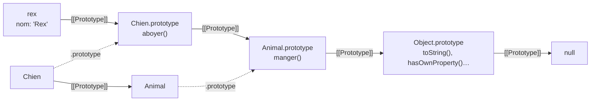

# 16 — Classes

> **Niveau** : Intermédiaire · **Durée** : ~3 h · **Prérequis** : [Fonctions](../06-fonctions/README.md), [Objets](../10-objets/README.md)

Dès qu'un programme manipule beaucoup d'objets du même genre (des comptes, des articles, des joueurs), on veut un **modèle** qui regroupe leurs données et leur comportement, protège ce qui doit l'être et se décline en variantes. C'est le rôle des classes. Ce chapitre couvre toute la syntaxe moderne (champs publics et privés, membres statiques, blocs `static`, héritage), montre ce qu'une classe fabrique réellement sous le capot, puis vous aide à concevoir : quand hériter, quand composer, et quels patterns utiliser.

## Objectifs

- Déclarer une classe avec constructeur, champs, méthodes, accesseurs et membres statiques.
- Encapsuler un état avec les champs et méthodes privés `#`, et tester leur présence avec `#x in obj`.
- Hériter avec `extends` et `super`, redéfinir des méthodes et étendre des classes natives comme `Error`.
- Expliquer ce qu'une classe produit en termes de fonctions et de prototypes.
- Éviter les pièges classiques : `this` perdu, `super()` oublié, ordre d'initialisation.
- Choisir entre héritage et composition, et appliquer quelques patterns utiles (fabrique, observateur avec `EventTarget`, stratégie).
- Situer les décorateurs : ce qu'ils sont et où en est leur standardisation.

## Sommaire

- [Pourquoi des classes ?](#pourquoi-des-classes-)
- [Déclarer une classe](#déclarer-une-classe)
- [Champs publics](#champs-publics)
- [Méthodes, getters et setters](#méthodes-getters-et-setters)
- [Encapsulation : les membres privés](#encapsulation--les-membres-privés)
- [Membres statiques](#membres-statiques)
- [Héritage](#héritage)
- [Étendre les classes natives](#étendre-les-classes-natives)
- [Ce que fait une classe sous le capot](#ce-que-fait-une-classe-sous-le-capot)
- [Le piège des méthodes « perdues »](#le-piège-des-méthodes--perdues-)
- [Classes abstraites et new.target](#classes-abstraites-et-newtarget)
- [Composition plutôt qu'héritage](#composition-plutôt-quhéritage)
- [Patterns utiles](#patterns-utiles)
- [Décorateurs : où en est-on ?](#décorateurs--où-en-est-on-)
- [Pièges courants](#pièges-courants)
- [Bonnes pratiques](#bonnes-pratiques)
- [Résumé](#résumé)
- [Exercices](#exercices)
- [Pour aller plus loin](#pour-aller-plus-loin)

## Pourquoi des classes ?

Imaginons une boutique en ligne. Chaque article a un nom, un prix et un stock, et l'on doit pouvoir calculer un prix TTC. Avec des objets littéraux, on recopierait la même structure (et la même fonction) pour chaque article. Une **fonction fabrique** (voir [Fonctions](../06-fonctions/README.md)) règle la répétition :

```js
function creerArticle(nom, prixHt) {
  return {
    nom,
    prixHt,
    prixTtc() {
      return Math.round(this.prixHt * 1.2 * 100) / 100;
    },
  };
}

const clavier = creerArticle("Clavier", 49.9);
const souris = creerArticle("Souris", 19.9);
console.log(clavier.prixTtc()); // 59.88
console.log(clavier.prixTtc === souris.prixTtc); // false : une copie de la méthode par objet
```

Chaque objet porte sa propre copie de `prixTtc`. Pour **partager** le comportement, JavaScript utilise les prototypes (voir [Objets](../10-objets/README.md)). La syntaxe `class` (ES2015) rend ce mécanisme lisible et y ajoute ce que les prototypes seuls n'offrent pas simplement : vrais membres privés, héritage avec `super`, membres statiques.

```js
class Article {
  constructor(nom, prixHt) {
    this.nom = nom;
    this.prixHt = prixHt;
  }

  prixTtc() {
    return Math.round(this.prixHt * 1.2 * 100) / 100;
  }
}

const clavier = new Article("Clavier", 49.9);
const souris = new Article("Souris", 19.9);
console.log(clavier.prixTtc()); // 59.88
console.log(clavier.prixTtc === souris.prixTtc); // true : une seule méthode, partagée
console.log(clavier instanceof Article); // true
```

> [!NOTE]
> Les classes ne sont pas obligatoires en JavaScript : fonctions et objets littéraux suffisent souvent. Elles brillent quand vous créez **beaucoup d'objets du même type** qui ont un **état** et un **comportement** liés, ou quand une API attend une classe (Web Components, `Error`, `EventTarget`…).

## Déclarer une classe

### Syntaxe de base

Une classe se déclare avec `class`, un nom en PascalCase et un corps contenant un `constructor` (appelé par `new`) et des méthodes. Les méthodes ne sont pas séparées par des virgules.

```js
class Minuteur {
  constructor(dureeSecondes) {
    this.restant = dureeSecondes;
  }

  avancer(secondes = 1) {
    this.restant = Math.max(0, this.restant - secondes);
    return this; // renvoyer this permet d'enchaîner les appels
  }

  estTermine() {
    return this.restant === 0;
  }
}

const cuisson = new Minuteur(90);
cuisson.avancer(30).avancer(45);
console.log(cuisson.restant); // 15
console.log(cuisson.estTermine()); // false
console.log(cuisson.avancer(60).estTermine()); // true
```

### Ce qu'il faut savoir tout de suite

- `new` est **obligatoire** : appeler `Minuteur(90)` lève une `TypeError`.
- Le corps d'une classe est toujours en **mode strict**.
- Une classe est **déclarée mais pas initialisée** avant sa ligne de déclaration (zone morte temporelle, comme `let`) : on ne peut pas l'utiliser plus haut dans le fichier.
- Sans `constructor`, la classe reçoit un constructeur vide par défaut.
- Comme les fonctions, une classe peut être une **expression** : `const Point = class { … };`.

```js
try {
  new Lampe(); // utilisée avant sa déclaration
} catch (erreur) {
  console.log(erreur.name); // ReferenceError
}

class Lampe {
  allumee = false;
}

try {
  Lampe(); // sans new
} catch (erreur) {
  console.log(erreur.message); // Class constructor Lampe cannot be invoked without 'new'
}

// Expression de classe, utile pour créer des classes à la volée
const Point = class {
  constructor(x, y) {
    this.x = x;
    this.y = y;
  }
};
console.log(new Point(2, 3)); // Point { x: 2, y: 3 }
console.log(typeof Point); // function
```

## Champs publics

Depuis ES2022, on peut **déclarer les champs** directement dans le corps de la classe, avec une valeur initiale. C'est plus lisible que de tout créer dans le constructeur : on voit d'un coup d'œil la forme des objets.

```js
class Panier {
  articles = []; // chaque instance reçoit SON propre tableau
  remise = 0;
  creeLe = "2026-11-06";

  constructor(client) {
    this.client = client;
  }

  ajouter(nom, prix) {
    this.articles.push({ nom, prix });
    return this;
  }

  get total() {
    const brut = this.articles.reduce((somme, a) => somme + a.prix, 0);
    return brut * (1 - this.remise);
  }
}

const p1 = new Panier("Ada").ajouter("Livre", 20).ajouter("Stylo", 5);
const p2 = new Panier("Alan");
p1.remise = 0.1;

console.log(p1.total); // 22.5
console.log(p2.articles); // [] : les tableaux ne sont pas partagés
console.log(Object.keys(p1)); // [ 'articles', 'remise', 'creeLe', 'client' ] : les champs sont créés avant le corps du constructeur
```

Points importants :

- L'**initialiseur** (`= []`) est évalué **pour chaque instance**, au moment de sa création : pas de partage accidentel.
- Un initialiseur peut utiliser `this` et les champs déclarés **avant** lui.
- Les champs sont créés **avant** l'exécution du corps du constructeur (dans une classe dérivée : juste après `super()`).
- Gardez le constructeur pour ce qui dépend des **arguments** ; déclarez le reste en champs.

## Méthodes, getters et setters

Les méthodes sont placées sur le **prototype** : une seule copie, partagée par toutes les instances. Les **accesseurs** (`get`/`set`) ressemblent à des propriétés mais exécutent du code : parfait pour une valeur calculée ou une validation.

```js
class Rectangle {
  constructor(largeur, hauteur) {
    this.largeur = largeur;
    this.hauteur = hauteur;
  }

  // Valeur calculée : toujours à jour
  get aire() {
    return this.largeur * this.hauteur;
  }

  // Lecture et écriture contrôlées
  get carre() {
    return this.largeur === this.hauteur;
  }

  set cote(valeur) {
    if (valeur <= 0) throw new RangeError("Le côté doit être positif");
    this.largeur = valeur;
    this.hauteur = valeur;
  }

  toString() {
    return `Rectangle ${this.largeur}×${this.hauteur}`;
  }
}

const r = new Rectangle(4, 3);
console.log(r.aire); // 12 (pas de parenthèses : c'est un getter)
r.cote = 5;
console.log(r.aire, r.carre); // 25 true
console.log(`${r}`); // Rectangle 5×5 (toString est appelée)

try {
  r.aire = 100; // getter sans setter : interdit en mode strict
} catch (erreur) {
  console.log(erreur.name); // TypeError
}
```

Les noms de méthodes peuvent être **calculés**, ce qui permet notamment de rendre une classe itérable avec `Symbol.iterator` (voir [Itérateurs et générateurs](../13-iterateurs-generateurs/README.md)) :

```js
class Playlist {
  #titres = [];

  ajouter(...titres) {
    this.#titres.push(...titres);
    return this;
  }

  *[Symbol.iterator]() {
    yield* this.#titres;
  }
}

const soiree = new Playlist().ajouter("Intro", "Groove", "Final");
console.log([...soiree]); // [ 'Intro', 'Groove', 'Final' ]
for (const titre of soiree) console.log(titre); // Intro, puis Groove, puis Final
```

## Encapsulation : les membres privés

### Champs privés `#`

Un champ dont le nom commence par `#` (ES2022) n'est accessible **qu'à l'intérieur** du corps de la classe. Ce n'est pas une convention : le moteur l'interdit. Cela protège les **invariants** de l'objet (ici : le solde ne change que par des opérations validées).

```js
class CompteBancaire {
  #solde = 0;
  #historique = [];

  constructor(titulaire) {
    this.titulaire = titulaire;
  }

  deposer(montant) {
    this.#verifierMontant(montant);
    this.#solde += montant;
    this.#historique.push({ type: "dépôt", montant });
    return this;
  }

  retirer(montant) {
    this.#verifierMontant(montant);
    if (montant > this.#solde) throw new Error("Solde insuffisant");
    this.#solde -= montant;
    this.#historique.push({ type: "retrait", montant });
    return this;
  }

  get solde() {
    return this.#solde; // lecture seule de l'extérieur
  }

  get historique() {
    return this.#historique.map((operation) => ({ ...operation })); // une copie, pas l'original
  }

  // Méthode privée
  #verifierMontant(montant) {
    if (!Number.isFinite(montant) || montant <= 0) {
      throw new RangeError(`Montant invalide : ${montant}`);
    }
  }
}

const compte = new CompteBancaire("Ada").deposer(100).retirer(30);
console.log(compte.solde); // 70
console.log(compte.historique.length); // 2
console.log(compte); // CompteBancaire { titulaire: 'Ada' } (les champs privés n'apparaissent pas)
console.log(Object.keys(compte)); // [ 'titulaire' ]
console.log(JSON.stringify(compte)); // {"titulaire":"Ada"}

compte.historique.push("piratage");
console.log(compte.historique.length); // 2 : la copie protège l'original

try {
  compte.retirer(-5);
} catch (erreur) {
  console.log(erreur.message); // Montant invalide : -5
}
```

Accéder à `compte.#solde` en dehors de la classe n'est même pas une erreur d'exécution : c'est une **erreur de syntaxe**, détectée avant que le fichier ne s'exécute.

<!-- no-run -->
```js
console.log(compte.#solde); // ❌ SyntaxError: Private field '#solde' must be declared in an enclosing class
```

> [!NOTE]
> Les outils de développement des navigateurs affichent les champs privés pour faciliter le débogage, mais aucun code extérieur ne peut les lire, même avec `Object.getOwnPropertyNames`, `Reflect.ownKeys` ou `JSON.stringify`.

La confidentialité est **par classe, pas par instance** : une méthode peut lire les champs privés d'une **autre** instance de la même classe. C'est ce qui permet d'écrire `equals` ou un virement :

```js
class Monnaie {
  #centimes;

  constructor(euros) {
    this.#centimes = Math.round(euros * 100);
  }

  egale(autre) {
    return this.#centimes === autre.#centimes; // accès au champ privé d'une autre instance
  }

  plus(autre) {
    return new Monnaie((this.#centimes + autre.#centimes) / 100);
  }

  toString() {
    return `${(this.#centimes / 100).toFixed(2)} €`;
  }
}

const a = new Monnaie(0.1);
const b = new Monnaie(0.2);
console.log(a.plus(b).egale(new Monnaie(0.3))); // true (en centimes, pas d'erreur d'arrondi)
console.log(`${a.plus(b)}`); // 0.30 €
```

### Vérifier la présence d'un champ privé : `#x in obj`

Lire `autre.#centimes` lève une `TypeError` si `autre` n'est pas une `Monnaie`. Pour tester sans risque, ES2022 permet d'écrire `#champ in objet` (une « vérification de marque ») :

```js
class Monnaie {
  #centimes;

  constructor(euros) {
    this.#centimes = Math.round(euros * 100);
  }

  static estMonnaie(valeur) {
    return typeof valeur === "object" && valeur !== null && #centimes in valeur;
  }

  egale(autre) {
    return Monnaie.estMonnaie(autre) && this.#centimes === autre.#centimes;
  }
}

const dix = new Monnaie(10);
const imitation = { centimes: 1000 };
Object.setPrototypeOf(imitation, Monnaie.prototype); // trompe instanceof…

console.log(imitation instanceof Monnaie); // true ❌
console.log(Monnaie.estMonnaie(imitation)); // false ✅ (pas de vrai champ privé)
console.log(Monnaie.estMonnaie(dix)); // true
console.log(dix.egale(imitation)); // false, sans exception
```

`instanceof` ne regarde que la chaîne de prototypes, que n'importe qui peut modifier ; `#x in obj` vérifie que l'objet a vraiment été construit par la classe.

### `#`, `_` ou closures ?

| Technique | Vraiment privé ? | Remarque |
| --- | --- | --- |
| `this._solde` (convention) | non | simple signal « ne touchez pas », encore très répandu dans le code ancien |
| variable capturée par une closure | oui | une copie des méthodes par objet (voir la fonction fabrique plus haut) |
| `#solde` | oui | partagé via le prototype, vérifiable avec `#solde in obj` ; la solution moderne |
| `private` de TypeScript | **non**, à l'exécution | vérification à la compilation seulement ; le champ reste visible en JavaScript |

## Membres statiques

### Méthodes et champs statiques

Un membre `static` appartient à la **classe** elle-même, pas aux instances. Usages typiques : constantes, compteurs globaux à la classe, **méthodes de fabrique** (`Date.now()`, `Array.from()`, `Object.groupBy()` sont des méthodes statiques natives).

```js
class Couleur {
  static #creees = 0; // les champs statiques sont initialisés dans l'ordre :
  static NOIR = new Couleur(0, 0, 0); // #creees doit exister avant cette ligne

  constructor(rouge, vert, bleu) {
    this.rouge = rouge;
    this.vert = vert;
    this.bleu = bleu;
    Couleur.#creees++;
  }

  // Fabrique : un nom explicite plutôt qu'un constructeur aux arguments ambigus
  static depuisHex(hex) {
    const [r, v, b] = hex.match(/[0-9a-f]{2}/gi).map((paire) => parseInt(paire, 16));
    return new this(r, v, b); // this = la classe (ou une sous-classe)
  }

  static get nombreCreees() {
    return Couleur.#creees;
  }

  versHex() {
    return "#" + [this.rouge, this.vert, this.bleu].map((c) => c.toString(16).padStart(2, "0")).join("");
  }
}

const orange = Couleur.depuisHex("#ff8800");
console.log(orange); // Couleur { rouge: 255, vert: 136, bleu: 0 }
console.log(orange.versHex()); // #ff8800
console.log(Couleur.NOIR.versHex()); // #000000
console.log(Couleur.nombreCreees); // 2
console.log(orange.depuisHex); // undefined : pas accessible depuis une instance
```

Dans une méthode statique, `this` désigne la classe sur laquelle on l'appelle : `new this(…)` crée donc une instance de la **sous-classe** si on l'appelle depuis une sous-classe. Les membres statiques sont hérités.

> [!TIP]
> Une classe qui ne contient **que** des méthodes statiques (`class Utils { static … }`) est un anti-pattern en JavaScript : un **module** qui exporte des fonctions fait la même chose plus simplement (voir [Modules](../26-modules/README.md)).

### Blocs d'initialisation statiques

Un bloc `static { … }` (ES2022, Baseline 2023) s'exécute **une fois**, quand la classe est évaluée. Il sert aux initialisations statiques qui ne tiennent pas en une expression : plusieurs étapes, `try/catch`, ou calcul de plusieurs champs à la fois. Il a accès aux membres privés de la classe.

```js
class Traductions {
  static langues;
  static #dictionnaires = new Map();

  static {
    const brut = '{"fr":{"bonjour":"Bonjour"},"en":{"bonjour":"Hello"}}';
    try {
      for (const [langue, mots] of Object.entries(JSON.parse(brut))) {
        Traductions.#dictionnaires.set(langue, mots);
      }
    } catch {
      Traductions.#dictionnaires.set("fr", {}); // valeur de repli
    }
    Traductions.langues = [...Traductions.#dictionnaires.keys()];
  }

  static traduire(langue, cle) {
    return Traductions.#dictionnaires.get(langue)?.[cle] ?? cle;
  }
}

console.log(Traductions.langues); // [ 'fr', 'en' ]
console.log(Traductions.traduire("en", "bonjour")); // Hello
console.log(Traductions.traduire("de", "bonjour")); // bonjour
```

Un bloc `static` permet aussi de donner à une fonction **extérieure** un accès contrôlé à un champ privé (comme les « amis » d'autres langages) :

```js
let lireCode;

class Badge {
  #code;

  constructor(code) {
    this.#code = code;
  }

  static {
    lireCode = (badge) => badge.#code; // seule cette fonction a le droit de lire #code
  }
}

const badge = new Badge("A-42");
console.log(lireCode(badge)); // A-42
console.log(Object.keys(badge)); // []
```

## Héritage

### `extends` et `super`

`extends` crée une classe **dérivée** qui hérite des méthodes (et membres statiques) d'une classe **parente**. Dans le constructeur d'une classe dérivée, `super(…)` appelle le constructeur parent et **doit** être exécuté avant toute utilisation de `this`.

```js
class Vehicule {
  constructor(marque, vitesseMax) {
    this.marque = marque;
    this.vitesseMax = vitesseMax;
  }

  decrire() {
    return `${this.marque}, ${this.vitesseMax} km/h`;
  }

  tempsPour(distanceKm) {
    return distanceKm / this.vitesseMax;
  }
}

class Velo extends Vehicule {
  constructor(marque, electrique = false) {
    super(marque, electrique ? 25 : 20); // d'abord le parent…
    this.electrique = electrique; // … ensuite this
  }

  // Redéfinition : on complète la méthode du parent avec super.methode()
  decrire() {
    return `Vélo ${this.electrique ? "électrique " : ""}${super.decrire()}`;
  }
}

const velo = new Velo("Riverside", true);
console.log(velo.decrire()); // Vélo électrique Riverside, 25 km/h
console.log(velo.tempsPour(50)); // 2 (méthode héritée)
console.log(velo instanceof Velo, velo instanceof Vehicule); // true true
```

Si une classe dérivée n'a pas de constructeur, elle reçoit automatiquement `constructor(...args) { super(...args); }`. Si elle en a un, oublier `super()` provoque une `ReferenceError` à la création de l'instance :

```js
class Animal {
  constructor(nom) {
    this.nom = nom;
  }
}

class Chat extends Animal {
  constructor(nom) {
    this.miaule = true; // ❌ avant super()
    super(nom);
  }
}

try {
  new Chat("Félix");
} catch (erreur) {
  console.log(erreur.name); // ReferenceError
  console.log(erreur.message); // Must call super constructor in derived class before accessing 'this' or returning from derived constructor
}
```

`super` fonctionne aussi dans les méthodes statiques (`super.depuisJSON(…)`) et dans les accesseurs.

### L'ordre d'initialisation

À la création d'une instance dérivée, les étapes s'enchaînent ainsi : champs du parent, constructeur du parent, **puis** champs de l'enfant, constructeur de l'enfant. Conséquence piégeuse : si le constructeur parent appelle une méthode redéfinie par l'enfant, celle-ci s'exécute **avant** que les champs de l'enfant n'existent.

```js
const journal = [];

class Composant {
  nomBase = journal.push("1. champs du parent");

  constructor() {
    journal.push("2. constructeur du parent");
    this.afficher(); // ⚠️ appelle la version de l'enfant… trop tôt
  }

  afficher() {}
}

class Bouton extends Composant {
  libelle = "Valider";
  nomEnfant = journal.push("3. champs de l'enfant");

  constructor() {
    super();
    journal.push("4. constructeur de l'enfant");
  }

  afficher() {
    journal.push(`   afficher() voit libelle = ${this.libelle}`);
  }
}

new Bouton();
console.log(journal.join("\n"));
// 1. champs du parent
// 2. constructeur du parent
//    afficher() voit libelle = undefined
// 3. champs de l'enfant
// 4. constructeur de l'enfant
```

Règle simple : **n'appelez pas de méthode redéfinissable depuis un constructeur**. Proposez plutôt une méthode d'initialisation que l'appelant invoque après `new`.

### `instanceof`

`objet instanceof Classe` teste si `Classe.prototype` figure dans la chaîne de prototypes de `objet`. C'est pratique pour aiguiller un traitement (par exemple selon le type d'erreur, voir plus bas), mais cela ne garantit pas la forme de l'objet (la chaîne de prototypes est modifiable, voir `#x in obj`) et cela échoue entre deux « royaumes » JavaScript (une `iframe`, un `vm` Node) : utilisez alors `Array.isArray()` ou `Error.isError()` (ES2026).

## Étendre les classes natives

### Étendre `Error`

Créer ses propres types d'erreurs permet de les distinguer avec `instanceof` et de leur ajouter des informations. Trois règles : appeler `super(message, options)` (pour profiter de `cause`, ES2022), définir `name`, et ajouter vos champs.

```js
class ErreurApplication extends Error {
  constructor(message, options) {
    super(message, options);
    this.name = new.target.name; // le nom de la classe réellement instanciée
  }
}

class ErreurValidation extends ErreurApplication {
  constructor(champ, message) {
    super(message);
    this.champ = champ;
  }
}

class ErreurReseau extends ErreurApplication {
  constructor(url, options) {
    super(`Échec de la requête vers ${url}`, options);
    this.url = url;
  }
}

function traiter(erreur) {
  if (erreur instanceof ErreurValidation) return `Champ « ${erreur.champ} » : ${erreur.message}`;
  if (erreur instanceof ErreurReseau) return `Réseau indisponible (${erreur.cause.message})`;
  throw erreur; // erreur inattendue : on la laisse remonter
}

const validation = new ErreurValidation("email", "adresse invalide");
console.log(String(validation)); // ErreurValidation: adresse invalide
console.log(traiter(validation)); // Champ « email » : adresse invalide

const reseau = new ErreurReseau("/api/panier", { cause: new Error("délai dépassé") });
console.log(traiter(reseau)); // Réseau indisponible (délai dépassé)
console.log(reseau instanceof ErreurApplication, reseau instanceof Error); // true true
console.log(Error.isError(reseau)); // true (ES2026)
```

Le chapitre [Erreurs](../17-erreurs/README.md) approfondit les hiérarchies d'erreurs, la propagation et le choix entre lancer et retourner une erreur.

### Étendre `Array` ou `Map`

Les autres classes natives s'étendent de la même façon. Les méthodes héritées qui créent un nouveau tableau (`map`, `filter`, `slice`) renvoient une instance de la **sous-classe** (grâce à `Symbol.species`), mais pas les méthodes ES2023 `toSorted`, `toReversed`, `toSpliced` et `with`, qui renvoient toujours un `Array` ordinaire.

```js
class Notes extends Array {
  get moyenne() {
    return this.length === 0 ? 0 : this.reduce((somme, n) => somme + n, 0) / this.length;
  }
}

const notes = Notes.from([12, 15, 9]); // Notes.of(12, 15, 9) fonctionne aussi
const bonus = notes.map((n) => n + 1);

console.log(notes.moyenne); // 12
console.log(bonus instanceof Notes, bonus.moyenne); // true 13
console.log(notes.toSorted() instanceof Notes); // false : toSorted renvoie un Array
console.log(new Notes(3).length); // 3 ⚠️ comme new Array(3) : trois cases vides, pas [3]

// Étendre Map : un compteur
class Compteur extends Map {
  incrementer(cle) {
    this.set(cle, (this.get(cle) ?? 0) + 1);
    return this;
  }
}

const mots = new Compteur();
for (const mot of "le chat et le chien".split(" ")) mots.incrementer(mot);
console.log(mots.get("le"), mots.size); // 2 4
```

> [!TIP]
> Avant d'étendre `Array`, demandez-vous si une classe qui **contient** un tableau privé (composition) ne serait pas plus sûre : vous exposez alors seulement les opérations voulues, au lieu de toute l'API des tableaux (y compris `push` ou `length = 0`, qui peuvent casser vos invariants).

## Ce que fait une classe sous le capot

Une classe est avant tout une **fonction constructeur** associée à un **objet prototype** (le mécanisme des prototypes est expliqué au chapitre [Objets](../10-objets/README.md)). Les deux écritures suivantes produisent presque la même chose :

```js
// Avec class
class Animal {
  constructor(nom) {
    this.nom = nom;
  }
  manger() {
    return `${this.nom} mange`;
  }
}

class Chien extends Animal {
  aboyer() {
    return `${this.nom} aboie`;
  }
}

// À l'ancienne (avant ES2015) : ce que vous rencontrerez dans du code historique
function AnimalAncien(nom) {
  this.nom = nom;
}
AnimalAncien.prototype.manger = function () {
  return `${this.nom} mange`;
};

function ChienAncien(nom) {
  AnimalAncien.call(this, nom); // l'équivalent de super(nom)
}
ChienAncien.prototype = Object.create(AnimalAncien.prototype);
ChienAncien.prototype.constructor = ChienAncien;
ChienAncien.prototype.aboyer = function () {
  return `${this.nom} aboie`;
};

const rex = new Chien("Rex");
const medor = new ChienAncien("Médor");
console.log(rex.manger(), "/", medor.manger()); // Rex mange / Médor mange

// Ce que fabrique réellement la classe
console.log(typeof Chien); // function
console.log(Object.getPrototypeOf(rex) === Chien.prototype); // true
console.log(Object.getPrototypeOf(Chien.prototype) === Animal.prototype); // true : héritage des méthodes
console.log(Object.getPrototypeOf(Chien) === Animal); // true : héritage des membres statiques
console.log(Object.hasOwn(rex, "nom"), Object.hasOwn(rex, "aboyer")); // true false
console.log(Object.getOwnPropertyNames(Chien.prototype)); // [ 'constructor', 'aboyer' ]
```



Quand on écrit `rex.manger()`, le moteur cherche `manger` sur `rex`, ne le trouve pas, remonte à `Chien.prototype`, puis à `Animal.prototype` où il le trouve, et l'appelle avec `this = rex`.

La classe n'est pourtant pas un simple « sucre syntaxique ». Par rapport à la version ancienne, elle :

- **interdit l'appel sans `new`** ;
- rend les méthodes **non énumérables** (elles n'apparaissent pas dans un `for…in`) ;
- exécute son corps en **mode strict** et n'est pas utilisable avant sa déclaration ;
- permet `super`, qui n'a pas d'équivalent simple dans l'ancienne syntaxe ;
- apporte des fonctionnalités **impossibles à reproduire** à l'identique : champs privés `#`, blocs `static`, héritage correct des classes natives comme `Error` ou `Array`.

```js
function AncienneVersion() {}
AncienneVersion.prototype.methode = function () {};

class NouvelleVersion {
  methode() {}
}

console.log(Object.keys(AncienneVersion.prototype)); // [ 'methode' ]
console.log(Object.keys(NouvelleVersion.prototype)); // []
```

## Le piège des méthodes « perdues »

`this` n'est pas lié à l'objet une fois pour toutes : il dépend de **la façon dont la fonction est appelée** (voir [Fonctions](../06-fonctions/README.md)). Dès qu'on détache une méthode de son objet (pour la passer en callback à `setTimeout`, `addEventListener`, `map`…), `this` est perdu.

```js
class Chronometre {
  secondes = 0;

  tic() {
    this.secondes++;
  }
}

const chrono = new Chronometre();
const tic = chrono.tic; // la méthode est détachée de chrono

try {
  tic(); // appelée seule : this vaut undefined (mode strict)
} catch (erreur) {
  console.log(erreur.message); // Cannot read properties of undefined (reading 'secondes')
}
```

Trois solutions :

```js
class Chronometre {
  secondes = 0;
  ticFleche = () => {
    this.secondes++; // 3. champ fléché : this capturé à la création de l'instance
  };

  constructor() {
    this.ticLie = this.tic.bind(this); // 2. copie liée créée dans le constructeur
  }

  tic() {
    this.secondes++;
  }
}

const chrono = new Chronometre();
const appeler = (callback) => callback(); // simule setTimeout, addEventListener…

appeler(() => chrono.tic()); // 1. fonction fléchée au moment de l'appel
appeler(chrono.ticLie);
appeler(chrono.ticFleche);
console.log(chrono.secondes); // 3
```

| Solution | Avantages | Inconvénients |
| --- | --- | --- |
| `() => objet.methode()` à l'appel | simple, aucune modification de la classe | une nouvelle fonction à chaque fois (gênant pour `removeEventListener`) |
| `this.methode.bind(this)` dans le constructeur | référence stable, méthode toujours sur le prototype | un peu verbeux |
| champ fléché `methode = () => {…}` | référence stable, très lisible | une copie par instance, pas sur le prototype, impossible à appeler via `super.methode()` |

Pour les écouteurs d'événements, une référence **stable** est nécessaire pour pouvoir les retirer ; on peut aussi passer un `signal` d'`AbortController` à `addEventListener` (voir [Événements](../24-evenements/README.md)).

## Classes abstraites et `new.target`

JavaScript n'a pas de mot-clé `abstract`. On peut toutefois empêcher l'instanciation directe d'une classe de base grâce à `new.target`, qui désigne la classe effectivement appelée avec `new`, et signaler les méthodes à implémenter.

```js
class Forme {
  constructor() {
    if (new.target === Forme) {
      throw new TypeError("Forme est abstraite : instanciez une sous-classe");
    }
  }

  aire() {
    throw new Error(`${this.constructor.name} doit implémenter aire()`);
  }

  // Méthode « patron » : s'appuie sur ce que les sous-classes fournissent
  decrire() {
    return `${this.constructor.name} d'aire ${this.aire().toFixed(2)}`;
  }
}

class Cercle extends Forme {
  constructor(rayon) {
    super();
    this.rayon = rayon;
  }
  aire() {
    return Math.PI * this.rayon ** 2;
  }
}

class Triangle extends Forme {} // oubli d'aire()

console.log(new Cercle(1).decrire()); // Cercle d'aire 3.14

try {
  new Forme();
} catch (erreur) {
  console.log(erreur.message); // Forme est abstraite : instanciez une sous-classe
}

try {
  new Triangle().decrire();
} catch (erreur) {
  console.log(erreur.message); // Triangle doit implémenter aire()
}
```

## Composition plutôt qu'héritage

### Le problème des hiérarchies

L'héritage exprime une relation « **est un** » : un `Velo` *est un* `Vehicule`. Il devient vite inconfortable quand les variantes se croisent :

<!-- no-run -->
```js
class Oiseau {
  voler() { /* … */ }
}
class Canard extends Oiseau {
  nager() { /* … */ }
}
class Pingouin extends Oiseau {
  voler() {
    throw new Error("Je ne vole pas !"); // ❌ la sous-classe renie le contrat du parent
  }
  nager() { /* … copié de Canard */ }
}
```

Une hiérarchie profonde couple fortement les classes : modifier le parent peut casser des enfants lointains, et toute nouvelle combinaison (un oiseau qui nage mais ne vole pas) oblige à réorganiser l'arbre ou à dupliquer du code.

### Composer des objets

La **composition** exprime « **a un** » ou « **sait faire** » : un objet délègue une partie de son travail à d'autres objets qu'il **contient**. Première approche : assembler des capacités.

```js
const peutVoler = (etat) => ({
  voler: () => `${etat.nom} s'envole`,
});

const peutNager = (etat) => ({
  nager: () => `${etat.nom} nage`,
});

function creerCanard(nom) {
  const etat = { nom };
  return { ...etat, ...peutVoler(etat), ...peutNager(etat) };
}

function creerPingouin(nom) {
  const etat = { nom };
  return { ...etat, ...peutNager(etat) }; // pas de voler() : rien à renier
}

const donald = creerCanard("Donald");
const pingu = creerPingouin("Pingu");
console.log(donald.voler(), "/", donald.nager()); // Donald s'envole / Donald nage
console.log(pingu.nager(), "/", typeof pingu.voler); // Pingu nage / undefined
```

Deuxième approche, très courante dans le code applicatif : une classe reçoit ses **collaborateurs** dans son constructeur (injection de dépendances). On peut alors les remplacer, par exemple par des faux en test.

```js
class ServiceCommandes {
  #depot;
  #notificateur;

  constructor({ depot, notificateur }) {
    this.#depot = depot;
    this.#notificateur = notificateur;
  }

  passer(commande) {
    if (commande.articles.length === 0) throw new Error("Commande vide");
    const id = this.#depot.enregistrer(commande);
    this.#notificateur.envoyer(commande.email, `Commande ${id} confirmée`);
    return id;
  }
}

// Collaborateurs de test : en mémoire, sans base de données ni e-mail réel
const depotMemoire = {
  commandes: [],
  enregistrer(commande) {
    this.commandes.push(commande);
    return `CMD-${this.commandes.length}`;
  },
};
const messagesEnvoyes = [];
const notificateurFactice = {
  envoyer: (destinataire, texte) => messagesEnvoyes.push(`${destinataire} : ${texte}`),
};

const service = new ServiceCommandes({ depot: depotMemoire, notificateur: notificateurFactice });
console.log(service.passer({ email: "ada@example.com", articles: ["Livre"] })); // CMD-1
console.log(messagesEnvoyes); // [ 'ada@example.com : Commande CMD-1 confirmée' ]
```

### Mixins

Un **mixin** est une fonction qui prend une classe et renvoie une sous-classe enrichie. On peut ainsi ajouter des capacités à plusieurs classes sans hiérarchie commune :

```js
const Horodatable = (Base) =>
  class extends Base {
    horodater(date) {
      this.modifieLe = date;
      return this;
    }
  };

const Serialisable = (Base) =>
  class extends Base {
    versJson() {
      return JSON.stringify(this);
    }
  };

class Note {
  constructor(texte) {
    this.texte = texte;
  }
}

class NoteSynchronisee extends Serialisable(Horodatable(Note)) {}

const note = new NoteSynchronisee("Acheter du pain").horodater("2026-11-06");
console.log(note.versJson()); // {"texte":"Acheter du pain","modifieLe":"2026-11-06"}
console.log(note instanceof Note); // true
```

Les mixins restent de l'héritage : l'ordre d'application compte, deux mixins peuvent définir la même méthode, et `instanceof Horodatable` n'a pas de sens. Utilisez-les avec parcimonie.

### Comment choisir

| Situation | Choix |
| --- | --- |
| Relation « est un » stable, hiérarchie de 1 ou 2 niveaux, API qui l'impose (`Error`, `EventTarget`, `HTMLElement`) | héritage |
| Relation « a un » / « utilise un » (dépôt, client HTTP, journal) | composition, collaborateurs injectés |
| Capacités qui se combinent librement (vole, nage, sérialisable) | composition de capacités ; mixins en dernier recours |
| Simple variation d'un calcul | une fonction passée en paramètre (pattern Stratégie) |

## Patterns utiles

### Singleton : un module suffit

On voit souvent des classes qui interceptent leur constructeur pour renvoyer toujours la même instance. En JavaScript, c'est inutile : **un module n'est évalué qu'une fois**, donc l'objet qu'il exporte est déjà unique (voir [Modules](../26-modules/README.md)).

<!-- no-run -->
```js
// config.js
class Configuration {
  #valeurs = { langue: "fr", theme: "clair" };
  lire(cle) {
    return this.#valeurs[cle];
  }
  modifier(cle, valeur) {
    this.#valeurs[cle] = valeur;
  }
}

export const configuration = new Configuration(); // l'unique instance

// ailleurs.js
import { configuration } from "./config.js";
configuration.modifier("theme", "sombre"); // tous les importeurs voient le changement
```

Gardez en tête qu'un singleton est un **état global** : il complique les tests. L'injection de dépendances (vue plus haut) est souvent préférable.

### Fabrique

Une fabrique choisit et construit le bon objet à partir de données. Les **méthodes statiques** nommées (`Couleur.depuisHex`) en sont la forme la plus simple. Pour choisir parmi plusieurs classes, un **registre** (objet ou `Map`) remplace avantageusement un long `switch` :

```js
class Cercle {
  constructor({ rayon }) {
    this.rayon = rayon;
  }
  aire() {
    return Math.PI * this.rayon ** 2;
  }
}

class Rectangle {
  constructor({ largeur, hauteur }) {
    this.largeur = largeur;
    this.hauteur = hauteur;
  }
  aire() {
    return this.largeur * this.hauteur;
  }
}

const FORMES = new Map([
  ["cercle", Cercle],
  ["rectangle", Rectangle],
]);

function creerForme({ type, ...options }) {
  const Classe = FORMES.get(type);
  if (!Classe) throw new Error(`Forme inconnue : ${type}`);
  return new Classe(options);
}

// Typiquement, des données venues d'un fichier JSON ou d'une API
const donnees = [
  { type: "rectangle", largeur: 3, hauteur: 4 },
  { type: "cercle", rayon: 1 },
];
const formes = donnees.map(creerForme);
console.log(formes.map((f) => `${f.constructor.name} : ${f.aire().toFixed(2)}`)); // [ 'Rectangle : 12.00', 'Cercle : 3.14' ]
```

Ajouter une forme revient à écrire sa classe et à l'enregistrer : `creerForme` ne change pas.

### Observateur avec EventTarget

Le pattern **observateur** permet à un objet de prévenir d'autres objets de ses changements sans les connaître. Inutile de le coder à la main : `EventTarget`, la classe qui fait fonctionner les événements du DOM, s'étend directement. Elle est aussi disponible dans Node.js (globale depuis la version 15, et `CustomEvent` stable depuis Node 22).

```js
class Panier extends EventTarget {
  #articles = [];

  ajouter(article) {
    this.#articles.push(article);
    this.dispatchEvent(
      new CustomEvent("change", { detail: { article, nombre: this.#articles.length } }),
    );
  }
}

const panier = new Panier();
const arret = new AbortController();

// Un premier observateur : le badge du panier
panier.addEventListener(
  "change",
  (evenement) => console.log(`Badge : ${evenement.detail.nombre} article(s)`),
  { signal: arret.signal }, // permettra de se désabonner
);

// Un second : une seule fois
panier.addEventListener("change", () => console.log("Premier article ajouté !"), { once: true });

panier.ajouter("Pomme");
// Badge : 1 article(s)
// Premier article ajouté !
panier.ajouter("Poire");
// Badge : 2 article(s)

arret.abort(); // désabonne le badge
panier.ajouter("Kiwi"); // plus personne n'écoute
console.log("Fin"); // Fin
```

Vous profitez ainsi gratuitement des options standard (`once`, `signal`, `capture`), de `removeEventListener` et d'une API que tout développeur web connaît. Le chapitre [Événements](../24-evenements/README.md) détaille `Event` et `CustomEvent`. Dans Node.js, la classe historique `EventEmitter` du module `node:events` joue le même rôle (voir [Node.js](../27-nodejs/README.md)).

### Stratégie

Le pattern **stratégie** consiste à rendre un comportement interchangeable. En JavaScript, une stratégie est souvent… une simple fonction :

```js
const LIVRAISONS = {
  standard: (total) => (total >= 50 ? 0 : 4.9),
  express: () => 9.9,
  retrait: () => 0,
};

class Commande {
  #articles = [];

  constructor(modeLivraison = "standard") {
    this.modeLivraison = modeLivraison;
  }

  ajouter(prix) {
    this.#articles.push(prix);
    return this;
  }

  get total() {
    const sousTotal = this.#articles.reduce((somme, prix) => somme + prix, 0);
    const fraisDePort = LIVRAISONS[this.modeLivraison](sousTotal);
    return sousTotal + fraisDePort;
  }
}

console.log(new Commande().ajouter(20).ajouter(10).total); // 34.9
console.log(new Commande().ajouter(60).total); // 60
console.log(new Commande("express").ajouter(60).total); // 69.9
```

Ajouter un mode de livraison ne demande ni sous-classe ni `if` supplémentaire dans `Commande`.

## Décorateurs : où en est-on ?

Un **décorateur** est une fonction appliquée à une classe ou à l'un de ses membres avec la syntaxe `@nom`, pour en modifier ou en enrichir le comportement (journalisation, mise en cache, validation…). Vous les rencontrerez surtout dans des frameworks comme Angular, NestJS ou Lit.

<!-- no-run -->
```js
class Calculatrice {
  @journaliser
  additionner(a, b) {
    return a + b;
  }
}
```

**État en novembre 2026** : la proposition TC39 a atteint le stage 3 en 2022, mais le tableau officiel des propositions la classe aujourd'hui au **stage 2.7**. **Aucun navigateur ni Node.js** ne prend en charge cette syntaxe nativement : elle nécessite un transpileur, TypeScript (décorateurs standard depuis la version 5.0) ou Babel (`@babel/plugin-proposal-decorators`).

> [!WARNING]
> L'option `experimentalDecorators` de TypeScript, utilisée historiquement par Angular et NestJS, correspond à une **ancienne version** des décorateurs, incompatible avec la proposition actuelle. Ne mélangez pas les deux.

Le principe se comprend sans syntaxe nouvelle : un décorateur de méthode reçoit la méthode et un objet de contexte, et renvoie la méthode de remplacement. On peut l'appliquer « à la main » :

```js
function journaliser(methode, contexte) {
  return function (...args) {
    const resultat = methode.apply(this, args);
    console.log(`${String(contexte.name)}(${args.join(", ")}) → ${resultat}`);
    return resultat;
  };
}

class Calculatrice {
  additionner(a, b) {
    return a + b;
  }
}

// Ce que ferait @journaliser, appliqué manuellement
Calculatrice.prototype.additionner = journaliser(Calculatrice.prototype.additionner, {
  kind: "method",
  name: "additionner",
});

const calculatrice = new Calculatrice();
calculatrice.additionner(2, 3); // additionner(2, 3) → 5
```

## Pièges courants

- **Oublier `new`** : `Classe()` lève une `TypeError`.
- **Utiliser `this` avant `super()`** dans un constructeur dérivé : `ReferenceError`.
- **Méthode détachée** passée en callback : `this` vaut `undefined`. Utilisez une fléchée, `bind` ou un champ fléché.
- **Appeler une méthode redéfinissable dans le constructeur parent** : les champs de l'enfant n'existent pas encore.
- **Croire que `JSON.stringify` sérialise tout** : il ignore les champs privés et les getters (définis sur le prototype). Ajoutez une méthode `toJSON()` si besoin.
- **Champs privés et `Proxy`** : un `Proxy` autour d'une instance ne peut pas lire ses champs `#` (`TypeError`) ; les méthodes appelées via le proxy reçoivent le proxy comme `this`.
- **`new SousClasseDeArray(3)`** crée trois cases vides ; utilisez `SousClasse.from()` ou `SousClasse.of()`.
- **Un champ qui masque un accesseur** : déclarer un champ `nom` dans une sous-classe crée une propriété propre qui cache le `get nom()`/`set nom()` du parent (le setter n'est pas appelé).
- **`instanceof` entre royaumes** (iframe, `vm`) : faux négatifs. Préférez `Array.isArray`, `Error.isError` ou `#x in obj`.
- **`private` de TypeScript** pris pour une protection à l'exécution : ce n'est qu'une vérification à la compilation.
- **Hiérarchies profondes** construites « pour réutiliser du code » : préférez la composition.

## Bonnes pratiques

- Déclarez les champs en tête de classe ; réservez le constructeur à ce qui dépend des arguments.
- Rendez **privé** (`#`) tout ce qui n'a pas à être utilisé de l'extérieur ; exposez des getters plutôt que des champs modifiables, et des **copies** plutôt que vos structures internes.
- Validez dans le constructeur et les setters pour qu'un objet ne puisse jamais être dans un état incohérent.
- Préférez des **méthodes de fabrique statiques** au nom explicite (`depuisHex`, `depuisJson`) à un constructeur aux arguments ambigus.
- Limitez l'héritage à une relation « est un » claire et peu profonde ; composez le reste.
- N'écrivez pas de classe là où une fonction ou un module suffit (classe de méthodes statiques, singleton maison).
- Pour notifier des changements, étendez `EventTarget` plutôt que de réinventer un système d'abonnement.
- Une classe, une responsabilité : `Utilisateur` ne devrait pas aussi envoyer des e-mails et générer des PDF.

## Résumé

- `class` (ES2015) déclare une fonction constructeur et son prototype : les méthodes sont partagées, `new` est obligatoire, le corps est en mode strict.
- Les **champs publics** (ES2022) sont initialisés pour chaque instance ; les **accesseurs** `get`/`set` exposent des valeurs calculées ou validées.
- Les **membres privés** `#` (ES2022) sont réellement inaccessibles hors de la classe ; `#x in obj` vérifie qu'un objet a été construit par la classe.
- Les membres **statiques** appartiennent à la classe ; les **blocs `static`** (ES2022) font les initialisations complexes.
- `extends` et `super` gèrent l'héritage ; `super()` doit précéder `this` ; les champs de l'enfant sont créés après le constructeur parent.
- On étend les natifs : `Error` (avec `name` et `cause`), `Array`, `Map`, `EventTarget`…
- Sous le capot : `Object.getPrototypeOf(instance) === Classe.prototype`, et `extends` relie à la fois les prototypes et les constructeurs.
- `this` se perd quand on détache une méthode : fléchée, `bind` ou champ fléché.
- **Composition** (« a un », capacités, injection de dépendances) plutôt qu'héritage profond ; patterns utiles : fabrique, observateur avec `EventTarget`, stratégie.
- Les **décorateurs** (`@nom`) ne sont pas encore standard (stage 2.7 en novembre 2026) : ils nécessitent TypeScript ou Babel.

## Exercices

### Exercice 1 — Compteur borné (★☆☆)

Écrivez une classe `Compteur` dont la valeur reste entre un minimum et un maximum (0 et 10 par défaut, passés en options : `new Compteur({ min: 0, max: 3 })`). Elle propose `incrementer()`, `decrementer()` et `reinitialiser()` (chaînables) et un getter `valeur`. La valeur ne doit pas être modifiable de l'extérieur.

<details>
<summary>Solution</summary>

```js
class Compteur {
  #valeur;
  #min;
  #max;

  constructor({ min = 0, max = 10 } = {}) {
    if (min > max) throw new RangeError("min doit être inférieur ou égal à max");
    this.#min = min;
    this.#max = max;
    this.#valeur = min;
  }

  get valeur() {
    return this.#valeur;
  }

  incrementer() {
    this.#valeur = Math.min(this.#valeur + 1, this.#max);
    return this;
  }

  decrementer() {
    this.#valeur = Math.max(this.#valeur - 1, this.#min);
    return this;
  }

  reinitialiser() {
    this.#valeur = this.#min;
    return this;
  }
}

const places = new Compteur({ min: 0, max: 3 });
console.log(places.incrementer().incrementer().valeur); // 2
console.log(places.incrementer().incrementer().incrementer().valeur); // 3 (plafonné)
console.log(places.reinitialiser().decrementer().valeur); // 0 (plancher)
console.log(new Compteur().incrementer().valeur); // 1

try {
  places.valeur = 99;
} catch (erreur) {
  console.log(erreur.name); // TypeError (getter sans setter)
}
```

Les trois champs sont privés, et `valeur` n'a qu'un getter : impossible de forcer une valeur hors bornes. Le paramètre `{ min = 0, max = 10 } = {}` combine déstructuration et valeurs par défaut, ce qui permet aussi d'appeler `new Compteur()` sans argument. Chaque méthode renvoie `this` pour l'enchaînement.

</details>

### Exercice 2 — Température (★☆☆)

Écrivez une classe `Temperature` qui stocke une valeur en degrés Celsius dans un champ privé et expose deux accesseurs, `celsius` et `fahrenheit`, en lecture **et** en écriture (°F = °C × 9/5 + 32). Toute valeur inférieure au zéro absolu (−273,15 °C) lève une `RangeError`. Ajoutez une méthode statique `depuisFahrenheit(f)`.

<details>
<summary>Solution</summary>

```js
class Temperature {
  static ZERO_ABSOLU = -273.15;
  #celsius;

  constructor(celsius) {
    this.celsius = celsius; // passe par le setter : la validation s'applique aussi ici
  }

  static depuisFahrenheit(fahrenheit) {
    const t = new Temperature(0);
    t.fahrenheit = fahrenheit;
    return t;
  }

  get celsius() {
    return this.#celsius;
  }

  set celsius(valeur) {
    if (valeur < Temperature.ZERO_ABSOLU) {
      throw new RangeError(`${valeur} °C est sous le zéro absolu`);
    }
    this.#celsius = valeur;
  }

  get fahrenheit() {
    return (this.#celsius * 9) / 5 + 32;
  }

  set fahrenheit(valeur) {
    this.celsius = ((valeur - 32) * 5) / 9;
  }
}

const salon = new Temperature(20);
console.log(salon.fahrenheit); // 68
salon.fahrenheit = 212;
console.log(salon.celsius); // 100
console.log(Temperature.depuisFahrenheit(32).celsius); // 0

try {
  new Temperature(-300);
} catch (erreur) {
  console.log(erreur.message); // -300 °C est sous le zéro absolu
}
```

Une seule donnée est stockée (`#celsius`) ; `fahrenheit` est entièrement calculé, ce qui évite toute incohérence entre deux valeurs. Le constructeur et le setter `fahrenheit` passent tous deux par le setter `celsius` : la validation est écrite **une seule fois**.

</details>

### Exercice 3 — Virements entre comptes (★★☆)

Écrivez une classe `Compte` avec un solde privé, une méthode `virer(destinataire, montant)` qui débite le compte courant et crédite le destinataire **sans méthode publique de crédit**, et une méthode statique `estCompte(valeur)`. Un virement vers autre chose qu'un `Compte`, un montant invalide ou un solde insuffisant doivent lever une erreur sans rien modifier.

<details>
<summary>Solution</summary>

```js
class Compte {
  #solde;

  constructor(titulaire, soldeInitial = 0) {
    this.titulaire = titulaire;
    this.#solde = soldeInitial;
  }

  static estCompte(valeur) {
    return typeof valeur === "object" && valeur !== null && #solde in valeur;
  }

  get solde() {
    return this.#solde;
  }

  virer(destinataire, montant) {
    if (!Compte.estCompte(destinataire)) throw new TypeError("Destinataire invalide");
    if (!(montant > 0)) throw new RangeError("Montant invalide");
    if (montant > this.#solde) throw new Error("Solde insuffisant");
    this.#solde -= montant;
    destinataire.#solde += montant; // autorisé : même classe
    return this;
  }
}

const ada = new Compte("Ada", 100);
const alan = new Compte("Alan");

ada.virer(alan, 40);
console.log(ada.solde, alan.solde); // 60 40

for (const [cible, montant] of [[{ titulaire: "Faux" }, 10], [alan, -5], [alan, 1000]]) {
  try {
    ada.virer(cible, montant);
  } catch (erreur) {
    console.log(`${erreur.name} : ${erreur.message}`);
  }
}
// TypeError : Destinataire invalide
// RangeError : Montant invalide
// Error : Solde insuffisant

console.log(ada.solde, alan.solde); // 60 40 (rien n'a bougé)
```

La confidentialité de `#solde` est par **classe** : `virer` peut modifier `destinataire.#solde`, alors qu'aucun code extérieur ne peut créditer un compte. `#solde in valeur` garantit qu'on ne touchera pas un objet qui ne possède pas le champ (ce qui lèverait une `TypeError` au milieu du virement). Toutes les vérifications ont lieu **avant** la moindre modification : l'opération est « tout ou rien ». La condition `!(montant > 0)` rejette aussi `NaN`.

</details>

### Exercice 4 — Hiérarchie d'erreurs (★★☆)

Créez une classe de base `ErreurApi` (dont `name` vaut automatiquement le nom de la sous-classe et qui a un champ `statut`), puis `ErreurNonTrouvee(ressource, id)` (statut 404) et `ErreurNonAutorisee()` (statut 401). Écrivez ensuite `reponseHttp(erreur)` qui renvoie `{ statut, message }` pour une `ErreurApi` et `{ statut: 500, message: "Erreur interne" }` pour toute autre erreur.

<details>
<summary>Solution</summary>

```js
class ErreurApi extends Error {
  constructor(message, statut, options) {
    super(message, options);
    this.name = new.target.name;
    this.statut = statut;
  }
}

class ErreurNonTrouvee extends ErreurApi {
  constructor(ressource, id) {
    super(`${ressource} ${id} introuvable`, 404);
    this.ressource = ressource;
    this.id = id;
  }
}

class ErreurNonAutorisee extends ErreurApi {
  constructor() {
    super("Authentification requise", 401);
  }
}

function reponseHttp(erreur) {
  if (erreur instanceof ErreurApi) {
    return { statut: erreur.statut, message: erreur.message };
  }
  return { statut: 500, message: "Erreur interne" }; // ne pas divulguer le détail
}

const introuvable = new ErreurNonTrouvee("Article", 42);
console.log(introuvable.name); // ErreurNonTrouvee
console.log(reponseHttp(introuvable)); // { statut: 404, message: 'Article 42 introuvable' }
console.log(reponseHttp(new ErreurNonAutorisee())); // { statut: 401, message: 'Authentification requise' }
console.log(reponseHttp(new TypeError("x is undefined"))); // { statut: 500, message: 'Erreur interne' }
console.log(introuvable instanceof Error); // true
```

`new.target.name` donne le nom de la classe réellement instanciée, si bien que chaque sous-classe a le bon `name` sans le répéter. `reponseHttp` s'appuie sur `instanceof ErreurApi` : toute nouvelle sous-classe sera gérée automatiquement. Les erreurs inattendues deviennent une 500 générique, pour ne pas exposer de détails internes au client.

</details>

### Exercice 5 — Intervalle itérable (★★☆)

Écrivez une classe `Intervalle(debut, fin, pas = 1)` (fin incluse) avec un getter `longueur`, une méthode `contient(n)` et un itérateur, pour que `[...new Intervalle(1, 10, 3)]` donne `[1, 4, 7, 10]`. Ajoutez une méthode statique `depuisTexte("1..10")`.

<details>
<summary>Solution</summary>

```js
class Intervalle {
  constructor(debut, fin, pas = 1) {
    if (pas <= 0) throw new RangeError("Le pas doit être positif");
    this.debut = debut;
    this.fin = fin;
    this.pas = pas;
  }

  static depuisTexte(texte) {
    const correspondance = /^(-?\d+)\.\.(-?\d+)$/.exec(texte);
    if (!correspondance) throw new SyntaxError(`Format invalide : ${texte}`);
    return new Intervalle(Number(correspondance[1]), Number(correspondance[2]));
  }

  get longueur() {
    return this.fin < this.debut ? 0 : Math.floor((this.fin - this.debut) / this.pas) + 1;
  }

  contient(n) {
    return n >= this.debut && n <= this.fin && (n - this.debut) % this.pas === 0;
  }

  *[Symbol.iterator]() {
    for (let n = this.debut; n <= this.fin; n += this.pas) yield n;
  }
}

const intervalle = new Intervalle(1, 10, 3);
console.log([...intervalle]); // [ 1, 4, 7, 10 ]
console.log(intervalle.longueur); // 4
console.log(intervalle.contient(7), intervalle.contient(8)); // true false
console.log(Math.max(...Intervalle.depuisTexte("-2..3"))); // 3
console.log([...new Intervalle(5, 1)]); // []
```

La méthode génératrice `*[Symbol.iterator]()` rend l'objet utilisable avec `for…of`, la décomposition `...` et toutes les API qui acceptent des itérables. `longueur` est calculé sans parcourir l'intervalle. Le chapitre [Itérateurs et générateurs](../13-iterateurs-generateurs/README.md) détaille ce protocole.

</details>

### Exercice 6 — Stock observable (★★★)

Écrivez une classe `Stock` qui étend `EventTarget`. Elle gère des quantités par produit (`ajouter(produit, quantite)`, `retirer(produit, quantite)`, `quantite(produit)`), refuse de retirer plus que disponible, et émet des `CustomEvent` : `"alerte"` quand la quantité d'un produit passe **sous** un seuil (fixé à la construction), `"rupture"` quand elle tombe à 0. Abonnez un journal aux deux événements.

<details>
<summary>Solution</summary>

```js
class Stock extends EventTarget {
  #quantites = new Map();
  #seuil;

  constructor({ seuil = 5 } = {}) {
    super(); // obligatoire : on étend EventTarget
    this.#seuil = seuil;
  }

  quantite(produit) {
    return this.#quantites.get(produit) ?? 0;
  }

  ajouter(produit, quantite) {
    this.#quantites.set(produit, this.quantite(produit) + quantite);
    return this;
  }

  retirer(produit, quantite) {
    const avant = this.quantite(produit);
    if (quantite > avant) {
      throw new RangeError(`Stock insuffisant pour ${produit} (${avant} disponible(s))`);
    }
    const apres = avant - quantite;
    this.#quantites.set(produit, apres);

    if (apres === 0) {
      this.#emettre("rupture", { produit });
    } else if (apres < this.#seuil && avant >= this.#seuil) {
      this.#emettre("alerte", { produit, quantite: apres });
    }
    return this;
  }

  #emettre(type, detail) {
    this.dispatchEvent(new CustomEvent(type, { detail }));
  }
}

const stock = new Stock({ seuil: 3 });
const journal = [];
stock.addEventListener("alerte", (e) => journal.push(`alerte : ${e.detail.produit} (${e.detail.quantite})`));
stock.addEventListener("rupture", (e) => journal.push(`rupture : ${e.detail.produit}`));

stock.ajouter("café", 5).ajouter("thé", 2);
stock.retirer("café", 1); // 4 : rien
stock.retirer("café", 2); // 2 : passe sous le seuil
stock.retirer("café", 1); // 1 : déjà sous le seuil, pas de nouvelle alerte
stock.retirer("thé", 2); // 0 : rupture

try {
  stock.retirer("thé", 1);
} catch (erreur) {
  journal.push(erreur.message);
}

console.log(journal);
// [
//   'alerte : café (2)',
//   'rupture : thé',
//   'Stock insuffisant pour thé (0 disponible(s))'
// ]
```

`Stock` hérite de tout le système d'abonnement d'`EventTarget` (`addEventListener`, `once`, `signal`, `removeEventListener`). La condition `avant >= this.#seuil` évite de répéter l'alerte à chaque retrait sous le seuil : on ne signale que le **franchissement**. La méthode privée `#emettre` factorise la création des événements.

</details>

### Exercice 7 — De l'héritage à la composition (★★★)

Une application envoie des notifications. Une première version utilisait une hiérarchie `Notification` → `NotificationEmail`, `NotificationSms`, puis `NotificationEmailEtSms`… qui explosait à chaque nouveau canal. Réécrivez-la par composition : une classe `Notificateur` reçoit une liste de **canaux** (des objets ayant une méthode `envoyer(destinataire, message)`) et une méthode `notifier(utilisateur, message)` qui envoie sur chaque canal que l'utilisateur accepte (`utilisateur.canaux`, un tableau de noms). Un canal qui échoue ne doit pas empêcher les autres ; `notifier` renvoie la liste des canaux réussis et échoués.

<details>
<summary>Solution</summary>

```js
class Notificateur {
  #canaux;

  constructor(canaux) {
    this.#canaux = new Map(canaux.map((canal) => [canal.nom, canal]));
  }

  notifier(utilisateur, message) {
    const bilan = { reussis: [], echoues: [] };
    for (const nom of utilisateur.canaux) {
      const canal = this.#canaux.get(nom);
      if (!canal) continue; // canal non configuré : ignoré
      try {
        canal.envoyer(utilisateur, message);
        bilan.reussis.push(nom);
      } catch (erreur) {
        bilan.echoues.push(`${nom} (${erreur.message})`);
      }
    }
    return bilan;
  }
}

// Des canaux factices : en production, ils appelleraient un service d'e-mail, de SMS…
const envoyes = [];
const email = { nom: "email", envoyer: (u, m) => envoyes.push(`[email] ${u.email} : ${m}`) };
const sms = { nom: "sms", envoyer: (u, m) => envoyes.push(`[sms] ${u.telephone} : ${m}`) };
const push = {
  nom: "push",
  envoyer() {
    throw new Error("service indisponible");
  },
};

const notificateur = new Notificateur([email, sms, push]);
const ada = { email: "ada@example.com", telephone: "0600000000", canaux: ["email", "push", "sms"] };

console.log(notificateur.notifier(ada, "Votre colis arrive"));
// {
//   reussis: [ 'email', 'sms' ],
//   echoues: [ 'push (service indisponible)' ]
// }
console.log(envoyes);
// [
//   '[email] ada@example.com : Votre colis arrive',
//   '[sms] 0600000000 : Votre colis arrive'
// ]
```

Chaque canal est indépendant : en ajouter un (Slack, courrier…) revient à écrire un objet avec `nom` et `envoyer`, sans toucher au `Notificateur` ni créer de sous-classe pour chaque combinaison. Les canaux étant **injectés**, on les remplace facilement par des faux en test, comme ici. Le `try/catch` par canal isole les pannes : l'échec du push n'empêche ni l'e-mail ni le SMS.

</details>

## Pour aller plus loin

- [MDN — Classes](https://developer.mozilla.org/fr/docs/Web/JavaScript/Reference/Classes)
- [MDN — Propriétés privées](https://developer.mozilla.org/fr/docs/Web/JavaScript/Reference/Classes/Private_properties)
- [MDN — Blocs d'initialisation statiques](https://developer.mozilla.org/fr/docs/Web/JavaScript/Reference/Classes/Static_initialization_blocks)
- [MDN — Héritage et chaîne de prototypes](https://developer.mozilla.org/fr/docs/Web/JavaScript/Inheritance_and_the_prototype_chain)
- [MDN — EventTarget](https://developer.mozilla.org/fr/docs/Web/API/EventTarget)
- [Proposition TC39 sur les décorateurs](https://github.com/tc39/proposal-decorators) et [tableau des propositions en cours](https://github.com/tc39/proposals)
- [patterns.dev](https://www.patterns.dev/) — patterns de conception appliqués à JavaScript

---

[← Dates et heures](../15-dates/README.md) · [Sommaire](../README.md#sommaire) · [Erreurs →](../17-erreurs/README.md)
