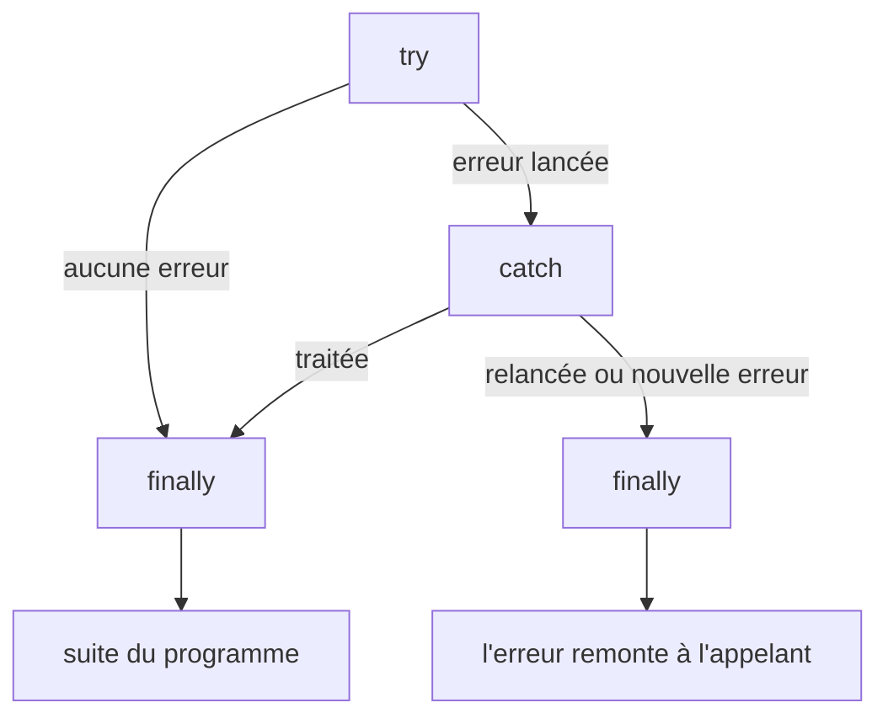
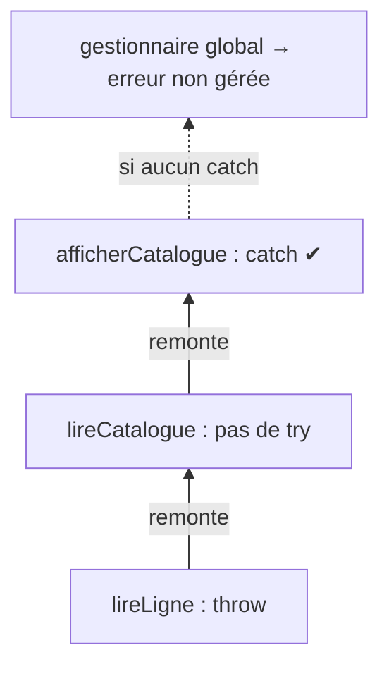

# 17 — Les erreurs

> **Niveau** : Intermédiaire · **Durée** : ~3 h · **Prérequis** : [Fonctions](../06-fonctions/README.md), [Classes](../16-classes/README.md)

Un programme réel rencontre des fichiers absents, des réseaux coupés, des saisies invalides et des bogues. La question n'est pas d'éviter toutes les erreurs, mais de les **signaler clairement**, de les **traiter au bon endroit** et de **ne jamais les perdre**. Ce chapitre couvre tout le cycle : lancer, capturer, enrichir, propager, libérer les ressources, déboguer et surveiller.

## Objectifs

- Reconnaître les types d'erreurs natifs et lire un message d'erreur ou une stack trace
- Lancer des erreurs pertinentes (`throw new TypeError(…)`, `cause`) et les capturer avec `try/catch/finally`
- Créer une hiérarchie d'erreurs personnalisées et distinguer les erreurs avec `instanceof`, `code` et `Error.isError`
- Choisir entre lancer une exception et retourner un résultat (pattern Result)
- Intercepter les erreurs non gérées dans le navigateur et dans Node.js
- Libérer des ressources de façon fiable avec `finally`, `using` et `DisposableStack`
- Déboguer efficacement (stack trace, `debugger`, DevTools, source maps) et journaliser utilement

## Sommaire

- [Qu'est-ce qu'une erreur ?](#quest-ce-quune-erreur-)
- [Les types d'erreurs natifs](#les-types-derreurs-natifs)
- [Lancer une erreur avec throw](#lancer-une-erreur-avec-throw)
- [Capturer avec try, catch et finally](#capturer-avec-try-catch-et-finally)
- [Identifier une erreur](#identifier-une-erreur)
- [Erreurs personnalisées](#erreurs-personnalisées)
- [Chaîner les erreurs avec cause](#chaîner-les-erreurs-avec-cause)
- [Plusieurs erreurs à la fois : AggregateError](#plusieurs-erreurs-à-la-fois--aggregateerror)
- [Lancer ou retourner ? Le pattern Result](#lancer-ou-retourner--le-pattern-result)
- [Propagation : où capturer une erreur ?](#propagation--où-capturer-une-erreur-)
- [Erreurs asynchrones (aperçu)](#erreurs-asynchrones-aperçu)
- [Erreurs non gérées](#erreurs-non-gérées)
- [Libérer les ressources : finally, using et DisposableStack](#libérer-les-ressources--finally-using-et-disposablestack)
- [Déboguer](#déboguer)
- [Valider aux frontières](#valider-aux-frontières)
- [Journaliser et surveiller](#journaliser-et-surveiller)
- [Écrire des messages d'erreur utiles](#écrire-des-messages-derreur-utiles)
- [Pièges courants](#pièges-courants)
- [Bonnes pratiques](#bonnes-pratiques)
- [Résumé](#résumé)
- [Exercices](#exercices)
- [Pour aller plus loin](#pour-aller-plus-loin)

## Qu'est-ce qu'une erreur ?

On distingue trois familles de problèmes :

| Famille | Quand ? | Exemple | Qui la détecte ? |
| --- | --- | --- | --- |
| Erreur de syntaxe | Avant l'exécution, à l'analyse du fichier | `if (x {` | Le moteur refuse d'exécuter **tout** le fichier |
| Erreur d'exécution (exception) | Pendant l'exécution | lire une propriété de `undefined` | Le moteur lance une exception |
| Erreur logique | Le code tourne mais donne un mauvais résultat | `prix * 1.2` au lieu de `prix * 1.055` | Vous, vos tests ([chapitre 29](../29-tests/README.md)) |

Ce chapitre traite surtout des **exceptions**. Quand une exception est **lancée** (*thrown*), l'exécution normale s'interrompt immédiatement : le moteur remonte la pile d'appels à la recherche d'un bloc `catch`. S'il n'en trouve aucun, l'erreur est **non gérée** : elle est affichée dans la console et, dans Node.js, le processus s'arrête.

Une exception est presque toujours un objet `Error` (ou d'une classe qui en hérite). Il porte :

| Propriété | Contenu | Standard ? |
| --- | --- | --- |
| `name` | le type d'erreur (`"TypeError"`, `"ErreurValidation"`…) | oui (hérité du prototype) |
| `message` | la description lisible | oui |
| `cause` | l'erreur d'origine, si on l'a fournie (ES2022) | oui |
| `stack` | la pile d'appels au moment de la création, sous forme de texte | non, mais présent partout (format propre à chaque moteur) |

```js
const erreur = new Error("Le fichier de configuration est introuvable");

console.log(erreur.name); // Error
console.log(erreur.message); // Le fichier de configuration est introuvable
console.log(String(erreur)); // Error: Le fichier de configuration est introuvable
console.log(erreur instanceof Error); // true
console.log(typeof erreur.stack); // string
```

> [!NOTE]
> Créer une erreur ne la lance pas : `new Error(…)` fabrique un objet ordinaire. C'est `throw` qui interrompt l'exécution.

## Les types d'erreurs natifs

Le langage définit une classe de base, `Error`, et plusieurs sous-classes que le moteur utilise selon la situation. Les messages ci-dessous sont ceux de V8 (Chrome, Edge, Node.js) : Firefox et Safari formulent différemment. **Ne testez jamais le texte d'un message** dans votre code, testez le type.

| Type | Lancé quand… | Exemple déclencheur | Message V8 |
| --- | --- | --- | --- |
| `SyntaxError` | le code (ou un texte analysé) est mal formé | `JSON.parse("{nom: 1}")` | `Expected property name or '}' in JSON at position 1 (line 1 column 2)` |
| `ReferenceError` | un identifiant n'existe pas, ou est utilisé avant son initialisation (TDZ) | `variableInexistante` | `variableInexistante is not defined` |
| `TypeError` | une opération est appliquée à une valeur du mauvais type | `null.nom` | `Cannot read properties of null (reading 'nom')` |
| `RangeError` | une valeur numérique sort de la plage autorisée | `new Array(-1)` | `Invalid array length` |
| `URIError` | une séquence d'URI est invalide | `decodeURIComponent("%")` | `URI malformed` |
| `EvalError` | jamais lancé par les moteurs actuels : conservé pour compatibilité | — | — |
| `AggregateError` (ES2021) | plusieurs erreurs sont regroupées en une seule | `Promise.any([])` | `All promises were rejected` |
| `SuppressedError` (prévu pour ES2027) | une erreur de libération de ressource en masque une autre | voir [`using`](#libérer-les-ressources--finally-using-et-disposablestack) | `An error was suppressed during disposal` |

Les erreurs les plus fréquentes au quotidien sont `TypeError` et `ReferenceError`. Ce bloc les provoque toutes et affiche leur type :

```js
const essais = [
  () => variableInexistante,
  () => {
    console.log(total);
    let total = 0;
  },
  () => {
    const utilisateur = undefined;
    return utilisateur.nom;
  },
  () => {
    const prix = 42;
    prix();
  },
  () => {
    const taux = 0.2;
    taux = 0.1;
  },
  () => (3.14159).toFixed(101),
  () => "ab".repeat(-1),
  () => decodeURIComponent("%E0%A4%A"),
  () => JSON.parse("{'nom': 'Ada'}"),
  () => 1 + 1n,
];

for (const essai of essais) {
  try {
    essai();
  } catch (erreur) {
    console.log(`${erreur.name} — ${erreur.message}`);
  }
}
// ReferenceError — variableInexistante is not defined
// ReferenceError — Cannot access 'total' before initialization
// TypeError — Cannot read properties of undefined (reading 'nom')
// TypeError — prix is not a function
// TypeError — Assignment to constant variable.
// RangeError — toFixed() digits argument must be between 0 and 100
// RangeError — Invalid count value: -1
// URIError — URI malformed
// SyntaxError — Expected property name or '}' in JSON at position 1 (line 1 column 2)
// TypeError — Cannot mix BigInt and other types, use explicit conversions
```

Une `SyntaxError` dans **votre fichier** ne peut pas être capturée par un `try/catch` de ce même fichier : le moteur refuse de l'exécuter avant même la première ligne. En revanche, les `SyntaxError` produites **à l'exécution** par `JSON.parse`, `new Function` ou `import()` d'un module invalide se capturent normalement (voir l'exemple `JSON.parse` ci-dessus).

### Erreurs propres à l'environnement

D'autres erreurs viennent de l'hôte plutôt que du langage :

- **`DOMException`** (navigateur, et Node.js pour les API web) : `AbortError` quand on annule un `fetch`, `DataCloneError` avec `structuredClone`, `NotAllowedError`… Elle hérite de `Error`, on la distingue par son `name`.
- **Erreurs système de Node.js** : des `Error` ordinaires enrichies de propriétés `code` (`"ENOENT"`, `"EACCES"`, `"ECONNREFUSED"`…), `syscall` et `path`.
- **`InternalError`** : n'existe **que dans Firefox** (par exemple « too much recursion »). Non standard : n'écrivez jamais de code qui en dépend ; Chrome et Node lancent une `RangeError` pour une récursion trop profonde.

```js
import { readFile } from "node:fs/promises";

try {
  await readFile("config-absente.json", "utf8");
} catch (erreur) {
  console.log(erreur.code); // ENOENT
  console.log(erreur.syscall); // open
  console.log(erreur.message); // ENOENT: no such file or directory, open 'config-absente.json'
}

try {
  structuredClone(() => {});
} catch (erreur) {
  console.log(erreur instanceof DOMException, erreur.name); // true DataCloneError
}
```

## Lancer une erreur avec throw

`throw` interrompt la fonction en cours et transmet une valeur à l'appelant. Techniquement, on peut lancer **n'importe quelle valeur**, mais il faut **toujours lancer un objet `Error`** : seul lui porte une stack trace, et tout le code qui capture s'attend à trouver `message`.

```js
// ❌ Une chaîne : pas de stack trace, pas de message, pas de type
try {
  throw "Solde insuffisant";
} catch (erreur) {
  console.log(erreur.message); // undefined
  console.log(erreur.stack); // undefined
}

// ✅ Un objet Error
try {
  throw new Error("Solde insuffisant");
} catch (erreur) {
  console.log(erreur.message); // Solde insuffisant
}
```

Choisissez le type le plus précis : `TypeError` pour une valeur du mauvais type, `RangeError` pour une valeur hors limites, une [erreur personnalisée](#erreurs-personnalisées) pour une règle métier.

```js
function retirer(compte, montant) {
  if (typeof montant !== "number" || Number.isNaN(montant)) {
    throw new TypeError(`Le montant doit être un nombre, reçu : ${typeof montant}`);
  }
  if (montant <= 0) {
    throw new RangeError(`Le montant doit être strictement positif, reçu : ${montant}`);
  }
  if (montant > compte.solde) {
    throw new Error(`Solde insuffisant : ${compte.solde} € disponibles, ${montant} € demandés`);
  }
  compte.solde -= montant;
  return compte.solde;
}

const compte = { titulaire: "Ada", solde: 100 };
console.log(retirer(compte, 30)); // 70

for (const montant of ["30", -5, 500]) {
  try {
    retirer(compte, montant);
  } catch (erreur) {
    console.log(`${erreur.name} : ${erreur.message}`);
  }
}
// TypeError : Le montant doit être un nombre, reçu : string
// RangeError : Le montant doit être strictement positif, reçu : -5
// Error : Solde insuffisant : 70 € disponibles, 500 € demandés
```

`throw` est une instruction : elle ne s'utilise pas directement dans une expression (`valeur ?? throw …` est une erreur de syntaxe ; une proposition TC39 de « throw expressions » existe mais n'est pas adoptée). Dans une expression, passez par une petite fonction :

```js
function echouer(message) {
  throw new Error(message);
}

const config = { port: 8080 };
const port = config.port ?? echouer("Le port est obligatoire");
console.log(port); // 8080
```

## Capturer avec try, catch et finally

```js
function analyserConfig(texte) {
  try {
    console.log("1. début du try");
    const config = JSON.parse(texte); // peut lancer une SyntaxError
    console.log("2. analyse réussie");
    return config;
  } catch (erreur) {
    console.log(`3. capturée : ${erreur.name}`);
    return {};
  } finally {
    console.log("4. finally, dans tous les cas");
  }
}

console.log(analyserConfig('{"port": 80}'));
// 1. début du try
// 2. analyse réussie
// 4. finally, dans tous les cas
// { port: 80 }

console.log(analyserConfig("{port: 80}"));
// 1. début du try
// 3. capturée : SyntaxError
// 4. finally, dans tous les cas
// {}
```



Les règles à retenir :

- Dès qu'une instruction du `try` lance une erreur, **le reste du `try` est sauté**.
- Le `catch` reçoit la valeur lancée. Son paramètre n'existe que dans le bloc `catch`.
- `finally` s'exécute **toujours** : après un `try` réussi, après un `catch`, même si le `try` ou le `catch` contient un `return`, un `break` ou relance une erreur. C'est l'endroit pour libérer une ressource.
- On peut écrire `try/catch`, `try/finally` ou `try/catch/finally`.

### catch sans paramètre (ES2019)

Quand le détail de l'erreur ne sert à rien, on peut omettre le paramètre :

```js
function estJsonValide(texte) {
  try {
    JSON.parse(texte);
    return true;
  } catch {
    return false;
  }
}

console.log(estJsonValide('{"ok": true}')); // true
console.log(estJsonValide("{ok: true}")); // false
```

### Ne capturer que ce qu'on sait traiter

Un `catch` attrape **tout**, y compris vos propres bogues. Si vous ne gérez qu'un cas précis, testez-le et **relancez** le reste :

```js
import { readFile } from "node:fs/promises";

async function lireConfig(chemin) {
  try {
    return JSON.parse(await readFile(chemin, "utf8"));
  } catch (erreur) {
    if (erreur.code === "ENOENT") {
      return { theme: "clair" }; // fichier absent : configuration par défaut
    }
    throw erreur; // autre problème (JSON invalide, droits…) : pas notre rôle ici
  }
}

console.log(await lireConfig("inexistant.json")); // { theme: 'clair' }
```

### Le piège du return dans finally

Un `return` placé dans `finally` **remplace** la valeur de retour du `try` et **avale** toute erreur en cours :

```js
function chargerDonnees() {
  try {
    throw new Error("Connexion perdue");
  } finally {
    return "tout va bien"; // ❌ l'erreur disparaît sans laisser de trace
  }
}

console.log(chargerDonnees()); // tout va bien
```

N'écrivez jamais `return`, `break`, `continue` ni `throw` dans un `finally` : réservez-le au nettoyage.

## Identifier une erreur

Dans un `catch`, la valeur reçue peut être n'importe quoi : une `TypeError` de votre propre code, une erreur réseau, une chaîne lancée par une vieille bibliothèque. Quatre outils permettent de l'identifier :

| Outil | Usage | Limite |
| --- | --- | --- |
| `erreur instanceof ErreurReseau` | distinguer vos classes d'erreurs | échoue entre deux « royaumes » (iframe, `node:vm`, worker) |
| `erreur.name === "AbortError"` | erreurs de l'hôte (`DOMException`) | le nom peut être modifié, attention aux fautes de frappe |
| `erreur.code === "ENOENT"` | erreurs système de Node, vos propres codes | il faut que l'erreur ait un code |
| `Error.isError(erreur)` (ES2026) | savoir si c'est **vraiment** une erreur | ne dit rien du type précis |

### Error.isError (ES2026)

`instanceof Error` vérifie la chaîne de prototypes. C'est trompeur dans deux cas : un objet peut « imiter » une erreur, et une erreur créée dans un autre royaume (une iframe, un contexte `node:vm`) a son propre `Error.prototype`. `Error.isError` vérifie la **marque interne** posée par le constructeur `Error`, comme `Array.isArray` le fait pour les tableaux :

```js
import vm from "node:vm";

const venueDAilleurs = vm.runInNewContext('new TypeError("créée dans un autre contexte")');
console.log(venueDAilleurs instanceof Error); // false ❌ autre royaume
console.log(Error.isError(venueDAilleurs)); // true ✅

const imitation = Object.create(Error.prototype);
console.log(imitation instanceof Error); // true ❌ ce n'est pas une vraie erreur
console.log(Error.isError(imitation)); // false ✅

class ErreurMetier extends Error {}
console.log(Error.isError(new ErreurMetier("ok"))); // true
console.log(Error.isError(new DOMException("annulé", "AbortError"))); // true
console.log(Error.isError({ name: "Error", message: "faux" })); // false
```

Son usage principal : **normaliser** ce qu'on reçoit dans un `catch`, pour pouvoir toujours compter sur `message` et `stack` :

```js
function enErreur(valeur) {
  if (Error.isError(valeur)) return valeur;
  return new Error(`Valeur non-Error lancée : ${String(valeur)}`, { cause: valeur });
}

try {
  throw "délai dépassé"; // lancé par une bibliothèque mal écrite
} catch (valeur) {
  const erreur = enErreur(valeur);
  console.log(erreur.message); // Valeur non-Error lancée : délai dépassé
  console.log(erreur.cause); // délai dépassé
}
```

> [!NOTE]
> Disponibilité de `Error.isError` (novembre 2026, d'après MDN) : Chrome et Edge 134+, Firefox 138+, Node.js 24.3+, Deno 2.2+. Safari ne le propose pas encore en version stable : prévoyez un repli si vous ciblez Safari, par exemple `Error.isError?.(valeur) ?? valeur instanceof Error`.

## Erreurs personnalisées

Les erreurs natives décrivent des problèmes techniques. Pour vos règles métier (« stock épuisé », « utilisateur introuvable »), créez vos propres classes : elles permettent de **trier** les erreurs dans un `catch` et de transporter des **données utiles**.

```js
class ErreurValidation extends Error {
  constructor(message, { champ, ...options } = {}) {
    super(message, options); // transmet message et éventuellement cause
    this.name = "ErreurValidation";
    this.champ = champ;
  }
}

try {
  throw new ErreurValidation("L'adresse e-mail est obligatoire", { champ: "email" });
} catch (erreur) {
  console.log(erreur instanceof ErreurValidation); // true
  console.log(erreur instanceof Error); // true
  console.log(String(erreur)); // ErreurValidation: L'adresse e-mail est obligatoire
  console.log(erreur.champ); // email
}
```

Trois détails comptent :

1. **Appelez `super(message, options)`** : c'est lui qui initialise `message`, `cause` et la stack trace.
2. **Définissez `name` explicitement** avec une chaîne. `this.constructor.name` est tentant, mais les minificateurs renomment souvent les classes en production (`ErreurValidation` devient `e`).
3. **Pas besoin de `Error.captureStackTrace`** avec `class … extends Error` : la pile est déjà correcte. Cette méthode, longtemps propre à V8 (désormais présente aussi dans Firefox 138+ et Safari 17.2+), sert surtout à masquer des fonctions utilitaires de la pile.

### Une hiérarchie d'erreurs

Dans une application, une classe de base commune permet de distinguer **vos** erreurs, prévues, des bogues imprévus :

```js
class ErreurApplication extends Error {
  name = "ErreurApplication";
  statut = 500;

  constructor(message, { code = "ERREUR_INTERNE", ...options } = {}) {
    super(message, options);
    this.code = code;
  }
}

class ErreurValidation extends ErreurApplication {
  name = "ErreurValidation";
  statut = 400;

  constructor(message, { champ, ...options } = {}) {
    super(message, { code: "VALIDATION", ...options });
    this.champ = champ;
  }
}

class ErreurIntrouvable extends ErreurApplication {
  name = "ErreurIntrouvable";
  statut = 404;

  constructor(ressource, id) {
    super(`${ressource} ${id} introuvable`, { code: "INTROUVABLE" });
    this.ressource = ressource;
  }
}

function enReponseHttp(erreur) {
  if (erreur instanceof ErreurApplication) {
    return { statut: erreur.statut, corps: { code: erreur.code, message: erreur.message } };
  }
  // Bogue imprévu : on ne divulgue pas les détails internes au client
  return { statut: 500, corps: { code: "ERREUR_INTERNE", message: "Une erreur est survenue" } };
}

const erreurs = [
  new ErreurIntrouvable("Commande", 42),
  new ErreurValidation("Quantité négative", { champ: "quantite" }),
  new TypeError("x is not a function"),
];
for (const erreur of erreurs) {
  const { statut, corps } = enReponseHttp(erreur);
  console.log(statut, corps.code, "—", corps.message);
}
// 404 INTROUVABLE — Commande 42 introuvable
// 400 VALIDATION — Quantité négative
// 500 ERREUR_INTERNE — Une erreur est survenue
```

Les champs de classe (`name = …`, `statut = …`) sont initialisés juste après `super()`, et ceux de la sous-classe écrasent ceux de la classe parente (voir le [chapitre 16](../16-classes/README.md)).

> [!TIP]
> Ne créez pas une classe par message. Une poignée de classes (validation, introuvable, non autorisé, conflit, service indisponible…) complétées par une propriété `code` suffit à la plupart des applications.

## Chaîner les erreurs avec cause

Une erreur de bas niveau (« ENOENT », « Unexpected token ») est précise mais sans contexte ; une erreur de haut niveau (« Impossible de charger la configuration ») a du contexte mais perd le détail. L'option `cause` (ES2022) garde **les deux** :

```js
function analyserConfig(texte) {
  try {
    return JSON.parse(texte);
  } catch (erreur) {
    throw new Error("Configuration invalide : le fichier n'est pas du JSON", { cause: erreur });
  }
}

try {
  analyserConfig("port = 8080");
} catch (erreur) {
  console.log(erreur.message); // Configuration invalide : le fichier n'est pas du JSON
  console.log(erreur.cause.name); // SyntaxError
  console.log(erreur.cause instanceof SyntaxError); // true
}
```

`console.log(erreur)` dans Node.js et les DevTools des navigateurs affiche la cause sous l'erreur (`[cause]: SyntaxError: …` dans Node), avec les deux stack traces. Quand les erreurs sont enveloppées plusieurs fois, on peut parcourir la chaîne :

```js
function chaineDesCauses(erreur) {
  const messages = [];
  for (let courante = erreur; courante; courante = courante.cause) {
    messages.push(Error.isError(courante) ? `${courante.name}: ${courante.message}` : String(courante));
  }
  return messages.join("\n  ↳ ");
}

const racine = new Error("ECONNREFUSED 127.0.0.1:5432");
const milieu = new Error("Requête SQL impossible", { cause: racine });
const haut = new Error("Impossible d'afficher le tableau de bord", { cause: milieu });

console.log(chaineDesCauses(haut));
// Error: Impossible d'afficher le tableau de bord
//   ↳ Error: Requête SQL impossible
//   ↳ Error: ECONNREFUSED 127.0.0.1:5432
```

Disponibilité : tous les navigateurs actuels (Chrome 93+, Firefox 91+, Safari 15+) et Node.js 16.9+.

## Plusieurs erreurs à la fois : AggregateError

`AggregateError` (ES2021) regroupe plusieurs erreurs dans sa propriété `errors`. Le langage l'utilise pour `Promise.any` quand **toutes** les promesses échouent (détails au [chapitre 19](../19-promises/README.md)) :

```js
const miroirs = [
  Promise.reject(new Error("miroir-eu : délai dépassé")),
  Promise.reject(new Error("miroir-us : 503")),
];

try {
  await Promise.any(miroirs);
} catch (erreur) {
  console.log(erreur.name); // AggregateError
  console.log(erreur.message); // All promises were rejected
  console.log(erreur.errors.map((e) => e.message)); // [ 'miroir-eu : délai dépassé', 'miroir-us : 503' ]
}
```

Vous pouvez aussi l'utiliser pour rapporter **toutes** les erreurs d'un formulaire d'un coup plutôt que la première seulement :

```js
function validerInscription({ email = "", motDePasse = "", age }) {
  const erreurs = [];
  if (!email.includes("@")) erreurs.push(new Error("E-mail invalide"));
  if (motDePasse.length < 12) erreurs.push(new Error("Mot de passe trop court (12 caractères minimum)"));
  if (!Number.isInteger(age) || age < 15) erreurs.push(new Error("Âge minimal : 15 ans"));
  if (erreurs.length > 0) {
    throw new AggregateError(erreurs, `${erreurs.length} champ(s) invalide(s)`);
  }
}

try {
  validerInscription({ email: "ada.example.com", motDePasse: "1234", age: 36 });
} catch (erreur) {
  console.log(erreur.message); // 2 champ(s) invalide(s)
  for (const detail of erreur.errors) console.log(`- ${detail.message}`);
  // - E-mail invalide
  // - Mot de passe trop court (12 caractères minimum)
}
```

## Lancer ou retourner ? Le pattern Result

Les exceptions sont parfaites pour les situations **exceptionnelles** : un bogue, une précondition violée, une ressource indispensable absente. Elles sont moins adaptées aux échecs **attendus et fréquents** (saisie utilisateur invalide, élément introuvable) : rien n'oblige l'appelant à les gérer, et rien dans la signature de la fonction n'indique qu'elle peut échouer.

Le **pattern Result** fait de l'échec une valeur de retour ordinaire : la fonction renvoie soit `{ ok: true, valeur }`, soit `{ ok: false, erreur }`.

```js
/**
 * @template T
 * @typedef {{ ok: true, valeur: T } | { ok: false, erreur: Error }} Resultat
 */

const succes = (valeur) => ({ ok: true, valeur });
const echec = (erreur) => ({ ok: false, erreur });

/** @returns {Resultat<number>} */
function lireQuantite(saisie) {
  const quantite = Number(saisie);
  if (saisie.trim() === "" || !Number.isInteger(quantite)) {
    return echec(new TypeError(`« ${saisie} » n'est pas un nombre entier`));
  }
  if (quantite < 1 || quantite > 99) {
    return echec(new RangeError(`La quantité doit être comprise entre 1 et 99 (reçu : ${quantite})`));
  }
  return succes(quantite);
}

for (const saisie of ["3", "trois", "250"]) {
  const resultat = lireQuantite(saisie);
  if (resultat.ok) {
    console.log(`Quantité acceptée : ${resultat.valeur}`);
  } else {
    console.log(`Refusé : ${resultat.erreur.message}`);
  }
}
// Quantité acceptée : 3
// Refusé : « trois » n'est pas un nombre entier
// Refusé : La quantité doit être comprise entre 1 et 99 (reçu : 250)
```

Le commentaire `@typedef` documente le type (voir le [chapitre 30](../30-commentaires-jsdoc/README.md)) : avec la vérification de TypeScript, l'éditeur refuse alors l'accès à `resultat.valeur` tant qu'on n'a pas testé `resultat.ok`.

Pour faire le pont avec du code qui lance des exceptions, une petite fonction convertit une exception en `Resultat` :

```js
function essayer(fonction) {
  try {
    return { ok: true, valeur: fonction() };
  } catch (erreur) {
    return { ok: false, erreur: Error.isError(erreur) ? erreur : new Error(String(erreur)) };
  }
}

async function essayerAsync(promesse) {
  try {
    return { ok: true, valeur: await promesse };
  } catch (erreur) {
    return { ok: false, erreur: Error.isError(erreur) ? erreur : new Error(String(erreur)) };
  }
}

const config = essayer(() => JSON.parse("{port: 80}"));
console.log(config.ok, config.erreur?.name); // false SyntaxError

const reponse = await essayerAsync(Promise.resolve(42));
console.log(reponse); // { ok: true, valeur: 42 }
```

Comment choisir ?

| Situation | Exception | Result |
| --- | --- | --- |
| Bogue, état impossible, argument d'un type absurde | ✅ | |
| Ressource indispensable absente (base de données, configuration) | ✅ | |
| Saisie utilisateur invalide, validation de formulaire | | ✅ |
| Recherche qui peut ne rien trouver | | ✅ (ou `undefined`/`null`) |
| L'appelant immédiat doit **toujours** traiter l'échec | | ✅ |
| L'erreur doit remonter de nombreux niveaux jusqu'à un gestionnaire central | ✅ | |

Restez cohérent dans un même module : un mélange anarchique des deux styles est pire que l'un ou l'autre. Des bibliothèques comme `neverthrow` proposent un type Result plus complet (chaînage avec `map`, `andThen`…).

## Propagation : où capturer une erreur ?

Une erreur non capturée **remonte** la pile d'appels, fonction par fonction, jusqu'au premier `catch` rencontré :

```js
function lireLigne(ligne) {
  const [nom, prix] = ligne.split(";");
  if (prix === undefined) throw new Error(`Ligne mal formée : « ${ligne} »`);
  return { nom, prix: Number(prix) };
}

function lireCatalogue(texte) {
  return texte.split("\n").map(lireLigne); // pas de try : l'erreur traverse
}

function afficherCatalogue(texte) {
  try {
    for (const { nom, prix } of lireCatalogue(texte)) console.log(`${nom} : ${prix} €`);
  } catch (erreur) {
    console.log(`Catalogue illisible. ${erreur.message}`);
  }
}

afficherCatalogue("Café;3.5\nThé;2.8");
// Café : 3.5 €
// Thé : 2.8 €
afficherCatalogue("Café;3.5\nThé 2.8");
// Catalogue illisible. Ligne mal formée : « Thé 2.8 »
```



Où placer le `catch` ? **Là où l'on sait quoi faire de l'erreur** :

- au plus près, si l'on peut **récupérer** (valeur par défaut, nouvel essai, autre source) ;
- à une **frontière** (gestionnaire de route HTTP, gestionnaire d'événement d'interface, commande d'une CLI) pour transformer l'erreur en réponse 500, en message à l'utilisateur ou en code de sortie ;
- **nulle part ailleurs**. Un `try/catch` dans chaque fonction qui se contente de journaliser puis de relancer produit des journaux en double et du bruit.

```js
// ❌ Capture qui ne sert à rien : elle journalise puis relance, à chaque niveau
function calculerRemise(panier) {
  try {
    return panier.total * 0.1;
  } catch (erreur) {
    console.error("Erreur dans calculerRemise", erreur);
    throw erreur;
  }
}

// ✅ Pas de try ici : l'erreur remonte jusqu'à la frontière qui saura la traiter
function calculerRemiseSimple(panier) {
  return panier.total * 0.1;
}

console.log(calculerRemise({ total: 80 }), calculerRemiseSimple({ total: 80 })); // 8 8
```

Et surtout, **n'avalez jamais une erreur** :

```js
// ❌ Le pire : l'erreur disparaît, le bogue devient introuvable
try {
  JSON.parse("{invalide}");
} catch {}

// ✅ Si l'échec est vraiment sans conséquence, dites-le explicitement
try {
  JSON.parse("{invalide}");
} catch {
  // Préférences corrompues : on repart des valeurs par défaut (cas prévu)
}
```

## Erreurs asynchrones (aperçu)

Un `try/catch` ne capture que les erreurs lancées **pendant** l'exécution de son bloc. Un callback exécuté plus tard (`setTimeout`, écouteur d'événement) s'exécute après la fin du `try` :

<!-- no-run -->
```js
// ❌ Le catch ne verra jamais cette erreur : elle survient après la fin du try
try {
  setTimeout(() => {
    throw new Error("trop tard");
  }, 100);
} catch (erreur) {
  console.log("jamais exécuté");
}
```

Avec les promesses et `async`/`await`, on retrouve un `try/catch` naturel… à condition de **ne pas oublier `await`** :

```js
async function chargerProfil(id) {
  throw new Error(`Profil ${id} introuvable`);
}

// ✅ Avec await, le rejet devient une exception capturable
try {
  await chargerProfil(7);
} catch (erreur) {
  console.log(erreur.message); // Profil 7 introuvable
}

// ✅ Ou avec .catch() sur la promesse
chargerProfil(8).catch((erreur) => console.log(erreur.message)); // Profil 8 introuvable
```

Sans `await`, la fonction `async` renvoie une promesse rejetée que le `try` ne voit pas : c'est un **rejet non géré** (section suivante). Même subtilité avec `return promesse` dans un `try` : seul `return await promesse` fait passer le rejet par le `catch` de la fonction.

```js
const echouer = async () => {
  throw new Error("réseau indisponible");
};

async function sansAwait() {
  try {
    return echouer(); // la promesse est renvoyée telle quelle
  } catch {
    return "valeur de secours";
  }
}

async function avecAwait() {
  try {
    return await echouer(); // le rejet est transformé en exception ici
  } catch {
    return "valeur de secours";
  }
}

console.log(await sansAwait().catch((erreur) => `rejet : ${erreur.message}`)); // rejet : réseau indisponible
console.log(await avecAwait()); // valeur de secours
```

Tout cela est détaillé aux chapitres [19 — Promesses](../19-promises/README.md) et [20 — async/await](../20-async-await/README.md).

## Erreurs non gérées

Même avec du code soigné, une erreur finira par échapper à tous les `catch`. Chaque environnement fournit un **filet de sécurité global** : il ne sert pas à « réparer », mais à **journaliser** l'erreur (et, côté serveur, à arrêter proprement le processus).

### Dans le navigateur

<!-- no-run -->
```js
// Erreur lancée et non capturée (script, écouteur d'événement, setTimeout…)
window.addEventListener("error", (event) => {
  // event est un ErrorEvent : message, filename, lineno, colno, error
  envoyerAuMonitoring({
    message: event.message,
    fichier: `${event.filename}:${event.lineno}:${event.colno}`,
    pile: event.error?.stack,
  });
});

// Promesse rejetée sans gestionnaire
window.addEventListener("unhandledrejection", (event) => {
  envoyerAuMonitoring({ message: "Rejet non géré", raison: String(event.reason) });
  // event.preventDefault() empêcherait l'affichage par défaut dans la console
});

// Une promesse rejetée reçoit finalement un gestionnaire, plus tard
window.addEventListener("rejectionhandled", (event) => {
  console.info("Rejet finalement géré :", event.reason);
});
```

Points importants :

- Pour une erreur venant d'un script **d'une autre origine** (CDN), le navigateur masque les détails et n'indique que `"Script error."`. Pour obtenir le message, chargez le script avec `<script src="…" crossorigin="anonymous">` et faites envoyer l'en-tête CORS `Access-Control-Allow-Origin` par le serveur.
- Les erreurs de chargement de ressources (`` cassée…) ne remontent pas jusqu'à `window` par bouillonnement : écoutez `error` sur l'élément, ou en phase de capture.
- `reportError(erreur)` signale une erreur aux gestionnaires globaux **comme si** elle n'avait pas été capturée, sans interrompre le code en cours. Pratique dans une bibliothèque qui exécute des callbacks utilisateur et veut continuer malgré l'échec de l'un d'eux. Disponible dans tous les navigateurs actuels, mais **pas dans Node.js**.

### Dans Node.js

Depuis Node.js 15, une promesse rejetée sans gestionnaire est traitée comme une exception non capturée : le processus affiche l'erreur et **s'arrête avec le code de sortie 1**. C'est voulu : un programme dans un état inconnu ne doit pas continuer.

Deux événements de `process` permettent d'intervenir :

| Événement | Déclenché par | Paramètres |
| --- | --- | --- |
| `uncaughtException` | une exception non capturée (ou un rejet non géré, en mode par défaut, si `unhandledRejection` n'est pas écouté) | `(erreur, origine)` |
| `unhandledRejection` | une promesse rejetée sans gestionnaire | `(raison, promesse)` |

<!-- no-run -->
```js
// Point d'entrée d'un serveur : journaliser, nettoyer, puis quitter
process.on("uncaughtException", (erreur, origine) => {
  console.error(`[fatal] ${origine}`, erreur);
  // Nettoyage SYNCHRONE uniquement (l'état du programme est incertain), puis :
  process.exit(1);
});

process.on("unhandledRejection", (raison) => {
  // Relancer transforme le rejet en uncaughtException : un seul chemin à gérer
  throw raison;
});
```

> [!WARNING]
> La documentation de Node.js est formelle : `uncaughtException` n'est **pas** un équivalent de « On Error Resume Next ». Après une exception non capturée, l'application est dans un état indéfini. Journalisez, libérez ce qui peut l'être, quittez, et laissez un superviseur (systemd, Docker, Kubernetes, PM2) redémarrer le processus.

Écouter `unhandledRejection` **sans** relancer désactive l'arrêt automatique : le processus continue. C'est rarement une bonne idée en production, mais cela montre le mécanisme :

```js
process.on("unhandledRejection", (raison) => {
  console.log(`Rejet non géré : ${raison.message}`);
});

Promise.reject(new Error("promesse oubliée"));
setTimeout(() => console.log("le processus continue"), 10);
// Rejet non géré : promesse oubliée
// le processus continue
```

L'option `--unhandled-rejections` (`throw` par défaut, `strict`, `warn`, `none`…) modifie ce comportement ; le mode par défaut convient dans l'immense majorité des cas.

## Libérer les ressources : finally, using et DisposableStack

Un fichier ouvert, une connexion, un verrou, un minuteur : toute ressource acquise doit être libérée, **même si une erreur survient**. La solution historique est `finally` :

```js
function ouvrirConnexion(nom) {
  console.log(`ouverture de ${nom}`);
  return {
    requete: (sql) => `résultat de « ${sql} »`,
    fermer: () => console.log(`fermeture de ${nom}`),
  };
}

const connexion = ouvrirConnexion("base");
try {
  console.log(connexion.requete("SELECT 1"));
} finally {
  connexion.fermer(); // exécuté même si la requête lance une erreur
}
// ouverture de base
// résultat de « SELECT 1 »
// fermeture de base
```

Avec deux ou trois ressources, les `try/finally` imbriqués deviennent vite illisibles, et il est facile d'oublier l'un d'eux.

### using et Symbol.dispose

La proposition **Explicit Resource Management** (stade 4 au TC39, prévue pour ES2027) ajoute la déclaration `using`. Une variable déclarée avec `using` est **libérée automatiquement à la sortie de son bloc**, quelle que soit la façon d'en sortir (fin normale, `return`, exception). La valeur doit posséder une méthode `[Symbol.dispose]()` (ou valoir `null`/`undefined`).

```js
function ouvrirConnexion(nom) {
  console.log(`ouverture de ${nom}`);
  return {
    requete: (sql) => `résultat de « ${sql} »`,
    [Symbol.dispose]() {
      console.log(`fermeture de ${nom}`);
    },
  };
}

function rapport() {
  using base = ouvrirConnexion("base");
  using cache = ouvrirConnexion("cache");
  console.log(base.requete("SELECT 1"));
  throw new Error("calcul impossible");
} // ← cache puis base sont fermés ici, dans l'ordre inverse de leur ouverture

try {
  rapport();
} catch (erreur) {
  console.log(`erreur : ${erreur.message}`);
}
// ouverture de base
// ouverture de cache
// résultat de « SELECT 1 »
// fermeture de cache
// fermeture de base
// erreur : calcul impossible
```

`using` s'utilise dans un bloc, un corps de fonction, une boucle `for`/`for…of`, ou au niveau supérieur d'un **module** (pas d'un script classique). Pour une libération **asynchrone** (fermer un fichier, terminer une transaction), utilisez `await using` avec une méthode `[Symbol.asyncDispose]()`. Node.js en fournit déjà plusieurs : `FileHandle` de `node:fs/promises`, `fs.mkdtempDisposable()` (Node 24.4+)…

```js
import { mkdtempDisposable, writeFile, readdir } from "node:fs/promises";
import { tmpdir } from "node:os";
import path from "node:path";

async function testerAvecDossierTemporaire() {
  await using dossier = await mkdtempDisposable(path.join(tmpdir(), "essai-"));
  await writeFile(path.join(dossier.path, "a.txt"), "contenu");
  console.log(await readdir(dossier.path)); // [ 'a.txt' ]
  return dossier.path;
} // ← le dossier et son contenu sont supprimés ici

const chemin = await testerAvecDossierTemporaire();
console.log(await readdir(chemin).catch((erreur) => erreur.code)); // ENOENT
```

### SuppressedError

Que se passe-t-il si la libération elle-même échoue alors qu'une erreur est déjà en cours ? Aucune n'est perdue : elles sont réunies dans une `SuppressedError`, dont `error` contient l'erreur de libération et `suppressed` l'erreur qu'elle a masquée.

```js
try {
  using fichier = {
    [Symbol.dispose]() {
      throw new Error("fermeture impossible");
    },
  };
  throw new Error("écriture impossible");
} catch (erreur) {
  console.log(erreur.name); // SuppressedError
  console.log(erreur.error.message); // fermeture impossible
  console.log(erreur.suppressed.message); // écriture impossible
}
```

### DisposableStack

`DisposableStack` regroupe plusieurs nettoyages dans un seul objet jetable. Il est utile quand les ressources sont acquises dynamiquement, ou pour des valeurs qui ne connaissent pas `Symbol.dispose` :

| Méthode | Rôle |
| --- | --- |
| `pile.use(ressource)` | enregistre une ressource qui a déjà `[Symbol.dispose]` |
| `pile.adopt(valeur, liberer)` | enregistre une valeur quelconque et la fonction qui la libère |
| `pile.defer(fonction)` | enregistre un simple nettoyage |
| `pile.move()` | transfère les nettoyages vers une nouvelle pile (la pile d'origine est vidée) |
| `pile.dispose()` | exécute tous les nettoyages, dans l'ordre inverse |

```js
function demarrerService() {
  using pile = new DisposableStack();

  const minuteur = setInterval(() => {}, 1000);
  pile.defer(() => {
    clearInterval(minuteur);
    console.log("minuteur arrêté");
  });

  const connexion = pile.adopt({ id: 1 }, (c) => console.log(`connexion ${c.id} fermée`));
  console.log(`service démarré avec la connexion ${connexion.id}`);

  // Tout a réussi : on transfère les nettoyages à l'appelant.
  // Si une erreur était survenue plus haut, `using` aurait tout libéré automatiquement.
  return pile.move();
}

const service = demarrerService();
console.log("le service tourne");
service.dispose();
// service démarré avec la connexion 1
// le service tourne
// connexion 1 fermée
// minuteur arrêté
```

`AsyncDisposableStack` est l'équivalent asynchrone (`await pile.disposeAsync()`).

> [!NOTE]
> Disponibilité (novembre 2026, d'après MDN) : Chrome et Edge 134+, Firefox 141+, Node.js 24+, Deno. Safari ne le propose pas encore en version stable. TypeScript (5.2+) et Babel savent transpiler `using` ; `DisposableStack` nécessite alors un polyfill (par exemple celui de `core-js`).

## Déboguer

### Lire une stack trace

Voici une erreur réelle et ce que Node.js affiche :

<!-- no-run -->
```js
function calculerTotal(panier) {
  return panier.articles.reduce((total, article) => total + article.prix, 0);
}

function afficherResume(panier) {
  const total = calculerTotal(panier);
  console.log(`Total : ${total} €`);
}

afficherResume({ client: "Ada" });
```

```text
file:///projet/panier.mjs:2
  return panier.articles.reduce((total, article) => total + article.prix, 0);
                         ^

TypeError: Cannot read properties of undefined (reading 'reduce')
    at calculerTotal (file:///projet/panier.mjs:2:26)
    at afficherResume (file:///projet/panier.mjs:6:17)
    at file:///projet/panier.mjs:10:1
    at ModuleJob.run (node:internal/modules/esm/module_job:561:25)
    …
```

Méthode de lecture :

1. **La ligne de l'erreur** : type + message. « Cannot read properties of undefined (reading 'reduce') » signifie « on a écrit `quelqueChose.reduce` et `quelqueChose` vaut `undefined` », ici `panier.articles`.
2. **La première ligne `at`** : l'endroit exact (`fichier:ligne:colonne`). La petite flèche `^` le montre dans le code.
3. **Les lignes suivantes** : qui a appelé qui, du plus récent au plus ancien. Remontez-les jusqu'à **votre** code : la cause est souvent là (ici, `afficherResume` a reçu un panier sans `articles`).
4. **Ignorez les lignes internes** (`node:internal/…`, `node_modules/…`) sauf si rien d'autre n'explique l'erreur.

Pour les fonctions `async`, V8 reconstitue la chaîne d'appels avec des lignes `at async …`. Par défaut, V8 conserve 10 lignes : `Error.stackTraceLimit = 50` (dans le code) ou `node --stack-trace-limit=50 app.js` en affiche davantage.

### console et debugger

L'API `console` (présentée au [chapitre 1](../01-introduction/README.md)) reste l'outil le plus rapide. Pour déboguer, retenez surtout `console.error` (sortie d'erreur, affichée en rouge), `console.trace()` (affiche la pile d'appels courante sans lancer d'erreur), `console.table()` pour un tableau d'objets et `console.dir(objet, { depth: null })` dans Node pour un objet profond.

> [!WARNING]
> `console.assert(condition, message)` **ne lance pas d'erreur** : il affiche « Assertion failed » et le programme continue. Pour une vraie assertion dans Node.js, utilisez `node:assert` (`assert.ok(condition, message)` lance une `AssertionError`).

L'instruction `debugger;` met le programme en pause à cet endroit **si un débogueur est attaché** (DevTools ouverts, Node lancé avec `--inspect`), et ne fait rien sinon. Ne la laissez pas dans le code livré (la règle ESLint `no-debugger` la signale).

Les débogueurs offrent mieux que `console.log` :

- **Points d'arrêt** en cliquant sur un numéro de ligne, **conditionnels** (« seulement si `id === 42` ») et **logpoints** (un `console.log` ajouté sans modifier le code).
- **Pause sur exceptions** (« Pause on caught/uncaught exceptions ») : le débogueur s'arrête à l'endroit exact où l'erreur est lancée, avec toutes les variables visibles.
- Inspection de la pile d'appels, des variables locales et des closures, exécution pas à pas.

Dans Node.js : `node --inspect-brk app.js`, puis ouvrez `chrome://inspect` dans Chrome ; ou, dans VS Code, lancez le script depuis un **JavaScript Debug Terminal** : les points d'arrêt posés dans l'éditeur fonctionnent directement.

### Source maps

En production, le code est souvent **transformé** : minifié, regroupé par un bundler, compilé depuis TypeScript. Une stack trace pointe alors vers `app.min.js:1:48213`, inutilisable. Une **source map** (fichier `.map`) fait la correspondance entre le code généré et vos fichiers sources ; le fichier généré la désigne par un commentaire final :

```text
//# sourceMappingURL=app.min.js.map
```

- Les outils les génèrent sur demande : `build.sourcemap` dans Vite, `--sourcemap` pour esbuild, `sourceMap` dans `tsconfig.json`.
- Les DevTools des navigateurs les utilisent automatiquement.
- Node.js les applique aux stack traces avec `node --enable-source-maps app.js`.
- Les services de monitoring (voir plus bas) acceptent qu'on leur **téléverse** les source maps sans les publier sur le site, pour ne pas exposer le code source.

## Valider aux frontières

Le meilleur moment pour détecter une donnée invalide est **le moment où elle entre** dans le programme : saisie d'un formulaire, corps d'une requête HTTP, réponse d'une API, fichier, variable d'environnement. Une fois validée, la donnée peut circuler dans le reste du code sans vérifications répétées. C'est le principe « **échouer tôt** » (*fail fast*) : une erreur signalée à l'entrée est claire, la même erreur découverte trois modules plus loin est un casse-tête.

```js
function lireConfigServeur(env) {
  const port = Number(env.PORT ?? 3000);
  if (!Number.isInteger(port) || port < 1 || port > 65535) {
    throw new RangeError(`PORT doit être un entier entre 1 et 65535, reçu : « ${env.PORT} »`);
  }

  const modes = ["development", "production", "test"];
  const mode = env.NODE_ENV ?? "development";
  if (!modes.includes(mode)) {
    throw new RangeError(`NODE_ENV doit valoir ${modes.join(", ")} ; reçu : « ${mode} »`);
  }

  return Object.freeze({ port, mode });
}

console.log(lireConfigServeur({ PORT: "8080", NODE_ENV: "production" })); // { port: 8080, mode: 'production' }

try {
  lireConfigServeur({ PORT: "80a" });
} catch (erreur) {
  console.log(erreur.message); // PORT doit être un entier entre 1 et 65535, reçu : « 80a »
}
```

Pour des structures complexes (corps de requête, réponse d'API), écrire ces vérifications à la main devient fastidieux : les bibliothèques de **schémas** comme Zod ou Valibot décrivent la forme attendue et produisent des erreurs détaillées champ par champ (voir le [chapitre 25](../25-json-et-stockage/README.md)).

> [!IMPORTANT]
> La validation côté navigateur améliore l'expérience utilisateur, mais ne protège rien : un attaquant envoie ce qu'il veut directement au serveur. **Toute donnée reçue par un serveur doit y être revalidée.**

## Journaliser et surveiller

En développement, l'erreur s'affiche sous vos yeux. En production, elle survient chez un utilisateur, à 3 h du matin. Il faut donc l'**enregistrer** avec assez de contexte pour la reproduire.

Un piège d'abord : `message`, `stack` et `cause` ne sont **pas énumérables**. `JSON.stringify(erreur)` produit donc `{}` :

```js
const erreur = new Error("Paiement refusé", { cause: new Error("Carte expirée") });
console.log(JSON.stringify(erreur)); // {}
console.log(Object.keys(erreur)); // []
```

Une fonction de sérialisation explicite règle le problème :

```js
function serialiserErreur(erreur, { avecPile = false } = {}) {
  if (!Error.isError(erreur)) return { valeur: String(erreur) };
  return {
    name: erreur.name,
    message: erreur.message,
    ...(erreur.code !== undefined && { code: erreur.code }),
    ...(avecPile && { stack: erreur.stack }),
    ...(erreur.cause !== undefined && { cause: serialiserErreur(erreur.cause, { avecPile }) }),
  };
}

function journaliser(niveau, message, contexte = {}) {
  // Une ligne JSON par événement : facile à filtrer et à agréger
  console.log(JSON.stringify({ niveau, message, ...contexte }));
}

const echec = new Error("Paiement refusé", { cause: Object.assign(new Error("Carte expirée"), { code: "CARD_EXPIRED" }) });
journaliser("error", "Échec du paiement", { commande: 1042, erreur: serialiserErreur(echec) });
// {"niveau":"error","message":"Échec du paiement","commande":1042,"erreur":{"name":"Error","message":"Paiement refusé","cause":{"name":"Error","message":"Carte expirée","code":"CARD_EXPIRED"}}}
```

Bonnes habitudes de journalisation :

- **Des niveaux** : `debug`, `info`, `warn`, `error`, `fatal`. On filtre selon l'environnement.
- **Du contexte** : identifiant de requête, d'utilisateur (pas son nom), de commande, opération en cours. « Échec » seul ne sert à rien.
- **Pas de secrets ni de données personnelles** : mots de passe, jetons, numéros de carte, e-mails n'ont rien à faire dans un journal.
- **Une seule fois** : à la frontière qui traite l'erreur, pas à chaque niveau.
- **Un format structuré** (JSON) en production. Côté Node.js, des bibliothèques comme Pino produisent ce format efficacement.

Pour les erreurs survenant chez les utilisateurs (navigateur, mobile) ou sur des serveurs, un **service de monitoring** (Sentry, Datadog, Bugsnag, ou une solution fondée sur OpenTelemetry…) collecte les erreurs non gérées, les regroupe, les associe aux source maps et alerte l'équipe. Il s'appuie sur les mêmes mécanismes que ceux vus plus haut (`error`, `unhandledrejection`, `uncaughtException`).

## Écrire des messages d'erreur utiles

Un bon message répond à trois questions : **quoi** (ce qui a échoué), **pourquoi** (la valeur ou la condition en cause), et si possible **comment corriger**.

```js
const id = 42;

// ❌ Inutilisable
const e1 = new Error("Erreur");
// ❌ Vague : quel utilisateur ? pourquoi ?
const e2 = new Error("Utilisateur invalide");
// ✅ Quoi + pourquoi + piste
const e3 = new Error(
  `Utilisateur ${id} introuvable dans la base « clients ». Vérifiez l'identifiant ou synchronisez la base.`,
);

console.log(e3.message);
// Utilisateur 42 introuvable dans la base « clients ». Vérifiez l'identifiant ou synchronisez la base.
```

Conseils :

- **Incluez la valeur reçue** (`reçu : « 80a »`) et ce qui était attendu. Attention aux valeurs sensibles (ne recopiez pas un mot de passe dans un message).
- **Distinguez deux publics.** Le message technique (avec identifiants, chemins, cause) va dans les journaux ; l'utilisateur reçoit un message simple et actionnable (« Le paiement a échoué, aucun montant n'a été débité. Réessayez ou utilisez une autre carte. »). Ne lui montrez jamais une stack trace : c'est inutile pour lui et utile à un attaquant.
- **Restez stable** : si du code doit réagir à une erreur, donnez-lui un `code` ; le texte du message peut alors évoluer librement.

## Pièges courants

| Piège | Conséquence | Correction |
| --- | --- | --- |
| `throw "texte"` ou `throw { message }` | pas de stack trace, `instanceof Error` faux | toujours `throw new Error(…)` (ou une sous-classe) |
| `catch {}` vide | l'erreur disparaît, le bogue devient introuvable | traiter, relancer, ou commenter pourquoi c'est sans conséquence |
| `catch` qui traite tout pareil | vos bogues (`TypeError`) sont confondus avec les erreurs prévues | tester le type ou le `code`, relancer le reste |
| `return` dans `finally` | écrase le résultat et avale l'erreur | `finally` ne sert qu'au nettoyage |
| `await` oublié dans un `try` | le rejet échappe au `catch` → rejet non géré | `await` (ou `return await`) dans le `try` |
| `try` autour d'un `setTimeout` ou d'un écouteur | le callback s'exécute après la fin du `try` | mettre le `try` **dans** le callback, ou passer par des promesses |
| `JSON.stringify(erreur)` | donne `{}` | sérialiser `name`, `message`, `stack`, `cause` explicitement |
| `erreur.message` sur une valeur inconnue | `undefined`, voire `TypeError` si on a lancé `null` | normaliser avec `Error.isError` |
| Tester le texte du message (`message.includes("not found")`) | casse au moindre changement de formulation ou de moteur | tester le type, `name` ou `code` |
| `this.name = this.constructor.name` | nom illisible après minification | une chaîne littérale |
| Continuer après `uncaughtException` | application dans un état indéfini | journaliser, nettoyer, `process.exit(1)` |

## Bonnes pratiques

- Lancez **toujours** des objets `Error`, du type le plus précis possible, avec un message qui dit quoi, pourquoi et comment corriger.
- Validez les entrées **aux frontières** du programme et échouez tôt.
- Capturez une erreur **là où vous savez la traiter** ; ailleurs, laissez-la remonter. Ne l'avalez jamais.
- Enveloppez une erreur de bas niveau avec `{ cause }` plutôt que de la remplacer.
- Créez quelques classes d'erreurs métier avec une propriété `code`, et une classe de base commune.
- Réservez les exceptions à l'exceptionnel ; pour les échecs attendus, envisagez le pattern Result.
- Libérez les ressources dans `finally` ou, quand l'environnement le permet, avec `using`/`await using`.
- Installez un gestionnaire global (`unhandledrejection`/`error` dans le navigateur, `uncaughtException` dans Node) qui **journalise**, et arrêtez le processus serveur après une erreur fatale.
- Journalisez une seule fois, en JSON structuré, avec du contexte et sans données sensibles ; activez les source maps pour la production.

## Résumé

- Une exception interrompt l'exécution et remonte la pile d'appels jusqu'au premier `catch` ; sans `catch`, elle devient une erreur non gérée.
- Les types natifs (`TypeError`, `ReferenceError`, `RangeError`, `SyntaxError`, `URIError`, `AggregateError`…) héritent tous de `Error` ; `InternalError` n'existe que dans Firefox.
- `try` / `catch` / `finally` : `finally` s'exécute toujours ; `catch` sans paramètre est permis depuis ES2019 ; pas de `return` dans `finally`.
- `Error.isError` (ES2026) reconnaît une vraie erreur, même venue d'un autre royaume ; `instanceof` sert à distinguer vos classes ; `code` et `name` identifient les erreurs système et `DOMException`.
- Les erreurs personnalisées étendent `Error`, appellent `super(message, options)` et définissent `name` ; `cause` (ES2022) chaîne les erreurs sans perdre l'origine.
- Le pattern Result (`{ ok, valeur }` / `{ ok, erreur }`) convient aux échecs attendus.
- Le code asynchrone exige `await` (ou `.catch`) pour que les erreurs soient capturées ; un rejet non géré arrête un processus Node.js.
- `using`, `await using` et `DisposableStack` (prévus pour ES2027, déjà dans Chrome, Firefox et Node 24+) libèrent les ressources automatiquement ; `SuppressedError` conserve les deux erreurs quand la libération échoue aussi.
- Pour déboguer : lire la stack trace de haut en bas jusqu'à son propre code, utiliser points d'arrêt et pause sur exceptions, activer les source maps.

## Exercices

### Exercice 1 — Reconnaître les erreurs (★☆☆)

Sans exécuter le code, indiquez le type d'erreur (`name`) produit par chaque fonction, puis vérifiez avec une boucle `try/catch`.

```js
const cas = {
  a: () => undefined.longueur,
  b: () => maFonction(),
  c: () => new Array(2 ** 32),
  d: () => JSON.parse("[1, 2,]"),
  e: () => {
    const liste = Object.freeze([1, 2]);
    liste.push(3);
  },
  f: () => Symbol("id") + "",
};
```

<details>
<summary>Solution</summary>

```js
const cas = {
  a: () => undefined.longueur,
  b: () => maFonction(),
  c: () => new Array(2 ** 32),
  d: () => JSON.parse("[1, 2,]"),
  e: () => {
    const liste = Object.freeze([1, 2]);
    liste.push(3);
  },
  f: () => Symbol("id") + "",
};

for (const [nom, fonction] of Object.entries(cas)) {
  try {
    fonction();
  } catch (erreur) {
    console.log(nom, erreur.name);
  }
}
// a TypeError
// b ReferenceError
// c RangeError
// d SyntaxError
// e TypeError
// f TypeError
```

- **a** : lire une propriété de `undefined` → `TypeError`.
- **b** : identifiant jamais déclaré → `ReferenceError`.
- **c** : la longueur d'un tableau est limitée à 2³² − 1 → `RangeError`.
- **d** : JSON n'autorise pas la virgule finale → `SyntaxError` (lancée à l'exécution, donc capturable).
- **e** : on ne peut pas ajouter d'élément à un tableau gelé → `TypeError`.
- **f** : un symbole ne se convertit pas implicitement en chaîne → `TypeError` (`String(symbole)` fonctionne, lui).

</details>

### Exercice 2 — Une fonction qui valide ses arguments (★☆☆)

Écrivez `pourcentage(partie, total)` qui renvoie le pourcentage arrondi à une décimale. Elle lance une `TypeError` si l'un des arguments n'est pas un nombre fini, et une `RangeError` si `total` vaut 0 ou si `partie` est négative. Les messages doivent indiquer la valeur reçue.

<details>
<summary>Solution</summary>

```js
function pourcentage(partie, total) {
  for (const [nom, valeur] of Object.entries({ partie, total })) {
    if (typeof valeur !== "number" || !Number.isFinite(valeur)) {
      throw new TypeError(`${nom} doit être un nombre fini, reçu : ${String(valeur)}`);
    }
  }
  if (total === 0) throw new RangeError("total ne peut pas valoir 0");
  if (partie < 0) throw new RangeError(`partie doit être positive, reçu : ${partie}`);
  return Math.round((partie / total) * 1000) / 10;
}

console.log(pourcentage(1, 3)); // 33.3

for (const [partie, total] of [["5", 10], [5, 0], [-1, 10], [NaN, 10]]) {
  try {
    pourcentage(partie, total);
  } catch (erreur) {
    console.log(`${erreur.name} : ${erreur.message}`);
  }
}
// TypeError : partie doit être un nombre fini, reçu : 5
// RangeError : total ne peut pas valoir 0
// RangeError : partie doit être positive, reçu : -1
// TypeError : partie doit être un nombre fini, reçu : NaN
```

`Number.isFinite` refuse à la fois les non-nombres, `NaN` et `Infinity` sans conversion implicite. L'astuce `Object.entries({ partie, total })` évite de répéter la même vérification pour chaque argument tout en gardant le nom dans le message.

</details>

### Exercice 3 — Une hiérarchie pour une API (★★☆)

Créez `ErreurHttp` (propriétés `statut` et `url`, message `HTTP <statut> sur <url>`) et deux sous-classes : `ErreurClient` (statuts 4xx) et `ErreurServeur` (5xx). Écrivez ensuite `creerErreurHttp(statut, url)` qui instancie la bonne classe, et `estReessayable(erreur)` qui renvoie `true` uniquement pour les erreurs serveur et le statut 429.

<details>
<summary>Solution</summary>

```js
class ErreurHttp extends Error {
  name = "ErreurHttp";

  constructor(statut, url, options) {
    super(`HTTP ${statut} sur ${url}`, options);
    this.statut = statut;
    this.url = url;
  }
}

class ErreurClient extends ErreurHttp {
  name = "ErreurClient";
}

class ErreurServeur extends ErreurHttp {
  name = "ErreurServeur";
}

function creerErreurHttp(statut, url) {
  if (statut >= 500) return new ErreurServeur(statut, url);
  if (statut >= 400) return new ErreurClient(statut, url);
  throw new RangeError(`${statut} n'est pas un statut d'erreur`);
}

function estReessayable(erreur) {
  return erreur instanceof ErreurServeur || (erreur instanceof ErreurHttp && erreur.statut === 429);
}

const erreurs = [404, 429, 503].map((statut) => creerErreurHttp(statut, "/api/commandes"));
for (const erreur of erreurs) {
  console.log(`${erreur.name} | ${erreur.message} | réessayable : ${estReessayable(erreur)}`);
}
// ErreurClient | HTTP 404 sur /api/commandes | réessayable : false
// ErreurClient | HTTP 429 sur /api/commandes | réessayable : true
// ErreurServeur | HTTP 503 sur /api/commandes | réessayable : true

console.log(estReessayable(new TypeError("bogue"))); // false
```

Les sous-classes n'ont pas besoin de constructeur : elles héritent de celui d'`ErreurHttp` et ne redéfinissent que `name`. `estReessayable` reçoit n'importe quelle erreur ; un bogue (`TypeError`) n'est jamais réessayé, ce qui évite de répéter indéfiniment une opération vouée à l'échec. Ce type de fonction sert de base à une stratégie de *retry* (voir le [chapitre 20](../20-async-await/README.md)).

</details>

### Exercice 4 — Envelopper sans perdre la cause (★★☆)

La fonction `lireParametres(texte)` analyse un JSON puis vérifie que la propriété `langue` est une chaîne. Faites-la lancer une erreur `"Paramètres illisibles"` dont la `cause` est l'erreur d'origine, quelle qu'elle soit. Écrivez ensuite `afficherChaine(erreur)` qui affiche chaque niveau de la chaîne de causes, indenté.

<details>
<summary>Solution</summary>

```js
function lireParametres(texte) {
  try {
    const parametres = JSON.parse(texte);
    if (typeof parametres.langue !== "string") {
      throw new TypeError(`langue doit être une chaîne, reçu : ${typeof parametres.langue}`);
    }
    return parametres;
  } catch (erreur) {
    throw new Error("Paramètres illisibles", { cause: erreur });
  }
}

function afficherChaine(erreur, niveau = 0) {
  console.log(`${"  ".repeat(niveau)}${erreur.name}: ${erreur.message}`);
  if (Error.isError(erreur.cause)) afficherChaine(erreur.cause, niveau + 1);
}

for (const texte of ['{"langue": 42}', "{langue: fr}", '{"langue": "fr"}']) {
  try {
    console.log(lireParametres(texte));
  } catch (erreur) {
    afficherChaine(erreur);
  }
}
// Error: Paramètres illisibles
//   TypeError: langue doit être une chaîne, reçu : number
// Error: Paramètres illisibles
//   SyntaxError: Expected property name or '}' in JSON at position 1 (line 1 column 2)
// { langue: 'fr' }
```

Le `catch` enveloppe à la fois la `SyntaxError` de `JSON.parse` et la `TypeError` lancée dans le `try` lui-même : l'appelant n'a qu'un type d'erreur à gérer, mais le détail reste disponible dans `cause`. `afficherChaine` est récursive et s'arrête quand la cause n'est plus une erreur.

</details>

### Exercice 5 — Convertir vers le pattern Result (★★☆)

Écrivez `trouverUtilisateur(utilisateurs, email)` qui renvoie un `Resultat` : succès avec l'utilisateur, ou échec avec une `TypeError` si l'e-mail n'est pas une chaîne contenant `@`, ou une `Error` de `code` `"INTROUVABLE"` si personne ne correspond. Écrivez ensuite `saluer(resultat)` qui produit un message adapté à chaque cas.

<details>
<summary>Solution</summary>

```js
const succes = (valeur) => ({ ok: true, valeur });
const echec = (erreur) => ({ ok: false, erreur });

function trouverUtilisateur(utilisateurs, email) {
  if (typeof email !== "string" || !email.includes("@")) {
    return echec(new TypeError(`E-mail invalide : ${String(email)}`));
  }
  const utilisateur = utilisateurs.find((u) => u.email === email.toLowerCase());
  if (!utilisateur) {
    return echec(Object.assign(new Error(`Aucun compte pour ${email}`), { code: "INTROUVABLE" }));
  }
  return succes(utilisateur);
}

function saluer(resultat) {
  if (resultat.ok) return `Bonjour ${resultat.valeur.prenom} !`;
  if (resultat.erreur.code === "INTROUVABLE") return "Compte inconnu : voulez-vous vous inscrire ?";
  return `Saisie incorrecte (${resultat.erreur.message})`;
}

const utilisateurs = [
  { prenom: "Ada", email: "ada@example.com" },
  { prenom: "Alan", email: "alan@example.com" },
];

console.log(saluer(trouverUtilisateur(utilisateurs, "ADA@example.com"))); // Bonjour Ada !
console.log(saluer(trouverUtilisateur(utilisateurs, "grace@example.com"))); // Compte inconnu : voulez-vous vous inscrire ?
console.log(saluer(trouverUtilisateur(utilisateurs, "grace"))); // Saisie incorrecte (E-mail invalide : grace)
```

Aucun `try/catch` n'est nécessaire : les deux échecs sont des cas **prévus**, que l'appelant traite comme n'importe quelle valeur. `Object.assign(new Error(…), { code })` est un raccourci pour ajouter un code sans créer de classe.

</details>

### Exercice 6 — Des ressources jetables (★★★)

Créez une classe `Verrou` : son constructeur affiche `verrou <nom> pris`, et sa méthode `[Symbol.dispose]()` affiche `verrou <nom> libéré`. Écrivez `transferer(depuis, vers, montant)` qui prend les deux verrous avec `using` (toujours dans l'ordre alphabétique des noms de compte, pour éviter les interblocages), lance une erreur si le solde est insuffisant et effectue le transfert sinon. Vérifiez que les verrous sont libérés dans les deux cas.

<details>
<summary>Solution</summary>

```js
class Verrou {
  #nom;

  constructor(nom) {
    this.#nom = nom;
    console.log(`verrou ${nom} pris`);
  }

  [Symbol.dispose]() {
    console.log(`verrou ${this.#nom} libéré`);
  }
}

function transferer(depuis, vers, montant) {
  const [premier, second] = [depuis, vers].toSorted((a, b) => a.nom.localeCompare(b.nom));
  using verrou1 = new Verrou(premier.nom);
  using verrou2 = new Verrou(second.nom);

  if (depuis.solde < montant) {
    throw new RangeError(`Solde insuffisant sur ${depuis.nom} : ${depuis.solde} €`);
  }
  depuis.solde -= montant;
  vers.solde += montant;
}

const courant = { nom: "courant", solde: 100 };
const epargne = { nom: "epargne", solde: 500 };

transferer(epargne, courant, 200);
console.log(courant.solde, epargne.solde);

try {
  transferer(courant, epargne, 1000);
} catch (erreur) {
  console.log(erreur.message);
}
// verrou courant pris
// verrou epargne pris
// verrou epargne libéré
// verrou courant libéré
// 300 300
// verrou courant pris
// verrou epargne pris
// verrou epargne libéré
// verrou courant libéré
// Solde insuffisant sur courant : 300 €
```

Les deux verrous sont libérés dans l'ordre inverse de leur acquisition, que la fonction se termine normalement ou par une exception, sans aucun `try/finally`. Le tri par nom (`toSorted`, ES2023) garantit que deux transferts croisés prennent toujours les verrous dans le même ordre. Avec `try/finally`, il aurait fallu deux blocs imbriqués.

</details>

### Exercice 7 — Un filet de sécurité pour une CLI (★★★)

Écrivez une fonction `executerCommande(commande)` pour le point d'entrée d'un outil en ligne de commande. Elle exécute la fonction asynchrone `commande` et renvoie le code de sortie à utiliser : `0` en cas de succès, `2` pour une `ErreurUtilisateur` (message affiché simplement, sans pile), `1` pour toute autre erreur (affichée en détail, avec sa cause). Testez avec trois commandes.

<details>
<summary>Solution</summary>

```js
class ErreurUtilisateur extends Error {
  name = "ErreurUtilisateur";
}

async function executerCommande(commande) {
  try {
    await commande();
    return 0;
  } catch (erreur) {
    if (erreur instanceof ErreurUtilisateur) {
      console.log(`Erreur : ${erreur.message}`);
      return 2;
    }
    const detail = Error.isError(erreur) ? erreur : new Error(String(erreur));
    console.log(`Erreur inattendue : ${detail.name}: ${detail.message}`);
    if (detail.cause !== undefined) console.log(`  cause : ${detail.cause.message ?? detail.cause}`);
    return 1;
  }
}

const codes = [
  await executerCommande(async () => console.log("Fichier converti.")),
  await executerCommande(async () => {
    throw new ErreurUtilisateur("Le fichier « rapport.txt » n'existe pas. Vérifiez le chemin.");
  }),
  await executerCommande(async () => {
    throw new Error("Échec de la conversion", { cause: new RangeError("Page 0 invalide") });
  }),
];
console.log(codes);
// Fichier converti.
// Erreur : Le fichier « rapport.txt » n'existe pas. Vérifiez le chemin.
// Erreur inattendue : Error: Échec de la conversion
//   cause : Page 0 invalide
// [ 0, 2, 1 ]
```

Dans un vrai programme, le point d'entrée ferait `process.exitCode = await executerCommande(principal);`. Utiliser `process.exitCode` plutôt que `process.exit()` laisse Node terminer proprement les écritures en cours. La distinction entre erreur de l'utilisateur (message court, actionnable) et bogue (détails pour le développeur) est la même que dans un serveur HTTP entre 4xx et 5xx.

</details>

## Pour aller plus loin

- [MDN — Error](https://developer.mozilla.org/fr/docs/Web/JavaScript/Reference/Global_Objects/Error) et ses sous-classes
- [MDN — Contrôle du flux et gestion des erreurs](https://developer.mozilla.org/fr/docs/Web/JavaScript/Guide/Control_flow_and_error_handling)
- [MDN — `Error.isError()`](https://developer.mozilla.org/en-US/docs/Web/JavaScript/Reference/Global_Objects/Error/isError)
- [MDN — Gestion des ressources (`using`, `DisposableStack`)](https://developer.mozilla.org/en-US/docs/Web/JavaScript/Guide/Resource_management)
- [MDN — `unhandledrejection`](https://developer.mozilla.org/fr/docs/Web/API/Window/unhandledrejection_event) et [`reportError()`](https://developer.mozilla.org/en-US/docs/Web/API/Window/reportError)
- [Node.js — Errors](https://nodejs.org/docs/latest/api/errors.html) et [événements de `process`](https://nodejs.org/docs/latest/api/process.html#event-uncaughtexception)
- [Chrome DevTools — Déboguer du JavaScript](https://developer.chrome.com/docs/devtools/javascript) et [Node.js — Debugging guide](https://nodejs.org/learn/getting-started/debugging)

---

[← Classes](../16-classes/README.md) · [Sommaire](../README.md#sommaire) · [Asynchrone →](../18-asynchrone/README.md)
