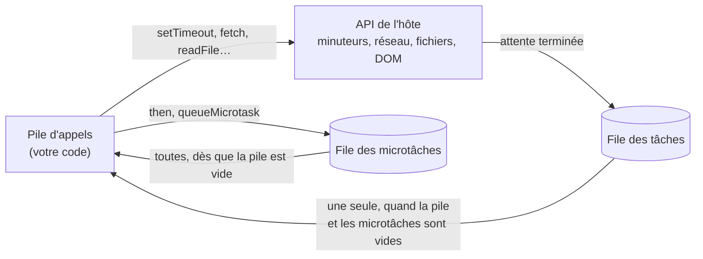
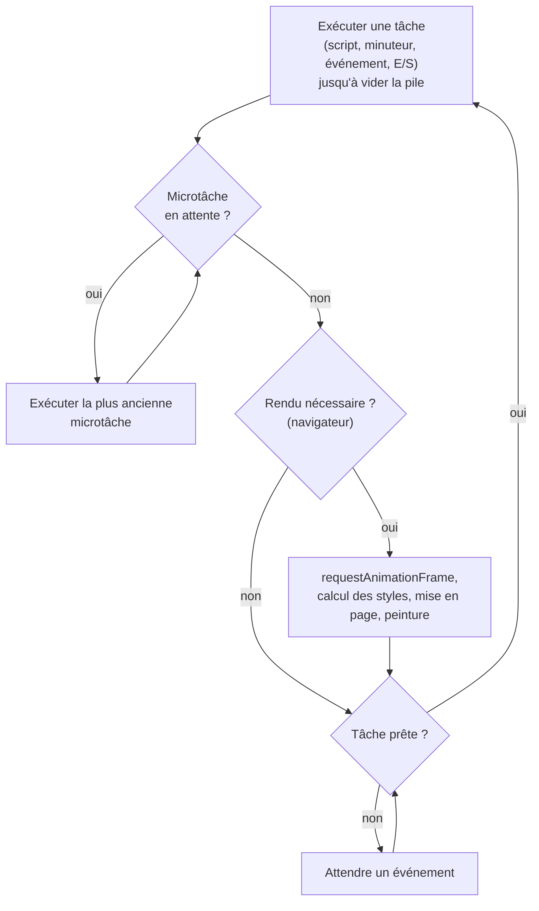
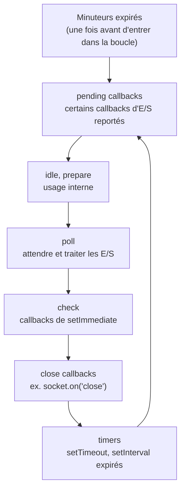

# 18 — L'asynchrone et la boucle d'événements

> **Niveau** : Intermédiaire · **Durée** : ~3 h · **Prérequis** : [Fonctions](../06-fonctions/README.md), [Erreurs](../17-erreurs/README.md)

JavaScript n'exécute qu'une seule chose à la fois. Pourtant, une page web reste réactive pendant qu'elle télécharge des données, et un serveur Node.js répond à des milliers de clients avec un seul thread. Ce chapitre explique le mécanisme qui rend cela possible, la **boucle d'événements**, et vous apprend à prédire dans quel ordre votre code s'exécute. C'est le socle des deux chapitres suivants : les [promesses](../19-promises/README.md) et [`async`/`await`](../20-async-await/README.md).

## Objectifs

- Expliquer pourquoi JavaScript a besoin de l'asynchrone et ce que « mono-thread » veut vraiment dire.
- Décrire le rôle de la pile d'appels, des API de l'hôte, de la file des tâches et de la file des microtâches.
- Prédire l'ordre d'exécution d'un programme qui mélange code synchrone, `setTimeout`, promesses et `queueMicrotask`.
- Écrire et lire du code à base de callbacks, et reconnaître ses limites (pyramide, erreurs perdues, inversion de contrôle).
- Connaître les spécificités de Node.js : phases de la boucle, `setImmediate`, `process.nextTick`.
- Repérer le code qui bloque la boucle et le corriger (découpage en morceaux, workers).

## Sommaire

- [Pourquoi l'asynchrone](#pourquoi-lasynchrone)
- [Le modèle d'exécution](#le-modèle-dexécution)
- [La boucle d'événements](#la-boucle-dévénements)
- [Tâches et microtâches](#tâches-et-microtâches)
- [La boucle et le rendu dans le navigateur](#la-boucle-et-le-rendu-dans-le-navigateur)
- [Les callbacks](#les-callbacks)
- [Prédire l'ordre d'exécution](#prédire-lordre-dexécution)
- [Les spécificités de Node.js](#les-spécificités-de-nodejs)
- [Ne pas bloquer la boucle](#ne-pas-bloquer-la-boucle)
- [Workers et vrai parallélisme](#workers-et-vrai-parallélisme)
- [La suite de la partie Asynchrone](#la-suite-de-la-partie-asynchrone)
- [Pièges courants](#pièges-courants)
- [Bonnes pratiques](#bonnes-pratiques)
- [Résumé](#résumé)
- [Exercices](#exercices)
- [Pour aller plus loin](#pour-aller-plus-loin)

## Pourquoi l'asynchrone

### Un seul thread pour votre code

Votre code JavaScript s'exécute sur **un seul thread** : une seule pile d'appels, une seule instruction à la fois. Dans un navigateur, ce thread (le *thread principal*) gère aussi l'affichage et les interactions de l'utilisateur.

Imaginons qu'on veuille attendre une seconde de la manière la plus naïve possible :

<!-- no-run -->
```js
// ❌ Attente active : le thread tourne à vide pendant 1 seconde
function patienter(ms) {
  const fin = Date.now() + ms;
  while (Date.now() < fin) {
    // on ne fait rien, mais on occupe le thread
  }
}

console.log("Chargement…");
patienter(1000); // dans un navigateur, la page est figée : ni clic, ni défilement
console.log("Terminé");
```

Pendant cette seconde, rien d'autre ne peut se produire : aucun clic n'est traité, aucune animation ne progresse, un serveur ne répond à aucune requête. Or un programme réel passe l'essentiel de son temps à **attendre** : une réponse réseau (couramment des dizaines ou des centaines de millisecondes, soit des millions d'opérations pour le processeur), un fichier sur le disque, une action de l'utilisateur.

### Déléguer l'attente

La solution : ne pas attendre soi-même. On confie l'attente à l'**environnement hôte** (le navigateur ou Node.js), on lui donne une fonction à rappeler quand le résultat sera prêt — un *callback* —, et on continue immédiatement.

```js
console.log("1. Je commande un café");

setTimeout(() => {
  console.log("3. Le café est prêt");
}, 100);

console.log("2. Je lis mes e-mails en attendant");
// 1. Je commande un café
// 2. Je lis mes e-mails en attendant
// 3. Le café est prêt
```

`setTimeout` ne met pas le programme en pause : il demande à l'hôte de rappeler la fonction dans 100 ms, puis rend la main aussitôt.

> [!NOTE]
> « Mono-thread » concerne **votre** code JavaScript. L'hôte, lui, utilise plusieurs threads en interne : le navigateur pour le réseau, le décodage d'images ou le ramasse-miettes ; Node.js pour les fichiers ou la compression (via la bibliothèque libuv). Votre code, lui, ne voit qu'un seul fil d'exécution.

### Vocabulaire

| Terme | Sens |
| --- | --- |
| **Synchrone** | Le résultat est disponible quand l'appel se termine (`Math.max`, `JSON.parse`). |
| **Asynchrone** | L'appel se termine tout de suite ; le résultat arrive plus tard, via un callback, une promesse ou un événement. |
| **Bloquant** | Occupe le thread jusqu'à la fin (`fs.readFileSync`, une boucle de calcul). |
| **Non bloquant** | Rend la main immédiatement et laisse le thread libre pour autre chose. |
| **Concurrence** | Plusieurs tâches progressent sur la même période en s'entrelaçant : un cuisinier qui surveille trois casseroles. |
| **Parallélisme** | Plusieurs tâches s'exécutent au même instant sur plusieurs cœurs : trois cuisiniers. |

JavaScript offre nativement la **concurrence** sur un seul thread grâce à la boucle d'événements. Le **parallélisme** demande des [workers](#workers-et-vrai-parallélisme).

## Le modèle d'exécution

### La pile d'appels

La **pile d'appels** (*call stack*) mémorise où en est l'exécution. Chaque appel de fonction empile un cadre ; chaque `return` le dépile.

```js
function tva(prixHt) {
  return prixHt * 0.2;
}

function prixTtc(prixHt) {
  return prixHt + tva(prixHt);
}

console.log(prixTtc(50)); // 60
```

| Étape | Contenu de la pile (du bas vers le haut) |
| --- | --- |
| Début du script | `script` |
| Appel de `prixTtc(50)` | `script` → `prixTtc` |
| Appel de `tva(50)` | `script` → `prixTtc` → `tva` |
| `tva` renvoie `10` | `script` → `prixTtc` |
| `prixTtc` renvoie `60`, `console.log` l'affiche | `script` |
| Fin du script | *(vide)* |

Une pile qui grandit sans fin (récursion infinie) provoque une `RangeError: Maximum call stack size exceeded` (voir le [chapitre 06](../06-fonctions/README.md)).

### Exécution jusqu'au bout

Règle fondamentale : **une fonction en cours d'exécution n'est jamais interrompue** par un callback. Le callback attend que la pile soit vide (*run-to-completion*).

```js
setTimeout(() => console.log("minuteur (prévu à 0 ms)"), 0);

const fin = Date.now() + 100;
while (Date.now() < fin) {} // 100 ms de calcul

console.log("boucle terminée");
// boucle terminée
// minuteur (prévu à 0 ms)
```

Un délai de `0` ne veut pas dire « tout de suite », mais « dès que possible, quand le thread sera libre ». Conséquence heureuse : à l'intérieur d'un bloc de code synchrone, aucune autre partie de votre programme ne peut modifier vos variables dans votre dos. Ce n'est plus vrai *entre* deux étapes asynchrones, comme on le verra au [chapitre 20](../20-async-await/README.md#lordre-dexécution-dune-fonction-async).

### Les API de l'hôte

La spécification ECMAScript définit le langage, y compris les promesses. Mais `setTimeout`, `fetch`, le DOM ou `fs.readFile` **ne font pas partie du langage** : ce sont des API fournies par l'hôte. Dans le navigateur, la boucle d'événements elle-même est définie par la spécification HTML ; dans Node.js, elle est implémentée par libuv.

| API | Qui gère l'attente | Où arrive le callback |
| --- | --- | --- |
| `setTimeout`, `setInterval` | les minuteurs de l'hôte | file des tâches |
| Événements DOM (clic, touche…) | le navigateur | file des tâches |
| `fetch` | la pile réseau de l'hôte | la promesse se règle dans une tâche ; ses `then` sont des microtâches |
| `fs.readFile` (Node.js) | le pool de threads de libuv | file des tâches (phase *poll*) |
| `then`, `catch`, `finally`, `await`, `queueMicrotask` | le moteur JavaScript | file des microtâches |
| `MutationObserver` (navigateur) | le navigateur | file des microtâches |

### Les files d'attente

Quand l'hôte a terminé une attente, il ne peut pas appeler votre callback n'importe quand (la pile est peut-être occupée). Il le dépose dans une **file d'attente** :

- la **file des tâches** (*task queue*, aussi appelée *callback queue*) : minuteurs, événements, entrées/sorties ;
- la **file des microtâches** (*microtask queue*) : réactions des promesses et `queueMicrotask`. Elle est **prioritaire**.

> [!NOTE]
> Vous rencontrerez le terme « macrotâche » (*macrotask*) pour désigner les tâches. Il est très répandu mais n'existe pas dans les spécifications, qui parlent simplement de *tasks* et de *microtasks*.



## La boucle d'événements

La **boucle d'événements** (*event loop*) est l'algorithme qui décide quoi exécuter ensuite. En simplifiant :

```text
tant que le programme est en vie :
  1. prendre la plus ancienne tâche prête et l'exécuter jusqu'au bout
  2. exécuter TOUTES les microtâches, y compris celles ajoutées pendant ce temps
  3. (navigateur) mettre à jour l'affichage si nécessaire
  4. s'il n'y a rien à faire, dormir jusqu'au prochain événement
```

L'exécution du script lui-même est la toute première tâche.



Suivons un exemple pas à pas.

```js
console.log("début");
setTimeout(() => console.log("minuteur"), 0);
Promise.resolve().then(() => console.log("promesse"));
console.log("fin");
// début
// fin
// promesse
// minuteur
```

| Étape | Ce qui se passe | Microtâches | Tâches | Affichage |
| --- | --- | --- | --- | --- |
| 1 | `console.log("début")` | | | début |
| 2 | `setTimeout` confie le minuteur à l'hôte, qui dépose le callback dans la file dès qu'il expire | | minuteur | |
| 3 | `Promise.resolve()` est déjà tenue : son `then` part dans les microtâches | promesse | minuteur | |
| 4 | `console.log("fin")` ; le script se termine, la pile est vide | promesse | minuteur | fin |
| 5 | La boucle vide les microtâches | | minuteur | promesse |
| 6 | La boucle prend la tâche suivante | | | minuteur |

Dans Node.js, le programme se termine quand il ne reste plus rien à attendre : aucun minuteur actif, aucune connexion ouverte, aucune lecture de fichier en cours. Dans un navigateur, la boucle tourne tant que la page est ouverte.

## Tâches et microtâches

| | Tâches | Microtâches |
| --- | --- | --- |
| Sources | script initial, `setTimeout`, `setInterval`, événements, E/S, `MessageChannel`, `setImmediate` (Node.js) | `then`/`catch`/`finally`, reprise après `await`, `queueMicrotask`, `MutationObserver` |
| Combien par tour | **une** | **toutes**, jusqu'à ce que la file soit vide |
| Le rendu peut-il s'intercaler ? | oui, entre deux tâches | non |

La règle « toutes les microtâches » a une conséquence importante : une microtâche qui en ajoute une autre passe **avant** toute tâche déjà en attente.

```js
setTimeout(() => console.log("tâche : minuteur"), 0);

let compteur = 0;
function microtache() {
  compteur++;
  if (compteur < 3) queueMicrotask(microtache);
  console.log(`microtâche ${compteur}`);
}
queueMicrotask(microtache);
// microtâche 1
// microtâche 2
// microtâche 3
// tâche : minuteur
```

Sans la condition `compteur < 3`, le minuteur ne s'exécuterait jamais et, dans un navigateur, la page gèlerait : des microtâches récursives **affament** la boucle. Un `setTimeout` récursif, lui, laisse passer les autres tâches et le rendu entre deux appels.

### `queueMicrotask` : à quoi ça sert

`queueMicrotask(callback)` programme une microtâche sans créer de promesse. On l'utilise rarement, surtout pour **différer un travail à la fin de la tâche courante**, par exemple pour regrouper plusieurs modifications synchrones en une seule notification. Plusieurs frameworks regroupent ainsi leurs mises à jour.

```js
const changements = [];
let notificationPrevue = false;

function signalerChangement(champ) {
  changements.push(champ);
  if (!notificationPrevue) {
    notificationPrevue = true;
    queueMicrotask(() => {
      console.log("Enregistrement groupé :", changements.join(", "));
      changements.length = 0;
      notificationPrevue = false;
    });
  }
}

signalerChangement("nom");
signalerChangement("email");
signalerChangement("ville");
console.log("Modifications terminées");
// Modifications terminées
// Enregistrement groupé : nom, email, ville
```

Une exception levée dans un callback de `queueMicrotask` est signalée comme une exception non interceptée (et non comme une promesse rejetée).

## La boucle et le rendu dans le navigateur

L'écran se rafraîchit typiquement 60 fois par seconde (souvent plus), soit environ 16,7 ms par image à 60 Hz. Le navigateur ne peut redessiner la page **qu'entre deux tâches**, après les microtâches. Une tâche qui dure longtemps retarde donc l'affichage *et* la réponse aux clics. Le navigateur qualifie de **tâche longue** (*long task*) toute tâche de 50 ms ou plus ; ce sont elles qui dégradent l'indicateur de réactivité INP (*Interaction to Next Paint*).

<!-- no-run -->
```js
// ❌ La barre ne bouge pas pendant la boucle : l'écran n'est redessiné qu'à la fin
const barre = document.querySelector("progress");
for (let i = 0; i <= 100; i++) {
  barre.value = i;
  calculLourd(i); // fonction coûteuse quelconque
}
```

Le DOM est bien modifié 101 fois, mais le rendu n'a lieu qu'une fois la tâche terminée : l'utilisateur voit la barre passer d'un coup de 0 à 100. La solution est de [découper le travail](#ne-pas-bloquer-la-boucle) pour rendre la main entre deux morceaux. Pour synchroniser une animation avec l'affichage, on utilise `requestAnimationFrame`, dont le callback s'exécute juste avant le rendu (voir le [chapitre 21](../21-timers/README.md)).

> [!NOTE]
> Plus précisément, la file des microtâches est vidée chaque fois que la pile d'appels se vide, pas seulement à la fin d'une tâche. Lors d'un vrai clic, si un bouton a deux écouteurs, les microtâches du premier s'exécutent avant le second. Avec `bouton.click()` appelé depuis votre code, la pile n'est pas vide entre les deux écouteurs : les microtâches attendent la fin des deux. Ce détail compte rarement, mais il explique certains comportements surprenants dans les tests.

## Les callbacks

### Callbacks synchrones et asynchrones

Un **callback** est une fonction passée en argument pour être appelée plus tard (voir les fonctions d'ordre supérieur au [chapitre 06](../06-fonctions/README.md)). Tous les callbacks ne sont pas asynchrones :

```js
const prix = [10, 20, 30];

prix.forEach((p) => console.log("synchrone", p)); // appelé pendant forEach
setTimeout(() => console.log("asynchrone"), 0); // appelé plus tard, dans une autre tâche
console.log("après forEach et setTimeout");
// synchrone 10
// synchrone 20
// synchrone 30
// après forEach et setTimeout
// asynchrone
```

### La convention « erreur d'abord » de Node.js

Les API historiques de Node.js passent au callback l'erreur en **premier** argument (`null` si tout va bien), puis le résultat :

```js
import { readFile } from "node:fs";

readFile("fichier-introuvable.txt", "utf8", (erreur, contenu) => {
  if (erreur) {
    console.log("Lecture impossible :", erreur.code); // Lecture impossible : ENOENT
    return;
  }
  console.log(contenu);
});
```

Si vous écrivez vous-même une API à callbacks, respectez cette convention : elle est attendue par les outils comme `util.promisify` (voir le [chapitre 19](../19-promises/README.md#promisifier-une-api-à-callbacks)).

### La pyramide des callbacks

Chaque étape dépend de la précédente : charger un utilisateur, puis ses commandes, puis la livraison de la dernière commande. Avec des callbacks, chaque étape s'imbrique dans la précédente. Les fonctions ci-dessous simulent des appels réseau avec un court délai.

```js
function chargerUtilisateur(id, callback) {
  setTimeout(() => {
    if (id <= 0) callback(new Error(`Utilisateur ${id} introuvable`));
    else callback(null, { id, nom: "Ada" });
  }, 10);
}

function chargerCommandes(utilisateur, callback) {
  setTimeout(() => callback(null, [{ numero: "C-101" }, { numero: "C-102" }]), 10);
}

function chargerLivraison(commande, callback) {
  setTimeout(() => callback(null, { commande: commande.numero, statut: "expédiée" }), 10);
}

chargerUtilisateur(1, (erreur, utilisateur) => {
  if (erreur) return console.error(erreur.message);
  chargerCommandes(utilisateur, (erreur, commandes) => {
    if (erreur) return console.error(erreur.message);
    chargerLivraison(commandes.at(-1), (erreur, livraison) => {
      if (erreur) return console.error(erreur.message);
      console.log(`${utilisateur.nom} : commande ${livraison.commande} ${livraison.statut}`);
      // Ada : commande C-102 expédiée
    });
  });
});
```

Trois étapes suffisent à dessiner la fameuse « pyramide » (*callback hell*). Ses défauts vont au-delà de l'esthétique.

**1. La gestion d'erreurs est répétée à chaque niveau**, et il suffit d'un oubli pour qu'une erreur disparaisse silencieusement.

**2. `try/catch` ne traverse pas l'asynchrone.** Quand le callback s'exécute, le bloc `try` est terminé depuis longtemps : il n'est plus sur la pile.

```js
process.on("uncaughtException", (erreur) => {
  console.log("Exception non interceptée :", erreur.message);
});

try {
  setTimeout(() => {
    throw new Error("lancée dans le minuteur");
  }, 0);
  console.log("try terminé sans erreur");
} catch {
  console.log("jamais affiché");
}
// try terminé sans erreur
// Exception non interceptée : lancée dans le minuteur
```

**3. L'inversion de contrôle.** En passant votre callback à une fonction tierce, vous lui confiez la suite de votre programme. Rien ne garantit qu'elle l'appellera une seule fois, qu'elle l'appellera tout court, ou qu'elle l'appellera toujours de façon asynchrone. Ce dernier cas est particulièrement sournois :

```js
const cache = new Map();

// ❌ Tantôt synchrone (valeur en cache), tantôt asynchrone
function lireConfig(nom, callback) {
  if (cache.has(nom)) {
    callback(cache.get(nom));
    return;
  }
  setTimeout(() => {
    cache.set(nom, `valeur de ${nom}`);
    callback(cache.get(nom));
  }, 10);
}

function demo(etiquette) {
  console.log(`${etiquette} : avant`);
  lireConfig("theme", () => console.log(`${etiquette} : callback`));
  console.log(`${etiquette} : après`);
}

demo("1er appel");
setTimeout(() => demo("2e appel"), 50);
// 1er appel : avant
// 1er appel : après
// 1er appel : callback
// 2e appel : avant
// 2e appel : callback
// 2e appel : après
```

Le même code produit deux ordres différents selon l'état du cache : un code appelant qui initialise une variable *après* l'appel fonctionnera la première fois et cassera la seconde. Une API asynchrone doit l'être **toujours** (ici, il suffirait de remplacer l'appel direct par `queueMicrotask(() => callback(cache.get(nom)))`). Ce piège est si connu qu'il a un surnom dans la communauté Node.js : « libérer Zalgo ».

Les **promesses** ont été conçues pour régler ces trois problèmes : un résultat réglé une seule fois, des réactions toujours asynchrones, des erreurs qui se propagent jusqu'à un gestionnaire unique. C'est l'objet du [chapitre 19](../19-promises/README.md).

## Prédire l'ordre d'exécution

Savoir prédire l'ordre d'affichage d'un programme asynchrone, c'est la preuve qu'on a compris la boucle. Voici une méthode en quatre étapes.

1. **Exécutez tout le code synchrone**, de haut en bas, en notant les affichages. Attention : la fonction passée à `new Promise(…)` (l'*exécuteur*) s'exécute **immédiatement**, de façon synchrone. De même, le corps d'une fonction `async` s'exécute de façon synchrone jusqu'à son premier `await` (voir le [chapitre 20](../20-async-await/README.md#lordre-dexécution-dune-fonction-async)).
2. **Rangez chaque callback dans sa file** au moment où il est programmé :
   - `then`/`catch`/`finally` sur une promesse **déjà réglée**, ou `queueMicrotask` → file des microtâches ;
   - `then` sur une promesse **en attente** → rien pour l'instant : la réaction partira dans les microtâches quand la promesse sera réglée ;
   - `setTimeout`, `setInterval` → file des tâches, dans l'ordre d'expiration (à délai égal, dans l'ordre de création).
3. **Pile vide : videz la file des microtâches**, y compris celles ajoutées au passage.
4. **Prenez la tâche suivante**, exécutez-la, puis revenez à l'étape 3.

### Exemple 1 — l'exécuteur est synchrone

```js
console.log("1");

const promesse = new Promise((resolve) => {
  console.log("2 : l'exécuteur s'exécute tout de suite");
  resolve("ok");
});

promesse.then((valeur) => console.log("4 :", valeur));
console.log("3");
// 1
// 2 : l'exécuteur s'exécute tout de suite
// 3
// 4 : ok
```

### Exemple 2 — tâches et microtâches imbriquées

```js
setTimeout(() => {
  console.log("minuteur 1");
  Promise.resolve().then(() => console.log("microtâche dans minuteur 1"));
}, 0);

setTimeout(() => console.log("minuteur 2"), 0);

Promise.resolve().then(() => {
  console.log("microtâche 1");
  setTimeout(() => console.log("minuteur 3"), 0);
});
// microtâche 1
// minuteur 1
// microtâche dans minuteur 1
// minuteur 2
// minuteur 3
```

| Moment | Affichage | File des microtâches après | File des tâches après |
| --- | --- | --- | --- |
| Fin du script | | microtâche 1 | minuteur 1, minuteur 2 |
| Microtâches | microtâche 1 | | minuteur 1, minuteur 2, minuteur 3 |
| Tâche « minuteur 1 » | minuteur 1 | microtâche dans minuteur 1 | minuteur 2, minuteur 3 |
| Microtâches | microtâche dans minuteur 1 | | minuteur 2, minuteur 3 |
| Tâche « minuteur 2 » | minuteur 2 | | minuteur 3 |
| Tâche « minuteur 3 » | minuteur 3 | | |

La microtâche créée dans « minuteur 1 » passe **avant** « minuteur 2 », alors que celui-ci attendait déjà : après chaque tâche, les microtâches sont vidées.

### Exemple 3 — deux chaînes de promesses s'entrelacent

```js
Promise.resolve()
  .then(() => console.log("1a"))
  .then(() => console.log("1b"))
  .then(() => console.log("1c"));

Promise.resolve()
  .then(() => console.log("2a"))
  .then(() => console.log("2b"))
  .then(() => console.log("2c"));
// 1a
// 2a
// 1b
// 2b
// 1c
// 2c
```

Chaque `then` renvoie une nouvelle promesse, réglée seulement quand son callback a fini. « 1b » n'entre donc dans la file qu'après l'exécution de « 1a », derrière « 2a » qui y était déjà.

### Exemple 4 — des délais différents

```js
setTimeout(() => console.log("100 ms"), 100);
setTimeout(() => console.log("0 ms"), 0);
setTimeout(() => console.log("50 ms"), 50);
// 0 ms
// 50 ms
// 100 ms
```

Le délai d'un minuteur est un **minimum**, jamais une garantie : si la boucle est occupée, le callback attend (voir [Ne pas bloquer la boucle](#ne-pas-bloquer-la-boucle) et le [chapitre 21](../21-timers/README.md) pour la précision des minuteurs).

## Les spécificités de Node.js

### libuv et les phases de la boucle

Node.js associe le moteur V8 à **libuv**, une bibliothèque C qui fournit la boucle d'événements et les entrées/sorties asynchrones. Le réseau s'appuie sur les mécanismes non bloquants du système d'exploitation ; les opérations qui n'en disposent pas (fichiers, `dns.lookup`, une partie de `crypto` et de `zlib`) passent par un **pool de threads**, de 4 threads par défaut (variable d'environnement `UV_THREADPOOL_SIZE`).

La boucle de Node.js ne se résume pas à une seule file de tâches : chaque tour traverse plusieurs **phases**, chacune avec sa propre file.



Depuis Node.js 20 (libuv 1.45), les minuteurs sont traités **après** la phase *poll* de chaque tour, et une fois avant d'entrer dans la boucle ; auparavant ils l'étaient en début de tour. Ce détail explique les différences que vous pourriez lire dans d'anciens articles.

Entre **chaque callback**, quelle que soit la phase, Node.js vide la file `process.nextTick` puis la file des microtâches (comme le navigateur le fait entre deux tâches).

### `setImmediate` ou `setTimeout(…, 0)`

`setImmediate(callback)` programme un callback pour la phase *check* du tour en cours ou du suivant. Comparé à `setTimeout(callback, 0)` :

- **dans le module principal**, l'ordre entre les deux est **imprévisible** : il dépend du temps écoulé avant l'entrée dans la boucle ;
- **dans un callback d'entrée/sortie** (phase *poll*), `setImmediate` passe **toujours** en premier, car la phase *check* suit directement.

```js
import { readFile } from "node:fs";

readFile(import.meta.filename, () => {
  // nous sommes dans la phase poll
  setTimeout(() => console.log("setTimeout"), 0);
  setImmediate(() => console.log("setImmediate"));
  queueMicrotask(() => console.log("microtâche"));
});
// microtâche
// setImmediate
// setTimeout
```

### `process.nextTick`

`process.nextTick(callback)` place le callback dans une file propre à Node.js, traitée **avant** les microtâches à la fin de l'opération en cours. Il existe depuis les débuts de Node.js, avant les promesses. Sa documentation le classe désormais comme **hérité** (*Legacy*, depuis Node.js 22.7 et 20.18) et recommande d'utiliser `queueMicrotask()` à la place : c'est standard, et cela fonctionne aussi dans le navigateur.

Son ordre relatif aux promesses a même une subtilité : il dépend du type de module.

```js
// Ce bloc est un module ES (comme tous les exemples de ce cours)
Promise.resolve().then(() => console.log("promesse"));
queueMicrotask(() => console.log("microtâche"));
process.nextTick(() => console.log("nextTick"));
// promesse
// microtâche
// nextTick
```

Dans un module ES, le code de premier niveau s'exécute lui-même pendant le traitement des microtâches : Node.js finit de vider cette file avant de passer à `nextTick`. Le même code dans un fichier CommonJS (`.cjs`, `require`) affiche `nextTick`, `promesse`, `microtâche`. À l'intérieur d'un callback (minuteur, E/S), `nextTick` passe toujours avant les microtâches. Conclusion pratique : ne faites pas dépendre votre programme de cet ordre, et utilisez `queueMicrotask`.

Comme les microtâches, des appels récursifs à `process.nextTick` empêchent la boucle d'atteindre la phase *poll* et affament les entrées/sorties.

## Ne pas bloquer la boucle

### Les symptômes

Un seul thread exécute votre code : tant qu'un calcul l'occupe, **tout le reste attend**. Dans un serveur, ce ne sont pas seulement la requête en cours mais toutes les requêtes de tous les clients qui sont retardées. Dans une page, l'interface est figée.

```js
const debut = performance.now();

setTimeout(() => {
  const retard = performance.now() - debut;
  console.log(`Minuteur prévu à 10 ms, exécuté vers ${Math.round(retard / 100) * 100} ms`);
}, 10);

const fin = Date.now() + 300;
while (Date.now() < fin) {} // calcul synchrone de 300 ms
console.log("Calcul terminé");
// Calcul terminé
// Minuteur prévu à 10 ms, exécuté vers 300 ms
```

### Les coupables habituels

| Coupable | Alternative |
| --- | --- |
| Gros calcul dans une boucle (statistiques, chiffrement, traitement d'image) | découper en morceaux, ou déléguer à un worker |
| `JSON.parse`/`JSON.stringify` sur des données énormes | réduire la taille, traiter en flux (voir le [chapitre 27](../27-nodejs/README.md)) |
| API synchrones dans un serveur : `readFileSync`, `execSync`, `pbkdf2Sync`… | leurs versions asynchrones (`fs/promises`, `execFile`, `pbkdf2`) |
| Expression régulière à retour arrière catastrophique | réécrire la regex (voir le [chapitre 14](../14-regex/README.md)) |
| Microtâches ou `nextTick` récursifs sans fin | une tâche (`setTimeout`, `setImmediate`) entre deux étapes |

Les API synchrones ne sont pas interdites : dans un script en ligne de commande ou au démarrage d'un serveur, `readFileSync` est simple et sans danger. Le problème, c'est de les appeler **pendant** que le programme doit rester réactif.

Pour mesurer : dans Node.js, `monitorEventLoopDelay` du module `node:perf_hooks` mesure le retard de la boucle ; dans le navigateur, l'onglet *Performance* des outils de développement signale les tâches longues.

### Découper le travail en morceaux

Quand un traitement est inévitable, on le découpe et on **rend la main** à la boucle entre deux morceaux, en programmant la suite comme une nouvelle tâche. Les autres tâches (requêtes, clics, rendu) peuvent s'intercaler.

```js
const commandes = Array.from({ length: 30_000 }, (_, i) => ({ montant: i % 100 }));

// ❌ Version bloquante : tout est traité dans une seule tâche
function totalBloquant(elements, quandTermine) {
  let total = 0;
  for (const element of elements) total += element.montant;
  quandTermine(total);
}

// ✅ Version découpée : 1 000 éléments par tâche
function totalParMorceaux(elements, quandTermine, tailleMorceau = 1000) {
  let total = 0;
  let index = 0;
  function traiterMorceau() {
    const fin = Math.min(index + tailleMorceau, elements.length);
    for (; index < fin; index++) total += elements[index].montant;
    if (index < elements.length) setImmediate(traiterMorceau); // rend la main
    else quandTermine(total);
  }
  traiterMorceau();
}

setImmediate(() => console.log("Une requête est traitée pendant le calcul"));
totalBloquant(commandes, (total) => console.log("Bloquant :", total));
totalParMorceaux(commandes, (total) => console.log("Par morceaux :", total));
// Bloquant : 1485000
// Une requête est traitée pendant le calcul
// Par morceaux : 1485000
```

Dans le navigateur, on rend la main avec `setTimeout(suite, 0)`, ou mieux avec `await scheduler.yield()`, disponible dans Chrome 129+ et Firefox 142+ mais pas encore dans Safari d'après MDN (novembre 2026). Ces outils sont détaillés au [chapitre 21](../21-timers/README.md), et la version `async`/`await` de ce découpage au [chapitre 20](../20-async-await/README.md#performance).

## Workers et vrai parallélisme

Découper ne rend pas le calcul plus rapide : on partage seulement le thread. Pour exécuter du code JavaScript **en parallèle** sur un autre cœur, il faut un **worker** : un thread séparé, avec sa propre pile, son propre tas et sa propre boucle d'événements. Le thread principal et le worker ne partagent pas leurs variables : ils communiquent par **messages**, dont les données sont copiées (algorithme de clonage structuré, celui de `structuredClone`).

### Dans Node.js : `worker_threads`

Cet exemple relance le fichier lui-même dans un worker pour compter les nombres premiers, pendant que le thread principal reste libre.

```js
import { Worker, isMainThread, parentPort, workerData } from "node:worker_threads";

function compterPremiers(limite) {
  let total = 0;
  for (let n = 2; n <= limite; n++) {
    let premier = true;
    for (let d = 2; d * d <= n; d++) {
      if (n % d === 0) {
        premier = false;
        break;
      }
    }
    if (premier) total++;
  }
  return total;
}

if (isMainThread) {
  const worker = new Worker(new URL(import.meta.url), { workerData: 1_000_000 });
  worker.once("message", (total) => console.log(`${total} nombres premiers trouvés par le worker`));
  worker.once("error", (erreur) => console.error("Erreur dans le worker :", erreur));
  setTimeout(() => console.log("Le thread principal reste disponible"), 0);
} else {
  parentPort.postMessage(compterPremiers(workerData));
}
// Le thread principal reste disponible
// 78498 nombres premiers trouvés par le worker
```

### Dans le navigateur : Web Workers

```html
<script type="module">
  const worker = new Worker(new URL("./calcul.js", import.meta.url), { type: "module" });
  worker.addEventListener("message", (evenement) => {
    console.log("Résultat :", evenement.data);
  });
  worker.postMessage(1_000_000);
</script>
```

<!-- no-run -->
```js
// calcul.js — s'exécute dans le worker
import { compterPremiers } from "./premiers.js";

self.addEventListener("message", (evenement) => {
  self.postMessage(compterPremiers(evenement.data));
});
```

Ce qu'il faut savoir avant d'utiliser des workers :

- un worker n'a **pas accès au DOM** ; il dispose en revanche de `fetch`, des minuteurs, d'IndexedDB… ;
- démarrer un worker coûte du temps et de la mémoire : il est rentable pour des calculs longs, pas pour de petites opérations. Pour de nombreuses tâches, on réutilise un groupe de workers (*pool*), par exemple avec la bibliothèque Piscina dans Node.js ;
- pour éviter de copier de gros volumes, on peut **transférer** un `ArrayBuffer` (il devient inutilisable chez l'expéditeur) ou partager un `SharedArrayBuffer` synchronisé avec `Atomics` ; dans le navigateur, ce dernier exige une page *cross-origin isolated* (en-têtes COOP et COEP).

## La suite de la partie Asynchrone

| Chapitre | Ce que vous y apprendrez |
| --- | --- |
| [19 — Promesses](../19-promises/README.md) | l'objet promesse, le chaînage, la propagation des erreurs, les combinateurs `all`/`allSettled`/`race`/`any` |
| [20 — `async`/`await`](../20-async-await/README.md) | la syntaxe moderne et les patterns appliqués : parallélisme, annulation, timeout, retry, limiteur, pagination |
| [21 — Minuteurs](../21-timers/README.md) | `setTimeout` en détail, `requestAnimationFrame`, debounce et throttle |
| [22 — Fetch et HTTP](../22-fetch-http/README.md) | les requêtes réseau |

Le même enchaînement, écrit dans les trois styles que vous allez rencontrer :

<!-- no-run -->
```js
// Callbacks (ce chapitre)
chargerUtilisateur(1, (erreur, utilisateur) => {
  if (erreur) return gererErreur(erreur);
  chargerCommandes(utilisateur, (erreur, commandes) => {
    if (erreur) return gererErreur(erreur);
    afficher(commandes);
  });
});

// Promesses (chapitre 19)
chargerUtilisateur(1).then(chargerCommandes).then(afficher).catch(gererErreur);

// async/await (chapitre 20)
try {
  const utilisateur = await chargerUtilisateur(1);
  afficher(await chargerCommandes(utilisateur));
} catch (erreur) {
  gererErreur(erreur);
}
```

## Pièges courants

- **Croire que `setTimeout(f, 0)` exécute `f` immédiatement.** Il l'exécute dans une tâche ultérieure, après tout le code synchrone et toutes les microtâches.
- **Entourer un appel asynchrone d'un `try/catch`** en espérant attraper les erreurs du callback : le callback s'exécute plus tard, hors du `try`.
- **Faire une pause avec une boucle d'attente active** (`while (Date.now() < fin)`) : tout le programme est gelé.
- **Appeler un callback tantôt de façon synchrone, tantôt de façon asynchrone** : l'ordre d'exécution du code appelant devient imprévisible.
- **Créer des microtâches récursives sans fin** : contrairement à un `setTimeout` récursif, elles affament la boucle et gèlent la page.
- **Utiliser des API synchrones (`readFileSync`…) dans un serveur** : chaque appel bloque tous les clients.
- **Compter sur l'ordre de `setTimeout(…, 0)` et `setImmediate` dans le module principal** : il n'est pas déterministe.
- **Dépendre de l'ordre entre `process.nextTick` et les promesses** : il diffère entre CommonJS et modules ES.

## Bonnes pratiques

- Gardez chaque tâche courte : visez moins de 50 ms, et déplacez les calculs lourds dans un worker.
- Préférez les API asynchrones dès que le programme doit rester réactif.
- Une fonction asynchrone doit l'être **toujours**, même quand le résultat est déjà connu.
- Pour différer un travail à la fin de la tâche courante, utilisez `queueMicrotask` plutôt que `process.nextTick`.
- Dans le nouveau code, préférez les promesses et `async`/`await` aux callbacks ; convertissez les vieilles API à callbacks (chapitre 19).
- Si vous écrivez une API à callbacks, respectez la convention « erreur d'abord ».

## Résumé

- Votre code JavaScript s'exécute sur un seul thread ; l'hôte (navigateur, Node.js) se charge des attentes et vous rappelle via des callbacks.
- Une fonction en cours n'est jamais interrompue : un callback attend que la pile d'appels soit vide.
- Deux files : les **tâches** (minuteurs, événements, E/S), traitées une par une, et les **microtâches** (promesses, `queueMicrotask`), vidées entièrement après chaque tâche.
- L'ordre se prédit ainsi : code synchrone → toutes les microtâches → une tâche → toutes les microtâches → …
- Le navigateur ne redessine la page qu'entre deux tâches : une tâche longue (≥ 50 ms) fige l'interface.
- Les callbacks posent trois problèmes : pyramide, erreurs à gérer partout et hors de portée de `try/catch`, inversion de contrôle.
- Dans Node.js, la boucle traverse des phases (*timers*, *poll*, *check*…) ; `setImmediate` passe avant `setTimeout(…, 0)` dans un callback d'E/S ; `process.nextTick` est hérité, préférez `queueMicrotask`.
- Ne bloquez pas la boucle : API asynchrones, travail découpé en morceaux, workers pour le vrai parallélisme.

## Exercices

### Exercice 1 — Premier pronostic (★☆☆)

Sans exécuter le code, écrivez l'ordre des affichages.

```js
console.log("A");
setTimeout(() => console.log("B"), 0);
queueMicrotask(() => console.log("C"));
Promise.resolve().then(() => console.log("D"));
console.log("E");
```

<details>
<summary>Solution</summary>

```text
A
E
C
D
B
```

`A` et `E` sont synchrones. Les deux microtâches s'exécutent ensuite dans l'ordre où elles ont été programmées (`C` puis `D`). Le minuteur `B` est une tâche : il passe en dernier.

</details>

### Exercice 2 — Un compte à rebours non bloquant (★☆☆)

Écrivez `compteARebours(depart, quandFini)` qui affiche `3`, `2`, `1` à 100 ms d'intervalle (pour `depart = 3`), puis appelle `quandFini`, **sans boucle d'attente active**. Pendant le compte à rebours, le reste du programme doit pouvoir s'exécuter.

<details>
<summary>Solution</summary>

```js
function compteARebours(depart, quandFini) {
  if (depart === 0) {
    quandFini();
    return;
  }
  console.log(depart);
  setTimeout(() => compteARebours(depart - 1, quandFini), 100);
}

compteARebours(3, () => console.log("Partez !"));
console.log("Le programme continue pendant le compte à rebours");
// 3
// Le programme continue pendant le compte à rebours
// 2
// 1
// Partez !
```

Chaque étape programme la suivante avec `setTimeout` puis rend la main : entre deux affichages, le thread est libre. `3` s'affiche de façon synchrone, avant la ligne suivante du programme.

</details>

### Exercice 3 — Pronostic avec exécuteur et imbrications (★★☆)

Quel est l'ordre des affichages ?

```js
console.log("A");
setTimeout(() => {
  console.log("B");
  Promise.resolve().then(() => console.log("C"));
}, 0);
new Promise((resolve) => {
  console.log("D");
  resolve();
  console.log("E");
}).then(() => {
  console.log("F");
  setTimeout(() => console.log("G"), 0);
});
queueMicrotask(() => console.log("H"));
setTimeout(() => console.log("I"), 0);
console.log("J");
```

<details>
<summary>Solution</summary>

```text
A D E J F H B C I G
```

- Synchrone : `A`, puis l'exécuteur de la promesse (`D`, `E` : `resolve()` n'arrête pas l'exécuteur), puis `J`.
- File des tâches à la fin du script : `B`, `I`. File des microtâches : `F` (la promesse était déjà tenue quand `then` a été appelé), puis `H`.
- Microtâches : `F` (qui programme le minuteur `G`, placé derrière `I`), puis `H`.
- Tâche `B`, qui ajoute la microtâche `C`, exécutée aussitôt après. Puis les tâches `I` et `G`.

</details>

### Exercice 4 — Pronostic dans Node.js (★★☆)

Ce code s'exécute dans Node.js. Quel est l'ordre des affichages ? Pourquoi est-il déterministe ici, alors que `setTimeout(…, 0)` et `setImmediate` ne le sont pas dans le module principal ?

```js
import { readFile } from "node:fs";

readFile(import.meta.filename, () => {
  setTimeout(() => console.log("A"), 0);
  setImmediate(() => {
    console.log("B");
    Promise.resolve().then(() => console.log("D"));
  });
  queueMicrotask(() => console.log("E"));
  process.nextTick(() => console.log("F"));
});
```

<details>
<summary>Solution</summary>

```text
F E B D A
```

Le callback de `readFile` s'exécute dans la phase *poll*. À sa fin, Node.js vide la file `nextTick` (`F`) puis les microtâches (`E`). La phase suivante est *check* : `B` s'exécute, et sa microtâche `D` juste après lui. Le minuteur `A` n'est traité qu'à la phase *timers*, plus tard. C'est déterministe car, depuis un callback d'E/S, la phase *check* arrive toujours avant la phase *timers*. Dans le module principal, en revanche, le minuteur peut avoir expiré (ou non) avant que la boucle ne démarre.

</details>

### Exercice 5 — Libérer Zalgo… puis le renfermer (★★☆)

Reprenez la fonction `lireConfig` de la section [La pyramide des callbacks](#la-pyramide-des-callbacks) et corrigez-la pour qu'elle appelle **toujours** son callback de façon asynchrone. Vérifiez que les deux appels affichent alors `avant`, `après`, `callback` dans le même ordre.

<details>
<summary>Solution</summary>

```js
const cache = new Map();

function lireConfig(nom, callback) {
  if (cache.has(nom)) {
    queueMicrotask(() => callback(cache.get(nom))); // ✅ toujours asynchrone
    return;
  }
  setTimeout(() => {
    cache.set(nom, `valeur de ${nom}`);
    callback(cache.get(nom));
  }, 10);
}

function demo(etiquette) {
  console.log(`${etiquette} : avant`);
  lireConfig("theme", () => console.log(`${etiquette} : callback`));
  console.log(`${etiquette} : après`);
}

demo("1er appel");
setTimeout(() => demo("2e appel"), 50);
// 1er appel : avant
// 1er appel : après
// 1er appel : callback
// 2e appel : avant
// 2e appel : après
// 2e appel : callback
```

`queueMicrotask` reporte l'appel à la fin de la tâche courante : le résultat reste quasi immédiat, mais le code appelant voit toujours le même ordre. Une promesse donne cette garantie automatiquement (chapitre 19).

</details>

### Exercice 6 — Exécuter des tâches à callbacks en série (★★★)

Écrivez `enSerie(taches, callbackFinal)`. Chaque tâche est une fonction `(callback) => …` qui appelle `callback(erreur, resultat)` selon la convention « erreur d'abord ». `enSerie` lance les tâches **l'une après l'autre**, puis appelle `callbackFinal(null, resultats)` avec le tableau des résultats dans l'ordre. À la première erreur, elle s'arrête et appelle `callbackFinal(erreur)`.

<details>
<summary>Solution</summary>

```js
function enSerie(taches, callbackFinal) {
  const resultats = [];

  function lancer(index) {
    if (index === taches.length) {
      callbackFinal(null, resultats);
      return;
    }
    taches[index]((erreur, resultat) => {
      if (erreur) {
        callbackFinal(erreur);
        return;
      }
      resultats.push(resultat);
      lancer(index + 1);
    });
  }

  lancer(0);
}

// Tâches simulées
const tache = (valeur, delai, echoue = false) => (callback) =>
  setTimeout(() => (echoue ? callback(new Error(`échec de ${valeur}`)) : callback(null, valeur)), delai);

enSerie([tache("café", 30), tache("croissant", 10), tache("jus", 20)], (erreur, resultats) => {
  if (erreur) return console.log("Erreur :", erreur.message);
  console.log("Commande servie :", resultats.join(", "));
});

enSerie([tache("thé", 10), tache("gâteau", 10, true), tache("eau", 10)], (erreur, resultats) => {
  if (erreur) return console.log("Erreur :", erreur.message);
  console.log("Commande servie :", resultats.join(", "));
});
// Erreur : échec de gâteau
// Commande servie : café, croissant, jus
```

On ne peut pas utiliser une simple boucle : il faut attendre le callback d'une tâche avant de lancer la suivante. La fonction récursive `lancer` joue le rôle de la boucle, chaque appel étant déclenché par le callback précédent. La deuxième série s'exécute en même temps que la première et échoue plus tôt (au bout de 20 ms environ, contre 60 ms), d'où l'ordre des affichages. Avec `async`/`await`, ce sera une simple boucle `for…of` (chapitre 20).

</details>

### Exercice 7 — Détecter une boucle bloquée (★★★)

Écrivez `surveillerBoucle(intervalle, seuil)` qui vérifie toutes les `intervalle` millisecondes que la boucle n'a pas pris de retard. Si un contrôle arrive avec plus de `seuil` ms de retard, affichez une alerte avec le retard arrondi à la centaine. La fonction renvoie une fonction d'arrêt. Testez-la avec un calcul bloquant de 300 ms.

<details>
<summary>Solution</summary>

```js
function surveillerBoucle(intervalle = 20, seuil = 50) {
  let prevu = performance.now() + intervalle;
  const id = setInterval(() => {
    const maintenant = performance.now();
    const retard = maintenant - prevu;
    if (retard > seuil) {
      console.log(`Alerte : boucle bloquée pendant environ ${Math.round(retard / 100) * 100} ms`);
    }
    prevu = maintenant + intervalle;
  }, intervalle);
  return () => clearInterval(id);
}

const arreter = surveillerBoucle();

setTimeout(() => {
  const fin = Date.now() + 300;
  while (Date.now() < fin) {} // calcul bloquant
}, 50);

setTimeout(arreter, 500);
// Alerte : boucle bloquée pendant environ 300 ms
```

Le principe : on sait quand le prochain contrôle devrait avoir lieu ; s'il arrive bien plus tard, c'est que la boucle était occupée. C'est exactement ce que mesure, en plus précis, `monitorEventLoopDelay` de `node:perf_hooks`. On recalcule `prevu` à partir de l'heure réelle pour ne signaler chaque blocage qu'une fois.

</details>

## Pour aller plus loin

- [MDN — Modèle d'exécution de JavaScript](https://developer.mozilla.org/fr/docs/Web/JavaScript/Reference/Execution_model)
- [MDN — Utiliser les microtâches avec `queueMicrotask()`](https://developer.mozilla.org/fr/docs/Web/API/HTML_DOM_API/Microtask_guide)
- [MDN — Utiliser les Web Workers](https://developer.mozilla.org/fr/docs/Web/API/Web_Workers_API/Using_web_workers)
- [Node.js — The Node.js Event Loop](https://nodejs.org/en/learn/asynchronous-work/event-loop-timers-and-nexttick)
- [Node.js — Don't Block the Event Loop](https://nodejs.org/en/learn/asynchronous-work/dont-block-the-event-loop)
- [Node.js — `worker_threads`](https://nodejs.org/docs/latest/api/worker_threads.html)
- [web.dev — Optimiser les tâches longues](https://web.dev/articles/optimize-long-tasks)
- [Jake Archibald — Tasks, microtasks, queues and schedules](https://jakearchibald.com/2015/tasks-microtasks-queues-and-schedules/) (article interactif, en anglais)
- [Spécification HTML — Event loops](https://html.spec.whatwg.org/multipage/webappapis.html#event-loops)

---

[← Chapitre précédent](../17-erreurs/README.md) · [Sommaire](../README.md#sommaire) · [Chapitre suivant →](../19-promises/README.md)
