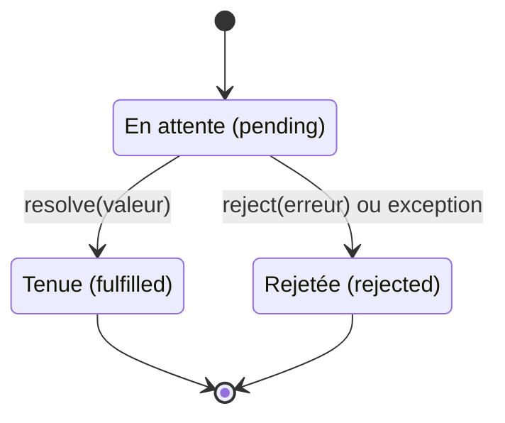

# 19 — Les promesses

> **Niveau** : Intermédiaire · **Durée** : ~3 h · **Prérequis** : [L'asynchrone et la boucle d'événements](../18-asynchrone/README.md)

Une promesse est un objet qui représente le résultat **futur** d'une opération asynchrone : une valeur qui arrivera, ou une erreur. Introduites en ES2015, les promesses ont remplacé les callbacks dans les API modernes (`fetch`, `fs/promises`…) et servent de fondation à `async`/`await`. Ce chapitre présente leur API complète ; les patterns appliqués (séquentiel, parallèle limité, timeout, retry, annulation) sont au [chapitre 20](../20-async-await/README.md).

## Objectifs

- Décrire les états d'une promesse et les garanties qu'elle offre par rapport aux callbacks.
- Créer des promesses avec `new Promise`, `Promise.resolve`/`reject`, `Promise.withResolvers` (ES2024) et `Promise.try` (ES2025), et convertir une API à callbacks.
- Consommer et chaîner des promesses avec `then`, `catch` et `finally`, en maîtrisant les valeurs de retour.
- Propager, récupérer et transformer les erreurs dans une chaîne.
- Choisir le bon combinateur : `Promise.all`, `allSettled`, `race` ou `any`.
- Reconnaître les anti-patterns courants et éviter les rejets non gérés.

## Sommaire

- [Pourquoi les promesses](#pourquoi-les-promesses)
- [Les états d'une promesse](#les-états-dune-promesse)
- [Créer une promesse](#créer-une-promesse)
- [Consommer une promesse](#consommer-une-promesse)
- [Le chaînage](#le-chaînage)
- [La propagation des erreurs](#la-propagation-des-erreurs)
- [`Promise.withResolvers`](#promisewithresolvers)
- [`Promise.try`](#promisetry)
- [Les combinateurs](#les-combinateurs)
- [Les thenables](#les-thenables)
- [Promesses et boucle d'événements](#promesses-et-boucle-dévénements)
- [Les rejets non gérés](#les-rejets-non-gérés)
- [Anti-patterns](#anti-patterns)
- [Vers `async`/`await`](#vers-asyncawait)
- [Pièges courants](#pièges-courants)
- [Bonnes pratiques](#bonnes-pratiques)
- [Résumé](#résumé)
- [Exercices](#exercices)
- [Pour aller plus loin](#pour-aller-plus-loin)

## Pourquoi les promesses

Le [chapitre 18](../18-asynchrone/README.md#la-pyramide-des-callbacks) a montré les trois défauts des callbacks : la pyramide, des erreurs à traiter à chaque niveau (et hors de portée de `try/catch`), et l'**inversion de contrôle** — on confie la suite de son programme à une fonction tierce.

Une promesse inverse la relation. Au lieu de passer un callback à la fonction asynchrone, c'est la fonction qui **renvoie un objet** sur lequel on branche ses réactions :

```js
function chargerUtilisateur(id) {
  return new Promise((resolve, reject) => {
    setTimeout(() => {
      if (id <= 0) reject(new Error(`Utilisateur ${id} introuvable`));
      else resolve({ id, nom: "Ada" });
    }, 10);
  });
}

const promesse = chargerUtilisateur(1);
console.log(promesse); // Promise { <pending> }
promesse.then((utilisateur) => console.log(utilisateur.nom)); // Ada
```

Cet objet offre des garanties qu'aucun callback ne donne :

1. **Une seule issue** : une promesse est tenue *ou* rejetée, une seule fois, et ne change plus jamais.
2. **Toujours asynchrone** : les réactions s'exécutent dans une microtâche, même si la promesse est déjà réglée (fini le problème de la fonction tantôt synchrone, tantôt asynchrone).
3. **Abonnement à tout moment** : on peut appeler `then` avant ou après le règlement, autant de fois qu'on veut ; chacun reçoit le résultat.
4. **Des erreurs qui se propagent** le long d'une chaîne jusqu'au premier gestionnaire.
5. **Composables** : on peut combiner plusieurs promesses (`Promise.all`…) parce que ce sont des valeurs ordinaires, qu'on stocke dans des variables et des tableaux.

## Les états d'une promesse

Une promesse est toujours dans l'un de ces trois états :

| État | Anglais | Signification |
| --- | --- | --- |
| en attente | *pending* | l'opération n'est pas terminée |
| tenue | *fulfilled* | l'opération a réussi ; la promesse a une **valeur** |
| rejetée | *rejected* | l'opération a échoué ; la promesse a une **raison** (en général une `Error`) |

Une promesse tenue ou rejetée est dite **réglée** (*settled*). Le passage est définitif.



> [!NOTE]
> « Résolue » (*resolved*) n'est pas synonyme de « tenue ». Une promesse résolue avec **une autre promesse** suit le destin de celle-ci : elle reste en attente tant que l'autre l'est. `resolve` veut dire « voici ce qui décidera du résultat », pas forcément « voici la valeur ».

On ne peut pas lire l'état d'une promesse de façon synchrone : c'est voulu, on réagit à son règlement avec `then`. Node.js l'affiche toutefois avec `console.log`, ce qui est pratique pour déboguer :

```js
const enAttente = new Promise(() => {});
const tenue = Promise.resolve(42);
const rejetee = Promise.reject(new Error("panne"));
rejetee.catch(() => {}); // on gère le rejet pour éviter une alerte

console.log(enAttente); // Promise { <pending> }
console.log(tenue); // Promise { 42 }
console.log(rejetee); // Promise { <rejected> Error: panne … (suivi de la pile d'appels) }
```

## Créer une promesse

### Le constructeur `new Promise`

`new Promise(executeur)` appelle **immédiatement et de façon synchrone** la fonction `executeur(resolve, reject)`. Son rôle : lancer l'opération, puis appeler `resolve(valeur)` en cas de succès ou `reject(erreur)` en cas d'échec.

```js
const promesse = new Promise((resolve, reject) => {
  resolve("premier");
  resolve("second"); // ignoré : la promesse est déjà réglée
  reject(new Error("trop tard")); // ignoré aussi
});
promesse.then((valeur) => console.log(valeur)); // premier

const exception = new Promise(() => {
  throw new Error("lancée dans l'exécuteur");
});
exception.catch((erreur) => console.log("Rejetée :", erreur.message)); // Rejetée : lancée dans l'exécuteur
```

Les règles à retenir :

- seul le **premier** appel à `resolve` ou `reject` compte ;
- une exception levée **de façon synchrone** dans l'exécuteur rejette la promesse. Une exception levée plus tard, dans un callback (`setTimeout`…), n'est pas rattrapée : il faut appeler `reject` ;
- appeler `resolve` n'interrompt pas l'exécuteur : le code qui suit s'exécute quand même (mettez un `return` si nécessaire) ;
- rejetez toujours avec un objet `Error` (ou une sous-classe) : il porte un message et une pile d'appels.

Le constructeur sert presque exclusivement à **envelopper une API qui ne connaît pas les promesses** : minuteur, événement, callback. L'exemple classique, une pause :

```js
function attendre(ms) {
  return new Promise((resolve) => setTimeout(resolve, ms));
}

attendre(50).then(() => console.log("50 ms plus tard"));
```

Node.js propose déjà cette fonction dans `node:timers/promises` (voir le [chapitre 21](../21-timers/README.md)). Dans le navigateur, on enveloppe de la même façon une API à événements :

<!-- no-run -->
```js
function chargerImage(url) {
  return new Promise((resolve, reject) => {
    const image = new Image();
    image.addEventListener("load", () => resolve(image), { once: true });
    image.addEventListener("error", () => reject(new Error(`Impossible de charger ${url}`)), { once: true });
    image.src = url;
  });
}

chargerImage("/logo.png")
  .then((image) => document.body.append(image))
  .catch((erreur) => console.error(erreur.message));
```

### Promisifier une API à callbacks

Pour une fonction qui suit la convention « erreur d'abord » de Node.js, l'enveloppe est toujours la même :

```js
import { readFile } from "node:fs";

function lireFichier(chemin) {
  return new Promise((resolve, reject) => {
    readFile(chemin, "utf8", (erreur, contenu) => {
      if (erreur) reject(erreur);
      else resolve(contenu);
    });
  });
}

lireFichier("absent.txt").catch((erreur) => console.log("Échec :", erreur.code)); // Échec : ENOENT
```

Node.js fournit `util.promisify` pour l'automatiser :

```js
import { readFile } from "node:fs";
import { promisify } from "node:util";

const lireFichier = promisify(readFile);
lireFichier("absent.txt", "utf8").catch((erreur) => console.log("Échec :", erreur.code)); // Échec : ENOENT
```

En pratique, la plupart des modules de Node.js ont aujourd'hui une version à promesses : préférez-les.

```js
import { readFile, writeFile, rm } from "node:fs/promises";

writeFile("note.txt", "Acheter du pain")
  .then(() => readFile("note.txt", "utf8"))
  .then((contenu) => console.log("Relu :", contenu)) // Relu : Acheter du pain
  .finally(() => rm("note.txt"));
```

| Module à callbacks | Version à promesses |
| --- | --- |
| `node:fs` | `node:fs/promises` |
| `node:timers` | `node:timers/promises` |
| `node:dns` | `node:dns/promises` |
| `node:stream` (`pipeline`, `finished`) | `node:stream/promises` |
| `node:readline` | `node:readline/promises` |

### `Promise.resolve` et `Promise.reject`

`Promise.resolve(valeur)` renvoie une promesse tenue avec `valeur` ; `Promise.reject(raison)` une promesse rejetée. Elles servent surtout à **toujours renvoyer une promesse**, même quand le résultat est connu tout de suite :

```js
const cache = new Map([["fr", "Bonjour"]]);

function traduire(langue) {
  if (cache.has(langue)) return Promise.resolve(cache.get(langue)); // déjà connu
  if (typeof langue !== "string") return Promise.reject(new TypeError("Langue invalide"));
  return new Promise((resolve) => setTimeout(() => resolve(`Hello (${langue})`), 10));
}

traduire("fr").then((texte) => console.log(texte)); // Bonjour
traduire(42).catch((erreur) => console.log(erreur.message)); // Langue invalide
traduire("en").then((texte) => console.log(texte)); // Hello (en)
```

Deux détails utiles :

- `Promise.resolve(p)` renvoie **`p` lui-même** si `p` est déjà une promesse native, et adopte l'état d'un [thenable](#les-thenables) ;
- contrairement à ce que laisse croire son nom, `Promise.resolve(valeur).then(f)` n'appelle pas `f` immédiatement : la réaction reste une microtâche.

```js
const p = Promise.resolve("valeur");
console.log(Promise.resolve(p) === p); // true

Promise.resolve("plus tard").then((v) => console.log(v));
console.log("d'abord");
// d'abord
// plus tard
```

## Consommer une promesse

### `then`

`promesse.then(siTenue, siRejetee)` enregistre une ou deux réactions et **renvoie une nouvelle promesse** (voir [le chaînage](#le-chaînage)). Les deux arguments sont facultatifs. Les réactions :

- sont appelées une seule fois, avec la valeur ou la raison ;
- s'exécutent toujours de façon asynchrone ;
- s'exécutent dans l'ordre d'enregistrement quand plusieurs `then` visent la même promesse ;
- fonctionnent même si on s'abonne après le règlement.

```js
const promesse = Promise.resolve("prêt");

promesse.then((valeur) => console.log("1er abonné :", valeur));
promesse.then((valeur) => console.log("2e abonné :", valeur));
console.log("Le code synchrone passe d'abord");

setTimeout(() => {
  promesse.then((valeur) => console.log("Abonné tardif :", valeur));
}, 50);
// Le code synchrone passe d'abord
// 1er abonné : prêt
// 2e abonné : prêt
// Abonné tardif : prêt
```

### `catch`

`promesse.catch(siRejetee)` est un raccourci pour `promesse.then(undefined, siRejetee)`.

```js
const commande = new Promise((resolve, reject) => {
  setTimeout(() => reject(new Error("Stock épuisé")), 10);
});

commande
  .then((recu) => console.log("Commande passée :", recu))
  .catch((erreur) => console.log("Commande impossible :", erreur.message));
// Commande impossible : Stock épuisé
```

### `finally`

`promesse.finally(f)` (ES2018) exécute `f` quelle que soit l'issue : idéal pour masquer un indicateur de chargement ou libérer une ressource. Ses particularités :

- `f` ne reçoit **aucun argument** : elle ne sait pas si l'opération a réussi ;
- la valeur ou l'erreur **traverse** `finally` sans changer ;
- sauf si `f` lève une exception (ou renvoie une promesse rejetée) : cette erreur remplace alors le résultat ;
- si `f` renvoie une promesse, la chaîne attend qu'elle soit réglée.

```js
function chargerProduit(id) {
  return new Promise((resolve, reject) => {
    setTimeout(() => {
      if (id === 0) reject(new Error("Produit introuvable"));
      else resolve({ id, nom: "Lampe" });
    }, 10);
  });
}

function afficherProduit(id) {
  console.log(`[${id}] Indicateur affiché`);
  return chargerProduit(id)
    .then((produit) => console.log(`[${id}] Produit : ${produit.nom}`))
    .catch((erreur) => console.log(`[${id}] Erreur : ${erreur.message}`))
    .finally(() => console.log(`[${id}] Indicateur masqué`));
}

afficherProduit(7).then(() => afficherProduit(0));
// [7] Indicateur affiché
// [7] Produit : Lampe
// [7] Indicateur masqué
// [0] Indicateur affiché
// [0] Erreur : Produit introuvable
// [0] Indicateur masqué
```

```js
Promise.resolve(42)
  .finally(() => "ignoré") // la valeur renvoyée par finally est ignorée
  .then((valeur) => {
    console.log(valeur); // 42
    return Promise.resolve(42).finally(() => {
      throw new Error("échec du nettoyage"); // une exception, elle, remplace le résultat
    });
  })
  .catch((erreur) => console.log(erreur.message)); // échec du nettoyage
```

## Le chaînage

### Ce que renvoie `then`

C'est **la** notion clé des promesses : `then` (comme `catch` et `finally`) renvoie une **nouvelle** promesse, dont le sort dépend de ce que fait le callback.

| Le callback… | La promesse renvoyée par `then` est… |
| --- | --- |
| renvoie une valeur `v` | tenue avec `v` |
| ne renvoie rien | tenue avec `undefined` |
| renvoie une promesse (ou un thenable) | réglée comme elle : la chaîne **attend** |
| lève une exception | rejetée avec cette exception |

```js
const attendre = (ms) => new Promise((resolve) => setTimeout(resolve, ms));

Promise.resolve(2)
  .then((n) => n * 10) // renvoie une valeur
  .then((n) => {
    console.log("valeur :", n); // valeur : 20
  }) // ne renvoie rien
  .then((rien) => {
    console.log("rien :", rien); // rien : undefined
    return attendre(20).then(() => "après 20 ms"); // renvoie une promesse
  })
  .then((texte) => {
    console.log("attendu :", texte); // attendu : après 20 ms
    throw new Error("problème"); // lève une exception
  })
  .catch((erreur) => console.log("rejet :", erreur.message)); // rejet : problème
```

### Enchaîner des étapes asynchrones

Voici la pyramide du [chapitre 18](../18-asynchrone/README.md#la-pyramide-des-callbacks), réécrite avec des fonctions qui renvoient des promesses. Chaque étape **renvoie** la promesse suivante : la chaîne reste plate, et un seul `catch` suffit.

```js
const attendre = (ms) => new Promise((resolve) => setTimeout(resolve, ms));

function chargerUtilisateur(id) {
  return attendre(10).then(() => {
    if (id <= 0) throw new Error(`Utilisateur ${id} introuvable`);
    return { id, nom: "Ada" };
  });
}
const chargerCommandes = (utilisateur) =>
  attendre(10).then(() => [{ numero: "C-101" }, { numero: "C-102" }]);
const chargerLivraison = (commande) =>
  attendre(10).then(() => ({ commande: commande.numero, statut: "expédiée" }));

chargerUtilisateur(1)
  .then((utilisateur) => chargerCommandes(utilisateur))
  .then((commandes) => chargerLivraison(commandes.at(-1)))
  .then((livraison) => console.log(`Commande ${livraison.commande} ${livraison.statut}`))
  .catch((erreur) => console.log("Échec :", erreur.message));

chargerUtilisateur(-1)
  .then((utilisateur) => chargerCommandes(utilisateur))
  .then((commandes) => chargerLivraison(commandes.at(-1)))
  .then((livraison) => console.log(`Commande ${livraison.commande} ${livraison.statut}`))
  .catch((erreur) => console.log("Échec :", erreur.message));
// Échec : Utilisateur -1 introuvable
// Commande C-102 expédiée
```

Quand une fonction prend exactement la valeur précédente en argument, on peut même écrire `.then(chargerCommandes)`.

Limite de la chaîne : chaque callback ne voit que la valeur de l'étape précédente. Pour afficher le **nom** de l'utilisateur à la dernière étape, il faut soit imbriquer (avec modération) pour garder `utilisateur` dans la portée, soit transporter un objet d'étape en étape :

<!-- no-run -->
```js
chargerUtilisateur(1)
  .then((utilisateur) =>
    chargerCommandes(utilisateur)
      .then((commandes) => chargerLivraison(commandes.at(-1)))
      .then((livraison) => console.log(`${utilisateur.nom} : ${livraison.statut}`)),
  )
  .catch((erreur) => console.log("Échec :", erreur.message));
```

C'est précisément le genre de situation où `async`/`await` brille : toutes les variables restent dans la même portée ([chapitre 20](../20-async-await/README.md)).

## La propagation des erreurs

Un rejet — ou une exception levée dans n'importe quel callback — **saute** tous les `then` suivants jusqu'au premier gestionnaire de rejet. C'est l'équivalent asynchrone de `try/catch`.

```js
function chargerPrix(produit) {
  return new Promise((resolve, reject) => {
    setTimeout(() => {
      if (produit === "inconnu") reject(new Error(`Produit « ${produit} » introuvable`));
      else resolve(19.9);
    }, 10);
  });
}

chargerPrix("inconnu")
  .then((prix) => {
    console.log("non exécuté");
    return prix * 1.2;
  })
  .then(() => console.log("non exécuté non plus"))
  .catch((erreur) => {
    console.log("Attrapée :", erreur.message);
    return 0; // valeur de repli
  })
  .then((prix) => console.log("La chaîne continue avec", prix));
// Attrapée : Produit « inconnu » introuvable
// La chaîne continue avec 0
```

### Récupérer, transformer ou relancer

Dans un `catch`, vous avez trois options, exactement comme dans un bloc `catch` synchrone :

| Dans le `catch`… | Effet sur la suite de la chaîne |
| --- | --- |
| renvoyer une valeur | **récupération** : la chaîne repart tenue avec cette valeur |
| relancer la même erreur (`throw erreur`) | **propagation** : le gestionnaire suivant la recevra |
| lancer une nouvelle erreur avec `cause` | **transformation** : on ajoute du contexte sans perdre l'origine |

```js
const chargerPanier = () => Promise.reject(new Error("Base de données injoignable"));

chargerPanier()
  .catch((erreur) => {
    throw new Error("Impossible d'afficher le panier", { cause: erreur });
  })
  .catch((erreur) => {
    console.log(erreur.message); // Impossible d'afficher le panier
    console.log("Cause :", erreur.cause.message); // Cause : Base de données injoignable
  });
```

Placez le `catch` là où vous savez **quoi faire** de l'erreur : afficher un message, utiliser une valeur de repli, réessayer. Un `catch` qui se contente de journaliser puis de continuer comme si de rien n'était transforme une erreur en `undefined` silencieux (voir les [anti-patterns](#anti-patterns)). La propriété `cause` (ES2022) est présentée au [chapitre 17](../17-erreurs/README.md).

### `then(succes, echec)` n'est pas `then(succes).catch(echec)`

Le second argument de `then` ne surveille que la promesse **d'origine**, pas une erreur levée par le premier argument :

```js
process.on("unhandledRejection", (erreur) => console.log("Rejet non géré :", erreur.message));

// ❌ echec ne voit pas l'erreur levée dans succes
Promise.resolve("données").then(
  () => {
    throw new Error("bug dans le traitement");
  },
  () => console.log("jamais appelé"),
);

// ✅ catch, placé après, surveille aussi le traitement
Promise.resolve("données")
  .then(() => {
    throw new Error("bug dans le traitement");
  })
  .catch((erreur) => console.log("Attrapée :", erreur.message));
// Attrapée : bug dans le traitement
// Rejet non géré : bug dans le traitement
```

La forme à deux arguments a un usage légitime : traiter différemment l'échec de l'opération elle-même et celui des étapes suivantes. Dans le doute, utilisez `catch`.

## `Promise.withResolvers`

Avec le constructeur, `resolve` et `reject` ne sont accessibles qu'à l'intérieur de l'exécuteur. Quand la décision se prend **ailleurs** (dans un écouteur d'événement, une autre méthode…), on écrivait :

<!-- no-run -->
```js
let resoudre;
let rejeter;
const promesse = new Promise((resolve, reject) => {
  resoudre = resolve;
  rejeter = reject;
});
```

`Promise.withResolvers()` (ES2024) fait exactement cela en une ligne et renvoie `{ promise, resolve, reject }`. Elle est disponible dans tous les navigateurs principaux depuis mars 2024 (Baseline, largement disponible) et dans Node.js 22+.

```js
function attendreEvenement(cible, type) {
  const { promise, resolve } = Promise.withResolvers();
  cible.addEventListener(type, resolve, { once: true });
  return promise;
}

const formulaire = new EventTarget(); // EventTarget existe aussi dans Node.js
attendreEvenement(formulaire, "valider").then((evenement) => console.log("Reçu :", evenement.type));
setTimeout(() => formulaire.dispatchEvent(new Event("valider")), 10);
// Reçu : valider
```

Un autre cas typique : un objet qui expose une promesse « prêt » et la résout quand il le décide.

```js
class Connexion {
  #pret = Promise.withResolvers();

  get pret() {
    return this.#pret.promise;
  }

  ouvrir() {
    setTimeout(() => this.#pret.resolve("connecté à la base"), 20);
    return this;
  }
}

const connexion = new Connexion().ouvrir();
connexion.pret.then((etat) => console.log("Requête 1 :", etat));
connexion.pret.then((etat) => console.log("Requête 2 :", etat));
// Requête 1 : connecté à la base
// Requête 2 : connecté à la base
```

Pour un `EventEmitter` de Node.js, la fonction `once` du module `node:events` renvoie directement une promesse.

## `Promise.try`

Une fonction qui renvoie une promesse peut aussi lever une exception **synchrone**, par exemple en validant ses arguments avant de lancer l'opération. Cette exception échappe alors au `.catch` :

```js
function chargerProfil(id) {
  if (typeof id !== "number") throw new TypeError("L'identifiant doit être un nombre");
  return new Promise((resolve) => setTimeout(() => resolve({ id, nom: "Grace" }), 10));
}

// ❌ La TypeError est levée avant même que .catch soit appelé
try {
  chargerProfil("7").catch(() => console.log("jamais exécuté"));
} catch (erreur) {
  console.log("Exception synchrone :", erreur.message);
}

// ✅ Promise.try transforme l'exception synchrone en rejet
Promise.try(chargerProfil, "7").catch((erreur) => console.log("Rejet :", erreur.message));
Promise.try(chargerProfil, 7).then((profil) => console.log("Profil :", profil.nom));
// Exception synchrone : L'identifiant doit être un nombre
// Rejet : L'identifiant doit être un nombre
// Profil : Grace
```

`Promise.try(f, ...arguments)` (ES2025) appelle `f` **immédiatement**, avec les arguments donnés, et renvoie toujours une promesse : tenue avec la valeur de retour, rejetée avec l'exception, ou réglée comme la promesse renvoyée. Les alternatives historiques ont chacune un défaut : `Promise.resolve().then(f)` repousse l'appel de `f` à une microtâche ultérieure, et `new Promise((resolve) => resolve(f()))` est verbeux.

`Promise.try` est disponible dans Chrome 128+, Firefox 134+, Safari 18.2+ (Baseline 2025) et Node.js 23+, donc dans les LTS actuelles (24 et 26). Notez qu'une fonction `async` offre la même garantie automatiquement : toute exception y devient un rejet ([chapitre 20](../20-async-await/README.md#les-fonctions-async)).

## Les combinateurs

Les quatre méthodes statiques `Promise.all`, `allSettled`, `race` et `any` prennent un itérable (souvent un tableau) de promesses et renvoient **une** promesse.

> [!IMPORTANT]
> Un combinateur ne « lance » rien : les opérations ont démarré au moment où leurs promesses ont été créées. Il se contente d'**attendre** leurs résultats, et il n'arrête pas les opérations qui ne l'intéressent plus. Pour annuler réellement une opération, voir `AbortController` au [chapitre 20](../20-async-await/README.md#annuler-avec-abortcontroller).

Les exemples utilisent une fonction qui simule un appel distant :

```js
const simuler = (valeur, ms, echec = false) =>
  new Promise((resolve, reject) =>
    setTimeout(() => (echec ? reject(new Error(valeur)) : resolve(valeur)), ms),
  );

simuler("météo", 10).then(console.log); // météo
simuler("panne", 10, true).catch((erreur) => console.log(erreur.message)); // panne
```

### `Promise.all`

**Toutes ou rien** : tenue avec le tableau des valeurs quand toutes sont tenues, rejetée dès la **première** rejetée. C'est le combinateur des opérations indépendantes dont on a besoin ensemble, par exemple pour composer un tableau de bord :

```js
const simuler = (valeur, ms, echec = false) =>
  new Promise((resolve, reject) =>
    setTimeout(() => (echec ? reject(new Error(valeur)) : resolve(valeur)), ms),
  );

const debut = performance.now();
Promise.all([simuler("profil", 60), simuler("notifications", 20), simuler("météo", 40)]).then(
  ([profil, notifications, meteo]) => {
    console.log(profil, notifications, meteo);
    console.log(`≈ ${Math.round((performance.now() - debut) / 20) * 20} ms`);
  },
);

Promise.all([simuler("profil", 60), simuler("notifications indisponibles", 20, true)]).catch(
  (erreur) => console.log("Échec :", erreur.message),
);
// Échec : notifications indisponibles   (au bout de 20 ms, sans attendre « profil »)
// profil notifications météo
// ≈ 60 ms
```

- Les valeurs arrivent dans l'**ordre du tableau d'entrée**, pas dans l'ordre d'arrivée.
- La durée totale est celle de l'opération **la plus lente** (≈ 60 ms ici, et non 120 ms) : les trois attentes se chevauchent.
- En cas d'échec, les autres opérations continuent en arrière-plan ; leurs résultats sont simplement ignorés.
- Les éléments qui ne sont pas des promesses sont acceptés tels quels : `Promise.all([1, simuler("a", 10)])` donne `[1, "a"]`.
- Avec un tableau vide, la promesse est tenue avec `[]`.

### `Promise.allSettled`

**Toutes, quoi qu'il arrive** (ES2020) : attend que chaque promesse soit réglée et ne rejette jamais. Chaque résultat est un objet `{ status: "fulfilled", value }` ou `{ status: "rejected", reason }`. C'est le bon choix quand un échec partiel est acceptable, comme l'envoi d'une série de notifications :

```js
const envoyer = (destinataire, ms, echec = false) =>
  new Promise((resolve, reject) =>
    setTimeout(() => (echec ? reject(new Error(`${destinataire} injoignable`)) : resolve(destinataire)), ms),
  );

Promise.allSettled([
  envoyer("ada@exemple.fr", 10),
  envoyer("grace@exemple.fr", 20, true),
  envoyer("alan@exemple.fr", 15),
]).then((resultats) => {
  const { fulfilled = [], rejected = [] } = Object.groupBy(resultats, (r) => r.status);
  console.log("Envoyés :", fulfilled.map((r) => r.value)); // Envoyés : [ 'ada@exemple.fr', 'alan@exemple.fr' ]
  console.log("Échecs :", rejected.map((r) => r.reason.message)); // Échecs : [ 'grace@exemple.fr injoignable' ]
});
```

`Object.groupBy` (ES2024) est présenté au [chapitre 09](../09-tableaux/README.md).

### `Promise.race`

**La première réglée** : la promesse renvoyée adopte l'issue de la première promesse réglée, qu'elle soit tenue **ou rejetée**.

```js
const simuler = (valeur, ms, echec = false) =>
  new Promise((resolve, reject) =>
    setTimeout(() => (echec ? reject(new Error(valeur)) : resolve(valeur)), ms),
  );

Promise.race([simuler("serveur A", 30), simuler("serveur B", 10)]).then((gagnant) =>
  console.log("Le plus rapide :", gagnant), // Le plus rapide : serveur B
);

Promise.race([simuler("serveur A", 30), simuler("serveur B en panne", 10, true)]).catch((erreur) =>
  console.log("La première réponse est un échec :", erreur.message), // La première réponse est un échec : serveur B en panne
);
```

Son usage le plus courant est le **délai maximal** : faire la course entre une opération et un minuteur qui rejette. Une implémentation correcte (qui nettoie son minuteur) est au [chapitre 20](../20-async-await/README.md#imposer-un-délai-maximal). Attention : avec un tableau vide, `Promise.race([])` reste en attente **pour toujours**.

### `Promise.any`

**La première réussite** (ES2021) : tenue avec la valeur de la première promesse tenue ; les rejets sont ignorés… sauf si **toutes** échouent, auquel cas elle est rejetée avec une `AggregateError` dont la propriété `errors` contient toutes les raisons, dans l'ordre d'entrée. Idéal pour interroger des sources redondantes (miroirs, CDN) :

```js
const telecharger = (miroir, ms, echec = false) =>
  new Promise((resolve, reject) =>
    setTimeout(() => (echec ? reject(new Error(`${miroir} hors service`)) : resolve(miroir)), ms),
  );

Promise.any([
  telecharger("miroir-paris", 10, true),
  telecharger("miroir-lyon", 30),
  telecharger("miroir-lille", 20),
]).then((miroir) => console.log("Téléchargé depuis", miroir)); // Téléchargé depuis miroir-lille

Promise.any([telecharger("miroir-paris", 10, true), telecharger("miroir-lyon", 20, true)]).catch(
  (erreur) => {
    console.log(erreur.name, ":", erreur.message); // AggregateError : All promises were rejected
    console.log(erreur.errors.map((e) => e.message)); // [ 'miroir-paris hors service', 'miroir-lyon hors service' ]
  },
);
```

Le message de l'`AggregateError` (« All promises were rejected » dans V8) dépend du moteur : testez `erreur.errors`, pas le texte.

### Tableau comparatif

| Combinateur | Tenue quand… | Rejetée quand… | Résultat | Tableau vide |
| --- | --- | --- | --- | --- |
| `Promise.all` | toutes sont tenues | la première est rejetée | tableau des valeurs, ordre d'entrée | tenue avec `[]` |
| `Promise.allSettled` (ES2020) | toutes sont réglées | jamais | tableau de `{ status, value }` / `{ status, reason }` | tenue avec `[]` |
| `Promise.race` | la première réglée est tenue | la première réglée est rejetée | issue de la première réglée | en attente pour toujours |
| `Promise.any` (ES2021) | la première est tenue | toutes sont rejetées | première valeur, ou `AggregateError` | rejetée (`AggregateError`) |

En résumé : besoin de **tout** → `all` ; besoin d'un **bilan** → `allSettled` ; besoin du **premier signe de vie**, succès ou échec → `race` ; besoin du **premier succès** → `any`.

## Les thenables

Un **thenable** est n'importe quel objet doté d'une méthode `then(resolve, reject)`. `Promise.resolve`, la valeur renvoyée par un callback de `then` et `await` les « assimilent » : ils appellent leur méthode `then` pour obtenir le résultat. C'est ce qui a permis aux promesses natives de cohabiter avec les bibliothèques antérieures à ES2015 (jQuery Deferred, Bluebird…).

```js
const thenable = {
  then(resolve) {
    setTimeout(() => resolve("valeur fournie par un thenable"), 10);
  },
};

Promise.resolve(thenable).then((valeur) => console.log(valeur)); // valeur fournie par un thenable
```

Le revers : un objet qui possède **par hasard** une méthode `then` est traité comme un thenable. Si cette méthode n'appelle jamais `resolve`, la promesse reste en attente pour toujours :

```js
const requete = {
  url: "/api/produits",
  then() {
    console.log("then() appelé par le moteur !");
  },
};

Promise.resolve(requete).then(() => console.log("jamais affiché"));
// then() appelé par le moteur !
```

N'appelez donc jamais une méthode `then` si vous n'écrivez pas un thenable. Le même piège existe avec un module qui exporterait une fonction nommée `then` et qu'on chargerait avec `import()`.

## Promesses et boucle d'événements

Les réactions des promesses (`then`, `catch`, `finally`) sont des **microtâches** : elles passent après le code synchrone en cours, mais avant le prochain minuteur ou événement. Le [chapitre 18](../18-asynchrone/README.md#prédire-lordre-dexécution) détaille la méthode pour prédire l'ordre d'exécution et propose des exercices.

Un détail avancé : résoudre une promesse avec **une autre promesse** (ou renvoyer une promesse depuis `then`) coûte deux tours de microtâches supplémentaires, le temps d'appeler son `then`.

```js
const p = Promise.resolve("valeur");
new Promise((resolve) => resolve(p)).then(() => console.log("adoptée"));
p.then(() => console.log("tour 1"))
  .then(() => console.log("tour 2"))
  .then(() => console.log("tour 3"));
// tour 1
// tour 2
// adoptée
// tour 3
```

Ne construisez jamais un programme dont la correction dépend de ce décompte : si deux opérations doivent se suivre, enchaînez-les explicitement.

## Les rejets non gérés

Une promesse rejetée sans aucun gestionnaire est un **rejet non géré** : l'erreur se perd, comme une exception qui ne serait jamais attrapée. Les environnements le signalent quand la file des microtâches est vidée et qu'aucun gestionnaire n'a été branché.

- **Navigateur** : la console affiche « Uncaught (in promise) » et l'événement `unhandledrejection` est déclenché sur `window` (puis `rejectionhandled` si un gestionnaire est ajouté plus tard). Le programme continue.
- **Node.js** : depuis Node.js 15, le mode par défaut (`--unhandled-rejections=throw`) traite un rejet non géré comme une exception non interceptée : **le processus s'arrête** avec le code de sortie 1.

<!-- no-run -->
```js
// Navigateur : filet de sécurité global, pour journaliser (pas pour « réparer »)
window.addEventListener("unhandledrejection", (evenement) => {
  envoyerAuMonitoring(evenement.reason);
});
```

Dans Node.js, les événements `unhandledRejection` et `rejectionHandled` de `process` jouent le même rôle. Installer un écouteur `unhandledRejection` remplace l'arrêt du processus par votre traitement :

```js
process.on("unhandledRejection", (raison) => console.log("Non géré :", raison.message));
process.on("rejectionHandled", () => console.log("Finalement géré, mais trop tard"));

const promesse = Promise.reject(new Error("oubli"));

setTimeout(() => {
  promesse.catch(() => console.log("catch branché après coup"));
}, 10);
// Non géré : oubli
// catch branché après coup
// Finalement géré, mais trop tard
```

La règle qui évite tous ces problèmes : **chaque chaîne de promesses se termine par un `catch`, ou est renvoyée (ou attendue avec `await`) par du code qui gère l'erreur**. Les écouteurs globaux servent à journaliser les oublis, pas à les remplacer. Le [chapitre 17](../17-erreurs/README.md) traite plus largement des erreurs non gérées.

## Anti-patterns

### Le constructeur inutile

Envelopper dans `new Promise` une fonction qui renvoie **déjà** une promesse est superflu et dangereux : il est facile d'oublier de relayer le rejet, et la promesse reste alors en attente pour toujours.

<!-- no-run -->
```js
// ❌ Si chargerUtilisateur échoue, la promesse renvoyée ne se règle jamais
function chargerNom(id) {
  return new Promise((resolve) => {
    chargerUtilisateur(id).then((utilisateur) => resolve(utilisateur.nom));
  });
}

// ✅ then renvoie déjà une promesse, rejets compris
function chargerNom(id) {
  return chargerUtilisateur(id).then((utilisateur) => utilisateur.nom);
}
```

Réservez `new Promise` aux API qui ne connaissent pas les promesses (minuteurs, événements, callbacks).

### Le `return` oublié

Sans `return`, la chaîne n'attend pas l'opération lancée dans le callback, et les erreurs de celle-ci échappent au `catch` :

```js
const attendre = (ms) => new Promise((resolve) => setTimeout(resolve, ms));
const enregistrer = (panier) => attendre(20).then(() => console.log("Panier enregistré :", panier));

// ❌ Accolades sans return : le then suivant n'attend pas
Promise.resolve("3 articles")
  .then((panier) => {
    enregistrer(panier);
  })
  .then(() => console.log("❌ Terminé ?"));

// ✅ On renvoie la promesse
attendre(50)
  .then(() => "2 articles")
  .then((panier) => enregistrer(panier))
  .then(() => console.log("✅ Terminé"));
// ❌ Terminé ?
// Panier enregistré : 3 articles
// Panier enregistré : 2 articles
// ✅ Terminé
```

Avec une fonction fléchée sans accolades, le `return` est implicite : `.then((panier) => enregistrer(panier))`.

### Les promesses imbriquées

Imbriquer les `then` recrée la pyramide qu'on voulait fuir, et oblige à gérer les erreurs à chaque niveau.

<!-- no-run -->
```js
// ❌
chargerUtilisateur(1).then((utilisateur) => {
  chargerCommandes(utilisateur).then((commandes) => {
    chargerLivraison(commandes.at(-1)).then((livraison) => afficher(livraison));
  });
});

// ✅ Chaque étape renvoie la suivante
chargerUtilisateur(1)
  .then(chargerCommandes)
  .then((commandes) => chargerLivraison(commandes.at(-1)))
  .then(afficher)
  .catch(afficherErreur);
```

L'imbrication n'est justifiée que pour garder une variable dans la portée (voir [le chaînage](#enchaîner-des-étapes-asynchrones)), et elle doit alors **renvoyer** la chaîne intérieure.

### Avaler les erreurs

<!-- no-run -->
```js
// ❌ L'erreur disparaît, la suite reçoit undefined et plantera plus loin, sans indice
chargerPanier()
  .catch((erreur) => console.log(erreur))
  .then((panier) => afficherTotal(panier.total));

// ✅ Soit on récupère avec une vraie valeur de repli…
chargerPanier()
  .catch(() => ({ articles: [], total: 0 }))
  .then((panier) => afficherTotal(panier.total));

// ✅ …soit on laisse l'erreur remonter jusqu'à qui sait la traiter
chargerPanier()
  .then((panier) => afficherTotal(panier.total))
  .catch(afficherErreur);
```

### Rejeter avec autre chose qu'une `Error`

`reject("Échec")` fonctionne, mais la raison n'a ni pile d'appels ni `cause`, et le code qui teste `erreur instanceof Error` ou lit `erreur.message` se trompe. Utilisez toujours `reject(new Error("Échec"))` ou une [erreur personnalisée](../17-erreurs/README.md).

### Croire qu'une promesse est paresseuse

Une promesse n'est pas une « tâche à lancer » : c'est le **résultat** d'une opération **déjà démarrée**. L'exécuteur s'exécute à la création, même si personne n'appelle `then`, et on ne peut pas « relancer » une promesse.

```js
const promesse = new Promise((resolve) => {
  console.log("Requête envoyée !"); // affiché immédiatement
  setTimeout(() => resolve("réponse"), 10);
});
console.log("Promesse créée, aucun then appelé");
// Requête envoyée !
// Promesse créée, aucun then appelé
```

Pour différer, répéter ou limiter des opérations (réessayer après un échec, en lancer trois à la fois…), manipulez des **fonctions qui renvoient une promesse**, et non des promesses : `() => chargerPage(2)` plutôt que `chargerPage(2)`. Le [chapitre 20](../20-async-await/README.md#limiter-la-concurrence) en fait un usage intensif.

### Mélanger callbacks et promesses

Appeler un callback depuis un `then` mélange deux mondes : une exception levée par le callback devient un rejet… et déclenche le `catch`, qui rappelle le callback une seconde fois.

```js
const chargerUtilisateur = () => Promise.resolve({ nom: "Ada" });

// ❌ Si le callback lève une exception, il est rappelé avec l'erreur
function chargerAvecCallback(callback) {
  chargerUtilisateur()
    .then((utilisateur) => callback(null, utilisateur))
    .catch((erreur) => callback(erreur));
}

chargerAvecCallback((erreur, utilisateur) => {
  console.log("Callback appelé, erreur :", erreur?.message);
  if (!erreur) throw new Error("bug dans le callback");
});
// Callback appelé, erreur : undefined
// Callback appelé, erreur : bug dans le callback
```

Restez dans un seul style. Si vous devez vraiment exposer une API à callbacks au-dessus de promesses, `util.callbackify` de Node.js s'en charge correctement.

## Vers `async`/`await`

`async`/`await` (ES2017) est une syntaxe construite **sur** les promesses : une fonction `async` renvoie une promesse, et `await` attend le règlement d'une promesse sans bloquer le thread. Tout ce chapitre reste donc valable : les combinateurs, la propagation des erreurs, les rejets non gérés.

```js
const attendre = (ms) => new Promise((resolve) => setTimeout(resolve, ms));
const chargerUtilisateur = (id) => attendre(10).then(() => ({ id, nom: "Ada" }));
const chargerCommandes = () => attendre(10).then(() => [{ numero: "C-101" }, { numero: "C-102" }]);

// Avec then
chargerUtilisateur(1)
  .then((utilisateur) =>
    chargerCommandes(utilisateur).then((commandes) => `${utilisateur.nom} : ${commandes.length} commandes`),
  )
  .then(console.log); // Ada : 2 commandes

// Avec async/await : plus besoin d'imbriquer pour garder « utilisateur »
async function resumer(id) {
  const utilisateur = await chargerUtilisateur(id);
  const commandes = await chargerCommandes(utilisateur);
  return `${utilisateur.nom} : ${commandes.length} commandes`;
}
resumer(1).then(console.log); // Ada : 2 commandes
```

La suite au [chapitre 20](../20-async-await/README.md), avec les patterns appliqués : exécution séquentielle ou parallèle, annulation, délai maximal, nouvelles tentatives, limitation de la concurrence.

## Pièges courants

- **Oublier le `return`** dans un callback de `then` à accolades : la chaîne n'attend pas et les erreurs s'échappent.
- **Terminer une chaîne sans `catch`** : dans Node.js, un rejet non géré arrête le processus.
- **Croire que `then(succes, echec)` attrape les erreurs de `succes`.**
- **Croire que `Promise.all` lance ou annule des opérations** : il attend des opérations déjà lancées et n'arrête pas les autres en cas d'échec.
- **Utiliser `Promise.race([])`** (ou `race` sur un tableau qui peut être vide) : la promesse ne se règle jamais.
- **Lever une exception dans un callback asynchrone d'un exécuteur** (`setTimeout` dans `new Promise`) au lieu d'appeler `reject` : elle n'est pas rattrapée.
- **Supposer qu'une fonction qui renvoie une promesse ne lève jamais d'exception synchrone** : utilisez `Promise.try` ou une fonction `async`.
- **Doter un objet d'une méthode `then`** sans le vouloir : il devient un thenable.
- **Compter les tours de microtâches** pour ordonner deux opérations.

## Bonnes pratiques

- Renvoyez toujours une promesse depuis une fonction asynchrone, et renvoyez la promesse suivante dans chaque `then`.
- Gardez les chaînes **plates** ; terminez-les par un `catch` placé là où l'on sait traiter l'erreur.
- Rejetez avec des objets `Error`, et ajoutez du contexte avec `cause` plutôt que d'écraser l'erreur d'origine.
- Utilisez `finally` pour le nettoyage (indicateur de chargement, ressource à libérer).
- Préférez les versions à promesses des API (`fs/promises`, `timers/promises`) à la promisification manuelle ; réservez `new Promise` aux API à callbacks ou à événements.
- Choisissez le combinateur selon le besoin : `all` (tout), `allSettled` (bilan), `race` (premier réglé), `any` (premier succès).
- Pour du code applicatif, préférez `async`/`await`, plus lisible ; les méthodes `then`/`catch` restent utiles pour de courtes transformations et pour comprendre ce qui se passe.

## Résumé

- Une promesse représente le résultat futur d'une opération : **en attente**, puis **tenue** (valeur) ou **rejetée** (raison), une seule fois et définitivement.
- L'exécuteur de `new Promise` s'exécute immédiatement ; seul le premier `resolve`/`reject` compte.
- `then`, `catch` et `finally` renvoient une **nouvelle** promesse ; ce que renvoie le callback (valeur, promesse, exception) décide de son sort.
- Les erreurs sautent les `then` jusqu'au premier `catch`, qui peut récupérer, relancer ou transformer (avec `cause`).
- `Promise.resolve`/`reject` créent des promesses réglées ; `Promise.withResolvers` (ES2024) expose `resolve`/`reject` hors de l'exécuteur ; `Promise.try` (ES2025) transforme les exceptions synchrones en rejets.
- Combinateurs : `all` (toutes ou rien), `allSettled` (bilan, ne rejette jamais), `race` (première réglée), `any` (première tenue, `AggregateError` sinon).
- Les réactions sont des microtâches ; un rejet sans gestionnaire est signalé, et arrête un processus Node.js.
- Anti-patterns : constructeur inutile, `return` oublié, imbrication, erreurs avalées, rejet sans `Error`, mélange avec les callbacks.

## Exercices

### Exercice 1 — Des promesses temporisées (★☆☆)

Écrivez `attendre(ms, valeur)`, qui renvoie une promesse tenue avec `valeur` au bout de `ms` millisecondes, et `echouerApres(ms, message)`, qui renvoie une promesse rejetée avec une `Error` au bout de `ms` millisecondes. Utilisez-les pour afficher `"prêt"` puis `"Erreur : délai dépassé"`.

<details>
<summary>Solution</summary>

```js
function attendre(ms, valeur) {
  return new Promise((resolve) => setTimeout(resolve, ms, valeur));
}

function echouerApres(ms, message) {
  return new Promise((_, reject) => setTimeout(() => reject(new Error(message)), ms));
}

attendre(10, "prêt").then((valeur) => console.log(valeur));
echouerApres(20, "délai dépassé").catch((erreur) => console.log("Erreur :", erreur.message));
// prêt
// Erreur : délai dépassé
```

`setTimeout` transmet ses arguments supplémentaires au callback : `setTimeout(resolve, ms, valeur)` appelle `resolve(valeur)`. Le paramètre `_` signale qu'on n'utilise pas `resolve`.

</details>

### Exercice 2 — Suivre les valeurs d'une chaîne (★☆☆)

Sans l'exécuter, indiquez ce qu'affiche ce code.

```js
Promise.resolve(1)
  .then((x) => x + 1)
  .then((x) => {
    console.log("A", x);
  })
  .then((x) => {
    console.log("B", x);
    throw new Error("C");
  })
  .then(() => console.log("D"))
  .catch((erreur) => {
    console.log("E", erreur.message);
    return 10;
  })
  .finally(() => console.log("F"))
  .then((x) => console.log("G", x));
```

<details>
<summary>Solution</summary>

```text
A 2
B undefined
E C
F
G 10
```

Le deuxième `then` ne renvoie rien : le suivant reçoit `undefined`. L'exception saute `D` jusqu'au `catch`, qui récupère avec `10`. `finally` ne reçoit rien et laisse passer la valeur `10` jusqu'au dernier `then`.

</details>

### Exercice 3 — Écrire son propre `promisify` (★★☆)

Écrivez `promisifier(fn)` qui transforme une fonction à callback « erreur d'abord » (le callback est son dernier argument) en fonction qui renvoie une promesse. Testez-la avec `readFile` de `node:fs` et avec la fonction suivante :

```js
function diviser(a, b, callback) {
  setTimeout(() => {
    if (b === 0) callback(new RangeError("Division par zéro"));
    else callback(null, a / b);
  }, 10);
}
```

<details>
<summary>Solution</summary>

```js
import { readFile } from "node:fs";

function promisifier(fn) {
  return (...args) =>
    new Promise((resolve, reject) => {
      fn(...args, (erreur, resultat) => {
        if (erreur) reject(erreur);
        else resolve(resultat);
      });
    });
}

function diviser(a, b, callback) {
  setTimeout(() => {
    if (b === 0) callback(new RangeError("Division par zéro"));
    else callback(null, a / b);
  }, 10);
}

const diviserAsync = promisifier(diviser);
diviserAsync(10, 4).then((resultat) => console.log("10 / 4 =", resultat));
diviserAsync(1, 0).catch((erreur) => console.log(erreur.name, ":", erreur.message));

const lire = promisifier(readFile);
lire("absent.txt", "utf8").catch((erreur) => console.log("readFile :", erreur.code));
// readFile : ENOENT   (le système répond avant les minuteurs de 10 ms)
// 10 / 4 = 2.5
// RangeError : Division par zéro
```

On ajoute notre propre callback après les arguments de l'appelant, et on traduit ses deux issues en `reject` et `resolve`. La vraie fonction `util.promisify` gère en plus les fonctions qui fournissent leur propre version à promesses (`util.promisify.custom`) et conserve `this`.

</details>

### Exercice 4 — Chasser les anti-patterns (★★☆)

Ce code fonctionne quand tout va bien, mais il contient quatre anti-patterns. Repérez-les et réécrivez `preparerFacture`.

<!-- no-run -->
```js
function preparerFacture(idClient) {
  return new Promise((resolve, reject) => {
    chargerClient(idClient).then((client) => {
      chargerCommandes(client).then((commandes) => {
        if (commandes.length === 0) reject("Aucune commande");
        const total = commandes.reduce((somme, c) => somme + c.montant, 0);
        resolve({ client: client.nom, total });
      });
    });
  });
}
```

<details>
<summary>Solution</summary>

Les anti-patterns : (1) constructeur inutile, (2) promesses imbriquées, (3) rejet avec une chaîne, (4) les échecs de `chargerClient` et `chargerCommandes` ne sont jamais relayés : la promesse reste en attente pour toujours. Bonus : après `reject`, le code continue et appelle `resolve` (sans effet, mais trompeur).

```js
const attendre = (ms) => new Promise((resolve) => setTimeout(resolve, ms));
const chargerClient = (id) =>
  attendre(10).then(() => {
    if (id === 0) throw new Error("Client introuvable");
    return { id, nom: id === 1 ? "Ada" : "Alan" };
  });
const chargerCommandes = (client) =>
  attendre(10).then(() => (client.id === 1 ? [{ montant: 30 }, { montant: 12.5 }] : []));

function preparerFacture(idClient) {
  return chargerClient(idClient).then((client) =>
    chargerCommandes(client).then((commandes) => {
      if (commandes.length === 0) throw new Error(`Aucune commande pour ${client.nom}`);
      const total = commandes.reduce((somme, c) => somme + c.montant, 0);
      return { client: client.nom, total };
    }),
  );
}

preparerFacture(1).then((facture) => console.log(facture));
preparerFacture(2).catch((erreur) => console.log(erreur.message));
preparerFacture(0).catch((erreur) => console.log(erreur.message));
// Client introuvable   (échoue dès la première étape, donc en premier)
// { client: 'Ada', total: 42.5 }
// Aucune commande pour Alan
```

Une seule imbrication subsiste, volontairement, pour garder `client` dans la portée ; elle **renvoie** sa chaîne, donc tous les rejets remontent. `throw` dans un `then` remplace `reject` et arrête bien l'exécution du callback.

</details>

### Exercice 5 — Réécrire `Promise.all` (★★☆)

Écrivez `toutes(iterable)` qui se comporte comme `Promise.all` : valeurs dans l'ordre d'entrée, rejet dès le premier échec, éléments non-promesses acceptés, tableau vide → `[]`.

<details>
<summary>Solution</summary>

```js
function toutes(iterable) {
  return new Promise((resolve, reject) => {
    const elements = Array.from(iterable);
    const valeurs = new Array(elements.length);
    let restantes = elements.length;

    if (restantes === 0) {
      resolve(valeurs);
      return;
    }

    elements.forEach((element, index) => {
      Promise.resolve(element).then((valeur) => {
        valeurs[index] = valeur;
        restantes--;
        if (restantes === 0) resolve(valeurs);
      }, reject);
    });
  });
}

const attendre = (ms, valeur) => new Promise((resolve) => setTimeout(resolve, ms, valeur));

toutes([attendre(30, "a"), "b", attendre(10, "c")]).then(console.log);
toutes([]).then(console.log);
toutes([attendre(10, "x"), Promise.reject(new Error("raté"))]).catch((e) => console.log(e.message));
// []
// raté
// [ 'a', 'b', 'c' ]
```

Points clés : on range chaque valeur à **son index** (et non avec `push`, qui suivrait l'ordre d'arrivée) ; on compte les promesses restantes plutôt que de tester `valeurs.length` ; `Promise.resolve` accepte indifféremment valeurs, promesses et thenables ; `reject` peut être appelé plusieurs fois sans danger, seul le premier appel compte. Ici, le constructeur est légitime : on combine plusieurs promesses en une seule.

</details>

### Exercice 6 — Réécrire `Promise.any` (★★★)

Écrivez `premiereReussie(iterable)` qui se comporte comme `Promise.any` : tenue avec la première valeur obtenue ; si **toutes** échouent (ou si l'itérable est vide), rejetée avec une `AggregateError` dont `errors` contient les raisons **dans l'ordre d'entrée**.

<details>
<summary>Solution</summary>

```js
function premiereReussie(iterable) {
  return new Promise((resolve, reject) => {
    const elements = Array.from(iterable);
    const erreurs = new Array(elements.length);
    let restantes = elements.length;

    if (restantes === 0) {
      reject(new AggregateError([], "Aucune promesse fournie"));
      return;
    }

    elements.forEach((element, index) => {
      Promise.resolve(element).then(resolve, (erreur) => {
        erreurs[index] = erreur;
        restantes--;
        if (restantes === 0) reject(new AggregateError(erreurs, "Toutes les promesses ont échoué"));
      });
    });
  });
}

const reussir = (ms, valeur) => new Promise((resolve) => setTimeout(resolve, ms, valeur));
const echouer = (ms, message) => new Promise((_, reject) => setTimeout(() => reject(new Error(message)), ms));

premiereReussie([echouer(5, "A"), reussir(20, "B"), reussir(10, "C")]).then(console.log);

premiereReussie([echouer(20, "lent"), echouer(5, "rapide")]).catch((erreur) => {
  console.log(erreur instanceof AggregateError, erreur.message);
  console.log(erreur.errors.map((e) => e.message));
});

premiereReussie([]).catch((erreur) => console.log(erreur.message));
// Aucune promesse fournie
// C
// true Toutes les promesses ont échoué
// [ 'lent', 'rapide' ]
```

C'est le miroir de l'exercice précédent : le succès règle tout de suite, l'échec est compté. Les erreurs sont rangées à leur index : « lent » apparaît en premier bien qu'il ait échoué en dernier.

</details>

### Exercice 7 — Une file d'attente asynchrone (★★★)

Écrivez une classe `FileAttente` avec deux méthodes :

- `deposer(element)` ajoute un élément ;
- `prendre()` renvoie une promesse tenue avec le plus ancien élément disponible. Si la file est vide, la promesse attend le prochain dépôt. Plusieurs consommateurs en attente sont servis dans l'ordre où ils ont appelé `prendre()`.

Utilisez `Promise.withResolvers`.

<details>
<summary>Solution</summary>

```js
class FileAttente {
  #elements = [];
  #enAttente = []; // fonctions resolve des consommateurs qui attendent

  deposer(element) {
    const consommateur = this.#enAttente.shift();
    if (consommateur) consommateur(element); // quelqu'un attend : on lui donne directement
    else this.#elements.push(element);
  }

  prendre() {
    if (this.#elements.length > 0) return Promise.resolve(this.#elements.shift());
    const { promise, resolve } = Promise.withResolvers();
    this.#enAttente.push(resolve);
    return promise;
  }
}

const commandes = new FileAttente();

// Deux cuisiniers attendent des commandes avant qu'il y en ait
commandes.prendre().then((plat) => console.log("Cuisinier 1 prépare :", plat));
commandes.prendre().then((plat) => console.log("Cuisinier 2 prépare :", plat));

commandes.deposer("pizza");
commandes.deposer("salade");
commandes.deposer("soupe"); // personne n'attend : elle est stockée

setTimeout(() => {
  commandes.prendre().then((plat) => console.log("Cuisinier 3 prépare :", plat));
}, 10);
// Cuisinier 1 prépare : pizza
// Cuisinier 2 prépare : salade
// Cuisinier 3 prépare : soupe
```

La file contient soit des éléments en trop, soit des consommateurs en attente, jamais les deux à la fois. `Promise.withResolvers` permet de ranger la fonction `resolve` dans un tableau et de l'appeler plus tard, depuis `deposer`. Ce motif (producteur/consommateur) sert par exemple à faire communiquer deux parties d'un programme sans qu'elles se connaissent.

</details>

## Pour aller plus loin

- [MDN — `Promise`](https://developer.mozilla.org/fr/docs/Web/JavaScript/Reference/Global_Objects/Promise)
- [MDN — Utiliser les promesses](https://developer.mozilla.org/fr/docs/Web/JavaScript/Guide/Using_promises)
- [MDN — `Promise.withResolvers()`](https://developer.mozilla.org/fr/docs/Web/JavaScript/Reference/Global_Objects/Promise/withResolvers) et [`Promise.try()`](https://developer.mozilla.org/fr/docs/Web/JavaScript/Reference/Global_Objects/Promise/try)
- [MDN — `AggregateError`](https://developer.mozilla.org/fr/docs/Web/JavaScript/Reference/Global_Objects/AggregateError)
- [MDN — Événement `unhandledrejection`](https://developer.mozilla.org/fr/docs/Web/API/Window/unhandledrejection_event)
- [Node.js — `util.promisify`](https://nodejs.org/docs/latest/api/util.html) et [option `--unhandled-rejections`](https://nodejs.org/docs/latest/api/cli.html)
- [javascript.info — Promesses, async/await](https://fr.javascript.info/async)
- [Nolan Lawson — We have a problem with promises](https://pouchdb.com/2015/05/18/we-have-a-problem-with-promises.html) (en anglais, un classique sur les anti-patterns)

---

[← Chapitre précédent](../18-asynchrone/README.md) · [Sommaire](../README.md#sommaire) · [Chapitre suivant →](../20-async-await/README.md)
