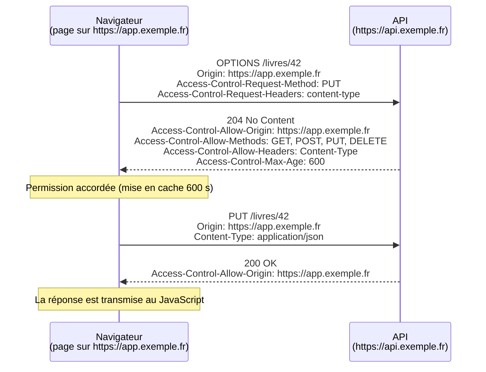

# 22 — Requêtes HTTP avec fetch

> **Niveau** : Intermédiaire · **Durée** : ~4 h · **Prérequis** : [Promesses](../19-promises/README.md), [async/await](../20-async-await/README.md), [Timers](../21-timers/README.md)

Presque toutes les applications parlent à un serveur : charger des données, envoyer un formulaire, téléverser une image, suivre une commande en temps réel. `fetch` est l'API standard pour cela, dans les navigateurs comme dans Node.js, Deno et Bun. Elle est simple à appeler mais facile à mal utiliser : elle ne rejette pas sur une erreur 404, n'a pas de délai maximal par défaut et se heurte aux règles CORS du navigateur. Ce chapitre part des bases du protocole HTTP pour arriver à un petit client robuste, en passant par les flux, l'annulation, CORS et la sécurité.

## Objectifs

- Décrire une requête et une réponse HTTP : méthode, URL, statut, en-têtes, corps.
- Envoyer des requêtes `GET`, `POST`, `PUT`, `PATCH`, `DELETE` avec `fetch` et lire la réponse dans le bon format.
- Distinguer et traiter les erreurs réseau, les erreurs HTTP et les erreurs de lecture du corps.
- Construire des URL sûres avec `URL` et `URLSearchParams`.
- Imposer un délai maximal, annuler une requête et lire une réponse en flux (progression, NDJSON).
- Expliquer CORS, le rôle des cookies et des jetons, et se protéger du CSRF.
- Écrire un petit client HTTP réutilisable et testable, et choisir entre `fetch`, une bibliothèque, SSE et WebSocket.

## Sommaire

- [HTTP en bref](#http-en-bref)
- [Exécuter les exemples de ce chapitre](#exécuter-les-exemples-de-ce-chapitre)
- [Premier `fetch`](#premier-fetch)
- [Le piège : `fetch` ne rejette pas sur une erreur HTTP](#le-piège--fetch-ne-rejette-pas-sur-une-erreur-http)
- [Lire le corps de la réponse](#lire-le-corps-de-la-réponse)
- [Envoyer des données](#envoyer-des-données)
- [Construire des URL avec `URL` et `URLSearchParams`](#construire-des-url-avec-url-et-urlsearchparams)
- [Les objets `Request` et `Response`](#les-objets-request-et-response)
- [Les options de `fetch`](#les-options-de-fetch)
- [Gérer les erreurs de façon robuste](#gérer-les-erreurs-de-façon-robuste)
- [Délai maximal et annulation](#délai-maximal-et-annulation)
- [Flux, progression et téléchargements](#flux-progression-et-téléchargements)
- [CORS expliqué](#cors-expliqué)
- [Cookies, jetons et authentification](#cookies-jetons-et-authentification)
- [Se protéger du CSRF](#se-protéger-du-csrf)
- [Un petit client HTTP réutilisable](#un-petit-client-http-réutilisable)
- [`fetch` dans Node.js](#fetch-dans-nodejs)
- [Bibliothèques et alternatives](#bibliothèques-et-alternatives)
- [Temps réel : SSE et WebSocket](#temps-réel--sse-et-websocket)
- [Pièges courants](#pièges-courants)
- [Bonnes pratiques et sécurité](#bonnes-pratiques-et-sécurité)
- [Résumé](#résumé)
- [Exercices](#exercices)
- [Pour aller plus loin](#pour-aller-plus-loin)

## HTTP en bref

HTTP est un protocole **requête / réponse** : le client envoie une requête, le serveur renvoie une réponse. Les deux ont la même structure : une première ligne, des en-têtes (`Nom: valeur`), une ligne vide, puis un corps facultatif.

```http
POST /api/livres HTTP/1.1
Host: bibliotheque.exemple.fr
Content-Type: application/json
Accept: application/json
Authorization: Bearer eyJhbGciOi…

{"titre": "Fondation", "auteur": "Isaac Asimov"}
```

```http
HTTP/1.1 201 Created
Content-Type: application/json; charset=utf-8
Location: /api/livres/42

{"id": 42, "titre": "Fondation", "auteur": "Isaac Asimov"}
```

### Les méthodes

| Méthode   | Usage                                   | Sûre ¹ | Idempotente ² | Corps de requête |
| --------- | --------------------------------------- | ------ | ------------- | ---------------- |
| `GET`     | Lire une ressource                      | oui    | oui           | non              |
| `HEAD`    | Comme `GET`, mais seulement les en-têtes | oui   | oui           | non              |
| `POST`    | Créer une ressource, déclencher une action | non | non           | oui              |
| `PUT`     | Remplacer entièrement une ressource     | non    | oui           | oui              |
| `PATCH`   | Modifier partiellement une ressource    | non    | non (en général) | oui           |
| `DELETE`  | Supprimer une ressource                 | non    | oui           | rarement         |
| `OPTIONS` | Demander les capacités du serveur (pré-vérification CORS) | oui | oui | non       |

¹ **Sûre** : ne modifie rien côté serveur. ² **Idempotente** : l'envoyer une ou dix fois produit le même état final. C'est ce qui permet de **renvoyer sans risque** une requête après une panne réseau : un `PUT` répété ne crée pas de doublon, un `POST` répété peut créer deux commandes (voir les nouvelles tentatives au [chapitre 20](../20-async-await/README.md)).

### Les codes de statut

| Famille | Sens               | Codes courants                                                                                          |
| ------- | ------------------ | ------------------------------------------------------------------------------------------------------- |
| 1xx     | Information        | rarement visibles depuis JavaScript                                                                     |
| 2xx     | Succès             | `200 OK`, `201 Created` (avec un en-tête `Location`), `204 No Content` (pas de corps)                   |
| 3xx     | Redirection        | `301`/`308` (définitive), `302`/`307` (temporaire), `304 Not Modified` (le cache est encore valable)    |
| 4xx     | Erreur du client   | `400 Bad Request`, `401 Unauthorized` (non authentifié), `403 Forbidden` (authentifié mais pas autorisé), `404 Not Found`, `409 Conflict`, `422 Unprocessable Content` (validation), `429 Too Many Requests` |
| 5xx     | Erreur du serveur  | `500 Internal Server Error`, `502 Bad Gateway`, `503 Service Unavailable`, `504 Gateway Timeout`        |

### Les en-têtes que vous croiserez le plus

| En-tête                       | Rôle                                                                     |
| ----------------------------- | ------------------------------------------------------------------------ |
| `Content-Type`                | Format du corps envoyé (`application/json`, `multipart/form-data`…)      |
| `Accept`                      | Format(s) de réponse souhaité(s)                                         |
| `Authorization`               | Identifiants, souvent `Bearer <jeton>`                                   |
| `Cookie` / `Set-Cookie`       | Cookies envoyés par le client / déposés par le serveur                  |
| `Cache-Control`, `ETag`, `If-None-Match` | Mise en cache et requêtes conditionnelles (réponse `304`)     |
| `Location`                    | URL de la ressource créée (`201`) ou de la redirection (`3xx`)           |
| `Retry-After`                 | Délai à respecter avant de réessayer (`429`, `503`)                      |
| `Origin`                      | Origine de la page qui fait la requête (utilisé par CORS)                |

### REST en deux minutes

Une API « REST » expose des **ressources** identifiées par des URL et manipulées avec les méthodes HTTP :

| Requête                  | Effet                       | Réponse typique                |
| ------------------------ | --------------------------- | ------------------------------ |
| `GET /livres`            | Lister (souvent paginé)     | `200` + tableau JSON           |
| `GET /livres/42`         | Lire un livre               | `200` + objet, ou `404`        |
| `POST /livres`           | Créer                       | `201` + objet + `Location`     |
| `PUT /livres/42`         | Remplacer                   | `200` + objet (ou `204`)       |
| `PATCH /livres/42`       | Modifier certains champs    | `200` + objet                  |
| `DELETE /livres/42`      | Supprimer                   | `204` sans corps               |

Les erreurs sont de plus en plus souvent décrites dans un format standard, les _Problem Details_ (RFC 9457) : un corps `application/problem+json` avec `type`, `title`, `status` et `detail`.

## Exécuter les exemples de ce chapitre

Pour que les exemples fonctionnent sans dépendre d'une API publique, la plupart démarrent **leur propre petit serveur** avec le module `node:http` de Node.js, sur le port `0` (le système choisit un port libre), puis l'arrêtent à la fin. Vous n'avez pas besoin de comprendre ce serveur en détail (il est présenté au [chapitre 27](../27-nodejs/README.md)) : concentrez-vous sur la partie client, qui est identique dans un navigateur.

D'autres exemples construisent directement un objet `Response` (`new Response(…)`), ce qui suffit pour étudier la lecture d'une réponse. Les blocs qui appellent une vraie API publique ou qui n'ont de sens que dans un navigateur sont signalés comme tels.

## Premier `fetch`

`fetch(url, options)` renvoie une **promesse de `Response`**. La lecture se fait en deux temps :

1. `await fetch(url)` se résout dès que le **statut et les en-têtes** sont arrivés ;
2. `await reponse.json()` (ou `.text()`, `.blob()`…) attend la fin du **corps** et le décode.

<!-- no-run -->
```js
// Une vraie API publique (nécessite un accès réseau)
const reponse = await fetch("https://api.github.com/repos/nodejs/node");
console.log(reponse.status); // 200
const depot = await reponse.json();
console.log(depot.full_name); // nodejs/node
```

La même chose avec un serveur local, en explorant l'objet `Response` :

```js
import { createServer } from "node:http";

// Petit serveur local pour l'exemple (port 0 = un port libre choisi par le système)
const serveur = createServer((requete, reponse) => {
  reponse.writeHead(200, { "Content-Type": "application/json; charset=utf-8" });
  reponse.end(JSON.stringify({ titre: "Le Petit Prince", auteur: "Antoine de Saint-Exupéry" }));
});
await new Promise((resoudre) => serveur.listen(0, resoudre));
const base = `http://localhost:${serveur.address().port}`;

const reponse = await fetch(`${base}/livres/1`);
console.log(reponse.ok, reponse.status, reponse.statusText); // true 200 OK
console.log(reponse.headers.get("Content-Type")); // application/json; charset=utf-8
console.log(reponse.url === `${base}/livres/1`); // true
console.log(reponse.redirected); // false

const livre = await reponse.json();
console.log(livre.titre); // Le Petit Prince

serveur.close();
```

| Propriété          | Contenu                                                                     |
| ------------------ | --------------------------------------------------------------------------- |
| `ok`               | `true` si le statut est entre 200 et 299                                    |
| `status`           | Le code numérique (`200`, `404`…)                                           |
| `statusText`       | Le message associé (`"OK"`) ; **vide en HTTP/2 et HTTP/3**, ne vous y fiez pas |
| `headers`          | Un objet `Headers` (noms insensibles à la casse)                            |
| `url`, `redirected`| L'URL finale et si une redirection a été suivie                             |
| `type`             | `"basic"`, `"cors"`, `"opaque"`… (utile dans le navigateur)                 |
| `body`, `bodyUsed` | Le corps sous forme de flux, et s'il a déjà été lu                          |

## Le piège : `fetch` ne rejette pas sur une erreur HTTP

Pour `fetch`, une réponse 404 ou 500 est une réponse **réussie** : le serveur a bien répondu. La promesse n'est rejetée que si **aucune réponse** n'a pu être obtenue. Vérifier `reponse.ok` est donc obligatoire.

```js
import { createServer } from "node:http";

const serveur = createServer((requete, reponse) => {
  if (requete.url === "/livres/1") {
    reponse.writeHead(200, { "Content-Type": "application/json" });
    return reponse.end(JSON.stringify({ id: 1, titre: "Dune" }));
  }
  reponse.writeHead(404, { "Content-Type": "application/json" });
  reponse.end(JSON.stringify({ erreur: "Livre introuvable" }));
});
await new Promise((resoudre) => serveur.listen(0, resoudre));
const base = `http://localhost:${serveur.address().port}`;

// ❌ Aucune vérification : le message d'erreur est traité comme un livre
async function chargerLivreNaif(id) {
  const reponse = await fetch(`${base}/livres/${id}`);
  return reponse.json();
}
const livre = await chargerLivreNaif(99);
console.log(livre.titre); // undefined

// ✅ On vérifie le statut avant de lire le corps
async function chargerLivre(id) {
  const reponse = await fetch(`${base}/livres/${id}`);
  if (!reponse.ok) throw new Error(`HTTP ${reponse.status} (${reponse.statusText})`);
  return reponse.json();
}
console.log((await chargerLivre(1)).titre); // Dune
try {
  await chargerLivre(99);
} catch (erreur) {
  console.log(erreur.message); // HTTP 404 (Not Found)
}

serveur.close();
```

`fetch` **rejette** sa promesse dans ces cas, toujours avant d'avoir une réponse :

| Situation                                                        | Erreur                                             |
| ---------------------------------------------------------------- | -------------------------------------------------- |
| Réseau : DNS introuvable, connexion refusée, coupure, certificat invalide | `TypeError`                               |
| Requête bloquée par CORS ou par une politique du navigateur      | `TypeError` (le détail n'apparaît que dans la console) |
| URL ou options invalides (URL mal formée, `GET` avec un corps, port interdit) | `TypeError`                           |
| Annulation via `AbortController`                                 | `DOMException` nommée `AbortError` (ou la raison passée à `abort()`) |
| Délai de `AbortSignal.timeout()` dépassé                         | `DOMException` nommée `TimeoutError`               |

```js
import { createServer } from "node:http";

// On récupère un port libre puis on le libère : personne n'y écoute plus
const temporaire = createServer();
await new Promise((resoudre) => temporaire.listen(0, resoudre));
const portFerme = temporaire.address().port;
await new Promise((resoudre) => temporaire.close(resoudre));

try {
  await fetch(`http://127.0.0.1:${portFerme}/`);
} catch (erreur) {
  console.log(erreur.name, "-", erreur.message); // TypeError - fetch failed
  console.log(erreur.cause.code); // ECONNREFUSED
}

try {
  await fetch("pas une url");
} catch (erreur) {
  console.log(erreur.name); // TypeError
}

try {
  await fetch("http://127.0.0.1/", { method: "GET", body: "contenu" });
} catch (erreur) {
  console.log(erreur.message); // Request with GET/HEAD method cannot have body.
}
```

> [!NOTE]
> Le message d'une erreur réseau change d'un environnement à l'autre : « Failed to fetch » (Chrome), « NetworkError when attempting to fetch resource. » (Firefox), « Load failed » (Safari), « fetch failed » (Node.js, avec le détail dans `erreur.cause`). Ne testez jamais le texte du message : testez `erreur.name` ou `instanceof`.

## Lire le corps de la réponse

| Méthode                 | Résultat                         | Usage                                         |
| ----------------------- | -------------------------------- | --------------------------------------------- |
| `reponse.json()`        | La valeur JavaScript décodée     | API JSON (rejette avec `SyntaxError` si le JSON est invalide) |
| `reponse.text()`        | Une chaîne (décodée en UTF-8)    | HTML, CSV, texte brut                         |
| `reponse.blob()`        | Un `Blob` (avec son type MIME)   | Images, fichiers à afficher ou télécharger dans le navigateur |
| `reponse.arrayBuffer()` | Un `ArrayBuffer`                 | Données binaires                              |
| `reponse.bytes()`       | Un `Uint8Array`                  | Données binaires, plus pratique (Chrome 132+, Firefox 128+, Safari 18+, Node.js 22.3+) |
| `reponse.formData()`    | Un `FormData`                    | Réponses `multipart/form-data` (rare)         |
| `reponse.body`          | Un `ReadableStream` d'octets     | Lecture progressive ([flux](#flux-progression-et-téléchargements)) |

Le corps est un **flux** : il ne peut être lu **qu'une seule fois**. Pour le lire deux fois (journaliser et traiter, mettre en cache et afficher), clonez la réponse **avant** la première lecture.

```js
const reponse = new Response('{"titre":"Dune","pages":412}', {
  headers: { "Content-Type": "application/json" },
});

const copie = reponse.clone(); // avant toute lecture
const livre = await reponse.json();
console.log(livre.pages); // 412
console.log(reponse.bodyUsed); // true

try {
  await reponse.text(); // deuxième lecture du même corps
} catch (erreur) {
  console.log(erreur.name); // TypeError
}

console.log(await copie.text()); // {"titre":"Dune","pages":412}
```

### Corps vide et contenu inattendu

Deux réponses font échouer un `reponse.json()` naïf : `204 No Content` (corps vide) et une page HTML d'erreur renvoyée par un proxy ou un pare-feu à la place du JSON attendu. Une fonction de lecture prudente :

```js
async function lireJson(reponse) {
  if (reponse.status === 204) return null;
  const texte = await reponse.text();
  if (texte === "") return null;
  const type = reponse.headers.get("Content-Type") ?? "";
  if (!/\bjson\b/i.test(type)) {
    throw new TypeError(`JSON attendu, reçu « ${type || "type inconnu"} »`);
  }
  return JSON.parse(texte); // SyntaxError si le JSON est invalide
}

console.log(await lireJson(Response.json({ id: 1 }))); // { id: 1 }
console.log(await lireJson(new Response(null, { status: 204 }))); // null

const pageErreur = new Response("<h1>502 Bad Gateway</h1>", { headers: { "Content-Type": "text/html" } });
try {
  await lireJson(pageErreur);
} catch (erreur) {
  console.log(erreur.message); // JSON attendu, reçu « text/html »
}

const jsonCasse = new Response('{"id": 1,', { headers: { "Content-Type": "application/json" } });
try {
  await lireJson(jsonCasse);
} catch (erreur) {
  console.log(erreur.name); // SyntaxError
}
```

L'expression `/\bjson\b/` accepte aussi `application/problem+json` et `application/ld+json`. Le format JSON lui-même (`JSON.parse`, _reviver_, dates) est détaillé au [chapitre 25](../25-json-et-stockage/README.md).

## Envoyer des données

Le deuxième argument de `fetch` décrit la requête : `method`, `headers`, `body`… Le type du corps détermine l'en-tête `Content-Type` envoyé **automatiquement**, sauf pour le JSON, qu'il faut déclarer vous-même. Démonstration avec un serveur « écho » qui renvoie ce qu'il a reçu :

```js
import { createServer } from "node:http";

// Serveur écho : renvoie la méthode, le Content-Type et le corps reçus
const serveur = createServer(async (requete, reponse) => {
  let corps = "";
  for await (const morceau of requete) corps += morceau;
  reponse.writeHead(200, { "Content-Type": "application/json" });
  reponse.end(JSON.stringify({ methode: requete.method, type: requete.headers["content-type"] ?? null, corps }));
});
await new Promise((resoudre) => serveur.listen(0, resoudre));
const base = `http://localhost:${serveur.address().port}`;

async function envoyer(body, headers) {
  const reponse = await fetch(`${base}/echo`, { method: "POST", body, headers });
  return reponse.json();
}

// ❌ JSON sans Content-Type : le serveur reçoit du « texte brut »
console.log((await envoyer(JSON.stringify({ titre: "Dune" }))).type); // text/plain;charset=UTF-8

// ✅ JSON : on sérialise et on déclare le type
const json = await envoyer(JSON.stringify({ titre: "Dune" }), { "Content-Type": "application/json" });
console.log(json.type, json.corps); // application/json {"titre":"Dune"}

// URLSearchParams : format des formulaires HTML classiques, encodage automatique
const formulaireSimple = await envoyer(new URLSearchParams({ q: "café crème", page: "2" }));
console.log(formulaireSimple.type); // application/x-www-form-urlencoded;charset=UTF-8
console.log(formulaireSimple.corps); // q=caf%C3%A9+cr%C3%A8me&page=2

// FormData : champs + fichiers, en multipart/form-data
const donnees = new FormData();
donnees.append("titre", "Dune");
donnees.append("couverture", new Blob(["(octets de l'image)"], { type: "image/png" }), "dune.png");
const multipart = await envoyer(donnees);
console.log(multipart.type.split(";")[0]); // multipart/form-data
console.log(multipart.corps.includes('filename="dune.png"')); // true

// Blob : le type du Blob devient le Content-Type
const csv = await envoyer(new Blob(["id;titre\n1;Dune"], { type: "text/csv" }));
console.log(csv.type); // text/csv

serveur.close();
```

| Corps (`body`)                     | `Content-Type` automatique                            |
| ---------------------------------- | ----------------------------------------------------- |
| Chaîne (dont `JSON.stringify(…)`)  | `text/plain;charset=UTF-8` → **déclarez `application/json`** |
| `URLSearchParams`                  | `application/x-www-form-urlencoded;charset=UTF-8`     |
| `FormData`                         | `multipart/form-data; boundary=…`                     |
| `Blob` / `File`                    | Le type du blob (rien s'il est vide)                  |
| `ArrayBuffer`, `Uint8Array`…       | Aucun : précisez-le (ex. `application/octet-stream`)  |
| `ReadableStream`                   | Aucun ; exige `duplex: "half"` (voir [plus bas](#flux-progression-et-téléchargements)) |

> [!WARNING]
> Avec `FormData`, **ne définissez pas** `Content-Type` vous-même : le navigateur doit y ajouter la délimitation (`boundary=…`) qui sépare les champs. Un `Content-Type: multipart/form-data` écrit à la main, sans `boundary`, rend le corps illisible pour le serveur.

Dans une page, `new FormData(formulaire)` récupère d'un coup tous les champs d'un `<form>`, fichiers compris :

```html
<form id="profil">
  <input name="pseudo" required />
  <input name="avatar" type="file" accept="image/*" />
  <button>Enregistrer</button>
</form>
```

<!-- no-run -->
```js
const formulaire = document.querySelector("#profil");

formulaire.addEventListener("submit", async (evenement) => {
  evenement.preventDefault(); // on envoie nous-mêmes, sans recharger la page
  const reponse = await fetch("/api/profil", { method: "POST", body: new FormData(formulaire) });
  if (!reponse.ok) return afficherErreur(`Échec de l'enregistrement (${reponse.status})`);
  afficherSucces("Profil enregistré");
});
```

### L'objet `Headers`

`headers` accepte un objet littéral, un tableau de paires ou un objet `Headers`. Ce dernier normalise les noms (insensibles à la casse) et regroupe les valeurs multiples :

```js
const enTetes = new Headers({ Accept: "application/json" });
enTetes.set("Authorization", "Bearer abc123"); // remplace
enTetes.append("Accept-Language", "fr"); // ajoute
enTetes.append("Accept-Language", "en;q=0.8");

console.log(enTetes.get("accept-language")); // fr, en;q=0.8
console.log(enTetes.has("AUTHORIZATION")); // true
console.log([...enTetes.keys()]); // [ 'accept', 'accept-language', 'authorization' ]
```

Dans un navigateur, certains en-têtes sont **interdits** au JavaScript et silencieusement ignorés (`Cookie`, `Host`, `Origin`, `Referer`, `Content-Length`, les en-têtes `Sec-*`…) : c'est le navigateur qui les gère. Node.js, qui n'est pas un navigateur, laisse définir `Cookie` ou `Origin`.

### Un CRUD complet

Un mini-serveur REST en mémoire et les quatre opérations côté client :

```js
import { createServer } from "node:http";

// --- Serveur REST minimal (en mémoire) ---
const livres = new Map([[1, { id: 1, titre: "Dune", lu: false }]]);
let prochainId = 2;

const serveur = createServer(async (requete, reponse) => {
  let texte = "";
  for await (const morceau of requete) texte += morceau;
  const donnees = texte ? JSON.parse(texte) : {};
  const id = Number(requete.url.split("/")[2]); // /livres/42 → 42 ; /livres → NaN
  const repondre = (statut, corps, enTetes = {}) => {
    if (corps !== undefined) enTetes["Content-Type"] = "application/json";
    reponse.writeHead(statut, enTetes).end(corps === undefined ? undefined : JSON.stringify(corps));
  };

  if (requete.method === "GET" && Number.isNaN(id)) return repondre(200, [...livres.values()]);
  if (requete.method === "POST") {
    const livre = { id: prochainId++, lu: false, ...donnees };
    livres.set(livre.id, livre);
    return repondre(201, livre, { Location: `/livres/${livre.id}` });
  }
  if (!livres.has(id)) return repondre(404, { erreur: "Livre introuvable" });
  if (requete.method === "GET") return repondre(200, livres.get(id));
  if (requete.method === "PATCH") return repondre(200, Object.assign(livres.get(id), donnees));
  if (requete.method === "DELETE") {
    livres.delete(id);
    return repondre(204);
  }
  repondre(405, { erreur: "Méthode non autorisée" }, { Allow: "GET, POST, PATCH, DELETE" });
});
await new Promise((resoudre) => serveur.listen(0, resoudre));
const base = `http://localhost:${serveur.address().port}`;
const json = { "Content-Type": "application/json" };

// --- Client ---
// Créer
let reponse = await fetch(`${base}/livres`, { method: "POST", headers: json, body: JSON.stringify({ titre: "Fondation" }) });
console.log(reponse.status, reponse.headers.get("Location")); // 201 /livres/2
console.log(await reponse.json()); // { id: 2, lu: false, titre: 'Fondation' }

// Lire
reponse = await fetch(`${base}/livres`);
console.log((await reponse.json()).map((livre) => livre.titre)); // [ 'Dune', 'Fondation' ]

// Modifier partiellement
reponse = await fetch(`${base}/livres/2`, { method: "PATCH", headers: json, body: JSON.stringify({ lu: true }) });
console.log(await reponse.json()); // { id: 2, lu: true, titre: 'Fondation' }

// Supprimer
reponse = await fetch(`${base}/livres/2`, { method: "DELETE" });
console.log(reponse.status, (await reponse.text()) === ""); // 204 true

reponse = await fetch(`${base}/livres/2`);
console.log(reponse.status, await reponse.json()); // 404 { erreur: 'Livre introuvable' }

serveur.close();
```

`PUT` s'utiliserait comme `PATCH`, mais avec la ressource **complète** : un champ absent est un champ supprimé.

## Construire des URL avec `URL` et `URLSearchParams`

Concaténer des chaînes pour fabriquer une URL est une source de bugs (et parfois de failles) : un `&`, un `#` ou un espace dans une valeur casse la requête.

```js
const terme = "Tintin & Milou";

// ❌ Concaténation : « & Milou » est pris pour un nouveau paramètre
const naive = `https://api.exemple.fr/recherche?q=${terme}&page=1`;
console.log(JSON.stringify(new URL(naive).searchParams.get("q"))); // "Tintin "

// ✅ URLSearchParams encode chaque valeur
const url = new URL("/recherche", "https://api.exemple.fr");
url.searchParams.set("q", terme);
url.searchParams.set("page", 1); // converti en chaîne
console.log(url.href); // https://api.exemple.fr/recherche?q=Tintin+%26+Milou&page=1
console.log(url.searchParams.get("q")); // Tintin & Milou

// Valeurs multiples, conversion en objet, nombre de paramètres
const filtres = new URL("https://api.exemple.fr/livres?genre=sf&genre=polar&tri=titre");
console.log(filtres.searchParams.getAll("genre")); // [ 'sf', 'polar' ]
console.log(Object.fromEntries(filtres.searchParams)); // { genre: 'polar', tri: 'titre' }
console.log(filtres.searchParams.size); // 3

// Un segment de chemin s'encode avec encodeURIComponent
console.log(`/artistes/${encodeURIComponent("AC/DC")}`); // /artistes/AC%2FDC
```

`fetch` accepte directement un objet `URL` : `fetch(url)`. Et `new URLSearchParams(objet)` produit une chaîne de requête complète : `` `/livres?${new URLSearchParams({ q: "dune", page: 2 })}` ``.

### Le piège de la barre oblique finale

`new URL(chemin, base)` résout `chemin` **comme un lien relatif** dans une page : le dernier segment de `base` est remplacé s'il ne se termine pas par `/`, et un chemin commençant par `/` repart de la racine.

```js
console.log(new URL("livres", "https://api.exemple.fr/v1").href); // https://api.exemple.fr/livres
console.log(new URL("livres", "https://api.exemple.fr/v1/").href); // https://api.exemple.fr/v1/livres
console.log(new URL("/livres", "https://api.exemple.fr/v1/").href); // https://api.exemple.fr/livres
```

Règle simple pour une URL de base d'API : terminez-la par `/` et écrivez les chemins **sans** `/` initial.

### Valider une URL : `URL.canParse` et `URL.parse`

`new URL("…")` lève une `TypeError` si la chaîne n'est pas une URL valide. Deux méthodes statiques évitent le `try/catch` : `URL.canParse()` (Baseline 2023) et `URL.parse()` (Baseline 2024, Node.js 22.1+), qui renvoie `null` au lieu de lever une erreur.

```js
console.log(URL.canParse("pas une url")); // false
console.log(URL.canParse("/profil", "https://exemple.fr")); // true

const lien = URL.parse("https://boutique.exemple.fr:8443/panier?code=NOEL");
console.log(lien.hostname, lien.port, lien.searchParams.get("code")); // boutique.exemple.fr 8443 NOEL
console.log(URL.parse("javascript est super")); // null

// Accepter uniquement des liens http(s) fournis par un utilisateur
const estLienWebSur = (texte) => ["http:", "https:"].includes(URL.parse(texte)?.protocol);
console.log(estLienWebSur("https://exemple.fr"), estLienWebSur("javascript:alert(1)")); // true false
```

## Les objets `Request` et `Response`

`fetch(url, options)` est un raccourci : il construit un objet `Request`, l'envoie et produit un objet `Response`. Ces deux classes sont utilisables directement, ce qui sert dans trois situations :

- **réutiliser ou transmettre une requête** préparée à l'avance (`fetch(requete)`, `requete.clone()`) ;
- **fabriquer des réponses** : dans un Service Worker, dans les serveurs « standard Web » (`Deno.serve`, `Bun.serve`, Hono, les gestionnaires de routes de nombreux frameworks), ou dans les tests ;
- **simuler `fetch`** dans un test, sans réseau.

```js
const requete = new Request("https://api.exemple.fr/livres", {
  method: "POST",
  headers: { "Content-Type": "application/json" },
  body: JSON.stringify({ titre: "Dune" }),
});
console.log(requete.method, requete.url); // POST https://api.exemple.fr/livres
console.log(await requete.json()); // { titre: 'Dune' }

// Fabriquer des réponses
const creee = Response.json({ id: 7 }, { status: 201 }); // JSON + Content-Type (Baseline 2023)
console.log(creee.status, creee.headers.get("Content-Type")); // 201 application/json

const redirection = Response.redirect("https://exemple.fr/connexion", 302);
console.log(redirection.status, redirection.headers.get("Location")); // 302 https://exemple.fr/connexion

const echecReseau = Response.error(); // ce que voit un Service Worker en cas d'erreur réseau
console.log(echecReseau.type, echecReseau.status); // error 0
```

**Injecter `fetch`** en paramètre rend une fonction testable sans serveur :

```js
async function compterLivresNonLus(fetchFn = globalThis.fetch) {
  const reponse = await fetchFn("https://api.exemple.fr/livres?lu=false");
  if (!reponse.ok) throw new Error(`HTTP ${reponse.status}`);
  const livres = await reponse.json();
  return livres.length;
}

// Dans un test : un faux fetch qui renvoie une réponse construite à la main
const fetchFactice = async () => Response.json([{ id: 1 }, { id: 4 }]);
console.log(await compterLivresNonLus(fetchFactice)); // 2

const fetchEnPanne = async () => new Response("Service indisponible", { status: 503 });
await compterLivresNonLus(fetchEnPanne).catch((erreur) => console.log(erreur.message)); // HTTP 503
```

## Les options de `fetch`

| Option           | Valeurs (défaut en gras)                                        | Rôle                                                                 |
| ---------------- | --------------------------------------------------------------- | -------------------------------------------------------------------- |
| `method`         | **`"GET"`**, `"POST"`…                                          | Méthode HTTP                                                         |
| `headers`        | objet, tableau de paires, `Headers`                             | En-têtes de la requête                                               |
| `body`           | chaîne, `FormData`, `URLSearchParams`, `Blob`, `ArrayBuffer`, `ReadableStream`… | Corps (interdit avec `GET`/`HEAD`)                 |
| `signal`         | un `AbortSignal`                                                | Annulation et délai maximal                                          |
| `credentials`    | `"omit"`, **`"same-origin"`**, `"include"`                      | Envoi des cookies et identifiants HTTP ([voir plus bas](#cookies-jetons-et-authentification)) |
| `mode`           | **`"cors"`**, `"same-origin"`, `"no-cors"`                      | Règles d'accès entre origines ([CORS](#cors-expliqué))               |
| `cache`          | **`"default"`**, `"no-store"`, `"reload"`, `"no-cache"`, `"force-cache"`, `"only-if-cached"` | Interaction avec le cache HTTP du navigateur |
| `redirect`       | **`"follow"`**, `"error"`, `"manual"`                           | Suivre les redirections, échouer, ou les traiter soi-même            |
| `referrerPolicy` | `"no-referrer"`, `"strict-origin-when-cross-origin"`…           | Contenu de l'en-tête `Referer`                                       |
| `integrity`      | `"sha384-…"`                                                    | Vérifie l'empreinte de la ressource téléchargée (SRI)                |
| `keepalive`      | **`false`**, `true`                                             | La requête survit à la fermeture de la page (corps ≤ 64 Kio)         |
| `priority`       | **`"auto"`**, `"high"`, `"low"`                                 | Indice de priorité pour le navigateur                                |
| `duplex`         | `"half"`                                                        | Obligatoire quand `body` est un `ReadableStream`                     |

Quelques précisions :

- **`cache`** ne concerne que le cache HTTP du navigateur : `"no-store"` ignore le cache, `"no-cache"` revalide toujours auprès du serveur (requête conditionnelle, réponse `304` possible), `"force-cache"` utilise une copie même périmée. Un serveur bien configuré (`Cache-Control`, `ETag`) rend généralement ces options inutiles.
- **`keepalive: true`** (Baseline 2024) est une alternative plus souple à `navigator.sendBeacon()` pour envoyer des statistiques au moment où l'utilisateur quitte la page :

<!-- no-run -->
```js
addEventListener("visibilitychange", () => {
  if (document.visibilityState !== "hidden") return;
  fetch("/api/statistiques", {
    method: "POST",
    keepalive: true, // la requête part même si l'onglet se ferme
    headers: { "Content-Type": "application/json" },
    body: JSON.stringify({ page: location.pathname, duree: Math.round(performance.now()) }),
  });
});
```

- **`priority`** (Baseline 2024) aide le navigateur à ordonner ses téléchargements : `"high"` pour les données affichées en premier, `"low"` pour un préchargement.
- Dans **Node.js**, les options propres au navigateur (`mode`, `credentials`, `cache`, `referrerPolicy`, `priority`) sont acceptées mais n'ont pas d'effet : il n'y a ni CORS, ni gestion automatique des cookies, ni cache HTTP.

## Gérer les erreurs de façon robuste

Une requête peut échouer à quatre endroits différents, et l'utilisateur mérite un message adapté à chacun :

| Étape                     | Exemple                                    | Comment le détecter                         | Réessayer ?                          |
| ------------------------- | ------------------------------------------ | ------------------------------------------- | ------------------------------------ |
| Réseau                    | Wi-Fi coupé, DNS, serveur éteint, CORS     | `fetch` rejette avec une `TypeError`        | Oui, avec délai (si idempotent)      |
| Délai / annulation        | Serveur trop lent, utilisateur qui annule  | `name` : `TimeoutError` / `AbortError`      | Délai : oui ; annulation : non       |
| HTTP                      | `404`, `422`, `500`, `503`                 | `!reponse.ok`, `reponse.status`             | `408`, `429`, `502`, `503`, `504` : oui ; les autres `4xx` : non |
| Lecture du corps          | JSON invalide, page HTML d'un proxy        | `SyntaxError`, type de contenu inattendu    | Rarement                             |

On regroupe tout cela dans une fonction, avec des classes d'erreur dédiées (le [chapitre 17](../17-erreurs/README.md) détaille les erreurs personnalisées et `cause`) :

```js
import { createServer } from "node:http";

class ErreurReseau extends Error {
  name = "ErreurReseau";
}

class ErreurHttp extends Error {
  name = "ErreurHttp";
  constructor(reponse, details) {
    super(`HTTP ${reponse.status} pour ${reponse.url}`);
    this.status = reponse.status;
    this.details = details; // le corps de l'erreur renvoyé par le serveur
  }
}

async function requeteJson(url, { delai = 5000, ...options } = {}) {
  let reponse;
  try {
    reponse = await fetch(url, { ...options, signal: options.signal ?? AbortSignal.timeout(delai) });
  } catch (erreur) {
    if (erreur.name === "TimeoutError" || erreur.name === "AbortError") throw erreur;
    throw new ErreurReseau(`Impossible de joindre ${url}`, { cause: erreur });
  }

  const texte = await reponse.text(); // lire le corps dans tous les cas libère la connexion
  let donnees = null;
  try {
    donnees = texte ? JSON.parse(texte) : null;
  } catch (erreur) {
    if (reponse.ok) throw erreur; // SyntaxError : succès annoncé mais réponse illisible
    donnees = texte; // une erreur HTTP en texte brut reste exploitable
  }
  if (!reponse.ok) throw new ErreurHttp(reponse, donnees);
  return donnees;
}

function messagePourUtilisateur(erreur) {
  if (erreur.name === "TimeoutError") return "Le serveur met trop de temps à répondre.";
  if (erreur.name === "AbortError") return null; // annulation volontaire : rien à afficher
  if (erreur instanceof ErreurReseau) return "Connexion impossible, vérifiez votre réseau.";
  if (erreur instanceof ErreurHttp && erreur.status === 404) return "Cette page n'existe plus.";
  if (erreur instanceof ErreurHttp && erreur.status === 422) return `Formulaire invalide : ${erreur.details.erreurs.join(", ")}.`;
  if (erreur instanceof ErreurHttp && erreur.status >= 500) return "Le service rencontre un problème, réessayez plus tard.";
  if (erreur instanceof SyntaxError) return "Réponse illisible du serveur.";
  return "Erreur inattendue.";
}

// --- Un serveur qui sait mal se comporter ---
const serveur = createServer((requete, reponse) => {
  const json = (statut, corps) => reponse.writeHead(statut, { "Content-Type": "application/json" }).end(JSON.stringify(corps));
  if (requete.url === "/ok") return json(200, { message: "bonjour" });
  if (requete.url === "/introuvable") return json(404, { erreur: "introuvable" });
  if (requete.url === "/invalide") return json(422, { erreurs: ["e-mail manquant", "mot de passe trop court"] });
  if (requete.url === "/panne") return reponse.writeHead(503).end("maintenance en cours");
  if (requete.url === "/casse") return reponse.writeHead(200, { "Content-Type": "application/json" }).end("{oups");
  if (requete.url === "/lent") {
    const minuteur = setTimeout(() => json(200, {}), 1000);
    return reponse.on("close", () => clearTimeout(minuteur));
  }
});
await new Promise((resoudre) => serveur.listen(0, resoudre));
const base = `http://localhost:${serveur.address().port}`;

const temporaire = createServer();
await new Promise((resoudre) => temporaire.listen(0, resoudre));
const portFerme = temporaire.address().port;
await new Promise((resoudre) => temporaire.close(resoudre));

console.log(await requeteJson(`${base}/ok`)); // { message: 'bonjour' }

for (const url of [`${base}/introuvable`, `${base}/invalide`, `${base}/panne`, `${base}/casse`, `${base}/lent`, `http://127.0.0.1:${portFerme}/`]) {
  try {
    await requeteJson(url, { delai: 100 });
  } catch (erreur) {
    console.log(messagePourUtilisateur(erreur));
  }
}
// Cette page n'existe plus.
// Formulaire invalide : e-mail manquant, mot de passe trop court.
// Le service rencontre un problème, réessayez plus tard.
// Réponse illisible du serveur.
// Le serveur met trop de temps à répondre.
// Connexion impossible, vérifiez votre réseau.

serveur.close();
serveur.closeAllConnections(); // ferme aussi la connexion de la requête abandonnée
```

Pour les nouvelles tentatives (backoff exponentiel, _jitter_, respect de `Retry-After`) et la limitation du nombre de requêtes simultanées, reportez-vous au [chapitre 20](../20-async-await/README.md) : ces techniques s'appliquent telles quelles à `requeteJson`. Ne réessayez automatiquement que les requêtes **idempotentes** (`GET`, `PUT`, `DELETE`) ou munies d'une clé d'idempotence.

## Délai maximal et annulation

`fetch` n'a **aucun délai maximal par défaut** : une requête vers un serveur qui ne répond pas peut rester en suspens plusieurs minutes. Passez toujours un `signal` :

- `AbortSignal.timeout(ms)` : délai maximal (rejet avec `TimeoutError`) ;
- `AbortController` : annulation à la demande (bouton « Annuler », nouvelle recherche, composant détruit) ; rejet avec `AbortError`, ou avec la raison passée à `abort(raison)` ;
- `AbortSignal.any([…])` : les deux à la fois.

Le signal couvre **toute** la requête, y compris la lecture du corps : si le délai expire pendant `reponse.json()`, c'est cette lecture qui rejette.

```js
import { createServer } from "node:http";

// Un serveur qui envoie les en-têtes tout de suite, puis le corps 500 ms plus tard
const serveur = createServer((requete, reponse) => {
  reponse.writeHead(200, { "Content-Type": "text/plain" });
  reponse.write("début… ");
  const minuteur = setTimeout(() => reponse.end("fin"), 500);
  reponse.on("close", () => clearTimeout(minuteur));
});
await new Promise((resoudre) => serveur.listen(0, resoudre));
const base = `http://localhost:${serveur.address().port}`;

// 1. Délai maximal : il expire pendant la lecture du corps
const reponse = await fetch(base, { signal: AbortSignal.timeout(100) });
console.log("statut reçu :", reponse.status); // statut reçu : 200
try {
  await reponse.text();
} catch (erreur) {
  console.log("lecture interrompue :", erreur.name); // lecture interrompue : TimeoutError
}

// 2. Annulation par l'utilisateur, combinée à un délai maximal
const annulation = new AbortController();
setTimeout(() => annulation.abort(), 50); // l'utilisateur clique sur « Annuler »
try {
  const signal = AbortSignal.any([annulation.signal, AbortSignal.timeout(5000)]);
  const lente = await fetch(base, { signal });
  await lente.text();
} catch (erreur) {
  console.log("annulée :", erreur.name); // annulée : AbortError
}

serveur.close();
serveur.closeAllConnections();
```

> [!WARNING]
> L'ancienne technique `Promise.race([fetch(url), delai(5000)])` **n'annule rien** : la promesse « gagnante » rejette, mais la requête continue en arrière-plan et occupe une connexion. Utilisez un signal.

Pour une recherche pendant la frappe, annulez la requête précédente à chaque nouvelle saisie (exemple complet avec debounce au [chapitre 21](../21-timers/README.md)) ; sinon, une réponse lente à « jav » peut arriver **après** celle à « javascript » et écraser les bons résultats.

## Flux, progression et téléchargements

`reponse.body` est un `ReadableStream` d'octets (`Uint8Array`) : on peut traiter la réponse **au fur et à mesure** qu'elle arrive, sans attendre la fin. C'est ce qui permet d'afficher une progression, de traiter des fichiers énormes sans tout charger en mémoire, ou d'afficher le texte d'une IA générative mot à mot.

### Lire morceau par morceau et suivre la progression

`for await…of` parcourt un flux morceau par morceau. La taille totale, si le serveur la connaît, est dans l'en-tête `Content-Length`.

```js
async function lireAvecProgression(reponse, surProgression) {
  const total = Number(reponse.headers.get("Content-Length")) || null; // null si inconnue
  const morceaux = [];
  let recu = 0;

  for await (const morceau of reponse.body) {
    morceaux.push(morceau);
    recu += morceau.byteLength;
    surProgression(recu, total);
  }

  // Assembler les morceaux en un seul tableau d'octets
  const octets = new Uint8Array(recu);
  let position = 0;
  for (const morceau of morceaux) {
    octets.set(morceau, position);
    position += morceau.byteLength;
  }
  return octets;
}

// Une réponse dont le corps arrive en trois morceaux (comme sur un réseau lent)
const morceaux = ["a".repeat(30), "b".repeat(30), "c".repeat(40)].map((texte) => new TextEncoder().encode(texte));
const flux = new ReadableStream({
  pull(controleur) {
    if (morceaux.length > 0) controleur.enqueue(morceaux.shift());
    else controleur.close();
  },
});
const reponse = new Response(flux, { headers: { "Content-Length": "100" } });

const octets = await lireAvecProgression(reponse, (recu, total) => {
  console.log(total ? `${Math.round((recu / total) * 100)} %` : `${recu} octets`);
});
console.log(octets.byteLength, "octets reçus");
// 30 %
// 60 %
// 100 %
// 100 octets reçus
```

Avec un vrai `fetch`, le code est identique : `lireAvecProgression(await fetch(url), afficher)`. Deux limites à connaître :

- `Content-Length` peut être **absent** (réponse générée à la volée) ou correspondre à la taille **compressée** (`Content-Encoding: gzip`) alors que le flux fournit les octets décompressés : prévoyez une progression « indéterminée ».
- L'itération d'un flux avec `for await…of` est Baseline 2026 (Safari ne l'a ajoutée qu'avec la version 27). Pour les navigateurs plus anciens, utilisez un lecteur :

```js
const reponse = new Response("Bonjour, monde !");
const lecteur = reponse.body.getReader();
let taille = 0;
while (true) {
  const { done, value } = await lecteur.read();
  if (done) break;
  taille += value.byteLength;
}
console.log(taille); // 16
```

### Décoder du texte en flux et lire du NDJSON

`pipeThrough(new TextDecoderStream())` transforme le flux d'octets en flux de **chaînes**, en gérant correctement les caractères multi-octets coupés entre deux morceaux (un « é » fait deux octets en UTF-8).

Beaucoup d'API envoient des résultats progressifs au format **NDJSON** (_newline-delimited JSON_ : un objet JSON par ligne) : exports volumineux, journaux, réponses d'IA générative. Un morceau réseau peut couper une ligne en deux : il faut donc accumuler le texte et ne décoder que les lignes **complètes**.

```js
import { createServer } from "node:http";

// Serveur qui envoie un suivi de traitement en NDJSON, avec des lignes coupées entre deux envois
const serveur = createServer(async (requete, reponse) => {
  reponse.writeHead(200, { "Content-Type": "application/x-ndjson" });
  const envois = ['{"etape":1,"message":"Analyse du fichier"}\n{"etape":2,"mes', 'sage":"Conversion"}\n', '{"etape":3,"message":"Terminé ✓"}\n'];
  for (const envoi of envois) {
    reponse.write(envoi);
    await new Promise((resoudre) => setTimeout(resoudre, 30));
  }
  reponse.end();
});
await new Promise((resoudre) => serveur.listen(0, resoudre));

async function* lignesJson(reponse) {
  let tampon = "";
  for await (const texte of reponse.body.pipeThrough(new TextDecoderStream())) {
    tampon += texte;
    const lignes = tampon.split("\n");
    tampon = lignes.pop(); // la dernière ligne est peut-être incomplète : on la garde
    for (const ligne of lignes) if (ligne.trim()) yield JSON.parse(ligne);
  }
  if (tampon.trim()) yield JSON.parse(tampon); // dernière ligne sans \n final
}

const reponse = await fetch(`http://localhost:${serveur.address().port}/conversion`);
for await (const evenement of lignesJson(reponse)) {
  console.log(`[${evenement.etape}/3] ${evenement.message}`);
}
// [1/3] Analyse du fichier
// [2/3] Conversion
// [3/3] Terminé ✓

serveur.close();
```

`lignesJson` est un générateur asynchrone ([chapitre 13](../13-iterateurs-generateurs/README.md)) : le code qui le consomme ne voit qu'une suite d'objets, sans se soucier du découpage réseau.

### Envoyer en flux et progression de l'envoi

`fetch` ne fournit **pas d'événement de progression pour l'envoi** (_upload_). Deux options :

- `XMLHttpRequest`, dont `xhr.upload.onprogress` reste la solution fiable et universelle pour une barre de progression de téléversement ;
- un corps `ReadableStream` avec `duplex: "half"`, que l'on compte au fur et à mesure de sa lecture. Dans les navigateurs, seuls Chrome et Edge le permettent (version 105+, uniquement sur une connexion HTTP/2 ou HTTP/3, et toujours avec une pré-vérification CORS) ; Node.js le gère aussi en HTTP/1.1.

<!-- no-run -->
```js
// Navigateur : progression d'un téléversement avec XMLHttpRequest
function televerser(fichier, surProgression) {
  return new Promise((resoudre, rejeter) => {
    const xhr = new XMLHttpRequest();
    xhr.open("POST", "/api/fichiers");
    xhr.upload.addEventListener("progress", (e) => {
      if (e.lengthComputable) surProgression(e.loaded / e.total);
    });
    xhr.addEventListener("load", () => (xhr.status < 300 ? resoudre(JSON.parse(xhr.responseText)) : rejeter(new Error(`HTTP ${xhr.status}`))));
    xhr.addEventListener("error", () => rejeter(new TypeError("Erreur réseau")));
    const donnees = new FormData();
    donnees.append("fichier", fichier);
    xhr.send(donnees);
  });
}
```

### Proposer un fichier au téléchargement (navigateur)

<!-- no-run -->
```js
async function telechargerFichier(url, nomFichier) {
  const reponse = await fetch(url);
  if (!reponse.ok) throw new Error(`HTTP ${reponse.status}`);
  const blob = await reponse.blob();
  const lienTemporaire = URL.createObjectURL(blob); // une URL « blob: » vers les données en mémoire
  const a = Object.assign(document.createElement("a"), { href: lienTemporaire, download: nomFichier });
  a.click();
  URL.revokeObjectURL(lienTemporaire); // libère la mémoire
}

await telechargerFichier("/api/exports/factures.csv", "factures-2026.csv");
```

Pour un simple fichier statique, un lien `<a href="/rapport.pdf" download>` suffit : `fetch` n'est utile que si la requête exige un en-tête (`Authorization`) ou un traitement.

## CORS expliqué

### La politique de même origine

Une **origine**, c'est le triplet _protocole + domaine + port_ : `https://app.exemple.fr` et `https://api.exemple.fr` sont deux origines différentes, tout comme `http://localhost:5173` et `http://localhost:3000`.

Par défaut, le navigateur applique la **politique de même origine** : une page peut _envoyer_ des requêtes vers une autre origine, mais son JavaScript ne peut pas _lire_ la réponse. Sans cette règle, n'importe quel site visité pourrait lire vos e-mails sur votre webmail, puisque le navigateur y joint automatiquement vos cookies.

**CORS** (_Cross-Origin Resource Sharing_) permet au **serveur** d'assouplir cette règle en déclarant, par des en-têtes de réponse, quelles origines ont le droit de lire ses réponses. Conséquences importantes :

- CORS se règle **côté serveur**. Aucune option de `fetch` ne contourne une erreur CORS.
- CORS protège **les utilisateurs du navigateur**, pas le serveur : `curl`, Node.js ou un script Python ignorent complètement CORS. Ce n'est pas un mécanisme d'authentification.
- Une erreur CORS apparaît dans la console du navigateur ; le JavaScript, lui, ne reçoit qu'une `TypeError` sans détail.

### Requêtes simples et pré-vérification

Une requête est dite **simple** si elle utilise `GET`, `HEAD` ou `POST`, uniquement des en-têtes « sûrs » (`Accept`, `Accept-Language`, `Content-Language`, `Content-Type`, `Range`), et un `Content-Type` parmi `application/x-www-form-urlencoded`, `multipart/form-data` ou `text/plain`. Le navigateur l'envoie directement et vérifie seulement la réponse.

Toute autre requête (un `PUT`, un `DELETE`, un `Content-Type: application/json`, un en-tête `Authorization`…) est précédée d'une **pré-vérification** (_preflight_) : une requête `OPTIONS` qui demande la permission.



### Les en-têtes de réponse CORS

| En-tête                            | Rôle                                                                              |
| ---------------------------------- | --------------------------------------------------------------------------------- |
| `Access-Control-Allow-Origin`      | L'origine autorisée (une seule) ou `*` (toutes, **sans** identifiants)            |
| `Access-Control-Allow-Methods`     | Méthodes autorisées (réponse à la pré-vérification)                               |
| `Access-Control-Allow-Headers`     | En-têtes de requête autorisés (réponse à la pré-vérification)                     |
| `Access-Control-Allow-Credentials` | `true` pour autoriser les requêtes avec cookies (`credentials: "include"`)        |
| `Access-Control-Max-Age`           | Durée de mise en cache de la pré-vérification, en secondes (5 s par défaut)       |
| `Access-Control-Expose-Headers`    | En-têtes de réponse lisibles par le JavaScript, en plus des en-têtes de base (`Content-Type`, `Content-Length`, `Cache-Control`…) |

Avec des identifiants (cookies), le serveur **doit** renvoyer une origine explicite (pas `*`) et `Access-Control-Allow-Credentials: true`. S'il choisit l'origine dans une liste, il ajoute `Vary: Origin` pour que les caches ne servent pas la réponse d'une origine à une autre.

Voici la partie serveur, avec une liste d'origines autorisées. On simule ensuite depuis Node.js les requêtes qu'enverrait un navigateur (Node.js permet de définir l'en-tête `Origin`, ce qu'un navigateur interdit) :

```js
import { createServer } from "node:http";

const ORIGINES_AUTORISEES = new Set(["https://app.exemple.fr", "http://localhost:5173"]);

const serveur = createServer((requete, reponse) => {
  const origine = requete.headers.origin;
  reponse.setHeader("Vary", "Origin");
  if (ORIGINES_AUTORISEES.has(origine)) {
    reponse.setHeader("Access-Control-Allow-Origin", origine);
    reponse.setHeader("Access-Control-Allow-Credentials", "true");
  }

  if (requete.method === "OPTIONS") {
    // Pré-vérification : on indique ce qui est permis, sans corps
    reponse.setHeader("Access-Control-Allow-Methods", "GET, POST, PUT, DELETE");
    reponse.setHeader("Access-Control-Allow-Headers", "Content-Type, Authorization");
    reponse.setHeader("Access-Control-Max-Age", "600");
    return reponse.writeHead(204).end();
  }
  reponse.writeHead(200, { "Content-Type": "application/json" }).end(JSON.stringify({ livres: [] }));
});
await new Promise((resoudre) => serveur.listen(0, resoudre));
const base = `http://localhost:${serveur.address().port}`;

// Ce qu'enverrait le navigateur avant un PUT depuis https://app.exemple.fr
const preVerification = await fetch(`${base}/livres/42`, {
  method: "OPTIONS",
  headers: { Origin: "https://app.exemple.fr", "Access-Control-Request-Method": "PUT" },
});
console.log(preVerification.status); // 204
console.log(preVerification.headers.get("Access-Control-Allow-Origin")); // https://app.exemple.fr
console.log(preVerification.headers.get("Access-Control-Allow-Methods")); // GET, POST, PUT, DELETE

// Une origine inconnue : pas d'en-tête Allow-Origin, le navigateur bloquerait la lecture
const intrus = await fetch(`${base}/livres`, { headers: { Origin: "https://site-pirate.exemple" } });
console.log(intrus.status, intrus.headers.get("Access-Control-Allow-Origin")); // 200 null
await intrus.body.cancel(); // on n'a pas besoin du corps

serveur.close();
```

Remarquez le dernier cas : le serveur a **répondu** (`200`). C'est le navigateur qui refuse ensuite de transmettre la réponse à la page. CORS ne remplace donc pas un contrôle d'accès côté serveur.

### Résoudre une erreur CORS

1. **Lisez la console** du navigateur : elle indique l'en-tête manquant ou incorrect.
2. **Corrigez le serveur** : ajoutez l'origine de votre application, les méthodes et en-têtes utilisés, et gérez `OPTIONS`. La plupart des frameworks ont un module CORS (le paquet `cors` pour Express, par exemple).
3. **En développement**, faites passer les appels par le serveur de développement : avec Vite, l'option `server.proxy` redirige `/api` vers votre API, et la page et l'API partagent alors la même origine ([chapitre 28](../28-outillage/README.md)).
4. **N'utilisez pas `mode: "no-cors"`** pour « faire disparaître » l'erreur : la réponse devient **opaque** (statut `0`, corps illisible). Ce mode ne sert qu'à certains usages des Service Workers.

## Cookies, jetons et authentification

### `credentials` et les cookies

Dans un navigateur, les cookies sont gérés **automatiquement** : le serveur les dépose avec `Set-Cookie`, le navigateur les renvoie avec les requêtes suivantes selon l'option `credentials` :

- `"same-origin"` (défaut) : cookies envoyés uniquement vers la même origine ;
- `"include"` : envoyés aussi vers d'autres origines (le serveur doit alors répondre avec une origine explicite et `Access-Control-Allow-Credentials: true`) ;
- `"omit"` : jamais.

Le JavaScript du navigateur ne peut **pas** lire l'en-tête `Set-Cookie` d'une réponse, ni les cookies marqués `HttpOnly` dans `document.cookie`. C'est voulu.

Les attributs d'un cookie déterminent sa sécurité :

| Attribut              | Effet                                                                                     |
| --------------------- | ----------------------------------------------------------------------------------------- |
| `HttpOnly`            | Invisible pour JavaScript : un script injecté (XSS) ne peut pas le voler                  |
| `Secure`              | Envoyé uniquement en HTTPS                                                                |
| `SameSite=Lax`        | Non envoyé avec les requêtes provenant d'autres sites, sauf la navigation vers le site (clic sur un lien) |
| `SameSite=Strict`     | Jamais envoyé depuis un autre site, même lors d'un clic sur un lien                       |
| `SameSite=None`       | Toujours envoyé (exige `Secure`) : nécessaire si le cookie doit accompagner des requêtes venant d'un autre **site** (domaine enregistrable différent, par exemple un widget intégré ailleurs) |
| `Max-Age` / `Expires` | Durée de vie ; sans eux, cookie de session (supprimé à la fermeture du navigateur)        |

> [!NOTE]
> Chrome et Edge traitent un cookie sans attribut `SameSite` comme `Lax`, mais Firefox et Safari ne le font pas par défaut. Déclarez toujours `SameSite` explicitement.

### Jetons « Bearer »

Les API consommées par des applications mobiles, des serveurs ou des scripts utilisent souvent un **jeton** envoyé dans l'en-tête `Authorization` :

<!-- no-run -->
```js
const reponse = await fetch("https://api.exemple.fr/commandes", {
  headers: { Authorization: `Bearer ${jetonAcces}` },
});
if (reponse.status === 401) {
  // jeton absent, expiré ou invalide : le rafraîchir ou redemander une connexion
}
```

Où conserver ce jeton dans une application web ?

| Stockage                           | Lisible par un script injecté (XSS) ? | Envoyé automatiquement (risque CSRF) ? | Commentaire                                      |
| ---------------------------------- | ------------------------------------- | -------------------------------------- | ------------------------------------------------ |
| Variable en mémoire                | Oui, tant que la page est ouverte     | Non                                    | Perdu au rechargement ; associez-le à un jeton de rafraîchissement en cookie `HttpOnly` |
| `localStorage` / `sessionStorage`  | **Oui**, et durablement               | Non                                    | À éviter pour des jetons : `sessionStorage` n'est pas plus sûr, il est seulement effacé plus tôt |
| Cookie `HttpOnly; Secure; SameSite` | **Non**                              | Oui                                    | Recommandé pour les sessions d'une application web, avec une protection CSRF |

Pour une application web classique, le plus sûr est souvent une **session par cookie `HttpOnly`** gérée par votre propre serveur (éventuellement un _backend for frontend_ qui détient les jetons des API tierces). Les jetons `Bearer` conviennent aux applications mobiles, aux échanges entre serveurs et aux scripts. Dans tous les cas : HTTPS uniquement, jamais de jeton dans une URL (elles finissent dans les journaux et l'historique), et des jetons d'accès de courte durée.

### Côté Node.js : aucun cookie automatique

Node.js n'est pas un navigateur : `fetch` n'y conserve **aucun** cookie entre deux requêtes. Il faut lire les cookies reçus et les renvoyer soi-même. `headers.getSetCookie()` (Baseline 2023, Node.js 19.7+) renvoie chaque `Set-Cookie` séparément, ce que `headers.get()` ne permet pas proprement (il les joint par des virgules, alors que les dates d'expiration en contiennent déjà).

```js
import { createServer } from "node:http";

const serveur = createServer((requete, reponse) => {
  if (requete.url === "/connexion") {
    reponse.setHeader("Set-Cookie", ["session=s3cr3t; HttpOnly; Secure; SameSite=Lax; Path=/", "theme=sombre; Path=/"]);
    return reponse.writeHead(204).end();
  }
  const connecte = requete.headers.cookie?.includes("session=s3cr3t") ?? false;
  reponse.writeHead(connecte ? 200 : 401).end(connecte ? "Bienvenue !" : "Connectez-vous");
});
await new Promise((resoudre) => serveur.listen(0, resoudre));
const base = `http://localhost:${serveur.address().port}`;

const connexion = await fetch(`${base}/connexion`, { method: "POST" });
const cookiesRecus = connexion.headers.getSetCookie();
console.log(cookiesRecus.length); // 2

// Sans renvoyer le cookie, le serveur ne nous reconnaît pas
const anonyme = await fetch(`${base}/profil`);
console.log(anonyme.status, await anonyme.text()); // 401 Connectez-vous

// On reconstruit l'en-tête Cookie : « nom=valeur » de chaque cookie, sans ses attributs
const enTeteCookie = cookiesRecus.map((cookie) => cookie.split(";")[0]).join("; ");
console.log(enTeteCookie); // session=s3cr3t; theme=sombre
const authentifie = await fetch(`${base}/profil`, { headers: { Cookie: enTeteCookie } });
console.log(authentifie.status, await authentifie.text()); // 200 Bienvenue !

serveur.close();
```

Ce traitement manuel ignore l'expiration, le domaine et le chemin des cookies : pour un vrai robot ou un test de bout en bout, utilisez une bibliothèque de gestion de cookies (comme `tough-cookie`) ou un outil comme Playwright.

## Se protéger du CSRF

Une attaque **CSRF** (_Cross-Site Request Forgery_) exploite le fait que le navigateur **joint automatiquement les cookies**. Une page piégée sur `site-pirate.exemple` contient un formulaire invisible qui se soumet tout seul vers `https://banque.exemple.fr/virement` : la requête part avec le cookie de session de la victime, et le serveur croit qu'elle vient d'elle. L'attaquant ne peut pas lire la réponse (politique de même origine), mais l'action est faite.

Les défenses, à combiner :

| Défense                                    | Principe                                                                                     |
| ------------------------------------------ | -------------------------------------------------------------------------------------------- |
| `SameSite=Lax` ou `Strict`                 | Le cookie de session n'est pas envoyé avec les requêtes provenant d'un autre site            |
| Jeton anti-CSRF                            | Le serveur exige un jeton imprévisible, connu de la page légitime seulement, dans un en-tête ou un champ caché |
| Vérifier `Origin` (et `Sec-Fetch-Site`)    | Le serveur refuse les requêtes modifiantes dont l'origine n'est pas la sienne                |
| Exiger `Content-Type: application/json`    | Un formulaire HTML ne peut pas l'envoyer, et une requête `fetch` d'un autre site avec ce type déclenche une pré-vérification CORS refusée ; le serveur doit rejeter les autres types |
| Ne jamais modifier de données en `GET`     | Une simple image `` suffirait sinon                              |

Côté client, l'envoi du jeton anti-CSRF tient en quelques lignes ; tout le reste se passe sur le serveur :

```html
<meta name="csrf-token" content="g8Kq3…jeton-généré-par-le-serveur" />
```

<!-- no-run -->
```js
const jetonCsrf = document.querySelector('meta[name="csrf-token"]').content;

async function envoyerFormulaire(url, donnees) {
  return fetch(url, {
    method: "POST",
    headers: { "Content-Type": "application/json", "X-CSRF-Token": jetonCsrf },
    body: JSON.stringify(donnees),
  });
}
```

Un jeton `Bearer` stocké en mémoire et ajouté à la main n'est pas exposé au CSRF (le navigateur ne l'envoie jamais de lui-même), mais il l'est au vol par XSS : aucune solution n'est gratuite. La [fiche OWASP sur le CSRF](https://cheatsheetseries.owasp.org/cheatsheets/Cross-Site_Request_Forgery_Prevention_Cheat_Sheet.html) détaille les options.

## Un petit client HTTP réutilisable

Répéter `if (!reponse.ok)`, `JSON.stringify`, l'en-tête `Content-Type` et le délai maximal dans chaque appel finit par produire des oublis. Un client d'une cinquantaine de lignes centralise tout cela :

- URL de base et paramètres de requête encodés ;
- corps JSON sérialisé avec le bon en-tête ;
- délai maximal par défaut, combiné au `signal` de l'appelant ;
- lecture du corps selon le `Content-Type`, `204` géré ;
- erreur `ErreurHttp` avec le statut et les détails renvoyés par le serveur ;
- `fetch` injectable, pour les tests.

```js
class ErreurHttp extends Error {
  name = "ErreurHttp";
  constructor(reponse, details) {
    super(`HTTP ${reponse.status} ${reponse.url}`);
    this.status = reponse.status;
    this.details = details;
  }
}

async function lireCorps(reponse) {
  if (reponse.status === 204) return null;
  const texte = await reponse.text();
  if (texte === "") return null;
  return /\bjson\b/i.test(reponse.headers.get("Content-Type") ?? "") ? JSON.parse(texte) : texte;
}

function creerClient({ baseUrl, enTetes = {}, delai = 10_000, fetch: fetchFn = globalThis.fetch }) {
  const racine = baseUrl.endsWith("/") ? baseUrl : `${baseUrl}/`;

  async function requete(methode, chemin, { query, json, body, headers, signal } = {}) {
    const url = new URL(chemin.replace(/^\//, ""), racine);
    for (const [cle, valeur] of Object.entries(query ?? {})) {
      if (valeur !== undefined && valeur !== null) url.searchParams.set(cle, valeur);
    }

    const reponse = await fetchFn(url, {
      method: methode,
      headers: {
        Accept: "application/json",
        ...(json !== undefined && { "Content-Type": "application/json" }),
        ...enTetes,
        ...headers,
      },
      body: json !== undefined ? JSON.stringify(json) : body,
      signal: signal ? AbortSignal.any([signal, AbortSignal.timeout(delai)]) : AbortSignal.timeout(delai),
    });

    if (!reponse.ok) throw new ErreurHttp(reponse, await lireCorps(reponse).catch(() => null));
    return lireCorps(reponse);
  }

  return {
    get: (chemin, options) => requete("GET", chemin, options),
    post: (chemin, json, options) => requete("POST", chemin, { ...options, json }),
    put: (chemin, json, options) => requete("PUT", chemin, { ...options, json }),
    patch: (chemin, json, options) => requete("PATCH", chemin, { ...options, json }),
    delete: (chemin, options) => requete("DELETE", chemin, options),
  };
}

// --- Test avec un faux fetch : aucune requête réseau ---
const appels = [];
async function fetchFactice(url, init) {
  appels.push(`${init.method} ${url}`);
  if (init.method === "GET" && url.pathname === "/v1/livres") return Response.json([{ id: 1, titre: "Dune" }]);
  if (init.method === "POST") return Response.json({ id: 2, ...JSON.parse(init.body) }, { status: 201 });
  if (init.method === "DELETE") return new Response(null, { status: 204 });
  return Response.json({ erreur: "Livre introuvable" }, { status: 404 });
}

const api = creerClient({ baseUrl: "https://api.exemple.fr/v1", fetch: fetchFactice });

console.log(await api.get("/livres", { query: { lu: false, auteur: undefined } })); // [ { id: 1, titre: 'Dune' } ]
console.log(await api.post("livres", { titre: "Fondation" })); // { id: 2, titre: 'Fondation' }
console.log(await api.delete("livres/2")); // null
try {
  await api.get("livres/99");
} catch (erreur) {
  console.log(erreur.name, erreur.status, erreur.details); // ErreurHttp 404 { erreur: 'Livre introuvable' }
}
console.log(appels);
// [
//   'GET https://api.exemple.fr/v1/livres?lu=false',
//   'POST https://api.exemple.fr/v1/livres',
//   'DELETE https://api.exemple.fr/v1/livres/2',
//   'GET https://api.exemple.fr/v1/livres/99'
// ]
```

Utilisation réelle : `const api = creerClient({ baseUrl: "https://api.exemple.fr/v1" });`, puis `const livres = await api.get("livres", { query: { page: 2 } });`.

### Des « intercepteurs » sans framework : envelopper `fetch`

Les bibliothèques comme axios proposent des _intercepteurs_ pour ajouter un jeton ou réagir aux `401`. Avec `fetch`, il suffit d'**envelopper** la fonction : on obtient une nouvelle fonction de même signature, que l'on passe au client. Ici, on ajoute le jeton et, en cas de `401`, on le rafraîchit **une seule fois** (même si plusieurs requêtes échouent en même temps) avant de réessayer.

```js
function avecJeton(fetchFn, { obtenirJeton, rafraichirJeton }) {
  let rafraichissementEnCours = null; // partagé entre les requêtes simultanées

  return async function fetchAuthentifie(url, init = {}) {
    const envoyer = async () => {
      const headers = new Headers(init.headers);
      headers.set("Authorization", `Bearer ${await obtenirJeton()}`);
      return fetchFn(url, { ...init, headers });
    };

    const reponse = await envoyer();
    if (reponse.status !== 401) return reponse;

    await reponse.body?.cancel(); // on abandonne le corps de la réponse 401
    rafraichissementEnCours ??= rafraichirJeton().finally(() => (rafraichissementEnCours = null));
    await rafraichissementEnCours;
    return envoyer(); // une seule nouvelle tentative
  };
}

// --- Démonstration avec un faux serveur qui n'accepte que le jeton « v2 » ---
let jeton = "v1-expire";
let rafraichissements = 0;
const fetchFactice = async (url, init) =>
  init.headers.get("Authorization") === "Bearer v2" ? Response.json({ commandes: 3 }) : new Response(null, { status: 401 });

const fetchAuthentifie = avecJeton(fetchFactice, {
  obtenirJeton: async () => jeton,
  rafraichirJeton: async () => {
    rafraichissements++;
    jeton = "v2";
  },
});

const reponses = await Promise.all([fetchAuthentifie("/api/commandes"), fetchAuthentifie("/api/commandes")]);
console.log(await Promise.all(reponses.map((r) => r.json()))); // [ { commandes: 3 }, { commandes: 3 } ]
console.log("rafraîchissements :", rafraichissements); // rafraîchissements : 1
```

C'est le même principe pour journaliser les requêtes, mesurer leur durée ou ajouter des nouvelles tentatives : chaque comportement est une petite fonction qui enveloppe la précédente.

## `fetch` dans Node.js

`fetch`, `Request`, `Response`, `Headers` et `FormData` sont globaux dans Node.js (sans drapeau depuis la v18, stables depuis la v21). L'implémentation repose sur [undici](https://undici.nodejs.org), un client HTTP écrit pour Node.js (version embarquée : `process.versions.undici`). Ce qui change par rapport au navigateur :

- **pas de CORS**, pas de politique de même origine, et les en-têtes « interdits » (`Cookie`, `Origin`…) sont autorisés ;
- **pas de cookies automatiques** ni de cache HTTP ([voir plus haut](#côté-nodejs--aucun-cookie-automatique)) ;
- **consommez ou annulez toujours le corps** (`await reponse.text()`, `await reponse.body?.cancel()`) : un corps laissé en plan garde la connexion occupée jusqu'au passage du ramasse-miettes. Si seuls les en-têtes vous intéressent, faites une requête `HEAD` ;
- `fetch("file:///…")` n'est pas pris en charge : lisez les fichiers avec `node:fs/promises` ;
- les réglages fins (taille du groupe de connexions, délais de connexion, proxy, HTTP/2) passent par l'option `dispatcher` avec un `Agent` du paquet `undici`. Depuis Node.js 24.5 et 22.21, l'option `--use-env-proxy` (ou `NODE_USE_ENV_PROXY=1`) fait aussi respecter les variables d'environnement `HTTP_PROXY`, `HTTPS_PROXY` et `NO_PROXY` (fonctionnalité encore en développement actif).

Pour **créer** un serveur HTTP, Node.js fournit `node:http` (utilisé dans les exemples de ce chapitre) ; le [chapitre 27](../27-nodejs/README.md) construit une petite API JSON complète.

## Bibliothèques et alternatives

| Outil                           | Points forts                                                                                     | Quand l'envisager                                    |
| ------------------------------- | ------------------------------------------------------------------------------------------------ | ---------------------------------------------------- |
| `fetch` natif + petit client    | Standard, aucune dépendance, flux, annulation, identique navigateur / Node.js / Deno / Bun        | Par défaut                                           |
| [ky](https://github.com/sindresorhus/ky) (2.x) | Fine surcouche de `fetch` : erreurs HTTP levées, nouvelles tentatives, délai maximal, _hooks_, option `json` | Vous voulez ces fonctions sans les écrire |
| [axios](https://axios-http.com) (1.x) | Très répandu : intercepteurs, JSON automatique, rejet sur statut non 2xx, progression d'envoi (via XHR dans le navigateur) | Projet existant, besoin de progression d'envoi |
| [ofetch](https://github.com/unjs/ofetch) | Surcouche de `fetch` de l'écosystème Nuxt/UnJS : JSON automatique, nouvelles tentatives        | Projets Nuxt / Nitro                                  |
| `XMLHttpRequest`                | Historique ; seule API native avec progression d'envoi                                          | Barre de progression de téléversement                |

Comparez le code nécessaire pour la même tâche :

<!-- no-run -->
```js
// fetch natif : vérifier le statut et décoder soi-même
const reponse = await fetch("/api/livres?page=2", { signal: AbortSignal.timeout(5000) });
if (!reponse.ok) throw new Error(`HTTP ${reponse.status}`);
const livres = await reponse.json();

// ky : la vérification et le décodage sont intégrés
import ky from "ky";
const livresKy = await ky.get("/api/livres", { searchParams: { page: 2 }, timeout: 5000 }).json();

// axios : response.data contient déjà le JSON
import axios from "axios";
const { data: livresAxios } = await axios.get("/api/livres", { params: { page: 2 }, timeout: 5000 });
```

Une dépendance HTTP ajoute du poids et une surface d'attaque (chaîne d'approvisionnement) : pour la plupart des projets, `fetch` et le client de la section précédente suffisent.

## Temps réel : SSE et WebSocket

Quand le serveur doit **pousser** des informations (notification, cours de bourse, message de discussion, progression d'un traitement), plusieurs approches existent :

| Technique                  | Sens                     | Principe                                                    | Pour…                                        |
| -------------------------- | ------------------------ | ----------------------------------------------------------- | -------------------------------------------- |
| Sondage (_polling_)        | client → serveur         | Redemander régulièrement ([chapitre 21](../21-timers/README.md)) | Mises à jour rares, simplicité maximale |
| Réponse en flux (`fetch`)  | serveur → client         | Une réponse qui arrive petit à petit (NDJSON, SSE lu à la main) | Suivre un traitement lancé par une requête, IA générative |
| Server-Sent Events (`EventSource`) | serveur → client | Connexion HTTP longue, messages texte, **reconnexion automatique** | Notifications, flux d'actualités, tableaux de bord |
| WebSocket                  | bidirectionnel           | Connexion permanente, messages texte ou binaires            | Discussion, jeu, édition collaborative       |

### Server-Sent Events

Le serveur répond avec le type `text/event-stream` et écrit des messages séparés par une ligne vide :

```text
event: commande
id: 1042
data: {"id":1042,"statut":"expédiée"}

data: un message sans type (événement « message »)

```

Côté navigateur, `EventSource` gère la connexion, la reconnexion après une coupure, et renvoie l'en-tête `Last-Event-ID` pour reprendre là où on s'était arrêté :

<!-- no-run -->
```js
const source = new EventSource("/api/evenements", { withCredentials: true });

source.addEventListener("commande", (evenement) => {
  const commande = JSON.parse(evenement.data);
  afficherNotification(`Commande ${commande.id} : ${commande.statut}`);
});
source.addEventListener("error", () => console.log("connexion perdue, nouvelle tentative automatique…"));

// Quand on n'en a plus besoin :
source.close();
```

Limites : `EventSource` ne fait que des `GET`, sans en-têtes personnalisés (donc pas d'`Authorization`) ; en HTTP/1.1, chaque flux occupe l'une des 6 connexions simultanées autorisées par domaine (la limite disparaît en HTTP/2). Pour un flux en `POST` (cas des API d'IA générative), lisez le format SSE à la main avec `fetch` (voir l'[exercice 7](#exercice-7--lire-un-flux-sse-avec-fetch-)). Dans Node.js, `EventSource` est encore expérimental (option `--experimental-eventsource`, Node.js 22.3+).

### WebSocket

Un WebSocket ouvre une connexion **permanente et bidirectionnelle** : client et serveur s'envoient des messages quand ils veulent. Le client `WebSocket` est disponible dans tous les navigateurs et, de façon stable, dans Node.js depuis la v22.4 ; pour le serveur, Node.js n'a pas de module intégré (on utilise par exemple le paquet `ws`).

<!-- no-run -->
```js
const socket = new WebSocket("wss://discussion.exemple.fr/salons/general");

socket.addEventListener("open", () => {
  socket.send(JSON.stringify({ type: "rejoindre", pseudo: "Ada" }));
});
socket.addEventListener("message", (evenement) => {
  const message = JSON.parse(evenement.data);
  afficherMessage(message.auteur, message.texte);
});
socket.addEventListener("close", (evenement) => {
  console.log(`connexion fermée (code ${evenement.code})`); // à vous de gérer la reconnexion
});
```

Contrairement à `EventSource`, un WebSocket ne se reconnecte pas tout seul : prévoyez une reconnexion avec un délai croissant, et un message périodique (_heartbeat_) pour détecter une connexion morte.

## Pièges courants

- **Oublier de vérifier `reponse.ok`** : un 404 ou un 500 ne rejette pas la promesse.
- **Oublier `await` devant `reponse.json()`** : vous manipulez une promesse au lieu des données.
- **Envoyer du JSON sans `Content-Type: application/json`** : le serveur reçoit du `text/plain` et ne décode pas le corps.
- **Définir `Content-Type` à la main avec `FormData`** : la délimitation (`boundary`) disparaît.
- **Lire deux fois le corps** : `TypeError: Body is unusable`. Clonez la réponse avant la première lecture.
- **Appeler `reponse.json()` sur une réponse `204`** ou une page HTML d'erreur : `SyntaxError`. Vérifiez le statut et le type.
- **Ne mettre aucun délai maximal** : une requête peut rester en suspens indéfiniment.
- **Utiliser `Promise.race` comme délai maximal** : la requête n'est pas annulée.
- **Construire les URL par concaténation** : caractères spéciaux non encodés, paramètres injectés.
- **Croire qu'on peut corriger CORS côté client**, ou utiliser `mode: "no-cors"` : la réponse devient opaque.
- **Stocker un jeton dans `localStorage`** en pensant qu'il y est en sécurité.
- **Tester le texte du message d'erreur** (`"Failed to fetch"`) : il change selon le navigateur.
- **Réessayer automatiquement un `POST`** non idempotent : risque de doublon (double commande, double paiement).
- **Laisser des réponses non lues dans Node.js** : les connexions s'épuisent.

## Bonnes pratiques et sécurité

1. **Vérifiez toujours le statut**, et transformez les erreurs HTTP en erreurs explicites (`ErreurHttp` avec statut et détails).
2. **Passez toujours un `signal`** : `AbortSignal.timeout()` pour le délai maximal, `AbortController` pour l'annulation.
3. **Construisez les URL avec `URL` et `URLSearchParams`**, encodez les segments de chemin avec `encodeURIComponent`.
4. **Centralisez** l'accès réseau dans un petit client (en-têtes, délai, erreurs) et injectez `fetch` pour tester sans serveur.
5. **Ne faites jamais confiance aux données reçues** : validez leur forme (avec un schéma Zod ou Valibot, voir le [chapitre 25](../25-json-et-stockage/README.md)) et n'insérez jamais une réponse dans la page avec `innerHTML` sans l'assainir ([chapitre 23](../23-dom/README.md)).
6. **HTTPS partout**, jamais de secret (clé d'API privée) dans le code client : tout ce qui est envoyé au navigateur est lisible. Faites passer ces appels par votre serveur.
7. **Préférez les cookies `HttpOnly; Secure; SameSite`** pour les sessions web, et protégez les requêtes modifiantes contre le CSRF.
8. **Réglez CORS au plus juste** : liste d'origines explicite, pas de `*` avec des identifiants, `Vary: Origin`.
9. **Respectez le serveur** : délais croissants entre les tentatives, respect de `429` et `Retry-After`, requêtes dédupliquées ou mises en cache.
10. **Gérez les états de l'interface** : chargement, erreur (avec un message utile et un bouton « Réessayer »), vide, et annulation des requêtes devenues inutiles.

## Résumé

- Une requête HTTP = méthode + URL + en-têtes + corps ; une réponse = statut + en-têtes + corps. `GET`, `PUT` et `DELETE` sont idempotentes, `POST` ne l'est pas.
- `await fetch(url)` se résout à l'arrivée des en-têtes ; le corps se lit ensuite, **une seule fois**, avec `json()`, `text()`, `blob()`, `bytes()`… ou en flux via `reponse.body`.
- `fetch` ne rejette que si aucune réponse n'est obtenue (réseau, CORS, annulation) : **vérifiez `reponse.ok`**.
- Le type du corps fixe le `Content-Type` automatiquement, sauf pour le JSON (à déclarer) ; ne le définissez jamais avec `FormData`.
- `URL` et `URLSearchParams` construisent des URL correctement encodées ; `URL.parse()` et `URL.canParse()` les valident.
- `AbortSignal.timeout()`, `AbortController` et `AbortSignal.any()` gèrent délais et annulations, lecture du corps comprise.
- `reponse.body` permet la progression des téléchargements et la lecture de flux (NDJSON, SSE) ; pour la progression d'un envoi, `XMLHttpRequest` reste nécessaire.
- CORS est une permission accordée par le **serveur** au navigateur ; les requêtes non simples sont pré-vérifiées par un `OPTIONS`.
- Cookies `HttpOnly; Secure; SameSite` pour les sessions web, jetons `Bearer` pour les API ; protégez-vous du CSRF et du XSS.
- Un client d'une cinquantaine de lignes et des fonctions qui enveloppent `fetch` remplacent la plupart des bibliothèques.
- Pour le temps réel : sondage, réponse en flux, Server-Sent Events (serveur → client, reconnexion automatique) ou WebSocket (bidirectionnel).

## Exercices

### Exercice 1 — Une URL de recherche (★☆☆)

Écrivez `urlRecherche(base, criteres)` qui construit l'URL `base + "/recherche"` avec les critères en paramètres : les valeurs `undefined`, `null` et `""` sont ignorées, et un tableau produit un paramètre répété (`genre=sf&genre=polar`).

<details>
<summary>Solution</summary>

```js
function urlRecherche(base, criteres) {
  const url = new URL("recherche", base.endsWith("/") ? base : `${base}/`);
  for (const [cle, valeur] of Object.entries(criteres)) {
    const valeurs = Array.isArray(valeur) ? valeur : [valeur];
    for (const v of valeurs) {
      if (v !== undefined && v !== null && v !== "") url.searchParams.append(cle, v);
    }
  }
  return url;
}

const url = urlRecherche("https://librairie.exemple.fr/api", {
  q: "science-fiction & fantasy",
  genre: ["sf", "fantasy"],
  page: 2,
  auteur: undefined,
  editeur: "",
});
console.log(url.href); // https://librairie.exemple.fr/api/recherche?q=science-fiction+%26+fantasy&genre=sf&genre=fantasy&page=2
```

`append` (et non `set`) permet les paramètres répétés. La normalisation de la barre oblique finale évite le piège de `new URL("recherche", "…/api")`, qui remplacerait `api`.

</details>

### Exercice 2 — Classer une réponse (★☆☆)

Écrivez `categorie(reponse)` qui renvoie `"succès"`, `"redirection"`, `"erreur client"`, `"erreur serveur"` ou `"erreur réseau"` (réponse de type `"error"`, de statut `0`). Testez-la avec des objets `Response` construits à la main.

<details>
<summary>Solution</summary>

```js
function categorie(reponse) {
  if (reponse.type === "error" || reponse.status === 0) return "erreur réseau";
  if (reponse.ok) return "succès";
  if (reponse.status >= 300 && reponse.status < 400) return "redirection";
  if (reponse.status < 500) return "erreur client";
  return "erreur serveur";
}

const exemples = [
  Response.json({ id: 1 }),
  new Response(null, { status: 204 }),
  new Response(null, { status: 304 }),
  new Response("Introuvable", { status: 404 }),
  new Response("Trop de requêtes", { status: 429 }),
  new Response("Panne", { status: 503 }),
  Response.error(),
];
console.log(exemples.map(categorie));
// [
//   'succès',
//   'succès',
//   'redirection',
//   'erreur client',
//   'erreur client',
//   'erreur serveur',
//   'erreur réseau'
// ]
```

Avec `fetch`, les redirections `301`/`302` sont suivies automatiquement (`redirect: "follow"`) : vous ne verrez un statut 3xx que pour un `304` ou avec `redirect: "manual"`.

</details>

### Exercice 3 — `obtenirJson` avec délai maximal (★★☆)

Écrivez `obtenirJson(url, { delai = 3000 } = {})` qui renvoie les données JSON, lève une `ErreurHttp` (avec `status`) si le statut n'est pas 2xx, et laisse passer la `TimeoutError` si le serveur est trop lent. Testez-la contre un serveur local qui répond `200`, `404` et « trop lentement ».

<details>
<summary>Solution</summary>

```js
import { createServer } from "node:http";

class ErreurHttp extends Error {
  name = "ErreurHttp";
  constructor(status, url) {
    super(`HTTP ${status} pour ${url}`);
    this.status = status;
  }
}

async function obtenirJson(url, { delai = 3000 } = {}) {
  const reponse = await fetch(url, { signal: AbortSignal.timeout(delai), headers: { Accept: "application/json" } });
  if (!reponse.ok) {
    await reponse.body?.cancel(); // on ne lit pas le corps : on libère la connexion
    throw new ErreurHttp(reponse.status, url);
  }
  return reponse.json();
}

const serveur = createServer((requete, reponse) => {
  if (requete.url === "/meteo") return reponse.writeHead(200, { "Content-Type": "application/json" }).end('{"ville":"Lyon","temperature":14}');
  if (requete.url === "/lent") {
    const minuteur = setTimeout(() => reponse.end("{}"), 1000);
    return reponse.on("close", () => clearTimeout(minuteur));
  }
  reponse.writeHead(404).end();
});
await new Promise((resoudre) => serveur.listen(0, resoudre));
const base = `http://localhost:${serveur.address().port}`;

console.log(await obtenirJson(`${base}/meteo`)); // { ville: 'Lyon', temperature: 14 }

for (const chemin of ["/inconnu", "/lent"]) {
  try {
    await obtenirJson(`${base}${chemin}`, { delai: 100 });
  } catch (erreur) {
    console.log(erreur.name, erreur.status ?? "");
  }
}
// ErreurHttp 404
// TimeoutError

serveur.close();
serveur.closeAllConnections();
```

</details>

### Exercice 4 — Suivre la pagination par l'en-tête `Link` (★★☆)

De nombreuses API (dont celle de GitHub) indiquent la page suivante dans un en-tête `Link: <https://…?page=2>; rel="next"`. Écrivez un générateur asynchrone `toutesLesPages(url)` qui produit les éléments de chaque page en suivant les liens `rel="next"` jusqu'à la dernière.

<details>
<summary>Solution</summary>

```js
import { createServer } from "node:http";

// Serveur : 7 livres, 3 par page, lien vers la page suivante dans l'en-tête Link
const LIVRES = ["Dune", "Fondation", "Hypérion", "Neuromancien", "Ubik", "Solaris", "La Horde du Contrevent"];
const serveur = createServer((requete, reponse) => {
  const url = new URL(requete.url, `http://${requete.headers.host}`);
  const page = Number(url.searchParams.get("page") ?? 1);
  const elements = LIVRES.slice((page - 1) * 3, page * 3);
  const enTetes = { "Content-Type": "application/json" };
  if (page * 3 < LIVRES.length) {
    url.searchParams.set("page", page + 1);
    enTetes.Link = `<${url.href}>; rel="next"`;
  }
  reponse.writeHead(200, enTetes).end(JSON.stringify(elements));
});
await new Promise((resoudre) => serveur.listen(0, resoudre));

function lienSuivant(enTeteLink) {
  // Exemple : <https://api/x?page=2>; rel="next", <https://api/x?page=3>; rel="last"
  for (const partie of enTeteLink?.split(",") ?? []) {
    const correspondance = partie.match(/<([^>]+)>\s*;\s*rel="?next"?/);
    if (correspondance) return correspondance[1];
  }
  return null;
}

async function* toutesLesPages(url) {
  let suivante = url;
  while (suivante) {
    const reponse = await fetch(suivante, { signal: AbortSignal.timeout(5000) });
    if (!reponse.ok) throw new Error(`HTTP ${reponse.status}`);
    yield* await reponse.json();
    suivante = lienSuivant(reponse.headers.get("Link"));
  }
}

const titres = await Array.fromAsync(toutesLesPages(`http://localhost:${serveur.address().port}/livres`));
console.log(titres.length, titres.at(-1)); // 7 La Horde du Contrevent

serveur.close();
```

`yield*` délègue à chaque tableau de la page : le consommateur reçoit les livres un par un. `Array.fromAsync` (ES2026) rassemble tout ; avec `for await…of`, on pourrait aussi s'arrêter avant la fin (`break`) sans télécharger les pages suivantes.

</details>

### Exercice 5 — Plusieurs requêtes, résultats partiels (★★☆)

Écrivez `chargerTout(urls)` qui lance toutes les requêtes **en parallèle** et renvoie `{ reussites, echecs }` : `reussites` contient les données JSON des requêtes réussies, `echecs` des objets `{ url, raison }`. Une requête qui échoue ne doit pas faire échouer les autres, et chaque échec doit être associé à la **bonne** URL.

<details>
<summary>Solution</summary>

```js
import { createServer } from "node:http";

const serveur = createServer((requete, reponse) => {
  const stocks = { "/stock/A12": 4, "/stock/B07": 0 };
  if (requete.url in stocks) {
    return reponse.writeHead(200, { "Content-Type": "application/json" }).end(JSON.stringify({ produit: requete.url.slice(7), quantite: stocks[requete.url] }));
  }
  reponse.writeHead(requete.url === "/stock/panne" ? 503 : 404).end();
});
await new Promise((resoudre) => serveur.listen(0, resoudre));
const base = `http://localhost:${serveur.address().port}`;

async function chargerTout(urls) {
  const resultats = await Promise.allSettled(
    urls.map(async (url) => {
      const reponse = await fetch(url, { signal: AbortSignal.timeout(5000) });
      if (!reponse.ok) {
        await reponse.body?.cancel();
        throw new Error(`HTTP ${reponse.status}`);
      }
      return reponse.json();
    }),
  );

  const reussites = [];
  const echecs = [];
  resultats.forEach((resultat, index) => {
    if (resultat.status === "fulfilled") reussites.push(resultat.value);
    else echecs.push({ url: urls[index], raison: resultat.reason.message });
  });
  return { reussites, echecs };
}

const chemins = ["/stock/A12", "/stock/inconnu", "/stock/B07", "/stock/panne"];
const { reussites, echecs } = await chargerTout(chemins.map((chemin) => base + chemin));
console.log(reussites); // [ { produit: 'A12', quantite: 4 }, { produit: 'B07', quantite: 0 } ]
console.log(echecs.map(({ url, raison }) => `${url.replace(base, "")} → ${raison}`)); // [ '/stock/inconnu → HTTP 404', '/stock/panne → HTTP 503' ]

serveur.close();
```

`Promise.allSettled` conserve l'ordre des promesses : l'`index` du résultat est donc celui de l'URL. L'erreur classique consiste à filtrer les échecs **avant** de reprendre l'index (`.filter(…).map((r, i) => urls[i])`), ce qui associe les erreurs aux mauvaises URL. Pour limiter le nombre de requêtes simultanées sur une longue liste, voir le limiteur de concurrence du [chapitre 20](../20-async-await/README.md).

</details>

### Exercice 6 — Dédupliquer les requêtes simultanées (★★★)

Sur une page, trois composants demandent le profil de l'utilisateur au même moment : trois requêtes identiques partent. Écrivez `creerFetchDeduplique(fetchFn)` qui renvoie une fonction de même signature : les requêtes `GET` **simultanées** vers la même URL partagent un seul appel réseau, et chaque appelant reçoit sa **propre** réponse lisible. Une fois la requête terminée, l'appel suivant repart vers le réseau. Les autres méthodes ne sont jamais dédupliquées.

<details>
<summary>Solution</summary>

```js
function creerFetchDeduplique(fetchFn = globalThis.fetch) {
  const enVol = new Map(); // url → promesse de la réponse « originale »

  return async function fetchDeduplique(url, init = {}) {
    const methode = (init.method ?? "GET").toUpperCase();
    if (methode !== "GET") return fetchFn(url, init);

    const cle = String(url);
    let promesse = enVol.get(cle);
    if (!promesse) {
      promesse = fetchFn(url, init).finally(() => enVol.delete(cle));
      enVol.set(cle, promesse);
    }
    const reponse = await promesse;
    return reponse.clone(); // chaque appelant lit sa propre copie du corps
  };
}

let appelsReseau = 0;
const fetchFactice = async (url) => {
  appelsReseau++;
  await new Promise((resoudre) => setTimeout(resoudre, 20)); // latence simulée
  return Response.json({ url: String(url), pseudo: "ada" });
};

const fetchDeduplique = creerFetchDeduplique(fetchFactice);

const reponses = await Promise.all([fetchDeduplique("/api/moi"), fetchDeduplique("/api/moi"), fetchDeduplique("/api/moi")]);
const profils = await Promise.all(reponses.map((reponse) => reponse.json()));
console.log(profils.map((p) => p.pseudo), appelsReseau); // [ 'ada', 'ada', 'ada' ] 1

await fetchDeduplique("/api/moi"); // la première requête est terminée : nouvel appel
await fetchDeduplique("/api/moi", { method: "POST" }); // jamais dédupliqué
console.log(appelsReseau); // 3
```

Points délicats : sans `clone()`, le premier appelant qui lit le corps le rendrait illisible pour les autres ; la suppression dans `finally` garantit qu'une requête en échec n'empêche pas les suivantes. Chaque `clone()` duplique le flux : la réponse d'origine, jamais lue, garde une copie des données en mémoire jusqu'à ce que le ramasse-miettes la libère. C'est sans conséquence pour de petites réponses JSON, mais à éviter pour de gros fichiers. Les bibliothèques de gestion de données côté client (TanStack Query, SWR) font ce travail, avec un cache en plus.

</details>

### Exercice 7 — Lire un flux SSE avec `fetch` (★★★)

Les API d'IA générative répondent souvent à un `POST` par un flux au format Server-Sent Events, qu'`EventSource` ne sait pas lire (il ne fait que des `GET`). Écrivez un générateur asynchrone `evenementsSse(reponse)` qui produit des objets `{ event, data, id }` à partir de `reponse.body`. Règles du format : les messages sont séparés par une ligne vide ; chaque ligne est `champ: valeur` ; plusieurs lignes `data:` d'un même message sont jointes par `\n` ; `event` vaut `"message"` par défaut ; les lignes commençant par `:` sont des commentaires. Votre code doit résister à un découpage arbitraire du flux.

<details>
<summary>Solution</summary>

```js
async function* evenementsSse(reponse) {
  let tampon = "";
  let message = { event: "message", data: [], id: undefined };

  for await (const texte of reponse.body.pipeThrough(new TextDecoderStream())) {
    tampon += texte;
    const lignes = tampon.split(/\r?\n/);
    tampon = lignes.pop(); // ligne peut-être incomplète

    for (const ligne of lignes) {
      if (ligne === "") {
        // fin d'un message
        if (message.data.length > 0) yield { event: message.event, data: message.data.join("\n"), id: message.id };
        message = { event: "message", data: [], id: undefined };
        continue;
      }
      if (ligne.startsWith(":")) continue; // commentaire (souvent un « ping » pour garder la connexion)
      const separateur = ligne.indexOf(":");
      const champ = separateur === -1 ? ligne : ligne.slice(0, separateur);
      const valeur = separateur === -1 ? "" : ligne.slice(separateur + 1).replace(/^ /, "");
      if (champ === "data") message.data.push(valeur);
      else if (champ === "event") message.event = valeur;
      else if (champ === "id") message.id = valeur;
    }
  }
}

// Un flux découpé n'importe où, y compris au milieu des lignes
const brut = ': ping\n\nevent: debut\ndata: {"modele":"demo"}\n\ndata: Bonjour\ndata: le monde\nid: 2\n\ndata: [FIN]\n\n';
const decoupes = [brut.slice(0, 5), brut.slice(5, 23), brut.slice(23, 50), brut.slice(50, 61), brut.slice(61)];
const flux = new ReadableStream({
  pull(controleur) {
    if (decoupes.length > 0) controleur.enqueue(new TextEncoder().encode(decoupes.shift()));
    else controleur.close();
  },
});

for await (const evenement of evenementsSse(new Response(flux))) {
  console.log(evenement);
}
// { event: 'debut', data: '{"modele":"demo"}', id: undefined }
// { event: 'message', data: 'Bonjour\nle monde', id: '2' }
// { event: 'message', data: '[FIN]', id: undefined }
```

La structure est la même que pour le NDJSON : un tampon qui ne garde que la ligne incomplète, et un état (`message`) qui s'accumule jusqu'à la ligne vide. L'usage réel ressemble à : `for await (const e of evenementsSse(await fetch(url, { method: "POST", body, signal })))`.

</details>

## Pour aller plus loin

- [MDN — Utiliser l'API Fetch](https://developer.mozilla.org/fr/docs/Web/API/Fetch_API/Using_Fetch)
- [MDN — `RequestInit`](https://developer.mozilla.org/en-US/docs/Web/API/RequestInit) (toutes les options de `fetch`)
- [MDN — `Response`](https://developer.mozilla.org/fr/docs/Web/API/Response) et [`Headers`](https://developer.mozilla.org/fr/docs/Web/API/Headers)
- [MDN — `URL`](https://developer.mozilla.org/fr/docs/Web/API/URL) et [`URLSearchParams`](https://developer.mozilla.org/fr/docs/Web/API/URLSearchParams)
- [MDN — Codes de statut HTTP](https://developer.mozilla.org/fr/docs/Web/HTTP/Reference/Status)
- [MDN — CORS](https://developer.mozilla.org/fr/docs/Web/HTTP/Guides/CORS)
- [MDN — Utiliser les flux lisibles](https://developer.mozilla.org/fr/docs/Web/API/Streams_API/Using_readable_streams)
- [MDN — Server-Sent Events](https://developer.mozilla.org/fr/docs/Web/API/Server-sent_events/Using_server-sent_events) et [WebSocket](https://developer.mozilla.org/fr/docs/Web/API/WebSocket)
- [OWASP — Prévention du CSRF](https://cheatsheetseries.owasp.org/cheatsheets/Cross-Site_Request_Forgery_Prevention_Cheat_Sheet.html)
- [Spécification Fetch (WHATWG)](https://fetch.spec.whatwg.org/)
- [Node.js — `fetch`](https://nodejs.org/docs/latest/api/globals.html#fetch) et [undici](https://undici.nodejs.org)

---

[← Chapitre précédent](../21-timers/README.md) · [Sommaire](../README.md#sommaire) · [Chapitre suivant →](../23-dom/README.md)
