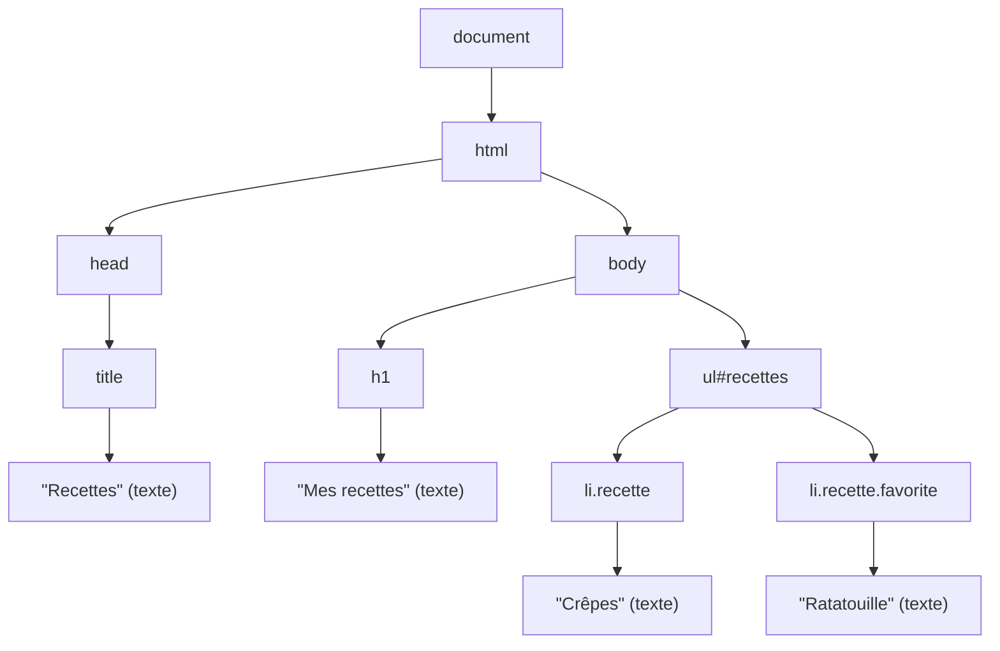

# 23 — Le DOM

> **Niveau** : Intermédiaire · **Durée** : ~4 h · **Prérequis** : [Fonctions](../06-fonctions/README.md), [Tableaux](../09-tableaux/README.md), [Objets](../10-objets/README.md)

Le DOM (_Document Object Model_) est la représentation vivante d'une page web : un arbre d'objets que JavaScript peut lire et modifier. C'est grâce à lui qu'un script affiche un résultat, construit une liste à partir de données ou ouvre un menu. Ce chapitre vous apprend à le manipuler de façon **sûre** (sans faille XSS), **performante** et **accessible**. Les événements (clics, saisie, formulaires) font l'objet du [chapitre suivant](../24-evenements/README.md).

> [!NOTE]
> Le DOM est une API du navigateur, pas du langage : il n'existe pas dans Node.js. Les blocs de code de ce chapitre sont donc à essayer dans un navigateur, avec le HTML montré juste avant. La page [`demo.html`](demo.html) regroupe les exemples clés : ouvrez-la directement (double-clic), puis ouvrez la console des outils de développement (<kbd>F12</kbd>). Pour tester du code DOM sous Node (jsdom, happy-dom), voyez le chapitre [Tests](../29-tests/README.md).

## Objectifs

- Expliquer ce qu'est le DOM et charger un script au bon moment (`defer`, `type="module"`).
- Sélectionner et parcourir des éléments avec `querySelector`, `closest` et les propriétés de navigation.
- Modifier texte, attributs, classes et styles en choisissant la bonne API.
- Insérer du contenu **sans faille XSS** (`textContent`, `createElement`, `<template>`, Sanitizer API).
- Construire et mettre à jour une interface efficacement (fragments, regroupement des lectures et écritures).
- Réagir aux changements avec `MutationObserver`, `IntersectionObserver` et `ResizeObserver`.
- Garder une page accessible (HTML sémantique, ARIA, focus) et découvrir les Web Components.

## Sommaire

- [Le DOM, un arbre d'objets](#le-dom-un-arbre-dobjets)
- [Charger son script au bon moment](#charger-son-script-au-bon-moment)
- [Sélectionner des éléments](#sélectionner-des-éléments)
- [NodeList et HTMLCollection](#nodelist-et-htmlcollection)
- [Parcourir l'arbre](#parcourir-larbre)
- [Lire et modifier le contenu](#lire-et-modifier-le-contenu)
- [innerHTML et les failles XSS](#innerhtml-et-les-failles-xss)
- [Attributs et propriétés](#attributs-et-propriétés)
- [Classes et styles](#classes-et-styles)
- [Créer, insérer, déplacer, supprimer](#créer-insérer-déplacer-supprimer)
- [Modèles : template, DocumentFragment et cloneNode](#modèles--template-documentfragment-et-clonenode)
- [Dimensions, position et défilement](#dimensions-position-et-défilement)
- [Performance : reflow et regroupement](#performance--reflow-et-regroupement)
- [Observer la page](#observer-la-page)
- [Accessibilité](#accessibilité)
- [Web Components (aperçu)](#web-components-aperçu)
- [Pièges courants](#pièges-courants)
- [Bonnes pratiques](#bonnes-pratiques)
- [Résumé](#résumé)
- [Exercices](#exercices)
- [Pour aller plus loin](#pour-aller-plus-loin)

## Le DOM, un arbre d'objets

Quand le navigateur reçoit du HTML, il l'analyse (_parse_) et construit en mémoire un arbre de **nœuds**. Prenons cette page :

```html
<!doctype html>
<html lang="fr">
  <head>
    <title>Recettes</title>
  </head>
  <body>
    <h1>Mes recettes</h1>
    <ul id="recettes">
      <li class="recette">Crêpes</li>
      <li class="recette favorite">Ratatouille</li>
    </ul>
  </body>
</html>
```

Le navigateur en tire l'arbre suivant (les nœuds texte qui ne contiennent que des espaces sont omis) :



Chaque nœud est un objet JavaScript. Les principaux types :

| Type | `nodeType` | Exemple |
| --- | --- | --- |
| `Element` | `1` (`Node.ELEMENT_NODE`) | `<li>`, `<ul>`, `<body>` |
| `Text` | `3` (`Node.TEXT_NODE`) | le texte « Crêpes », mais aussi les espaces et retours à la ligne entre les balises |
| `Comment` | `8` (`Node.COMMENT_NODE`) | `<!-- … -->` |
| `Document` | `9` (`Node.DOCUMENT_NODE`) | `document`, la racine |
| `DocumentFragment` | `11` (`Node.DOCUMENT_FRAGMENT_NODE`) | un conteneur léger, hors de la page (voir [plus bas](#modèles--template-documentfragment-et-clonenode)) |

Ces objets héritent les uns des autres : un `<li>` est un `HTMLLIElement`, qui hérite de `HTMLElement`, puis `Element`, `Node` et enfin `EventTarget`. C'est pour cela que tout élément possède `addEventListener` (chapitre suivant) et `textContent`.

<!-- no-run -->
```js
console.log(document.documentElement.lang); // "fr" : <html> est document.documentElement
const liste = document.getElementById("recettes");
console.log(liste.nodeType === Node.ELEMENT_NODE); // true
console.log(liste.nodeName); // "UL" (en majuscules pour les éléments HTML)
console.log(liste.childNodes.length); // 5 : 3 nœuds texte (indentation) + 2 <li>
console.log(liste.children.length); // 2 : seulement les éléments
console.log(Object.getPrototypeOf(liste.children[0]).constructor.name); // "HTMLLIElement"
```

Trois points à retenir :

- **Le DOM n'est pas le code source.** Le navigateur corrige le HTML (il ajoute un `<tbody>` aux tableaux, ferme les balises oubliées), puis vos scripts le modifient. « Afficher le code source » montre le fichier reçu ; l'onglet **Éléments** des outils de développement montre le DOM actuel.
- **`window` et `document` sont deux objets différents.** `window` est l'objet global du navigateur (il contient `document`, `location`, `localStorage`, `setTimeout`…) ; `document` est la racine du DOM. Raccourcis utiles : `document.documentElement` (`<html>`), `document.head`, `document.body`, `document.title`.
- **Le DOM est une API Web**, spécifiée par le WHATWG, et non une partie d'ECMAScript. On l'utilise depuis JavaScript, mais il pourrait l'être depuis un autre langage.

## Charger son script au bon moment

Un `<script src>` classique placé dans `<head>` **bloque** l'analyse de la page : le navigateur s'arrête, télécharge le script, l'exécute… alors que le `<body>` n'existe pas encore. Résultat : `document.querySelector("#recettes")` renvoie `null`.

| Balise | Téléchargement | Exécution | Ordre entre scripts | DOM complet à l'exécution ? |
| --- | --- | --- | --- | --- |
| `<script src>` | bloque l'analyse | immédiate | ordre du document | non (seulement ce qui précède) |
| `<script src async>` | en parallèle | dès qu'il est téléchargé | **non garanti** | pas forcément |
| `<script src defer>` | en parallèle | après l'analyse, avant `DOMContentLoaded` | ordre du document | oui |
| `<script type="module">` | en parallèle | comme `defer` (même en ligne) | ordre du document | oui |

La recommandation actuelle tient en une ligne : **un module dans le `<head>`**.

```html
<head>
  <meta charset="utf-8" />
  <title>Recettes</title>
  <script type="module" src="app.js"></script>
</head>
```

Un module est différé automatiquement, s'exécute en mode strict et peut utiliser `import` (voir [Modules](../26-modules/README.md)). `async` convient aux scripts indépendants de la page (statistiques, par exemple). L'ancienne habitude de placer `<script>` juste avant `</body>` fonctionne encore, mais elle retarde le téléchargement.

> [!WARNING]
> Un module externe (`<script type="module" src="app.js">`) ouvert depuis une page en `file://` est bloqué par Chrome (règles CORS). Servez votre dossier en HTTP : `npx serve`, `python3 -m http.server` ou Vite (voir [Outillage](../28-outillage/README.md)). Les scripts **en ligne**, comme ceux de `demo.html`, fonctionnent en `file://`.

Deux événements jalonnent le chargement :

- `DOMContentLoaded` (sur `document`) : le HTML est analysé et les scripts différés ont été exécutés ; images et feuilles de style peuvent encore être en cours de chargement ;
- `load` (sur `window`) : tout est chargé, images, polices et iframes compris.

`document.readyState` passe de `"loading"` à `"interactive"` puis `"complete"`. Si votre code peut être chargé de plusieurs façons (un _widget_ inséré par d'autres, par exemple), ce motif fonctionne dans tous les cas :

<!-- no-run -->
```js
function demarrer() {
  console.log("DOM prêt :", document.readyState); // "interactive" ou "complete"
}

if (document.readyState === "loading") {
  document.addEventListener("DOMContentLoaded", demarrer);
} else {
  demarrer(); // l'événement est déjà passé : on démarre tout de suite
}
```

Avec `type="module"` ou `defer`, ce test est inutile : le DOM est déjà prêt quand le script s'exécute.

## Sélectionner des éléments

Les exemples des sections suivantes utilisent cette petite boutique :

```html
<main id="boutique">
  <h2>Produits</h2>
  <ul class="produits">
    <li class="produit" data-id="p1" data-prix="12.5">
      <span class="nom">Thé vert</span>
      <button type="button" class="ajouter">Ajouter</button>
    </li>
    <li class="produit en-promo" data-id="p2" data-prix="8">
      <span class="nom">Café moulu</span>
      <button type="button" class="ajouter">Ajouter</button>
    </li>
    <li class="produit" data-id="p3" data-prix="4.2">
      <span class="nom">Chocolat noir</span>
      <button type="button" class="ajouter" disabled>Épuisé</button>
    </li>
  </ul>
</main>
```

`querySelector` et `querySelectorAll` acceptent **n'importe quel sélecteur CSS** :

<!-- no-run -->
```js
const boutique = document.getElementById("boutique"); // l'identifiant, sans « # »
const premier = document.querySelector(".produit"); // le premier élément trouvé, ou null
const produits = document.querySelectorAll(".produit"); // tous (NodeList statique)
console.log(produits.length); // 3

const nomEnPromo = document.querySelector("li.en-promo .nom");
console.log(nomEnPromo.textContent); // "Café moulu"

const boutonsActifs = document.querySelectorAll(
  "button.ajouter:not([disabled])",
);
console.log(boutonsActifs.length); // 2

const cafe = document.querySelector('[data-id="p2"]');
console.log(cafe === nomEnPromo.parentElement); // true

// Chercher à l'intérieur d'un élément : plus rapide et sans ambiguïté
const liste = boutique.querySelector(".produits");
const enfantsDirects = liste.querySelectorAll(":scope > li"); // :scope = l'élément lui-même
console.log(enfantsDirects.length); // 3
```

`querySelector` renvoie `null` quand rien ne correspond. Vérifiez-le avant d'utiliser le résultat :

<!-- no-run -->
```js
// ❌ TypeError: Cannot set properties of null si #panier n'existe pas
// document.querySelector("#panier").textContent = "Vide";

// ❌ SyntaxError : le chaînage optionnel est interdit à gauche d'une affectation
// document.querySelector("#panier")?.textContent = "Vide";

// ✅
const panier = document.querySelector("#panier");
if (panier) panier.textContent = "Vide";
```

Pour remonter vers un ancêtre, `closest(sélecteur)` part de l'élément lui-même et s'arrête au premier qui correspond ; `matches(sélecteur)` teste l'élément seul. Ce duo est au cœur de la délégation d'événements ([chapitre 24](../24-evenements/README.md#délégation-dévénements)).

<!-- no-run -->
```js
const bouton = document.querySelector("button.ajouter");
const produit = bouton.closest(".produit");
console.log(produit.dataset.id); // "p1"
console.log(produit.matches(".en-promo")); // false
console.log(bouton.closest(".introuvable")); // null
console.log(bouton.closest("button") === bouton); // true : l'élément lui-même compte
```

Un identifiant qui commence par un chiffre, ou une valeur saisie par l'utilisateur, peut produire un sélecteur invalide. `CSS.escape` échappe la valeur ; pour un identifiant, `getElementById` évite simplement le problème :

<!-- no-run -->
```js
const id = "2024-bilan";
// document.querySelector(`#${id}`); // ❌ DOMException (SyntaxError) : '#2024-bilan' is not a valid selector
console.log(document.querySelector(`#${CSS.escape(id)}`)); // ✅ null (aucun élément ici), sans erreur
console.log(document.getElementById(id)); // ✅ null, plus simple
```

| Méthode | Renvoie | Remarque |
| --- | --- | --- |
| `getElementById(id)` | un élément ou `null` | sur `document` (pas sur un élément) ; très rapide |
| `querySelector(sel)` | un élément ou `null` | sur `document` ou sur n'importe quel élément |
| `querySelectorAll(sel)` | `NodeList` **statique** | instantané pris au moment de l'appel |
| `closest(sel)` / `matches(sel)` | ancêtre ou `null` / booléen | l'élément lui-même est inclus |
| `getElementsByClassName`, `getElementsByTagName` | `HTMLCollection` **vivante** | historiques ; préférez `querySelectorAll` |

## NodeList et HTMLCollection

Ni l'une ni l'autre n'est un tableau : ce sont des **collections** indexées, dotées d'une `length` et itérables avec `for…of`.

| | `NodeList` | `HTMLCollection` |
| --- | --- | --- |
| Obtenue par | `querySelectorAll` (statique), `childNodes` (vivante) | `children`, `getElementsBy…`, `form.elements` (toujours vivante) |
| Contient | des nœuds (éléments, textes…) | uniquement des éléments |
| `forEach` | oui | non |
| `map`, `filter`… | non | non |

Pour profiter des méthodes de tableau, convertissez : `Array.from(collection)` ou `[...collection]`.

<!-- no-run -->
```js
const noms = [...document.querySelectorAll(".produit .nom")].map(
  (el) => el.textContent,
);
console.log(noms); // ["Thé vert", "Café moulu", "Chocolat noir"]

const prixTotal = Array.from(document.querySelectorAll(".produit"), (li) =>
  Number(li.dataset.prix),
).reduce((somme, prix) => somme + prix, 0);
console.log(prixTotal); // 24.7
```

Une collection **vivante** se met à jour toute seule quand le DOM change. C'est pratique… et piégeux quand on la modifie pendant qu'on la parcourt :

```html
<ul>
  <li class="nouveau">A</li>
  <li class="nouveau">B</li>
  <li class="nouveau">C</li>
  <li class="nouveau">D</li>
</ul>
```

<!-- no-run -->
```js
const nouveaux = document.getElementsByClassName("nouveau"); // collection vivante
for (let i = 0; i < nouveaux.length; i++) {
  nouveaux[i].classList.remove("nouveau"); // ❌ l'élément quitte la collection, les indices se décalent
}
console.log(document.querySelectorAll(".nouveau").length); // 2 : B et D ont été sautés

// ✅ querySelectorAll renvoie un instantané : on peut modifier sans risque
for (const li of document.querySelectorAll(".nouveau"))
  li.classList.remove("nouveau");
console.log(document.querySelectorAll(".nouveau").length); // 0
```

## Parcourir l'arbre

Chaque nœud connaît ses voisins. Il existe deux familles de propriétés : celles qui ne voient que les **éléments** (à préférer) et celles qui voient **tous les nœuds**, y compris les textes d'indentation.

| Éléments seulement | Tous les nœuds |
| --- | --- |
| `parentElement` | `parentNode` |
| `children` | `childNodes` |
| `firstElementChild` / `lastElementChild` | `firstChild` / `lastChild` |
| `nextElementSibling` / `previousElementSibling` | `nextSibling` / `previousSibling` |
| `childElementCount` | `childNodes.length` |

Avec la boutique de la section précédente :

<!-- no-run -->
```js
const cafe = document.querySelector('[data-id="p2"]');
console.log(cafe.previousElementSibling.dataset.id); // "p1"
console.log(cafe.nextElementSibling.dataset.id); // "p3"
console.log(cafe.parentElement.className); // "produits"
console.log(cafe.firstElementChild.textContent); // "Café moulu"
console.log(cafe.firstChild.nodeType); // 3 : un nœud texte (l'indentation)
console.log(cafe.parentElement.contains(cafe)); // true
console.log(cafe.lastElementChild.nextElementSibling); // null : fin de la fratrie
```

En pratique, on parcourt rarement l'arbre pas à pas : `closest` pour remonter et `querySelector` pour descendre suffisent presque toujours. Pour des parcours avancés (tous les nœuds texte d'une zone, par exemple), il existe [`TreeWalker`](https://developer.mozilla.org/fr/docs/Web/API/TreeWalker).

## Lire et modifier le contenu

Quatre propriétés donnent accès au contenu d'un élément :

| Propriété | Lecture | Écriture |
| --- | --- | --- |
| `textContent` | tout le texte des descendants, y compris le texte masqué | remplace le contenu par **un seul nœud texte** : sûr |
| `innerText` | le texte **tel qu'il est affiché** (tient compte du CSS) | idem, mais transforme les `\n` en `<br>` |
| `innerHTML` | le HTML des descendants, sérialisé | **analyse la chaîne comme du HTML** : dangereux avec des données externes |
| `outerHTML` | comme `innerHTML`, élément compris | remplace l'élément lui-même |

```html
<p id="message">Bonjour <strong>Léa</strong><span hidden> (admin)</span></p>
```

<!-- no-run -->
```js
const message = document.getElementById("message");
console.log(message.textContent); // "Bonjour Léa (admin)"
console.log(message.innerText); // "Bonjour Léa" : le texte masqué est ignoré
console.log(message.innerHTML); // 'Bonjour <strong>Léa</strong><span hidden=""> (admin)</span>'

message.textContent = "<em>Coucou</em>"; // affiché tel quel, chevrons compris
console.log(message.innerHTML); // "&lt;em&gt;Coucou&lt;/em&gt;"
```

**Utilisez `textContent` par défaut.** `innerText` est plus lent : pour savoir ce qui est visible, il doit calculer la mise en page (voir [Performance](#performance--reflow-et-regroupement)). Réservez-le aux cas où vous voulez réellement « le texte que voit l'utilisateur ». Pour les champs de formulaire, le contenu saisi se lit avec `value` (et `checked` pour les cases à cocher), pas avec `textContent`.

## innerHTML et les failles XSS

Une faille **XSS** (_cross-site scripting_) survient quand une donnée contrôlée par quelqu'un d'autre (paramètre d'URL, commentaire, nom d'utilisateur, réponse d'API) est insérée dans la page **comme du HTML**. Le code de l'attaquant s'exécute alors avec tous les droits de votre site : il peut lire les données de la page et le `localStorage`, envoyer des requêtes au nom de l'utilisateur, afficher un faux formulaire de connexion…

```html
<h1 id="bienvenue"></h1>
```

<!-- no-run -->
```js
// Page de bienvenue : https://exemple.fr/?nom=Léa
const nom = new URLSearchParams(location.search).get("nom") ?? "visiteur";

// ❌ Faille XSS : la chaîne est interprétée comme du HTML
document.querySelector("#bienvenue").innerHTML = `Bonjour ${nom} !`;
```

Il suffit d'envoyer à quelqu'un le lien `?nom=` : l'image ne se charge pas, son attribut `onerror` s'exécute. Un `<script>` inséré par `innerHTML` ne s'exécute pas, mais les attributs d'événement (`onerror`, `onload`, `onfocus`…) et les URL `javascript:` suffisent largement.

### Les bonnes solutions

**1. Du texte ? `textContent`.** C'est le cas le plus fréquent, et le plus simple.

<!-- no-run -->
```js
const nom = new URLSearchParams(location.search).get("nom") ?? "visiteur";
document.querySelector("#bienvenue").textContent = `Bonjour ${nom} !`; // ✅ jamais interprété
```

**2. De la structure ? Construisez les nœuds.** `append`, `prepend` et `replaceChildren` acceptent des nœuds **et des chaînes**, qu'ils transforment en nœuds texte :

<!-- no-run -->
```js
const nom = new URLSearchParams(location.search).get("nom") ?? "visiteur";
const fort = document.createElement("strong");
fort.textContent = nom;
document.querySelector("#bienvenue").replaceChildren("Bonjour ", fort, " !"); // ✅
```

**3. Un gabarit HTML ? Échappez chaque valeur.** Si vous générez du HTML sous forme de chaîne (gabarit, rendu côté serveur), chaque donnée doit être échappée. L'ordre compte : `&` d'abord, sinon on échapperait les entités produites ensuite.

```js
function echapperHtml(valeur) {
  return String(valeur)
    .replaceAll("&", "&amp;")
    .replaceAll("<", "&lt;")
    .replaceAll(">", "&gt;")
    .replaceAll('"', "&quot;")
    .replaceAll("'", "&#39;");
}

const nom = '';
console.log(`<p>Bonjour ${echapperHtml(nom)}</p>`);
// <p>Bonjour &lt;img src=x onerror=&quot;alert(1)&quot;&gt;</p>
```

Cet échappement protège le **contenu texte** et les valeurs d'attributs **entre guillemets**. Il ne suffit pas dans un attribut `href` ou `src` (une URL `javascript:` ne contient aucun caractère spécial), dans un attribut `on…`, dans un `<script>` ou dans du CSS. Pour une URL, validez son protocole :

```js
function urlSure(adresse, base = "https://exemple.fr/") {
  const url = URL.parse(adresse, base); // null si l'adresse est invalide
  return url && ["https:", "http:", "mailto:"].includes(url.protocol)
    ? url.href
    : null;
}

console.log(urlSure("https://developer.mozilla.org")); // "https://developer.mozilla.org/"
console.log(urlSure("/contact")); // "https://exemple.fr/contact"
console.log(urlSure("  JavaScript:alert(1)")); // null
```

Dans une page, passez `location.href` comme base. `URL.parse` (Baseline 2024) est disponible dans tous les navigateurs récents et dans Node.js 22.1+ (voir [Fetch et HTTP](../22-fetch-http/README.md)).

**4. Du HTML venant d'ailleurs ? Assainissez-le.** Pour afficher du HTML riche fourni par un tiers (commentaire mis en forme, contenu d'un CMS), il faut un **assainisseur** (_sanitizer_) qui ne garde que les balises et attributs sans danger. La **Sanitizer API** le fait nativement avec `element.setHTML()` :

```html
<div id="commentaire"></div>
```

<!-- no-run -->
```js
const html =
  '<p>Super <b>recette</b> !</p><a href="javascript:alert(1)">lien</a>';
const zone = document.getElementById("commentaire");

if ("setHTML" in Element.prototype) {
  zone.setHTML(html); // assaini : l'image piégée et l'URL javascript: disparaissent
  console.log(zone.innerHTML); // '<p>Super <b>recette</b> !</p><a>lien</a>'
} else {
  zone.textContent = html; // repli sûr (ou DOMPurify, voir ci-dessous)
}
```

`setHTML()` retire **toujours** ce qui peut exécuter du code (`<script>`, attributs `on…`, URL `javascript:`…), quelle que soit la configuration passée. Sa configuration par défaut est volontairement stricte : elle retire aussi, par exemple, les attributs `class`, `style` et `data-*`. On peut la régler : `zone.setHTML(html, { sanitizer: { elements: ["p", "b", "i", "a"] } })`.

> [!IMPORTANT]
> **Disponibilité (novembre 2026)** : `setHTML()` et `Sanitizer` sont disponibles dans Chrome et Edge 146+ et Firefox 148+, mais pas encore dans Safari : l'API n'est pas Baseline. Testez sa présence comme ci-dessus et, en attendant, utilisez la bibliothèque [DOMPurify](https://github.com/cure53/DOMPurify) : `zone.innerHTML = DOMPurify.sanitize(html)`.

Ne confondez pas avec `setHTMLUnsafe()` (Baseline 2025), qui **n'assainit rien** : il sert à insérer du HTML de confiance contenant du Shadow DOM déclaratif.

### Les « puits » dangereux

Toute API qui interprète une chaîne comme du code ou du HTML est un **puits** (_sink_) : n'y faites jamais entrer de données non fiables.

| Dangereux avec des données externes | Alternative sûre |
| --- | --- |
| `el.innerHTML = x`, `el.outerHTML = x` | `textContent`, `replaceChildren()`, `setHTML()` |
| `el.insertAdjacentHTML(position, x)` | `insertAdjacentText`, `before`/`after`/`append` |
| `document.write(x)` | à proscrire dans tous les cas |
| `a.href = x`, `img.src = x`, `iframe.src = x` | valider le protocole avec `URL` |
| `el.setAttribute("onclick", x)` | `addEventListener` ([chapitre 24](../24-evenements/README.md)) |
| `eval(x)`, `new Function(x)`, `setTimeout("code")` | jamais avec des données |

En complément, le serveur peut envoyer une **Content Security Policy** (en-tête `Content-Security-Policy`) qui interdit les scripts en ligne et les attributs `on…`. La directive `require-trusted-types-for 'script'` active les **Trusted Types** (Baseline 2026 : Chrome, Edge, Firefox 148+, Safari 26+) : le navigateur refuse alors toute chaîne brute passée à `innerHTML` et aux autres puits, ce qui rend les oublis impossibles. Ces deux protections sont présentées sur [MDN](https://developer.mozilla.org/fr/docs/Web/HTTP/Guides/CSP).

## Attributs et propriétés

Un **attribut** est écrit dans le HTML et vaut toujours une chaîne. Une **propriété** appartient à l'objet DOM et a un type (booléen, nombre, objet). La plupart des attributs standard sont « reflétés » par une propriété, mais pas toujours à l'identique :

```html
<a id="lien" href="/contact" class="bouton principal">Contact</a>
<input id="quantite" type="number" value="1" />
```

<!-- no-run -->
```js
const lien = document.getElementById("lien");
console.log(lien.getAttribute("href")); // "/contact" : tel qu'écrit
console.log(lien.href); // "https://exemple.fr/contact" : URL absolue (si la page est sur exemple.fr)
console.log(lien.className); // "bouton principal" : « class » est un mot réservé en JS

const quantite = document.getElementById("quantite");
quantite.value = "3"; // l'état courant, ce que voit l'utilisateur
console.log(quantite.getAttribute("value")); // "1" : l'attribut garde la valeur initiale
console.log(quantite.defaultValue); // "1"
console.log(quantite.valueAsNumber); // 3
```

| Méthode | Rôle |
| --- | --- |
| `getAttribute(nom)` | lit la chaîne, ou `null` si l'attribut est absent |
| `setAttribute(nom, valeur)` | crée ou modifie (la valeur est convertie en chaîne) |
| `removeAttribute(nom)` / `hasAttribute(nom)` | supprime / teste la présence |
| `toggleAttribute(nom, force?)` | ajoute ou retire un attribut booléen |
| `getAttributeNames()` | tableau des noms d'attributs |

Pour les attributs **booléens** (`disabled`, `hidden`, `checked`, `required`…), seule la **présence** compte, pas la valeur :

<!-- no-run -->
```js
const bouton = document.querySelector("button");
bouton.setAttribute("disabled", "false"); // ❌ le bouton est désactivé : l'attribut est présent
bouton.disabled = false; // ✅ la propriété est un vrai booléen
bouton.toggleAttribute("disabled", true); // ✅ équivalent à bouton.disabled = true
```

### Les attributs `data-*` et `dataset`

Les attributs `data-*` stockent des données propres à votre application. `dataset` y donne accès en convertissant les noms en camelCase (`data-prix-ttc` ↔ `dataset.prixTtc`) :

```html
<li id="article" data-id="p2" data-prix-ttc="8.40" data-en-stock="true">Café</li>
```

<!-- no-run -->
```js
const article = document.getElementById("article");
console.log(article.dataset.prixTtc); // "8.40"
console.log(typeof article.dataset.prixTtc); // "string" : toujours des chaînes
const prix = Number(article.dataset.prixTtc); // 8.4
const enStock = article.dataset.enStock === "true"; // true

article.dataset.quantite = 2; // ajoute data-quantite="2"
delete article.dataset.enStock; // retire data-en-stock
console.log(article.outerHTML);
// '<li id="article" data-id="p2" data-prix-ttc="8.40" data-quantite="2">Café</li>'
```

Les attributs `data-*` se ciblent aussi en CSS (`[data-en-stock="true"]`) et dans les sélecteurs. Ils servent à **relier le DOM à vos données** (un identifiant, une action), pas à stocker de gros objets : gardez l'état de l'application dans vos variables JavaScript.

## Classes et styles

### `classList`

Changer l'apparence en ajoutant ou retirant des **classes** garde le style dans le CSS, où il est facile à maintenir et à animer.

```html
<div class="carte">…</div>
```

<!-- no-run -->
```js
const carte = document.querySelector(".carte");
carte.classList.add("active", "mise-en-avant"); // plusieurs classes à la fois
carte.classList.remove("mise-en-avant");
console.log(carte.classList.toggle("ouverte")); // true : ajoutée (renvoie le nouvel état)

const modeSombre = true;
carte.classList.toggle("sombre", modeSombre); // 2e argument : true = ajouter, false = retirer
carte.classList.replace("active", "inactive");
console.log(carte.classList.contains("inactive")); // true
console.log([...carte.classList]); // ["carte", "inactive", "ouverte", "sombre"]
console.log(carte.className); // "carte inactive ouverte sombre"
```

`className` lit ou remplace **toute** la liste sous forme de chaîne ; c'est utile pour réinitialiser, mais `classList` évite d'écraser par mégarde les classes ajoutées par d'autres scripts.

### Le style en ligne : `style`

`element.style` correspond à l'attribut `style` de l'élément. Les propriétés s'écrivent en camelCase, ou avec leur nom CSS via `setProperty` :

```html
<p class="alerte">Stock bientôt épuisé</p>
```

<!-- no-run -->
```js
const alerte = document.querySelector(".alerte");
alerte.style.backgroundColor = "gold"; // background-color
alerte.style.setProperty("border-left", "4px solid orange");
console.log(alerte.getAttribute("style")); // "background-color: gold; border-left: 4px solid orange;"

alerte.style.removeProperty("border-left");
alerte.style.backgroundColor = ""; // une chaîne vide retire la déclaration
console.log(alerte.style.color); // "" : style ne contient que le style en ligne
```

### Variables CSS et `getComputedStyle`

Les **propriétés personnalisées** (variables CSS) sont le meilleur pont entre JavaScript et CSS : le script change une valeur, le CSS décide comment l'utiliser.

```html
<style>
  :root {
    --couleur-accent: #0b6bcb;
  }
  .bouton {
    background: var(--couleur-accent);
    color: white;
  }
</style>
<button type="button" class="bouton">Valider</button>
```

<!-- no-run -->
```js
const racine = document.documentElement;
racine.style.setProperty("--couleur-accent", "#c2185b"); // tous les boutons changent de couleur

const styles = getComputedStyle(document.querySelector(".bouton"));
console.log(styles.getPropertyValue("--couleur-accent")); // "#c2185b"
console.log(styles.backgroundColor); // "rgb(194, 24, 91)" : valeur calculée
console.log(styles.display); // "inline-block"
```

`getComputedStyle(el)` donne les valeurs **calculées** (celles qu'applique réellement le navigateur, toutes sources confondues), en lecture seule. Comme `innerText`, il peut forcer un recalcul des styles : ne l'appelez pas dans une boucle serrée.

> [!TIP]
> Pour masquer un élément, `el.hidden = true` est le plus lisible. Attention : une règle CSS comme `.panneau { display: flex; }` l'emporte sur l'attribut `hidden`. Ajoutez `[hidden] { display: none !important; }` à votre feuille de style pour éviter la surprise.

## Créer, insérer, déplacer, supprimer

On crée un élément avec `document.createElement`, on le remplit, puis on l'insère (les exemples reprennent la boutique de la section [Sélectionner des éléments](#sélectionner-des-éléments)). Les méthodes modernes acceptent **plusieurs** arguments, nœuds ou chaînes (les chaînes deviennent des nœuds texte, jamais du HTML) :

```html
<!-- cible.before(x) -->
<ul class="cible">
  <!-- cible.prepend(x) -->
  <li>Élément existant</li>
  <!-- cible.append(x) -->
</ul>
<!-- cible.after(x) -->
```

<!-- no-run -->
```js
const liste = document.querySelector(".produits");

const li = document.createElement("li");
li.className = "produit";
li.dataset.id = "p4";
li.dataset.prix = "6.9";
li.textContent = "Miel de lavande";

liste.append(li); // à la fin
liste.prepend(document.createComment("début de la liste")); // au début
liste.before("Nos produits :"); // juste avant la liste (nœud texte)

const titre = document.createElement("h3");
titre.textContent = "Épicerie fine";
liste.before(titre);

li.replaceWith(li.cloneNode(true)); // remplace le nœud par un autre
liste.lastElementChild.remove(); // supprime le dernier <li>
console.log(liste.children.length); // 3
```

Un nœud n'existe qu'à **un seul endroit** : insérer un nœud déjà présent dans la page le **déplace**. C'est la façon la plus simple de réordonner une liste (`toSorted`, ES2023, renvoie une copie triée sans modifier l'original, voir [Tableaux](../09-tableaux/README.md)) :

<!-- no-run -->
```js
const liste = document.querySelector(".produits");
const tries = [...liste.children].toSorted(
  (a, b) => Number(a.dataset.prix) - Number(b.dataset.prix),
);
liste.append(...tries); // chaque <li> est déplacé dans le nouvel ordre
console.log([...liste.children].map((li) => li.dataset.id)); // ["p3", "p2", "p1"]
```

Déplacer ainsi un élément le retire puis le réinsère : une vidéo redémarre, une iframe se recharge, le focus est perdu. La nouvelle méthode `parent.moveBefore(noeud, reference)` déplace sans perdre cet état ; elle est disponible dans Chrome et Edge 133+ et Firefox 144+, pas encore dans Safari (novembre 2026) : testez `"moveBefore" in Element.prototype` avant de l'utiliser.

Pour **vider** ou **remplacer** tout le contenu d'un élément, `replaceChildren()` fait les deux en une opération :

<!-- no-run -->
```js
const liste = document.querySelector(".produits");
liste.replaceChildren(); // vide la liste
const nouveaux = ["Thé noir", "Tisane"].map((nom) => {
  const li = document.createElement("li");
  li.textContent = nom;
  return li;
});
liste.replaceChildren(...nouveaux); // remplace tout le contenu
console.log(liste.textContent); // "Thé noirTisane"
```

Vous rencontrerez aussi les anciennes méthodes, toujours valides mais plus verbeuses :

| Ancienne écriture | Écriture moderne |
| --- | --- |
| `parent.appendChild(n)` | `parent.append(n)` |
| `parent.insertBefore(n, parent.firstChild)` | `parent.prepend(n)` |
| `parent.insertBefore(n, ref)` | `ref.before(n)` |
| `parent.insertBefore(n, ref.nextSibling)` | `ref.after(n)` |
| `parent.removeChild(n)` | `n.remove()` |
| `parent.replaceChild(nouveau, ancien)` | `ancien.replaceWith(nouveau)` |
| `el.innerHTML = ""` | `el.replaceChildren()` |

Les méthodes `insertAdjacentElement(position, el)` et `insertAdjacentText(position, texte)` offrent les mêmes quatre positions sous forme de chaînes : `"beforebegin"`, `"afterbegin"`, `"beforeend"`, `"afterend"`. Leur cousine `insertAdjacentHTML` analyse du HTML : elle est donc soumise aux mêmes règles que `innerHTML`.

<!-- no-run -->
```js
const liste = document.querySelector(".produits");
// ❌ innerHTML += reconstruit TOUTE la liste : écouteurs, saisie et focus perdus, et faille XSS si nom vient de l'extérieur
const nom = "Sel de Guérande";
liste.innerHTML += `<li>${nom}</li>`;
// ✅ ajoute un seul élément, sans toucher au reste
const li = document.createElement("li");
li.textContent = nom;
liste.append(li);
```

## Modèles : template, DocumentFragment et cloneNode

Construire un composant élément par élément devient vite fastidieux. L'élément `<template>` permet d'écrire la structure **en HTML** : son contenu est inerte (non affiché, scripts non exécutés, images non chargées) jusqu'à ce qu'on le clone.

```html
<template id="modele-produit">
  <li class="produit">
    <span class="nom"></span>
    <span class="prix"></span>
    <button type="button" class="ajouter">Ajouter</button>
  </li>
</template>
<ul class="produits"></ul>
```

<!-- no-run -->
```js
const produits = [
  { id: "p1", nom: "Thé vert", prix: 12.5 },
  { id: "p2", nom: "Café <moulu>", prix: 8 },
];
const modele = document.getElementById("modele-produit");
const liste = document.querySelector(".produits");
const formatPrix = new Intl.NumberFormat("fr-FR", {
  style: "currency",
  currency: "EUR",
});

const fragment = document.createDocumentFragment();
for (const produit of produits) {
  const copie = modele.content.cloneNode(true); // un DocumentFragment
  copie.querySelector(".produit").dataset.id = produit.id;
  copie.querySelector(".nom").textContent = produit.nom; // sûr, même avec « < »
  copie.querySelector(".prix").textContent = formatPrix.format(produit.prix);
  fragment.append(copie);
}
liste.append(fragment); // une seule insertion dans la page ; le fragment se vide
console.log(liste.children.length); // 2
console.log(liste.lastElementChild.querySelector(".nom").textContent); // "Café <moulu>"
console.log(fragment.childNodes.length); // 0
```

Un `DocumentFragment` est un conteneur léger, hors de la page : on y prépare des nœuds, puis on insère le tout d'un coup. Quand on l'insère, ce sont ses **enfants** qui sont déplacés. Aujourd'hui, `liste.append(...elements)` donne le même résultat ; le fragment reste utile avec `<template>` ou pour passer « un paquet de nœuds » à une fonction.

`cloneNode(true)` copie un nœud et toute sa descendance (`cloneNode()` sans argument ne copie que le nœud lui-même). Deux points à connaître :

- les écouteurs ajoutés avec `addEventListener` **ne sont pas copiés** (les attributs, si) ;
- les attributs `id` sont copiés tels quels : pensez à les modifier, un `id` doit rester unique dans la page.

## Dimensions, position et défilement

| Propriété | Ce qu'elle mesure |
| --- | --- |
| `el.getBoundingClientRect()` | position et taille réelles (transformations comprises), **relatives à la fenêtre** : `top`, `left`, `bottom`, `right`, `width`, `height`, `x`, `y` |
| `el.offsetWidth` / `offsetHeight` | taille de la boîte, bordures comprises (entier, sans transformations) |
| `el.clientWidth` / `clientHeight` | zone intérieure visible : contenu + `padding`, sans bordure ni barre de défilement |
| `el.scrollWidth` / `scrollHeight` | taille totale du contenu, partie masquée comprise |
| `el.scrollTop` / `scrollLeft` | défilement actuel de l'élément (modifiable) |
| `window.innerWidth` / `innerHeight` | taille de la fenêtre, barres de défilement comprises |
| `document.documentElement.clientWidth` | largeur de la fenêtre sans la barre de défilement |
| `window.scrollX` / `scrollY` | défilement de la page |

```html
<h2 class="titre-carte" style="width: 8rem; white-space: nowrap; overflow: hidden; text-overflow: ellipsis">
  Un titre beaucoup trop long pour sa boîte
</h2>
<section class="encart" style="margin-top: 150vh">Encart</section>
```

<!-- no-run -->
```js
const encart = document.querySelector(".encart");
const rect = encart.getBoundingClientRect();
const hautDansLaPage = rect.top + window.scrollY; // coordonnées « page » plutôt que « fenêtre »
console.log(rect.top > window.innerHeight); // true : l'encart est sous la ligne de flottaison

// Détecter un texte tronqué (pour afficher une infobulle, par exemple)
const titre = document.querySelector(".titre-carte");
console.log(titre.scrollWidth > titre.clientWidth); // true

// Faire défiler en respectant la préférence « réduire les animations »
const sansAnimation = matchMedia("(prefers-reduced-motion: reduce)").matches;
encart.scrollIntoView({
  behavior: sansAnimation ? "auto" : "smooth",
  block: "center",
});
window.scrollTo({ top: 0, behavior: sansAnimation ? "auto" : "smooth" });
```

Pour savoir si un élément est visible à l'écran, ne calculez pas sa position à chaque défilement : utilisez [`IntersectionObserver`](#intersectionobserver).

## Performance : reflow et regroupement

Après chaque modification du DOM, le navigateur doit recalculer les styles, puis la **mise en page** (_layout_ ou _reflow_ : position et taille de chaque boîte), puis repeindre. Il est malin : il regroupe les modifications et ne recalcule qu'une fois, juste avant d'afficher l'image suivante.

Sauf si vous lui demandez une mesure (`offsetWidth`, `getBoundingClientRect()`, `getComputedStyle()`, `innerText`, `scrollTop`…) **juste après** une modification : il doit alors recalculer la mise en page immédiatement, de façon synchrone. Dans une boucle qui alterne lectures et écritures, ce recalcul a lieu à chaque tour : c'est le _layout thrashing_.

<!-- no-run -->
```js
const cartes = document.querySelectorAll(".carte");

// ❌ lecture puis écriture à chaque tour : une mise en page forcée par carte
for (const carte of cartes) {
  const largeur = carte.offsetWidth; // lecture : force le calcul
  carte.style.height = `${largeur * 0.75}px`; // écriture : invalide la mise en page
}

// ✅ toutes les lectures d'abord, puis toutes les écritures
const largeurs = [...cartes].map((carte) => carte.offsetWidth);
cartes.forEach((carte, i) => {
  carte.style.height = `${largeurs[i] * 0.75}px`;
});
```

Dans ce cas précis, la meilleure solution n'utilise même pas JavaScript : `.carte { aspect-ratio: 4 / 3; }` en CSS. Retenez ces règles :

- **construisez hors de la page, insérez une fois** (`replaceChildren`, `append(...elements)`, fragment) ;
- **regroupez** les lectures, puis les écritures ; pour une animation, faites les écritures dans `requestAnimationFrame` (voir [Timers](../21-timers/README.md)) ;
- **changez une classe** plutôt que dix propriétés de `style` ;
- **animez `transform` et `opacity`**, que le navigateur peut animer sans recalculer la mise en page, plutôt que `top`, `left` ou `width` ;
- pour une très longue liste, affichez-la par pages ou utilisez la propriété CSS `content-visibility: auto` (Baseline 2025), qui saute le rendu des parties hors écran ;
- **mesurez avant d'optimiser** : le panneau _Performance_ des outils de développement signale les mises en page forcées.

## Observer la page

Trois « observateurs » permettent de réagir à des changements sans scruter la page en boucle. Leurs rappels sont appelés de façon **asynchrone**, avec des changements regroupés, ce qui les rend bien plus efficaces qu'une vérification à chaque défilement. Pensez à appeler `disconnect()` quand vous n'en avez plus besoin.

### MutationObserver

`MutationObserver` signale les modifications du DOM : nœuds ajoutés ou retirés, attributs ou textes modifiés. Il sert surtout à réagir à du contenu que vous ne contrôlez pas (script tiers, CMS). Pour votre propre code, appelez simplement une fonction après la modification.

```html
<div id="journal"></div>
```

<!-- no-run -->
```js
const journal = document.getElementById("journal");
const observateur = new MutationObserver((mutations) => {
  for (const mutation of mutations) {
    if (mutation.type === "childList") {
      console.log(
        `${mutation.addedNodes.length} ajout(s), ${mutation.removedNodes.length} retrait(s)`,
      );
    } else if (mutation.type === "attributes") {
      console.log(
        `attribut ${mutation.attributeName} modifié (avant : ${mutation.oldValue})`,
      );
    }
  }
});
observateur.observe(journal, {
  childList: true,
  subtree: true,
  attributes: true,
  attributeOldValue: true,
});

journal.append(document.createElement("p"));
journal.dataset.etat = "plein";
console.log("modifications faites");
// Affiche d'abord « modifications faites », puis, dans une microtâche, les deux mutations :
// 1 ajout(s), 0 retrait(s)
// attribut data-etat modifié (avant : null)
```

Les anciens _Mutation Events_ (`DOMNodeInserted`…) ont été retirés des navigateurs : `MutationObserver` est leur remplaçant.

### IntersectionObserver

`IntersectionObserver` signale quand un élément **entre dans la zone visible** (ou dans un autre conteneur) ou en sort. Cas d'usage : animation à l'apparition, défilement infini (on observe un élément « sentinelle » en bas de liste), statistiques « contenu vu », mise en pause d'une vidéo hors écran.

```html
<style>
  .a-reveler { opacity: 0; transition: opacity 0.6s; }
  .a-reveler.visible { opacity: 1; }
</style>
<section class="a-reveler" style="margin-top: 150vh">Je deviens visible en défilant</section>
```

<!-- no-run -->
```js
const observateur = new IntersectionObserver(
  (entrees, obs) => {
    for (const entree of entrees) {
      if (!entree.isIntersecting) continue;
      entree.target.classList.add("visible"); // la transition CSS fait le reste
      obs.unobserve(entree.target); // une seule fois par élément
    }
  },
  { rootMargin: "0px 0px -10% 0px", threshold: 0.2 }, // 20 % visible, hors des 10 % du bas
);

for (const el of document.querySelectorAll(".a-reveler"))
  observateur.observe(el);
```

Le rappel est appelé une première fois juste après `observe()`, avec l'état initial. Pour le chargement différé des images, inutile d'écrire du code : `` le fait nativement.

### ResizeObserver

`ResizeObserver` signale les changements de **taille d'un élément** (et pas seulement de la fenêtre). Il est utile quand JavaScript doit connaître cette taille : redessiner un `<canvas>`, recalculer un graphique.

```html
<div class="graphique" style="resize: horizontal; overflow: auto; border: 1px solid; width: 500px">Graphique</div>
```

<!-- no-run -->
```js
const observateur = new ResizeObserver((entrees) => {
  for (const entree of entrees) {
    const largeur = entree.contentBoxSize[0].inlineSize; // largeur du contenu, en px
    entree.target.classList.toggle("compact", largeur < 400);
    console.log(`largeur : ${Math.round(largeur)} px`);
  }
});
observateur.observe(document.querySelector(".graphique"));
```

Si vous voulez seulement **adapter le style** à la taille d'un conteneur, les _container queries_ CSS (`@container`, largement disponibles) le font sans JavaScript. Et évitez de modifier la taille de l'élément observé dans le rappel : vous créeriez une boucle que le navigateur interrompt avec l'erreur « ResizeObserver loop completed with undelivered notifications ».

## Accessibilité

Une interface construite en JavaScript doit rester utilisable au clavier et avec un lecteur d'écran (VoiceOver, NVDA, TalkBack). Quatre règles couvrent l'essentiel.

**1. Le HTML sémantique d'abord.** Un `<button>` est focalisable, s'active avec <kbd>Entrée</kbd> et <kbd>Espace</kbd> et est annoncé comme un bouton. Un `<div>` cliquable n'a rien de tout cela.

```html
<!-- ❌ invisible au clavier, annoncé comme du simple texte -->
<div class="bouton" onclick="envoyer()">Envoyer</div>

<!-- ✅ -->
<button type="button" class="bouton">Envoyer</button>
```

Utilisez `<a href>` pour naviguer et `<button>` pour agir, des `<label>` pour les champs, une hiérarchie de titres cohérente et les zones `<header>`, `<nav>`, `<main>`, `<footer>`. Pensez aussi aux éléments natifs qui évitent du JavaScript : `<details>`/`<summary>` pour un panneau dépliable, `<dialog>` pour une boîte de dialogue ([chapitre 24](../24-evenements/README.md#accessibilité-au-clavier)).

**2. ARIA complète le HTML, il ne le remplace pas.** Les attributs `role` et `aria-*` changent seulement ce qui est **annoncé**, pas le comportement. La première règle d'ARIA est de ne pas s'en servir quand un élément natif existe. Quand vous construisez un composant interactif, tenez son état à jour :

```html
<button type="button" id="bouton-filtres" aria-expanded="false" aria-controls="filtres">Filtres</button>
<div id="filtres" hidden>
  <label><input type="checkbox" name="bio" /> Bio uniquement</label>
</div>
```

<!-- no-run -->
```js
const bouton = document.getElementById("bouton-filtres");
const panneau = document.getElementById(bouton.getAttribute("aria-controls"));

bouton.addEventListener("click", () => {
  const ouvert = bouton.getAttribute("aria-expanded") === "true";
  bouton.setAttribute("aria-expanded", String(!ouvert)); // annoncé « développé » / « réduit »
  panneau.hidden = ouvert;
});
```

**3. Annoncez les changements importants.** Quand du contenu change ailleurs que sous le focus (« Article ajouté au panier », « 12 résultats »), une **région live** le fait lire par le lecteur d'écran sans déplacer le focus. La région doit exister (vide) **avant** que son contenu change :

```html
<p id="statut" role="status"></p>
```

<!-- no-run -->
```js
const statut = document.getElementById("statut");
function annoncer(message) {
  statut.textContent = message; // role="status" équivaut à aria-live="polite"
}
annoncer("Article ajouté au panier (3 articles).");
```

**4. Gérez le focus.** Le focus clavier doit toujours être à un endroit logique :

- `el.focus()` ne fonctionne que sur un élément focalisable (lien, bouton, champ, ou élément avec `tabindex`). Pour donner le focus par script à un titre ou un conteneur, ajoutez-lui `tabindex="-1"` (focalisable par script, mais pas avec <kbd>Tab</kbd>) ;
- quand vous supprimez l'élément qui avait le focus (une ligne de tableau, par exemple), déplacez le focus vers un voisin, sinon il retombe sur `<body>` et l'utilisateur perd sa place ;
- après un changement de « page » sans rechargement, placez le focus sur le nouveau `<h1>` ;
- n'utilisez jamais de `tabindex` positif, qui bouleverse l'ordre de tabulation ;
- l'attribut `inert` (Baseline 2023) rend toute une zone non interactive et invisible pour les technologies d'assistance, par exemple l'arrière-plan d'un panneau latéral ouvert.

<!-- no-run -->
```js
function supprimerLigne(ligne) {
  const voisine = ligne.nextElementSibling ?? ligne.previousElementSibling;
  ligne.remove();
  // Le focus va sur la ligne voisine, ou sur le titre de la liste s'il n'y en a plus
  (
    voisine?.querySelector("button") ?? document.querySelector("#titre-liste")
  ).focus();
}
```

Enfin, distinguez les trois façons de masquer :

| Technique | Visible à l'écran | Lu par un lecteur d'écran |
| --- | --- | --- |
| `hidden` (ou `display: none`) | non | non |
| `aria-hidden="true"` | oui | non (pour une icône décorative, par exemple) |
| classe « visuellement masqué » (CSS ci-dessous) | non | oui (pour un libellé destiné aux lecteurs d'écran) |

```css
.visuellement-masque {
  position: absolute;
  width: 1px;
  height: 1px;
  overflow: hidden;
  clip-path: inset(50%);
  white-space: nowrap;
}
```

Testez régulièrement : naviguez **uniquement au clavier**, lancez l'audit d'accessibilité de Lighthouse ou l'extension axe DevTools, et essayez un lecteur d'écran.

## Web Components (aperçu)

Les **Web Components** permettent de créer vos propres balises HTML, réutilisables dans n'importe quel site ou framework. Ils reposent sur trois technologies : les **éléments personnalisés** (_custom elements_), le **Shadow DOM** (encapsulation du balisage et des styles) et les **modèles** (`<template>`, `<slot>`).

Un élément personnalisé est une classe qui hérite de `HTMLElement` (voir [Classes](../16-classes/README.md) ; les champs `static` et privés `#` datent d'ES2022), enregistrée sous un nom qui **contient un tiret** :

```html
<compteur-clics valeur="3"></compteur-clics>
```

<!-- no-run -->
```js
class CompteurClics extends HTMLElement {
  static observedAttributes = ["valeur"]; // attributs à surveiller
  #bouton;

  connectedCallback() {
    // Appelé à chaque insertion dans la page (y compris après un déplacement)
    if (this.#bouton) return;
    this.#bouton = document.createElement("button");
    this.#bouton.type = "button";
    this.#bouton.addEventListener("click", () => {
      this.setAttribute("valeur", String(this.valeur + 1));
    });
    this.append(this.#bouton);
    this.#afficher();
  }

  attributeChangedCallback() {
    this.#afficher(); // appelé à chaque changement d'un attribut observé
  }

  get valeur() {
    return Number(this.getAttribute("valeur") ?? 0);
  }

  #afficher() {
    if (this.#bouton) this.#bouton.textContent = `Cliqué ${this.valeur} fois`;
  }
}

customElements.define("compteur-clics", CompteurClics);
console.log(document.querySelector("compteur-clics").textContent); // "Cliqué 3 fois"
```


Le **Shadow DOM** attache à l'élément un sous-arbre isolé : ses styles ne fuient pas vers la page et ceux de la page ne l'atteignent pas. Les `<slot>` indiquent où s'affiche le contenu fourni par l'utilisateur de la balise :

```html
<carte-profil>
  <span slot="nom">Ada Lovelace</span>
  <p>Pionnière de la programmation.</p>
</carte-profil>
```

<!-- no-run -->
```js
class CarteProfil extends HTMLElement {
  constructor() {
    super();
    const racine = this.attachShadow({ mode: "open" });
    // innerHTML est acceptable ici : la chaîne est fixe et ne contient aucune donnée externe
    racine.innerHTML = `
      <style>
        :host { display: block; border: 1px solid #ccc; border-radius: 8px; padding: 1rem; }
        h2 { margin: 0; font-size: 1.1rem; } /* ne s'applique qu'à l'intérieur du composant */
      </style>
      <h2><slot name="nom">Anonyme</slot></h2>
      <slot></slot>
    `;
  }
}
customElements.define("carte-profil", CarteProfil);
const racineOmbre = document.querySelector("carte-profil").shadowRoot;
console.log(racineOmbre.querySelector("h2") !== null); // true
```


Le Shadow DOM peut aussi être déclaré directement en HTML avec `<template shadowrootmode="open">` (Shadow DOM déclaratif, Baseline 2024), ce qui permet le rendu côté serveur. Évitez en revanche les « éléments natifs personnalisés » (`<button is="mon-bouton">`), que Safari ne prend pas en charge. Pour des composants plus ambitieux, la bibliothèque [Lit](https://lit.dev/) apporte réactivité et gabarits au-dessus de ces standards.

## Pièges courants

- **Script exécuté trop tôt** : `querySelector` renvoie `null` parce que le HTML n'est pas encore analysé. Utilisez `type="module"` ou `defer`.
- **Oublier que `querySelector` peut renvoyer `null`** : `TypeError: Cannot read properties of null`. Et `el?.textContent = "…"` est une erreur de syntaxe.
- **Traiter une `NodeList` comme un tableau** : `document.querySelectorAll("li").map(…)` lève `TypeError: … map is not a function`. Convertissez avec `[...liste]`.
- **Modifier une collection vivante en la parcourant** (`getElementsByClassName`, `children`) : des éléments sont sautés.
- **`innerHTML` avec des données externes** : faille XSS. Et `innerHTML +=` reconstruit tout le contenu (écouteurs, saisie et focus perdus).
- **`setAttribute("disabled", "false")`** désactive l'élément : seule la présence d'un attribut booléen compte.
- **Oublier que `dataset` contient des chaînes** : `if (el.dataset.quantite)` est vrai pour `"0"`. Convertissez avec `Number()`.
- **Lire le style avec `el.style`** : il ne contient que le style en ligne ; utilisez `getComputedStyle`.
- **`hidden` sans effet** parce qu'une règle CSS `display` l'emporte.
- **`cloneNode`** duplique les `id` et ne copie pas les écouteurs.
- **Alterner lectures et écritures de mise en page** dans une boucle : la page rame.
- **Oublier qu'insérer un nœud existant le déplace** au lieu de le copier.

## Bonnes pratiques

- Chargez vos scripts avec `<script type="module">` (ou `defer`).
- Sélectionnez une fois, gardez la référence, et limitez la recherche à un conteneur (`conteneur.querySelector(…)`).
- `textContent` par défaut ; jamais `innerHTML` avec des données externes ; Sanitizer API ou DOMPurify si vous devez afficher du HTML tiers ; CSP et Trusted Types côté serveur.
- Mettez la structure dans le HTML (`<template>`), l'état dans des classes, des attributs `data-*` ou `aria-*`, et l'apparence dans le CSS.
- Préparez les nœuds hors de la page et insérez-les en une fois ; ne mélangez pas mesures et modifications.
- Préférez les solutions natives : `<details>`, `<dialog>`, `popover`, `loading="lazy"`, `aspect-ratio`, _container queries_.
- HTML sémantique d'abord, ARIA ensuite ; gardez le focus à un endroit logique ; testez au clavier.
- Déconnectez les observateurs (`disconnect()`) dont vous n'avez plus besoin.

## Résumé

- Le DOM est l'arbre d'objets construit par le navigateur à partir du HTML ; `document` en est la racine, et ce n'est pas une API de JavaScript lui-même (absente de Node.js).
- `<script type="module">` (ou `defer`) exécute le code une fois le HTML analysé.
- `querySelector`/`querySelectorAll` acceptent tout sélecteur CSS ; `closest` remonte vers un ancêtre ; le résultat peut être `null`.
- `querySelectorAll` renvoie une `NodeList` statique ; `children` et `getElementsBy…` des collections vivantes. Aucune n'est un tableau.
- `textContent` est sûr ; `innerHTML` interprète du HTML et ouvre la porte au XSS. Pour du HTML externe : `setHTML()` (Chrome, Edge, Firefox) ou DOMPurify.
- Attributs (chaînes du HTML) et propriétés (valeurs typées de l'objet) ne coïncident pas toujours ; `dataset` donne accès aux `data-*`, toujours sous forme de chaînes.
- `classList` pour les classes, `style.setProperty` et les variables CSS pour les valeurs dynamiques, `getComputedStyle` pour lire le style appliqué.
- `append`, `prepend`, `before`, `after`, `replaceWith`, `replaceChildren` et `remove` couvrent toutes les insertions ; insérer un nœud existant le déplace.
- `<template>` + `cloneNode(true)` + insertion unique : la recette pour afficher des données.
- Regroupez lectures et écritures pour éviter les mises en page forcées.
- `MutationObserver`, `IntersectionObserver` et `ResizeObserver` remplacent les vérifications en boucle.
- Accessibilité : éléments natifs, ARIA tenu à jour, régions live, focus géré.

## Exercices

Chaque exercice se fait dans une page HTML (copiez le HTML fourni dans un fichier, ajoutez un `<script type="module">` en bas), sauf l'exercice 3 qui s'exécute aussi dans Node.js.

### Exercice 1 — Total du panier (★☆☆)

Avec le HTML ci-dessous, calculez le total des prix (`data-prix`, multiplié par `data-quantite`) et affichez-le dans `#total` au format « 34,90 € » (utilisez `Intl.NumberFormat`). Affichez aussi le nombre d'articles dans `#nombre`.

```html
<ul id="panier">
  <li data-prix="12.5" data-quantite="2">Thé vert</li>
  <li data-prix="4.95" data-quantite="1">Chocolat noir</li>
  <li data-prix="4.95" data-quantite="1">Biscuits</li>
</ul>
<p><span id="nombre"></span> articles, total : <output id="total"></output></p>
```

<details>
<summary>Solution</summary>

```html
<ul id="panier">
  <li data-prix="12.5" data-quantite="2">Thé vert</li>
  <li data-prix="4.95" data-quantite="1">Chocolat noir</li>
  <li data-prix="4.95" data-quantite="1">Biscuits</li>
</ul>
<p><span id="nombre"></span> articles, total : <output id="total"></output></p>
```

<!-- no-run -->
```js
const lignes = [...document.querySelectorAll("#panier li")];

const total = lignes.reduce(
  (somme, li) => somme + Number(li.dataset.prix) * Number(li.dataset.quantite),
  0,
);
const nombre = lignes.reduce(
  (somme, li) => somme + Number(li.dataset.quantite),
  0,
);

const formatPrix = new Intl.NumberFormat("fr-FR", {
  style: "currency",
  currency: "EUR",
});
document.getElementById("total").textContent = formatPrix.format(total);
document.getElementById("nombre").textContent = nombre;
console.log(total, nombre); // 34.9 4
```

`dataset` renvoie des chaînes : sans `Number()`, `"12.5" * "2"` fonctionnerait par conversion implicite, mais `somme + "12.5"` concaténerait. On convertit donc explicitement. Pour de vrais montants, calculez en centimes entiers (voir [Nombres et Math](../08-nombres-et-math/README.md)) : ici `12.5 * 2 + 4.95 + 4.95` tombe juste, mais ce n'est pas garanti en général.

</details>

### Exercice 2 — Signaler les liens externes (★☆☆)

Dans un article, repérez les liens qui pointent vers un **autre site** que la page courante. Pour chacun, ajoutez la classe `externe`, l'attribut `rel="noopener"` et, à la fin du lien, un texte « (site externe) » visuellement masqué (classe `visuellement-masque`) pour les lecteurs d'écran. Affichez le nombre de liens externes dans la console.

```html
<article id="article">
  <p>Lisez <a href="https://developer.mozilla.org/">MDN</a>, la <a href="/faq">FAQ</a>
  et <a href="https://tc39.es/">le site du TC39</a>. Écrivez-nous : <a href="mailto:contact@exemple.fr">contact</a>.</p>
</article>
```

<details>
<summary>Solution</summary>

```html
<article id="article">
  <p>Lisez <a href="https://developer.mozilla.org/">MDN</a>, la <a href="/faq">FAQ</a>
  et <a href="https://tc39.es/">le site du TC39</a>. Écrivez-nous : <a href="mailto:contact@exemple.fr">contact</a>.</p>
</article>
```

<!-- no-run -->
```js
const liens = document.querySelectorAll("#article a[href]");
let nombreExternes = 0;

for (const lien of liens) {
  const url = new URL(lien.href); // lien.href est déjà une URL absolue
  const estExterne =
    url.protocol.startsWith("http") && url.origin !== location.origin;
  if (!estExterne) continue;

  nombreExternes++;
  lien.classList.add("externe");
  lien.rel = "noopener";
  const mention = document.createElement("span");
  mention.className = "visuellement-masque";
  mention.textContent = " (site externe)";
  lien.append(mention);
}

console.log(nombreExternes); // 2
```

La propriété `href` (contrairement à `getAttribute("href")`) donne l'URL **résolue**, ce qui permet de comparer les origines même pour un lien relatif comme `/faq`. Le test du protocole écarte les liens `mailto:`, dont l'origine est `"null"`.

</details>

### Exercice 3 — Un gabarit qui échappe tout seul (★★☆)

Écrivez une fonction de gabarit étiqueté (_tagged template_, voir [Syntaxe moderne](../11-syntaxe-moderne/README.md)) `html` qui échappe automatiquement chaque valeur interpolée, mais pas le texte écrit dans le gabarit. Un tableau interpolé doit être joint sans séparateur, chacun de ses éléments étant échappé. Le code doit fonctionner dans Node.js.

```js
// Exemple attendu :
// html`<p title="${'"x"'}">${"<b>"}</p>`  →  '<p title="&quot;x&quot;">&lt;b&gt;</p>'
```

<details>
<summary>Solution</summary>

```js
function echapperHtml(valeur) {
  return String(valeur)
    .replaceAll("&", "&amp;")
    .replaceAll("<", "&lt;")
    .replaceAll(">", "&gt;")
    .replaceAll('"', "&quot;")
    .replaceAll("'", "&#39;");
}

function html(morceaux, ...valeurs) {
  return morceaux.reduce((resultat, morceau, i) => {
    if (i === 0) return morceau;
    const valeur = valeurs[i - 1];
    const texte = Array.isArray(valeur)
      ? valeur.map(echapperHtml).join("")
      : echapperHtml(valeur ?? "");
    return resultat + texte + morceau;
  }, "");
}

const commentaire = {
  auteur: "Léa <admin>",
  texte: 'J\'adore "ce" site & ses recettes',
};
console.log(
  html`<p class="commentaire"><b>${commentaire.auteur}</b> : ${commentaire.texte}</p>`,
);
// <p class="commentaire"><b>Léa &lt;admin&gt;</b> : J&#39;adore &quot;ce&quot; site &amp; ses recettes</p>

const tags = ["<js>", "dom"];
console.log(html`<p title="${'"x"'}">${"<b>"}</p>`); // <p title="&quot;x&quot;">&lt;b&gt;</p>
console.log(html`<ul>${tags}</ul>`); // <ul>&lt;js&gt;dom</ul>
console.log(html`<p>${null}${undefined}${0}</p>`); // <p>0</p>
```

La fonction reçoit les morceaux de texte fixes (`morceaux`, toujours un de plus que les valeurs) et les valeurs. Seules les valeurs sont échappées : le gabarit, écrit par le développeur, est de confiance. `null` et `undefined` donnent une chaîne vide plutôt que `"null"`. Notez qu'on ne peut pas imbriquer deux appels (`html` dans `html`) sans double échappement : les bibliothèques comme Lit résolvent ce problème en renvoyant un objet « déjà sûr » plutôt qu'une chaîne.

</details>

### Exercice 4 — Liste triable à partir de données (★★☆)

À partir du tableau `livres` ci-dessous et du `<template>` fourni, affichez la liste des livres (titre, auteur, année). Ajoutez deux boutons « Trier par titre » et « Trier par année » qui réordonnent la liste **en déplaçant les éléments existants** (sans les recréer). Le titre « <Inconnu> » doit s'afficher tel quel.

```html
<template id="modele-livre">
  <li><cite class="titre"></cite> — <span class="auteur"></span> (<span class="annee"></span>)</li>
</template>
<button type="button" id="tri-titre">Trier par titre</button>
<button type="button" id="tri-annee">Trier par année</button>
<ul id="livres"></ul>
```

```js
const livres = [
  {
    titre: "Vingt mille lieues sous les mers",
    auteur: "Jules Verne",
    annee: 1870,
  },
  { titre: "Les Misérables", auteur: "Victor Hugo", annee: 1862 },
  { titre: "<Inconnu>", auteur: "Anonyme", annee: 1900 },
  { titre: "Émaux et Camées", auteur: "Théophile Gautier", annee: 1852 },
];
```

<details>
<summary>Solution</summary>

```html
<template id="modele-livre">
  <li><cite class="titre"></cite> — <span class="auteur"></span> (<span class="annee"></span>)</li>
</template>
<button type="button" id="tri-titre">Trier par titre</button>
<button type="button" id="tri-annee">Trier par année</button>
<ul id="livres"></ul>
```

<!-- no-run -->
```js
const livres = [
  {
    titre: "Vingt mille lieues sous les mers",
    auteur: "Jules Verne",
    annee: 1870,
  },
  { titre: "Les Misérables", auteur: "Victor Hugo", annee: 1862 },
  { titre: "<Inconnu>", auteur: "Anonyme", annee: 1900 },
  { titre: "Émaux et Camées", auteur: "Théophile Gautier", annee: 1852 },
];

const modele = document.getElementById("modele-livre");
const liste = document.getElementById("livres");

const elements = livres.map((livre) => {
  const copie = modele.content.cloneNode(true);
  const li = copie.firstElementChild;
  li.querySelector(".titre").textContent = livre.titre;
  li.querySelector(".auteur").textContent = livre.auteur;
  li.querySelector(".annee").textContent = livre.annee;
  li.dataset.titre = livre.titre;
  li.dataset.annee = livre.annee;
  return li;
});
liste.replaceChildren(...elements);

const comparateurs = {
  "tri-titre": (a, b) => a.dataset.titre.localeCompare(b.dataset.titre, "fr"),
  "tri-annee": (a, b) => Number(a.dataset.annee) - Number(b.dataset.annee),
};

for (const [id, comparer] of Object.entries(comparateurs)) {
  document.getElementById(id).addEventListener("click", () => {
    liste.append(...[...liste.children].toSorted(comparer)); // déplace, ne recrée pas
  });
}

document.getElementById("tri-titre").click();
console.log([...liste.children].map((li) => li.dataset.titre));
// ["<Inconnu>", "Émaux et Camées", "Les Misérables", "Vingt mille lieues sous les mers"]
```

`copie.firstElementChild` récupère le `<li>` (le premier enfant du fragment est un nœud texte d'indentation, d'où `firstElementChild` plutôt que `firstChild`). `localeCompare(…, "fr")` trie « Émaux » avec les E, là où un tri par défaut le placerait après « V » ; « < » précède les lettres. Comme les éléments sont déplacés et non recréés, un éventuel état (focus, case cochée) est conservé.

</details>

### Exercice 5 — Table des matières automatique (★★☆)

Générez une table des matières dans `<nav id="toc">` à partir des titres `<h2>` et `<h3>` de `<article>`. Chaque titre sans `id` en reçoit un, dérivé de son texte (minuscules, sans accents, espaces remplacés par des tirets, unique). Les `<h3>` forment une sous-liste sous le `<h2>` qui les précède. Ajoutez `aria-label="Table des matières"` au `<nav>`.

```html
<nav id="toc"></nav>
<article>
  <h2>Préparer la pâte</h2>
  <h3>Les ingrédients</h3>
  <h3>Le repos</h3>
  <h2>Cuisson</h2>
  <h2 id="service">Servir</h2>
  <h3>Les ingrédients</h3>
</article>
```

<details>
<summary>Solution</summary>

```html
<nav id="toc"></nav>
<article>
  <h2>Préparer la pâte</h2>
  <h3>Les ingrédients</h3>
  <h3>Le repos</h3>
  <h2>Cuisson</h2>
  <h2 id="service">Servir</h2>
  <h3>Les ingrédients</h3>
</article>
```

<!-- no-run -->
```js
function versIdentifiant(texte) {
  return texte
    .normalize("NFD") // sépare lettres et accents…
    .replace(/\p{Diacritic}/gu, "") // …puis retire les accents
    .toLowerCase()
    .trim()
    .replace(/[^a-z0-9]+/g, "-")
    .replace(/^-|-$/g, "");
}

function identifiantUnique(base) {
  let id = base;
  for (let n = 2; document.getElementById(id); n++) id = `${base}-${n}`;
  return id;
}

function lien(titre) {
  titre.id ||= identifiantUnique(versIdentifiant(titre.textContent));
  const a = document.createElement("a");
  a.href = `#${titre.id}`;
  a.textContent = titre.textContent;
  const li = document.createElement("li");
  li.append(a);
  return li;
}

const nav = document.getElementById("toc");
nav.setAttribute("aria-label", "Table des matières");
const racine = document.createElement("ol");
let dernierH2 = null;

for (const titre of document.querySelectorAll("article :is(h2, h3)")) {
  const li = lien(titre);
  if (titre.tagName === "H2" || !dernierH2) {
    racine.append(li);
    dernierH2 = titre.tagName === "H2" ? li : null;
  } else {
    let sousListe = dernierH2.querySelector("ol");
    if (!sousListe)
      dernierH2.append((sousListe = document.createElement("ol")));
    sousListe.append(li);
  }
}
nav.replaceChildren(racine);

console.log(
  [...document.querySelectorAll("article :is(h2, h3)")].map((t) => t.id),
);
// ["preparer-la-pate", "les-ingredients", "le-repos", "cuisson", "service", "les-ingredients-2"]
```

`querySelectorAll("article :is(h2, h3)")` renvoie les titres **dans l'ordre du document**, quel que soit l'ordre des sélecteurs. `normalize("NFD")` décompose « é » en « e » + accent combinant, que la classe Unicode `\p{Diacritic}` retire (voir [Expressions régulières](../14-regex/README.md)). Un `id` existant (`service`) est conservé grâce à `||=` (ES2021), et la boucle d'`identifiantUnique` garantit l'unicité. Un `<h3>` placé avant tout `<h2>` est rattaché à la racine.

</details>

### Exercice 6 — Une fonction `creerElement` (★★★)

Écrivez `creerElement(balise, proprietes, ...enfants)` qui crée un élément en une expression, sans jamais interpréter de HTML :

- `proprietes` peut contenir `class` (chaîne), `dataset` (objet), `aria` (objet : `{ expanded: false }` → `aria-expanded="false"`), `on` (objet d'écouteurs : `{ click: fn }`), et tout autre attribut (une valeur `true` crée un attribut booléen vide, `false`, `null` ou `undefined` l'omettent) ;
- `enfants` peut contenir des nœuds, des chaînes, des nombres, des tableaux (aplatis) et des valeurs `null`/`undefined`/`false` (ignorées).

Utilisez-la pour construire une carte de produit.

<details>
<summary>Solution</summary>

```html
<div id="app"></div>
```

<!-- no-run -->
```js
function creerElement(balise, proprietes = {}, ...enfants) {
  const el = document.createElement(balise);
  const {
    class: classe,
    dataset = {},
    aria = {},
    on = {},
    ...attributs
  } = proprietes;

  if (classe) el.className = classe;
  Object.assign(el.dataset, dataset);
  for (const [nom, valeur] of Object.entries(aria))
    el.setAttribute(`aria-${nom}`, String(valeur));
  for (const [type, ecouteur] of Object.entries(on))
    el.addEventListener(type, ecouteur);
  for (const [nom, valeur] of Object.entries(attributs)) {
    if (valeur === true) el.setAttribute(nom, "");
    else if (valeur !== false && valeur != null)
      el.setAttribute(nom, String(valeur));
  }

  const nettoyes = enfants
    .flat(Infinity)
    .filter((enfant) => enfant != null && enfant !== false);
  el.append(
    ...nettoyes.map((enfant) =>
      enfant instanceof Node ? enfant : String(enfant),
    ),
  );
  return el;
}

const produit = {
  id: "p7",
  nom: "Thé <vert>",
  prix: 12.5,
  tags: ["bio", "vrac"],
  epuise: false,
};
const carte = creerElement(
  "article",
  { class: "carte", dataset: { id: produit.id }, aria: { label: produit.nom } },
  creerElement("h3", {}, produit.nom),
  creerElement(
    "ul",
    {},
    produit.tags.map((tag) => creerElement("li", {}, tag)),
  ),
  produit.epuise && creerElement("p", { class: "alerte" }, "Épuisé"),
  creerElement(
    "button",
    {
      type: "button",
      disabled: produit.epuise,
      on: { click: () => console.log("ajouté :", produit.id) },
    },
    "Ajouter (",
    produit.prix,
    " €)",
  ),
);
document.getElementById("app").append(carte);

console.log(carte.outerHTML);
// <article class="carte" data-id="p7" aria-label="Thé &lt;vert&gt;"><h3>Thé &lt;vert&gt;</h3><ul><li>bio</li><li>vrac</li></ul><button type="button">Ajouter (12.5 €)</button></article>
carte.querySelector("button").click(); // ajouté : p7
```

La déstructuration avec reste (`...attributs`) sépare les clés spéciales des attributs ordinaires. Les enfants sont aplatis avec `flat(Infinity)`, filtrés (ce qui permet l'idiome `condition && element`), puis passés à `append`, qui transforme les chaînes en nœuds texte : le nom « Thé <vert> » ne peut pas injecter de HTML. Les `&lt;` visibles dans `outerHTML` ne sont qu'un effet de la **sérialisation** : le DOM contient bien le texte « Thé <vert> ». (Depuis une modification de la spécification HTML en 2025, les navigateurs à jour échappent aussi `<` et `>` dans les valeurs d'attributs ; un navigateur plus ancien affichera `aria-label="Thé <vert>"`.) Ce motif est celui des fonctions `h()` ou `createElement` des bibliothèques d'interface.

</details>

### Exercice 7 — Un élément `<temps-relatif>` (★★★)

Créez un élément personnalisé `<temps-relatif datetime="2026-11-06T09:00:00Z">` qui affiche une durée relative en français (« il y a 5 minutes », « dans 2 jours ») avec `Intl.RelativeTimeFormat`, et se met à jour toutes les 30 secondes. Le minuteur doit être arrêté quand l'élément quitte la page, et l'affichage doit se mettre à jour si l'attribut `datetime` change. Le texte d'origine (la date lisible) doit rester accessible via l'attribut `title`.

<details>
<summary>Solution</summary>

```html
<p>Publié <temps-relatif id="publication" datetime="2026-11-06T09:00:00Z">le 6 novembre 2026</temps-relatif></p>
```

<!-- no-run -->
```js
const unites = [
  ["year", 365 * 24 * 3600],
  ["month", 30 * 24 * 3600],
  ["week", 7 * 24 * 3600],
  ["day", 24 * 3600],
  ["hour", 3600],
  ["minute", 60],
  ["second", 1],
];
const format = new Intl.RelativeTimeFormat("fr", { numeric: "auto" });

function formaterRelatif(date, maintenant = Date.now()) {
  const secondes = (date.getTime() - maintenant) / 1000;
  for (const [unite, duree] of unites) {
    if (Math.abs(secondes) >= duree || unite === "second") {
      return format.format(Math.round(secondes / duree), unite);
    }
  }
}

class TempsRelatif extends HTMLElement {
  static observedAttributes = ["datetime"];
  #minuteur;

  connectedCallback() {
    this.#afficher();
    this.#minuteur = setInterval(() => this.#afficher(), 30_000);
  }

  disconnectedCallback() {
    clearInterval(this.#minuteur); // sinon le minuteur tourne pour un élément disparu
  }

  attributeChangedCallback() {
    if (this.isConnected) this.#afficher();
  }

  #afficher() {
    const date = new Date(this.getAttribute("datetime") ?? NaN);
    if (Number.isNaN(date.getTime())) return; // date absente ou invalide : on garde le texte d'origine
    this.title ||= this.textContent.trim(); // conserve la date lisible avant de la remplacer
    this.textContent = formaterRelatif(date);
  }
}
customElements.define("temps-relatif", TempsRelatif);

const el = document.getElementById("publication");
el.setAttribute("datetime", new Date(Date.now() - 5 * 60_000).toISOString());
console.log(el.textContent); // "il y a 5 minutes"
el.setAttribute(
  "datetime",
  new Date(Date.now() + 2 * 86_400_000).toISOString(),
);
console.log(el.textContent); // "après-demain"
console.log(el.title); // "le 6 novembre 2026"
```

On choisit la plus grande unité dont la durée est dépassée, puis on arrondit. Avec `numeric: "auto"`, `Intl.RelativeTimeFormat` produit des formes naturelles comme « hier » ou « après-demain » au lieu de « dans 2 jours ». Le minuteur démarre dans `connectedCallback` et s'arrête dans `disconnectedCallback` : c'est la règle pour toute ressource (minuteur, écouteur sur `window`, observateur) d'un composant. L'élément est défini **après** l'analyse du HTML : à sa définition, le navigateur le « met à niveau » et appelle d'abord `attributeChangedCallback` pour l'attribut déjà présent, puis `connectedCallback`. C'est pourquoi la sauvegarde du `title` se fait dans `#afficher`, qui est appelée en premier quel que soit le chemin. `new Date(null)` donnerait le 1ᵉʳ janvier 1970 : d'où le `?? NaN`, qui rend une date absente invalide.

</details>

## Pour aller plus loin

- [MDN — Introduction au DOM](https://developer.mozilla.org/fr/docs/Web/API/Document_Object_Model/Introduction)
- [MDN — Localiser des éléments avec les sélecteurs](https://developer.mozilla.org/fr/docs/Web/API/Document_object_model/Locating_DOM_elements_using_selectors)
- [MDN — HTML Sanitizer API](https://developer.mozilla.org/en-US/docs/Web/API/HTML_Sanitizer_API) et [Trusted Types API](https://developer.mozilla.org/en-US/docs/Web/API/Trusted_Types_API)
- [OWASP — Cross Site Scripting Prevention Cheat Sheet](https://cheatsheetseries.owasp.org/cheatsheets/Cross_Site_Scripting_Prevention_Cheat_Sheet.html)
- [MDN — MutationObserver](https://developer.mozilla.org/fr/docs/Web/API/MutationObserver), [Intersection Observer API](https://developer.mozilla.org/fr/docs/Web/API/Intersection_Observer_API), [ResizeObserver](https://developer.mozilla.org/fr/docs/Web/API/ResizeObserver)
- [web.dev — Éviter les mises en page forcées et le layout thrashing](https://web.dev/articles/avoid-large-complex-layouts-and-layout-thrashing)
- [W3C — ARIA Authoring Practices Guide](https://www.w3.org/WAI/ARIA/apg/) (motifs de composants accessibles)
- [MDN — Web Components](https://developer.mozilla.org/fr/docs/Web/API/Web_components)

---

[← Chapitre précédent](../22-fetch-http/README.md) · [Sommaire](../README.md#sommaire) · [Chapitre suivant →](../24-evenements/README.md)
