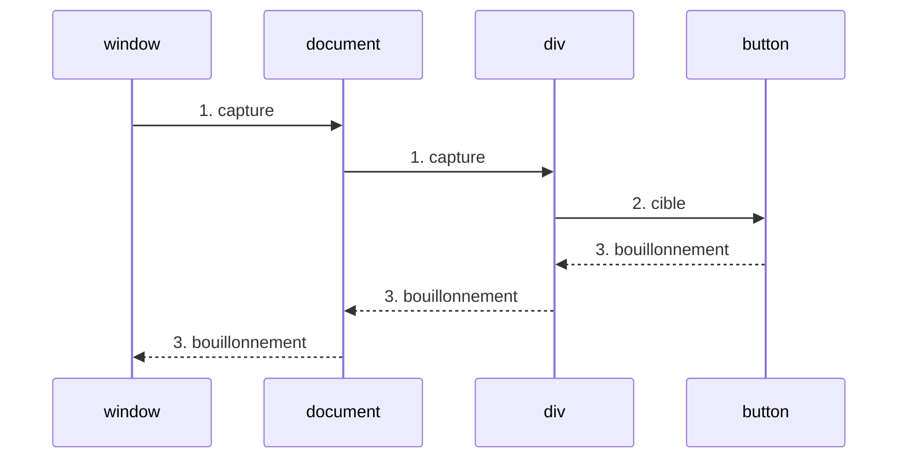

# 24 — Les événements et les formulaires

> **Niveau** : Intermédiaire · **Durée** : ~4 h · **Prérequis** : [Le DOM](../23-dom/README.md), [Fonctions](../06-fonctions/README.md), [Asynchrone](../18-asynchrone/README.md)

Une page web passe l'essentiel de son temps à **attendre** : un clic, une touche, une saisie, la fin d'un chargement. Le navigateur signale chacun de ces faits par un **événement**, et votre code y réagit. Ce chapitre explique comment écouter proprement (et arrêter d'écouter), comment un événement circule dans l'arbre du DOM, comment gérer des listes entières avec un seul écouteur, et comment construire des formulaires validés et accessibles. Il se termine par les événements personnalisés, qui fonctionnent aussi dans Node.js.

> [!NOTE]
> Les blocs marqués comme du code navigateur sont à essayer dans une page, avec le HTML montré juste avant. Les exemples à base de `EventTarget` et `CustomEvent` fonctionnent tels quels dans Node.js. La page [`demo.html`](demo.html) regroupe les exemples clés : ouvrez-la directement dans votre navigateur.

## Objectifs

- Attacher et retirer des écouteurs avec `addEventListener` et ses options (`once`, `passive`, `capture`, `signal`).
- Expliquer la propagation (capture, cible, bouillonnement) et la différence entre `target` et `currentTarget`.
- Annuler une action par défaut et gérer toute une liste avec la **délégation d'événements**.
- Choisir le bon événement : `click` ou `pointerdown`, `input` ou `change`, `key` ou `code`, `visibilitychange` plutôt que `unload`.
- Lire un formulaire avec `FormData` et le valider avec la Constraint Validation API, messages accessibles compris.
- Créer des événements personnalisés avec `CustomEvent` et utiliser `EventTarget` hors du DOM.
- Rendre une interface utilisable au clavier (`<button>`, `<dialog>`, gestion du focus).

## Sommaire

- [Le modèle événementiel](#le-modèle-événementiel)
- [addEventListener et removeEventListener](#addeventlistener-et-removeeventlistener)
- [Les options : once, passive, capture, signal](#les-options--once-passive-capture-signal)
- [L'objet Event](#lobjet-event)
- [Propagation : capture, cible, bouillonnement](#propagation--capture-cible-bouillonnement)
- [Annuler l'action par défaut](#annuler-laction-par-défaut)
- [Délégation d'événements](#délégation-dévénements)
- [Les événements courants](#les-événements-courants)
- [Formulaires](#formulaires)
- [Événements personnalisés](#événements-personnalisés)
- [Performance](#performance)
- [Accessibilité au clavier](#accessibilité-au-clavier)
- [Pièges courants](#pièges-courants)
- [Bonnes pratiques](#bonnes-pratiques)
- [Résumé](#résumé)
- [Exercices](#exercices)
- [Pour aller plus loin](#pour-aller-plus-loin)

## Le modèle événementiel

Quand l'utilisateur clique, le navigateur détermine l'élément visé, crée un objet `Event` qui décrit ce qui s'est passé, puis appelle **une par une** les fonctions (les **écouteurs**, _listeners_) qui se sont déclarées intéressées. Entre deux événements, votre code ne fait rien : il attend.

Ces écouteurs s'exécutent sur le fil principal, celui qui affiche aussi la page, via la boucle d'événements (voir [Asynchrone](../18-asynchrone/README.md)). Un écouteur qui calcule pendant 500 ms gèle la page pendant 500 ms : aucun clic, aucun défilement fluide. Les navigateurs mesurent ce délai entre une interaction et l'image suivante (métrique **INP**, _Interaction to Next Paint_) ; gardez vos écouteurs courts.

Les événements ne viennent pas que du DOM : `window`, `document`, `AbortSignal`, `WebSocket`, `MediaQueryList`, `Worker`… sont tous des **`EventTarget`**, l'interface qui fournit `addEventListener`, `removeEventListener` et `dispatchEvent`. Cette interface existe aussi dans Node.js, ce qui permet d'en essayer les bases sans navigateur.

## addEventListener et removeEventListener

`cible.addEventListener(type, ecouteur, options)` enregistre une fonction appelée à chaque événement du type donné. L'écouteur reçoit l'objet `Event` en argument.

```html
<button type="button" id="commander">Commander</button>
```

<!-- no-run -->
```js
const bouton = document.getElementById("commander");

function commander(event) {
  console.log(`${event.type} sur #${event.currentTarget.id}`);
}

bouton.addEventListener("click", commander);
bouton.click(); // click sur #commander (click() simule un clic)
```

### Trois façons d'attacher un écouteur

```html
<!-- ❌ Attribut HTML : du code dans une chaîne, exécuté dans la portée globale,
     et bloqué par une Content Security Policy stricte -->
<button type="button" id="commander" onclick="commander()">Commander</button>
```

<!-- no-run -->
```js
const bouton = document.getElementById("commander");

// ⚠️ Propriété on… : un seul gestionnaire par type, le suivant écrase le précédent
bouton.onclick = () => console.log("premier");
bouton.onclick = () => console.log("second"); // remplace « premier »

// ✅ addEventListener : autant d'écouteurs que nécessaire, des options, et un retrait possible
bouton.addEventListener("click", () => console.log("A"));
bouton.addEventListener("click", () => console.log("B"));

bouton.click();
// second
// A
// B
```

Les écouteurs d'un même élément sont appelés **dans l'ordre d'enregistrement**. Utilisez toujours `addEventListener` : c'est la seule forme qui permet plusieurs écouteurs indépendants (votre code, une bibliothèque, un outil de statistiques) et des options.

### Retirer un écouteur

`removeEventListener` doit recevoir **la même fonction** (la même référence) et la même valeur de `capture`. Une fonction anonyme ne peut donc pas être retirée. Ces règles valent pour tout `EventTarget` : on peut les vérifier dans Node.js.

```js
const minuteur = new EventTarget(); // un EventTarget hors du DOM

function afficher(event) {
  console.log(`événement ${event.type}`);
}

minuteur.addEventListener("tic", afficher);
minuteur.addEventListener("tic", afficher); // ignoré : cette fonction est déjà enregistrée
minuteur.dispatchEvent(new Event("tic")); // événement tic (une seule fois)

minuteur.removeEventListener("tic", afficher); // ✅ même référence
minuteur.dispatchEvent(new Event("tic")); // (rien)

minuteur.addEventListener("tic", () => console.log("anonyme"));
minuteur.removeEventListener("tic", () => console.log("anonyme")); // ❌ une autre fonction : rien n'est retiré
minuteur.dispatchEvent(new Event("tic")); // anonyme
```

Même piège avec `bind`, qui crée une nouvelle fonction à chaque appel : `removeEventListener("click", this.surClic.bind(this))` ne retire rien. Gardez la référence dans une variable, ou, plus simple, utilisez l'option `signal`.

## Les options : once, passive, capture, signal

Le troisième argument est un objet d'options :

| Option | Effet |
| --- | --- |
| `once: true` | l'écouteur est retiré automatiquement après son premier appel |
| `signal` | un `AbortSignal` : l'écouteur est retiré quand le signal est annulé (`controleur.abort()`) |
| `passive: true` | promet de ne pas appeler `preventDefault()` ; le navigateur peut alors faire défiler la page sans attendre l'écouteur |
| `capture: true` | écoute pendant la phase de **capture** au lieu du bouillonnement (voir [Propagation](#propagation--capture-cible-bouillonnement)) |

```js
const connexion = new EventTarget();

connexion.addEventListener(
  "message",
  () => console.log("premier message reçu"),
  { once: true },
);

const controleur = new AbortController();
connexion.addEventListener("message", () => console.log("écouteur A"), {
  signal: controleur.signal,
});
connexion.addEventListener("message", () => console.log("écouteur B"), {
  signal: controleur.signal,
});

connexion.dispatchEvent(new Event("message"));
// premier message reçu
// écouteur A
// écouteur B
connexion.dispatchEvent(new Event("message"));
// écouteur A
// écouteur B
controleur.abort(); // retire A et B d'un coup
connexion.dispatchEvent(new Event("message")); // (rien)
```

L'option `signal` est la façon moderne de **nettoyer**. Un composant qui écoute `window` ou `document` doit retirer ses écouteurs quand il disparaît, sinon ils continuent de s'exécuter (et de garder en mémoire tout ce qu'ils référencent) : c'est une fuite. Avec un seul `AbortController`, le nettoyage tient en une ligne, et le même signal peut aussi annuler les `fetch` du composant (voir [Async/await](../20-async-await/README.md)).

<!-- no-run -->
```js
function activerPanneau(panneau) {
  const controleur = new AbortController();
  const { signal } = controleur;

  window.addEventListener(
    "keydown",
    (event) => {
      if (event.key === "Escape") panneau.hidden = true;
    },
    { signal },
  );
  window.addEventListener("resize", () => console.log(innerWidth), {
    signal,
    passive: true,
  });
  document.addEventListener(
    "visibilitychange",
    () => console.log(document.visibilityState),
    { signal },
  );

  return () => controleur.abort(); // fonction de nettoyage : retire les trois écouteurs
}

const desactiver = activerPanneau(document.body);
desactiver(); // plus aucun écouteur actif
```

Pour `wheel`, `touchstart` et `touchmove` sur `window`, `document`, `<html>` et `<body>`, la spécification fait de `passive: true` la valeur par défaut : le défilement reste fluide même si un écouteur est lent. Sur un autre élément, passez `passive: true` vous-même quand vous n'annulez pas l'événement. Un `preventDefault()` dans un écouteur passif est ignoré (avec un avertissement dans la console).

## L'objet Event

L'écouteur reçoit un objet qui décrit l'événement. Les propriétés communes :

| Propriété ou méthode | Rôle |
| --- | --- |
| `type` | le nom de l'événement (`"click"`, `"input"`…) |
| `target` | l'élément **d'où part** l'événement (le plus profond : l'élément cliqué) |
| `currentTarget` | l'élément **qui porte l'écouteur** en cours d'exécution |
| `eventPhase` | `1` capture, `2` cible, `3` bouillonnement (`0` hors propagation) |
| `bubbles`, `cancelable` | l'événement bouillonne-t-il ? peut-on l'annuler ? |
| `defaultPrevented` | `true` si `preventDefault()` a été appelé |
| `isTrusted` | `true` pour un événement produit par le navigateur, `false` pour un `dispatchEvent` |
| `timeStamp` | instant de création, en millisecondes (comme `performance.now()`) |
| `preventDefault()` | annule l'action par défaut |
| `stopPropagation()` / `stopImmediatePropagation()` | arrête la propagation |
| `composedPath()` | tableau des cibles traversées, de la cible à `window` |

Chaque famille d'événements ajoute ses propriétés : `PointerEvent` et `MouseEvent` (`clientX`, `button`, `pointerType`), `KeyboardEvent` (`key`, `code`, `ctrlKey`), `InputEvent` (`inputType`, `data`), `SubmitEvent` (`submitter`), `FocusEvent` (`relatedTarget`)…

### target et currentTarget

```html
<ul id="menu">
  <li><button type="button">Messages <span class="badge">3</span></button></li>
</ul>
```

<!-- no-run -->
```js
document.getElementById("menu").addEventListener("click", (event) => {
  console.log(event.target.tagName); // "SPAN" : l'élément réellement cliqué (le badge)
  console.log(event.currentTarget.id); // "menu" : l'élément qui porte l'écouteur
  console.log(event.target.closest("button").textContent); // "Messages 3"
});
document.querySelector(".badge").click();
```

`target` peut donc être un enfant de l'élément qui vous intéresse (un `<span>`, une icône `<svg>`) : `closest()` remonte jusqu'à lui. Autre piège : `currentTarget` ne vaut quelque chose **que pendant** l'appel de l'écouteur. Après un `await`, il vaut `null` : copiez-le d'abord dans une variable.

```js
const cible = new EventTarget();
cible.addEventListener("enregistrer", async (event) => {
  const source = event.currentTarget; // ✅ copié pendant l'appel
  await Promise.resolve(); // n'importe quelle attente
  console.log(event.currentTarget); // null : l'événement est terminé
  console.log(source === cible); // true
});
cible.dispatchEvent(new Event("enregistrer"));
```

### `this` dans un écouteur

Dans un écouteur écrit avec `function`, `this` vaut `currentTarget`. Une fonction fléchée n'a pas de `this` propre : elle garde celui du code qui l'entoure (voir [Fonctions](../06-fonctions/README.md)). Le plus lisible est de ne pas dépendre de `this` et d'utiliser `event.currentTarget`.

Un écouteur peut aussi être un **objet** doté d'une méthode `handleEvent` ; `this` est alors l'objet lui-même, ce qui évite `bind` (`total = 0` est un champ de classe, ES2022) :

```js
class Compteur {
  total = 0;

  handleEvent(event) {
    this.total++; // this est l'objet Compteur
    console.log(`${event.type} n° ${this.total}`);
  }
}

const panier = new EventTarget();
const compteur = new Compteur();
panier.addEventListener("ajout", compteur); // on passe l'objet, pas une méthode
panier.dispatchEvent(new Event("ajout")); // ajout n° 1
panier.dispatchEvent(new Event("ajout")); // ajout n° 2
panier.removeEventListener("ajout", compteur); // même référence : retrait possible
```

Passer une méthode directement (`bouton.addEventListener("click", objet.methode)`) **perd** son `this` : enveloppez-la dans une fléchée (`() => objet.methode()`) ou déclarez-la comme champ fléché dans la classe (voir [Classes](../16-classes/README.md)).

## Propagation : capture, cible, bouillonnement

Un clic sur un bouton est aussi un clic sur sa liste, sur `<body>`, sur le document. Un événement du DOM traverse donc l'arbre en **trois phases** :

1. **capture** : il descend de `window` jusqu'au parent de la cible ;
2. **cible** : il atteint l'élément d'origine ;
3. **bouillonnement** (_bubbling_) : il remonte de la cible jusqu'à `window`.



Par défaut, un écouteur est appelé pendant le bouillonnement (ou à la cible) ; avec `{ capture: true }`, il est appelé pendant la capture.

```html
<div id="exterieur">
  <button type="button" id="interieur">Cliquez</button>
</div>
```

<!-- no-run -->
```js
const exterieur = document.getElementById("exterieur");
const interieur = document.getElementById("interieur");
const phases = ["aucune", "capture", "cible", "bouillonnement"];
const journal = (nom) => (event) =>
  console.log(`${nom} — ${phases[event.eventPhase]}`);

document.addEventListener("click", journal("document"), { capture: true });
exterieur.addEventListener("click", journal("extérieur"), { capture: true });
exterieur.addEventListener("click", journal("extérieur"));
interieur.addEventListener("click", journal("intérieur"));
document.addEventListener("click", journal("document"));

interieur.click();
// document — capture
// extérieur — capture
// intérieur — cible
// extérieur — bouillonnement
// document — bouillonnement
```

Le bouillonnement est ce qui rend possible la [délégation](#délégation-dévénements) : un seul écouteur sur un ancêtre voit les clics de tous ses descendants. La capture est plus rare ; elle sert à intercepter un événement avant tout le monde, ou à attraper des événements qui ne bouillonnent pas.

### stopPropagation et stopImmediatePropagation

`event.stopPropagation()` arrête le trajet après l'élément courant (ses autres écouteurs sont tout de même appelés) ; `stopImmediatePropagation()` arrête aussi les écouteurs suivants du même élément :

```js
const formulaire = new EventTarget();
formulaire.addEventListener("valider", (event) => {
  console.log("vérification");
  event.stopImmediatePropagation(); // les écouteurs suivants ne sont pas appelés
});
formulaire.addEventListener("valider", () => console.log("jamais affiché"));
formulaire.dispatchEvent(new Event("valider")); // vérification
```

> [!WARNING]
> Évitez `stopPropagation()` « par précaution » : il casse les écouteurs placés plus haut que vous ne connaissez pas (délégation, menu qui se ferme au clic extérieur, statistiques). Pour qu'un ancêtre ignore un clic déjà traité, il vaut mieux qu'il teste `event.target` ou `event.defaultPrevented`.

### Les événements qui ne bouillonnent pas

Quelques événements ne remontent pas l'arbre : `focus` et `blur` (utilisez `focusin` et `focusout`, qui bouillonnent), `mouseenter` et `mouseleave` (`pointerover`/`pointerout` bouillonnent), `load` et `error` sur une image ou un script, `scroll` sur un élément, `invalid` sur un champ. La propriété `event.bubbles` le confirme. La phase de capture, elle, a lieu pour tous : `document.addEventListener("error", journaliser, { capture: true })` attrape les erreurs de chargement de **toutes** les images de la page.

## Annuler l'action par défaut

Beaucoup d'événements déclenchent une action du navigateur : suivre un lien, envoyer un formulaire, cocher une case, insérer un caractère, ouvrir le menu contextuel. `event.preventDefault()` l'annule (si `event.cancelable` vaut `true`).

Exemple réaliste : un lien « Aide » qui ouvre un panneau dans la page. Sans JavaScript, ou si l'utilisateur veut l'ouvrir dans un nouvel onglet, le lien doit continuer de fonctionner :

```html
<a href="/aide" id="lien-aide">Aide</a>
<aside id="panneau-aide" hidden>Contenu de l'aide…</aside>
```

<!-- no-run -->
```js
document.getElementById("lien-aide").addEventListener("click", (event) => {
  // Ctrl/Cmd/Maj + clic ou clic du milieu : laisser le navigateur ouvrir un onglet
  if (event.button !== 0 || event.ctrlKey || event.metaKey || event.shiftKey)
    return;
  event.preventDefault(); // pas de navigation
  document.getElementById("panneau-aide").hidden = false;
});
```

`return false` n'annule rien dans un écouteur `addEventListener` : cette convention ne vaut que pour les attributs et propriétés `on…` (et pour jQuery). Appelez `preventDefault()`.

## Délégation d'événements

Une liste de 200 tâches avec deux boutons chacune, c'est 400 écouteurs… et ceux des tâches ajoutées ensuite manquent à l'appel. La **délégation** inverse le problème : **un seul écouteur sur l'ancêtre commun**, qui identifie l'élément visé grâce au bouillonnement et à `closest()`.

```html
<ul id="taches">
  <li data-id="1">
    <span class="titre">Acheter du pain</span>
    <button type="button" data-action="terminer">Terminer</button>
    <button type="button" data-action="supprimer">Supprimer</button>
  </li>
</ul>
```

<!-- no-run -->
```js
const liste = document.getElementById("taches");

const actions = {
  terminer: (tache) => tache.classList.toggle("terminee"),
  supprimer: (tache) => tache.remove(),
};

liste.addEventListener("click", (event) => {
  const bouton = event.target.closest("button[data-action]");
  if (!bouton || !liste.contains(bouton)) return; // clic ailleurs dans la liste
  actions[bouton.dataset.action]?.(bouton.closest("li"));
});

// Une tâche ajoutée plus tard fonctionne sans nouvel écouteur
const nouvelle = liste.firstElementChild.cloneNode(true);
nouvelle.dataset.id = "2";
nouvelle.querySelector(".titre").textContent = "Appeler le garage";
liste.append(nouvelle);

nouvelle.querySelector('[data-action="terminer"]').click();
console.log(nouvelle.classList.contains("terminee")); // true
liste.firstElementChild.querySelector('[data-action="supprimer"]').click();
console.log(liste.children.length); // 1
```

Trois détails font la robustesse de ce motif :

- `closest()` plutôt que `event.target.matches()` : on peut cliquer sur une icône ou un `<span>` **dans** le bouton ;
- `liste.contains(bouton)` écarte un ancêtre qui correspondrait au sélecteur **au-dessus** de la liste ;
- les attributs `data-action` relient le HTML au code sans multiplier les classes ni les identifiants, et l'appel optionnel `?.()` (ES2020) ignore une action inconnue.

La délégation fonctionne avec tous les événements qui bouillonnent (`click`, `input`, `change`, `keydown`, `submit`, `focusin`…). Pour `focus`/`blur`, utilisez `focusin`/`focusout`.

## Les événements courants

| Famille | Événements | Cible habituelle |
| --- | --- | --- |
| Pointeur et souris | `click`, `dblclick`, `contextmenu`, `pointerdown`, `pointermove`, `pointerup`, `pointercancel`, `pointerover`/`pointerout` | éléments |
| Clavier | `keydown`, `keyup` | élément qui a le focus, `document` |
| Saisie | `input`, `change`, `beforeinput` | champs, éléments `contenteditable` |
| Focus | `focus`, `blur`, `focusin`, `focusout` | éléments focalisables |
| Formulaire | `submit`, `reset`, `invalid`, `formdata` | `<form>`, champs |
| Défilement, taille | `scroll`, `scrollend`, `resize` | `window`, éléments défilants |
| Cycle de vie | `DOMContentLoaded`, `load`, `visibilitychange`, `pagehide`, `pageshow`, `beforeunload` | `document`, `window` |
| Ressources | `load`, `error` | ``, `<script>`, `<link>`, `window` |
| Presse-papiers | `copy`, `cut`, `paste` | `document`, champs |
| Glisser-déposer | `dragstart`, `dragover`, `drop`… | éléments `draggable` |

### Souris et pointeur

- **`click`** est déclenché par la souris, par un appui tactile **et par le clavier** (<kbd>Entrée</kbd> ou <kbd>Espace</kbd> sur un bouton, <kbd>Entrée</kbd> sur un lien). Pour une action, écoutez donc `click`, pas `mousedown`.
- Les **Pointer Events** (`pointerdown`, `pointermove`, `pointerup`, `pointercancel`) unifient souris, doigt et stylet ; `event.pointerType` vaut `"mouse"`, `"touch"` ou `"pen"`. Préférez-les aux anciens `mouse…` et `touch…` pour les interactions plus riches qu'un clic.
- Coordonnées : `clientX`/`clientY` (fenêtre), `pageX`/`pageY` (page), `offsetX`/`offsetY` (élément cible). `event.button` vaut `0` pour le bouton principal.
- `mouseenter`/`mouseleave` ne bouillonnent pas et ignorent les passages d'un enfant à l'autre ; souvent, la pseudo-classe CSS `:hover` suffit.

Exemple : faire glisser une poignée. `setPointerCapture` garantit que les événements suivants arrivent à la poignée, même si le pointeur la quitte :

```html
<div id="piste" style="position: relative; height: 2rem; background: #eee; touch-action: none">
  <div id="poignee" style="position: absolute; width: 2rem; height: 2rem; background: steelblue"></div>
</div>
```

<!-- no-run -->
```js
const piste = document.getElementById("piste");
const poignee = document.getElementById("poignee");

poignee.addEventListener("pointerdown", (event) => {
  poignee.setPointerCapture(event.pointerId);
});
poignee.addEventListener("pointermove", (event) => {
  if (!poignee.hasPointerCapture(event.pointerId)) return; // bouton relâché : on ignore
  const { left, width } = piste.getBoundingClientRect();
  const x = Math.min(
    Math.max(event.clientX - left, 0),
    width - poignee.offsetWidth,
  );
  poignee.style.translate = `${x}px`;
});
```

La capture est relâchée automatiquement au `pointerup`. La règle CSS `touch-action: none` empêche le navigateur de faire défiler la page quand on glisse au doigt. Pour un vrai curseur de valeur, `<input type="range">` est accessible au clavier sans une ligne de JavaScript : ne réinventez un contrôle que si aucun élément natif ne convient.

### Clavier

`keydown` est déclenché à l'appui (et répété si la touche reste enfoncée : `event.repeat` vaut alors `true`), `keyup` au relâchement. Deux propriétés décrivent la touche :

- **`key`** : le **sens** de la touche, compte tenu de la disposition du clavier et des modificateurs (`"a"`, `"A"`, `"Enter"`, `"Escape"`, `"ArrowUp"`, `" "`) ;
- **`code`** : la **position physique** de la touche, indépendante de la disposition (`"KeyQ"`, `"Digit1"`, `"Space"`).

| Touche appuyée sur un clavier AZERTY | `event.key` | `event.code` |
| --- | --- | --- |
| <kbd>A</kbd> (à la place du Q d'un clavier QWERTY) | `"a"` (ou `"A"` avec <kbd>Maj</kbd>) | `"KeyQ"` |
| <kbd>&amp; 1</kbd> (rangée du haut, sans <kbd>Maj</kbd>) | `"&"` | `"Digit1"` |
| <kbd>Espace</kbd> | `" "` | `"Space"` |
| <kbd>Échap</kbd> | `"Escape"` | `"Escape"` |

Utilisez `key` pour les raccourcis (« Ctrl + S », « Échap ») et `code` quand seule la position compte (déplacements dans un jeu). Les anciennes propriétés `keyCode`, `which` et `charCode`, ainsi que l'événement `keypress`, sont **obsolètes**.

<!-- no-run -->
```js
function fermerPanneaux() {
  for (const panneau of document.querySelectorAll("[data-panneau]"))
    panneau.hidden = true;
}

document.addEventListener("keydown", (event) => {
  if (event.isComposing) return; // saisie en cours avec un éditeur de méthode d'entrée (japonais, chinois…)
  if (event.key === "Escape") fermerPanneaux();

  // Ctrl + K (Windows, Linux) ou Cmd + K (macOS)
  if (event.key.toLowerCase() === "k" && (event.ctrlKey || event.metaKey)) {
    event.preventDefault(); // le navigateur utilise aussi ce raccourci
    document.getElementById("recherche")?.focus();
  }
});
```

Un raccourci d'une seule lettre ne doit pas se déclencher pendant que l'utilisateur **tape dans un champ** : testez `event.target.closest("input, textarea, select, [contenteditable]")`. Et ne détournez pas les raccourcis essentiels du navigateur ou des technologies d'assistance.

### Saisie : input, change, beforeinput

- **`input`** est déclenché à **chaque modification** de la valeur : frappe, collage, dictée, saisie automatique. C'est lui qu'il faut pour une réaction immédiate (filtre, compteur de caractères).
- **`change`** est déclenché quand la modification est **validée** : à la perte du focus pour un champ texte, immédiatement pour une case à cocher, un bouton radio ou un `<select>`.
- **`beforeinput`** est déclenché **avant** la modification et peut l'annuler ; `event.inputType` (`"insertText"`, `"deleteContentBackward"`…) et `event.data` la décrivent.

```html
<label for="filtre">Filtrer les pays</label>
<input id="filtre" type="search" />
<ul id="pays">
  <li>France</li>
  <li>Belgique</li>
  <li>Suisse</li>
  <li>Canada</li>
</ul>
```

<!-- no-run -->
```js
const champ = document.getElementById("filtre");
const pays = document.querySelectorAll("#pays li");

champ.addEventListener("input", () => {
  const recherche = champ.value.trim().toLocaleLowerCase("fr");
  for (const li of pays)
    li.hidden = !li.textContent.toLocaleLowerCase("fr").includes(recherche);
});

champ.value = "an"; // une modification par script ne déclenche PAS input…
champ.dispatchEvent(new Event("input", { bubbles: true })); // …on le simule
console.log([...pays].filter((li) => !li.hidden).map((li) => li.textContent)); // ["France", "Canada"]
```

Sur une grande liste ou avec une requête réseau à chaque frappe, attendez une pause dans la saisie avec un _debounce_ (voir [Timers](../21-timers/README.md)).

### Focus

`focus` et `blur` signalent qu'un élément gagne ou perd le focus ; ils ne bouillonnent pas. Leurs équivalents `focusin` et `focusout` bouillonnent et se prêtent à la délégation. `event.relatedTarget` indique l'élément qui perd (ou gagne) le focus en même temps, et `document.activeElement` l'élément qui l'a actuellement.

<!-- no-run -->
```js
const brouillon = {};
const formulaire = document.querySelector("form");

// Un seul écouteur pour tous les champs : on mémorise chaque champ quitté
formulaire.addEventListener("focusout", (event) => {
  if (event.target.matches("input, textarea"))
    brouillon[event.target.name] = event.target.value;
});
```

Avant d'écrire du JavaScript, vérifiez si le CSS ne suffit pas : `:focus-visible` affiche un contour de focus seulement quand il est utile (navigation au clavier), `:focus-within` stylise un conteneur dont un descendant a le focus.

### Défilement et redimensionnement

- **`scroll`** est déclenché très souvent (jusqu'à chaque image) : écouteur passif et léger, ou mieux, pas d'écouteur du tout. Pour savoir si un élément est visible, utilisez `IntersectionObserver` ; pour un en-tête collant, `position: sticky` en CSS. Un exemple de limitation avec `requestAnimationFrame` figure dans la section [Performance](#performance).
- **`scrollend`** (Baseline 2025) signale la fin d'un défilement.
- **`resize`** n'existe que sur `window`. Pour la taille d'un élément, utilisez `ResizeObserver` ; pour un point de rupture, `matchMedia`, qui ne prévient qu'au franchissement du seuil :

<!-- no-run -->
```js
const ecranLarge = matchMedia("(min-width: 48rem)");

function adapterMenu() {
  document.body.classList.toggle("menu-large", ecranLarge.matches);
}

ecranLarge.addEventListener("change", adapterMenu); // seulement quand on franchit 48rem
adapterMenu(); // état initial
```

### Chargement et cycle de vie de la page

`DOMContentLoaded` et `load` sont présentés au [chapitre précédent](../23-dom/README.md#charger-son-script-au-bon-moment). Les autres événements du cycle de vie servent à réagir quand l'utilisateur **quitte** la page :

- **`visibilitychange`** (sur `document`) : la page passe à l'arrière-plan (`document.visibilityState === "hidden"`) ou revient. Mettez en pause vidéos, animations et interrogations du serveur ; **enregistrez l'état** ici. Sur mobile, c'est souvent le dernier événement fiable : le système peut ensuite tuer l'onglet sans prévenir.
- **`pagehide`** et **`pageshow`** : la page est quittée ou affichée. Si `event.persisted` vaut `true` dans `pageshow`, la page sort du **cache aller-retour** (_bfcache_) du navigateur, intacte : rafraîchissez les données qui ont pu changer.
- **`beforeunload`** : à réserver à **un seul usage**, prévenir d'une perte de modifications non enregistrées. Le navigateur affiche son propre message (le texte que vous fournissez est ignoré), et seulement si l'utilisateur a interagi avec la page.
- **`unload`** : **à ne plus utiliser**. Il n'est pas fiable (surtout sur mobile), il empêche le cache aller-retour, et Chrome le désactive progressivement.

<!-- no-run -->
```js
function avertir(event) {
  event.preventDefault(); // demande la confirmation du navigateur
  event.returnValue = true; // pour les navigateurs anciens
}

// N'écouter beforeunload que lorsqu'il y a réellement quelque chose à perdre
const editeur = document.querySelector("textarea");
editeur.addEventListener("input", () => {
  if (editeur.value !== editeur.defaultValue)
    window.addEventListener("beforeunload", avertir);
  else window.removeEventListener("beforeunload", avertir);
});

document.addEventListener("visibilitychange", () => {
  if (document.visibilityState === "hidden") {
    sessionStorage.setItem("brouillon", editeur.value); // dernier moment fiable pour enregistrer
    // Pour des statistiques : navigator.sendBeacon("/api/stats", donnees) survit à la fermeture
  }
});

window.addEventListener("pageshow", (event) => {
  if (event.persisted)
    console.log("page restaurée depuis le cache aller-retour");
});
```

## Formulaires

Le formulaire est la façon standard de recueillir des données : il fonctionne au clavier, avec les gestionnaires de mots de passe, la saisie automatique et les lecteurs d'écran. JavaScript vient **l'améliorer** (validation sur mesure, envoi sans rechargement), pas le remplacer. Cette section s'appuie sur ce formulaire d'inscription :

```html
<form id="inscription" action="/api/inscription" method="post">
  <p>
    <label for="pseudo">Pseudo</label>
    <input id="pseudo" name="pseudo" required minlength="3" maxlength="20" pattern="[a-z0-9_]+"
      autocomplete="username" aria-describedby="aide-pseudo erreur-pseudo" />
    <small id="aide-pseudo">3 à 20 caractères : minuscules, chiffres ou « _ ».</small>
    <span id="erreur-pseudo" class="erreur"></span>
  </p>
  <p>
    <label for="email">E-mail</label>
    <input id="email" name="email" type="email" required autocomplete="email" aria-describedby="erreur-email" />
    <span id="erreur-email" class="erreur"></span>
  </p>
  <p>
    <label for="age">Âge</label>
    <input id="age" name="age" type="number" min="13" max="120" aria-describedby="erreur-age" />
    <span id="erreur-age" class="erreur"></span>
  </p>
  <fieldset>
    <legend>Centres d'intérêt</legend>
    <label><input type="checkbox" name="interets" value="js" checked /> JavaScript</label>
    <label><input type="checkbox" name="interets" value="css" /> CSS</label>
    <label><input type="checkbox" name="interets" value="a11y" checked /> Accessibilité</label>
  </fieldset>
  <p><label><input type="checkbox" name="newsletter" /> Recevoir la lettre d'information</label></p>
  <button type="submit">S'inscrire</button>
</form>
<p id="resultat" role="status"></p>
```

### L'événement submit

Écoutez **`submit` sur le formulaire**, pas `click` sur le bouton : `submit` est aussi déclenché par <kbd>Entrée</kbd> dans un champ, et seulement **après** la validation native.

<!-- no-run -->
```js
const formulaire = document.getElementById("inscription");

formulaire.addEventListener("submit", async (event) => {
  event.preventDefault(); // on envoie nous-mêmes, sans recharger la page
  const reponse = await fetch(formulaire.action, {
    method: "POST",
    body: new FormData(formulaire),
  });
  document.getElementById("resultat").textContent = reponse.ok
    ? "Inscription enregistrée."
    : "Erreur, réessayez.";
});
```

À savoir :

- un `<button>` placé dans un formulaire est **par défaut** de type `submit` : donnez `type="button"` à tous les autres boutons ;
- `event.submitter` désigne le bouton qui a déclenché l'envoi, utile quand il y en a plusieurs ;
- pour envoyer par script, utilisez `formulaire.requestSubmit()` : il valide et déclenche `submit`, comme un vrai clic. `formulaire.submit()` court-circuite les deux ;
- l'envoi lui-même (`fetch`, JSON, gestion des erreurs) est détaillé au chapitre [Fetch et HTTP](../22-fetch-http/README.md).

### Lire les champs avec FormData

`new FormData(formulaire)` rassemble les champs qui ont un attribut `name`, ne sont pas désactivés et, pour les cases et boutons radio, sont cochés. On peut l'envoyer tel quel avec `fetch` ou le lire :

<!-- no-run -->
```js
const formulaire = document.getElementById("inscription");
formulaire.elements.pseudo.value = "ada_l"; // form.elements donne accès aux champs par leur name
formulaire.elements.email.value = "ada@exemple.fr";

const donnees = new FormData(formulaire);
console.log(donnees.get("pseudo")); // "ada_l"
console.log(donnees.getAll("interets")); // ["js", "a11y"] : toutes les cases cochées de ce nom
console.log(donnees.get("newsletter")); // null : une case non cochée est absente
console.log(donnees.get("age")); // "" : toujours des chaînes (ou des objets File)
console.log(Object.fromEntries(donnees).interets); // "a11y" ❌ seule la dernière valeur est gardée
```

`Object.fromEntries` est pratique pour un formulaire simple, mais il perd les valeurs multiples. Pour obtenir un objet correctement typé, écrivez la conversion :

<!-- no-run -->
```js
function lireInscription(formulaire) {
  const donnees = new FormData(formulaire);
  const age = donnees.get("age");
  return {
    pseudo: donnees.get("pseudo").trim(),
    email: donnees.get("email").trim(),
    age: age === "" ? null : Number(age),
    interets: donnees.getAll("interets"),
    newsletter: donnees.has("newsletter"),
  };
}

console.log(lireInscription(document.getElementById("inscription")));
// { pseudo: "", email: "", age: null, interets: ["js", "a11y"], newsletter: false }
```

Un champ `<input type="file">` donne un objet `File` (avec `multiple`, utilisez `getAll`). `new URLSearchParams(donnees)` produit le format `application/x-www-form-urlencoded`, et `new FormData(formulaire, event.submitter)` (Baseline 2023) inclut le nom et la valeur du bouton utilisé.

### La validation HTML

Avant tout JavaScript, le HTML sait valider beaucoup de choses, et le navigateur bloque l'envoi tant qu'un champ est invalide :

| Attribut | Contrainte |
| --- | --- |
| `required` | champ obligatoire |
| `type="email"`, `"url"`, `"number"`, `"date"`… | format attendu (et clavier adapté sur mobile) |
| `minlength`, `maxlength` | longueur du texte |
| `min`, `max`, `step` | bornes et pas d'un nombre ou d'une date |
| `pattern` | expression régulière que **toute** la valeur doit respecter |

Sur le formulaire, `novalidate` désactive les bulles natives (l'API de validation reste utilisable) ; sur un bouton, `formnovalidate` envoie sans valider (« Enregistrer le brouillon »). En CSS, préférez `:user-invalid` (Baseline 2023) à `:invalid` : il ne s'applique qu'**après** une interaction, au lieu d'afficher le formulaire vide tout en rouge.

```css
input:user-invalid {
  border-color: crimson;
}
```

### La Constraint Validation API

Chaque champ expose son état de validité :

| Membre | Rôle |
| --- | --- |
| `champ.validity` | objet `ValidityState` : `valid`, `valueMissing`, `typeMismatch`, `patternMismatch`, `tooShort`, `tooLong`, `rangeUnderflow`, `rangeOverflow`, `stepMismatch`, `badInput`, `customError` |
| `champ.validationMessage` | le message du navigateur, dans la langue du navigateur |
| `champ.willValidate` | `false` pour les champs non validés (boutons, `fieldset`, champs désactivés) |
| `champ.checkValidity()` / `formulaire.checkValidity()` | renvoie un booléen et déclenche `invalid` sur les champs fautifs |
| `champ.reportValidity()` | idem, et affiche la bulle d'erreur native |
| `champ.setCustomValidity(message)` | déclare une erreur personnalisée ; `""` l'efface |

Pour des messages adaptés à votre public, associez un texte à chaque cause d'erreur :

<!-- no-run -->
```js
const messages = {
  valueMissing: () => "Ce champ est obligatoire.",
  typeMismatch: () => "Le format n'est pas valide.",
  patternMismatch: () =>
    "Caractères autorisés : minuscules, chiffres et « _ ».",
  tooShort: (champ) =>
    `Au moins ${champ.minLength} caractères (actuellement ${champ.value.length}).`,
  rangeUnderflow: (champ) => `La valeur minimale est ${champ.min}.`,
  rangeOverflow: (champ) => `La valeur maximale est ${champ.max}.`,
};

function messagePour(champ) {
  for (const [cause, message] of Object.entries(messages)) {
    if (champ.validity[cause]) return message(champ);
  }
  return champ.validationMessage; // cause non prévue : message du navigateur
}

const pseudo = document.getElementById("pseudo");
pseudo.value = "Al";
console.log(pseudo.validity.patternMismatch, pseudo.validity.tooShort); // true false
console.log(messagePour(pseudo)); // "Caractères autorisés : minuscules, chiffres et « _ »."
```

`tooShort` vaut `false` ici, bien que « Al » ne fasse que 2 caractères : les contraintes de longueur ne sont vérifiées que pour une valeur **saisie par l'utilisateur**, pas pour une valeur affectée par script. Les autres contraintes (`required`, `pattern`, `type`, `min`…) le sont dans tous les cas.

Pour une règle que le HTML ne sait pas exprimer (pseudo déjà pris, deux champs qui doivent correspondre), utilisez `setCustomValidity`. N'oubliez pas de **remettre la chaîne vide** quand l'erreur disparaît, sinon le champ reste invalide pour toujours :

<!-- no-run -->
```js
const pseudosPris = new Set(["admin", "root"]);
const pseudo = document.getElementById("pseudo");

pseudo.addEventListener("input", () => {
  const pris = pseudosPris.has(pseudo.value);
  pseudo.setCustomValidity(pris ? "Ce pseudo est déjà pris." : ""); // "" = valide
});

pseudo.value = "admin";
pseudo.dispatchEvent(new Event("input"));
console.log(pseudo.validity.customError, pseudo.validationMessage); // true "Ce pseudo est déjà pris."
```

### Des messages d'erreur accessibles

Les bulles natives ont deux défauts : on ne peut pas les styliser et elles disparaissent vite. Pour afficher vos propres messages tout en gardant l'API de validation :

1. passez le formulaire en `novalidate` ;
2. à l'envoi, écrivez le message de chaque champ invalide dans l'élément relié par `aria-describedby` (le lecteur d'écran le lit avec le libellé) et ajoutez `aria-invalid="true"` ;
3. placez le focus sur le **premier** champ invalide ;
4. mettez le message à jour pendant la correction.

<!-- no-run -->
```js
const messages = {
  valueMissing: () => "Ce champ est obligatoire.",
  typeMismatch: () => "Le format n'est pas valide.",
  patternMismatch: () =>
    "Caractères autorisés : minuscules, chiffres et « _ ».",
  tooShort: (champ) => `Au moins ${champ.minLength} caractères.`,
  rangeUnderflow: (champ) => `La valeur minimale est ${champ.min}.`,
  rangeOverflow: (champ) => `La valeur maximale est ${champ.max}.`,
};
const messagePour = (champ) =>
  Object.entries(messages).find(([cause]) => champ.validity[cause])?.[1](
    champ,
  ) ?? champ.validationMessage;

const formulaire = document.getElementById("inscription");
formulaire.noValidate = true; // on garde l'API, on remplace les bulles natives

function mettreAJourErreur(champ) {
  const zone = document.getElementById(`erreur-${champ.name}`);
  if (!zone) return;
  zone.textContent = champ.validity.valid ? "" : messagePour(champ);
  if (champ.validity.valid) champ.removeAttribute("aria-invalid");
  else champ.setAttribute("aria-invalid", "true"); // ⚠️ aria-invalid="" signifierait « valide »
}

formulaire.addEventListener("submit", (event) => {
  event.preventDefault();
  const champs = [...formulaire.elements].filter((el) => el.willValidate);
  champs.forEach(mettreAJourErreur);
  const premierInvalide = champs.find((champ) => !champ.validity.valid);
  if (premierInvalide) {
    premierInvalide.focus(); // annonce : libellé, valeur, puis message d'erreur
    return;
  }
  document.getElementById("resultat").textContent =
    "Formulaire valide, envoi en cours…";
});

formulaire.addEventListener("input", (event) => {
  if (event.target.hasAttribute("aria-invalid"))
    mettreAJourErreur(event.target); // correction en direct
});

formulaire.requestSubmit(); // formulaire vide : erreurs affichées, focus sur le pseudo
console.log(
  document.activeElement.id,
  document.getElementById("erreur-pseudo").textContent,
);
// pseudo Ce champ est obligatoire.
```

Ne signalez pas une erreur **uniquement** par la couleur (ajoutez du texte, voire une icône) et ne désactivez pas le bouton d'envoi : un bouton grisé n'explique pas ce qui manque.

> [!IMPORTANT]
> La validation côté client améliore l'expérience, elle ne protège **rien** : n'importe qui peut envoyer une requête sans passer par votre formulaire. Le serveur doit toujours revalider les données (voir [JSON et stockage](../25-json-et-stockage/README.md#valider-les-données)).

## Événements personnalisés

Vos propres composants peuvent émettre des événements : un panier signale « article ajouté », un lecteur signale « piste terminée ». Le reste de l'application réagit sans que le composant ait à connaître ses auditeurs.

### CustomEvent

`new CustomEvent(type, options)` crée un événement qui transporte des données dans `detail`. Les options `bubbles` et `cancelable` valent `false` par défaut ; `composed: true` permet de traverser la frontière d'un Shadow DOM.

```html
<ul id="catalogue">
  <li data-id="p2">Café moulu <button type="button">Ajouter</button></li>
</ul>
<p id="compteur-panier" role="status">Panier : 0 article</p>
```

<!-- no-run -->
```js
// Le catalogue émet un événement, sans savoir qui l'écoute
document.getElementById("catalogue").addEventListener("click", (event) => {
  const produit = event.target.closest("button")?.closest("li");
  if (!produit) return;
  produit.dispatchEvent(
    new CustomEvent("panier:ajout", {
      bubbles: true,
      detail: { id: produit.dataset.id, quantite: 1 },
    }),
  );
});

// Ailleurs, l'en-tête du site met à jour son compteur
let nombreArticles = 0;
document.addEventListener("panier:ajout", (event) => {
  nombreArticles += event.detail.quantite;
  document.getElementById("compteur-panier").textContent =
    `Panier : ${nombreArticles} article${nombreArticles > 1 ? "s" : ""}`;
});

document.querySelector("#catalogue button").click();
console.log(document.getElementById("compteur-panier").textContent); // "Panier : 1 article"
```

Choisissez des noms en minuscules qui ne risquent pas de collision avec un événement natif, avec un préfixe (`panier:ajout`, `lecteur-fin`). Pour un événement qu'un auditeur doit pouvoir refuser, ajoutez `cancelable: true` : `dispatchEvent` renvoie alors `false` si un écouteur a appelé `preventDefault()`.

### EventTarget hors du DOM

`EventTarget` est un constructeur ordinaire : n'importe quelle classe peut en hériter pour devenir émettrice d'événements. Ce code fonctionne à l'identique dans un navigateur et dans Node.js (où `CustomEvent` est global depuis la version 19) :

```js
class Panier extends EventTarget {
  #articles = new Map();

  ajouter(id, quantite = 1) {
    const demande = new CustomEvent("avant-ajout", {
      detail: { id, quantite },
      cancelable: true,
    });
    if (!this.dispatchEvent(demande)) return false; // un écouteur a refusé l'ajout

    this.#articles.set(id, (this.#articles.get(id) ?? 0) + quantite);
    this.dispatchEvent(
      new CustomEvent("change", { detail: { total: this.total } }),
    );
    return true;
  }

  get total() {
    return [...this.#articles.values()].reduce((somme, n) => somme + n, 0);
  }
}

const panier = new Panier();
panier.addEventListener("avant-ajout", (event) => {
  if (event.detail.quantite > 10) event.preventDefault(); // règle métier : 10 au maximum
});
panier.addEventListener("change", (event) =>
  console.log(`total : ${event.detail.total}`),
);

console.log(panier.ajouter("the-vert", 2));
// total : 2
// true
console.log(panier.ajouter("cafe", 50)); // false
console.log(panier.ajouter("cafe"));
// total : 3
// true
```

Deux propriétés de `dispatchEvent` sont importantes :

```js
const bus = new EventTarget();
bus.addEventListener("ping", () => console.log("2. écouteur"));

console.log("1. avant dispatchEvent");
bus.dispatchEvent(new Event("ping"));
console.log("3. après dispatchEvent"); // dispatchEvent est SYNCHRONE

const fermeture = new Event("fermeture"); // cancelable vaut false par défaut
bus.addEventListener("fermeture", (event) => event.preventDefault());
console.log(bus.dispatchEvent(fermeture), fermeture.defaultPrevented); // true false
```

- **`dispatchEvent` est synchrone** : tous les écouteurs ont été exécutés quand il rend la main (contrairement à un `fetch`, rien n'est différé). Les événements produits par le navigateur sont, eux, mis en file d'attente par la boucle d'événements.
- **Une erreur dans un écouteur n'interrompt pas les autres** et ne remonte pas jusqu'à `dispatchEvent` : elle est signalée à part (console et événement `error` de `window` dans un navigateur ; exception non interceptée, qui arrête le processus, dans Node.js).
- `preventDefault()` sur un événement non annulable est sans effet : pensez à `cancelable: true`.

Dans Node.js, vous rencontrerez aussi `EventEmitter` (module `node:events`), l'émetteur historique de Node, à l'API différente (`on`, `emit`) ; voir [Node.js](../27-nodejs/README.md). `EventTarget` a l'avantage d'être le même partout : navigateur, Node.js, Deno, Bun.

## Performance

Quelques réflexes suffisent à garder une page réactive :

- **déléguez** plutôt que de poser un écouteur par élément ;
- déclarez **`passive: true`** les écouteurs `touchstart`, `touchmove` et `wheel` qui n'appellent pas `preventDefault()` ;
- **espacez** les traitements coûteux : _debounce_ pour attendre la fin d'une saisie, _throttle_ ou `requestAnimationFrame` pour les événements continus (`scroll`, `pointermove`), voir [Timers](../21-timers/README.md) ;
- **gardez les écouteurs courts** : faites le minimum (mettre à jour l'affichage), et découpez ou reportez le reste ;
- dans un écouteur fréquent, ne **mesurez** pas la mise en page après l'avoir modifiée (voir [Performance du DOM](../23-dom/README.md#performance--reflow-et-regroupement)).

Exemple : une barre de progression de lecture, mise à jour au plus une fois par image :

```html
<progress id="progression" max="1" value="0" aria-label="Progression de la lecture"></progress>
<article style="height: 300vh">Un long article…</article>
```

<!-- no-run -->
```js
const barre = document.getElementById("progression");
let miseAJourPrevue = false;

window.addEventListener(
  "scroll",
  () => {
    if (miseAJourPrevue) return; // une mise à jour est déjà prévue pour la prochaine image
    miseAJourPrevue = true;
    requestAnimationFrame(() => {
      const maximum = document.documentElement.scrollHeight - innerHeight;
      barre.value = maximum > 0 ? scrollY / maximum : 0;
      miseAJourPrevue = false;
    });
  },
  { passive: true },
);
```

## Accessibilité au clavier

Tout ce qui se fait à la souris doit pouvoir se faire au clavier : de nombreuses personnes naviguent avec <kbd>Tab</kbd>, <kbd>Entrée</kbd>, <kbd>Espace</kbd>, les flèches et <kbd>Échap</kbd> (handicap moteur, lecteur d'écran, préférence).

**Utilisez les éléments natifs.** Voici ce qu'il faut écrire pour qu'un `<div>` se comporte à peu près comme un bouton :

<!-- no-run -->
```js
// ❌ Beaucoup de code pour imiter <button>… et il manque encore des comportements
const faux = document.querySelector("div.bouton");
faux.setAttribute("role", "button");
faux.tabIndex = 0; // focalisable avec Tab
faux.addEventListener("keydown", (event) => {
  if (event.key === "Enter") faux.click();
  if (event.key === " ") event.preventDefault(); // pas de défilement de la page
});
faux.addEventListener("keyup", (event) => {
  if (event.key === " ") faux.click(); // un bouton s'active au relâchement d'Espace
});

// ✅ <button type="button"> fait tout cela nativement : focus, Entrée, Espace, annonce, état désactivé
```

Les autres règles :

- le **focus est visible** (ne supprimez jamais `outline` sans le remplacer ; `:focus-visible` aide) ;
- l'**ordre de tabulation** suit l'ordre du DOM : n'utilisez pas de `tabindex` positif ;
- **pas de piège** : on doit pouvoir sortir de tout composant au clavier ;
- <kbd>Échap</kbd> ferme ce qui est ouvert (menu, boîte de dialogue), et le focus **revient** sur l'élément qui l'a ouvert ;
- rien ne doit dépendre du seul survol (`mouseenter`) : prévoyez l'équivalent au focus ou au clic ;
- pour les composants composites (barre d'outils, onglets, menus), le [guide APG du W3C](https://www.w3.org/WAI/ARIA/apg/) décrit les touches attendues (flèches, « tabindex mobile »).

**Une boîte de dialogue modale : `<dialog>`.** Avec `showModal()`, le navigateur place le focus dans la boîte, rend le reste de la page inerte, ferme sur <kbd>Échap</kbd> et, à la fermeture, rend le focus à l'élément qui l'avait. Aucune de ces fonctions n'est simple à réécrire.

```html
<button type="button" id="ouvrir-suppression">Supprimer le compte</button>
<dialog id="confirmation" aria-labelledby="titre-confirmation">
  <form method="dialog">
    <h2 id="titre-confirmation">Supprimer définitivement ?</h2>
    <p>Cette action est irréversible.</p>
    <button value="annuler" autofocus>Annuler</button>
    <button value="confirmer">Supprimer</button>
  </form>
</dialog>
```

<!-- no-run -->
```js
const dialogue = document.getElementById("confirmation");

document.getElementById("ouvrir-suppression").addEventListener("click", () => {
  dialogue.returnValue = ""; // sinon Échap conserverait la réponse précédente
  dialogue.showModal();
});

dialogue.addEventListener("close", () => {
  // Un bouton d'un <form method="dialog"> ferme la boîte et donne sa value à returnValue
  console.log(dialogue.returnValue || "fermée avec Échap"); // "confirmer", "annuler" ou "fermée avec Échap"
});
```

Pour ouvrir la boîte **sans JavaScript**, les _invoker commands_ (Baseline 2025 : Chrome et Edge 135+, Firefox 144+, Safari 26.2+) suffisent : `<button type="button" commandfor="confirmation" command="show-modal">Supprimer le compte</button>`. De même, l'attribut `popover` (Baseline 2025) gère menus et info-bulles non modaux, avec fermeture par <kbd>Échap</kbd> ou clic extérieur.

## Pièges courants

- **`this` dans une fonction fléchée** n'est pas l'élément ; une méthode passée telle quelle perd son `this`. Utilisez `event.currentTarget`.
- **Retirer une fonction anonyme ou un `bind`** : rien n'est retiré. Gardez la référence ou utilisez `signal`.
- **Écouteurs ajoutés en double** dans une fonction appelée plusieurs fois (à chaque rendu) : l'action s'exécute deux, trois, dix fois. Ajoutez-les une seule fois, déléguez, ou nettoyez avec `signal`.
- **Fuites** : un composant supprimé laisse ses écouteurs sur `window` ou `document`.
- **`event.target` est le descendant le plus profond** (l'icône dans le bouton) : utilisez `closest()`.
- **`event.currentTarget` vaut `null` après un `await`.**
- **`return false`** n'annule rien avec `addEventListener` ; **`preventDefault()`** est ignoré dans un écouteur passif.
- **Écouter `click` sur le bouton d'envoi** au lieu de `submit` sur le formulaire ; oublier que les boutons d'un formulaire sont `submit` par défaut ; appeler `form.submit()`, qui saute la validation.
- **Confondre `input` et `change`.**
- **Croire qu'une affectation de `value` par script déclenche `input` ou `change`** : ce n'est pas le cas.
- **Utiliser `keyCode` ou `keypress`** (obsolètes), ou `code` pour un raccourci (faux sur AZERTY).
- **Déléguer `focus` ou `blur`**, qui ne bouillonnent pas : utilisez `focusin`/`focusout`.
- **Oublier `setCustomValidity("")`** : le champ reste invalide.
- **`aria-invalid=""`** équivaut à `false` : écrivez `aria-invalid="true"`.
- **Compter sur `unload` ou `beforeunload` pour enregistrer** : utilisez `visibilitychange`.
- **Semer des `stopPropagation()`**, qui cassent le code des autres.

## Bonnes pratiques

- `addEventListener` uniquement ; jamais d'attribut `onclick` dans le HTML.
- Un `AbortController` par composant, et `signal` sur tous ses écouteurs ; `abort()` au nettoyage.
- Déléguez pour les listes et le contenu dynamique, avec `closest()` et des attributs `data-action`.
- Écoutez `submit` sur le formulaire, lisez-le avec `FormData`, validez avec les attributs HTML d'abord, la Constraint Validation API ensuite, et toujours côté serveur.
- Messages d'erreur reliés par `aria-describedby`, `aria-invalid="true"`, focus sur le premier champ fautif.
- `key` pour le sens d'une touche, `code` pour sa position ; ne détournez pas les raccourcis du système.
- `visibilitychange` pour enregistrer, `pageshow` pour rafraîchir, `beforeunload` seulement s'il y a des modifications non enregistrées ; jamais `unload`.
- Éléments natifs (`<button>`, `<a href>`, `<dialog>`, `popover`, `<input type="range">`) avant tout composant fait main.
- Écouteurs courts, passifs quand c'est possible, espacés pour les événements continus.
- Des événements personnalisés nommés avec un préfixe, des données dans `detail`, `cancelable: true` quand on peut refuser.

## Résumé

- Un événement est un objet `Event` passé aux écouteurs enregistrés avec `addEventListener` ; `removeEventListener` exige la même référence.
- Options : `once` (une fois), `signal` (retrait groupé avec `AbortController`), `passive` (pas de `preventDefault`), `capture` (phase de capture).
- `target` est l'élément d'origine, `currentTarget` celui qui porte l'écouteur (et vaut `null` après l'événement).
- Un événement du DOM descend (capture), atteint la cible, puis remonte (bouillonnement). `stopPropagation` l'arrête, à utiliser avec parcimonie.
- `preventDefault()` annule l'action par défaut : navigation, envoi, saisie…
- La délégation (un écouteur sur l'ancêtre + `closest`) gère des listes entières et le contenu ajouté plus tard.
- `click` couvre souris, toucher et clavier ; les Pointer Events unifient les pointeurs ; `key` donne le sens d'une touche, `code` sa position.
- `input` réagit à chaque modification, `change` à la validation ; `visibilitychange` est le moment fiable pour enregistrer.
- Formulaires : `submit` + `preventDefault`, `FormData` (`getAll` pour les valeurs multiples), validation HTML, `validity`, `setCustomValidity`, messages accessibles. La validation client ne remplace jamais celle du serveur.
- `CustomEvent` transporte des données dans `detail` ; `EventTarget` fonctionne hors du DOM et dans Node.js ; `dispatchEvent` est synchrone.
- Accessibilité : éléments natifs, focus visible et logique, <kbd>Échap</kbd> qui ferme, `<dialog>` avec `showModal()`.

## Exercices

### Exercice 1 — Prédire l'affichage (★☆☆)

Sans l'exécuter, indiquez ce qu'affiche ce programme (il fonctionne dans Node.js comme dans un navigateur). Vérifiez ensuite.

```js
const cible = new EventTarget();
const controleur = new AbortController();

cible.addEventListener("x", () => console.log("A"), { once: true });
cible.addEventListener("x", () => console.log("B"), {
  signal: controleur.signal,
});
cible.addEventListener("x", (event) => {
  console.log("C");
  if (event.detail === 2) event.stopImmediatePropagation();
});
cible.addEventListener("x", () => console.log("D"));

cible.dispatchEvent(new CustomEvent("x", { detail: 1 }));
controleur.abort();
cible.dispatchEvent(new CustomEvent("x", { detail: 2 }));
cible.dispatchEvent(new CustomEvent("x", { detail: 3 }));
```

<details>
<summary>Solution</summary>

```text
A
B
C
D
C
C
D
```

Premier envoi : les quatre écouteurs s'exécutent dans l'ordre d'enregistrement, et A se retire (`once`). `controleur.abort()` retire ensuite B. Deuxième envoi : seul C reste avant D, et comme `detail` vaut `2`, il appelle `stopImmediatePropagation()` : D n'est pas appelé. Troisième envoi : C puis D.

</details>

### Exercice 2 — Compteur de caractères accessible (★☆☆)

Sous un `<textarea maxlength="140">`, affichez « 140 caractères restants » et mettez ce texte à jour **à chaque frappe**. Quand il reste moins de 20 caractères, ajoutez la classe `presque-plein` au compteur. Le compteur doit être relié au champ (`aria-describedby`) et annoncé poliment par les lecteurs d'écran.

```html
<label for="message">Votre message</label>
<textarea id="message" maxlength="140" aria-describedby="restant"></textarea>
<p id="restant" aria-live="polite"></p>
```

<details>
<summary>Solution</summary>

```html
<label for="message">Votre message</label>
<textarea id="message" maxlength="140" aria-describedby="restant"></textarea>
<p id="restant" aria-live="polite"></p>
```

<!-- no-run -->
```js
const champ = document.getElementById("message");
const compteur = document.getElementById("restant");

function mettreAJour() {
  const restant = champ.maxLength - champ.value.length;
  compteur.textContent = `${restant} caractère${restant > 1 ? "s" : ""} restant${restant > 1 ? "s" : ""}`;
  compteur.classList.toggle("presque-plein", restant < 20);
}

champ.addEventListener("input", mettreAJour);
mettreAJour(); // état initial (le champ peut être prérempli par le navigateur)

champ.value = "x".repeat(125);
champ.dispatchEvent(new Event("input"));
console.log(compteur.textContent, compteur.classList.contains("presque-plein")); // "15 caractères restants" true
```

`input` réagit à toute modification, collage compris (`keyup` raterait un collage à la souris). `aria-live="polite"` fait lire le nouveau texte quand le lecteur d'écran a fini ce qu'il disait. Si cette annonce à chaque frappe gêne, on peut n'actualiser la région live qu'aux paliers (20, 10, 0) et afficher le compte exact dans un élément non live. `value.length` compte des unités UTF-16, comme `maxlength` : les deux restent cohérents, même si un émoji compte pour 2.

</details>

### Exercice 3 — Liste de tâches avec délégation (★★☆)

Réalisez une liste de tâches :

- un formulaire ajoute une tâche (texte obligatoire, espaces retirés) et vide le champ ;
- chaque tâche a un bouton « Terminer » (bascule la classe `terminee` et `aria-pressed`) et un bouton « Supprimer » ;
- **un seul écouteur** gère les boutons de toutes les tâches, y compris celles ajoutées plus tard ;
- après une suppression, le focus va sur la tâche suivante (ou précédente), sinon sur le champ de saisie ;
- une région live annonce « 2 tâches restantes ».

```html
<form id="ajout-tache">
  <label for="texte-tache">Nouvelle tâche</label>
  <input id="texte-tache" name="texte" required />
  <button type="submit">Ajouter</button>
</form>
<ul id="taches"></ul>
<p id="bilan-taches" role="status"></p>
```

<details>
<summary>Solution</summary>

```html
<form id="ajout-tache">
  <label for="texte-tache">Nouvelle tâche</label>
  <input id="texte-tache" name="texte" required />
  <button type="submit">Ajouter</button>
</form>
<ul id="taches"></ul>
<p id="bilan-taches" role="status"></p>
```

<!-- no-run -->
```js
const formulaire = document.getElementById("ajout-tache");
const champ = formulaire.elements.texte;
const liste = document.getElementById("taches");
const bilan = document.getElementById("bilan-taches");

function creerBouton(action, texte) {
  const bouton = document.createElement("button");
  bouton.type = "button";
  bouton.dataset.action = action;
  bouton.textContent = texte;
  return bouton;
}

function annoncer() {
  const restantes = liste.querySelectorAll("li:not(.terminee)").length;
  bilan.textContent = `${restantes} tâche${restantes > 1 ? "s" : ""} restante${restantes > 1 ? "s" : ""}`;
}

formulaire.addEventListener("submit", (event) => {
  event.preventDefault();
  const texte = new FormData(formulaire).get("texte").trim();
  if (!texte) return; // que des espaces : required ne l'a pas détecté
  const li = document.createElement("li");
  const titre = document.createElement("span");
  titre.textContent = texte;
  const terminer = creerBouton("terminer", "Terminer");
  terminer.setAttribute("aria-pressed", "false");
  li.append(titre, " ", terminer, " ", creerBouton("supprimer", "Supprimer"));
  liste.append(li);
  formulaire.reset();
  champ.focus();
  annoncer();
});

liste.addEventListener("click", (event) => {
  const bouton = event.target.closest("button[data-action]");
  if (!bouton) return;
  const li = bouton.closest("li");

  if (bouton.dataset.action === "terminer") {
    const terminee = li.classList.toggle("terminee");
    bouton.setAttribute("aria-pressed", String(terminee));
  } else if (bouton.dataset.action === "supprimer") {
    const voisine = li.nextElementSibling ?? li.previousElementSibling;
    li.remove();
    (voisine?.querySelector("button") ?? champ).focus();
  }
  annoncer();
});

// Essai
for (const texte of ["Pain", "  Courrier ", "Garage"]) {
  champ.value = texte;
  formulaire.requestSubmit();
}
liste.children[1].querySelector('[data-action="terminer"]').click();
liste.children[0].querySelector('[data-action="supprimer"]').click();
console.log([...liste.querySelectorAll("span")].map((s) => s.textContent)); // ["Courrier", "Garage"]
console.log(bilan.textContent, document.activeElement.textContent); // "1 tâche restante" "Terminer"
```

`requestSubmit()` déclenche la validation et l'événement `submit`, exactement comme un clic : l'attribut `required` bloque un champ vide, et le test `!texte` rattrape un champ qui ne contient que des espaces. Le texte est inséré avec `textContent`, donc sans risque XSS. `aria-pressed` fait annoncer « Terminer, bouton bascule, activé ». Le focus est déplacé sur la tâche voisine pour que l'utilisateur au clavier ne soit pas renvoyé au début de la page.

</details>

### Exercice 4 — Raccourcis clavier (★★☆)

Ajoutez à une page :

- <kbd>/</kbd> place le focus dans le champ de recherche, **sauf** si l'utilisateur est déjà en train d'écrire dans un champ ;
- <kbd>Échap</kbd>, dans le champ de recherche, le vide et lui retire le focus ;
- <kbd>Ctrl</kbd> + <kbd>Entrée</kbd> (ou <kbd>Cmd</kbd> + <kbd>Entrée</kbd> sur macOS), dans le `<textarea>`, envoie le formulaire de commentaire (avec validation).

```html
<input type="search" id="recherche" aria-label="Rechercher" aria-keyshortcuts="/" />
<form id="commentaire">
  <textarea name="texte" required aria-label="Commentaire" aria-keyshortcuts="Control+Enter Meta+Enter"></textarea>
  <button type="submit">Publier</button>
</form>
```

<details>
<summary>Solution</summary>

```html
<input type="search" id="recherche" aria-label="Rechercher" aria-keyshortcuts="/" />
<form id="commentaire">
  <textarea name="texte" required aria-label="Commentaire" aria-keyshortcuts="Control+Enter Meta+Enter"></textarea>
  <button type="submit">Publier</button>
</form>
```

<!-- no-run -->
```js
const recherche = document.getElementById("recherche");
const formulaire = document.getElementById("commentaire");
const estUnChampDeSaisie = (el) =>
  el instanceof Element &&
  el.closest("input, textarea, select, [contenteditable]");

document.addEventListener("keydown", (event) => {
  if (event.isComposing || event.defaultPrevented) return;

  if (event.key === "/" && !estUnChampDeSaisie(event.target)) {
    event.preventDefault(); // sinon « / » serait tapé dans le champ qui reçoit le focus
    recherche.focus();
  }
});

recherche.addEventListener("keydown", (event) => {
  if (event.key !== "Escape") return;
  recherche.value = "";
  recherche.blur();
});

formulaire.elements.texte.addEventListener("keydown", (event) => {
  if (event.key === "Enter" && (event.ctrlKey || event.metaKey)) {
    event.preventDefault(); // pas de retour à la ligne
    formulaire.requestSubmit(); // validation + événement submit
  }
});

formulaire.addEventListener("submit", (event) => {
  event.preventDefault();
  console.log("publié :", formulaire.elements.texte.value);
});

// Essais avec des événements simulés (isTrusted vaut false, mais les écouteurs les reçoivent)
document.body.dispatchEvent(
  new KeyboardEvent("keydown", { key: "/", bubbles: true, cancelable: true }),
);
console.log(document.activeElement === recherche); // true
recherche.value = "dom";
recherche.dispatchEvent(
  new KeyboardEvent("keydown", { key: "Escape", bubbles: true }),
);
console.log(recherche.value === "" && document.activeElement === document.body); // true
const zone = formulaire.elements.texte;
zone.value = "Très clair !";
zone.dispatchEvent(
  new KeyboardEvent("keydown", {
    key: "Enter",
    ctrlKey: true,
    bubbles: true,
    cancelable: true,
  }),
);
// publié : Très clair !
```

On teste `event.key` (le caractère « / » produit, quelle que soit la disposition du clavier) et non `code`, car sur AZERTY « / » s'obtient avec <kbd>Maj</kbd> + <kbd>:</kbd>. Le test `estUnChampDeSaisie` évite de voler la frappe de quelqu'un qui écrit « 1/2 » dans un champ. `aria-keyshortcuts` documente les raccourcis pour les technologies d'assistance ; mentionnez-les aussi dans l'interface. `requestSubmit()` plutôt que `submit()` : le `required` du `<textarea>` est respecté.

</details>

### Exercice 5 — Un bus d'événements minimal (★★☆)

Écrivez `creerBus()` qui renvoie un objet `{ on, once, emit }` construit sur `EventTarget` :

- `on(type, fonction)` appelle `fonction(detail)` à chaque `emit(type, detail)` et **renvoie une fonction de désabonnement** ;
- `once(type, fonction)` ne réagit qu'une fois ;
- `emit(type, detail)` renvoie le nombre d'écouteurs appelés.

Le code doit fonctionner dans Node.js.

<details>
<summary>Solution</summary>

```js
function creerBus() {
  const cible = new EventTarget();
  let appels = 0;

  function ecouter(type, fonction, options = {}) {
    const controleur = new AbortController();
    cible.addEventListener(
      type,
      (event) => {
        appels++;
        fonction(event.detail);
      },
      { ...options, signal: controleur.signal },
    );
    return () => controleur.abort(); // désabonnement
  }

  return {
    on: (type, fonction) => ecouter(type, fonction),
    once: (type, fonction) => ecouter(type, fonction, { once: true }),
    emit(type, detail) {
      appels = 0;
      cible.dispatchEvent(new CustomEvent(type, { detail }));
      return appels;
    },
  };
}

const bus = creerBus();
const seDesabonner = bus.on("note", (note) =>
  console.log(`note reçue : ${note}`),
);
bus.once("note", () => console.log("première note !"));

console.log(bus.emit("note", 15));
// note reçue : 15
// première note !
// 2
console.log(bus.emit("note", 12));
// note reçue : 12
// 1
seDesabonner();
console.log(bus.emit("note", 9)); // 0
```

Chaque abonnement reçoit son propre `AbortController` : le désabonnement ne demande pas de garder une référence à la fonction enveloppe. On compte les appels dans une variable remise à zéro par `emit` : cela fonctionne parce que `dispatchEvent` est synchrone. La fonction de l'abonné reçoit directement `detail`, ce qui lui évite de connaître l'objet `Event`.

</details>

### Exercice 6 — Formulaire de mot de passe (★★★)

Construisez un formulaire « Changer de mot de passe » avec deux champs :

- le mot de passe doit contenir au moins 12 caractères, une majuscule, une minuscule et un chiffre ; affichez sous le champ la liste des règles, chacune marquée comme respectée ou non **pendant la saisie** ;
- la confirmation doit être identique au mot de passe (`setCustomValidity`), et se réévaluer quand **l'un ou l'autre** des champs change ;
- à l'envoi, utilisez les bulles natives (`reportValidity`) et affichez « Mot de passe modifié » dans une région live si tout est valide.

```html
<form id="changer-mdp">
  <label for="mdp">Nouveau mot de passe</label>
  <input id="mdp" name="mdp" type="password" required autocomplete="new-password" aria-describedby="regles-mdp" />
  <ul id="regles-mdp">
    <li data-regle="longueur">Au moins 12 caractères</li>
    <li data-regle="majuscule">Une majuscule</li>
    <li data-regle="minuscule">Une minuscule</li>
    <li data-regle="chiffre">Un chiffre</li>
  </ul>
  <label for="confirmation">Confirmation</label>
  <input id="confirmation" name="confirmation" type="password" required autocomplete="new-password" />
  <button type="submit">Modifier</button>
</form>
<p id="message-mdp" role="status"></p>
```

<details>
<summary>Solution</summary>

```html
<form id="changer-mdp">
  <label for="mdp">Nouveau mot de passe</label>
  <input id="mdp" name="mdp" type="password" required autocomplete="new-password" aria-describedby="regles-mdp" />
  <ul id="regles-mdp">
    <li data-regle="longueur">Au moins 12 caractères</li>
    <li data-regle="majuscule">Une majuscule</li>
    <li data-regle="minuscule">Une minuscule</li>
    <li data-regle="chiffre">Un chiffre</li>
  </ul>
  <label for="confirmation">Confirmation</label>
  <input id="confirmation" name="confirmation" type="password" required autocomplete="new-password" />
  <button type="submit">Modifier</button>
</form>
<p id="message-mdp" role="status"></p>
```

<!-- no-run -->
```js
const formulaire = document.getElementById("changer-mdp");
const { mdp, confirmation } = formulaire.elements;

const regles = {
  longueur: (valeur) => [...valeur].length >= 12,
  majuscule: (valeur) => /\p{Lu}/u.test(valeur),
  minuscule: (valeur) => /\p{Ll}/u.test(valeur),
  chiffre: (valeur) => /\d/.test(valeur),
};

function verifier() {
  const echecs = [];
  for (const li of document.querySelectorAll("#regles-mdp [data-regle]")) {
    const respectee = regles[li.dataset.regle](mdp.value);
    li.classList.toggle("respectee", respectee);
    li.ariaLabel = `${li.textContent} : ${respectee ? "respecté" : "non respecté"}`;
    if (!respectee) echecs.push(li.textContent.toLowerCase());
  }
  mdp.setCustomValidity(
    mdp.value && echecs.length ? `Il manque : ${echecs.join(", ")}.` : "",
  );
  confirmation.setCustomValidity(
    confirmation.value && confirmation.value !== mdp.value
      ? "Les deux mots de passe sont différents."
      : "",
  );
}

formulaire.addEventListener("input", verifier); // délégation : un écouteur pour les deux champs

formulaire.addEventListener("submit", (event) => {
  event.preventDefault();
  verifier();
  if (!formulaire.reportValidity()) return; // bulles natives, focus sur le premier champ invalide
  document.getElementById("message-mdp").textContent = "Mot de passe modifié.";
  formulaire.reset();
});

// Essais
mdp.value = "court1A";
confirmation.value = "court1A";
formulaire.dispatchEvent(new Event("input"));
console.log(mdp.validationMessage); // "Il manque : au moins 12 caractères."
mdp.value = "UnMotDePasse2026";
formulaire.dispatchEvent(new Event("input"));
console.log(confirmation.validationMessage); // "Les deux mots de passe sont différents."
confirmation.value = "UnMotDePasse2026";
formulaire.dispatchEvent(new Event("input")); // une vraie frappe déclencherait input
formulaire.requestSubmit();
console.log(document.getElementById("message-mdp").textContent); // "Mot de passe modifié."
```

Un seul écouteur `input` sur le formulaire réévalue les **deux** champs, ce qui règle le cas classique « je corrige le premier mot de passe après avoir tapé la confirmation ». `setCustomValidity` reçoit `""` dès que la règle est respectée. Les classes Unicode `\p{Lu}` et `\p{Ll}` acceptent les lettres accentuées (« É » est une majuscule), et `[...valeur].length` compte les caractères plutôt que les unités UTF-16. Le message est vide tant que le champ est vide : c'est alors `required` qui s'exprime. Enfin, ces règles aident l'utilisateur, mais le serveur doit les vérifier aussi.

</details>

### Exercice 7 — Attendre un événement avec une promesse (★★★)

Écrivez `attendreEvenement(cible, type, { signal, delai } = {})` qui renvoie une promesse résolue avec le premier événement `type` émis par `cible`. Elle est rejetée si `signal` est annulé (avec la raison du signal) ou, si `delai` est fourni, au bout de `delai` millisecondes (avec une `Error` dont le `name` vaut `"TimeoutError"`). Dans tous les cas, **aucun écouteur ni minuteur ne doit rester actif** après le règlement de la promesse. Le code doit fonctionner dans Node.js.

<details>
<summary>Solution</summary>

```js
function attendreEvenement(cible, type, { signal, delai } = {}) {
  return new Promise((resoudre, rejeter) => {
    if (signal?.aborted) return rejeter(signal.reason);

    const nettoyage = new AbortController(); // retire nos écouteurs, quelle que soit l'issue
    let minuteur;
    const terminer = (regler, valeur) => {
      clearTimeout(minuteur);
      nettoyage.abort();
      regler(valeur);
    };

    cible.addEventListener(type, (event) => terminer(resoudre, event), {
      once: true,
      signal: nettoyage.signal,
    });
    signal?.addEventListener("abort", () => terminer(rejeter, signal.reason), {
      once: true,
      signal: nettoyage.signal,
    });

    if (delai !== undefined) {
      minuteur = setTimeout(() => {
        const erreur = new Error(
          `Aucun événement « ${type} » après ${delai} ms`,
        );
        erreur.name = "TimeoutError";
        terminer(rejeter, erreur);
      }, delai);
    }
  });
}

const bouton = new EventTarget();

// 1. L'événement arrive à temps
setTimeout(
  () => bouton.dispatchEvent(new CustomEvent("valider", { detail: "ok" })),
  20,
);
const evenement = await attendreEvenement(bouton, "valider", { delai: 1000 });
console.log(evenement.detail); // "ok"

// 2. Délai dépassé
try {
  await attendreEvenement(bouton, "valider", { delai: 30 });
} catch (erreur) {
  console.log(erreur.name); // "TimeoutError"
}

// 3. Annulation par l'appelant
const controleur = new AbortController();
setTimeout(() => controleur.abort(new Error("Annulé par l'utilisateur")), 10);
try {
  await attendreEvenement(bouton, "valider", { signal: controleur.signal });
} catch (erreur) {
  console.log(erreur.message); // "Annulé par l'utilisateur"
}
```

Les `await` au premier niveau du script (_top-level await_, ES2022) fonctionnent parce que le code est exécuté comme un module. Toute l'issue passe par `terminer`, qui arrête le minuteur et retire **les deux** écouteurs grâce à un `AbortController` dédié : sans lui, l'écouteur `abort` resterait accroché au signal de l'appelant après une résolution normale, et l'écouteur de `cible` resterait en place après un délai dépassé. Pourquoi ne pas utiliser `AbortSignal.timeout(delai)` combiné au signal de l'appelant avec `AbortSignal.any()` ? Ce serait plus court dans un navigateur, mais dans Node.js le minuteur interne d'`AbortSignal.timeout` ne retient pas le processus : si rien d'autre n'est en attente, Node.js s'arrête avant l'expiration, avec l'avertissement « unsettled top-level await ». Un `setTimeout` explicite, annulé dans `terminer`, se comporte de la même façon partout. Node.js propose aussi une fonction voisine, `events.once(cible, type, { signal })`.

</details>

## Pour aller plus loin

- [MDN — Introduction aux événements](https://developer.mozilla.org/fr/docs/Learn_web_development/Core/Scripting/Events)
- [MDN — `addEventListener()`](https://developer.mozilla.org/fr/docs/Web/API/EventTarget/addEventListener)
- [MDN — Bouillonnement d'événements](https://developer.mozilla.org/fr/docs/Learn_web_development/Core/Scripting/Event_bubbling)
- [MDN — Validation des données de formulaire](https://developer.mozilla.org/fr/docs/Learn_web_development/Extensions/Forms/Form_validation)
- [MDN — `KeyboardEvent.key`](https://developer.mozilla.org/fr/docs/Web/API/KeyboardEvent/key) et [`KeyboardEvent.code`](https://developer.mozilla.org/fr/docs/Web/API/KeyboardEvent/code)
- [MDN — Pointer Events](https://developer.mozilla.org/fr/docs/Web/API/Pointer_events)
- [MDN — L'élément `<dialog>`](https://developer.mozilla.org/fr/docs/Web/HTML/Reference/Elements/dialog)
- [web.dev — Page Lifecycle API](https://developer.chrome.com/docs/web-platform/page-lifecycle-api) et [cache aller-retour (bfcache)](https://web.dev/articles/bfcache)
- [W3C — ARIA Authoring Practices Guide](https://www.w3.org/WAI/ARIA/apg/) (interactions clavier des composants)

---

[← Chapitre précédent](../23-dom/README.md) · [Sommaire](../README.md#sommaire) · [Chapitre suivant →](../25-json-et-stockage/README.md)
