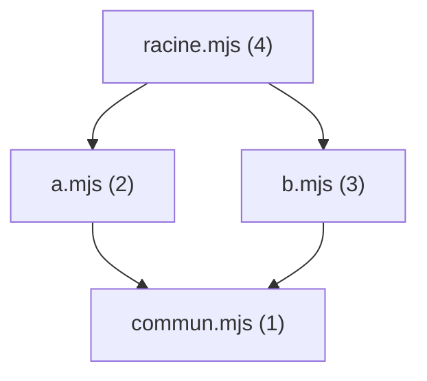

# 26 — Modules

> **Niveau** : Intermédiaire · **Durée** : ~3 h · **Prérequis** : [Fonctions](../06-fonctions/README.md), [async/await](../20-async-await/README.md)

Dès qu'un programme dépasse quelques centaines de lignes, il faut le découper en fichiers qui se partagent du code sans se marcher dessus. Les modules ES (ESM), standardisés en ES2015, sont aujourd'hui la réponse unique du langage : la même syntaxe `import`/`export` fonctionne dans les navigateurs, dans Node.js, dans Deno, dans Bun et dans tous les outils de build. Ce chapitre explique comment ils fonctionnent vraiment (liaisons vivantes, graphe, ordre d'évaluation), comment les utiliser dans le navigateur et dans Node.js, et ce que font les bundlers.

## Objectifs

- Découper un programme en modules avec `export` et `import` sous toutes leurs formes
- Choisir entre exports nommés et export par défaut, et organiser les réexportations
- Expliquer les liaisons vivantes, l'évaluation unique et l'ordre d'évaluation d'un graphe de modules
- Charger du code à la demande avec `import()`, utiliser `import.meta` et les import attributes
- Faire fonctionner des modules dans le navigateur (import maps, `modulepreload`) et dans Node.js (`"type"`, `exports`, `imports`, `require(esm)`)
- Lire du CommonJS et faire cohabiter les deux systèmes
- Comprendre le rôle d'un bundler (Vite, Rolldown, esbuild), du tree shaking et du code splitting

## Sommaire

- [Pourquoi des modules](#pourquoi-des-modules)
- [Premiers pas](#premiers-pas)
- [Exporter](#exporter)
- [Importer](#importer)
- [Exports nommés ou export par défaut](#exports-nommés-ou-export-par-défaut)
- [Réexporter et fichiers barrel](#réexporter-et-fichiers-barrel)
- [Ce qui change dans un module](#ce-qui-change-dans-un-module)
- [Les liaisons vivantes](#les-liaisons-vivantes)
- [Un module n'est évalué qu'une fois](#un-module-nest-évalué-quune-fois)
- [Le graphe de modules et l'ordre d'évaluation](#le-graphe-de-modules-et-lordre-dévaluation)
- [Import dynamique avec `import()`](#import-dynamique-avec-import)
- [Top-level await](#top-level-await)
- [`import.meta`](#importmeta)
- [Import attributes et modules JSON](#import-attributes-et-modules-json)
- [Les modules dans le navigateur](#les-modules-dans-le-navigateur)
- [Les modules dans Node.js](#les-modules-dans-nodejs)
- [Lire et utiliser du CommonJS](#lire-et-utiliser-du-commonjs)
- [Avant ESM, un peu d'histoire](#avant-esm-un-peu-dhistoire)
- [Bundlers et outils de build](#bundlers-et-outils-de-build)
- [Tree shaking et code splitting](#tree-shaking-et-code-splitting)
- [Dépendances circulaires](#dépendances-circulaires)
- [Organiser un projet](#organiser-un-projet)
- [L'exemple complet](#lexemple-complet)
- [Pièges courants](#pièges-courants)
- [Bonnes pratiques](#bonnes-pratiques)
- [Résumé](#résumé)
- [Exercices](#exercices)
- [Pour aller plus loin](#pour-aller-plus-loin)

## Pourquoi des modules

Avant les modules, une page chargeait plusieurs scripts classiques qui partageaient **une seule portée globale** :

```html
<!-- L'ordre compte : panier.js utilise une fonction définie dans prix.js -->
<script src="prix.js"></script>
<script src="panier.js"></script>
<script src="app.js"></script>
```

<!-- no-run -->
```js
// prix.js
var taux = 0.2;
function ttc(ht) {
  return ht * (1 + taux);
}

// panier.js — écrit par quelqu'un d'autre
var taux = 0.055; // ❌ écrase silencieusement le taux de prix.js
```

Trois problèmes en découlent :

1. **Collisions de noms** : toute variable de haut niveau devient globale, et deux fichiers peuvent s'écraser.
2. **Dépendances implicites** : rien n'indique que `panier.js` a besoin de `prix.js` ; seul l'ordre des balises le garantit.
3. **Pas d'encapsulation** : impossible de garder une fonction « privée » à un fichier.

Un module règle les trois : il a **sa propre portée**, il **déclare explicitement** ce dont il dépend (`import`) et ce qu'il expose (`export`). Tout le reste lui est privé.

## Premiers pas

Un module est simplement un fichier qui utilise `import` ou `export`. Voici deux fichiers :

<!-- no-run -->
```js
// prix.js
const TAUX_TVA = 0.2; // privé : non exporté

export function ttc(ht) {
  return ht * (1 + TAUX_TVA);
}
```

<!-- no-run -->
```js
// main.js
import { ttc } from "./prix.js";

console.log(ttc(100)); // 120
```

Pour l'exécuter :

- **Node.js** : placez un `package.json` contenant `{ "type": "module" }` à côté (ou nommez les fichiers `.mjs`), puis lancez `node main.js`.
- **Navigateur** : chargez le point d'entrée avec `<script type="module" src="main.js"></script>` et servez la page par HTTP (voir [plus bas](#les-modules-dans-le-navigateur)).

> [!NOTE]
> **Comment sont écrits les exemples de ce chapitre.** Les blocs de code de ce cours doivent rester exécutables d'un seul tenant. Quand un exemple a besoin de plusieurs fichiers, il les **crée avec `writeFile`**, puis les charge avec `await import(...)`. On ne peut pas utiliser un `import` statique à cet endroit : les imports statiques sont résolus *avant* l'exécution du fichier, donc avant que `writeFile` n'ait créé quoi que ce soit (la section [graphe de modules](#le-graphe-de-modules-et-lordre-dévaluation) explique pourquoi). Dans un vrai projet, chaque chaîne passée à `writeFile` serait un fichier séparé.

```js
import { writeFile } from "node:fs/promises";

// Crée le module prix.mjs dans le dossier courant…
await writeFile(
  "prix.mjs",
  `
const TAUX_TVA = 0.2;
export function ttc(ht) {
  return ht * (1 + TAUX_TVA);
}
`,
);

// …puis le charge.
const { ttc } = await import("./prix.mjs");
console.log(ttc(100)); // 120
```

## Exporter

Un module peut exporter des **liaisons** (variables, fonctions, classes) de plusieurs façons.

```js
// 1. Export « en ligne », devant la déclaration
export const DEVISE = "EUR";
export function arrondir(montant) {
  return Math.round(montant * 100) / 100;
}
export class Panier {
  articles = [];
}

// 2. Export groupé, en fin de fichier (souvent plus lisible : l'API publique est au même endroit)
const TAUX_NORMAL = 0.2;
const TAUX_REDUIT = 0.055;
export { TAUX_NORMAL, TAUX_REDUIT };

// 3. Export avec renommage
function calculerRemiseInterne(prix) {
  return prix * 0.9;
}
export { calculerRemiseInterne as appliquerRemise };

// 4. Export par défaut : au plus UN par module
export default function formaterPrix(montant) {
  return `${montant.toFixed(2)} €`;
}
```

Quelques règles :

- `export` n'est autorisé qu'au **niveau supérieur** du module, jamais dans un `if`, une fonction ou un bloc.
- `export default` peut être suivi d'une **expression** (`export default 42;`, `export default { a: 1 };`), alors que les exports nommés exigent une déclaration ou une liste.
- `export { x as default }` est équivalent à un export par défaut.
- Depuis ES2022, un nom exporté peut être une chaîne quelconque (`export { x as "nom avec espaces" }`). C'est surtout utile aux outils ; évitez-le dans votre code.

## Importer

Les formes d'import correspondent aux formes d'export. Les modules intégrés de Node.js (préfixe `node:`) permettent de les essayer sans créer de fichier :

```js
// Imports nommés : les noms doivent correspondre aux exports
import { join, extname } from "node:path";

// Renommage, pour éviter un conflit ou clarifier
import { join as joindreChemins } from "node:path";

// Import de l'espace de noms : un objet qui contient tous les exports
import * as path from "node:path";

// Import par défaut : le nom est libre
import EventEmitter from "node:events";

// Défaut + nommés dans la même instruction
import events, { once } from "node:events";

console.log(join("dossier", "fichier.txt")); // dossier/fichier.txt (dossier\fichier.txt sous Windows)
console.log(extname("photo.jpeg")); // .jpeg
console.log(joindreChemins("a", "b") === path.join("a", "b")); // true
console.log(EventEmitter === events); // true
console.log(typeof once); // function
```

Il existe aussi l'**import pour effet de bord**, qui exécute un module sans rien importer (polyfill, enregistrement d'un composant, feuille de style dans un bundler) :

<!-- no-run -->
```js
import "./polyfills.js";
import "./composants/bouton-favori.js"; // appelle customElements.define(...)
```

### Les spécificateurs

La chaîne après `from` s'appelle le **spécificateur**. Il en existe trois sortes :

| Sorte | Exemples | Résolu par |
| --- | --- | --- |
| Relatif | `"./prix.js"`, `"../lib/format.js"` | Résolution d'URL classique, à partir du module qui importe |
| Absolu (URL) | `"https://esm.sh/date-fns@4"`, `"file:///opt/app/x.js"`, `"node:fs"` | Tel quel (Node.js n'accepte pas `https:`) |
| « Nu » (*bare*) | `"date-fns"`, `"lit/decorators.js"`, `"#lib/prix.js"` | Node.js (`node_modules`, `package.json`), une import map dans le navigateur, ou un bundler |

> [!IMPORTANT]
> En ESM natif, **l'extension est obligatoire** dans un spécificateur relatif : `"./prix.js"`, pas `"./prix"`. Et un dossier ne se résout pas tout seul : `"./utils/index.js"`, pas `"./utils"`. Ces raccourcis viennent de CommonJS et des bundlers ; ils échouent dans le navigateur comme dans Node.js.

## Exports nommés ou export par défaut

| | Exports nommés | Export par défaut |
| --- | --- | --- |
| Nombre par module | Autant que nécessaire | Un seul |
| Nom à l'import | Imposé (renommage explicite avec `as`) | Libre |
| Autocomplétion, renommage automatique dans l'éditeur | Excellents | Moins fiables |
| Usage typique | Bibliothèque de fonctions, constantes | Le « sujet » unique du fichier, conventions d'outils (`vite.config.js`, composants chargés à la demande) |

Le nom libre de l'export par défaut est une fausse liberté : dans un gros projet, la même fonction finit importée sous trois noms différents, et une recherche dans le code ne la retrouve plus.

<!-- no-run -->
```js
// ❌ Trois fichiers, trois noms pour la même chose
import formater from "./format.js";
import fmt from "./format.js";
import formatPrice from "./format.js";

// ✅ Un nom unique, partout
import { formaterPrix } from "./format.js";
```

Recommandation : **préférez les exports nommés**, réservez l'export par défaut aux cas où un outil ou un framework l'attend. Et évitez de mélanger les deux pour une même valeur.

## Réexporter et fichiers barrel

Un module peut réexporter ce qu'un autre exporte, sans l'importer pour lui-même :

<!-- no-run -->
```js
// boutique/index.js
export { ttc, arrondir } from "./prix.js"; // réexport sélectif
export { default as formaterPrix } from "./format.js"; // défaut → nommé
export * from "./stock.js"; // tous les exports nommés (pas le défaut)
export * as livraison from "./livraison.js"; // ES2020 : regroupés dans un espace de noms
```

Un fichier qui ne fait que réexporter s'appelle un **barrel** (« tonneau ») : on importe ensuite tout depuis `./boutique/index.js`. C'est pratique, mais cela a un coût que l'on sous-estime souvent : **importer un seul nom depuis un barrel charge et évalue tous les modules qu'il réexporte**.

```js
import { writeFile } from "node:fs/promises";

await writeFile("prix.mjs", `console.log("prix.mjs évalué"); export const ttc = (ht) => ht * 1.2;`);
await writeFile("stock.mjs", `console.log("stock.mjs évalué"); export const stock = new Map();`);
await writeFile("graphiques.mjs", `console.log("graphiques.mjs évalué (module lourd)"); export const tracer = () => {};`);
await writeFile(
  "index.mjs",
  `export * from "./prix.mjs";
export * from "./stock.mjs";
export * from "./graphiques.mjs";`,
);

const { ttc } = await import("./index.mjs"); // on ne veut que ttc…
console.log(ttc(10)); // 12
// Affiché avant 12 :
// prix.mjs évalué
// stock.mjs évalué
// graphiques.mjs évalué (module lourd)
```

Un bundler en production peut éliminer le code inutile (voir [tree shaking](#tree-shaking-et-code-splitting)), mais seulement s'il est sûr que ces modules n'ont pas d'effets de bord. En développement (serveur Vite), dans les tests et dans Node.js, tout est chargé. Les barrels favorisent aussi les [dépendances circulaires](#dépendances-circulaires).

Règle pratique : un barrel est raisonnable **à la frontière d'un paquet** (son point d'entrée public) ; à l'intérieur d'une application, importez directement depuis le fichier qui définit la fonction.

## Ce qui change dans un module

Un fichier chargé comme module ne se comporte pas comme un script classique :

| | Script classique | Module |
| --- | --- | --- |
| Mode strict | Seulement avec `"use strict"` | Toujours |
| Variables de haut niveau | Globales (`var` et `function` deviennent des propriétés de `window`) | Locales au module |
| `this` au niveau supérieur | L'objet global | `undefined` |
| `import` / `export` | Interdits (erreur de syntaxe) | Autorisés |
| `await` au niveau supérieur | Interdit | Autorisé (ES2022) |
| Chargement dans le navigateur | Bloque l'analyse du HTML (sauf `defer`/`async`) | Différé (`defer`) par défaut |
| Exécution | À chaque balise `<script>` | Une seule fois par URL |

Ce bloc est lui-même exécuté comme un module :

```js
console.log(this); // undefined

try {
  totalGeneral = 42; // variable jamais déclarée
} catch (erreur) {
  console.log(erreur.name); // ReferenceError (le mode strict interdit les globales implicites)
}

const secret = "invisible ailleurs";
console.log(globalThis.secret); // undefined : une constante de module n'est pas globale
```

Les déclarations `import` sont **remontées** (*hoisted*) : elles sont traitées avant l'exécution de la première ligne, où qu'elles soient écrites au niveau supérieur. Par convention, on les place toutes en haut du fichier.

## Les liaisons vivantes

Un import n'est **pas une copie** : c'est une **liaison vivante** (*live binding*) vers la variable du module exportateur. Si le module modifie sa variable, l'importateur voit la nouvelle valeur.

```js
import { writeFile } from "node:fs/promises";

await writeFile(
  "compteur.mjs",
  `export let valeur = 0;
export function incrementer() {
  valeur++;
}`,
);

const compteur = await import("./compteur.mjs");
const { valeur } = compteur; // ⚠️ déstructurer COPIE la valeur du moment

compteur.incrementer();
compteur.incrementer();

console.log(compteur.valeur); // 2 : la liaison est vivante
console.log(valeur); // 0 : la copie, elle, n'a pas bougé
```

Avec un `import { valeur } from "./compteur.js"` statique, `valeur` serait bien vivante (elle vaudrait `2`). La copie vient ici de la déstructuration de l'objet module.

Une liaison importée est **en lecture seule** pour l'importateur : seul le module qui la déclare peut la réaffecter.

```js
import { writeFile } from "node:fs/promises";

await writeFile("compteur.mjs", `export let valeur = 0;`);
await writeFile(
  "tricheur.mjs",
  `import { valeur } from "./compteur.mjs";
try {
  valeur = 100;
} catch (erreur) {
  console.log(erreur.name + " : " + erreur.message);
}`,
);

await import("./tricheur.mjs"); // TypeError : Assignment to constant variable.

const espace = await import("./compteur.mjs");
console.log(Object.prototype.toString.call(espace)); // [object Module]
try {
  espace.valeur = 100;
} catch (erreur) {
  console.log(erreur.name); // TypeError : l'objet module est lui aussi en lecture seule
}
```

> [!TIP]
> Lecture seule ne veut pas dire immuable : si le module exporte un objet, l'importateur peut modifier ses propriétés (`config.langue = "en"`). C'est la même différence qu'entre `const` et `Object.freeze` (voir [Objets](../10-objets/README.md)).

## Un module n'est évalué qu'une fois

Quel que soit le nombre de fichiers qui l'importent, un module est **évalué une seule fois** ; tous reçoivent le même objet module. C'est ce qui rend naturel le partage d'état et le **singleton** :

```js
import { writeFile } from "node:fs/promises";

await writeFile(
  "panier.mjs",
  `console.log("panier.mjs évalué");
const articles = [];
export function ajouter(article) { articles.push(article); }
export function contenu() { return [...articles]; }`,
);
await writeFile("page-produit.mjs", `import { ajouter } from "./panier.mjs"; ajouter("Clavier");`);
await writeFile("bandeau.mjs", `import { ajouter } from "./panier.mjs"; ajouter("Souris");`);

await import("./page-produit.mjs"); // panier.mjs évalué (une seule fois)
await import("./bandeau.mjs");

const panier = await import("./panier.mjs");
console.log(panier.contenu()); // [ 'Clavier', 'Souris' ]
console.log(panier === (await import("./panier.mjs"))); // true
```

Pas besoin de classe ni de motif compliqué : **un module est déjà un singleton**.

Attention, l'unicité est liée à l'**URL résolue**, pas au fichier sur le disque. Une requête différente (`?v=2`) ou un même paquet installé deux fois dans `node_modules` donnent deux instances distinctes, avec chacune son état :

```js
import { writeFile } from "node:fs/promises";

await writeFile("etat.mjs", `export const identifiant = Math.random();`);

const a = await import("./etat.mjs");
const b = await import("./etat.mjs");
const c = await import("./etat.mjs?v=2");

console.log(a.identifiant === b.identifiant); // true
console.log(a.identifiant === c.identifiant); // false : autre URL, autre instance
```

## Le graphe de modules et l'ordre d'évaluation

Les imports statiques forment un **graphe**. Le moteur le traite en trois phases, avant d'exécuter la moindre ligne de votre code :


C'est pour cela que les imports statiques doivent être **analysables sans exécuter le code** : un spécificateur est une chaîne littérale, et `import` ne peut pas être dans un `if`. En échange, les outils connaissent tout le graphe à l'avance : erreurs détectées avant l'exécution, téléchargements en parallèle, tree shaking.

L'évaluation se fait **en profondeur, dépendances d'abord**, dans l'ordre des `import` :



```js
import { writeFile } from "node:fs/promises";

await writeFile("commun.mjs", `console.log("commun");`);
await writeFile("a.mjs", `import "./commun.mjs"; console.log("a");`);
await writeFile("b.mjs", `import "./commun.mjs"; console.log("b");`);
await writeFile("racine.mjs", `import "./a.mjs"; import "./b.mjs"; console.log("racine");`);

await import("./racine.mjs");
// commun
// a
// b
// racine
```

`commun.mjs`, importé deux fois, n'est évalué qu'une fois, et avant ceux qui en dépendent.

## Import dynamique avec `import()`

`import(specificateur)` (ES2020) est une **expression** : elle peut apparaître n'importe où (dans une fonction, un `if`, un gestionnaire d'événement), accepte un spécificateur calculé, et renvoie une **promesse** de l'objet module. Elle fonctionne aussi dans les scripts classiques et dans CommonJS.

Cas d'usage :

- **Charger à la demande** une fonctionnalité lourde (éditeur, graphiques, export PDF) seulement quand l'utilisateur en a besoin ;
- **Choisir une implémentation** à l'exécution (langue, plateforme) ;
- **Charger un module ESM depuis CommonJS**.

<!-- no-run -->
```js
// Navigateur : la bibliothèque de graphiques n'est téléchargée qu'au premier clic
boutonStatistiques.addEventListener("click", async () => {
  const { tracerGraphique } = await import("./graphiques.js");
  tracerGraphique(donnees);
});
```

L'objet obtenu est l'espace de noms : l'export par défaut est dans sa propriété `default`.

```js
import { writeFile } from "node:fs/promises";

await writeFile("fr.mjs", `export default { bonjour: "Bonjour", panier: "Votre panier" };`);
await writeFile("en.mjs", `export default { bonjour: "Hello", panier: "Your cart" };`);

// Liste blanche : on ne charge jamais un chemin construit à partir d'une saisie brute
const traductions = {
  fr: () => import("./fr.mjs"),
  en: () => import("./en.mjs"),
};

async function chargerTraductions(langue) {
  const chargeur = traductions[langue] ?? traductions.fr;
  const module = await chargeur();
  return module.default;
}

console.log((await chargerTraductions("en")).bonjour); // Hello
console.log((await chargerTraductions("de")).bonjour); // Bonjour (repli sur le français)
```

> [!WARNING]
> Ne passez jamais une saisie utilisateur directement à `import()` (`import(\`./pages/${saisie}.js\`)`) : c'est une porte ouverte au chargement de code arbitraire. Utilisez une table de correspondance comme ci-dessus. Bonus : les bundlers savent analyser des `import("./fr.js")` littéraux et en faire des fichiers séparés, alors qu'un chemin entièrement calculé leur est opaque.

## Top-level await

Depuis ES2022, `await` est permis au **niveau supérieur d'un module** (pas dans un script classique). Les modules qui l'importent **attendent** la fin de son évaluation :

```js
import { writeFile } from "node:fs/promises";

await writeFile(
  "config.mjs",
  `console.log("config : début du chargement");
await new Promise((resolve) => setTimeout(resolve, 100)); // simule une lecture lente
export const config = { pret: true };
console.log("config : prête");`,
);
await writeFile("app.mjs", `import { config } from "./config.mjs"; console.log("app démarre, config.pret =", config.pret);`);

await import("./app.mjs");
// config : début du chargement
// config : prête
// app démarre, config.pret = true
```

C'est idéal dans un point d'entrée ou un script (ce bloc l'utilise déjà pour `await writeFile`). Dans un module de bibliothèque, c'est à manier avec précaution : un `await` lent bloque **tout ce qui dépend du module**, et un module qui en contient ne peut pas être chargé avec `require()` (voir [`require(esm)`](#lire-et-utiliser-du-commonjs)). Le détail d'`async`/`await` est au chapitre [20](../20-async-await/README.md).

Côté navigateurs, le top-level await fonctionne depuis 2021 dans Chrome et Firefox (89) ; Safari l'implémente depuis la version 15, mais MDN ne le considère complet qu'à partir de Safari 27, à cause d'un bug quand plusieurs modules importent en même temps un module qui attend.

## `import.meta`

`import.meta` (ES2020) est un objet propre à chaque module, rempli par l'environnement.

| Propriété | Où | Contenu |
| --- | --- | --- |
| `import.meta.url` | Partout | L'URL du module (`https://…` ou `file:///…`) |
| `import.meta.resolve(spec)` | Navigateurs (Baseline 2023), Node.js, Deno, Bun | L'URL que donnerait `import(spec)` depuis ce module, sans le charger |
| `import.meta.dirname`, `import.meta.filename` | Node.js 20.11+ (stables depuis 22.16 et 24.0), Deno, Bun | Le dossier et le chemin du fichier, l'équivalent de `__dirname` et `__filename` |
| `import.meta.main` | Node.js 24.2+ et 22.18+ (stabilité 1.0, développement précoce), Deno, Bun | `true` si ce module est le point d'entrée du processus |
| `import.meta.env`, `import.meta.glob` | Vite (ajouts de l'outil, pas du standard) | Variables d'environnement, import groupé de fichiers |

```js
import path from "node:path";

console.log(import.meta.url.startsWith("file:///")); // true
console.log(path.basename(import.meta.filename)); // bloc.mjs (le nom de ce fichier)
console.log(import.meta.dirname === path.dirname(import.meta.filename)); // true
console.log(import.meta.resolve("./donnees.json").endsWith("/donnees.json")); // true
```

Le motif le plus utile, qui fonctionne **à la fois dans le navigateur, dans Node.js et dans les bundlers**, consiste à localiser une ressource par rapport au module plutôt que par rapport au dossier courant :

```js
import { readFile, writeFile } from "node:fs/promises";

await writeFile(new URL("./message.txt", import.meta.url), "Bonjour depuis un fichier voisin");

// Relatif au MODULE, pas au dossier depuis lequel on a lancé node
const urlMessage = new URL("./message.txt", import.meta.url);
console.log(await readFile(urlMessage, "utf8")); // Bonjour depuis un fichier voisin
```

Dans le navigateur, on écrirait `fetch(new URL("./message.txt", import.meta.url))`, et Vite reconnaît ce motif pour copier le fichier dans le build.

## Import attributes et modules JSON

Les **import attributes** (ES2025) ajoutent des informations à un import avec le mot-clé `with`. Le seul attribut standard aujourd'hui est `type`, et son usage principal est d'importer du **JSON** :

<!-- no-run -->
```js
import parametres from "./parametres.json" with { type: "json" };
```

L'attribut est **obligatoire** : il garantit que le fichier sera traité comme des données et jamais exécuté, même si le serveur renvoie par erreur (ou par malveillance) du JavaScript.

```js
import { writeFile } from "node:fs/promises";

await writeFile("parametres.json", JSON.stringify({ langue: "fr", articlesParPage: 20 }));

// Version dynamique : l'attribut passe dans le second argument
const { default: parametres } = await import("./parametres.json", { with: { type: "json" } });
console.log(parametres.articlesParPage); // 20

try {
  await import("./parametres.json?sans-attribut"); // sans `with`
} catch (erreur) {
  console.log(erreur.code); // ERR_IMPORT_ATTRIBUTE_MISSING
}
```

Un module JSON n'a **qu'un export par défaut** : `import { langue } from "./parametres.json" with { type: "json" }` est une erreur. Et comme tout module, il n'est évalué qu'une fois : tous les importateurs partagent le **même objet**, qu'ils peuvent donc modifier les uns pour les autres.

Disponibilité (novembre 2026) :

- JSON : Chrome/Edge 123, Firefox 138, Safari 17.2 (Baseline 2025) ; Node.js 18.20+/20.10+ (stable depuis 22.12), Deno, Bun.
- CSS (`with { type: "css" }`, renvoie une `CSSStyleSheet`) : Chrome/Edge 123 et Firefox 147, pas encore Safari.
- Texte (`with { type: "text" }`, proposition TC39 de stade 3) : commence à arriver dans les navigateurs ; dans Node.js 26, derrière le drapeau `--experimental-import-text`.

> [!NOTE]
> Vous croiserez peut-être l'ancienne syntaxe `assert { type: "json" }` (*import assertions*). Elle a été abandonnée au profit de `with` et n'est plus acceptée par Node.js depuis la version 22 ni par les navigateurs actuels.

## Les modules dans le navigateur

```html
<!doctype html>
<html lang="fr">
  <head>
    <meta charset="utf-8" />
    <title>Boutique</title>
    <!-- Différé automatiquement : pas besoin de defer ni de le placer en bas de page -->
    <script type="module" src="./src/main.js"></script>
  </head>
  <body>
    <script type="module">
      // Un module en ligne peut aussi importer
      import { ttc } from "./src/prix.js";
      document.body.append(`Prix TTC : ${ttc(10)} €`);
    </script>
  </body>
</html>
```

Ce qu'il faut savoir :

- **Différé par défaut** : un module est téléchargé en parallèle de l'analyse du HTML et exécuté une fois le document analysé, dans l'ordre des balises (comme `defer`). L'attribut `async` le fait s'exécuter dès qu'il est prêt, sans attendre.
- **Une seule exécution par URL**, même si deux balises le chargent.
- **CORS** : les modules sont chargés en mode CORS. Un module d'un autre domaine doit être servi avec l'en-tête `Access-Control-Allow-Origin` (voir [Fetch et HTTP](../22-fetch-http/README.md)).
- **Type MIME** : le serveur doit répondre avec un type JavaScript (`text/javascript`), sinon le navigateur refuse le module.
- **Pas de `file://`** : ouvrir le fichier HTML par un double clic échoue dans les navigateurs actuels. Servez le dossier, par exemple avec `npx vite` ou `python3 -m http.server`.
- **L'attribut `nomodule`** servait à fournir un repli aux navigateurs sans modules : il est inutile aujourd'hui, tous les navigateurs les gèrent depuis 2018.

### Import maps

Le navigateur ne sait pas résoudre un spécificateur nu comme `"date-fns"` : il n'a pas de `node_modules`. Une **import map** (Baseline 2023, largement disponible) lui fournit la correspondance :

```html
<!-- Doit précéder tout module qui utilise ces noms -->
<script type="importmap">
  {
    "imports": {
      "date-fns": "https://cdn.jsdelivr.net/npm/date-fns@4/+esm",
      "#lib/": "./src/lib/"
    }
  }
</script>

<script type="module">
  import { formatDistanceToNow } from "date-fns";
  import { ttc } from "#lib/prix.js"; // → ./src/lib/prix.js (préfixe terminé par /)
  console.log(formatDistanceToNow(new Date(2026, 0, 1)), ttc(10));
</script>
```

- Une clé terminée par `/` est un **préfixe** : `"#lib/"` couvre `#lib/prix.js`, `#lib/format.js`…
- `"scopes"` permet de rediriger un nom seulement pour certains chemins (deux versions d'une même bibliothèque).
- `"integrity"` associe une empreinte SRI aux URL (Chrome 127, Firefox 138, Safari 18).
- Plusieurs import maps dans une même page ne sont acceptées que par Chrome 133+ et Safari 18.4+ ; prévoyez-en une seule.

Les import maps permettent de se passer de bundler pour un petit site, et certains frameworks en ont fait leur mode par défaut (Ruby on Rails depuis la version 7). Pour une application plus grosse, voir [Bundlers](#bundlers-et-outils-de-build).

### Précharger les dépendances

Le navigateur ne découvre les imports d'un module qu'après l'avoir téléchargé et analysé : un graphe profond provoque une **cascade** de requêtes (`main.js`, puis `prix.js`, puis ce que `prix.js` importe…). `<link rel="modulepreload">` (Baseline largement disponible depuis 2026) annonce les fichiers à l'avance ; le navigateur les télécharge et les analyse en parallèle :

```html
<link rel="modulepreload" href="./src/lib/prix.js" />
<link rel="modulepreload" href="./src/lib/format.js" />
<script type="module" src="./src/main.js"></script>
```

Les bundlers génèrent ces balises automatiquement.

Enfin, les workers acceptent eux aussi les modules : `new Worker("./calcul.js", { type: "module" })` (Baseline largement disponible).

## Les modules dans Node.js

Node.js gère deux systèmes : les modules ES et l'ancien système **CommonJS** (`require`). Pour chaque fichier, il décide ainsi :

| Fichier | Traité comme |
| --- | --- |
| `.mjs` | Module ES, toujours |
| `.cjs` | CommonJS, toujours |
| `.js` avec `"type": "module"` dans le `package.json` le plus proche | Module ES |
| `.js` avec `"type": "commonjs"` | CommonJS |
| `.js` sans champ `"type"` | Détection : module ES s'il contient `import`, `export`, `import.meta` ou un `await` de haut niveau, sinon CommonJS (depuis Node.js 22.7 et 20.19) |

✅ Déclarez toujours explicitement `"type": "module"` dans vos projets : c'est plus rapide (pas de détection) et sans ambiguïté.

```json
{
  "name": "boutique",
  "version": "1.0.0",
  "type": "module"
}
```

Dans un module ES sous Node.js :

- les modules intégrés s'importent de préférence avec le préfixe `node:` (`import { readFile } from "node:fs/promises"`), obligatoire pour les plus récents (`node:test`, `node:sqlite`) ;
- l'extension est obligatoire dans les chemins relatifs, comme dans le navigateur ;
- `require`, `module`, `exports`, `__dirname` et `__filename` n'existent pas : utilisez `import`, `import.meta.dirname` et `import.meta.filename` ;
- les fichiers JSON s'importent avec `with { type: "json" }`.

```js
import { readFile, writeFile } from "node:fs/promises";
import { createRequire } from "node:module";

try {
  console.log(__dirname);
} catch (erreur) {
  console.log(erreur.name); // ReferenceError : __dirname n'existe pas en ESM
}

// Si vous avez vraiment besoin de require (paquet CommonJS ancien, résolution à la CommonJS) :
const require = createRequire(import.meta.url);

await writeFile("vieux.json", '{ "ok": true }');
console.log(require("./vieux.json").ok); // true
console.log(JSON.parse(await readFile("vieux.json", "utf8")).ok); // true : souvent plus simple
```

### Les champs `exports` et `imports`

Le champ **`exports`** du `package.json` définit l'**API publique** d'un paquet : seuls les chemins listés peuvent être importés de l'extérieur. Il remplace l'ancien champ `main` et prime sur lui.

```json
{
  "name": "mon-paquet",
  "type": "module",
  "exports": {
    ".": "./src/index.js",
    "./outils": "./src/outils.js",
    "./package.json": "./package.json"
  }
}
```

Avec cette configuration, `import "mon-paquet"` et `import "mon-paquet/outils"` fonctionnent, mais un import « profond » vers un fichier interne est refusé :

```js
import { mkdir, writeFile } from "node:fs/promises";

// Simule un paquet installé dans node_modules
await mkdir("node_modules/mon-paquet/src/interne", { recursive: true });
await writeFile(
  "node_modules/mon-paquet/package.json",
  JSON.stringify({
    name: "mon-paquet",
    type: "module",
    exports: { ".": "./src/index.js", "./outils": "./src/outils.js" },
  }),
);
await writeFile("node_modules/mon-paquet/src/index.js", `export const nom = "mon-paquet";`);
await writeFile("node_modules/mon-paquet/src/outils.js", `export const version = "1.0.0";`);
await writeFile("node_modules/mon-paquet/src/interne/cache.js", `export const cache = new Map();`);

console.log((await import("mon-paquet")).nom); // mon-paquet
console.log((await import("mon-paquet/outils")).version); // 1.0.0

try {
  await import("mon-paquet/src/interne/cache.js");
} catch (erreur) {
  console.log(erreur.code); // ERR_PACKAGE_PATH_NOT_EXPORTED
}
```

`exports` accepte aussi des **conditions**, testées dans l'ordre d'écriture, pour fournir des fichiers différents selon le contexte :

```json
{
  "exports": {
    ".": {
      "types": "./dist/index.d.ts",
      "browser": "./dist/navigateur.js",
      "node": "./dist/node.js",
      "default": "./dist/index.js"
    }
  }
}
```

`"import"` et `"require"` permettent de livrer une version ESM et une version CommonJS d'un même paquet. Cette pratique (paquet « dual ») est de moins en moins nécessaire : depuis Node.js 20.19 et 22.12, CommonJS peut charger directement de l'ESM (voir ci-dessous), et publier **uniquement en ESM** évite d'avoir deux copies du même code qui coexistent (*dual package hazard*). `"types"` (lu par TypeScript) se place en premier et `"default"` toujours en dernier.

Le champ **`imports`** crée des **alias privés** au paquet, qui commencent obligatoirement par `#`. Fini les `../../../lib/prix.js` :

```json
{
  "type": "module",
  "imports": {
    "#lib/*": "./src/lib/*",
    "#config": "./config/production.js"
  }
}
```

<!-- no-run -->
```js
// src/pages/commande/resume.js
import { ttc } from "#lib/prix.js"; // → ./src/lib/prix.js, depuis n'importe quel dossier
import config from "#config";
```

Ces alias sont standard : Node.js, Vite, esbuild, TypeScript (`moduleResolution: "nodenext"` ou `"bundler"`) et les autres outils les comprennent, et une import map peut reproduire les mêmes noms dans le navigateur ([l'exemple complet](#lexemple-complet) le fait). Depuis Node.js 25.4 et 24.14, un alias peut aussi commencer par `#/` (`"#/*": "./src/*"`).

## Lire et utiliser du CommonJS

CommonJS est le système historique de Node.js (2009). Vous le rencontrerez dans des paquets npm, d'anciens projets et des fichiers de configuration :

<!-- no-run -->
```js
// prix.cjs
const TAUX_TVA = 0.2;

function ttc(ht) {
  return ht * (1 + TAUX_TVA);
}

module.exports = { ttc }; // ce que renvoie require

// main.cjs
const { ttc } = require("./prix.cjs"); // synchrone, extension facultative en CommonJS
const path = require("node:path");

console.log(ttc(100), path.basename(__filename));
```

Ce qui le distingue de l'ESM :

| | CommonJS | Modules ES |
| --- | --- | --- |
| Syntaxe | `require()`, `module.exports`, `exports` | `import`, `export` |
| Chargement | Synchrone, à l'exécution | Asynchrone, graphe analysé avant l'exécution |
| `require`/`import` conditionnel | Possible partout | Seulement avec `import()` |
| Valeurs importées | **Copie** de `module.exports` au moment du `require` | Liaisons vivantes |
| Extensions, dossiers | Facultatives (`require("./prix")`, `require("./utils")` → `index.js`) | Obligatoires |
| `this` au niveau supérieur | `module.exports` | `undefined` |
| Navigateur | Non (bundler obligatoire) | Natif |

Le piège classique : réaffecter `exports` au lieu de `module.exports`.

<!-- no-run -->
```js
// ❌ exports n'est qu'une variable qui pointe vers module.exports : on coupe le lien
exports = { ttc };

// ✅
module.exports = { ttc };
// ✅ ou ajouter des propriétés
exports.ttc = ttc;
```

### Faire cohabiter les deux

**ESM qui importe du CommonJS** : ça marche. `module.exports` devient l'export par défaut ; Node.js tente en plus de deviner des exports nommés par analyse statique, mais seulement pour des formes simples (`exports.nom = …`).

```js
import { writeFile } from "node:fs/promises";

await writeFile(
  "ancien.cjs",
  `exports.saluer = (nom) => "Bonjour " + nom;
exports.version = 2;`,
);

const ancien = await import("./ancien.cjs");
console.log(ancien.default.version); // 2 : module.exports complet
console.log(ancien.saluer("Léa")); // Bonjour Léa : export nommé détecté
```

**CommonJS qui charge de l'ESM** : depuis Node.js 22.12 et 20.19, `require()` peut charger un module ES **synchrone** (sans top-level await) et renvoie son espace de noms. Cette fonctionnalité, appelée `require(esm)`, est stable depuis Node.js 25.4. Pour un module qui utilise top-level await, il reste `await import()`.

```js
import { writeFile } from "node:fs/promises";
import { execFileSync } from "node:child_process";

await writeFile("moderne.mjs", `export function doubler(x) { return x * 2; }`);
await writeFile("client.cjs", `const { doubler } = require("./moderne.mjs"); console.log(doubler(21));`);

// Lance client.cjs dans un autre processus Node.js
console.log(execFileSync(process.execPath, ["client.cjs"], { encoding: "utf8" }).trim()); // 42
```

Et la différence de sémantique, visible : CommonJS **copie**, ESM **lie**.

```js
import { writeFile } from "node:fs/promises";
import { createRequire } from "node:module";

await writeFile(
  "compteur.cjs",
  `let valeur = 0;
module.exports = { valeur, incrementer() { valeur++; } };`,
);

const require = createRequire(import.meta.url);
const compteur = require("./compteur.cjs");
compteur.incrementer();
console.log(compteur.valeur); // 0 : module.exports a reçu une COPIE de valeur
```

## Avant ESM, un peu d'histoire

Vous croiserez encore ces formats dans du code ancien ou dans des bibliothèques compilées :

| Période | Format | Principe |
| --- | --- | --- |
| Années 2000 | Espaces de noms, IIFE | Une fonction exécutée immédiatement crée une portée privée et renvoie un objet public (`var MonAppli = (function () { … })();`) |
| 2009 | CommonJS | `require`/`module.exports`, synchrone, pensé pour le serveur (Node.js) |
| 2011 | AMD (RequireJS) | `define([dépendances], fabrique)`, asynchrone, pensé pour le navigateur |
| 2013 | UMD | Un emballage qui détecte AMD, CommonJS ou une globale, pour publier un seul fichier |
| 2015 | Modules ES | Standard du langage (ES2015) ; navigateurs en 2017-2018, Node.js en 2019-2020 |

<details>
<summary>À quoi ressemble un fichier UMD (pour le reconnaître)</summary>

<!-- no-run -->
```js
(function (racine, fabrique) {
  if (typeof define === "function" && define.amd) define([], fabrique); // AMD
  else if (typeof module === "object" && module.exports) module.exports = fabrique(); // CommonJS
  else racine.prix = fabrique(); // globale du navigateur
})(this, function () {
  return { ttc: (ht) => ht * 1.2 };
});
```

</details>

N'écrivez plus de nouveau code dans ces formats : l'ESM fonctionne partout, et les bundlers savent produire de l'IIFE ou du CommonJS si une cible ancienne l'exige.

## Bundlers et outils de build

Si les navigateurs comprennent les modules, pourquoi « bundler » (regrouper) le code ? Parce qu'en production on veut :

- **moins de requêtes** et pas de cascade d'imports (voir [modulepreload](#précharger-les-dépendances)) ;
- **utiliser des paquets npm** écrits avec des spécificateurs nus, parfois en CommonJS ;
- **éliminer le code mort** ([tree shaking](#tree-shaking-et-code-splitting)) et **minifier** ;
- **découper** l'application en morceaux chargés à la demande ;
- **transformer** ce que le navigateur ne lit pas : TypeScript, JSX, CSS importé depuis JavaScript, images…

État des principaux outils en novembre 2026 (versions vérifiées sur npm) :

| Outil | Version | En bref |
| --- | --- | --- |
| [Vite](https://vite.dev/) | 8.3 | Serveur de développement + build. Depuis Vite 8 (mars 2026), un seul moteur pour les deux : **Rolldown** pour le regroupement et **Oxc** pour les transformations (avant : esbuild en développement, Rollup en production). Le choix par défaut pour une application web. |
| [Rolldown](https://rolldown.rs/) | 1.3 | Bundler écrit en Rust, compatible avec l'API et les plugins de Rollup ; version 1.0 stable en mai 2026. |
| [Rollup](https://rollupjs.org/) | 4.x | Le bundler historique « ESM d'abord », toujours maintenu, très utilisé pour publier des bibliothèques. |
| [esbuild](https://esbuild.github.io/) | 0.28 | Écrit en Go, extrêmement rapide, toujours en 0.x. Parfait pour des scripts, des outils, du code Node.js. |
| [webpack](https://webpack.js.org/) | 5.x | Le plus répandu dans les projets existants, très configurable. [Rspack](https://rspack.rs/) (2.x) est un équivalent compatible écrit en Rust. |
| [Parcel](https://parceljs.org/) | 2.x | Zéro configuration. |

Les commandes de base (le chapitre [Outillage](../28-outillage/README.md) détaille la création d'un projet Vite) :

```bash
npm create vite@latest      # crée un projet
npx vite                    # serveur de développement, rechargement instantané
npx vite build              # build de production dans dist/
npx vite preview            # sert dist/ pour vérifier le build

# esbuild : regrouper un outil Node.js en un seul fichier
npx esbuild src/main.js --bundle --platform=node --format=esm --outfile=dist/main.js
```

> [!TIP]
> Pour un petit site sans dépendances npm, des modules natifs et une import map suffisent souvent. Le bundler devient rentable dès que l'application grossit ou utilise des paquets npm.

## Tree shaking et code splitting

Le **tree shaking** consiste à retirer du bundle les exports que personne n'importe. Il n'est possible que parce que les imports ESM sont **statiques** : le bundler connaît, sans exécuter le code, la liste exacte de ce qui est utilisé.

Avec ces deux fichiers :

<!-- no-run -->
```js
// outils.js
export function utilisee(x) {
  return x * 2;
}

export function inutilisee(x) {
  return x * 3;
}

console.log("outils.js chargé"); // effet de bord
export const cache = creerCache(); // appel de fonction : effets inconnus
export const cachePur = /* @__PURE__ */ creerCache(); // annoté « sans effet »

function creerCache() {
  return new Map();
}

// main.js
import { utilisee } from "./outils.js";
console.log(utilisee(21));
```

`npx esbuild main.js --bundle --format=esm` produit :

<!-- no-run -->
```js
// outils.js
function utilisee(x) {
  return x * 2;
}
console.log("outils.js charg\xE9");
var cache = creerCache();
function creerCache() {
  return /* @__PURE__ */ new Map();
}

// main.js
console.log(utilisee(21));
```

- `inutilisee` et `cachePur` ont disparu.
- Le `console.log` et l'appel `creerCache()` non annoté sont **conservés** : le bundler ne peut pas prouver qu'ils sont sans effet. (Rolldown, qui analyse plus finement, supprime aussi `cache` ici : chaque outil a ses propres capacités d'analyse.)

Ce qui empêche le tree shaking :

- du code avec **effets de bord** au niveau supérieur des modules (modifier un prototype, enregistrer un composant, écrire dans `window`) ;
- du **CommonJS**, dont les exports ne sont connus qu'à l'exécution ;
- un accès dynamique à un espace de noms (`outils[nomCalcule]`).

Un paquet sans effets de bord le déclare dans son `package.json` avec `"sideEffects": false` (ou la liste des fichiers qui en ont : `"sideEffects": ["*.css"]`), une convention lue par webpack, Rollup, Rolldown, Vite et esbuild.

Le **code splitting** est l'opération inverse : découper le bundle en plusieurs fichiers (*chunks*). Chaque `import()` littéral devient un point de découpe. Sur [l'exemple complet](#lexemple-complet), `npx vite build` place le module d'export CSV, chargé par `import()`, dans son propre fichier (les empreintes des noms varient) :

```text
dist/index.html                0.61 kB │ gzip: 0.37 kB
dist/assets/csv-CiphJCqv.js    0.19 kB │ gzip: 0.17 kB
dist/assets/index-DJM6kjAv.js  3.27 kB │ gzip: 1.53 kB
```

Les applications découpent typiquement **par page** (chaque route charge son module) et **par fonctionnalité lourde**.

## Dépendances circulaires

Quand `a.js` importe `b.js` qui importe `a.js`, le graphe a un cycle. L'ESM le tolère, mais un des deux modules s'exécute forcément **avant** que l'autre ait initialisé ses variables :

```js
import { writeFile } from "node:fs/promises";

await writeFile(
  "a.mjs",
  `import { b } from "./b.mjs";
export const a = "A";
console.log("a voit b =", b);`,
);
await writeFile(
  "b.mjs",
  `import { a } from "./a.mjs";
export const b = "B";
try {
  console.log("b voit a =", a);
} catch (erreur) {
  console.log("b :", erreur.name, "-", erreur.message);
}`,
);

await import("./a.mjs");
// b : ReferenceError - Cannot access 'a' before initialization
// a voit b = B
```

On entre par `a.mjs`, qui importe d'abord `b.mjs` : `b.mjs` est donc évalué en premier, quand la constante `a` est encore dans sa zone morte temporelle (voir [Variables](../02-variables/README.md)).

Les **déclarations de fonction**, elles, sont initialisées dès la phase de liaison. Un cycle entre fonctions qui ne s'appellent qu'à l'exécution fonctionne donc :

```js
import { writeFile } from "node:fs/promises";

await writeFile(
  "pair.mjs",
  `import { estImpair } from "./impair.mjs";
export function estPair(n) { return n === 0 ? true : estImpair(n - 1); }`,
);
await writeFile(
  "impair.mjs",
  `import { estPair } from "./pair.mjs";
export function estImpair(n) { return n === 0 ? false : estPair(n - 1); }`,
);

const { estPair } = await import("./pair.mjs");
console.log(estPair(10), estPair(7)); // true false
```

Pour éviter les cycles problématiques :

1. **Extraire** la partie commune dans un troisième module dont dépendent les deux autres ;
2. **N'accéder aux imports que dans des fonctions**, pas au niveau supérieur ;
3. **Repérer** les cycles avec un outil : `madge --circular src/`, ou la règle `import/no-cycle` d'ESLint (paquets `eslint-plugin-import` ou `eslint-plugin-import-x`).

Les barrels sont une source fréquente de cycles : `composants/bouton.js` importe `../composants/index.js`, qui réexporte… `bouton.js`.

## Organiser un projet

Quelques principes qui tiennent dans la durée :

- **Un module, une responsabilité** : `prix.js` calcule des prix, il ne fait pas de requêtes réseau.
- **Exporter le minimum** : ce qui n'est pas exporté peut être modifié sans casser personne.
- **Regrouper par fonctionnalité** plutôt que par type de fichier quand le projet grandit :

```text
src/
├── main.js                 point d'entrée : branche les modules entre eux
├── catalogue/
│   ├── recherche.js
│   └── filtres.js
├── panier/
│   ├── panier.js
│   ├── prix.js
│   └── prix.test.js        le test à côté du code testé
└── lib/                    utilitaires sans lien avec le métier
    ├── format.js
    └── journal.js
```

- **Isoler les effets** : les modules de `lib/` et de logique métier ne touchent ni au DOM ni au système de fichiers ; seul le point d'entrée le fait. Ils deviennent réutilisables entre navigateur et Node.js, et faciles à tester (voir [Tests](../29-tests/README.md)).
- **Des alias plutôt que des `../../..`** : champ `imports` de Node.js (`#lib/*`), repris par une import map dans le navigateur.
- **Nommer les fichiers en kebab-case** (`bouton-favori.js`) : certains systèmes de fichiers ignorent la casse, d'autres non, et `Prix.js` importé comme `./prix.js` peut marcher sur votre machine et échouer en production.

## L'exemple complet

Le dossier [`exemple/`](exemple/) réunit les notions du chapitre dans une petite application qui fonctionne **sans modification** dans Node.js et dans le navigateur :

```text
exemple/
├── package.json            "type": "module" + alias "#lib/*" (champ imports)
├── index.html              import map qui reproduit l'alias #lib/ pour le navigateur
├── donnees/panier.json     importé avec with { type: "json" }
└── src/
    ├── main.js             point d'entrée Node.js : import() conditionnel, import.meta.filename
    ├── navigateur.js       point d'entrée navigateur : import() au clic
    ├── recapitulatif.js    code partagé
    └── lib/
        ├── prix.js         exports nommés
        ├── format.js       export par défaut
        ├── journal.js      état partagé (singleton)
        └── csv.js          chargé à la demande
```

```bash
cd 26-modules/exemple
node --run start            # ou : npm start
node --run csv              # ajoute l'export CSV, chargé avec import()
python3 -m http.server      # puis ouvrez http://localhost:8000 (ou : npx vite)
```

Dans l'onglet Réseau des outils de développement, observez la cascade : `navigateur.js`, puis `recapitulatif.js`, puis ses dépendances, et `csv.js` seulement au clic sur le bouton.

## Pièges courants

- **Oublier l'extension** : `import { ttc } from "./prix"` fonctionne avec certains bundlers mais pas en ESM natif. Écrivez `"./prix.js"`.
- **Importer un dossier** : `"./utils"` ne trouve pas `utils/index.js` tout seul.
- **Ouvrir la page en `file://`** : les modules ne se chargent pas. Servez-la par HTTP.
- **Confondre défaut et nommé** : `import formaterPrix from "./format.js"` alors que le module fait `export function formaterPrix` donne une erreur de type « does not provide an export named 'default' ». Et inversement.
- **Croire que l'import est une copie** : un import est une liaison vivante… sauf si vous déstructurez l'objet renvoyé par `import()`.
- **Réaffecter un import** : `valeur = 3` sur une liaison importée lève une `TypeError`.
- **Attendre une nouvelle instance** : un module importé dix fois n'est évalué qu'une fois ; son état est partagé.
- **Utiliser `__dirname` ou `require` en ESM** : remplacez-les par `import.meta.dirname` et `import` (ou `createRequire`).
- **Mélanger `"type": "module"` et du code CommonJS** dans des `.js` : renommez ces fichiers en `.cjs`.
- **Lire des fichiers relativement au dossier courant** (`readFile("./donnees.json")`) au lieu du module : le résultat dépend de l'endroit où l'on lance `node`. Utilisez `new URL("./donnees.json", import.meta.url)`.
- **Créer un cycle** qui accède à une constante au niveau supérieur : `ReferenceError: Cannot access … before initialization`.

## Bonnes pratiques

- ✅ Écrivez tout nouveau code en **ESM** et déclarez `"type": "module"`.
- ✅ Préférez les **exports nommés** ; un export par défaut seulement quand un outil l'attend.
- ✅ Gardez les modules **petits, cohésifs et sans effet de bord** au niveau supérieur, sauf le point d'entrée.
- ✅ Placez les imports en haut du fichier, les modules intégrés avec le préfixe `node:`.
- ✅ Chargez à la demande (`import()`) les fonctionnalités lourdes et peu utilisées, via une table de correspondance.
- ✅ Définissez l'API publique d'un paquet avec `exports`, et vos alias internes avec `imports`.
- ✅ Évitez les barrels à l'intérieur d'une application ; importez depuis le fichier source.
- ✅ Surveillez les cycles (`madge`, règle ESLint) et cassez-les en extrayant un module commun.
- ✅ Utilisez un bundler (Vite) pour une application, des modules natifs et une import map pour une page simple.

## Résumé

- Un module a sa propre portée, s'exécute en mode strict, et déclare ses dépendances (`import`) et son API (`export`).
- Exports nommés (plusieurs, nom imposé) et export par défaut (un seul, nom libre) ; `export … from` réexporte.
- Les imports sont des **liaisons vivantes** en lecture seule ; un module est **évalué une seule fois** par URL : c'est un singleton naturel.
- Le moteur construit le graphe, lie les modules puis les évalue en profondeur, dépendances d'abord. D'où des imports statiques et littéraux.
- `import()` charge un module à la demande et renvoie une promesse ; le top-level await fait attendre les importateurs.
- `import.meta.url` (partout), `import.meta.resolve`, `import.meta.dirname`/`filename` (Node.js) ; `new URL("./x", import.meta.url)` localise une ressource.
- `import … with { type: "json" }` (ES2025) importe du JSON, dans les navigateurs (Baseline 2025) comme dans Node.js.
- Navigateur : `<script type="module">` (différé, CORS, HTTP obligatoire), import maps pour les spécificateurs nus, `modulepreload` contre les cascades.
- Node.js : `"type": "module"`, extensions obligatoires, `exports` (API publique), `imports` (alias `#`), `require(esm)` pour les consommateurs CommonJS.
- Les bundlers (Vite 8 avec Rolldown, esbuild…) regroupent, éliminent le code mort et découpent le code aux `import()`.

## Exercices

### Exercice 1 — Sortir du global (★☆☆)

Ce script classique expose tout dans la portée globale :

<!-- no-run -->
```js
var PI_ARRONDI = 3.14;
function aireDisque(r) {
  return PI_ARRONDI * r * r;
}
function perimetreDisque(r) {
  return 2 * PI_ARRONDI * r;
}
console.log(aireDisque(2), perimetreDisque(1));
```

Découpez-le en un module `geometrie.mjs` qui n'expose que les deux fonctions (la constante reste privée) et un point d'entrée qui les utilise. Vérifiez que la constante n'est pas accessible depuis l'extérieur.

<details>
<summary>Solution</summary>

```js
import { writeFile } from "node:fs/promises";

// geometrie.mjs : PI_ARRONDI n'est pas exporté, il reste privé au module
await writeFile(
  "geometrie.mjs",
  `const PI_ARRONDI = 3.14;

export function aireDisque(r) {
  return PI_ARRONDI * r * r;
}

export function perimetreDisque(r) {
  return 2 * PI_ARRONDI * r;
}`,
);

// main.mjs : avec un import statique, comme dans un vrai projet
await writeFile(
  "main.mjs",
  `import { aireDisque, perimetreDisque } from "./geometrie.mjs";
console.log(aireDisque(2), perimetreDisque(1));`,
);

await import("./main.mjs"); // 12.56 6.28

const geometrie = await import("./geometrie.mjs");
console.log(Object.keys(geometrie)); // [ 'aireDisque', 'perimetreDisque' ]
console.log(geometrie.PI_ARRONDI); // undefined
```

On remplace aussi `var` par `const` : dans un module, une variable de haut niveau est de toute façon locale, mais `const` dit clairement qu'elle ne change pas.

</details>

### Exercice 2 — Nommé ou par défaut (★☆☆)

Le module `format.mjs` contient `export function formaterPrix(m) { … }` et `export default function formaterDate(d) { … }`. Pour chacun de ces imports, dites s'il fonctionne et ce qu'il importe :

1. `import formaterPrix from "./format.mjs";`
2. `import { formaterDate } from "./format.mjs";`
3. `import formaterDate, { formaterPrix } from "./format.mjs";`
4. `import * as format from "./format.mjs";`

<details>
<summary>Solution</summary>

1. Fonctionne, mais **piège** : on importe l'export par défaut (`formaterDate`) sous le nom `formaterPrix`.
2. **Erreur** : il n'existe pas d'export nommé `formaterDate` (le nom de la fonction exportée par défaut ne compte pas).
3. Correct : le défaut, puis l'export nommé.
4. Correct : `format.formaterPrix` et `format.default`.

```js
import { writeFile } from "node:fs/promises";

await writeFile(
  "format.mjs",
  `export function formaterPrix(m) { return m.toFixed(2) + " €"; }
export default function formaterDate(d) { return d.toISOString().slice(0, 10); }`,
);

await writeFile("essai1.mjs", `import formaterPrix from "./format.mjs"; console.log("1 :", formaterPrix.name);`);
await import("./essai1.mjs"); // 1 : formaterDate

await writeFile("essai2.mjs", `import { formaterDate } from "./format.mjs";`);
try {
  await import("./essai2.mjs");
} catch (erreur) {
  console.log("2 :", erreur.name); // 2 : SyntaxError
}

const format = await import("./format.mjs");
console.log("4 :", Object.keys(format)); // 4 : [ 'default', 'formaterPrix' ]
```

L'erreur 2 est une `SyntaxError` levée **avant** l'exécution du module, pendant la phase de liaison : c'est un des bénéfices des imports statiques.

</details>

### Exercice 3 — Prédire les liaisons (★★☆)

Que vaut chaque `console.log` ? Raisonnez avant d'exécuter.

```js
import { writeFile } from "node:fs/promises";

await writeFile(
  "score.mjs",
  `export let points = 10;
export const joueur = { nom: "Inès" };
export function marquer() {
  points += 5;
  joueur.nom = joueur.nom.toUpperCase();
}`,
);

const score = await import("./score.mjs");
const { points, joueur } = score;

score.marquer();

console.log(score.points); // ?
console.log(points); // ?
console.log(joueur.nom); // ?
```

<details>
<summary>Solution</summary>

- `score.points` vaut **15** : on lit la liaison vivante sur l'objet module.
- `points` vaut **10** : la déstructuration a copié la valeur au moment où elle a eu lieu.
- `joueur.nom` vaut **"INÈS"** : `joueur` est une copie de la *référence*, qui désigne toujours le même objet, modifié par `marquer`.

```js
import { writeFile } from "node:fs/promises";

await writeFile(
  "score.mjs",
  `export let points = 10;
export const joueur = { nom: "Inès" };
export function marquer() {
  points += 5;
  joueur.nom = joueur.nom.toUpperCase();
}`,
);

const score = await import("./score.mjs");
const { points, joueur } = score;
score.marquer();

console.log(score.points); // 15
console.log(points); // 10
console.log(joueur.nom); // INÈS
```

</details>

### Exercice 4 — Exporteurs à la demande (★★☆)

Écrivez une fonction `exporter(donnees, format)` qui charge à la demande le module `csv.mjs` ou `json.mjs` (chacun exporte une fonction `convertir(donnees)`), et lève une erreur claire pour un format inconnu. Vérifiez qu'un module n'est chargé que lorsqu'on en a besoin.

<details>
<summary>Solution</summary>

```js
import { writeFile } from "node:fs/promises";

await writeFile(
  "csv.mjs",
  `console.log("(csv.mjs chargé)");
export function convertir(donnees) {
  const colonnes = Object.keys(donnees[0]);
  const lignes = donnees.map((ligne) => colonnes.map((c) => ligne[c]).join(";"));
  return [colonnes.join(";"), ...lignes].join("\\n");
}`,
);
await writeFile(
  "json.mjs",
  `console.log("(json.mjs chargé)");
export function convertir(donnees) {
  return JSON.stringify(donnees);
}`,
);

const exporteurs = {
  csv: () => import("./csv.mjs"),
  json: () => import("./json.mjs"),
};

async function exporter(donnees, format) {
  if (!Object.hasOwn(exporteurs, format)) {
    throw new Error(`Format inconnu : ${format} (attendu : ${Object.keys(exporteurs).join(", ")})`);
  }
  const { convertir } = await exporteurs[format]();
  return convertir(donnees);
}

const ventes = [
  { produit: "Thé", quantite: 3 },
  { produit: "Café", quantite: 5 },
];

console.log(await exporter(ventes, "csv"));
// (csv.mjs chargé)
// produit;quantite
// Thé;3
// Café;5

try {
  await exporter(ventes, "pdf");
} catch (erreur) {
  console.log(erreur.message); // Format inconnu : pdf (attendu : csv, json)
}
// json.mjs n'a jamais été chargé.
```

`Object.hasOwn` évite qu'une valeur comme `"toString"` ou `"__proto__"` soit prise pour un format valide. Dans la chaîne passée à `writeFile`, `\\n` s'écrit avec deux barres pour que le fichier contienne `\n`.

</details>

### Exercice 5 — Un package.json qui protège son API (★★☆)

Vous publiez le paquet `calculs` organisé ainsi : `src/index.js` (API principale), `src/devises.js` (API secondaire), `src/interne/arrondi.js` (privé). Écrivez le `package.json` pour que :

- `import { … } from "calculs"` charge `src/index.js` ;
- `import { … } from "calculs/devises"` charge `src/devises.js` ;
- `src/interne/arrondi.js` soit inaccessible de l'extérieur ;
- à l'intérieur du paquet, on puisse écrire `import { arrondir } from "#interne/arrondi.js"`.

<details>
<summary>Solution</summary>

```json
{
  "name": "calculs",
  "version": "1.0.0",
  "type": "module",
  "exports": {
    ".": "./src/index.js",
    "./devises": "./src/devises.js"
  },
  "imports": {
    "#interne/*": "./src/interne/*"
  }
}
```

Vérification, en simulant l'installation du paquet :

```js
import { mkdir, writeFile } from "node:fs/promises";

const dossier = "node_modules/calculs";
await mkdir(`${dossier}/src/interne`, { recursive: true });
await writeFile(
  `${dossier}/package.json`,
  JSON.stringify({
    name: "calculs",
    type: "module",
    exports: { ".": "./src/index.js", "./devises": "./src/devises.js" },
    imports: { "#interne/*": "./src/interne/*" },
  }),
);
await writeFile(`${dossier}/src/interne/arrondi.js`, `export const arrondir = (x) => Math.round(x * 100) / 100;`);
await writeFile(
  `${dossier}/src/index.js`,
  `import { arrondir } from "#interne/arrondi.js";
export const moyenne = (...n) => arrondir(n.reduce((a, b) => a + b, 0) / n.length);`,
);
await writeFile(`${dossier}/src/devises.js`, `export const enCentimes = (euros) => Math.round(euros * 100);`);

const { moyenne } = await import("calculs");
const { enCentimes } = await import("calculs/devises");
console.log(moyenne(10, 11, 11)); // 10.67
console.log(enCentimes(19.99)); // 1999

try {
  await import("calculs/src/interne/arrondi.js");
} catch (erreur) {
  console.log(erreur.code); // ERR_PACKAGE_PATH_NOT_EXPORTED
}
```

Les alias `#` du champ `imports` ne sont visibles que depuis le paquet lui-même : un utilisateur du paquet ne peut pas s'en servir.

</details>

### Exercice 6 — Casser un cycle (★★★)

Dans cette application, `utilisateur.mjs` et `notifications.mjs` s'importent mutuellement, et l'application plante au démarrage. Expliquez pourquoi, puis corrigez en extrayant un troisième module.

```js
import { writeFile } from "node:fs/promises";

await writeFile(
  "utilisateur.mjs",
  `import { notifier } from "./notifications.mjs";
export const UTILISATEUR_PAR_DEFAUT = { nom: "invité" };
export function connecter(nom) {
  notifier(nom + " est connecté");
}`,
);
await writeFile(
  "notifications.mjs",
  `import { UTILISATEUR_PAR_DEFAUT } from "./utilisateur.mjs";
const destinataire = UTILISATEUR_PAR_DEFAUT.nom; // lu au niveau supérieur !
export function notifier(message) {
  console.log("[pour " + destinataire + "] " + message);
}`,
);

try {
  const { connecter } = await import("./utilisateur.mjs");
  connecter("Noé");
} catch (erreur) {
  console.log(erreur.name + " : " + erreur.message);
}
// ReferenceError : Cannot access 'UTILISATEUR_PAR_DEFAUT' before initialization
```

<details>
<summary>Solution</summary>

**Pourquoi** : on entre par `utilisateur.mjs`, qui importe d'abord `notifications.mjs`. Ce dernier est donc évalué en premier ; il lit `UTILISATEUR_PAR_DEFAUT` au niveau supérieur alors que `utilisateur.mjs` n'a pas encore exécuté sa ligne `export const …` : la constante est dans sa zone morte temporelle.

**Correction** : la valeur partagée part dans un module sans dépendance, dont dépendent les deux autres. Le graphe devient un arbre.

```js
import { writeFile } from "node:fs/promises";

await writeFile("constantes.mjs", `export const UTILISATEUR_PAR_DEFAUT = { nom: "invité" };`);
await writeFile(
  "notifications.mjs",
  `import { UTILISATEUR_PAR_DEFAUT } from "./constantes.mjs";
const destinataire = UTILISATEUR_PAR_DEFAUT.nom;
export function notifier(message) {
  console.log("[pour " + destinataire + "] " + message);
}`,
);
await writeFile(
  "utilisateur.mjs",
  `import { notifier } from "./notifications.mjs";
export { UTILISATEUR_PAR_DEFAUT } from "./constantes.mjs"; // l'API ne change pas pour les autres modules
export function connecter(nom) {
  notifier(nom + " est connecté");
}`,
);

const { connecter } = await import("./utilisateur.mjs");
connecter("Noé"); // [pour invité] Noé est connecté
```

Autre correction possible : lire `UTILISATEUR_PAR_DEFAUT.nom` **dans** `notifier` plutôt qu'au niveau supérieur. Cela marche, mais le cycle reste et cassera à la prochaine modification ; l'extraction est plus durable.

</details>

### Exercice 7 — Charger des extensions (★★★)

Une application charge des extensions placées dans un dossier `extensions/`. Chaque fichier `.mjs` exporte `nom` (chaîne), `priorite` (nombre) et `executer(texte)` (fonction qui renvoie un texte transformé). Écrivez `chargerExtensions(dossier)` qui :

1. liste les fichiers `.mjs` du dossier ;
2. les importe **en parallèle** ;
3. ignore (avec un avertissement) ceux qui n'ont pas la bonne forme ;
4. renvoie les extensions triées par priorité croissante.

Appliquez ensuite toutes les extensions, dans l'ordre, au texte `"  bonjour le monde  "`.

<details>
<summary>Solution</summary>

```js
import { mkdir, readdir, writeFile } from "node:fs/promises";
import path from "node:path";
import { pathToFileURL } from "node:url";

// Préparation : trois extensions, dont une invalide
await mkdir("extensions", { recursive: true });
await writeFile(
  "extensions/majuscules.mjs",
  `export const nom = "majuscules"; export const priorite = 20;
export const executer = (t) => t.toUpperCase();`,
);
await writeFile(
  "extensions/nettoyage.mjs",
  `export const nom = "nettoyage"; export const priorite = 10;
export const executer = (t) => t.trim();`,
);
await writeFile("extensions/cassee.mjs", `export const nom = "cassée";`);

async function chargerExtensions(dossier) {
  const fichiers = (await readdir(dossier)).filter((f) => f.endsWith(".mjs")).sort();

  const modules = await Promise.all(
    // import() attend une URL : pathToFileURL gère les espaces et Windows (C:\…)
    fichiers.map((f) => import(pathToFileURL(path.resolve(dossier, f)).href)),
  );

  const valides = modules.filter((m, i) => {
    const ok = typeof m.nom === "string" && typeof m.priorite === "number" && typeof m.executer === "function";
    if (!ok) console.warn(`Extension ignorée : ${fichiers[i]}`);
    return ok;
  });

  return valides.toSorted((a, b) => a.priorite - b.priorite);
}

const extensions = await chargerExtensions("extensions"); // Extension ignorée : cassee.mjs
console.log(extensions.map((e) => e.nom)); // [ 'nettoyage', 'majuscules' ]

const resultat = extensions.reduce((texte, extension) => extension.executer(texte), "  bonjour le monde  ");
console.log(resultat); // BONJOUR LE MONDE
```

Points clés :

- `import()` reçoit une **URL** : `pathToFileURL(...).href` transforme un chemin du système (avec ses espaces, ses `\` sous Windows) en `file:///…` valide.
- `Promise.all` lance les imports en parallèle.
- Un module mal formé n'est pas une erreur fatale, mais il est signalé (sur la sortie d'erreur avec `console.warn`).
- `toSorted` (ES2023) trie sans modifier le tableau d'origine (voir [Tableaux](../09-tableaux/README.md)).

</details>

## Pour aller plus loin

- [MDN — Utiliser les modules JavaScript](https://developer.mozilla.org/fr/docs/Web/JavaScript/Guide/Modules)
- [MDN — `import`](https://developer.mozilla.org/fr/docs/Web/JavaScript/Reference/Statements/import), [`export`](https://developer.mozilla.org/fr/docs/Web/JavaScript/Reference/Statements/export), [`import()`](https://developer.mozilla.org/fr/docs/Web/JavaScript/Reference/Operators/import), [`import.meta`](https://developer.mozilla.org/fr/docs/Web/JavaScript/Reference/Operators/import.meta)
- [MDN — Import attributes (`with`)](https://developer.mozilla.org/en-US/docs/Web/JavaScript/Reference/Statements/import/with)
- [MDN — Import maps](https://developer.mozilla.org/fr/docs/Web/HTML/Reference/Elements/script/type/importmap) et [`modulepreload`](https://developer.mozilla.org/en-US/docs/Web/HTML/Reference/Attributes/rel/modulepreload)
- [Node.js — Modules ECMAScript](https://nodejs.org/api/esm.html) et [Packages (`exports`, `imports`, `type`)](https://nodejs.org/api/packages.html)
- [Node.js — Charger des modules ES avec `require()`](https://nodejs.org/api/modules.html#loading-ecmascript-modules-using-require)
- [javascript.info — Modules (en français)](https://fr.javascript.info/modules-intro)
- Documentation de [Vite](https://vite.dev/guide/), [Rolldown](https://rolldown.rs/) et [esbuild](https://esbuild.github.io/)

---

[← Chapitre précédent](../25-json-et-stockage/README.md) · [Sommaire](../README.md#sommaire) · [Chapitre suivant →](../27-nodejs/README.md)
