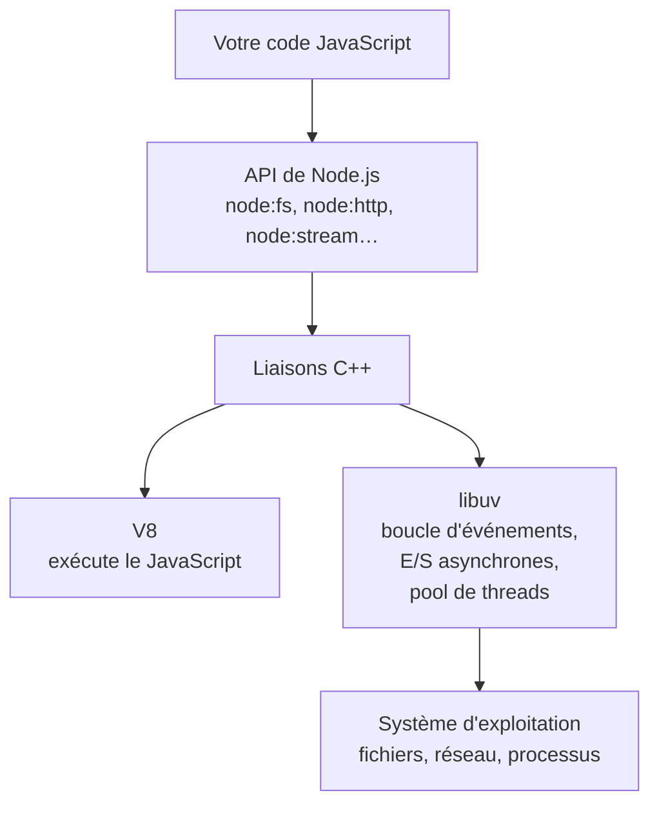
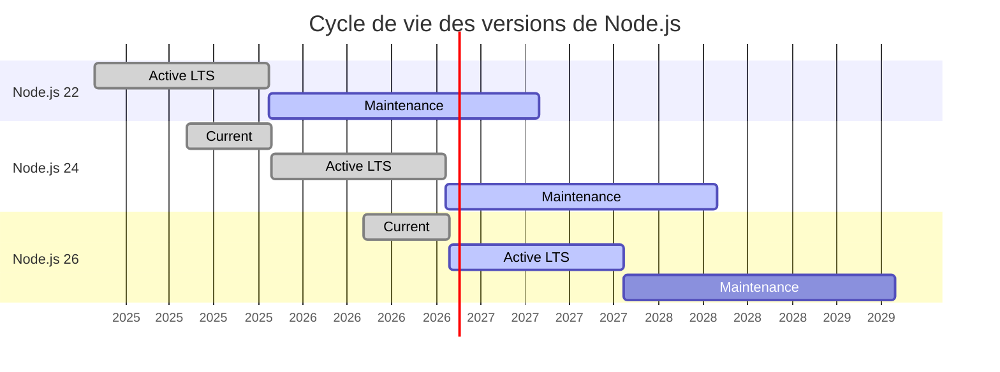

# 27 — Node.js en pratique

> **Niveau** : Intermédiaire · **Durée** : ~4 h · **Prérequis** : [Modules](../26-modules/README.md), [async/await](../20-async-await/README.md)

Node.js fait tourner JavaScript hors du navigateur : outils en ligne de commande, serveurs, scripts d'automatisation, et la quasi-totalité de l'outillage web (Vite, ESLint, Prettier…). Ce chapitre présente ce qu'il faut savoir pour s'en servir au quotidien en 2026 : versions et LTS, exécution, fichiers, streams, serveur HTTP, et les nombreuses fonctionnalités désormais intégrées qui évitent des dépendances (`--env-file`, `--watch`, `node --run`, `util.parseArgs`, `util.styleText`, TypeScript, `node:sqlite`, `fs.glob`, modèle de permissions).

**Fil rouge** : au fil du chapitre, on construit `taches`, une petite liste de tâches en ligne de commande, complète et testée. Le résultat final est dans [`exemple-cli/`](exemple-cli/).

## Objectifs

- Choisir une version de Node.js (LTS) et la gérer avec un gestionnaire de versions
- Exécuter du code avec les bonnes options : `--watch`, `--env-file`, `node --run`, TypeScript sans compilation
- Écrire une CLI propre : arguments (`util.parseArgs`), entrée et sorties standard, codes de sortie, couleurs
- Manipuler fichiers, dossiers et chemins avec `node:fs/promises`, `node:path` et les URL de fichiers
- Traiter de gros volumes avec les streams et `readline`, et réagir à des événements avec `EventEmitter`
- Écrire un petit serveur HTTP JSON et appeler des API avec `fetch`
- Connaître les modules récents (`node:sqlite`, permissions, workers) et sécuriser ses dépendances

## Sommaire

- [Ce qu'est Node.js](#ce-quest-nodejs)
- [Versions et LTS](#versions-et-lts)
- [Installer et gérer les versions](#installer-et-gérer-les-versions)
- [Exécuter du code](#exécuter-du-code)
- [TypeScript sans compilation](#typescript-sans-compilation)
- [L'objet `process`](#lobjet-process)
- [Écrire une CLI avec `util.parseArgs`](#écrire-une-cli-avec-utilparseargs)
- [Les modules intégrés](#les-modules-intégrés)
- [Lire et écrire des fichiers](#lire-et-écrire-des-fichiers)
- [Chemins et URL de fichiers](#chemins-et-url-de-fichiers)
- [Le module `os`](#le-module-os)
- [Événements avec `EventEmitter`](#événements-avec-eventemitter)
- [Les streams](#les-streams)
- [Un serveur HTTP](#un-serveur-http)
- [`fetch` côté serveur](#fetch-côté-serveur)
- [Processus enfants et threads](#processus-enfants-et-threads)
- [SQLite intégré](#sqlite-intégré)
- [Le modèle de permissions](#le-modèle-de-permissions)
- [Ce que Node.js fait désormais tout seul](#ce-que-nodejs-fait-désormais-tout-seul)
- [Sécurité des dépendances](#sécurité-des-dépendances)
- [Deno et Bun](#deno-et-bun)
- [Le fil rouge assemblé](#le-fil-rouge-assemblé)
- [Pièges courants](#pièges-courants)
- [Bonnes pratiques](#bonnes-pratiques)
- [Résumé](#résumé)
- [Exercices](#exercices)
- [Pour aller plus loin](#pour-aller-plus-loin)

## Ce qu'est Node.js

Node.js (2009) est un **environnement d'exécution** : il associe le moteur JavaScript **V8** (celui de Chrome) à **libuv**, une bibliothèque C qui fournit la boucle d'événements et des entrées/sorties asynchrones, et à une bibliothèque standard (fichiers, réseau, processus…).



Ce qu'il faut en retenir :

- Votre JavaScript s'exécute sur **un seul thread**. Pendant qu'un fichier se lit ou qu'une requête réseau attend, ce thread traite autre chose : c'est la [boucle d'événements](../18-asynchrone/README.md).
- Les opérations qui ne peuvent pas être asynchrones au niveau du système (lecture de fichiers, `dns.lookup`, compression, une partie de `crypto`) sont confiées au **pool de threads** de libuv (4 threads par défaut).
- Conséquence : un calcul long en JavaScript **bloque tout** le processus, y compris un serveur qui répond à d'autres utilisateurs. Pour du calcul intensif, il faut un [worker](#processus-enfants-et-threads).
- Il n'y a ni `window` ni `document` ; en revanche, beaucoup d'API web sont présentes : `fetch`, `URL`, `AbortController`, `EventTarget`, `structuredClone`, `crypto.randomUUID`, `WebSocket`, `performance`…

Node.js 26 embarque V8 14.6 ; Node.js 24, V8 13.6.

## Versions et LTS

Une version majeure sort chaque printemps. Elle passe ensuite par trois phases : *Current* (nouveautés), puis **Active LTS** (*Long Term Support* : corrections et améliorations prudentes), puis *Maintenance* (corrections critiques et de sécurité uniquement), avant la fin de vie.

État au 6 novembre 2026 (source : [calendrier officiel](https://github.com/nodejs/Release)) :

| Version | Nom de code | Statut | Fin de vie |
| --- | --- | --- | --- |
| **Node.js 26** | Lithium | **Active LTS** depuis le 28/10/2026 | 30/04/2029 |
| Node.js 24 | Krypton | Maintenance LTS depuis le 20/10/2026 | 30/04/2028 |
| Node.js 22 | Jod | Maintenance LTS | 30/04/2027 |
| Node.js 20 | Iron | Fin de vie depuis le 30/04/2026 | — |
| Node.js 27 | — | Alpha depuis le 28/10/2026, sortie prévue le 22/04/2027 | 30/04/2030 |



- ✅ Pour un nouveau projet, utilisez **Node.js 26**, la LTS active.
- Jusqu'à Node.js 25, seules les versions **paires** devenaient LTS ; les impaires (comme 25, fin de vie le 01/06/2026) ne vivaient que quelques mois.
- **À partir de Node.js 27**, le rythme change : une seule version majeure par an (en avril), et **chacune deviendra LTS** en octobre. Une phase « alpha » permet de la tester plusieurs mois avant sa sortie.
- Une version en fin de vie ne reçoit plus de correctifs de sécurité : ne l'utilisez pas en production.

## Installer et gérer les versions

Les installateurs de [nodejs.org](https://nodejs.org/en/download) conviennent pour débuter. Dès que vous travaillez sur plusieurs projets, utilisez un **gestionnaire de versions**, qui permet d'avoir plusieurs Node.js côte à côte et d'en changer par projet :

| Outil | Points forts |
| --- | --- |
| [fnm](https://github.com/Schniz/fnm) | Rapide (écrit en Rust), macOS, Linux et Windows, change de version automatiquement en entrant dans un dossier |
| [nvm](https://github.com/nvm-sh/nvm) | Le plus connu, script shell pour macOS et Linux (sous Windows : le projet distinct nvm-windows) |
| [mise](https://mise.jdx.dev/) | Gère aussi d'autres langages (Python, Ruby…) |

Volta, autrefois populaire, n'est plus maintenu ; ses auteurs recommandent de migrer vers mise.

```bash
fnm install --lts          # installe la dernière LTS
fnm use 26                 # utilise Node.js 26 dans ce terminal
node --version             # v26.13.0 (par exemple)
echo "26" > .nvmrc         # fixe la version du projet (lu par nvm et fnm ; fnm et mise lisent aussi .node-version)
```

Indiquez aussi la version minimale dans le `package.json` : `"engines": { "node": ">=22.12" }`.

## Exécuter du code

```bash
node script.js                 # exécute un fichier
node                           # ouvre le REPL (.help, .editor, .exit ; _ contient le dernier résultat)
node -e "console.log(2 ** 10)" # évalue une chaîne
node -p "os.cpus().length"     # évalue et affiche le résultat (les modules intégrés sont accessibles)
node --check script.js         # vérifie la syntaxe sans exécuter
```

### `--watch` : relancer à chaque modification

```bash
node --watch serveur.js                        # relance quand serveur.js ou un module importé change
node --watch-path=./src --watch-path=./config serveur.js   # surveille des dossiers précis
node --watch --watch-preserve-output serveur.js            # sans effacer la console
```

Stable depuis Node.js 22, `--watch` remplace nodemon dans la plupart des cas. `--watch-path` ne fonctionne que sous macOS et Windows.

### `--env-file` : charger un fichier `.env`

Un fichier `.env` stocke la configuration locale (port, URL de base de données, clés d'API de développement) hors du code :

```text
# .env — à ne JAMAIS versionner : ajoutez-le au .gitignore
PORT=8080
NOM_APPLI="Ma boutique"
CLE_API=dev-123 # commentaire en fin de ligne
```

```bash
node --env-file=.env serveur.js
node --env-file=.env --env-file=.env.local serveur.js   # le second complète ou remplace le premier
node --env-file-if-exists=.env.local serveur.js         # pas d'erreur si le fichier manque
```

Ces options sont stables depuis Node.js 24.10 et 22.21 : plus besoin du paquet dotenv. Une variable déjà définie dans l'environnement **l'emporte** sur le fichier, ce qui permet de surcharger une valeur au lancement. On peut aussi charger le fichier depuis le code, ou analyser un contenu `.env` :

```js
import { writeFile } from "node:fs/promises";
import { parseEnv } from "node:util";

await writeFile(".env", 'PORT=8080\nNOM_APPLI="Ma boutique"\nCLE_API=dev-123 # commentaire\n');

process.loadEnvFile(".env"); // sans argument : ./.env
console.log(process.env.NOM_APPLI); // Ma boutique
console.log(process.env.PORT, typeof process.env.PORT); // 8080 string : toujours des chaînes !

console.log(parseEnv("DEBUG=1\nMODE=production")); // { DEBUG: '1', MODE: 'production' }
```

### `node --run` : lancer un script du `package.json`

```json
{
  "scripts": {
    "dev": "node --watch --env-file=.env src/serveur.js",
    "test": "node --test"
  }
}
```

```bash
node --run dev               # comme npm run dev, en plus rapide
node --run test -- --test-reporter=dot    # arguments après --
```

`node --run` (stable depuis Node.js 22.10) démarre nettement plus vite que `npm run`, mais il est volontairement limité : il n'exécute pas les scripts `pre`/`post` (`pretest`, `postbuild`) et ne définit pas les variables d'environnement propres à npm. Comme `npm run`, il ajoute les `node_modules/.bin` au `PATH`, ce qui permet d'appeler les outils installés localement. Depuis Node.js 26.9, `node --run` sans argument liste les scripts disponibles.

```js
import { writeFile } from "node:fs/promises";
import { execFileSync } from "node:child_process";

await writeFile("package.json", JSON.stringify({ scripts: { saluer: "node saluer.js" } }));
await writeFile("saluer.js", "console.log('Bonjour, ' + (process.argv[2] ?? 'inconnu'))");

const sortie = execFileSync(process.execPath, ["--run", "saluer", "--", "Léa"], { encoding: "utf8" });
console.log(sortie.trim()); // Bonjour, Léa
```

## TypeScript sans compilation

Node.js exécute directement les fichiers `.ts` en **supprimant les annotations de type** (*type stripping*) : activé par défaut depuis Node.js 23.6 et 22.18, **stable depuis Node.js 25.2 et 24.12**.

```js
import { writeFile } from "node:fs/promises";
import { spawnSync } from "node:child_process";

await writeFile("package.json", JSON.stringify({ type: "module" }));
await writeFile(
  "prix.ts",
  `interface Article {
  nom: string;
  prixHT: number;
}

export function ttc(article: Article, taux: number = 0.2): number {
  return article.prixHT * (1 + taux);
}

console.log(ttc({ nom: "Clavier", prixHT: 50 }));`,
);

const resultat = spawnSync(process.execPath, ["prix.ts"], { encoding: "utf8" });
console.log(resultat.stdout.trim()); // 60
```

Ce qu'il faut savoir :

- **Aucune vérification de types** n'est faite : `const n: number = "texte"` s'exécute sans broncher. Pour vérifier, lancez `tsc --noEmit` (voir [Outillage](../28-outillage/README.md)) ou laissez faire votre éditeur.
- Seule la syntaxe **effaçable** est acceptée. Les constructions qui génèrent du JavaScript (`enum`, `namespace` contenant du code, propriétés de paramètre `constructor(public x: number)`) lèvent `ERR_UNSUPPORTED_TYPESCRIPT_SYNTAX`. L'option `"erasableSyntaxOnly": true` de TypeScript (5.8+) les signale dans l'éditeur.
- Les imports de **types** doivent utiliser `import type` (ou `import { type Id }`), sinon Node.js cherche une valeur qui n'existe pas à l'exécution.
- L'**extension est obligatoire** : `import { ttc } from "./prix.ts"`. Le `tsconfig.json` est ignoré (donc pas d'alias `paths` : utilisez le champ `imports` du `package.json`).
- Les fichiers `.ts` situés dans `node_modules` ne sont pas pris en charge : un paquet publié doit contenir du JavaScript.

Pour le TypeScript complet (enums, décorateurs, `tsconfig`), un outil comme `tsx` reste nécessaire (`npx tsx fichier.ts`).

## L'objet `process`

`process` (global, aussi importable depuis `node:process`) décrit le processus en cours.

| Propriété ou méthode | Rôle |
| --- | --- |
| `process.argv` | Arguments de la ligne de commande |
| `process.env` | Variables d'environnement (toujours des **chaînes**) |
| `process.cwd()` | Dossier courant (d'où la commande a été lancée) |
| `process.exitCode`, `process.exit()` | Code de sortie |
| `process.stdin`, `process.stdout`, `process.stderr` | Entrée et sorties standard (des streams) |
| `process.platform`, `process.arch` | `"linux"`, `"darwin"`, `"win32"` ; `"x64"`, `"arm64"` |
| `process.version`, `process.versions` | Version de Node.js et de ses composants |
| `process.memoryUsage()`, `process.uptime()` | Mémoire utilisée, durée de vie du processus |
| `process.on("SIGINT", …)` | Réagir à Ctrl+C, à un arrêt demandé… |

### Arguments

`process.argv` contient le chemin de `node`, celui du script, puis les arguments :

```js
import { writeFile } from "node:fs/promises";
import { execFileSync } from "node:child_process";

await writeFile("args.mjs", "console.log(process.argv.length, process.argv.slice(2));");

// Équivaut à : node args.mjs ajouter "Acheter du pain" --priorite haute
const sortie = execFileSync(process.execPath, ["args.mjs", "ajouter", "Acheter du pain", "--priorite", "haute"], {
  encoding: "utf8",
});
console.log(sortie.trim()); // 6 [ 'ajouter', 'Acheter du pain', '--priorite', 'haute' ]
```

On ne les analyse pas à la main : voir [`util.parseArgs`](#écrire-une-cli-avec-utilparseargs).

### Variables d'environnement

```js
process.env.NB_ESSAIS = 3; // converti en chaîne !
console.log(typeof process.env.NB_ESSAIS); // string
console.log(process.env.VARIABLE_ABSENTE); // undefined

// ✅ Lire, convertir et valider une seule fois, au démarrage
const port = Number(process.env.PORT ?? 3000);
if (!Number.isInteger(port) || port < 1 || port > 65535) {
  throw new Error(`PORT invalide : ${process.env.PORT}`);
}
console.log(port); // 3000 (si PORT n'est pas défini)
```

### Sorties standard et codes de sortie

Un programme en ligne de commande a deux sorties : **stdout** pour le résultat (`console.log`), **stderr** pour les messages d'erreur et de diagnostic (`console.error`, `console.warn`). Ainsi, `taches lister > liste.txt` écrit la liste dans le fichier, tandis que les erreurs restent visibles à l'écran.

Le **code de sortie** indique au shell, aux scripts et à l'intégration continue si tout s'est bien passé : `0` pour un succès, autre chose pour un échec. Par convention, `1` signale une erreur générale et `2` une mauvaise utilisation (option inconnue).

```js
import { spawnSync } from "node:child_process";

const lancer = (code) => spawnSync(process.execPath, ["-e", code]).status;

console.log(lancer("console.log('ok')")); // 0
console.log(lancer("process.exitCode = 2")); // 2
console.log(lancer("throw new Error('boum')")); // 1 : exception non interceptée
console.log(lancer("Promise.reject(new Error('boum'))")); // 1 : rejet non géré
```

> [!WARNING]
> Préférez `process.exitCode = 1` à `process.exit(1)`. `process.exit()` arrête le processus **immédiatement**, même si des opérations sont en cours : écritures en attente sur stdout (vers un pipe, par exemple), requêtes, timers. La fin de la sortie peut être perdue. Avec `exitCode`, Node.js termine proprement ce qui est en cours, puis sort avec ce code.

### Lire l'entrée standard

Une CLI peut recevoir des données par un pipe (`cat liste.txt | taches importer`). `process.stdin` est un stream ; pour tout lire d'un coup, `text()` de `node:stream/consumers` est le plus simple :

```js
import { writeFile } from "node:fs/promises";
import { execFileSync } from "node:child_process";

await writeFile(
  "majuscules.mjs",
  `import { text } from "node:stream/consumers";

if (process.stdin.isTTY) {
  console.error("Utilisation : echo bonjour | node majuscules.mjs");
  process.exitCode = 2;
} else {
  const contenu = await text(process.stdin);
  process.stdout.write(contenu.toUpperCase());
}`,
);

// Équivaut à : printf "bonjour\nle monde\n" | node majuscules.mjs
console.log(execFileSync(process.execPath, ["majuscules.mjs"], { input: "bonjour\nle monde\n", encoding: "utf8" }));
// BONJOUR
// LE MONDE
```

`process.stdin.isTTY` vaut `true` quand l'entrée est le clavier d'un terminal (rien n'a été envoyé par un pipe). De même, `process.stdout.isTTY` permet de savoir si la sortie est un terminal ou un fichier. Pour un très gros volume, on lit ligne à ligne avec [`readline`](#lire-un-gros-fichier-ligne-à-ligne).

### Arrêt propre

<!-- no-run -->
```js
// Ctrl+C envoie SIGINT ; un orchestrateur (Docker, systemd) envoie SIGTERM
for (const signal of ["SIGINT", "SIGTERM"]) {
  process.once(signal, () => {
    console.error(`${signal} reçu : arrêt en cours…`);
    serveur.close(() => process.exit(0)); // termine les requêtes en cours, puis sort
  });
}
```

## Écrire une CLI avec `util.parseArgs`

`util.parseArgs` (stable depuis Node.js 20) analyse les arguments sans dépendance. On décrit les options attendues, et il renvoie leurs valeurs et les arguments positionnels :

```js
import { parseArgs } from "node:util";

const options = {
  priorite: { type: "string", short: "p", default: "normale" },
  etiquette: { type: "string", multiple: true }, // option répétable
  toutes: { type: "boolean", short: "a", default: false },
  couleur: { type: "boolean", default: true },
};

const { values, positionals } = parseArgs({
  // Par défaut : process.argv sans les deux premiers éléments
  args: ["ajouter", "Acheter du pain", "-p", "haute", "--etiquette", "courses", "--etiquette=maison", "--no-couleur"],
  options,
  allowPositionals: true, // accepte des arguments hors options (la commande, le texte)
  allowNegative: true, // accepte --no-couleur pour mettre une option booléenne à false
});

console.log(positionals); // [ 'ajouter', 'Acheter du pain' ]
console.log(values.priorite, values.etiquette, values.toutes, values.couleur); // haute [ 'courses', 'maison' ] false false
```

- `-p haute`, `--priorite haute` et `--priorite=haute` sont équivalents ; `-ab` combine deux options courtes booléennes.
- Tout ce qui suit `--` est positionnel, même si cela commence par un tiret.
- En mode strict (par défaut), une option inconnue, une valeur manquante ou un positionnel non autorisé lève une erreur avec un `code` précis :

```js
import { parseArgs } from "node:util";

const options = { priorite: { type: "string", short: "p" } };

for (const args of [["--prio", "haute"], ["--priorite"], ["fichier.txt"]]) {
  try {
    parseArgs({ args, options });
  } catch (erreur) {
    console.log(erreur.code);
  }
}
// ERR_PARSE_ARGS_UNKNOWN_OPTION
// ERR_PARSE_ARGS_INVALID_OPTION_VALUE
// ERR_PARSE_ARGS_UNEXPECTED_POSITIONAL
```

`parseArgs` ne génère pas d'aide (`--help`) ni ne gère les sous-commandes : on les écrit soi-même, comme dans le fil rouge. Pour une CLI très riche, des bibliothèques comme commander restent pertinentes.

### Couleurs avec `util.styleText`

`util.styleText(format, texte)` (stable depuis Node.js 22.13 et 23.5) entoure un texte des codes ANSI de couleur et de style, ce qui remplace chalk dans la plupart des cas. Surtout, il **désactive les couleurs tout seul** quand la sortie n'est pas un terminal (redirection vers un fichier, pipe) ou quand la variable `NO_COLOR` est définie, comme le veulent les conventions :

```js
import { styleText } from "node:util";

// Dans un terminal : « OK » en vert. Redirigé vers un fichier : « OK » sans codes parasites.
console.log(styleText("green", "OK"));

// Pour voir les codes produits, on désactive la vérification du stream :
console.log(JSON.stringify(styleText(["bold", "red"], "Erreur", { validateStream: false })));
// "\u001b[1m\u001b[31mErreur\u001b[39m\u001b[22m"

// Pour un message destiné à stderr, c'est ce stream qu'il faut vérifier
console.error(styleText("yellow", "Attention", { stream: process.stderr }));
```

Les formats disponibles sont ceux de `util.inspect.colors` : `bold`, `dim`, `italic`, `underline`, `strikethrough`, `red`, `green`, `yellow`, `blue`, `gray`, `bgRed`… Depuis Node.js 26.1, on peut aussi donner une couleur hexadécimale (`"#ff8800"`).

### Fil rouge, étape 1 : les commandes de `taches`

Notre CLI aura cette interface :

```text
taches ajouter <texte…> [-p basse|normale|haute]
taches lister [-a] [--json]
taches terminer <id>
taches supprimer <id>
cat liste.txt | taches importer
taches --aide | --version
```

L'analyse des arguments, avec une gestion d'erreur qui respecte les codes de sortie :

```js
import { parseArgs } from "node:util";

const options = {
  priorite: { type: "string", short: "p", default: "normale" },
  toutes: { type: "boolean", short: "a", default: false },
  json: { type: "boolean", default: false },
  fichier: { type: "string", short: "f" },
  aide: { type: "boolean", short: "h", default: false },
  version: { type: "boolean", short: "v", default: false },
};

function analyser(argv) {
  try {
    const { values, positionals } = parseArgs({ args: argv, options, allowPositionals: true });
    const [commande, ...args] = positionals;
    return { commande, args, options: values };
  } catch (erreur) {
    return { erreur: erreur.message, code: 2 }; // 2 = mauvaise utilisation
  }
}

const { commande, args, options: valeurs } = analyser(["ajouter", "Réviser", "le", "chapitre", "-p", "haute"]);
console.log(commande, args, valeurs.priorite, valeurs.toutes); // ajouter [ 'Réviser', 'le', 'chapitre' ] haute false

const echec = analyser(["lister", "--tout"]);
console.log(echec.code, echec.erreur.startsWith("Unknown option '--tout'")); // 2 true
```

## Les modules intégrés

Node.js fournit une bibliothèque standard riche. Importez ses modules avec le préfixe `node:`, qui évite toute confusion avec un paquet npm du même nom (et qui est obligatoire pour `node:test`, `node:sqlite` et `node:sea`).

| Module | Usage |
| --- | --- |
| `node:fs/promises`, `node:fs` | Fichiers et dossiers |
| `node:path`, `node:url` | Chemins, conversion chemin ↔ URL `file:` |
| `node:os` | Informations sur le système |
| `node:process` | Le processus courant (aussi disponible en global) |
| `node:events` | `EventEmitter`, `once`, `on` |
| `node:stream`, `node:stream/promises` | Streams, `pipeline` |
| `node:readline` | Lecture ligne à ligne, questions interactives |
| `node:http`, `node:https` | Serveurs et clients HTTP |
| `node:child_process` | Lancer d'autres programmes |
| `node:worker_threads` | Threads pour le calcul intensif |
| `node:crypto` | Hachage, chiffrement, aléatoire sûr |
| `node:zlib` | Compression gzip, brotli, zstd |
| `node:util` | `parseArgs`, `styleText`, `promisify`, `inspect`… |
| `node:timers/promises` | `setTimeout` en promesse (voir [Timers](../21-timers/README.md)) |
| `node:assert/strict`, `node:test` | Tests (voir [Tests](../29-tests/README.md)) |
| `node:sqlite` | Base de données SQLite |

## Lire et écrire des fichiers

Le module `node:fs` existe en trois styles : **promesses** (`node:fs/promises`, à privilégier), **callbacks** (historique) et **synchrone** (`readFileSync`…). Le synchrone bloque le thread : acceptable dans un petit script ou au démarrage d'une CLI, à proscrire dans un serveur.

### Texte et JSON

```js
import { appendFile, readFile, writeFile } from "node:fs/promises";

await writeFile("notes.txt", "Première ligne\n"); // crée ou remplace
await appendFile("notes.txt", "Deuxième ligne\n"); // ajoute à la fin
console.log(await readFile("notes.txt", "utf8"));
// Première ligne
// Deuxième ligne

// JSON : JSON.stringify à l'écriture, JSON.parse à la lecture (voir le chapitre 25)
const reglages = { theme: "sombre", taillePolice: 16 };
await writeFile("reglages.json", `${JSON.stringify(reglages, null, 2)}\n`);
const relus = JSON.parse(await readFile("reglages.json", "utf8"));
console.log(relus.taillePolice); // 16

// Sans l'encodage, on obtient un Buffer (des octets)
const octets = await readFile("notes.txt");
console.log(octets.length, octets[0]); // 32 80 : 30 caractères mais 32 octets (« è » en occupe 2 en UTF-8) ; 80 = « P »
```

### Gérer les erreurs

Les erreurs du système de fichiers portent un `code` : `ENOENT` (fichier ou dossier introuvable), `EACCES`/`EPERM` (permission refusée), `EEXIST` (existe déjà), `EISDIR` (c'est un dossier), `ENOTEMPTY`…

```js
import { readFile } from "node:fs/promises";

async function lireReglages(fichier) {
  try {
    return JSON.parse(await readFile(fichier, "utf8"));
  } catch (erreur) {
    if (erreur.code === "ENOENT") return { theme: "clair" }; // ✅ cas prévu : valeurs par défaut
    throw erreur; // ✅ le reste (JSON invalide, permission) remonte
  }
}

console.log(await lireReglages("absent.json")); // { theme: 'clair' }
```

> [!TIP]
> ❌ Ne testez pas l'existence d'un fichier avant de l'ouvrir (`access`, puis `readFile`) : entre les deux, un autre processus peut le supprimer. ✅ Ouvrez-le directement et traitez `ENOENT`.

### Dossiers

```js
import { cp, mkdir, readdir, rm, stat, writeFile } from "node:fs/promises";

await mkdir("projet/src/lib", { recursive: true }); // crée les parents, pas d'erreur s'il existe déjà
await writeFile("projet/README.md", "# Projet\n");
await writeFile("projet/src/index.js", "export {};\n");
await writeFile("projet/src/lib/outils.js", "export {};\n");

// Contenu direct, avec le type de chaque entrée
const entrees = await readdir("projet", { withFileTypes: true });
console.log(entrees.map((e) => (e.isDirectory() ? `${e.name}/` : e.name)).sort()); // [ 'README.md', 'src/' ]

// Contenu récursif (chemins relatifs)
console.log((await readdir("projet", { recursive: true })).sort());
// [ 'README.md', 'src', 'src/index.js', 'src/lib', 'src/lib/outils.js' ]  (avec \ sous Windows)

const infos = await stat("projet/README.md");
console.log(infos.isFile(), infos.size); // true 9 (taille en octets)

await cp("projet", "sauvegarde", { recursive: true }); // copie récursive
await rm("sauvegarde", { recursive: true, force: true }); // suppression récursive : DÉFINITIVE
```

### Rechercher des fichiers avec `fs.glob`

`glob` (stable depuis Node.js 24 et 22.17) trouve les fichiers qui correspondent à un motif : `*` (n'importe quels caractères sauf `/`), `**` (n'importe quelle profondeur de dossiers), `{js,ts}` (alternatives). Il renvoie un itérateur asynchrone :

```js
import { glob, mkdir, writeFile } from "node:fs/promises";

await mkdir("site/src/pages", { recursive: true });
for (const fichier of ["site/README.md", "site/src/main.js", "site/src/pages/accueil.js", "site/src/pages/notes.md"]) {
  await writeFile(fichier, "");
}

const scripts = [];
for await (const fichier of glob("**/*.js", { cwd: "site" })) scripts.push(fichier);
console.log(scripts.sort()); // [ 'src/main.js', 'src/pages/accueil.js' ]

// Array.fromAsync (ES2024) collecte un itérateur asynchrone ; exclude écarte des motifs
const markdown = await Array.fromAsync(glob("site/**/*.md", { exclude: ["site/src/**"] }));
console.log(markdown); // [ 'site/README.md' ]
```

L'ordre des résultats n'est pas garanti : triez-les si l'ordre compte.

### Fil rouge, étape 2 : stocker les tâches

Les tâches sont enregistrées dans un fichier JSON. Deux précautions : un fichier absent n'est pas une erreur (premier lancement), et l'écriture est **atomique** : on écrit dans un fichier temporaire puis on le renomme, une opération que le système garantit indivisible. Si le programme est interrompu en plein milieu, l'ancien fichier reste intact au lieu d'être à moitié écrit.

```js
import { mkdir, readFile, rename, writeFile } from "node:fs/promises";
import path from "node:path";

async function charger(fichier) {
  try {
    const taches = JSON.parse(await readFile(fichier, "utf8"));
    if (!Array.isArray(taches)) throw new TypeError("un tableau était attendu");
    return taches;
  } catch (erreur) {
    if (erreur.code === "ENOENT") return []; // premier lancement
    throw new Error(`Fichier de tâches illisible : ${fichier}`, { cause: erreur });
  }
}

async function enregistrer(fichier, taches) {
  await mkdir(path.dirname(fichier), { recursive: true });
  const temporaire = `${fichier}.${process.pid}.tmp`;
  await writeFile(temporaire, `${JSON.stringify(taches, null, 2)}\n`);
  await rename(temporaire, fichier); // remplacement atomique
}

const fichier = path.join("donnees", "taches.json");
console.log(await charger(fichier)); // []

await enregistrer(fichier, [{ id: 1, texte: "Acheter du pain", faite: false }]);
console.log((await charger(fichier))[0].texte); // Acheter du pain

await writeFile(fichier, "{ pas du JSON");
try {
  await charger(fichier);
} catch (erreur) {
  console.log(erreur.message, "/", erreur.cause.name); // Fichier de tâches illisible : donnees/taches.json / SyntaxError
}
```

## Chemins et URL de fichiers

Ne construisez jamais un chemin en concaténant des chaînes : le séparateur est `/` sous macOS et Linux, `\` sous Windows. Le module `node:path` s'en charge :

```js
import path from "node:path";

console.log(path.join("projet", "src", "..", "README.md")); // projet/README.md
console.log(path.basename("/photos/vacances/plage.jpeg")); // plage.jpeg
console.log(path.basename("/photos/vacances/plage.jpeg", ".jpeg")); // plage
console.log(path.extname("archive.tar.gz")); // .gz
console.log(path.dirname("/home/lea/notes.txt")); // /home/lea
console.log(path.parse("/home/lea/notes.txt"));
// { root: '/', dir: '/home/lea', base: 'notes.txt', ext: '.txt', name: 'notes' }
console.log(path.relative("/home/lea/projets", "/home/lea/photos/ete.jpg")); // ../photos/ete.jpg
console.log(path.resolve("/srv", "app", "../donnees")); // /srv/donnees : toujours un chemin absolu
console.log(path.normalize("/a//b/../c/./d")); // /a/c/d

// Les résultats ci-dessus sont ceux de macOS et Linux. path.win32 et path.posix forcent un style :
console.log(path.win32.join("C:\\Users", "lea", "notes.txt")); // C:\Users\lea\notes.txt
```

### Dossier courant ou dossier du module

`path.resolve("donnees.json")` et `readFile("donnees.json")` sont relatifs au **dossier courant** (`process.cwd()`), c'est-à-dire l'endroit d'où l'on a lancé `node`, pas celui du fichier. Pour une ressource livrée avec le code, partez de l'emplacement du module :

<!-- no-run -->
```js
import path from "node:path";
import { readFile } from "node:fs/promises";

// ❌ Fonctionne depuis la racine du projet, échoue si l'on lance node depuis un autre dossier
const modeles = await readFile("src/modeles/facture.html", "utf8");

// ✅ Relatif au fichier courant (Node.js 20.11+)
const modeles2 = await readFile(path.join(import.meta.dirname, "modeles", "facture.html"), "utf8");

// ✅ Équivalent, et qui fonctionne aussi dans le navigateur avec fetch
const modeles3 = await readFile(new URL("./modeles/facture.html", import.meta.url), "utf8");
```

Les modules ES sont identifiés par des **URL** (`file:///home/lea/app/main.js`), alors que les API de fichiers attendent des **chemins**. `node:url` fait la conversion, en gérant les espaces, les caractères spéciaux et les lettres de lecteur Windows :

```js
import { fileURLToPath, pathToFileURL } from "node:url";

console.log(pathToFileURL("/tmp/mon fichier.txt").href); // file:///tmp/mon%20fichier.txt
console.log(fileURLToPath("file:///tmp/mon%20fichier.txt")); // /tmp/mon fichier.txt

// ❌ new URL(...).pathname garde le %20 et casse sous Windows (/C:/...) : utilisez fileURLToPath
console.log(new URL("file:///tmp/mon%20fichier.txt").pathname); // /tmp/mon%20fichier.txt
```

## Le module `os`

```js
import os from "node:os";

console.log(os.platform()); // 'linux', 'darwin' (macOS) ou 'win32'
console.log(os.homedir()); // le dossier personnel, par exemple /home/lea
console.log(os.tmpdir()); // le dossier temporaire du système
console.log(JSON.stringify(os.EOL)); // "\n" ("\r\n" sous Windows)
console.log(os.availableParallelism()); // nombre de cœurs utilisables, par exemple 8
console.log(Math.round(os.totalmem() / 1024 ** 3), "Go"); // mémoire totale, par exemple 16 Go
```

`os.homedir()` sert typiquement à placer un fichier de configuration (`~/.taches.json` dans le fil rouge), et `os.availableParallelism()` à dimensionner un pool de workers.

## Événements avec `EventEmitter`

Beaucoup d'objets de Node.js (serveurs, streams, processus enfants) **émettent des événements** auxquels on s'abonne. Ils héritent tous de `EventEmitter`, que vous pouvez utiliser pour vos propres objets :

```js
import { EventEmitter, once } from "node:events";

class CompteARebours extends EventEmitter {
  demarrer(secondes) {
    let restant = secondes;
    const minuterie = setInterval(() => {
      restant--;
      this.emit("tic", restant); // déclenche tous les écouteurs de « tic »
      if (restant === 0) {
        clearInterval(minuterie);
        this.emit("fin");
      }
    }, 10); // 10 ms au lieu d'une seconde pour l'exemple
    return this;
  }
}

const compte = new CompteARebours();
compte.on("tic", (restant) => console.log(`Plus que ${restant}`));
compte.once("fin", () => console.log("Décollage !")); // écouteur à usage unique

compte.demarrer(3);
await once(compte, "fin"); // once() de node:events renvoie une promesse
// Plus que 2
// Plus que 1
// Plus que 0
// Décollage !

console.log(compte.listenerCount("tic"), compte.listenerCount("fin")); // 1 0
```

- `on(nom, fn)` abonne, `off(nom, fn)` désabonne (avec la **même** fonction), `once` abonne pour une fois.
- Les écouteurs sont appelés **de manière synchrone**, dans l'ordre d'abonnement, au moment de `emit`.
- L'événement **`error`** est spécial : émis sans écouteur, il **lève une exception** qui arrête le processus. Abonnez-vous toujours à `error` sur un objet qui peut échouer.

```js
import { EventEmitter } from "node:events";

const connexion = new EventEmitter();
try {
  connexion.emit("error", new Error("connexion perdue"));
} catch (erreur) {
  console.log("Non géré :", erreur.message); // Non géré : connexion perdue
}

connexion.on("error", (erreur) => console.log("Géré :", erreur.message));
connexion.emit("error", new Error("connexion perdue")); // Géré : connexion perdue
```

Au-delà de 10 écouteurs pour un même événement, Node.js affiche un avertissement `MaxListenersExceededWarning` : c'est souvent le signe d'une fuite (un `on` dans une boucle ou à chaque requête, jamais suivi d'un `off`). Le standard du web `EventTarget` existe aussi dans Node.js (voir [Événements](../24-evenements/README.md)) ; `EventEmitter` reste la norme dans les API de Node.js.

## Les streams

Lire un fichier de 2 Go avec `readFile` charge 2 Go en mémoire. Un **stream** traite les données **morceau par morceau** (par défaut, 64 Ko pour un fichier) : la mémoire reste constante, et le traitement commence avant la fin de la lecture.

| Type | Exemples |
| --- | --- |
| `Readable` (lecture) | `fs.createReadStream`, `process.stdin`, une requête HTTP reçue par un serveur |
| `Writable` (écriture) | `fs.createWriteStream`, `process.stdout`, une réponse HTTP |
| `Duplex` (les deux) | Un socket TCP |
| `Transform` (transforme au passage) | `zlib.createGzip()`, chiffrement |

### `pipeline` : brancher des streams

`pipeline` (de `node:stream/promises`) relie des streams bout à bout, gère la **contre-pression** (on ne lit pas plus vite que l'on écrit) et **détruit proprement** tous les streams en cas d'erreur, ce que ne fait pas l'ancienne méthode `.pipe()`.

```js
import { createReadStream, createWriteStream } from "node:fs";
import { stat, writeFile } from "node:fs/promises";
import { pipeline } from "node:stream/promises";
import { createGzip } from "node:zlib";

// Un fichier de journal d'environ 1,6 Mo
const lignes = Array.from({ length: 50_000 }, (_, i) => `2026-11-06 INFO requête ${i} traitée en ${i % 50} ms`);
await writeFile("serveur.log", lignes.join("\n"));

// Compression en streaming : jamais plus de quelques morceaux en mémoire
await pipeline(createReadStream("serveur.log"), createGzip(), createWriteStream("serveur.log.gz"));

const avant = (await stat("serveur.log")).size;
const apres = (await stat("serveur.log.gz")).size;
console.log(apres < avant / 10); // true : un journal répétitif se compresse très bien
```

Une fonction génératrice asynchrone peut servir d'étape de transformation, ce qui est souvent plus lisible qu'une classe `Transform` :

```js
import { Readable } from "node:stream";
import { pipeline } from "node:stream/promises";

const recu = [];

await pipeline(
  Readable.from(["bonjour ", "le ", "monde"]), // un Readable à partir d'un itérable
  async function* (source) {
    for await (const morceau of source) yield morceau.toUpperCase(); // transformation
  },
  async function (source) {
    for await (const morceau of source) recu.push(morceau); // destination
  },
);

console.log(recu.join("")); // BONJOUR LE MONDE
```

### Lire un gros fichier ligne à ligne

`readline` découpe un stream en lignes ; avec `for await…of`, on traite un fichier de plusieurs gigaoctets avec une mémoire constante :

```js
import { createReadStream } from "node:fs";
import { writeFile } from "node:fs/promises";
import readline from "node:readline";

// 100 000 ventes : date;categorie;montant
const categories = ["livres", "musique", "jeux"];
const contenu = ["date;categorie;montant"];
for (let i = 0; i < 100_000; i++) contenu.push(`2026-11-06;${categories[i % 3]};${(i % 10) + 0.5}`);
await writeFile("ventes.csv", contenu.join("\n"));

const totaux = new Map();
const lecteur = readline.createInterface({ input: createReadStream("ventes.csv"), crlfDelay: Infinity });

let premiere = true;
for await (const ligne of lecteur) {
  if (premiere) {
    premiere = false; // en-tête
    continue;
  }
  const [, categorie, montant] = ligne.split(";");
  totaux.set(categorie, (totaux.get(categorie) ?? 0) + Number(montant));
}

console.log(totaux); // Map(3) { 'livres' => 166670, 'musique' => 166663.5, 'jeux' => 166666.5 }
```

`crlfDelay: Infinity` traite correctement les fins de ligne Windows (`\r\n`). C'est exactement ce que fait la commande `importer` du fil rouge, avec `process.stdin` comme source.

## Un serveur HTTP

Le module `node:http` crée un serveur en quelques lignes. Chaque requête appelle votre fonction avec `req` (la requête, un stream lisible) et `res` (la réponse, un stream inscriptible). Voici une petite **API JSON** complète, qui se teste elle-même avec `fetch` puis s'arrête :

```js
import http from "node:http";
import { once } from "node:events";

const taches = [{ id: 1, texte: "Écrire le chapitre", faite: false }];

function envoyerJson(res, statut, donnees) {
  res.writeHead(statut, { "Content-Type": "application/json; charset=utf-8" });
  res.end(JSON.stringify(donnees));
}

async function lireJson(req) {
  let corps = "";
  for await (const morceau of req) {
    corps += morceau;
    if (corps.length > 100_000) throw new RangeError("Corps trop volumineux"); // limite : protection
  }
  return JSON.parse(corps);
}

const serveur = http.createServer(async (req, res) => {
  const url = new URL(req.url, "http://localhost");
  try {
    if (url.pathname === "/taches" && req.method === "GET") {
      return envoyerJson(res, 200, taches);
    }
    if (url.pathname === "/taches" && req.method === "POST") {
      const { texte } = await lireJson(req);
      if (typeof texte !== "string" || !texte.trim()) {
        return envoyerJson(res, 400, { erreur: "Le champ « texte » est obligatoire." });
      }
      const tache = { id: taches.length + 1, texte: texte.trim(), faite: false };
      taches.push(tache);
      return envoyerJson(res, 201, tache); // 201 Created
    }
    envoyerJson(res, 404, { erreur: "Ressource introuvable" });
  } catch (erreur) {
    if (erreur instanceof SyntaxError) return envoyerJson(res, 400, { erreur: "JSON invalide" });
    if (erreur instanceof RangeError) return envoyerJson(res, 413, { erreur: erreur.message });
    console.error(erreur); // erreur inattendue : on la journalise, sans détails pour le client
    envoyerJson(res, 500, { erreur: "Erreur interne" });
  }
});

serveur.listen(0, "127.0.0.1"); // port 0 : le système choisit un port libre
await once(serveur, "listening");
const base = `http://127.0.0.1:${serveur.address().port}`;

let reponse = await fetch(`${base}/taches`, {
  method: "POST",
  headers: { "Content-Type": "application/json" },
  body: JSON.stringify({ texte: "Relire les exemples" }),
});
console.log(reponse.status, await reponse.json()); // 201 { id: 2, texte: 'Relire les exemples', faite: false }

reponse = await fetch(`${base}/taches`);
console.log(reponse.status, (await reponse.json()).length); // 200 2

reponse = await fetch(`${base}/taches`, { method: "POST", body: "{ pas du JSON" });
console.log(reponse.status, await reponse.json()); // 400 { erreur: 'JSON invalide' }

reponse = await fetch(`${base}/inconnu`);
console.log(reponse.status); // 404

serveur.close(); // libère le port ; le processus peut se terminer
```

Dans une vraie application, on lance le serveur sur un port fixe (`serveur.listen(process.env.PORT ?? 3000)`) et on ne le ferme qu'à l'arrêt (voir [Arrêt propre](#arrêt-propre)). Pour une API plus grande (routage avec paramètres, validation, middlewares), un framework fait gagner beaucoup de temps : Fastify (5.x), Express (5.x) ou Hono (4.x), ce dernier fonctionnant aussi sur Deno, Bun et les plateformes « edge ». Les notions HTTP (méthodes, statuts, en-têtes, CORS) sont détaillées au chapitre [Fetch et HTTP](../22-fetch-http/README.md).

## `fetch` côté serveur

`fetch` est global et stable depuis Node.js 21 : la même API que dans le navigateur, sans paquet (node-fetch, axios). Côté serveur, pensez toujours à **limiter la durée** d'un appel externe, sinon une API lente bloque vos propres requêtes :

<!-- no-run -->
```js
async function chargerMeteo(ville) {
  const url = new URL("https://api.exemple.com/meteo");
  url.searchParams.set("ville", ville);

  const reponse = await fetch(url, {
    headers: { Authorization: `Bearer ${process.env.CLE_METEO}` }, // la clé vient de l'environnement
    signal: AbortSignal.timeout(5000), // abandonne au bout de 5 s
  });
  if (!reponse.ok) throw new Error(`API météo : HTTP ${reponse.status}`);
  return reponse.json();
}
```

Les différences avec le navigateur : pas de CORS (un serveur peut appeler n'importe quelle origine), pas de cookies automatiques, et `fetch` s'appuie sur le client HTTP undici, intégré à Node.js. Retry et limitation de concurrence sont au chapitre [async/await](../20-async-await/README.md).

## Processus enfants et threads

### Lancer un autre programme : `child_process`

```js
import { execFile, spawn } from "node:child_process";
import readline from "node:readline";
import { promisify } from "node:util";

const executer = promisify(execFile);

// execFile : lance un programme et récupère toute sa sortie
const { stdout } = await executer(process.execPath, ["--version"]); // process.execPath = le node courant
console.log(stdout.startsWith("v")); // true

// spawn : pour suivre la sortie au fil de l'eau (longue commande, gros volume)
const enfant = spawn(process.execPath, ["-e", "for (let i = 1; i <= 3; i++) console.log('étape ' + i)"]);
for await (const ligne of readline.createInterface({ input: enfant.stdout })) {
  console.log(`[enfant] ${ligne}`);
}
// [enfant] étape 1
// [enfant] étape 2
// [enfant] étape 3

// Un code de sortie non nul rejette la promesse d'execFile
try {
  await executer(process.execPath, ["-e", "process.exit(4)"]);
} catch (erreur) {
  console.log(erreur.code); // 4
}
```

> [!WARNING]
> `exec("git log " + saisie)` passe la commande à un **shell** : une saisie comme `; rm -rf ~` serait exécutée (injection de commande). ✅ Utilisez `execFile` ou `spawn` avec un **tableau d'arguments**, qui ne passent pas par un shell : `execFile("git", ["log", saisie])`.

### Calcul intensif : `worker_threads`

Un calcul de plusieurs secondes bloque la boucle d'événements : un serveur ne répond plus à personne pendant ce temps. Un **worker** exécute du JavaScript sur un autre thread, avec sa propre mémoire ; on communique par messages :

```js
import { Worker, isMainThread, parentPort, workerData } from "node:worker_threads";

function fibonacci(n) {
  return n < 2 ? n : fibonacci(n - 1) + fibonacci(n - 2); // volontairement lent
}

if (isMainThread) {
  // Ce même fichier est relancé dans un worker
  const travailleur = new Worker(new URL(import.meta.url), { workerData: 30 });
  console.log("Calcul lancé, le thread principal reste libre");

  const resultat = await new Promise((resolve, reject) => {
    travailleur.once("message", resolve);
    travailleur.once("error", reject);
  });
  console.log("fibonacci(30) =", resultat);
} else {
  parentPort.postMessage(fibonacci(workerData)); // exécuté dans le worker
}
// Calcul lancé, le thread principal reste libre
// fibonacci(30) = 832040
```

Les workers servent au calcul (traitement d'images, compression, analyse de gros JSON), pas aux entrées/sorties, que Node.js gère déjà efficacement sur un seul thread. Démarrer un worker coûte quelques millisecondes : pour de nombreuses petites tâches, on en garde un **pool** (de la taille de `os.availableParallelism()`). La boucle d'événements est expliquée au chapitre [Asynchrone](../18-asynchrone/README.md).

## SQLite intégré

Le module `node:sqlite` donne accès à une base [SQLite](https://www.sqlite.org/) sans dépendance : idéal pour une CLI, un prototype, des tests ou une petite application. Son statut est **« release candidate »** (stabilité 1.2) dans Node.js 26 : l'API est pratiquement figée. Depuis Node.js 26.11, la classe principale s'appelle `Database` ; son ancien nom `DatabaseSync`, le seul disponible dans Node.js 22 et 24, reste un alias. L'exemple fonctionne avec les deux :

```js
import * as sqlite from "node:sqlite";

const Database = sqlite.Database ?? sqlite.DatabaseSync; // Node.js 26.11+ ou version antérieure

const db = new Database(":memory:"); // ou un chemin de fichier : new Database("bibliotheque.db")

db.exec(`
  CREATE TABLE livres (
    id INTEGER PRIMARY KEY,
    titre TEXT NOT NULL,
    annee INTEGER NOT NULL
  ) STRICT
`);

// Requête préparée : les valeurs sont passées à part, jamais concaténées dans le SQL
const inserer = db.prepare("INSERT INTO livres (titre, annee) VALUES (?, ?)");
inserer.run("Les Misérables", 1862);
inserer.run("Germinal", 1885);
const resultat = inserer.run("L'Étranger", 1942); // l'apostrophe ne pose aucun problème
console.log(resultat); // { changes: 1, lastInsertRowid: 3 }

const anciens = db.prepare("SELECT titre, annee FROM livres WHERE annee < ? ORDER BY annee").all(1900);
for (const { titre, annee } of anciens) console.log(`${annee} — ${titre}`);
// 1862 — Les Misérables
// 1885 — Germinal

// Paramètres nommés
const livre = db.prepare("SELECT id, titre FROM livres WHERE titre = $titre").get({ titre: "Germinal" });
console.log(livre.id, livre.titre); // 2 Germinal

db.close();
```

Toutes les méthodes sont **synchrones** : SQLite lit un fichier local, très rapidement. Les **requêtes préparées** (`?` ou `$nom`) protègent contre l'injection SQL : ne construisez jamais une requête avec `` `… WHERE titre = '${saisie}'` ``.

## Le modèle de permissions

Par défaut, un script Node.js peut tout faire : lire vos clés SSH, écrire n'importe où, lancer des programmes. Avec `--permission` (stable depuis Node.js 23.5 et 22.13), le processus n'a plus accès qu'à ce que vous autorisez explicitement :

```bash
node --permission --allow-fs-read=./donnees --allow-fs-write=./sortie script.js
```

| Option | Autorise |
| --- | --- |
| `--allow-fs-read=<chemin>`, `--allow-fs-write=<chemin>` | Lecture, écriture (répétable ; `*` pour tout) |
| `--allow-child-process` | Lancer des processus |
| `--allow-worker` | Créer des workers |
| `--allow-net` | Le réseau (Node.js 25+, en développement actif) |
| `--allow-addons`, `--allow-wasi` | Modules natifs, WASI |

Le fichier lancé est toujours lisible. Une opération interdite lève `ERR_ACCESS_DENIED`, et `process.permission.has()` permet de vérifier une permission à l'avance :

```js
import { mkdir, writeFile } from "node:fs/promises";
import { spawnSync } from "node:child_process";

await mkdir("donnees", { recursive: true });
await writeFile("donnees/notes.txt", "contenu autorisé");
await writeFile(
  "script.mjs",
  `import { readFile, writeFile } from "node:fs/promises";
console.log("lecture :", process.permission.has("fs.read", "donnees/notes.txt"));
console.log("écriture :", process.permission.has("fs.write"));
console.log(await readFile("donnees/notes.txt", "utf8"));
try {
  await writeFile("donnees/pirate.txt", "...");
} catch (erreur) {
  console.log(erreur.code, erreur.permission);
}`,
);

const resultat = spawnSync(process.execPath, ["--permission", "--allow-fs-read=./donnees", "script.mjs"], {
  encoding: "utf8",
});
console.log(resultat.stdout);
// lecture : true
// écriture : false
// contenu autorisé
// ERR_ACCESS_DENIED FileSystemWrite
```

> [!IMPORTANT]
> La documentation le présente comme une **ceinture de sécurité**, pas comme un bac à sable : il protège du code de confiance qui ferait une erreur (écrire au mauvais endroit), mais **ne garantit rien face à du code malveillant**. Pour exécuter du code non fiable, isolez-le au niveau du système (conteneur, machine virtuelle). Avant d'activer `--permission` en production, l'option `--permission-audit` (Node.js 25.8+, aussi présente dans les dernières versions 24) journalise les accès qui seraient refusés, sans rien bloquer.

## Ce que Node.js fait désormais tout seul

Beaucoup de dépendances classiques ont aujourd'hui un équivalent intégré. Moins de dépendances, c'est moins de mises à jour, d'installation et de risques (voir la section suivante) :

| Besoin | Paquet historique | Intégré à Node.js |
| --- | --- | --- |
| Charger un `.env` | dotenv | `--env-file`, `process.loadEnvFile()` |
| Relancer au changement | nodemon | `--watch` |
| Analyser les arguments | yargs, commander, minimist | `util.parseArgs` |
| Couleurs dans le terminal | chalk, kleur | `util.styleText` |
| Exécuter du TypeScript | ts-node, tsx | Suppression des types (syntaxe effaçable uniquement) |
| Requêtes HTTP | node-fetch, axios | `fetch` |
| Rechercher des fichiers | glob, fast-glob | `fs.glob` |
| Créer ou supprimer une arborescence | mkdirp, rimraf | `mkdir`/`rm` avec `{ recursive: true }` |
| Copie profonde d'un objet | lodash.clonedeep | `structuredClone` |
| Identifiant unique | uuid | `crypto.randomUUID()` |
| Client WebSocket | ws | `WebSocket` global (stable depuis Node.js 22.4) |
| Tests | mocha, jest | `node:test` (voir [Tests](../29-tests/README.md)) |
| Base SQLite | better-sqlite3 | `node:sqlite` |

Les paquets historiques gardent parfois des fonctionnalités en plus (un serveur WebSocket demande toujours `ws`, `tsx` gère les `enum`…) : le bon réflexe est de vérifier d'abord ce que Node.js propose.

## Sécurité des dépendances

Chaque paquet installé, et chacune de **ses** dépendances, exécute du code sur votre machine et chez vos utilisateurs. Les attaques de la « chaîne d'approvisionnement » sont réelles : en septembre 2025, des versions piégées de paquets téléchargés des milliards de fois par semaine (`chalk`, `debug` et une quinzaine d'autres) ont été publiées après l'hameçonnage d'un mainteneur ; quelques jours plus tard, un ver baptisé « Shai-Hulud » se propageait de paquet en paquet en volant des jetons npm.

Les réflexes à prendre :

- **Moins de dépendances** : avant `npm install`, vérifiez si Node.js ou le langage le fait déjà (tableau ci-dessus) ou si dix lignes suffisent.
- **Évaluer un paquet** avant de l'adopter : maintenance récente, nombre de mainteneurs, nombre de dépendances transitives, nom exact (le *typosquatting* imite des noms connus : `expres`, `lodahs`).
- **Versionner le lockfile** (`package-lock.json`) et installer avec `npm ci` en intégration continue : on obtient exactement les versions vérifiées.
- **Auditer** : `npm audit` signale les vulnérabilités connues, `npm audit signatures` vérifie les signatures et attestations de provenance des paquets.
- **Se méfier des scripts d'installation** (`postinstall`), vecteur favori des attaques : `npm install --ignore-scripts` les désactive ; pnpm ne les exécute plus par défaut pour les dépendances depuis sa version 10.
- **Ne jamais versionner de secrets** (`.env` dans le `.gitignore`), et donner aux jetons npm et d'intégration continue le minimum de droits.
- Pour les tâches risquées, le [modèle de permissions](#le-modèle-de-permissions) limite les dégâts d'une erreur.

Le chapitre [Outillage](../28-outillage/README.md) détaille npm, semver et les lockfiles.

## Deno et Bun

Node.js n'est plus le seul environnement d'exécution JavaScript côté serveur. Deux alternatives sérieuses, compatibles avec une grande partie de l'écosystème npm :

| | Node.js 26 | Deno 2.9 | Bun 1.4 |
| --- | --- | --- | --- |
| Moteur | V8 | V8 | JavaScriptCore (celui de Safari) |
| Écrit en | C++ | Rust | Zig |
| TypeScript | Suppression des types, sans vérification | Natif ; vérification avec `deno check` | Natif, sans vérification |
| Sécurité par défaut | Tout est permis (`--permission` en option) | **Rien n'est permis** sans `--allow-read`, `--allow-net`… | Tout est permis |
| Paquets | npm | npm (`npm:`), [JSR](https://jsr.io/), URL ; comprend `package.json` | npm, avec un `bun install` très rapide |
| Outils intégrés | test, watch, run, sqlite | fmt, lint, test, compile (exécutable autonome) | install, test, build (bundler), sqlite |
| Points forts | Stabilité, LTS longues, compatibilité maximale | Sécurité, outillage tout-en-un, standards du web | Vitesse de démarrage et d'installation |

Le code de ce cours (modules ES, `fetch`, `node:fs/promises`…) fonctionne en grande partie dans les trois. Pour un projet professionnel, Node.js LTS reste le choix le plus sûr ; Deno et Bun valent le détour pour des outils, des scripts ou de nouveaux projets.

## Le fil rouge assemblé

Toutes les pièces sont en place : arguments, stockage atomique, couleurs, lecture de l'entrée standard, codes de sortie. Voici l'organisation de [`exemple-cli/`](exemple-cli/) :

```text
exemple-cli/
├── package.json        "type": "module", "bin": { "taches": "./bin/taches.js" }
├── bin/taches.js       point d'entrée (3 lignes)
├── src/
│   ├── cli.js          analyse des arguments, aide, routage des commandes, codes de sortie
│   ├── taches.js       logique pure : ajouter, terminer, supprimer, trier (sans E/S)
│   ├── stockage.js     lecture/écriture du JSON (écriture atomique)
│   └── affichage.js    mise en forme avec styleText
└── test/taches.test.js tests unitaires et de bout en bout (node:test)
```

Le point d'entrée commence par un **shebang**, qui permet de lancer le fichier directement comme une commande (après `chmod +x` sous macOS et Linux) :

<!-- no-run -->
```js
#!/usr/bin/env node
// bin/taches.js
import { executer } from "../src/cli.js";

process.exitCode = await executer(process.argv.slice(2));
```

La logique métier ne fait **aucune entrée/sortie** : elle reçoit un tableau et en renvoie un nouveau. Elle est donc triviale à tester, et réutilisable (dans une API HTTP, par exemple) :

<!-- no-run -->
```js
// src/taches.js (extrait)
export function terminer(taches, id) {
  const index = indexDe(taches, id); // lève une ErreurUtilisateur si l'id n'existe pas
  const tache = { ...taches[index], faite: true };
  return { taches: taches.with(index, tache), tache }; // with (ES2023) : copie modifiée
}
```

`src/cli.js` relie le tout. Les erreurs **prévues** (tâche introuvable, texte vide) sont des `ErreurUtilisateur` : on affiche un message clair et on renvoie `1`. Les autres sont des bogues : on les laisse remonter avec leur pile d'appels.

<!-- no-run -->
```js
// src/cli.js (extrait)
const fichier = valeurs.fichier ?? cheminParDefaut(env); // --fichier, $TACHES_FICHIER ou ~/.taches.json
try {
  const taches = await charger(fichier);
  switch (commande) {
    case "lister": {
      const liste = aAfficher(taches, { toutes: valeurs.toutes });
      console.log(valeurs.json ? JSON.stringify(liste, null, 2) : formaterListe(liste));
      return 0;
    }
    case "ajouter": {
      const resultat = ajouter(taches, args.join(" "), valeurs.priorite);
      await enregistrer(fichier, resultat.taches);
      console.log(succes(`Ajoutée : ${formaterTache(resultat.tache)}`));
      return 0;
    }
    // … terminer, supprimer, importer
    default:
      console.error(erreur(`commande inconnue : « ${commande} ».`));
      return 2;
  }
} catch (e) {
  if (!(e instanceof ErreurUtilisateur)) throw e; // bogue : on garde la pile d'appels
  console.error(erreur(e.message));
  return 1;
}
```

Utilisation :

```bash
cd 27-nodejs/exemple-cli
node bin/taches.js ajouter Acheter du pain
node bin/taches.js ajouter "Réviser le chapitre 27" -p haute
printf "Appeler Léa\nPayer le loyer\n" | node bin/taches.js importer
node bin/taches.js terminer 1
node bin/taches.js lister
#   2 [ ] ! Réviser le chapitre 27
#   4 [ ]   Appeler Léa
#   5 [ ]   Payer le loyer
node bin/taches.js lister --json > taches.json   # sortie exploitable par un autre programme
node bin/taches.js terminer 42; echo $?          # Erreur : Aucune tâche n° 42. puis 1

node --run test        # lance les tests (node --test)
npm link               # installe la commande « taches » globalement depuis ce dossier
taches --aide
```

Le champ `bin` du `package.json` indique à npm quel fichier installer comme commande : c'est ainsi que sont distribués `vite`, `eslint` ou `prettier`.

## Pièges courants

- **Oublier que `process.env` ne contient que des chaînes** : `process.env.DEBUG = false` donne `"false"`, qui est *truthy*. Convertissez explicitement.
- **Résoudre un chemin par rapport au dossier courant** au lieu du module : utilisez `import.meta.dirname` ou `new URL(…, import.meta.url)`.
- **Concaténer des chemins** avec `+ "/" +` : utilisez `path.join`.
- **`new URL(…).pathname` au lieu de `fileURLToPath`** : caractères encodés (`%20`) et chemins Windows invalides.
- **Appeler `process.exit()`** alors que des écritures sont en cours : préférez `process.exitCode`.
- **Lire un gros fichier avec `readFile`** : passez par un stream ou `readline`.
- **Utiliser `.pipe()` sans gestion d'erreur** : une erreur laisse des streams ouverts ; utilisez `pipeline`.
- **Émettre `error` sans écouteur** : le processus s'arrête.
- **Bloquer la boucle d'événements** (calcul long, `readFileSync` dans un serveur) : toutes les requêtes attendent.
- **Passer une saisie à `exec`** : injection de commande ; utilisez `execFile` avec un tableau d'arguments.
- **Construire du SQL par concaténation** : injection SQL ; utilisez des requêtes préparées.
- **Exécuter une version de Node.js en fin de vie** (20 ou moins) : plus de correctifs de sécurité.
- **Attendre de la suppression des types qu'elle vérifie le TypeScript** : elle ne vérifie rien.

## Bonnes pratiques

- ✅ Utilisez la **LTS active** (Node.js 26), un gestionnaire de versions et un fichier `.nvmrc` ou `.node-version`.
- ✅ Écrivez en modules ES (`"type": "module"`) et importez les modules intégrés avec `node:`.
- ✅ Préférez `node:fs/promises` et les API asynchrones ; réservez le synchrone aux scripts simples.
- ✅ Gérez les erreurs par leur `code` (`ENOENT`…) et laissez remonter celles que vous n'attendez pas.
- ✅ Écrivez les fichiers importants de façon atomique (fichier temporaire + `rename`).
- ✅ Pour une CLI : résultat sur stdout, erreurs sur stderr, codes de sortie significatifs, `--help`, couleurs désactivables (`styleText` le fait), et une option `--json` pour les autres programmes.
- ✅ Séparez la logique pure des entrées/sorties : elle se teste et se réutilise.
- ✅ Validez la configuration (`process.env`) une fois, au démarrage.
- ✅ Bornez tout ce qui vient de l'extérieur : taille des corps de requête, durée des appels `fetch` (`AbortSignal.timeout`).
- ✅ Limitez vos dépendances, versionnez le lockfile, auditez-le.

## Résumé

- Node.js = V8 + libuv + une bibliothèque standard ; votre code tourne sur un seul thread, les E/S sont asynchrones.
- En novembre 2026 : Node.js 26 est la LTS active, 24 et 22 sont en maintenance, 20 est en fin de vie ; à partir de 27, chaque version annuelle devient LTS.
- `--watch`, `--env-file`, `node --run`, et l'exécution directe de TypeScript (syntaxe effaçable, sans vérification) simplifient le développement.
- `process` donne accès aux arguments, à l'environnement (des chaînes), aux sorties standard et au code de sortie (`process.exitCode`).
- `util.parseArgs` analyse les arguments d'une CLI ; `util.styleText` colore la sortie en respectant les terminaux et `NO_COLOR`.
- `node:fs/promises` pour les fichiers (codes d'erreur, `recursive`, `glob`), `node:path` et `node:url` pour les chemins.
- `EventEmitter` pour les événements (attention à `error`), les streams et `pipeline` pour les gros volumes, `readline` pour lire ligne à ligne.
- `node:http` suffit pour une petite API JSON ; `fetch` est global ; `execFile`/`spawn` lancent des programmes, les workers font du calcul en parallèle.
- `node:sqlite` (release candidate) et le modèle de permissions (`--permission`) sont intégrés.
- Chaque dépendance est un risque : vérifiez d'abord ce que Node.js fait déjà.

## Exercices

### Exercice 1 — Bonjour en ligne de commande (★☆☆)

Écrivez une fonction `saluer(argv)` qui reçoit un tableau d'arguments et renvoie le texte à afficher :

- `--nom <nom>` (ou `-n`), par défaut `"inconnu"` ;
- `--majuscules` (ou `-m`) met le message en majuscules ;
- `--aide` renvoie un texte d'aide ;
- une option inconnue renvoie `"Erreur : …"`.

<details>
<summary>Solution</summary>

```js
import { parseArgs } from "node:util";

const AIDE = "Utilisation : bonjour [-n <nom>] [-m]";

function saluer(argv) {
  let values;
  try {
    ({ values } = parseArgs({
      args: argv,
      options: {
        nom: { type: "string", short: "n", default: "inconnu" },
        majuscules: { type: "boolean", short: "m", default: false },
        aide: { type: "boolean", default: false },
      },
    }));
  } catch (erreur) {
    return `Erreur : ${erreur.message}`;
  }
  if (values.aide) return AIDE;
  const message = `Bonjour, ${values.nom} !`;
  return values.majuscules ? message.toUpperCase() : message;
}

console.log(saluer([])); // Bonjour, inconnu !
console.log(saluer(["--nom", "Léa"])); // Bonjour, Léa !
console.log(saluer(["-n", "Léa", "-m"])); // BONJOUR, LÉA !
console.log(saluer(["--aide"])); // Utilisation : bonjour [-n <nom>] [-m]
console.log(saluer(["--prenom", "Léa"])); // Erreur : Unknown option '--prenom'
```

Pour en faire une vraie commande, il suffirait d'un fichier contenant `console.log(saluer(process.argv.slice(2)))`, avec `process.exitCode = 2` en cas d'erreur. Séparer la fonction de `process.argv` permet de la tester avec de simples tableaux.

</details>

### Exercice 2 — Un mini `wc` (★☆☆)

Écrivez `compter(fichier)` qui renvoie le nombre de lignes, de mots et de caractères d'un fichier texte, et qui lève une erreur claire (`Fichier introuvable : …`) s'il n'existe pas.

<details>
<summary>Solution</summary>

```js
import { readFile, writeFile } from "node:fs/promises";

async function compter(fichier) {
  let texte;
  try {
    texte = await readFile(fichier, "utf8");
  } catch (erreur) {
    if (erreur.code === "ENOENT") throw new Error(`Fichier introuvable : ${fichier}`, { cause: erreur });
    throw erreur;
  }
  return {
    lignes: texte === "" ? 0 : texte.split("\n").length - (texte.endsWith("\n") ? 1 : 0),
    mots: texte.split(/\s+/).filter(Boolean).length,
    caracteres: [...texte].length, // points de code, pas unités UTF-16 (voir le chapitre 07)
  };
}

await writeFile("poeme.txt", "Demain, dès l'aube,\nà l'heure où blanchit la campagne,\nJe partirai.\n");
console.log(await compter("poeme.txt")); // { lignes: 3, mots: 11, caracteres: 68 }

try {
  await compter("absent.txt");
} catch (erreur) {
  console.log(erreur.message); // Fichier introuvable : absent.txt
}
```

La dernière ligne d'un fichier se termine en général par `\n` : sans la correction, `split("\n")` compterait une ligne vide de trop. `[...texte].length` compte les caractères accentués comme un seul caractère.

</details>

### Exercice 3 — Configuration validée (★★☆)

Écrivez `lireConfig(env)` qui lit un objet de variables d'environnement et renvoie une configuration typée :

- `PORT` : entier entre 1 et 65535, `3000` par défaut ;
- `MODE` : `"development"` ou `"production"`, `"development"` par défaut ;
- `DEBUG` : booléen, vrai pour `"1"` ou `"true"`, faux sinon.

Si plusieurs valeurs sont invalides, toutes les erreurs doivent être signalées en une fois. Testez avec le contenu d'un fichier `.env` analysé par `util.parseEnv`.

<details>
<summary>Solution</summary>

```js
import { parseEnv } from "node:util";

function lireConfig(env) {
  const erreurs = [];

  const port = Number(env.PORT ?? 3000);
  if (!Number.isInteger(port) || port < 1 || port > 65535) {
    erreurs.push(`PORT doit être un entier entre 1 et 65535 (reçu : « ${env.PORT} »)`);
  }

  const mode = env.MODE ?? "development";
  if (!["development", "production"].includes(mode)) {
    erreurs.push(`MODE doit valoir development ou production (reçu : « ${mode} »)`);
  }

  const debug = ["1", "true"].includes(env.DEBUG?.toLowerCase());

  if (erreurs.length > 0) {
    throw new AggregateError(erreurs.map((m) => new Error(m)), "Configuration invalide");
  }
  return Object.freeze({ port, mode, debug });
}

console.log(lireConfig(parseEnv("PORT=8080\nDEBUG=true"))); // { port: 8080, mode: 'development', debug: true }
console.log(lireConfig({})); // { port: 3000, mode: 'development', debug: false }

try {
  lireConfig(parseEnv("PORT=99999\nMODE=test"));
} catch (erreur) {
  console.log(erreur.message); // Configuration invalide
  for (const e of erreur.errors) console.log("-", e.message);
  // - PORT doit être un entier entre 1 et 65535 (reçu : « 99999 »)
  // - MODE doit valoir development ou production (reçu : « test »)
}
```

Dans une application, on appellerait `lireConfig(process.env)` une seule fois au démarrage : une configuration invalide arrête le programme immédiatement, avec un message clair, au lieu de provoquer une erreur obscure plus tard. `AggregateError` (ES2021) regroupe plusieurs erreurs (voir [Erreurs](../17-erreurs/README.md)).

</details>

### Exercice 4 — Statistiques d'un journal en streaming (★★☆)

Un serveur écrit un journal où chaque ligne a la forme `2026-11-06T10:00:00Z GET /produits 200 35ms`. Écrivez `analyserJournal(fichier)` qui le lit **ligne à ligne** et renvoie le nombre de requêtes par code de statut et la durée moyenne. Les lignes mal formées sont comptées à part.

<details>
<summary>Solution</summary>

```js
import { createReadStream } from "node:fs";
import { writeFile } from "node:fs/promises";
import readline from "node:readline";

const FORMAT = /^\S+ (?<methode>[A-Z]+) (?<chemin>\S+) (?<statut>\d{3}) (?<duree>\d+)ms$/;

async function analyserJournal(fichier) {
  const parStatut = {};
  let total = 0;
  let dureeTotale = 0;
  let malFormees = 0;

  const lignes = readline.createInterface({ input: createReadStream(fichier), crlfDelay: Infinity });
  for await (const ligne of lignes) {
    const correspondance = FORMAT.exec(ligne);
    if (!correspondance) {
      if (ligne.trim()) malFormees++;
      continue;
    }
    const { statut, duree } = correspondance.groups;
    parStatut[statut] = (parStatut[statut] ?? 0) + 1;
    dureeTotale += Number(duree);
    total++;
  }

  return { total, parStatut, dureeMoyenne: total ? Math.round(dureeTotale / total) : 0, malFormees };
}

// Génère un journal de 30 000 lignes, dont une mal formée
const statuts = ["200", "200", "200", "404", "500"];
const lignes = Array.from(
  { length: 30_000 },
  (_, i) => `2026-11-06T10:00:00Z GET /produits/${i} ${statuts[i % 5]} ${(i % 7) * 10}ms`,
);
lignes.splice(100, 0, "ligne corrompue");
await writeFile("acces.log", lignes.join("\n") + "\n");

console.log(await analyserJournal("acces.log"));
// { total: 30000, parStatut: { '200': 18000, '404': 6000, '500': 6000 }, dureeMoyenne: 30, malFormees: 1 }
```

La mémoire utilisée ne dépend pas de la taille du fichier : seule la ligne courante est en mémoire. L'expression régulière avec groupes nommés est détaillée au chapitre [Expressions régulières](../14-regex/README.md).

</details>

### Exercice 5 — Inventaire d'un projet (★★☆)

Écrivez `inventaire(dossier, motif)` qui trouve les fichiers correspondant à un motif glob (par exemple `"**/*.js"`), en ignorant `node_modules`, et renvoie la liste triée par taille décroissante avec la taille totale. Affichez le résultat avec les tailles formatées en octets.

<details>
<summary>Solution</summary>

```js
import { glob, mkdir, stat, writeFile } from "node:fs/promises";
import path from "node:path";

async function inventaire(dossier, motif) {
  const fichiers = [];
  for await (const chemin of glob(motif, { cwd: dossier, exclude: ["node_modules/**"] })) {
    const { size } = await stat(path.join(dossier, chemin));
    fichiers.push({ chemin, taille: size });
  }
  fichiers.sort((a, b) => b.taille - a.taille || a.chemin.localeCompare(b.chemin));
  const total = fichiers.reduce((somme, f) => somme + f.taille, 0);
  return { fichiers, total };
}

// Préparation d'un faux projet
await mkdir("app/src/lib", { recursive: true });
await mkdir("app/node_modules/paquet", { recursive: true });
await writeFile("app/src/main.js", "x".repeat(1200));
await writeFile("app/src/lib/outils.js", "x".repeat(300));
await writeFile("app/src/lib/format.js", "x".repeat(4500));
await writeFile("app/node_modules/paquet/index.js", "x".repeat(99_999));
await writeFile("app/README.md", "# App");

const format = new Intl.NumberFormat("fr-FR", { style: "unit", unit: "byte", unitDisplay: "long" });
const { fichiers, total } = await inventaire("app", "**/*.js");
for (const { chemin, taille } of fichiers) console.log(`${chemin.padEnd(20)} ${format.format(taille)}`);
console.log(`Total : ${format.format(total)}`);
// src/lib/format.js    4 500 octets
// src/main.js          1 200 octets
// src/lib/outils.js    300 octets
// Total : 6 000 octets
```

`exclude` accepte des motifs glob (Node.js 22.14+). Le séparateur de milliers de `Intl.NumberFormat` en français est une espace fine insécable (voir [Nombres](../08-nombres-et-math/README.md)). Sous Windows, les chemins renvoyés utilisent `\`.

</details>

### Exercice 6 — Serveur de fichiers statiques sûr (★★★)

Écrivez un serveur qui sert les fichiers d'un dossier `public/` : type MIME selon l'extension, `index.html` pour `/`, `404` si le fichier n'existe pas, et **refus** de toute tentative de sortir du dossier (*path traversal*), par exemple `/..%2fsecret.txt`. Testez-le avec `fetch`, puis fermez-le.

<details>
<summary>Solution</summary>

```js
import http from "node:http";
import { once } from "node:events";
import { mkdir, readFile, writeFile } from "node:fs/promises";
import path from "node:path";

await mkdir("public/css", { recursive: true });
await writeFile("public/index.html", "<h1>Accueil</h1>");
await writeFile("public/css/style.css", "body { margin: 0; }");
await writeFile("secret.txt", "mot de passe : ne doit jamais sortir");

const RACINE = path.resolve("public");
const TYPES = {
  ".html": "text/html; charset=utf-8",
  ".css": "text/css; charset=utf-8",
  ".js": "text/javascript; charset=utf-8",
  ".json": "application/json",
  ".png": "image/png",
};

function cheminSur(urlDemandee) {
  let chemin;
  try {
    chemin = decodeURIComponent(new URL(urlDemandee, "http://localhost").pathname);
  } catch {
    return null; // encodage invalide (%E0…)
  }
  if (chemin.endsWith("/")) chemin += "index.html";
  const absolu = path.resolve(RACINE, `.${chemin}`);
  // ✅ Le chemin final doit rester DANS la racine
  return absolu.startsWith(RACINE + path.sep) ? absolu : null;
}

const serveur = http.createServer(async (req, res) => {
  const fichier = cheminSur(req.url);
  if (!fichier) {
    res.writeHead(403).end("Interdit");
    return;
  }
  try {
    const contenu = await readFile(fichier);
    res.writeHead(200, { "Content-Type": TYPES[path.extname(fichier)] ?? "application/octet-stream" });
    res.end(contenu);
  } catch (erreur) {
    res.writeHead(erreur.code === "ENOENT" || erreur.code === "EISDIR" ? 404 : 500).end();
  }
});

serveur.listen(0, "127.0.0.1");
await once(serveur, "listening");
const base = `http://127.0.0.1:${serveur.address().port}`;

for (const chemin of ["/", "/css/style.css", "/absent.html", "/..%2fsecret.txt", "/css/..%2f..%2fsecret.txt"]) {
  const reponse = await fetch(base + chemin);
  console.log(chemin.padEnd(26), reponse.status, reponse.headers.get("content-type") ?? "");
}
// /                          200 text/html; charset=utf-8
// /css/style.css             200 text/css; charset=utf-8
// /absent.html               404
// /..%2fsecret.txt           403
// /css/..%2f..%2fsecret.txt  403

serveur.close();
```

Le navigateur et `fetch` normalisent les `/../` visibles, mais un attaquant peut **encoder** le `/` (`%2f`) : après `decodeURIComponent`, le chemin contient `../`. La seule défense fiable est de calculer le chemin absolu final avec `path.resolve`, puis de vérifier qu'il commence par la racine suivie d'un séparateur (sans le séparateur, `/srv/public-prive` passerait pour un sous-dossier de `/srv/public`).

</details>

### Exercice 7 — Une commande `stats` pour le fil rouge (★★★)

Ajoutez à `taches` une commande `stats` qui affiche le nombre total de tâches, le pourcentage de tâches faites, la répartition par priorité des tâches restantes et l'âge en jours de la plus ancienne tâche non faite. Écrivez d'abord une fonction pure `statistiques(taches, maintenant)`, puis branchez-la dans `src/cli.js`.

<details>
<summary>Solution</summary>

La fonction pure, testable sans fichier ni terminal :

```js
const PRIORITES = ["basse", "normale", "haute"];
const UN_JOUR = 24 * 60 * 60 * 1000;

function statistiques(taches, maintenant = new Date()) {
  const restantes = taches.filter((t) => !t.faite);
  const parPriorite = Object.fromEntries(PRIORITES.map((p) => [p, 0]));
  for (const tache of restantes) parPriorite[tache.priorite]++;

  const plusAncienne = restantes.reduce(
    (min, t) => Math.min(min, Date.parse(t.creeeLe)),
    Number.POSITIVE_INFINITY,
  );

  return {
    total: taches.length,
    pourcentageFaites: taches.length ? Math.round(((taches.length - restantes.length) / taches.length) * 100) : 0,
    parPriorite,
    agePlusAncienne: restantes.length ? Math.floor((maintenant - plusAncienne) / UN_JOUR) : null,
  };
}

const taches = [
  { id: 1, texte: "Pain", priorite: "normale", faite: true, creeeLe: "2026-10-01T09:00:00.000Z" },
  { id: 2, texte: "Rapport", priorite: "haute", faite: false, creeeLe: "2026-10-20T09:00:00.000Z" },
  { id: 3, texte: "Ranger", priorite: "basse", faite: false, creeeLe: "2026-11-02T09:00:00.000Z" },
  { id: 4, texte: "Appeler", priorite: "haute", faite: false, creeeLe: "2026-11-05T09:00:00.000Z" },
];

console.log(statistiques(taches, new Date("2026-11-06T12:00:00Z")));
// { total: 4, pourcentageFaites: 25, parPriorite: { basse: 1, normale: 0, haute: 2 }, agePlusAncienne: 17 }
console.log(statistiques([])); // { total: 0, pourcentageFaites: 0, parPriorite: { basse: 0, normale: 0, haute: 0 }, agePlusAncienne: null }
```

Le branchement dans la CLI : la fonction va dans `src/taches.js` (exportée), puis un nouveau cas dans le `switch` de `src/cli.js`, sans oublier la ligne correspondante dans le texte d'aide.

<!-- no-run -->
```js
case "stats": {
  const s = statistiques(taches);
  if (valeurs.json) {
    console.log(JSON.stringify(s, null, 2));
  } else {
    console.log(`${s.total} tâche(s), ${s.pourcentageFaites} % faites`);
    console.log(`Restantes : ${s.parPriorite.haute} haute(s), ${s.parPriorite.normale} normale(s), ${s.parPriorite.basse} basse(s)`);
    if (s.agePlusAncienne !== null) console.log(`La plus ancienne attend depuis ${s.agePlusAncienne} jour(s).`);
  }
  return 0;
}
```

Passer `maintenant` en paramètre (avec une valeur par défaut) rend la fonction **déterministe** dans les tests : le résultat ne dépend plus de la date du jour. Un test `node:test` correspondant pourrait rejoindre `test/taches.test.js`.

</details>

## Pour aller plus loin

- [Documentation de Node.js](https://nodejs.org/api/) : en particulier [Options de la ligne de commande](https://nodejs.org/api/cli.html), [`process`](https://nodejs.org/api/process.html), [`fs`](https://nodejs.org/api/fs.html), [Streams](https://nodejs.org/api/stream.html), [`http`](https://nodejs.org/api/http.html), [`events`](https://nodejs.org/api/events.html)
- [Node.js — TypeScript](https://nodejs.org/api/typescript.html), [Permissions](https://nodejs.org/api/permissions.html), [SQLite](https://nodejs.org/api/sqlite.html), [`util.parseArgs`](https://nodejs.org/api/util.html#utilparseargsconfig)
- [Node.js — Learn](https://nodejs.org/en/learn) : guides officiels, dont les [bonnes pratiques de sécurité](https://nodejs.org/en/learn/getting-started/security-best-practices)
- [Calendrier des versions](https://github.com/nodejs/Release)
- [OWASP — NPM Security Cheat Sheet](https://cheatsheetseries.owasp.org/cheatsheets/NPM_Security_Cheat_Sheet.html)
- [Documentation de Deno](https://docs.deno.com/) et [de Bun](https://bun.com/docs)

---

[← Chapitre précédent](../26-modules/README.md) · [Sommaire](../README.md#sommaire) · [Chapitre suivant →](../28-outillage/README.md)
