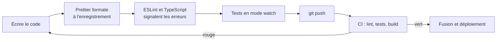

# 28 — L'outillage du développeur JavaScript

> **Niveau** : Intermédiaire · **Durée** : ~3 h · **Prérequis** : [Modules](../26-modules/README.md), [Node.js](../27-nodejs/README.md)

Un fichier `.js` et un navigateur suffisent pour apprendre. Dès qu'un projet grossit, qu'il utilise des bibliothèques ou qu'il est écrit à plusieurs, il faut des outils : un gestionnaire de paquets pour les dépendances, un serveur de développement et un bundler pour le navigateur, un formateur et un linter pour la qualité du code, une vérification de types et une intégration continue qui contrôle tout cela à chaque modification. Ce chapitre construit pas à pas un projet complet, outillé comme en entreprise, et explique le rôle de chaque pièce.

## Objectifs

- Créer et piloter un projet avec npm : `package.json`, dépendances, scripts, `npx`.
- Lire une plage de versions semver et comprendre le rôle du lockfile.
- Situer pnpm, Yarn et Bun par rapport à npm.
- Créer, développer et construire une application avec Vite.
- Formater avec Prettier et analyser avec ESLint (configuration « flat »), ou faire les deux avec Biome.
- Configurer VS Code et EditorConfig pour que toute l'équipe travaille de la même façon.
- Situer TypeScript et vérifier des types sans quitter JavaScript.
- Mettre en place une intégration continue GitHub Actions qui lance le lint, les tests et le build.

## Sommaire

- [Pourquoi des outils ?](#pourquoi-des-outils-)
- [npm et le fichier package.json](#npm-et-le-fichier-packagejson)
- [Versions sémantiques et lockfile](#versions-sémantiques-et-lockfile)
- [Sécurité des installations](#sécurité-des-installations)
- [pnpm, Yarn et Bun](#pnpm-yarn-et-bun)
- [Vite : serveur de développement et build](#vite--serveur-de-développement-et-build)
- [Prettier : le formatage automatique](#prettier--le-formatage-automatique)
- [ESLint : l'analyse statique](#eslint--lanalyse-statique)
- [Biome : l'alternative tout-en-un](#biome--lalternative-tout-en-un)
- [EditorConfig et VS Code](#editorconfig-et-vs-code)
- [TypeScript : vue d'ensemble](#typescript--vue-densemble)
- [Intégration continue avec GitHub Actions](#intégration-continue-avec-github-actions)
- [Navigateurs cibles : Baseline et browserslist](#navigateurs-cibles--baseline-et-browserslist)
- [Le poids des dépendances](#le-poids-des-dépendances)
- [Récapitulatif : le projet complet](#récapitulatif--le-projet-complet)
- [Pièges courants](#pièges-courants)
- [Bonnes pratiques](#bonnes-pratiques)
- [Résumé](#résumé)
- [Exercices](#exercices)
- [Pour aller plus loin](#pour-aller-plus-loin)

> [!NOTE]
> Les versions citées sont celles de novembre 2026 : npm 11 (livré avec Node.js 24 et 26) et npm 12, Vite 8, ESLint 10, Prettier 3.9, Biome 2.6, TypeScript 7, Vitest 5, pnpm 12. Les commandes et configurations de ce chapitre ont été testées telles quelles avec ces versions. Pour connaître la version actuelle d'un paquet : `npm view vite version`.

## Pourquoi des outils ?

Chaque outil répond à un problème précis. Si vous ne ressentez pas encore le problème, vous n'avez pas encore besoin de l'outil : un script de 50 lignes n'a besoin ni de Vite ni d'une CI.

| Problème | Outil | Quand il intervient |
| --- | --- | --- |
| Installer, mettre à jour et partager des bibliothèques | npm, pnpm, Yarn, Bun | à l'installation |
| Importer des paquets npm dans le navigateur, recharger la page à chaque modification, optimiser pour la production | Vite | en développement et au build |
| Des débats sans fin sur les espaces, les guillemets, les retours à la ligne | Prettier (ou Biome) | à l'enregistrement du fichier |
| Des bugs repérables sans exécuter le code (`=` au lieu de `===`, variable jamais utilisée) | ESLint (ou Biome) | pendant la frappe et avant chaque commit |
| Une fonction appelée avec une chaîne au lieu d'un nombre | TypeScript, ou JSDoc + `checkJs` | pendant la frappe |
| Une régression introduite sans s'en rendre compte | tests ([chapitre 29](../29-tests/README.md)) | à chaque modification |
| « Ça marche sur ma machine » | intégration continue | à chaque `push` et à chaque pull request |

Le circuit d'une modification dans un projet outillé ressemble à ceci :



## npm et le fichier package.json

**npm** est à la fois le gestionnaire de paquets livré avec Node.js et le registre public ([npmjs.com](https://www.npmjs.com/)) qui héberge plusieurs millions de paquets. Node.js 24 et 26 sont livrés avec npm 11 ; npm 12, sorti en juillet 2026, s'installe à part (`npm install -g npm@latest`).

### Créer un projet

```bash
mkdir mon-projet && cd mon-projet
npm init -y                       # crée un package.json avec les valeurs par défaut
npm pkg set type=module           # active les modules ES (import/export)
```

`npm init` sans `-y` pose les questions une par une. Avec npm 11 et 12, le `package.json` généré contient `"type": "commonjs"` : pensez à passer à `"module"` (ou utilisez directement `npm init -y --init-type=module`). Le [chapitre 26](../26-modules/README.md) explique la différence entre les deux.

### Anatomie d'un package.json

```json
{
  "name": "mon-app",
  "version": "1.2.0",
  "description": "Gestion de listes de courses",
  "private": true,
  "type": "module",
  "scripts": {
    "dev": "vite",
    "build": "vite build",
    "test": "vitest run"
  },
  "dependencies": {
    "date-fns": "^4.1.0"
  },
  "devDependencies": {
    "vite": "^8.3.6",
    "vitest": "^5.1.0"
  },
  "engines": {
    "node": ">=24"
  },
  "license": "MIT"
}
```

| Champ | Rôle |
| --- | --- |
| `name`, `version` | Identité du paquet. Obligatoires pour publier sur le registre. |
| `private: true` | Interdit toute publication accidentelle sur npm. À mettre dans toute application (par opposition à une bibliothèque). |
| `type` | `"module"` : les `.js` sont des modules ES ; `"commonjs"` (valeur implicite si le champ est absent) : ils sont CommonJS. |
| `scripts` | Commandes du projet, lancées par `npm run <nom>`. |
| `dependencies` | Paquets nécessaires à l'exécution du programme. |
| `devDependencies` | Paquets nécessaires seulement pour développer : outils de build, de test, de lint. |
| `peerDependencies` | Pour une bibliothèque : « je fonctionne avec la version de X que **vous** installez » (un plugin ESLint déclare `eslint` en peer). |
| `engines` | Versions de Node.js supportées. npm affiche un avertissement si elles ne correspondent pas. |
| `exports`, `imports`, `main` | Points d'entrée d'un paquet et alias internes ([chapitre 26](../26-modules/README.md)). |
| `bin` | Exécutables fournis par le paquet (c'est ainsi que `eslint` devient une commande). |
| `files` | Fichiers inclus lors de la publication. |

> [!TIP]
> Pour lire ou modifier le `package.json` en ligne de commande sans risquer une virgule mal placée : `npm pkg get scripts`, `npm pkg set scripts.lint="eslint ."`, `npm pkg delete scripts.lint`.

### Installer des dépendances

```bash
npm install date-fns          # dépendance d'exécution  → "dependencies"
npm install -D vitest         # dépendance de développement → "devDependencies" (--save-dev)
npm install -D -E prettier    # version exacte, sans ^ (--save-exact)
npm install                   # installe tout ce que liste le package.json (alias : npm i)
npm uninstall date-fns        # désinstalle et retire du package.json
```

Les paquets sont téléchargés dans `node_modules/`, un dossier qui ne se versionne **jamais** (ajoutez-le au `.gitignore`) : il se reconstruit à partir du `package.json` et du lockfile.

**`dependencies` ou `devDependencies` ?** Posez-vous la question : « le programme en a-t-il besoin pour tourner en production ? ». Pour un serveur Node.js, la distinction compte vraiment : en production, `npm ci --omit=dev` n'installe que les `dependencies`. Pour une application front construite par Vite, le code des bibliothèques est de toute façon copié dans le bundle ; la convention reste de ranger les outils (Vite, ESLint, Vitest) en `devDependencies` et les bibliothèques utilisées par le code (`date-fns`) en `dependencies`.

### Inspecter et entretenir

| Commande | Effet |
| --- | --- |
| `npm ls` | Arbre des dépendances directes (`--all` : tout l'arbre) |
| `npm explain <paquet>` | Pourquoi ce paquet est-il installé ? Qui en dépend ? |
| `npm outdated` | Dépendances pour lesquelles une version plus récente existe |
| `npm update` | Met à jour **dans les plages autorisées** du `package.json` (ne touche pas aux plages elles-mêmes) |
| `npm install vite@latest` | Passe à la dernière version, même s'il s'agit d'une nouvelle version majeure : lisez d'abord le guide de migration |
| `npm view <paquet>` | Informations du registre : versions, dépendances, dépôt, licence |
| `npm audit` | Vulnérabilités connues dans l'arbre installé |

### Les scripts

Les scripts donnent un vocabulaire commun à tout le projet : quel que soit l'outil sous-jacent, on lance `npm run dev`, `npm test` ou `npm run build`.

```json
{
  "scripts": {
    "dev": "vite",
    "build": "vite build",
    "lint": "eslint .",
    "test": "vitest run",
    "check": "npm run lint && npm test"
  }
}
```

```bash
npm run              # liste les scripts disponibles
npm run lint         # lance un script
npm test             # raccourci de npm run test (de même : npm start)
npm test -- --watch  # tout ce qui suit -- est transmis à la commande
node --run lint      # Node.js 22+ : lancement plus rapide, sans hooks pre/post
```

Trois règles à connaître :

1. Pendant un script, `node_modules/.bin` est ajouté au `PATH` : `"lint": "eslint ."` trouve l'ESLint **local** du projet, sans installation globale.
2. npm lance automatiquement `pre<nom>` avant et `post<nom>` après un script : `npm run build` exécute `prebuild`, `build`, puis `postbuild` s'ils existent. `node --run` ne le fait pas, volontairement.
3. `&&` enchaîne deux commandes et s'arrête à la première qui échoue ; il fonctionne aussi bien sous macOS et Linux que sous Windows.

### npx : exécuter sans installer

`npx` (alias de `npm exec`) lance l'exécutable d'un paquet. Si le paquet est installé dans le projet, c'est cette version qui est utilisée ; sinon, npx propose de le télécharger temporairement.

```bash
npx eslint src/                     # l'ESLint du projet
npx prettier --check .              # le Prettier du projet
npm create vite@latest              # équivaut à npx create-vite@latest
npx --yes cowsay "Bonjour"          # télécharge cowsay sans demander confirmation
```

> [!WARNING]
> `npx un-nom` télécharge et **exécute** le paquet du même nom s'il n'est pas installé. Une faute de frappe peut donc lancer un paquet malveillant au nom proche (*typosquatting*). Vérifiez le nom avant de confirmer, et n'utilisez `--yes` que pour des paquets que vous connaissez.

## Versions sémantiques et lockfile

### Semver : MAJEURE.MINEURE.CORRECTIF

Les paquets npm suivent la convention [semver](https://semver.org/lang/fr/) : dans `4.1.3`,

- **4** (majeure) change quand l'API change de façon incompatible : il faudra adapter votre code ;
- **1** (mineure) change quand on ajoute des fonctionnalités compatibles ;
- **3** (correctif) change pour des corrections de bugs compatibles.

Le `package.json` ne fixe pas une version mais une **plage** de versions acceptables :

| Plage | Signification | Accepte | Refuse |
| --- | --- | --- | --- |
| `4.1.3` | exactement cette version | `4.1.3` | `4.1.4` |
| `^4.1.3` | même majeure (valeur par défaut de `npm install`) | `4.1.4`, `4.9.0` | `5.0.0` |
| `~4.1.3` | même mineure | `4.1.9` | `4.2.0` |
| `^0.4.2` | en 0.x, la mineure joue le rôle de majeure | `0.4.9` | `0.5.0` |
| `^0.0.3` | en 0.0.x, rien d'autre que cette version | `0.0.3` | `0.0.4` |
| `>=24` | toute version supérieure ou égale | `24.0.0`, `26.13.0` | `22.22.0` |
| `*` | n'importe quelle version | tout | — |

Les préversions (`5.0.0-beta.1`) ne sont jamais retenues par une plage comme `^4.1.3` : il faut les demander explicitement.

> [!IMPORTANT]
> Semver est une **promesse** du mainteneur, pas une garantie. Une version mineure peut casser votre code par erreur. C'est l'une des raisons d'être du lockfile et des tests.

### Le lockfile

Si le `package.json` dit `"vite": "^8.3.6"`, deux développeurs qui installent à un mois d'écart peuvent obtenir `8.3.6` et `8.5.0`, sans parler des centaines de dépendances indirectes. Le fichier `package-lock.json` enregistre la version **exacte**, l'URL et l'empreinte (`integrity`) de chaque paquet de l'arbre :

```json
{
  "name": "mon-app",
  "lockfileVersion": 3,
  "packages": {
    "node_modules/vite": {
      "version": "8.3.6",
      "resolved": "https://registry.npmjs.org/vite/-/vite-8.3.6.tgz",
      "integrity": "sha512-…",
      "dev": true
    }
  }
}
```

- **Versionnez-le** (il fait partie du projet) et ne le modifiez jamais à la main.
- `npm install` respecte le lockfile mais le met à jour quand vous ajoutez ou changez une dépendance.
- `npm ci` (*clean install*) supprime `node_modules`, installe **exactement** ce que dit le lockfile et échoue s'il ne correspond pas au `package.json`. C'est la commande des intégrations continues et des déploiements.
- En cas de conflit Git dans le lockfile, résolvez le conflit du `package.json`, puis relancez `npm install` : npm régénère un lockfile cohérent.

## Sécurité des installations

Installer un paquet, c'est exécuter du code écrit par des inconnus, ainsi que celui de toutes ses dépendances. Quelques réflexes suffisent à éviter l'essentiel des problèmes (le [chapitre 27](../27-nodejs/README.md) revient sur la sécurité des dépendances côté serveur).

**Avant d'ajouter un paquet**, regardez sa page npm et son dépôt : nombre de téléchargements, date de la dernière version, nombre de mainteneurs, dépôt actif. `npm view <paquet>` en donne un aperçu.

**Les scripts d'installation.** Un paquet peut déclarer des scripts `preinstall`, `install` ou `postinstall` qui s'exécutent pendant `npm install`. C'est utile (compiler un module natif) mais c'est aussi le vecteur favori des attaques. npm durcit donc progressivement sa politique :

- depuis npm 11.16, `npm install` liste les dépendances dont les scripts d'installation n'ont pas été approuvés (ils s'exécutent encore, avec un avertissement) ;
- **npm 12** (juillet 2026) ne les exécute plus par défaut, et refuse aussi par défaut les dépendances installées depuis Git ou une URL distante.

On approuve explicitement les paquets de confiance ; la décision est enregistrée dans le champ `allowScripts` du `package.json`, qu'on versionne :

```bash
npm approve-scripts --allow-scripts-pending   # lister les paquets en attente
npm approve-scripts esbuild                   # approuver un paquet (version épinglée)
npm deny-scripts un-paquet                    # refuser explicitement
```

```json
{
  "allowScripts": {
    "esbuild@0.27.0": true,
    "un-paquet": false
  }
}
```

pnpm applique une politique similaire depuis sa version 10 (`pnpm approve-builds`).

**Les vulnérabilités connues.** `npm audit` compare l'arbre installé à la base d'alertes de GitHub. Interprétez le résultat avant d'agir :

```bash
npm audit                 # tout l'arbre
npm audit --omit=dev      # seulement ce qui part en production
npm audit fix             # mises à jour compatibles avec vos plages
```

> [!WARNING]
> `npm audit fix --force` accepte des changements de version **majeure**, y compris des retours en arrière : il peut par exemple proposer de rétrograder un outil d'une version majeure pour contourner une alerte de gravité modérée dans une de ses dépendances. Lisez ce qu'il propose. Une faille de déni de service dans un outil de lint, qui ne traite que votre propre code, n'a pas la même gravité qu'une faille dans le serveur qui reçoit les requêtes de vos utilisateurs.

## pnpm, Yarn et Bun

npm n'est pas le seul gestionnaire de paquets. Tous lisent le même `package.json` et téléchargent depuis le même registre ; ils diffèrent par leur vitesse, leur façon d'organiser `node_modules` et leur lockfile.

| | npm | pnpm | Yarn (v4) | Bun |
| --- | --- | --- | --- | --- |
| Installer tout | `npm install` | `pnpm install` | `yarn` | `bun install` |
| Ajouter | `npm install x` | `pnpm add x` | `yarn add x` | `bun add x` |
| Ajouter en dev | `npm install -D x` | `pnpm add -D x` | `yarn add -D x` | `bun add -d x` |
| Lancer un script | `npm run dev` | `pnpm dev` | `yarn dev` | `bun run dev` |
| Exécuter un paquet | `npx x` | `pnpm dlx x` | `yarn dlx x` | `bunx x` |
| Installation stricte (CI) | `npm ci` | `pnpm install --frozen-lockfile` | `yarn install --immutable` | `bun install --frozen-lockfile` |
| Lockfile | `package-lock.json` | `pnpm-lock.yaml` | `yarn.lock` | `bun.lock` |

- **pnpm** stocke chaque version de paquet une seule fois sur le disque et la relie dans les projets : installations rapides, gros gain de place, et un `node_modules` strict où un paquet ne peut pas importer une dépendance qu'il n'a pas déclarée. Très utilisé dans les monorepos.
- **Yarn** (version 4, dite « Berry ») propose par défaut le mode *Plug'n'Play*, sans dossier `node_modules`. La version 1 (« Classic ») n'évolue plus.
- **Bun** est un environnement d'exécution complet (comme Node.js) dont le gestionnaire de paquets, très rapide, peut s'utiliser seul dans un projet Node.

Le champ `packageManager` du `package.json` (par exemple `"packageManager": "pnpm@12.18.0"`) indique quel outil le projet utilise. Corepack, l'utilitaire qui installait automatiquement la bonne version, n'est plus livré avec Node.js depuis la version 25 : installez pnpm ou Yarn vous-même (`npm install -g pnpm@latest`), ou installez Corepack séparément (`npm install -g corepack`).

> [!TIP]
> Un projet, un gestionnaire, un lockfile. Si vous trouvez à la fois `package-lock.json` et `pnpm-lock.yaml` dans un dépôt, l'équipe n'installe pas les mêmes versions. Pour débuter, npm suffit largement.

## Vite : serveur de développement et build

Les navigateurs savent charger des modules ES (`<script type="module">`, [chapitre 26](../26-modules/README.md)). Pourquoi un outil de plus ? Parce qu'un vrai projet a besoin de :

- importer des paquets npm par leur nom (`import confetti from "canvas-confetti"`), ce que le navigateur ne sait pas résoudre seul (sans *import map*) ;
- voir ses modifications sans recharger la page ni perdre l'état (*Hot Module Replacement*, HMR) ;
- importer du CSS, des images, du JSON depuis le JavaScript ;
- produire pour la production des fichiers minifiés, regroupés, dont le nom contient une empreinte (`index-CAoPt-vL.js`) pour que le cache des navigateurs ne serve jamais une ancienne version.

[Vite](https://vite.dev/) fait tout cela avec presque aucune configuration. En développement, il sert vos fichiers comme des modules ES natifs, transformés à la demande ; pour la production, il les regroupe en un *bundle*. Depuis Vite 8 (mars 2026), un seul bundler écrit en Rust, **Rolldown**, remplace les deux outils utilisés auparavant (esbuild pour le pré-regroupement des dépendances, Rollup pour le build).

### Créer un projet

```bash
npm create vite@latest mon-app -- --template vanilla
cd mon-app
npm install
npm run dev
```

Le `--` sépare les options de npm de celles de `create-vite`. Sans `--template`, l'outil propose un menu : `vanilla` (JavaScript sans framework), `vue`, `react`, `preact`, `lit`, `svelte`, `solid`, `qwik`, chacun existant aussi en variante TypeScript (`vanilla-ts`…).

```text
mon-app/
├── index.html          ← point d'entrée : Vite part du HTML
├── package.json
├── public/             ← fichiers copiés tels quels (favicon, robots.txt)
│   └── favicon.svg
└── src/
    ├── main.js         ← chargé par <script type="module" src="/src/main.js">
    ├── counter.js
    ├── style.css
    └── assets/         ← images importées depuis le JS (nom avec empreinte au build)
```

Le `package.json` généré est minimal :

```json
{
  "name": "mon-app",
  "private": true,
  "version": "0.0.0",
  "type": "module",
  "scripts": {
    "dev": "vite",
    "build": "vite build",
    "preview": "vite preview"
  },
  "devDependencies": {
    "vite": "^8.3.6"
  }
}
```

### Les trois commandes

| Commande | Rôle | Adresse par défaut |
| --- | --- | --- |
| `npm run dev` | Serveur de développement avec HMR. Les fichiers sont servis à la demande, sans bundle. | `http://localhost:5173/` |
| `npm run build` | Construit la version de production dans `dist/`. | — |
| `npm run preview` | Sert le contenu de `dist/` pour le vérifier localement (ce n'est pas un serveur de production). | `http://localhost:4173/` |

```text
$ npm run build
vite v8.3.6 building client environment for production...
transforming...
✓ 9 modules transformed.
rendering chunks...
computing gzip size...
dist/index.html                  0.45 kB │ gzip: 0.29 kB
dist/assets/vite-BF8QNONU.svg    8.70 kB │ gzip: 1.60 kB
dist/assets/hero-CLDdwZDr.png   13.05 kB
dist/assets/index-CsUDhMuy.css   4.10 kB │ gzip: 1.46 kB
dist/assets/index-CAoPt-vL.js    4.05 kB │ gzip: 1.77 kB
✓ built in 119ms
```

Le dossier `dist/` est un site statique : il se déploie tel quel sur n'importe quel hébergeur (GitHub Pages, Netlify, un serveur nginx…).

### Importer autre chose que du JavaScript

Vite comprend les imports de CSS et de fichiers. Ce code tourne dans le navigateur, servi par Vite :

<!-- no-run -->
```js
import "./style.css"; // injecte la feuille de style dans la page
import logoUrl from "./assets/logo.svg"; // URL du fichier (avec empreinte au build)
import confetti from "canvas-confetti"; // paquet npm, résolu par Vite

document.querySelector("#logo").src = logoUrl;
document.querySelector("#bravo").addEventListener("click", () => confetti());
```

### Variables d'environnement

Vite lit les fichiers `.env`, `.env.local`, `.env.production`… et expose dans `import.meta.env` **uniquement** les variables préfixées par `VITE_`, plus quelques valeurs intégrées :

```bash
# .env
VITE_API_URL=https://api.exemple.fr
CLE_SECRETE=ne-doit-pas-fuiter
```

<!-- no-run -->
```js
console.log(import.meta.env.VITE_API_URL); // https://api.exemple.fr
console.log(import.meta.env.CLE_SECRETE); // undefined : pas de préfixe VITE_, non exposée
console.log(import.meta.env.MODE); // development (avec npm run dev), production (au build)
console.log(import.meta.env.DEV, import.meta.env.PROD); // true false en développement
```

> [!WARNING]
> Tout ce qui est dans `import.meta.env.VITE_*` est **écrit en clair dans le bundle** envoyé aux navigateurs. Une clé d'API secrète n'a rien à faire dans du code front : elle reste sur un serveur. Les fichiers `.env.local` (non versionnés) servent aux valeurs propres à votre machine.

### Configurer Vite

La plupart des projets n'ont pas besoin de `vite.config.js`. Les options les plus courantes :

<!-- no-run -->
```js
// vite.config.js
import { defineConfig } from "vite";

export default defineConfig({
  base: "/mon-app/", // site publié dans un sous-dossier (ex. GitHub Pages d'un dépôt)
  build: {
    sourcemap: true, // fichiers .map pour déboguer la production
  },
  server: {
    port: 3000,
    open: true, // ouvre le navigateur au démarrage
  },
});
```

Par défaut, Vite 8 produit du code pour les navigateurs **Baseline « largement disponible »** (au 1ᵉʳ janvier 2026) : Chrome et Edge 111, Firefox 114, Safari 16.4 et plus récents. Vite ne transforme que la syntaxe : il n'ajoute pas de polyfill pour une API absente d'un navigateur (voir [Navigateurs cibles](#navigateurs-cibles--baseline-et-browserslist)).

> [!NOTE]
> Vite ne vérifie ni les types ni la qualité du code : un fichier TypeScript plein d'erreurs de type est servi sans broncher. C'est le rôle de `tsc`, d'ESLint et des tests, lancés à côté.

## Prettier : le formatage automatique

Sans formateur, chaque revue de code dérive vers des remarques de style (« il manque un espace », « on met des guillemets doubles ici »), et chaque commit mélange de vraies modifications à des changements d'indentation. [Prettier](https://prettier.io/) supprime le problème : il **réécrit** entièrement la mise en forme selon des règles fixes. Il ne vérifie pas que le code est correct, seulement sa présentation.

```bash
npm install -D -E prettier
echo '{}' > .prettierrc.json
```

La documentation de Prettier recommande `-E` (version exacte) : même une version de correctif peut modifier légèrement la mise en forme, et toute l'équipe doit formater à l'identique. Un `.prettierrc.json` vide signifie « réglages par défaut » ; sa présence indique aussi aux éditeurs que le projet utilise Prettier.

Avant :

```js
const panier={articles:[{nom:'Stylo',prix:150},{nom:'Cahier',prix:320}],remise:0}
function total(p){return p.articles.reduce((s,a)=>s+a.prix,0)-p.remise}
```

Après `npx prettier --write .` :

```js
const panier = {
  articles: [
    { nom: "Stylo", prix: 150 },
    { nom: "Cahier", prix: 320 },
  ],
  remise: 0,
};
function total(p) {
  return p.articles.reduce((s, a) => s + a.prix, 0) - p.remise;
}
```

```bash
npx prettier --write .     # formate tous les fichiers pris en charge (JS, CSS, HTML, JSON, Markdown, YAML…)
npx prettier --check .     # vérifie sans modifier : échoue si un fichier n'est pas formaté (idéal en CI)
```

Prettier ignore déjà `node_modules`, les dossiers de Git et, s'il est lancé depuis la racine du projet, tout ce que liste le `.gitignore`. Pour exclure d'autres fichiers, créez un `.prettierignore` (même syntaxe que `.gitignore`) :

```text
dist
coverage
package-lock.json
```

Les options principales, avec leur valeur par défaut :

| Option | Défaut | Effet |
| --- | --- | --- |
| `printWidth` | `80` | Largeur de ligne visée |
| `tabWidth` / `useTabs` | `2` / `false` | Indentation |
| `semi` | `true` | Points-virgules en fin d'instruction |
| `singleQuote` | `false` | Guillemets simples au lieu de doubles |
| `trailingComma` | `"all"` | Virgule après le dernier élément d'une liste sur plusieurs lignes |

```json
{
  "singleQuote": true,
  "printWidth": 100
}
```

Ne changez ces options que si l'équipe y tient vraiment : l'intérêt de Prettier est justement de ne plus en discuter. Ce cours utilise les réglages par défaut. Pour exclure exceptionnellement un passage du formatage (une matrice alignée à la main, par exemple), précédez-le d'un commentaire `// prettier-ignore`.

## ESLint : l'analyse statique

Un **linter** lit votre code sans l'exécuter et signale les constructions suspectes. Ce programme s'exécute sans erreur… et contient quatre bugs :

```js
function droits(utilisateur) {
  if ((utilisateur.role = "admin")) return "tout"; // = au lieu de === : affecte "admin"
  return "lecture";
}
console.log(droits({ role: "invité" })); // tout  ← un invité a tous les droits !

const prix = Number("douze");
console.log(prix === NaN); // false  ← NaN n'est égal à rien, pas même à lui-même
console.log(typeof prix === "nubmer"); // false  ← faute de frappe

const config = { port: 3000, hote: "localhost", port: 8080 };
console.log(config.port); // 8080  ← la première valeur est silencieusement écrasée
```

ESLint les trouve tous, avant même la première exécution :

```text
$ npx eslint src/bugs.js

src/bugs.js
   2:8   error  Unexpected constant condition               no-constant-condition
   8:13  error  Use the isNaN function to compare with NaN  use-isnan
   9:29  error  Invalid typeof comparison value             valid-typeof
  11:49  error  Duplicate key 'port'                        no-dupe-keys

✖ 4 problems (4 errors, 0 warnings)
```

Chaque ligne donne la position (ligne:colonne), la gravité, le message et le nom de la règle : la documentation de chaque règle, sur [eslint.org/docs/latest/rules](https://eslint.org/docs/latest/rules/), explique le problème et la correction. Ici, la condition du `if` est une affectation de valeur constante, donc toujours vraie.

Prettier et ESLint sont **complémentaires** : le premier s'occupe de la forme, le second du fond.

### Installer et configurer (configuration « flat »)

La façon la plus rapide est l'assistant officiel, qui pose quelques questions et écrit la configuration :

```bash
npm init @eslint/config@latest
```

Ou à la main :

```bash
npm install -D eslint @eslint/js globals
```

La configuration se trouve dans `eslint.config.js` à la racine du projet. C'est un module JavaScript qui exporte un **tableau d'objets de configuration** : pour chaque fichier analysé, ESLint fusionne, dans l'ordre, tous les objets qui le concernent. Voici une configuration complète pour un projet Vite (code navigateur) avec quelques fichiers Node.js :

<!-- no-run -->
```js
// eslint.config.js
import js from "@eslint/js";
import { defineConfig, globalIgnores } from "eslint/config";
import globals from "globals";

export default defineConfig([
  // 1. Dossiers générés : jamais analysés
  globalIgnores(["dist/", "coverage/"]),

  // 2. Tout le JavaScript du projet : règles recommandées + quelques ajouts
  {
    files: ["**/*.{js,mjs}"],
    plugins: { js },
    extends: ["js/recommended"],
    languageOptions: {
      globals: globals.browser, // window, document, fetch… sont connus
    },
    rules: {
      eqeqeq: "error", // === obligatoire
      "no-var": "error",
      "prefer-const": "error",
      "no-unused-vars": ["error", { argsIgnorePattern: "^_" }], // _inutile est toléré
    },
  },

  // 3. Fichiers exécutés par Node.js : process, __dirname… sont connus
  {
    files: ["*.config.js", "scripts/**/*.js"],
    languageOptions: { globals: globals.node },
  },
]);
```

Les éléments clés :

| Élément | Rôle |
| --- | --- |
| `defineConfig([...])` | Valide la structure et active `extends`. Importé de `eslint/config`. |
| `globalIgnores([...])` | Fichiers et dossiers exclus de l'analyse. `node_modules/` et `.git/` le sont déjà. |
| `files` | Motifs *glob* des fichiers concernés par cet objet. |
| `plugins` + `extends` | Charge un ensemble de règles prêt à l'emploi (`js/recommended` : les règles qui signalent des erreurs probables). |
| `languageOptions.globals` | Variables globales autorisées. Le paquet `globals` fournit les listes `browser`, `node`, `worker`… Par défaut, le code est analysé comme un module ES de la dernière version du langage. |
| `rules` | Active, désactive ou paramètre des règles : `"off"`, `"warn"` ou `"error"`, éventuellement suivi d'options (`["error", { … }]`). |

> [!NOTE]
> ESLint 10 (février 2026) ne connaît plus que ce format. Les anciens fichiers `.eslintrc.json` ou `.eslintrc.js`, encore très présents dans les tutoriels, ne sont plus lus du tout. ESLint 10 cherche aussi `eslint.config.js` à partir du dossier de chaque fichier analysé, en remontant vers la racine. Les fichiers `eslint.config.mjs`, `.cjs` et `.ts` sont également acceptés.

### Lancer ESLint

```bash
npx eslint .          # analyse tout le projet
npx eslint . --fix    # corrige automatiquement ce qui peut l'être (prefer-const, par exemple)
```

Le code de sortie vaut 1 s'il reste au moins une erreur : c'est ce qui fait échouer la CI. Les avertissements (`"warn"`) n'en provoquent pas, sauf avec `--max-warnings 0`.

Désactiver une règle ponctuellement doit rester exceptionnel et justifié ; ESLint accepte une explication après `--` :

```js
function libelle(valeur) {
  // eslint-disable-next-line eqeqeq -- == null couvre à la fois null et undefined
  if (valeur == null) return "inconnu";
  return String(valeur);
}

console.log(libelle(undefined), libelle(null), libelle(0)); // inconnu inconnu 0
```

Si l'exception devient la règle, ajustez plutôt la configuration : `eqeqeq: ["error", "always", { null: "ignore" }]` autorise précisément `== null` partout.

### ESLint et Prettier ensemble

Les règles de mise en forme d'ESLint (indentation, espaces, guillemets) sont dépréciées depuis la version 8.53 et absentes de `js/recommended` : avec la configuration ci-dessus, ESLint et Prettier ne se contredisent pas. Si vous ajoutez un plugin qui réactive des règles de style, ajoutez `eslint-config-prettier` **en dernier** dans le tableau : il désactive toutes les règles qui feraient doublon avec Prettier.

<!-- no-run -->
```js
import prettier from "eslint-config-prettier/flat";
// …
export default defineConfig([
  // … vos objets de configuration …
  prettier, // toujours en dernier
]);
```

### Aller plus loin avec les plugins

L'écosystème fournit des plugins pour chaque besoin : `typescript-eslint` pour TypeScript, `eslint-plugin-react-hooks`, `eslint-plugin-vue`, `@vitest/eslint-plugin`, ou encore `@eslint/json` et `@eslint/markdown` pour analyser d'autres langages. Pour la vitesse, **Oxlint** (écrit en Rust) reprend plusieurs centaines de règles d'ESLint et s'exécute beaucoup plus vite ; c'est le linter proposé par défaut par `create-vite` pour les modèles React.

## Biome : l'alternative tout-en-un

[Biome](https://biomejs.dev/) réunit un formateur (compatible à 97 % avec Prettier d'après ses auteurs) et un linter (plusieurs centaines de règles, dont beaucoup reprises d'ESLint) dans un seul exécutable écrit en Rust. Une dépendance au lieu de quatre ou cinq, un fichier de configuration, et une vitesse nettement supérieure.

```bash
npm install -D -E @biomejs/biome
npx @biomejs/biome init        # crée biome.json
```

Une configuration alignée sur le style de ce cours (espaces plutôt que tabulations, qui sont le défaut de Biome) :

```json
{
  "$schema": "https://biomejs.dev/schemas/2.6.5/schema.json",
  "vcs": { "enabled": true, "clientKind": "git", "useIgnoreFile": true },
  "formatter": { "enabled": true, "indentStyle": "space", "indentWidth": 2 },
  "linter": {
    "enabled": true,
    "rules": { "preset": "recommended" }
  },
  "javascript": { "formatter": { "quoteStyle": "double" } }
}
```

`useIgnoreFile: true` fait respecter le `.gitignore`. Les commandes :

```bash
npx biome check .            # formatage + lint + tri des imports, sans rien modifier
npx biome check --write .    # applique les corrections sûres
npx biome format --write .   # formatage seul
npx biome lint .             # lint seul
npx biome ci .               # comme check, avec une sortie adaptée à la CI
npx biome migrate eslint --write    # convertit une configuration ESLint existante
npx biome migrate prettier --write  # reprend les options de Prettier
```

| | ESLint + Prettier | Biome |
| --- | --- | --- |
| Outils à installer | 2 à 5 paquets | 1 |
| Fichiers de configuration | 2 ou plus | 1 |
| Vitesse | bonne | très élevée |
| Langages | JS, TS, et beaucoup d'autres via les plugins | JS, TS, JSX, JSON, CSS, GraphQL, HTML (partiel) |
| Plugins et règles spécialisées | écosystème immense | plus restreint |
| Quand le choisir | projet qui dépend de plugins ESLint précis (framework, accessibilité, sécurité) | nouveau projet qui veut une configuration minimale |

Les deux choix sont bons ; l'important est d'en faire un et de l'appliquer partout, en local comme en CI.

## EditorConfig et VS Code

### EditorConfig

Le fichier `.editorconfig` décrit les réglages de base (encodage, fins de ligne, indentation) que la plupart des éditeurs savent appliquer, nativement ou avec une extension. Prettier le lit aussi : sans `.prettierrc` contraire, il en reprend l'indentation.

```ini
# .editorconfig
root = true

[*]
charset = utf-8
end_of_line = lf
indent_style = space
indent_size = 2
insert_final_newline = true
trim_trailing_whitespace = true

[*.md]
trim_trailing_whitespace = false
```

(Dans Markdown, deux espaces en fin de ligne forcent un retour à la ligne : on ne les supprime pas.)

### VS Code

[Visual Studio Code](https://code.visualstudio.com/) comprend JavaScript dès l'installation : autocomplétion (IntelliSense, alimentée par TypeScript même dans du JavaScript), navigation (`F12` : aller à la définition), renommage sûr (`F2`), débogueur intégré. Quelques extensions complètent l'outillage de ce chapitre :

| Extension | Identifiant | Rôle |
| --- | --- | --- |
| ESLint | `dbaeumer.vscode-eslint` | Souligne les erreurs ESLint pendant la frappe |
| Prettier | `esbenp.prettier-vscode` | Formate avec le Prettier du projet |
| Biome | `biomejs.biome` | Formatage et lint avec Biome (remplace les deux précédentes) |
| EditorConfig | `EditorConfig.EditorConfig` | Applique le `.editorconfig` |
| Vitest | `vitest.explorer` | Lance et débogue les tests depuis l'éditeur |

Versionnez dans le dépôt un dossier `.vscode/` avec deux fichiers : les extensions recommandées (VS Code propose de les installer à l'ouverture du projet) et les réglages communs.

```json
{
  "recommendations": [
    "dbaeumer.vscode-eslint",
    "esbenp.prettier-vscode",
    "EditorConfig.EditorConfig"
  ]
}
```

```json
{
  "editor.formatOnSave": true,
  "editor.defaultFormatter": "esbenp.prettier-vscode",
  "editor.codeActionsOnSave": {
    "source.fixAll.eslint": "explicit"
  }
}
```

Le premier va dans `.vscode/extensions.json`, le second dans `.vscode/settings.json` : chaque enregistrement formate le fichier et applique les corrections automatiques d'ESLint.

### Le débogueur

Plutôt que de multiplier les `console.log`, posez un **point d'arrêt** (clic dans la marge, à gauche du numéro de ligne) et exécutez le code sous le débogueur : l'exécution s'arrête sur la ligne, et vous inspectez les variables, la pile d'appels, et avancez instruction par instruction (`F10`, `F11`).

- **Pour Node.js** : ouvrez un *JavaScript Debug Terminal* (palette de commandes, `Ctrl+Maj+P` ou `Cmd+Maj+P`, puis « Debug: JavaScript Debug Terminal »). Tout ce que vous y lancez (`node script.js`, `npm test`, `npm run dev`) s'arrête sur vos points d'arrêt.
- **Pour le navigateur** : lancez `npm run dev`, puis une configuration qui ouvre Chrome relié à VS Code, dans `.vscode/launch.json` :

```json
{
  "version": "0.2.0",
  "configurations": [
    {
      "type": "chrome",
      "request": "launch",
      "name": "Déboguer l'app Vite dans Chrome",
      "url": "http://localhost:5173",
      "webRoot": "${workspaceFolder}"
    }
  ]
}
```

L'instruction `debugger;` dans le code produit le même effet qu'un point d'arrêt quand un débogueur est attaché. Le [chapitre 17](../17-erreurs/README.md) détaille les techniques de débogage.

## TypeScript : vue d'ensemble

JavaScript ne vérifie les types qu'à l'exécution, et seulement quand il le faut : `prixTtc("12", 0.2)` ne lève aucune erreur, il produit silencieusement un résultat faux. [TypeScript](https://www.typescriptlang.org/) est un **sur-ensemble de JavaScript** qui ajoute des annotations de types, vérifiées **avant** l'exécution par le compilateur `tsc`. Les types sont ensuite effacés : ce qui s'exécute reste du JavaScript.

```ts
type Article = { nom: string; prixCentimes: number; quantite: number };

export function total(articles: Article[]): number {
  return articles.reduce((somme, a) => somme + a.prixCentimes * a.quantite, 0);
}

total([{ nom: "Stylo", prixCentimes: "150", quantite: 2 }]);
// error TS2322: Type 'string' is not assignable to type 'number'.
```

Ce qu'apporte TypeScript :

- des erreurs détectées pendant la frappe plutôt qu'en production ;
- une autocomplétion et des renommages fiables, même dans un gros projet ;
- une documentation vivante : la signature d'une fonction dit ce qu'elle attend et renvoie.

Où l'utiliser aujourd'hui :

- **Vite** accepte les fichiers `.ts` sans configuration (il efface les types, sans les vérifier) ;
- **Node.js** exécute directement les fichiers `.ts` en effaçant les types, là aussi sans vérification ([chapitre 27](../27-nodejs/README.md)) ;
- la **vérification** elle-même se fait avec `tsc --noEmit` (analyse sans produire de fichier), dans l'éditeur, en script npm et en CI.

> [!NOTE]
> **TypeScript 7.0** (juillet 2026) est une réécriture du compilateur en Go, de 8 à 12 fois plus rapide selon Microsoft sur une compilation complète. Il s'installe toujours avec `npm install -D typescript` et fournit la même commande `tsc`. Il active `strict` par défaut, ne charge plus automatiquement les déclarations de types de `node_modules/@types` (`types` vaut `[]` : ajoutez `"types": ["node"]` et le paquet `@types/node` pour les globales de Node.js) et abandonne de vieilles options (`target: "es5"`, `baseUrl`). Il ne fournit pas encore d'API de programmation : les outils qui en dépendent (comme `typescript-eslint`) peuvent s'appuyer en attendant sur le paquet de compatibilité `@typescript/typescript6`.

### Vérifier du JavaScript sans le réécrire

Vous pouvez profiter de la vérification de TypeScript en restant en JavaScript : les types s'écrivent dans des commentaires **JSDoc**, et `tsc` les vérifie grâce à l'option `checkJs`. Le [chapitre 30](../30-commentaires-jsdoc/README.md) détaille la syntaxe ; voici la mise en place :

```bash
npm install -D typescript
```

```json
{
  "compilerOptions": {
    "allowJs": true,
    "checkJs": true,
    "noEmit": true,
    "target": "es2024",
    "module": "preserve"
  },
  "include": ["src"]
}
```

Ce `tsconfig.json` demande de vérifier tous les fichiers de `src/`, sans rien générer. Avec ce fichier `src/prix.js` :

<!-- no-run -->
```js
/**
 * Calcule un prix TTC arrondi au centime.
 * @param {number} prixHtCentimes
 * @param {number} tauxTva Taux sous forme décimale (0.2 pour 20 %)
 * @returns {number}
 */
export function prixTtc(prixHtCentimes, tauxTva) {
  return Math.round(prixHtCentimes * (1 + tauxTva));
}

const saisie = document.querySelector("#prix");
prixTtc(saisie.value, 0.2);
```

```text
$ npx tsc
src/prix.js(12,9): error TS18047: 'saisie' is possibly 'null'.
src/prix.js(12,16): error TS2339: Property 'value' does not exist on type 'Element'.
```

Deux vrais problèmes : l'élément peut ne pas exister, et `querySelector` ne sait pas qu'il s'agit d'un `<input>`. (Même corrigés, `saisie.value` reste une chaîne : TypeScript le signalerait à son tour.) Ajoutez `"typecheck": "tsc"` aux scripts pour lancer la vérification avec `npm run typecheck`. Pour une adoption progressive, commencez sans `checkJs` et ajoutez `// @ts-check` en tête des fichiers un par un.

## Intégration continue avec GitHub Actions

Les outils précédents ne servent que s'ils sont lancés. L'**intégration continue** (CI) les lance automatiquement sur un serveur à chaque `push` et à chaque pull request, dans un environnement propre : si le lint, les tests ou le build échouent, la modification est signalée en rouge avant d'être fusionnée.

Sur GitHub, une CI est un fichier YAML dans `.github/workflows/` :

```yaml
# .github/workflows/ci.yml
name: CI

on:
  push:
    branches: [main]
  pull_request:

permissions:
  contents: read

jobs:
  verifier:
    runs-on: ubuntu-latest
    strategy:
      matrix:
        node-version: [24, 26]
    steps:
      - uses: actions/checkout@v7
      - uses: actions/setup-node@v7
        with:
          node-version: ${{ matrix.node-version }}
          cache: npm
      - run: npm ci
      - run: npm run lint
      - run: npm run format:check
      - run: npm test
      - run: npm run build
```

Ligne à ligne :

| Clé | Rôle |
| --- | --- |
| `on` | Déclencheurs : chaque `push` sur `main` et chaque pull request. |
| `permissions` | Droits du jeton fourni au workflow : ici, lecture seule du dépôt (principe du moindre privilège). |
| `jobs.verifier.runs-on` | Machine virtuelle utilisée, recréée à neuf à chaque exécution. |
| `strategy.matrix` | Lance le job deux fois en parallèle, avec Node.js 24 et 26 (les deux LTS les plus récentes en novembre 2026). |
| `actions/checkout@v7` | Récupère le code du dépôt. |
| `actions/setup-node@v7` | Installe Node.js ; `cache: npm` met en cache les téléchargements entre deux exécutions. |
| `run: npm ci` | Installation stricte à partir du lockfile. |
| `run: npm run …` | Chaque étape qui échoue (code de sortie non nul) arrête le job et le marque en échec. |

Pour aller plus loin :

- dans les réglages du dépôt (*Settings → Rules*), exigez que la CI soit verte avant toute fusion dans `main` ;
- ajoutez un badge à votre README : `` ;
- laissez **Dependabot** proposer les mises à jour de dépendances sous forme de pull requests, testées par la CI :

```yaml
# .github/dependabot.yml
version: 2
updates:
  - package-ecosystem: npm
    directory: /
    schedule:
      interval: weekly
    groups:
      outils-de-dev:
        dependency-type: development
```

Le regroupement (`groups`) réunit toutes les mises à jour d'outils de développement dans une seule pull request par semaine, au lieu d'une par paquet.

## Navigateurs cibles : Baseline et browserslist

Quelle syntaxe et quelles API pouvez-vous utiliser sans risque ? **Baseline** répond à cette question pour la plate-forme web. Une fonctionnalité est :

- **Baseline « nouvellement disponible »** quand elle fonctionne dans la dernière version de tous les navigateurs principaux (Chrome, Edge, Firefox, Safari, sur ordinateur et mobile) ;
- **Baseline « largement disponible »** trente mois plus tard, quand la grande majorité des utilisateurs a mis à jour.

MDN et [caniuse.com](https://caniuse.com/) affichent ce statut pour chaque fonctionnalité. Ce cours indique aussi la version ECMAScript de chaque nouveauté : une fonctionnalité ES2025 n'est pas forcément Baseline « largement disponible » en 2026.

Les outils, eux, ont besoin d'une liste de navigateurs. Deux mécanismes coexistent :

- **Vite** utilise son option `build.target`, qui vaut par défaut Baseline « largement disponible » (voir plus haut) ;
- de nombreux autres outils (Autoprefixer, Lightning CSS, `@babel/preset-env`, le plugin ESLint `eslint-plugin-compat`) lisent une requête **browserslist**, dans un fichier `.browserslistrc` ou dans le champ `"browserslist"` du `package.json` :

```text
# .browserslistrc
baseline widely available
```

`npx browserslist "baseline widely available"` affiche les versions précises que cette requête désigne. La transpilation (et la question de savoir quand on en a encore besoin) est traitée au [chapitre 11](../11-syntaxe-moderne/README.md).

## Le poids des dépendances

Chaque dépendance a un coût : du code à télécharger, des dépendances indirectes, des mises à jour à suivre, une surface d'attaque. Les outils de ce chapitre (Vite, ESLint, Prettier, Vitest, TypeScript) représentent à eux seuls plus d'une centaine de paquets et plus de 100 Mo dans `node_modules`, mais ce sont des `devDependencies` : rien n'arrive dans le navigateur de vos utilisateurs. Ce qui compte pour eux, c'est la taille du **bundle**, affichée par `npm run build` (colonne `gzip`).

Avant d'ajouter une bibliothèque, vérifiez si la plate-forme ne fait pas déjà le travail. Beaucoup de dépendances très populaires ont aujourd'hui un équivalent natif :

```js
// lodash.clonedeep → structuredClone
const commande = {
  id: 42,
  client: { nom: "Ada" },
  creeLe: new Date("2026-11-06T09:00:00Z"),
};
const copie = structuredClone(commande);
copie.client.nom = "Grace";
console.log(commande.client.nom, copie.creeLe instanceof Date); // Ada true

// uuid → crypto.randomUUID
const id = crypto.randomUUID(); // aléatoire, par ex. "3b241101-e2bb-4255-8caf-4136c566a962"
console.log(id.length, id[14]); // 36 4  ← 36 caractères, « 4 » = UUID version 4

// moment → Intl.DateTimeFormat (et Temporal, chapitre 15)
const date = new Intl.DateTimeFormat("fr-FR", {
  dateStyle: "long",
  timeZone: "Europe/Paris",
});
console.log(date.format(commande.creeLe)); // 6 novembre 2026

// lodash.groupby, lodash.sortby, lodash.uniq → méthodes natives
const articles = [
  { nom: "Stylo", categorie: "papeterie", prix: 150 },
  { nom: "Clé USB", categorie: "informatique", prix: 900 },
  { nom: "Cahier", categorie: "papeterie", prix: 320 },
];
console.log(Object.keys(Object.groupBy(articles, (a) => a.categorie))); // [ 'papeterie', 'informatique' ]
console.log(articles.toSorted((a, b) => b.prix - a.prix).map((a) => a.nom)); // [ 'Clé USB', 'Cahier', 'Stylo' ]
console.log([...new Set(articles.map((a) => a.categorie))]); // [ 'papeterie', 'informatique' ]

// accounting.js, numeral → Intl.NumberFormat
const euros = new Intl.NumberFormat("fr-FR", {
  style: "currency",
  currency: "EUR",
});
console.log(euros.format(1370 / 100)); // 13,70 €
```

De même, `fetch` ([chapitre 22](../22-fetch-http/README.md)) suffit dans la plupart des cas où l'on installait axios. Quelques questions à se poser avant `npm install` :

1. La plate-forme le fait-elle déjà (MDN, chapitre [31](../31-aide-memoire/README.md) de ce cours) ?
2. Combien de lignes faudrait-il pour l'écrire soi-même, avec ses tests ?
3. Le paquet est-il maintenu, et combien de dépendances apporte-t-il (`npm view <paquet> dependencies`) ?
4. Quel est son poids une fois minifié (sites comme [pkg-size.dev](https://pkg-size.dev/) ou [bundlephobia.com](https://bundlephobia.com/)) ?

L'initiative communautaire [e18e](https://e18e.dev/) recense des remplacements plus légers pour de nombreux paquets courants.

## Récapitulatif : le projet complet

Voici l'état final du projet construit dans ce chapitre (application Vite, Prettier, ESLint, tests Vitest du [chapitre 29](../29-tests/README.md), CI) :

```text
mon-app/
├── .github/workflows/ci.yml
├── .vscode/
│   ├── extensions.json
│   └── settings.json
├── .editorconfig
├── .gitignore
├── .prettierignore
├── .prettierrc.json
├── eslint.config.js
├── index.html
├── package.json
├── package-lock.json
├── public/
└── src/
    ├── main.js
    ├── panier.js
    └── panier.test.js
```

```json
{
  "name": "mon-app",
  "version": "0.1.0",
  "private": true,
  "type": "module",
  "scripts": {
    "dev": "vite",
    "build": "vite build",
    "preview": "vite preview",
    "lint": "eslint .",
    "format": "prettier --write .",
    "format:check": "prettier --check .",
    "test": "vitest run",
    "test:watch": "vitest",
    "check": "npm run lint && npm run format:check && npm test"
  },
  "devDependencies": {
    "@eslint/js": "^10.0.1",
    "eslint": "^10.14.0",
    "globals": "^17.14.0",
    "prettier": "3.9.10",
    "vite": "^8.3.6",
    "vitest": "^5.1.0"
  },
  "engines": {
    "node": ">=24"
  }
}
```

Au quotidien : `npm run dev` et `npm run test:watch` dans deux terminaux, l'éditeur formate à chaque enregistrement, et `npm run check` avant de pousser, pour ne pas découvrir l'erreur dans la CI.

## Pièges courants

- **Versionner `node_modules`** : des centaines de mégaoctets dans le dépôt, des binaires propres à un système d'exploitation. Seuls `package.json` et le lockfile se versionnent.
- **Ne pas versionner le lockfile**, ou le supprimer « pour régler un problème » : chaque installation peut alors produire un arbre différent.
- **`npm install` en CI** au lieu de `npm ci` : le lockfile peut être modifié silencieusement et la CI ne teste plus exactement ce que vous avez en local.
- **Installer les outils en global** (`npm install -g eslint`) : chaque développeur a une version différente. Installez-les dans le projet et lancez-les via les scripts ou `npx`.
- **Oublier `"type": "module"`** : `import` provoque alors `SyntaxError: Cannot use import statement outside a module` dans Node.js.
- **Suivre un tutoriel ESLint ancien** : un `.eslintrc.json` est ignoré par ESLint 10, sans que la configuration voulue s'applique.
- **Laisser deux formateurs se battre** : Prettier et Biome (ou l'extension d'un autre formateur) qui reformatent le même fichier différemment à chaque enregistrement. Un seul formateur par projet, déclaré dans `editor.defaultFormatter`.
- **Mettre un secret dans une variable `VITE_`** : il finit en clair dans le bundle public.
- **Lancer `npm audit fix --force` sans lire** : il peut installer des versions majeures incompatibles, voire rétrograder un outil.
- **Mélanger plusieurs gestionnaires de paquets** dans un même projet (plusieurs lockfiles).

## Bonnes pratiques

- Un `package.json` lisible, avec `"private": true` pour une application, `"type": "module"` et un champ `engines`.
- Des scripts npm standard (`dev`, `build`, `test`, `lint`, `format`) : n'importe qui doit pouvoir démarrer le projet sans lire de documentation.
- Les outils en `devDependencies`, Prettier et Biome en version exacte (`-E`).
- Le formatage automatique à l'enregistrement, le lint dans l'éditeur, et les deux vérifiés en CI.
- Une configuration ESLint courte : partir de `js/recommended` et n'ajouter une règle que lorsqu'elle évite un vrai problème.
- `npm ci` en CI et en déploiement, Dependabot (ou Renovate) pour les mises à jour, la CI pour les valider.
- Lire le guide de migration avant chaque changement de version majeure d'un outil.
- Se demander si une dépendance est vraiment nécessaire avant de l'ajouter.

## Résumé

- `package.json` décrit le projet : identité, `type`, scripts, `dependencies` (exécution) et `devDependencies` (développement).
- Les plages semver (`^` : même majeure, `~` : même mineure) disent quelles versions sont acceptables ; le **lockfile** fige les versions exactes de tout l'arbre. On le versionne, et on installe avec `npm ci` en CI.
- Les scripts npm (`npm run …`) donnent un vocabulaire commun ; `node_modules/.bin` est dans leur `PATH` ; `npx` exécute un paquet sans installation globale.
- npm 12 bloque par défaut les scripts d'installation des dépendances non approuvées (`npm approve-scripts`, champ `allowScripts`).
- pnpm, Yarn et Bun sont des alternatives à npm ; un projet n'en utilise qu'un.
- **Vite** sert l'application en développement (HMR, `localhost:5173`) et construit une version optimisée dans `dist/` ; seules les variables `VITE_*` sont exposées au code, et elles sont publiques.
- **Prettier** formate, **ESLint** détecte les bugs (configuration « flat » `eslint.config.js`, seul format d'ESLint 10) ; **Biome** fait les deux en un seul outil.
- `.editorconfig` et `.vscode/` (extensions recommandées, formatage à l'enregistrement) harmonisent l'environnement de l'équipe ; le débogueur de VS Code remplace avantageusement les `console.log`.
- **TypeScript** vérifie les types avant l'exécution ; `tsc --noEmit` avec `checkJs` vérifie aussi du JavaScript annoté en JSDoc.
- Une **CI GitHub Actions** lance `npm ci`, le lint, les tests et le build à chaque push et pull request.

## Exercices

### Exercice 1 — Lire des plages de versions (★☆☆)

Les versions publiées d'un paquet sont `2.3.0`, `2.3.4`, `2.4.0`, `2.9.1`, `3.0.0-rc.1` et `3.0.0`. Pour chaque plage, quelle version `npm install` choisira-t-il (la plus récente acceptée) ?

1. `^2.3.0`
2. `~2.3.0`
3. `2.3.0`
4. `>=2.4.0 <3.0.0`
5. `^3.0.0-rc.1`

<details>
<summary>Solution</summary>

| Plage | Version choisie | Raison |
| --- | --- | --- |
| `^2.3.0` | `2.9.1` | Même majeure 2 ; `3.0.0-rc.1` est une préversion d'une autre majeure, ignorée. |
| `~2.3.0` | `2.3.4` | Même mineure 2.3. |
| `2.3.0` | `2.3.0` | Version exacte. |
| `>=2.4.0 <3.0.0` | `2.9.1` | Plage explicite. |
| `^3.0.0-rc.1` | `3.0.0` | La plage part de la préversion et accepte tout ce qui suit dans la majeure 3, y compris la version finale. |

La règle à retenir : une préversion n'est retenue que si la plage elle-même en mentionne une, sur la même version `MAJEURE.MINEURE.CORRECTIF`.

</details>

### Exercice 2 — Écrire les scripts d'un projet (★☆☆)

Un projet utilise Vite, ESLint, Prettier et le lanceur de tests intégré de Node.js (`node --test`). Écrivez la section `scripts` de son `package.json` pour que l'équipe dispose de : `dev`, `build`, `lint`, `format`, `format:check`, `test` et `check` (qui lance lint, vérification du formatage et tests, et s'arrête à la première erreur). Comment lancer seulement les tests dont le nom contient « panier », sans créer un nouveau script ?

<details>
<summary>Solution</summary>

```json
{
  "scripts": {
    "dev": "vite",
    "build": "vite build",
    "lint": "eslint .",
    "format": "prettier --write .",
    "format:check": "prettier --check .",
    "test": "node --test",
    "check": "npm run lint && npm run format:check && npm test"
  }
}
```

```bash
npm test -- --test-name-pattern=panier
```

Tout ce qui suit `--` est ajouté à la commande du script, qui devient `node --test --test-name-pattern=panier`. Avec `&&`, `check` s'arrête dès qu'une commande échoue : inutile de lancer les tests si le lint est déjà rouge.

</details>

### Exercice 3 — Corriger ce que signale ESLint (★★☆)

ESLint (configuration de ce chapitre) signale cinq problèmes dans ce fichier. Trouvez-les sans lancer ESLint, puis corrigez le code.

```js
export function moyenneDesNotes(eleves) {
  var total = 0;
  let nombre = 0;
  for (const eleve of eleves) {
    if (eleve.note == null) continue;
    total += eleve.note;
    nombre++;
  }
  let moyenne = total / nombre;
  if (moyenne === NaN) return null;
  return Math.round(moyenne * 10) / 10;
  console.log("moyenne calculée");
}
```

<details>
<summary>Solution</summary>

1. `var total` → `no-var` : utiliser `let`.
2. `eleve.note == null` → `eqeqeq` : la règle exige `===`. Ici, `== null` est un idiome volontaire (il couvre `null` et `undefined`) : écrivez les deux comparaisons explicitement, comme ci-dessous, ou configurez `eqeqeq` avec `{ null: "ignore" }`.
3. `let moyenne` jamais réassignée → `prefer-const`.
4. `moyenne === NaN` est toujours faux → `use-isnan` : c'est un vrai bug, une liste sans note renvoie `NaN` au lieu de `null`.
5. `console.log` après `return` n'est jamais exécuté → `no-unreachable`.

```js
export function moyenneDesNotes(eleves) {
  let total = 0;
  let nombre = 0;
  for (const eleve of eleves) {
    if (eleve.note === null || eleve.note === undefined) continue;
    total += eleve.note;
    nombre++;
  }
  if (nombre === 0) return null;
  return Math.round((total / nombre) * 10) / 10;
}

console.log(moyenneDesNotes([{ note: 12 }, { note: 15.5 }, { note: null }])); // 13.8
console.log(moyenneDesNotes([{ note: null }])); // null
console.log(moyenneDesNotes([])); // null
```

Tester `nombre === 0` avant la division est plus clair que de rattraper le `NaN` après coup : on traite la cause, pas le symptôme.

</details>

### Exercice 4 — Une configuration ESLint pour un projet mixte (★★☆)

Un projet contient :

- `src/` : code navigateur (utilise `document`, `localStorage`) ;
- `server/` : une API Node.js (utilise `process`) ;
- `src/**/*.test.js` : tests Vitest (qui importent `describe`, `it` et `expect` depuis `vitest`) ;
- `dist/` et `coverage/` : dossiers générés.

Écrivez `eslint.config.js` : règles recommandées et `eqeqeq` partout, globales du navigateur pour `src/`, globales de Node.js pour `server/` et les fichiers de configuration à la racine, et un avertissement pour les `console.log` oubliés, uniquement dans `src/` (règle `no-console`).

<details>
<summary>Solution</summary>

<!-- no-run -->
```js
import js from "@eslint/js";
import { defineConfig, globalIgnores } from "eslint/config";
import globals from "globals";

export default defineConfig([
  globalIgnores(["dist/", "coverage/"]),
  {
    files: ["**/*.js"],
    plugins: { js },
    extends: ["js/recommended"],
    rules: { eqeqeq: "error" },
  },
  {
    files: ["src/**/*.js"],
    languageOptions: { globals: globals.browser },
    rules: { "no-console": "warn" },
  },
  {
    files: ["server/**/*.js", "*.config.js"],
    languageOptions: { globals: globals.node },
  },
]);
```

Les tests n'ont besoin de rien de particulier : ils importent explicitement `describe`, `it` et `expect`, et héritent des globales du navigateur parce qu'ils sont dans `src/`. Un fichier `src/panier.test.js` reçoit l'objet commun puis celui de `src/`, fusionnés dans cet ordre ; `server/app.js` reçoit l'objet commun puis celui de `server/`. Résultat : `document` dans `server/` ou `process` dans `src/` est signalé par `no-undef`. Si les tests utilisaient l'option `globals: true` de Vitest (fonctions de test globales, sans import), il faudrait déclarer `describe`, `it`, `expect`… dans `languageOptions.globals` pour ces fichiers.

</details>

### Exercice 5 — Se passer d'une dépendance (★★☆)

Un projet installe trois paquets pour ces besoins. Réécrivez chacun avec les API natives de JavaScript et de Node.js :

1. `lodash.chunk` : découper `[1, 2, 3, 4, 5, 6, 7]` en paquets de 3 → `[[1, 2, 3], [4, 5, 6], [7]]` ;
2. `query-string` : transformer `{ q: "café crème", page: 2 }` en `q=caf%C3%A9+cr%C3%A8me&page=2`, et l'inverse ;
3. `pretty-bytes` : afficher `1536000` octets sous la forme `1,5 Mo`.

<details>
<summary>Solution</summary>

```js
// 1. Découper en paquets
function decouper(tableau, taille) {
  return Array.from({ length: Math.ceil(tableau.length / taille) }, (_, i) =>
    tableau.slice(i * taille, (i + 1) * taille),
  );
}
console.log(decouper([1, 2, 3, 4, 5, 6, 7], 3)); // [ [ 1, 2, 3 ], [ 4, 5, 6 ], [ 7 ] ]

// 2. Chaîne de requête : URLSearchParams
const requete = new URLSearchParams({ q: "café crème", page: 2 }).toString();
console.log(requete); // q=caf%C3%A9+cr%C3%A8me&page=2
console.log(Object.fromEntries(new URLSearchParams(requete))); // { q: 'café crème', page: '2' }

// 3. Tailles lisibles : Intl.NumberFormat avec une unité
function tailleLisible(octets) {
  const unites = ["byte", "kilobyte", "megabyte", "gigabyte"];
  let i = 0;
  let valeur = octets;
  while (valeur >= 1000 && i < unites.length - 1) {
    valeur /= 1000;
    i++;
  }
  return new Intl.NumberFormat("fr-FR", {
    style: "unit",
    unit: unites[i],
    maximumFractionDigits: 1,
  }).format(valeur);
}
console.log(tailleLisible(1536000)); // 1,5 Mo
console.log(tailleLisible(820)); // 820 o
```

Remarques :

- `URLSearchParams` renvoie toujours des chaînes : `page` vaut `"2"`, pas `2`. Convertissez avec `Number()` si besoin.
- `Intl.NumberFormat` accepte les unités `byte`, `kilobyte`, `megabyte`… et les traduit dans la langue demandée : « o », « ko », « Mo » en français. Avec `unitDisplay: "long"`, on obtient « 820 octets » ou « 2 kilooctets ». Si le résultat ne convient pas, une petite dépendance redevient une option raisonnable : c'est l'arbitrage décrit dans la section [Le poids des dépendances](#le-poids-des-dépendances).
- Ici, on utilise des multiples de 1 000 (unités du Système international), comme `pretty-bytes` par défaut.

</details>

### Exercice 6 — L'ordre d'exécution des scripts npm (★★★)

Écrivez une fonction `ordreExecution(scripts, nom)` qui reçoit l'objet `scripts` d'un `package.json` et le nom d'un script, et renvoie la liste des commandes que `npm run <nom>` exécutera, dans l'ordre : `pre<nom>` s'il existe, `<nom>`, puis `post<nom>` s'il existe. Si un script appelle `npm run <autre>` (seul ou enchaîné avec `&&`), développez récursivement. Levez une erreur si le script n'existe pas ou en cas de boucle infinie.

```text
scripts = {
  prebuild: "npm run clean",
  build: "vite build",
  postbuild: "node scripts/taille.js",
  clean: "rm -rf dist",
  check: "npm run lint && npm run build",
  lint: "eslint .",
}
ordreExecution(scripts, "check")
→ ["eslint .", "rm -rf dist", "vite build", "node scripts/taille.js"]
```

<details>
<summary>Solution</summary>

```js
function ordreExecution(scripts, nom, enCours = new Set()) {
  if (!Object.hasOwn(scripts, nom)) throw new Error(`Script inconnu : ${nom}`);
  if (enCours.has(nom)) {
    throw new Error(`Boucle détectée : ${[...enCours, nom].join(" → ")}`);
  }
  enCours.add(nom);

  const commandes = [];
  for (const etape of [`pre${nom}`, nom, `post${nom}`]) {
    if (!Object.hasOwn(scripts, etape)) continue;
    for (const morceau of scripts[etape].split("&&").map((m) => m.trim())) {
      const appel = morceau.match(/^npm run ([\w:-]+)$/);
      if (appel) commandes.push(...ordreExecution(scripts, appel[1], enCours));
      else commandes.push(morceau);
    }
  }

  enCours.delete(nom);
  return commandes;
}

const scripts = {
  prebuild: "npm run clean",
  build: "vite build",
  postbuild: "node scripts/taille.js",
  clean: "rm -rf dist",
  check: "npm run lint && npm run build",
  lint: "eslint .",
};

console.log(ordreExecution(scripts, "check"));
// [ 'eslint .', 'rm -rf dist', 'vite build', 'node scripts/taille.js' ]

try {
  ordreExecution({ a: "npm run b", b: "npm run a" }, "a");
} catch (erreur) {
  console.log(erreur.message); // Boucle détectée : a → b → a
}

try {
  ordreExecution(scripts, "deploy");
} catch (erreur) {
  console.log(erreur.message); // Script inconnu : deploy
}
```

Points importants :

- `Object.hasOwn` plutôt que `scripts[nom]` : un script nommé `toString` ou `constructor` ne doit pas être confondu avec une propriété héritée ([chapitre 10](../10-objets/README.md)).
- L'ensemble `enCours` contient la chaîne d'appels **en cours** ; on retire le nom en sortant, sinon un script appelé deux fois légitimement (par deux branches différentes) serait pris pour une boucle.
- C'est exactement ce que fait npm, en plus simple : `node --run`, lui, n'exécute pas les scripts `pre` et `post`.

</details>

### Exercice 7 — Un workflow de CI complet (★★★)

Écrivez un workflow GitHub Actions qui :

1. se déclenche sur les pull requests et sur les pushs vers `main` ;
2. lance, en parallèle, un job `qualite` (lint et formatage, une seule version de Node.js, lue dans un fichier `.nvmrc`) et un job `tests` (tests avec couverture via `npm run coverage`, avec Node.js 24 et 26) ;
3. envoie le rapport de couverture (dossier `coverage/`) comme artefact téléchargeable, seulement depuis Node.js 26 ;
4. annule une exécution en cours si un nouveau push arrive sur la même branche.

<details>
<summary>Solution</summary>

```yaml
name: CI

on:
  push:
    branches: [main]
  pull_request:

permissions:
  contents: read

concurrency:
  group: ci-${{ github.ref }}
  cancel-in-progress: true

jobs:
  qualite:
    runs-on: ubuntu-latest
    steps:
      - uses: actions/checkout@v7
      - uses: actions/setup-node@v7
        with:
          node-version-file: .nvmrc
          cache: npm
      - run: npm ci
      - run: npm run lint
      - run: npm run format:check

  tests:
    runs-on: ubuntu-latest
    strategy:
      matrix:
        node-version: [24, 26]
    steps:
      - uses: actions/checkout@v7
      - uses: actions/setup-node@v7
        with:
          node-version: ${{ matrix.node-version }}
          cache: npm
      - run: npm ci
      - run: npm run coverage
      - if: matrix.node-version == 26
        uses: actions/upload-artifact@v7
        with:
          name: couverture
          path: coverage/
```

- Deux jobs sans `needs` s'exécutent en parallèle ; la pull request n'est verte que si les trois exécutions (une de `qualite`, deux de `tests`) réussissent.
- `concurrency` regroupe les exécutions par branche (`github.ref`) : un nouveau push annule l'exécution précédente devenue inutile.
- `if: matrix.node-version == 26` limite l'envoi de l'artefact à une seule exécution de la matrice ; sinon, deux artefacts portant le même nom entreraient en conflit.
- Le fichier `.nvmrc` contient simplement `26` : la même source sert aux développeurs (avec nvm ou fnm) et à la CI.

</details>

## Pour aller plus loin

- [Documentation npm](https://docs.npmjs.com/) — en particulier [package.json](https://docs.npmjs.com/cli/configuring-npm/package-json) et [scripts](https://docs.npmjs.com/cli/using-npm/scripts)
- [semver.org](https://semver.org/lang/fr/) et le [calculateur semver de npm](https://semver.npmjs.com/)
- [Vite — Guide](https://vite.dev/guide/) et [variables d'environnement](https://vite.dev/guide/env-and-mode)
- [Prettier — Options](https://prettier.io/docs/options) et [justification de ses choix](https://prettier.io/docs/rationale)
- [ESLint — Fichiers de configuration](https://eslint.org/docs/latest/use/configure/configuration-files) et [liste des règles](https://eslint.org/docs/latest/rules/)
- [Biome — Démarrage](https://biomejs.dev/guides/getting-started/)
- [VS Code — Débogage JavaScript](https://code.visualstudio.com/docs/nodejs/nodejs-debugging)
- [TypeScript — Le manuel](https://www.typescriptlang.org/docs/handbook/intro.html) et [TypeScript pour les développeurs JavaScript](https://www.typescriptlang.org/docs/handbook/typescript-in-5-minutes.html)
- [GitHub Actions — Construire et tester du Node.js](https://docs.github.com/fr/actions/use-cases-and-examples/building-and-testing/building-and-testing-nodejs)
- [web.dev — Baseline](https://web.dev/baseline?hl=fr) et [browserslist](https://browsersl.ist/)
- [e18e — Remplacements de modules](https://e18e.dev/)

---

[← Chapitre précédent](../27-nodejs/README.md) · [Sommaire](../README.md#sommaire) · [Chapitre suivant →](../29-tests/README.md)
