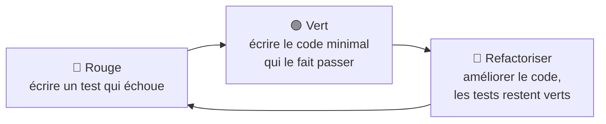

# 29 — Tester son code

> **Niveau** : Intermédiaire · **Durée** : ~3 h 30 · **Prérequis** : [Erreurs](../17-erreurs/README.md), [async/await](../20-async-await/README.md), [Outillage](../28-outillage/README.md)

Un test automatisé est un petit programme qui exécute votre code et vérifie qu'il fait ce qui est prévu. Écrits une fois, les tests se relancent en une seconde après chaque modification : ils signalent immédiatement ce qui a cassé, documentent le comportement attendu et permettent de restructurer le code sans crainte. Ce chapitre utilise d'abord le lanceur de tests intégré à Node.js, sans rien installer, puis Vitest, l'outil de référence des projets Vite, et se termine par un exemple complet de développement piloté par les tests.

## Objectifs

- Expliquer ce qu'apporte un test et distinguer tests unitaires, d'intégration et de bout en bout.
- Écrire et lancer des tests avec `node:test` et `node:assert/strict`, sans dépendance.
- Remplacer une dépendance gênante (réseau, horloge, hasard) par une doublure : injection, `mock.fn`, `mock.method`.
- Tester du code asynchrone, des erreurs et du code qui dépend du temps (`mock.timers`).
- Utiliser Vitest : `expect`, `vi.fn`, `vi.mock`, faux timers, environnement DOM, couverture.
- Situer Testing Library et Playwright.
- Appliquer le cycle du TDD : rouge, vert, refactorisation.

## Sommaire

- [Pourquoi tester ?](#pourquoi-tester-)
- [Les familles de tests](#les-familles-de-tests)
- [Anatomie d'un bon test](#anatomie-dun-bon-test)
- [node:test et node:assert/strict](#nodetest-et-nodeassertstrict)
- [Les doublures de test](#les-doublures-de-test)
- [Tester le code asynchrone](#tester-le-code-asynchrone)
- [Tester les erreurs](#tester-les-erreurs)
- [Tester le temps](#tester-le-temps)
- [Tester du code lié au DOM](#tester-du-code-lié-au-dom)
- [Vitest](#vitest)
- [Testing Library et Playwright](#testing-library-et-playwright)
- [Le développement piloté par les tests (TDD)](#le-développement-piloté-par-les-tests-tdd)
- [Pièges courants](#pièges-courants)
- [Bonnes pratiques](#bonnes-pratiques)
- [Résumé](#résumé)
- [Exercices](#exercices)
- [Pour aller plus loin](#pour-aller-plus-loin)

## Pourquoi tester ?

Vous testez déjà votre code : vous l'exécutez, vous regardez le résultat d'un `console.log`, vous cliquez dans la page. Le problème, c'est que ces vérifications sont **manuelles** : on ne les refait pas après chaque modification, on oublie les cas limites, et un bug réintroduit trois semaines plus tard passe inaperçu.

Automatiser, c'est écrire ces vérifications une fois pour toutes. Le module `node:assert` suffit pour une première version :

```js
import assert from "node:assert/strict";

function prixTtc(prixHtCentimes, tauxTva) {
  return Math.round(prixHtCentimes * (1 + tauxTva));
}

assert.equal(prixTtc(1000, 0.2), 1200);
assert.equal(prixTtc(999, 0.055), 1054);
assert.equal(prixTtc(0, 0.2), 0);
console.log("Tous les contrôles passent"); // Tous les contrôles passent
```

Si l'un des résultats change, `assert.equal` lève une `AssertionError` et le programme s'arrête avec un code d'erreur. C'est déjà un test. Il lui manque ce qu'apporte un **lanceur de tests** : continuer après le premier échec, nommer chaque vérification, afficher un rapport, isoler les tests les uns des autres, et les relancer automatiquement.

Ce que les tests vous apportent :

- **Un filet de sécurité** : vous pouvez modifier, optimiser, restructurer le code et savoir en une seconde si vous avez cassé quelque chose.
- **Une documentation exécutable** : « port offert à partir de 50 € » écrit dans un test ne peut pas devenir faux sans que quelqu'un s'en aperçoive.
- **Un meilleur code** : une fonction difficile à tester (qui lit l'heure, appelle le réseau et modifie le DOM à la fois) est généralement une fonction qui en fait trop.
- **Des bugs moins chers** : un bug trouvé pendant l'écriture coûte quelques minutes ; le même bug trouvé en production coûte des heures, des clients mécontents, parfois des données perdues.

## Les familles de tests

| Famille | Ce qu'on vérifie | Exemple | Vitesse | Outils |
| --- | --- | --- | --- | --- |
| **Unitaire** | une fonction ou un module isolé | `fraisDePort({ montantCentimes: 3000 })` vaut `490` | millisecondes | `node:test`, Vitest |
| **Intégration** | plusieurs modules ensemble, éventuellement avec une vraie base de données ou un vrai DOM simulé | le formulaire d'inscription affiche une erreur quand l'adresse est invalide | dizaines de millisecondes | `node:test`, Vitest + jsdom, Testing Library |
| **Bout en bout** (*end-to-end*, e2e) | l'application entière, dans un vrai navigateur, comme un utilisateur | un visiteur ajoute un article au panier et paie | secondes | Playwright |

Plus un test est proche de l'utilisateur, plus il donne confiance… et plus il est lent, fragile et coûteux à maintenir. On écrit donc **beaucoup** de tests unitaires et d'intégration, rapides et précis, et **quelques** tests de bout en bout sur les parcours critiques (inscription, paiement).

On parle aussi de **tests de non-régression** : chaque bug corrigé reçoit un test qui le reproduit, pour qu'il ne revienne jamais.

## Anatomie d'un bon test

Un test se lit en trois temps, le schéma **AAA** :

1. **Arrange** (préparer) : construire les données et l'état nécessaires ;
2. **Act** (agir) : appeler le code testé, une seule fois ;
3. **Assert** (vérifier) : comparer le résultat à ce qui est attendu.

```js
import { test } from "node:test";
import assert from "node:assert/strict";

function creerPanier() {
  const lignes = [];
  return {
    ajouter(article, quantite = 1) {
      lignes.push({ ...article, quantite });
    },
    total() {
      return lignes.reduce((s, l) => s + l.prixCentimes * l.quantite, 0);
    },
  };
}

test("ajouter deux cahiers compte deux fois leur prix", () => {
  // Arrange
  const panier = creerPanier();
  // Act
  panier.ajouter({ nom: "Cahier", prixCentimes: 320 }, 2);
  // Assert
  assert.equal(panier.total(), 640);
});
```

Un bon test est :

- **ciblé** : il vérifie un seul comportement, et son nom le décrit comme une phrase (« ajouter deux cahiers compte deux fois leur prix », pas « test 3 ») ;
- **indépendant** : il ne dépend ni de l'ordre d'exécution ni d'un autre test ;
- **déterministe** : il donne le même résultat à chaque exécution, sur toutes les machines (pas d'heure réelle, de hasard ou de réseau non maîtrisés) ;
- **rapide** : on doit pouvoir lancer des centaines de tests en quelques secondes ;
- **lisible** : quand il échoue, on comprend ce qui ne va pas sans lire le code testé.

## node:test et node:assert/strict

Node.js intègre un lanceur de tests complet, stable depuis Node.js 20 : le module **`node:test`**, associé au module d'assertions **`node:assert/strict`**. Aucune installation, aucune configuration.

### Premier test

Un fichier qui importe `node:test` lance ses tests dès qu'on l'exécute :

```js
// slug.test.js
import { describe, it, test } from "node:test";
import assert from "node:assert/strict";

function slugifier(texte) {
  return texte
    .normalize("NFD")
    .replace(/\p{Diacritic}/gu, "")
    .toLowerCase()
    .trim()
    .replace(/[^a-z0-9]+/g, "-")
    .replace(/^-|-$/g, "");
}

test("remplace les espaces par des tirets", () => {
  assert.equal(slugifier("Bonjour le monde"), "bonjour-le-monde");
});

describe("slugifier", () => {
  it("retire les accents", () => {
    assert.equal(slugifier("Élève à l'école"), "eleve-a-l-ecole");
  });

  it("supprime les tirets en début et en fin", () => {
    assert.equal(slugifier("  ¡Hola!  "), "hola");
  });
});
```

Dans un vrai projet, `slugifier` serait importée depuis son module (`import { slugifier } from "./slug.js"`) ; ici, tout est dans un seul fichier pour que l'exemple soit autonome.

```text
$ node slug.test.js
✔ remplace les espaces par des tirets (0.42ms)
▶ slugifier
  ✔ retire les accents (0.11ms)
  ✔ supprime les tirets en début et en fin (0.06ms)
✔ slugifier (0.31ms)
ℹ tests 3
ℹ suites 1
ℹ pass 3
ℹ fail 0
ℹ cancelled 0
ℹ skipped 0
ℹ todo 0
ℹ duration_ms 4.21
```

- `test(nom, fn)` déclare un test ; `describe(nom, fn)` regroupe des tests dans une **suite** ; `it` est un alias de `test`, qui se lit bien à l'intérieur d'un `describe` (« slugifier : it retire les accents »).
- Un test **réussit** si sa fonction se termine sans lever d'exception (ou si la promesse qu'elle renvoie est tenue) ; il **échoue** sinon. Les assertions ne sont rien d'autre que des fonctions qui lèvent une exception quand la condition n'est pas remplie.

Quand un test échoue, le rapport montre l'attendu, l'obtenu et la ligne fautive :

```text
✖ retire les accents (0.74ms)
  AssertionError [ERR_ASSERTION]: Expected values to be strictly equal:
  + actual - expected

  + 'élève-a-l-ecole'
  - 'eleve-a-l-ecole'

      at TestContext.<anonymous> (file:///…/slug.test.js:21:12)
```

Le code de sortie du processus vaut alors 1, ce qui fait échouer un script npm ou une CI.

### Lancer les tests

Dans un projet, on ne lance pas chaque fichier à la main : `node --test` trouve et exécute tous les fichiers de test, chacun dans un processus séparé.

```bash
node --test                          # tous les fichiers de test du projet
node --test "src/**/*.test.js"       # seulement ceux qui correspondent au motif
node --test --watch                  # relance à chaque modification (expérimental)
node --test --test-name-pattern="accents"   # seulement les tests dont le nom correspond
node --test --test-reporter=dot      # autres rapports : spec (défaut), tap, dot, junit, lcov
```

Sans argument, `node --test` cherche les fichiers dont le nom correspond à l'un de ces motifs (en ignorant `node_modules`) : `**/*.test.{js,mjs,cjs}`, `**/*-test.{js,mjs,cjs}`, `**/*_test.{js,mjs,cjs}`, `**/test-*.{js,mjs,cjs}`, `**/test.{js,mjs,cjs}` et tout fichier JavaScript d'un dossier `test/`. Les équivalents TypeScript (`.ts`, `.mts`, `.cts`) sont aussi pris.

Dans le `package.json` :

```json
{
  "scripts": {
    "test": "node --test",
    "test:watch": "node --test --watch"
  }
}
```

### Les assertions

Importez toujours **`node:assert/strict`**. Le module `node:assert` « historique » garde, pour compatibilité, des fonctions qui comparent avec `==` :

```js
import assertHistorique from "node:assert";
import assert from "node:assert/strict";

assertHistorique.equal(1, "1"); // ❌ passe : comparaison avec ==
console.log("assertHistorique.equal(1, '1') ne voit pas la différence");

try {
  assert.equal(1, "1"); // ✅ comparaison avec Object.is
} catch (erreur) {
  console.log(erreur.code); // ERR_ASSERTION
}
```

Les assertions les plus utiles :

| Assertion | Vérifie que… |
| --- | --- |
| `assert.equal(obtenu, attendu)` | les deux valeurs sont identiques (`Object.is`) : nombres, chaînes, booléens, **même** objet |
| `assert.notEqual(a, b)` | elles sont différentes |
| `assert.deepEqual(obtenu, attendu)` | deux objets ou tableaux ont le même contenu, récursivement (prototypes compris) |
| `assert.partialDeepStrictEqual(obtenu, attendu)` | `obtenu` contient **au moins** les propriétés de `attendu` (stable depuis Node.js 24) |
| `assert.ok(valeur)` | la valeur est *truthy* |
| `assert.match(chaine, regex)` | la chaîne correspond à l'expression régulière |
| `assert.throws(fn, attendu?)` | `fn()` lève une exception (éventuellement d'un type ou d'un message donné) |
| `assert.rejects(promesse, attendu?)` | la promesse est rejetée (à utiliser avec `await`) |
| `assert.doesNotThrow(fn)` | `fn()` ne lève pas d'exception |
| `assert.fail(message)` | échoue toujours (branche qui ne devrait jamais être atteinte) |

```js
import { test } from "node:test";
import assert from "node:assert/strict";

test("les assertions courantes", () => {
  const utilisateur = {
    id: 7,
    nom: "Ada",
    roles: ["admin"],
    creeLe: new Date(0),
  };

  // equal compare l'identité : deux objets au contenu identique sont différents
  assert.notEqual({ id: 7 }, { id: 7 });
  // deepEqual compare le contenu, récursivement
  assert.deepEqual(structuredClone(utilisateur), utilisateur);
  // partialDeepStrictEqual : seules les propriétés citées comptent
  assert.partialDeepStrictEqual(utilisateur, { nom: "Ada", roles: ["admin"] });

  assert.ok(utilisateur.roles.includes("admin"));
  assert.match("ada@exemple.fr", /^[^@\s]+@[^@\s]+$/);
  assert.equal(0.1 + 0.2 === 0.3, false); // les flottants ne se comparent pas avec equal…
  assert.ok(Math.abs(0.1 + 0.2 - 0.3) < Number.EPSILON); // … mais avec une tolérance
});
```

Chaque assertion accepte un dernier argument facultatif, le message affiché en cas d'échec : `assert.ok(stock >= 0, "le stock ne peut pas être négatif")`.

### Organiser avec describe et les hooks

Les **hooks** exécutent du code autour des tests : `before` (une fois avant tous les tests de la suite), `beforeEach` (avant chaque test), `afterEach` (après chaque test, même s'il a échoué) et `after` (une fois à la fin, même en cas d'échec). Le cas typique : repartir d'un état propre avant chaque test.

```js
import { beforeEach, describe, it } from "node:test";
import assert from "node:assert/strict";

class DepotUtilisateurs {
  #utilisateurs = new Map();
  #prochainId = 1;

  creer(nom) {
    const utilisateur = { id: this.#prochainId++, nom };
    this.#utilisateurs.set(utilisateur.id, utilisateur);
    return utilisateur;
  }

  trouver(id) {
    return this.#utilisateurs.get(id) ?? null;
  }

  get taille() {
    return this.#utilisateurs.size;
  }
}

describe("DepotUtilisateurs", () => {
  let depot;

  beforeEach(() => {
    depot = new DepotUtilisateurs(); // chaque test part d'un dépôt vide
  });

  it("attribue des identifiants croissants", () => {
    assert.equal(depot.creer("Ada").id, 1);
    assert.equal(depot.creer("Grace").id, 2);
  });

  it("retrouve un utilisateur par son identifiant", () => {
    const ada = depot.creer("Ada");
    assert.deepEqual(depot.trouver(ada.id), { id: 1, nom: "Ada" });
  });

  it("renvoie null pour un identifiant inconnu", () => {
    assert.equal(depot.trouver(42), null);
    assert.equal(depot.taille, 0); // pas de trace des tests précédents
  });
});
```

Sans le `beforeEach`, le deuxième test obtiendrait l'identifiant 3 et le troisième trouverait trois utilisateurs : les tests dépendraient de leur ordre. L'ordre exact des hooks :

```js
import { after, afterEach, before, beforeEach, describe, it } from "node:test";
import assert from "node:assert/strict";

const journal = [];

describe("ordre des hooks", () => {
  before(() => journal.push("before"));
  beforeEach(() => journal.push("beforeEach"));
  afterEach(() => journal.push("afterEach"));
  after(() => {
    journal.push("after");
    assert.deepEqual(journal, [
      "before",
      ...["beforeEach", "test 1", "afterEach"],
      ...["beforeEach", "test 2", "afterEach"],
      "after",
    ]);
  });

  it("test 1", () => journal.push("test 1"));
  it("test 2", () => journal.push("test 2"));
});
```

Les suites peuvent s'imbriquer : un `beforeEach` déclaré dans une suite parente s'exécute aussi avant les tests des suites enfants.

### Ignorer, marquer, isoler

```js
import { describe, it, test } from "node:test";

test("export PDF", { skip: "en attente de la nouvelle bibliothèque" }, () => {
  // non exécuté, signalé comme « skipped »
});

test.todo("gérer les codes promo cumulables"); // à écrire : signalé, n'échoue pas

describe("calculs fiscaux", () => {
  it("applique la TVA réduite aux livres", { todo: true }, () => {
    // exécuté, mais un échec ne fait pas échouer la suite
    throw new Error("pas encore implémenté");
  });
});
```

Dans le rapport, le test ignoré apparaît avec `﹣ … # en attente de la nouvelle bibliothèque` et les tests à faire avec `# TODO` ; un test `todo` qui échoue est listé avec son erreur, mais le code de sortie reste 0.

Pour se concentrer sur un test pendant le débogage, ajoutez l'option `{ only: true }` (ou `test.only`, `it.only`) et lancez `node --test --test-only`. Pensez à la retirer avant de commiter : un `only` oublié fait silencieusement disparaître tous les autres tests.

### Snapshots

Un **snapshot** enregistre la sortie d'une fonction lors de la première exécution, puis vérifie aux exécutions suivantes qu'elle n'a pas changé. C'est pratique pour des sorties volumineuses (un rapport, du HTML généré), à condition de relire le snapshot quand on le crée ou le met à jour. Stable depuis Node.js 23.4 :

<!-- no-run -->
```js
// facture.test.js
import { test } from "node:test";
import { genererFacture } from "./facture.js";

test("facture d'un client particulier", (t) => {
  t.assert.snapshot(
    genererFacture("Ada", [
      { prix: 1000, qte: 2 },
      { prix: 500, qte: 1 },
    ]),
  );
});
```

```bash
node --test --test-update-snapshots   # crée ou met à jour facture.test.js.snapshot
node --test                           # compare avec le snapshot enregistré
```

Le fichier `facture.test.js.snapshot`, versionné avec le test, contient la valeur sérialisée. Sans lui, le test échoue avec un message qui invite à relancer avec `--test-update-snapshots`.

### La couverture de code

La **couverture** mesure quelles lignes, branches et fonctions de votre code ont été exécutées par les tests. Dans Node.js, elle reste expérimentale et s'active avec un drapeau :

```bash
node --test --experimental-test-coverage --test-coverage-include="src/**"
```

```text
ℹ start of coverage report
ℹ ------------------------------------------------------------
ℹ file        | line % | branch % | funcs % | uncovered lines
ℹ ------------------------------------------------------------
ℹ src         |        |          |         |
ℹ  facture.js |  62.50 |   100.00 |   66.67 | 6-8
ℹ ------------------------------------------------------------
ℹ all files   |  62.50 |   100.00 |   66.67 |
ℹ ------------------------------------------------------------
ℹ end of coverage report
```

Les lignes 6 à 8 de `facture.js` ne sont jamais exécutées : soit il manque un test, soit ce code est inutile. On peut imposer des seuils : `--test-coverage-lines=80` (de même `--test-coverage-branches` et `--test-coverage-functions`) fait échouer la commande si la couverture des lignes passe sous 80 %. Pour exclure un passage, un commentaire `/* node:coverage ignore next */` ignore la ligne suivante.

> [!IMPORTANT]
> La couverture dit ce qui n'est **pas** testé ; elle ne dit pas que ce qui est couvert est **bien** testé. Une ligne exécutée par un test sans assertion est « couverte ». Visez des tests utiles sur le code important, pas un pourcentage (voir [Bonnes pratiques](#bonnes-pratiques)).

## Les doublures de test

Certaines dépendances rendent un test lent, non déterministe ou impossible : un appel réseau, l'heure courante, `Math.random`, l'envoi d'un e-mail. On les remplace pendant le test par une **doublure** (*test double*) :

| Doublure | Rôle | Exemple |
| --- | --- | --- |
| **Stub** (bouchon) | renvoie une réponse préparée | un faux `fetch` qui renvoie toujours le même JSON |
| **Spy** (espion) | enregistre les appels pour les vérifier ensuite | « `envoyerEmail` a été appelée une fois, avec cette adresse » |
| **Mock** | stub et espion à la fois, avec des attentes | souvent employé comme terme générique |
| **Fake** | une implémentation simplifiée mais fonctionnelle | un dépôt en mémoire à la place de la base de données |

### D'abord : l'injection de dépendances

La technique la plus simple ne demande aucun outil : au lieu d'utiliser directement une dépendance, la fonction la **reçoit en paramètre**, avec une valeur par défaut pour l'usage normal.

```js
import { test } from "node:test";
import assert from "node:assert/strict";

// La fonction reçoit l'horloge au lieu d'appeler Date.now() elle-même
function salutation({ maintenant = () => new Date() } = {}) {
  const heure = maintenant().getHours();
  if (heure < 12) return "Bonjour";
  if (heure < 18) return "Bon après-midi";
  return "Bonsoir";
}

test("dit bonjour le matin", () => {
  assert.equal(
    salutation({ maintenant: () => new Date(2026, 10, 6, 9, 30) }),
    "Bonjour",
  );
});

test("dit bonsoir à 18 h pile", () => {
  assert.equal(
    salutation({ maintenant: () => new Date(2026, 10, 6, 18, 0) }),
    "Bonsoir",
  );
});
```

Sans injection, le résultat du test dépendrait de l'heure à laquelle on le lance. Avec elle, le test est déterministe et la fonction reste utilisable normalement : `salutation()`.

### mock.fn : créer un espion

`mock.fn(implementation?)` crée une fonction qui enregistre chacun de ses appels dans sa propriété `mock` :

```js
import { mock, test } from "node:test";
import assert from "node:assert/strict";

function relancerRetards(emprunts, aujourdhui, envoyer) {
  for (const emprunt of emprunts) {
    if (emprunt.rendu || emprunt.retour >= aujourdhui) continue;
    envoyer(emprunt.email, `Merci de rendre « ${emprunt.titre} ».`);
  }
}

test("relance seulement les emprunts en retard et non rendus", () => {
  const envoyer = mock.fn();
  const emprunts = [
    {
      email: "ada@exemple.fr",
      titre: "Dune",
      retour: "2026-11-01",
      rendu: false,
    },
    {
      email: "alan@exemple.fr",
      titre: "Fondation",
      retour: "2026-11-20",
      rendu: false,
    },
    {
      email: "grace@exemple.fr",
      titre: "Hypérion",
      retour: "2026-10-15",
      rendu: true,
    },
  ];

  relancerRetards(emprunts, "2026-11-06", envoyer);

  assert.equal(envoyer.mock.callCount(), 1);
  assert.deepEqual(envoyer.mock.calls[0].arguments, [
    "ada@exemple.fr",
    "Merci de rendre « Dune ».",
  ]);
});

test("un espion peut aussi renvoyer une valeur", () => {
  const somme = mock.fn((a, b) => a + b);
  assert.equal(somme(2, 3), 5);
  assert.equal(somme.mock.calls[0].result, 5); // chaque appel garde arguments, result, error, this
});
```

(Les dates sont ici des chaînes ISO `AAAA-MM-JJ`, qui se comparent correctement dans l'ordre alphabétique.)

### mock.method : remplacer une méthode existante

`t.mock.method(objet, "nom", implementation?)` remplace temporairement une méthode et espionne ses appels. Créée par le contexte `t` du test, la doublure est **restaurée automatiquement** à la fin du test :

```js
import { test } from "node:test";
import assert from "node:assert/strict";

function lancerDe() {
  return Math.floor(Math.random() * 6) + 1;
}

test("renvoie 1 quand le hasard renvoie 0", (t) => {
  t.mock.method(Math, "random", () => 0);
  assert.equal(lancerDe(), 1);
});

test("renvoie 6 quand le hasard renvoie presque 1", (t) => {
  const espion = t.mock.method(Math, "random", () => 0.9999);
  assert.equal(lancerDe(), 6);
  assert.equal(espion.mock.callCount(), 1);
});

test("Math.random est restauré après chaque test", () => {
  const valeur = Math.random();
  assert.ok(valeur >= 0 && valeur < 1);
  assert.equal(Math.random.mock, undefined); // ce n'est plus la doublure
});
```

Le même mécanisme sert à faire taire ou à vérifier `console.warn`, ou à remplacer `globalThis.fetch` le temps d'un test. `t.mock.property(objet, "nom", valeur)` (Node.js 24.3+) fait de même pour une propriété.

### mock.module : remplacer un module entier

Quand le code importe directement un module que l'on ne peut pas injecter, `mock.module` remplace ce module pour toute la suite des imports. Cette fonctionnalité est en tout début de développement (stabilité 1.0) et exige un drapeau :

<!-- no-run -->
```js
// meteo.test.js — src/meteo.js importe lireCapteur depuis ./capteur.js
import { mock, test } from "node:test";
import assert from "node:assert/strict";

mock.module("../src/capteur.js", { exports: { lireCapteur: () => 31 } });
const { resume } = await import("../src/meteo.js"); // importé APRÈS le remplacement

test("résumé quand il fait chaud", () => {
  assert.equal(resume(), "Chaud (31 °C)");
});
```

```bash
node --test --experimental-test-module-mocks
```

L'import du module testé doit être **dynamique** et placé après `mock.module` : un `import` statique en tête de fichier serait résolu avant le remplacement. Préférez l'injection de dépendances quand c'est possible ; c'est plus simple et sans magie.

## Tester le code asynchrone

Une fonction de test peut être `async` : le lanceur attend que la promesse soit tenue (réussite) ou rejetée (échec).

```js
import { test } from "node:test";
import assert from "node:assert/strict";

async function chargerProfil(id, { fetch = globalThis.fetch } = {}) {
  const reponse = await fetch(`https://api.exemple.fr/utilisateurs/${id}`);
  if (!reponse.ok) throw new Error(`HTTP ${reponse.status}`);
  const { nom, email } = await reponse.json();
  return { id, nom, email };
}

// Fabrique un faux fetch qui renvoie toujours la même réponse
function fauxFetch(statut, corps) {
  return async () => ({
    ok: statut >= 200 && statut < 300,
    status: statut,
    json: async () => corps,
  });
}

test("renvoie le profil simplifié", async () => {
  const fetch = fauxFetch(200, {
    nom: "Ada",
    email: "ada@exemple.fr",
    motDePasse: "…",
  });
  const profil = await chargerProfil(7, { fetch });
  assert.deepEqual(profil, { id: 7, nom: "Ada", email: "ada@exemple.fr" });
});

test("rejette avec le statut HTTP en cas d'erreur", async () => {
  await assert.rejects(chargerProfil(7, { fetch: fauxFetch(404, {}) }), {
    message: "HTTP 404",
  });
});

test("laisse passer une erreur réseau", async () => {
  const fetch = async () => {
    throw new TypeError("fetch failed");
  };
  await assert.rejects(chargerProfil(7, { fetch }), TypeError);
});
```

Les règles :

- **`await`** devant chaque appel asynchrone du test, et devant `assert.rejects` ;
- jamais d'appel réseau réel dans un test unitaire : un faux `fetch` (injecté ou posé avec `t.mock.method(globalThis, "fetch", …)`) rend le test rapide et déterministe ;
- pour du code fondé sur des événements, `once` de `node:events` transforme un événement en promesse :

```js
import { once } from "node:events";
import { test } from "node:test";
import assert from "node:assert/strict";

class Telechargement extends EventTarget {
  demarrer() {
    queueMicrotask(() => {
      this.dispatchEvent(
        new CustomEvent("termine", { detail: { octets: 2048 } }),
      );
    });
  }
}

test("émet « termine » avec la taille téléchargée", async () => {
  const telechargement = new Telechargement();
  const evenement = once(telechargement, "termine"); // s'abonner AVANT de déclencher
  telechargement.demarrer();
  const [{ detail }] = await evenement;
  assert.deepEqual(detail, { octets: 2048 });
});
```

Pour une ancienne API à callbacks, la fonction de test peut recevoir un second paramètre `done`, à appeler quand le test est fini (`test("…", (t, done) => { … done(); })`) ; il est en général plus simple de convertir l'API en promesse avec `util.promisify` ([chapitre 19](../19-promises/README.md)).

> [!WARNING]
> Sans `await`, `assert.rejects(…)` renvoie une promesse que personne n'attend : le test se termine **avant** la vérification et s'affiche en vert. Node.js signale ensuite l'erreur (« generated asynchronous activity after the test ended ») et le processus finit en échec, mais le rapport est trompeur. Le linter peut vous aider : la règle `@typescript-eslint/no-floating-promises` détecte ces promesses oubliées.

## Tester les erreurs

Une fonction qui doit refuser une entrée invalide mérite des tests autant que le cas nominal. `assert.throws` attend une **fonction** qui lèvera l'exception, et accepte plusieurs formes de vérification :

```js
import { test } from "node:test";
import assert from "node:assert/strict";

class ErreurValidation extends Error {
  constructor(champ, message, options) {
    super(message, options);
    this.name = "ErreurValidation";
    this.champ = champ;
  }
}

function lireAge(saisie) {
  const age = Number(saisie);
  if (!Number.isInteger(age)) {
    throw new ErreurValidation(
      "age",
      `« ${saisie} » n'est pas un nombre entier`,
    );
  }
  if (age < 0 || age > 150) throw new RangeError(`Âge hors limites : ${age}`);
  return age;
}

test("accepte un âge valide", () => {
  assert.equal(lireAge("42"), 42);
});

test("vérifier la classe de l'erreur", () => {
  assert.throws(() => lireAge("-3"), RangeError);
});

test("vérifier le message avec une expression régulière", () => {
  assert.throws(() => lireAge("200"), /hors limites/);
});

test("vérifier plusieurs propriétés avec un objet", () => {
  assert.throws(() => lireAge("douze"), {
    name: "ErreurValidation",
    champ: "age",
    message: "« douze » n'est pas un nombre entier",
  });
});

test("examiner l'erreur librement avec une fonction", () => {
  assert.throws(
    () => lireAge("4.5"),
    (erreur) => erreur instanceof ErreurValidation && erreur.champ === "age",
  );
});

test("vérifier la cause d'une erreur enveloppée", () => {
  function importerLigne(ligne) {
    try {
      return { age: lireAge(ligne.split(";")[1]) };
    } catch (cause) {
      throw new Error(`Ligne invalide : ${ligne}`, { cause });
    }
  }
  assert.throws(
    () => importerLigne("Ada;-1"),
    (erreur) => {
      assert.equal(erreur.message, "Ligne invalide : Ada;-1");
      assert.ok(erreur.cause instanceof RangeError);
      return true; // une fonction de validation doit renvoyer true
    },
  );
});
```

La forme objet est souvent la plus lisible : seules les propriétés citées sont comparées (chacune avec une égalité profonde stricte). Pour inspecter une valeur plus complexe, comme la `cause` qui est elle-même une erreur, la fonction de validation permet d'utiliser des assertions ordinaires ; elle doit renvoyer `true`. Évitez de vérifier un message entier quand une partie suffit : un test trop précis casse à chaque reformulation. Pour une fonction asynchrone, les mêmes formes s'utilisent avec `await assert.rejects(promesse, …)`.

> [!WARNING]
> `assert.throws(lireAge("-3"), RangeError)` (sans `() =>`) appelle `lireAge` **avant** `assert.throws` : l'exception est levée dans le test lui-même, qui échoue avec la `RangeError` au lieu de la vérifier.

## Tester le temps

Un debounce de 300 ms, une session qui expire après 30 minutes, un rappel envoyé chaque jour : attendre réellement rendrait les tests lents, et l'heure réelle les rendrait aléatoires. `node:test` fournit des **faux timers** : `mock.timers` remplace `setTimeout`, `setInterval`, `setImmediate` et `Date` par des versions dont vous contrôlez l'horloge (stable depuis Node.js 23.1).

```js
import { test } from "node:test";
import assert from "node:assert/strict";

function debounce(fn, delai) {
  let minuteur;
  return (...args) => {
    clearTimeout(minuteur);
    minuteur = setTimeout(() => fn(...args), delai);
  };
}

test("debounce n'appelle la fonction qu'une fois, après le silence", (t) => {
  t.mock.timers.enable({ apis: ["setTimeout"] });
  const rechercher = t.mock.fn();
  const rechercherPlusTard = debounce(rechercher, 300);

  rechercherPlusTard("j");
  t.mock.timers.tick(100);
  rechercherPlusTard("ja");
  t.mock.timers.tick(100);
  rechercherPlusTard("jav");

  t.mock.timers.tick(299);
  assert.equal(rechercher.mock.callCount(), 0); // toujours rien

  t.mock.timers.tick(1);
  assert.equal(rechercher.mock.callCount(), 1);
  assert.deepEqual(rechercher.mock.calls[0].arguments, ["jav"]);
});
```

`tick(ms)` avance l'horloge virtuelle et exécute tous les timers échus entre-temps, instantanément. Le test dure une fraction de milliseconde. Avec `Date`, on fixe aussi la date courante :

```js
import { test } from "node:test";
import assert from "node:assert/strict";

const DUREE_SESSION_MS = 30 * 60 * 1000;

function creerSession(utilisateur) {
  return { utilisateur, expireLe: Date.now() + DUREE_SESSION_MS };
}

function estExpiree(session) {
  return Date.now() >= session.expireLe;
}

test("la session expire au bout de 30 minutes", (t) => {
  t.mock.timers.enable({
    apis: ["Date"],
    now: new Date("2026-11-06T09:00:00Z"),
  });
  const session = creerSession("ada");

  t.mock.timers.tick(29 * 60 * 1000);
  assert.equal(estExpiree(session), false);

  t.mock.timers.tick(60 * 1000);
  assert.equal(estExpiree(session), true);
  assert.equal(new Date().toISOString(), "2026-11-06T09:30:00.000Z");
});

test("setInterval est piloté de la même façon", (t) => {
  t.mock.timers.enable({ apis: ["setInterval"] });
  const releves = [];
  const id = setInterval(() => releves.push(releves.length + 1), 1000);

  t.mock.timers.tick(3500);
  clearInterval(id);
  assert.deepEqual(releves, [1, 2, 3]);
});
```

Les méthodes de `mock.timers` : `enable({ apis, now })` (sans `apis`, tout est simulé), `tick(ms)`, `runAll()` (exécute tous les timers en attente), `setTime(ms)` (change la date sans déclencher les timers) et `reset()` (restauration, automatique en fin de test quand on passe par `t.mock`).

> [!WARNING]
> Les faux timers remplacent les fonctions **globales** et les propriétés des modules `node:timers` et `node:timers/promises`. Une fonction importée par déstructuration avant le remplacement (`import { setTimeout as attendre } from "node:timers/promises"`) garde une référence vers la vraie fonction : votre test attendra réellement. Dans le code testé, utilisez le `setTimeout` global, ou importez le module entier (`import timers from "node:timers/promises"`, puis `timers.setTimeout(…)`).

Une alternative sans outil, toujours valable : injecter l'horloge, comme dans `salutation({ maintenant })` plus haut.

## Tester du code lié au DOM

Node.js n'a pas de `document`. Avant de chercher un DOM simulé, demandez-vous ce qui a vraiment besoin du DOM. Le plus souvent, on peut **séparer** la logique (calculer, valider, transformer : testable partout) de l'affichage (lire et écrire dans la page : une fine couche) :

```js
import { test } from "node:test";
import assert from "node:assert/strict";

// Logique pure : aucune dépendance au DOM
export function validerInscription({ email, motDePasse }) {
  const erreurs = {};
  if (!/^[^@\s]+@[^@\s]+\.[^@\s]+$/.test(email)) {
    erreurs.email = "Adresse invalide";
  }
  if (motDePasse.length < 12) erreurs.motDePasse = "12 caractères minimum";
  return erreurs;
}

// Couche d'affichage, très mince (non testée ici) :
// formulaire.addEventListener("submit", (e) => {
//   const erreurs = validerInscription(Object.fromEntries(new FormData(formulaire)));
//   afficherErreurs(erreurs);
// });

test("accepte une inscription valide", () => {
  assert.deepEqual(
    validerInscription({
      email: "ada@exemple.fr",
      motDePasse: "correct-horse-battery",
    }),
    {},
  );
});

test("signale chaque champ invalide", () => {
  assert.deepEqual(validerInscription({ email: "ada@", motDePasse: "court" }), {
    email: "Adresse invalide",
    motDePasse: "12 caractères minimum",
  });
});
```

Certaines API du navigateur existent aussi dans Node.js : `EventTarget`, `Event`, `CustomEvent`, `URL`, `fetch`, `AbortController`, `structuredClone`, `TextEncoder`… Un composant qui s'appuie sur elles se teste directement (comme `Telechargement` plus haut).

Pour tester réellement des éléments, des clics et des formulaires, il faut un DOM : **jsdom** ou **happy-dom**, deux implémentations du DOM en JavaScript. Le plus simple est de les utiliser via Vitest (section suivante). Pour aller jusqu'au vrai navigateur, voir Playwright.

## Vitest

[Vitest](https://vitest.dev/) est un lanceur de tests construit sur Vite. Il reprend l'API de Jest (`describe`, `it`, `expect`, `vi.fn`…), très répandue, et ajoute :

- la configuration de Vite (alias, plugins, TypeScript, JSX) sans rien refaire ;
- un mode *watch* qui ne relance que les tests concernés par une modification ;
- des environnements DOM (jsdom, happy-dom) et un mode navigateur réel ;
- les mocks de modules, les faux timers, la couverture et une interface graphique (`--ui`).

### Installation et premier test

```bash
npm install -D vitest
```

Vitest 5 demande Node.js 22.12 ou plus et Vite 6.4 ou plus ; npm installe Vite automatiquement s'il manque (avec Yarn, ajoutez-le vous-même). Les fichiers de test doivent contenir `.test.` ou `.spec.` dans leur nom.

```js
// src/panier.js
export function totalPanier(articles, { codePromo } = {}) {
  const sousTotal = articles.reduce(
    (s, a) => s + a.prixCentimes * a.quantite,
    0,
  );
  if (codePromo === undefined) return sousTotal;
  if (codePromo === "BIENVENUE10") return Math.round(sousTotal * 0.9);
  throw new RangeError(`Code promo inconnu : ${codePromo}`);
}
```

<!-- no-run -->
```js
// src/panier.test.js
import { describe, expect, it } from "vitest";
import { totalPanier } from "./panier.js";

describe("totalPanier", () => {
  it("additionne prix × quantité", () => {
    const articles = [
      { prixCentimes: 1250, quantite: 2 },
      { prixCentimes: 499, quantite: 1 },
    ];
    expect(totalPanier(articles)).toBe(2999);
  });

  it("applique le code BIENVENUE10", () => {
    const articles = [{ prixCentimes: 1000, quantite: 1 }];
    expect(totalPanier(articles, { codePromo: "BIENVENUE10" })).toBe(900);
  });

  it("refuse un code inconnu", () => {
    expect(() => totalPanier([], { codePromo: "GRATUIT" })).toThrow(RangeError);
    expect(() => totalPanier([], { codePromo: "GRATUIT" })).toThrow(/inconnu/);
  });
});
```

```json
{
  "scripts": {
    "test": "vitest run",
    "test:watch": "vitest",
    "coverage": "vitest run --coverage"
  }
}
```

```text
$ npx vitest run --reporter=verbose

 RUN  v5.1.0 /home/ada/mon-app

 ✓ src/panier.test.js > totalPanier > additionne prix × quantité 1ms
 ✓ src/panier.test.js > totalPanier > applique le code BIENVENUE10 0ms
 ✓ src/panier.test.js > totalPanier > refuse un code inconnu 0ms

 Test Files  1 passed (1)
      Tests  3 passed (3)
```

| Commande | Effet |
| --- | --- |
| `vitest` | mode *watch* dans un terminal interactif, exécution unique en CI |
| `vitest run` | exécution unique |
| `vitest panier` | seulement les fichiers dont le chemin contient « panier » |
| `vitest -t "code promo"` | seulement les tests dont le nom complet correspond |
| `vitest run --coverage` | avec couverture (paquet `@vitest/coverage-v8`) |
| `vitest --ui` | interface graphique dans le navigateur (paquet `@vitest/ui`) |

### expect : les assertions de Vitest

Vitest écrit les assertions sous la forme `expect(obtenu).matcher(attendu)`. La correspondance avec `node:assert/strict` :

| `node:assert/strict` | Vitest |
| --- | --- |
| `assert.equal(a, b)` | `expect(a).toBe(b)` |
| `assert.deepEqual(a, b)` | `expect(a).toStrictEqual(b)` (`toEqual` ignore les propriétés `undefined` et les classes) |
| `assert.partialDeepStrictEqual(a, b)` | `expect(a).toMatchObject(b)` |
| `assert.ok(a)` | `expect(a).toBeTruthy()` |
| `assert.match(s, re)` | `expect(s).toMatch(re)` |
| `assert.throws(fn, X)` | `expect(fn).toThrow(X)` |
| `await assert.rejects(p, X)` | `await expect(p).rejects.toThrow(X)` |
| — | `expect(tableau).toContain(x)`, `expect(objet).toHaveProperty("a.b")`, `expect(0.1 + 0.2).toBeCloseTo(0.3)` |
| `mock.fn().mock.callCount()` | `expect(espion).toHaveBeenCalledTimes(n)`, `toHaveBeenCalledWith(...)` |

Tout matcher s'inverse avec `.not` : `expect(liste).not.toContain("x")`.

### Configuration

Sans configuration, Vitest lit le `vite.config.js` du projet. Pour des réglages propres aux tests, un fichier `vitest.config.js` :

<!-- no-run -->
```js
// vitest.config.js
import { defineConfig } from "vitest/config";

export default defineConfig({
  test: {
    include: ["src/**/*.test.js"], // par défaut : tout fichier *.test.* ou *.spec.*
    environment: "node", // ou "jsdom", "happy-dom" pour tous les fichiers
    coverage: {
      provider: "v8",
      include: ["src/**/*.js"], // inclut aussi les fichiers qu'aucun test n'importe
      reporter: ["text", "html"],
      thresholds: { lines: 80 },
    },
  },
});
```

### Mocks : vi.fn, vi.spyOn, vi.mock

Dans l'exemple suivant, `produits.js` exporte `chargerProduit(id, { fetch })`, construite comme `chargerProfil` plus haut, et `afficherStock(produit)`, qui appelle `console.warn` quand le stock est nul.

<!-- no-run -->
```js
// src/produits.test.js
import { afterEach, expect, it, vi } from "vitest";
import { afficherStock, chargerProduit } from "./produits.js";

afterEach(() => {
  vi.restoreAllMocks(); // restaure les méthodes remplacées par vi.spyOn
});

it("renvoie le JSON quand la réponse est OK", async () => {
  // vi.fn : une fonction espionne, ici un faux fetch injecté
  const fetch = vi.fn().mockResolvedValue({
    ok: true,
    json: async () => ({ id: 7 }),
  });
  await expect(chargerProduit(7, { fetch })).resolves.toEqual({ id: 7 });
  expect(fetch).toHaveBeenCalledExactlyOnceWith(
    "https://api.exemple.fr/produits/7",
  );
});

it("prévient quand le produit est en rupture", () => {
  // vi.spyOn : espionner (et ici faire taire) une méthode existante
  const avertir = vi.spyOn(console, "warn").mockImplementation(() => {});
  afficherStock({ nom: "Stylo", stock: 0 });
  expect(avertir).toHaveBeenCalledWith("Stylo : rupture de stock");
});
```

`vi.mock` remplace un module entier pour le fichier de test, sans drapeau ni import dynamique : Vitest **remonte** automatiquement l'appel avant les `import` (il doit donc être écrit au premier niveau du fichier, pas dans un test).

<!-- no-run -->
```js
// src/meteo.test.js
import { expect, test, vi } from "vitest";
import { lireCapteur } from "./capteur.js";
import { resume } from "./meteo.js";

vi.mock("./capteur.js", () => ({ lireCapteur: vi.fn() }));

test("résumé quand il fait chaud", () => {
  vi.mocked(lireCapteur).mockReturnValue(31);
  expect(resume()).toBe("Chaud (31 °C)");
});

test("résumé quand il fait doux", () => {
  vi.mocked(lireCapteur).mockReturnValue(18);
  expect(resume()).toBe("Doux (18 °C)");
});
```

Depuis Vitest 5, l'historique des appels de tous les mocks est effacé avant chaque test (option `clearMocks`, désormais activée par défaut).

### Faux timers

<!-- no-run -->
```js
// src/debounce.test.js
import { afterEach, beforeEach, expect, test, vi } from "vitest";
import { debounce } from "./debounce.js";

beforeEach(() => {
  vi.useFakeTimers();
});

afterEach(() => {
  vi.useRealTimers();
});

test("debounce n'appelle la fonction qu'une fois, après le délai", () => {
  const rechercher = vi.fn();
  const rechercherPlusTard = debounce(rechercher, 300);

  rechercherPlusTard("j");
  rechercherPlusTard("ja");
  rechercherPlusTard("jav");
  vi.advanceTimersByTime(299);
  expect(rechercher).not.toHaveBeenCalled();

  vi.advanceTimersByTime(1);
  expect(rechercher).toHaveBeenCalledExactlyOnceWith("jav");
});

test("l'horloge système est simulée", () => {
  vi.setSystemTime(new Date("2026-12-25T10:00:00Z"));
  expect(new Date().toISOString()).toBe("2026-12-25T10:00:00.000Z");
});
```

`vi.runAllTimers()` exécute tous les timers en attente ; `vi.advanceTimersByTimeAsync(ms)`, version asynchrone d'`advanceTimersByTime`, laisse les promesses se résoudre entre deux timers (utile pour du code `async` qui attend). Depuis Vitest 5, `Temporal` est aussi simulé quand il est disponible.

### Tester avec un DOM simulé

Installez un environnement (`npm install -D jsdom` ou `npm install -D happy-dom`), puis activez-le pour tout le projet (`environment` dans la configuration) ou fichier par fichier avec un commentaire en tête :

<!-- no-run -->
```js
// @vitest-environment jsdom
import { beforeEach, expect, test } from "vitest";
import { setupCounter } from "./counter.js";

beforeEach(() => {
  document.body.innerHTML = `<button id="compteur" type="button"></button>`;
});

test("affiche 0 puis s'incrémente à chaque clic", () => {
  const bouton = document.querySelector("#compteur");
  setupCounter(bouton); // le compteur fourni par le modèle « vanilla » de Vite

  expect(bouton.textContent).toBe("Count is 0");
  bouton.click();
  bouton.click();
  expect(bouton.textContent).toBe("Count is 2");
});
```

jsdom est le plus complet et le plus répandu ; happy-dom est plus rapide mais implémente moins d'API. Ni l'un ni l'autre ne calcule de mise en page : les dimensions (`getBoundingClientRect`, `offsetWidth`) y valent 0. Pour cela, Vitest propose un **mode navigateur** (`@vitest/browser-playwright`) qui exécute les tests dans un vrai Chromium, Firefox ou WebKit.

### node:test ou Vitest ?

| | `node:test` | Vitest |
| --- | --- | --- |
| Installation | aucune | un paquet (et Vite) |
| Idéal pour | bibliothèques, scripts et serveurs Node.js | applications Vite, front-end, TypeScript/JSX |
| Assertions | `node:assert/strict` | `expect` (API Jest) |
| Mocks de modules | expérimental (drapeau) | `vi.mock`, mûr |
| DOM | à brancher soi-même | `environment: "jsdom"` |
| Couverture | expérimentale (drapeau) | `@vitest/coverage-v8` |
| Mode watch | expérimental | complet, sélectif |

Les deux sont de bons choix ; le test d'un même comportement s'écrit de la même façon. Jest, l'ancêtre de cette API, reste répandu dans les projets existants : ce que vous avez appris sur Vitest s'y transpose presque tel quel.

## Testing Library et Playwright

### Testing Library : tester comme un utilisateur

[Testing Library](https://testing-library.com/) fournit des fonctions pour trouver les éléments **comme le ferait un utilisateur** : par leur rôle et leur nom accessible (« le bouton S'inscrire »), par leur libellé, par leur texte, plutôt que par une classe CSS ou un identifiant technique. Le test survit ainsi aux changements de structure HTML, et il vérifie au passage l'accessibilité : un champ sans libellé est introuvable.

```js
// src/formulaire.js
export function monterFormulaire(racine) {
  racine.innerHTML = `
    <form novalidate>
      <label for="email">E-mail</label>
      <input id="email" name="email" type="email" />
      <button type="submit">S'inscrire</button>
      <p role="status"></p>
    </form>`;
  const formulaire = racine.querySelector("form");
  formulaire.addEventListener("submit", (evenement) => {
    evenement.preventDefault();
    const email = new FormData(formulaire).get("email").trim();
    racine.querySelector("[role=status]").textContent = email.includes("@")
      ? `Merci, ${email} est inscrit.`
      : "Adresse e-mail invalide.";
  });
}
```

<!-- no-run -->
```js
// src/formulaire.test.js
// @vitest-environment jsdom
import { screen } from "@testing-library/dom";
import userEvent from "@testing-library/user-event";
import { beforeEach, expect, test } from "vitest";
import { monterFormulaire } from "./formulaire.js";

beforeEach(() => {
  document.body.innerHTML = "";
  monterFormulaire(document.body);
});

test("confirme l'inscription avec une adresse valide", async () => {
  const utilisateur = userEvent.setup();
  await utilisateur.type(screen.getByLabelText("E-mail"), "ada@exemple.fr");
  await utilisateur.click(screen.getByRole("button", { name: "S'inscrire" }));
  expect(screen.getByRole("status").textContent).toBe(
    "Merci, ada@exemple.fr est inscrit.",
  );
});

test("signale une adresse invalide", async () => {
  const utilisateur = userEvent.setup();
  await utilisateur.type(screen.getByLabelText("E-mail"), "ada");
  await utilisateur.click(screen.getByRole("button", { name: "S'inscrire" }));
  expect(screen.getByRole("status").textContent).toBe(
    "Adresse e-mail invalide.",
  );
});
```

```bash
npm install -D @testing-library/dom @testing-library/user-event jsdom
```

`userEvent` simule de vraies interactions (focus, frappe touche par touche, clic) plutôt que de déclencher un événement isolé. Notez le `novalidate` : sans lui, le DOM simulé applique la validation native du champ `type="email"` et bloque l'envoi de « ada », exactement comme un navigateur ; le second test le révèle. Testing Library existe aussi en versions React, Vue, Svelte, Angular.

### Playwright : les tests de bout en bout

[Playwright](https://playwright.dev/) pilote de vrais navigateurs (Chromium, Firefox, WebKit) : il ouvre votre application, clique, tape, attend que les éléments apparaissent, et vérifie le résultat. C'est l'outil des tests de bout en bout.

```bash
npm init playwright@latest    # installe @playwright/test, les navigateurs et un exemple
npx playwright test           # lance les tests (sans interface)
npx playwright test --ui      # mode interactif, avec la chronologie de chaque action
```

<!-- no-run -->
```js
// playwright.config.js
import { defineConfig } from "@playwright/test";

export default defineConfig({
  testDir: "e2e",
  use: { baseURL: "http://localhost:5173" },
  webServer: {
    command: "npm run dev", // démarre Vite avant les tests
    url: "http://localhost:5173",
    reuseExistingServer: !process.env.CI,
  },
});
```

<!-- no-run -->
```js
// e2e/inscription.spec.js
import { expect, test } from "@playwright/test";

test("un visiteur s'inscrit à la lettre d'information", async ({ page }) => {
  await page.goto("/");
  await page.getByLabel("E-mail").fill("ada@exemple.fr");
  await page.getByRole("button", { name: "S'inscrire" }).click();
  await expect(page.getByRole("status")).toHaveText(
    "Merci, ada@exemple.fr est inscrit.",
  );
});
```

Si le projet utilise aussi Vitest, limitez celui-ci à ses propres fichiers (option `include` de la configuration, vue plus haut) : sinon, il tente d'exécuter les fichiers `e2e/*.spec.js` de Playwright et échoue. Les localisateurs (`getByRole`, `getByLabel`) suivent la même philosophie que Testing Library, et `expect(…).toHaveText` **réessaie** automatiquement jusqu'à ce que la condition soit vraie (ou qu'un délai expire) : pas besoin de `setTimeout` pour attendre l'interface. Réservez ces tests aux parcours essentiels : ils sont plus lents et demandent un navigateur installé, y compris en CI.

## Le développement piloté par les tests (TDD)

Le **TDD** (*Test-Driven Development*) inverse l'ordre habituel : on écrit le test **avant** le code. Le cycle est court (quelques minutes) et se répète :



1. **Rouge** : écrire un test pour le prochain petit comportement, et le voir **échouer** (cela prouve que le test teste vraiment quelque chose).
2. **Vert** : écrire le code le plus simple qui fait passer le test, même s'il paraît naïf.
3. **Refactoriser** : nettoyer le code (noms, doublons, structure) sans changer son comportement ; les tests garantissent qu'on n'a rien cassé.

Cette discipline produit un code testé à 100 % par construction, découpé en petites étapes vérifiées, et oblige à réfléchir à l'interface d'une fonction (comment on l'appelle, ce qu'elle renvoie) avant son implémentation.

### Exemple complet : les frais de port

Le cahier des charges d'une boutique en ligne :

1. moins de 50 € d'achats : 4,90 € de frais de port ;
2. à partir de 50 € : port offert ;
3. au-delà de 5 kg, un supplément de 2 € par kilogramme entamé, même quand le port est offert ;
4. un montant ou un poids négatif, ou non entier, est refusé.

Comme dans tout le cours, les montants sont en centimes et les poids en grammes (des entiers : pas d'erreurs d'arrondi, voir le [chapitre 08](../08-nombres-et-math/README.md)). On travaille avec deux fichiers, `frais-de-port.js` et `frais-de-port.test.js`, et `node --test --watch` dans un terminal.

**🔴 Étape 1.** Le premier test, pour la première règle :

<!-- no-run -->
```js
// frais-de-port.test.js
import { test } from "node:test";
import assert from "node:assert/strict";
import { fraisDePort } from "./frais-de-port.js";

test("4,90 € de port pour une commande de moins de 50 €", () => {
  assert.equal(fraisDePort({ montantCentimes: 3000, poidsGrammes: 800 }), 490);
});
```

```text
SyntaxError: The requested module './frais-de-port.js' does not provide an export named 'fraisDePort'
✖ frais-de-port.test.js
ℹ fail 1
```

Rouge, pour la bonne raison : la fonction n'existe pas.

**🟢** Le code minimal… est vraiment minimal :

```js
// frais-de-port.js
export function fraisDePort() {
  return 490;
}
```

C'est volontairement naïf : aucun test ne demande encore autre chose. C'est le prochain test qui forcera le code à évoluer.

**🔴 Étape 2.** Le port offert :

<!-- no-run -->
```js
test("port offert à partir de 50 €", () => {
  assert.equal(fraisDePort({ montantCentimes: 6400, poidsGrammes: 800 }), 0);
});
```

```text
✔ 4,90 € de port pour une commande de moins de 50 €
✖ port offert à partir de 50 €
  AssertionError [ERR_ASSERTION]: Expected values to be strictly equal:

  490 !== 0
```

**🟢**

```js
export function fraisDePort({ montantCentimes }) {
  if (montantCentimes >= 5000) return 0;
  return 490;
}
```

**🔴 Étape 3.** Les limites. « À partir de 50 € » : 50,00 € exactement donne-t-il le port offert ? Le cahier des charges dit oui. Les valeurs limites sont l'endroit préféré des bugs (`>` au lieu de `>=`), on les teste explicitement :

<!-- no-run -->
```js
test("port offert dès 50,00 € pile, payant à 49,99 €", () => {
  assert.equal(fraisDePort({ montantCentimes: 5000, poidsGrammes: 800 }), 0);
  assert.equal(fraisDePort({ montantCentimes: 4999, poidsGrammes: 800 }), 490);
});
```

Ce test passe immédiatement : le code était déjà correct. Ce n'est pas du temps perdu : il **protège** cette limite contre une future modification.

**🔴 Étape 4.** Le supplément de poids : 6,2 kg dépassent 5 kg de 1,2 kg, soit 2 kilogrammes entamés, donc 4 € de supplément.

<!-- no-run -->
```js
test("supplément de 2 € par kg entamé au-delà de 5 kg", () => {
  assert.equal(
    fraisDePort({ montantCentimes: 3000, poidsGrammes: 6200 }),
    490 + 400,
  );
});

test("le supplément s'applique même quand le port est offert", () => {
  assert.equal(
    fraisDePort({ montantCentimes: 8000, poidsGrammes: 12000 }),
    7 * 200,
  );
});
```

**🟢**

```js
export function fraisDePort({ montantCentimes, poidsGrammes }) {
  const base = montantCentimes >= 5000 ? 0 : 490;
  const kgEntames = Math.ceil(Math.max(0, poidsGrammes - 5000) / 1000);
  return base + kgEntames * 200;
}
```

**🔴 Étape 5.** Une limite encore (5 kg pile : pas de supplément ; 5,001 kg : un kilogramme entamé), puis la validation :

<!-- no-run -->
```js
test("pas de supplément à 5 kg pile, 2 € dès le premier gramme de plus", () => {
  assert.equal(fraisDePort({ montantCentimes: 3000, poidsGrammes: 5000 }), 490);
  assert.equal(fraisDePort({ montantCentimes: 3000, poidsGrammes: 5001 }), 690);
});

test("refuse un montant ou un poids invalide", () => {
  assert.throws(
    () => fraisDePort({ montantCentimes: -1, poidsGrammes: 800 }),
    RangeError,
  );
  assert.throws(
    () => fraisDePort({ montantCentimes: 3000, poidsGrammes: 1.5 }),
    RangeError,
  );
  assert.throws(
    () => fraisDePort({ montantCentimes: "30", poidsGrammes: 800 }),
    RangeError,
  );
});
```

Le premier test passe déjà ; le second échoue (`Missing expected exception (RangeError)`).

**🟢** On ajoute la validation en tête de fonction ; tout est vert.

**🔵 Refactorisation.** Le code fonctionne mais contient des « nombres magiques » (`5000`, `490`, `200`…) dont le sens n'apparaît que dans le cahier des charges. On les nomme, on extrait le calcul du supplément, on regroupe les tests par règle. Les tests ne changent pas de comportement, et restent verts à chaque petite modification. Voici le résultat final, réuni en un seul fichier exécutable :

```js
import { describe, it } from "node:test";
import assert from "node:assert/strict";

// ---- frais-de-port.js ----
const SEUIL_PORT_OFFERT_CENTIMES = 5000;
const PORT_STANDARD_CENTIMES = 490;
const POIDS_INCLUS_GRAMMES = 5000;
const SUPPLEMENT_PAR_KG_CENTIMES = 200;

function verifierEntierPositif(valeur, nom) {
  if (!Number.isInteger(valeur) || valeur < 0) {
    throw new RangeError(
      `${nom} doit être un entier positif (reçu : ${valeur})`,
    );
  }
}

function supplementPoids(poidsGrammes) {
  const excedent = Math.max(0, poidsGrammes - POIDS_INCLUS_GRAMMES);
  return Math.ceil(excedent / 1000) * SUPPLEMENT_PAR_KG_CENTIMES;
}

export function fraisDePort({ montantCentimes, poidsGrammes }) {
  verifierEntierPositif(montantCentimes, "montantCentimes");
  verifierEntierPositif(poidsGrammes, "poidsGrammes");
  const port =
    montantCentimes >= SEUIL_PORT_OFFERT_CENTIMES ? 0 : PORT_STANDARD_CENTIMES;
  return port + supplementPoids(poidsGrammes);
}

// ---- frais-de-port.test.js ----
const commande = (montantCentimes, poidsGrammes = 800) => ({
  montantCentimes,
  poidsGrammes,
});

describe("fraisDePort", () => {
  describe("port de base", () => {
    it("coûte 4,90 € sous 50 €", () => {
      assert.equal(fraisDePort(commande(3000)), 490);
      assert.equal(fraisDePort(commande(4999)), 490);
    });

    it("est offert à partir de 50 €", () => {
      assert.equal(fraisDePort(commande(5000)), 0);
      assert.equal(fraisDePort(commande(6400)), 0);
    });
  });

  describe("supplément de poids", () => {
    it("ne s'applique pas jusqu'à 5 kg inclus", () => {
      assert.equal(fraisDePort(commande(3000, 5000)), 490);
    });

    it("coûte 2 € par kg entamé au-delà de 5 kg", () => {
      assert.equal(fraisDePort(commande(3000, 5001)), 690);
      assert.equal(fraisDePort(commande(3000, 6200)), 890);
    });

    it("s'applique même quand le port est offert", () => {
      assert.equal(fraisDePort(commande(8000, 12000)), 1400);
    });
  });

  describe("validation", () => {
    for (const [montant, poids] of [
      [-1, 800],
      [3000, 1.5],
      ["30", 800],
      [3000, undefined],
    ]) {
      it(`refuse montant=${montant}, poids=${poids}`, () => {
        assert.throws(
          () => fraisDePort({ montantCentimes: montant, poidsGrammes: poids }),
          RangeError,
        );
      });
    }

    it("explique l'erreur", () => {
      assert.throws(() => fraisDePort(commande(-1)), {
        message: "montantCentimes doit être un entier positif (reçu : -1)",
      });
    });
  });
});
```

Remarquez la boucle qui génère un test par cas invalide : chaque cas apparaît séparément dans le rapport, et en ajouter un ne coûte qu'une ligne.

Le TDD n'est pas obligatoire pour bien tester ; il est particulièrement efficace pour la logique métier (calculs, règles, validation) et pour corriger un bug : on écrit d'abord le test qui reproduit le bug (rouge), puis on corrige (vert).

## Pièges courants

- **Oublier `await`** devant une fonction asynchrone ou devant `assert.rejects` / `expect(…).rejects` : la vérification s'exécute après la fin du test.
- **Passer le résultat au lieu de la fonction** : `assert.throws(f(x))` au lieu de `assert.throws(() => f(x))`.
- **Utiliser `node:assert` au lieu de `node:assert/strict`** : `assert.equal(1, "1")` passe.
- **Comparer des objets avec `equal` / `toBe`** : deux objets distincts au contenu identique ne sont pas « égaux » ; utilisez `deepEqual` / `toStrictEqual`.
- **Comparer des flottants exactement** : `0.1 + 0.2` ne vaut pas `0.3`. Travaillez en entiers (centimes) ou utilisez une tolérance (`toBeCloseTo`).
- **Des tests qui dépendent de l'ordre** : un état partagé (variable de module, base de données, `localStorage`) modifié par un test et lu par un autre. Réinitialisez dans un `beforeEach`.
- **Des tests qui dépendent de l'environnement** : l'heure (`new Date()`), le fuseau horaire (`toLocaleDateString` donne un autre jour en CI, souvent réglée en UTC), la langue, le hasard, le réseau. Fixez-les ou injectez-les.
- **Un `.only` ou un `skip` oublié** : une partie des tests ne tourne plus, en silence.
- **Une assertion dans un callback jamais appelé** : `liste.forEach((x) => assert.ok(x))` sur une liste vide ne vérifie rien. Vérifiez aussi la longueur, ou comptez les appels avec un espion (`mock.fn`).
- **Tester l'implémentation plutôt que le comportement** : vérifier qu'une méthode privée a été appelée, ou le nom d'une classe CSS interne. Le test casse à chaque refactorisation sans qu'aucun bug n'ait été introduit.
- **Trop de mocks** : un test qui remplace tout ne teste plus que les mocks. Ne doublez que ce qui est lent, non déterministe ou externe.

## Bonnes pratiques

- **Des noms de tests qui sont des phrases** décrivant un comportement : le rapport doit se lire comme une spécification.
- **Un comportement par test**, structuré en AAA. Plusieurs assertions sont acceptables si elles vérifient le même comportement.
- **Des tests déterministes et indépendants** : chaque test prépare ses propres données ; l'heure, le hasard et le réseau sont contrôlés.
- **Tester le comportement observable** (entrées, sorties, effets visibles), pas les détails internes.
- **Couvrir les cas limites** : liste vide, zéro, valeurs aux bornes (`4999`, `5000`), entrée invalide, erreur réseau.
- **Un test pour chaque bug corrigé**, écrit avant la correction.
- **Des tests rapides**, lancés en mode watch pendant le développement et en CI à chaque push ([chapitre 28](../28-outillage/README.md)).
- **Lire la couverture comme un indicateur, pas comme un objectif.** Ce test atteint 100 % de couverture… et ne vérifie rien :

```js
import { test } from "node:test";

function remise(montant, client) {
  if (client.fidele) return montant * 0.9;
  return montant;
}

test("❌ couvre tout, ne vérifie rien", () => {
  remise(100, { fidele: true });
  remise(100, { fidele: false });
});
```

Les deux branches sont exécutées, donc « couvertes » ; si quelqu'un remplace `0.9` par `9`, le test reste vert. Un pourcentage de couverture élevé obtenu ainsi donne une fausse confiance.

## Résumé

- Un test automatisé exécute le code et vérifie le résultat ; il échoue quand il lève une exception. Les tests sont un filet de sécurité, une documentation exécutable et une aide à la conception.
- Beaucoup de tests **unitaires** et d'**intégration**, rapides ; quelques tests de **bout en bout** pour les parcours critiques.
- Un bon test suit le schéma **AAA**, porte un nom descriptif, est déterministe, indépendant et rapide.
- **`node:test`** (intégré, stable) : `test`, `describe`/`it`, hooks `before`/`beforeEach`/`afterEach`/`after`, `skip`/`todo`/`only`, snapshots (`t.assert.snapshot`, `--test-update-snapshots`), couverture (`--experimental-test-coverage`). On lance tout avec `node --test`.
- Toujours **`node:assert/strict`** : `equal`, `deepEqual`, `partialDeepStrictEqual`, `match`, `throws`, `rejects`.
- **Doublures** : d'abord l'injection de dépendances ; puis `mock.fn` (espion), `t.mock.method` (restauré automatiquement), `mock.module` (expérimental, drapeau `--experimental-test-module-mocks`).
- **Asynchrone** : fonctions de test `async`, `await` partout, `await assert.rejects(…)`. **Erreurs** : `assert.throws(() => …, forme)`. **Temps** : `t.mock.timers.enable({ apis, now })` puis `tick(ms)`.
- **DOM** : séparer la logique (testable dans Node) de l'affichage ; pour un vrai DOM, jsdom ou happy-dom via Vitest, et Testing Library pour interagir comme un utilisateur.
- **Vitest** : API `expect`, `vi.fn`/`vi.spyOn`/`vi.mock`, `vi.useFakeTimers`, `environment: "jsdom"`, couverture v8, mode watch sélectif. **Playwright** pour les tests de bout en bout dans de vrais navigateurs.
- **TDD** : 🔴 un test qui échoue, 🟢 le code minimal, 🔵 refactoriser, et recommencer.
- La couverture indique ce qui n'est pas testé, pas la qualité des tests.

## Exercices

Tous les exercices utilisent `node:test` : chaque solution s'exécute telle quelle avec `node solution.js`.

### Exercice 1 — Premiers tests (★☆☆)

Écrivez des tests pour cette fonction : une phrase simple, une phrase avec majuscules, espaces et ponctuation (« Ésope reste ici et se repose »), une chaîne vide (considérée comme un palindrome), un mot qui n'est pas un palindrome. Regroupez-les dans un `describe`.

```js
function estPalindrome(texte) {
  const lettres = texte
    .normalize("NFD")
    .replace(/[^\p{Letter}\p{Number}]/gu, "")
    .toLowerCase();
  return lettres === [...lettres].reverse().join("");
}

console.log(estPalindrome("kayak")); // true
```

<details>
<summary>Solution</summary>

```js
import { describe, it } from "node:test";
import assert from "node:assert/strict";

function estPalindrome(texte) {
  const lettres = texte
    .normalize("NFD")
    .replace(/[^\p{Letter}\p{Number}]/gu, "")
    .toLowerCase();
  return lettres === [...lettres].reverse().join("");
}

describe("estPalindrome", () => {
  it("reconnaît un mot palindrome", () => {
    assert.equal(estPalindrome("kayak"), true);
  });

  it("ignore la casse, les accents, les espaces et la ponctuation", () => {
    assert.equal(estPalindrome("Ésope reste ici et se repose"), true);
    assert.equal(estPalindrome("Engage le jeu que je le gagne !"), true);
  });

  it("considère la chaîne vide comme un palindrome", () => {
    assert.equal(estPalindrome(""), true);
  });

  it("rejette un mot qui n'est pas un palindrome", () => {
    assert.equal(estPalindrome("javascript"), false);
  });
});
```

`normalize("NFD")` sépare chaque lettre accentuée en lettre de base plus accent (« É » devient « E » + accent aigu) ; l'expression régulière, qui ne garde que les lettres (`\p{Letter}`) et les chiffres, élimine alors les accents en même temps que les espaces et la ponctuation. Le cas de la chaîne vide est un **choix** : le test documente ce choix, qui pourrait sinon changer par accident.

</details>

### Exercice 2 — Des tests qui mentent (★☆☆)

Ces trois tests passent… alors que la fonction est fausse ou que le test ne vérifie rien. Trouvez le problème de chacun, corrigez les tests, puis la fonction.

```js
import { test } from "node:test";
import assert from "node:assert";

function convertirEnCentimes(prix) {
  return Number(prix.replace(",", ".")) * 100;
}

async function chargerTaux() {
  throw new Error("service indisponible");
}

test("convertit un prix en centimes", () => {
  assert.equal(convertirEnCentimes("12,50"), "1250");
});

test("convertit 19,99 €", () => {
  const resultat = convertirEnCentimes("19,99");
  assert.ok(resultat, 1999);
});

test("chargerTaux échoue si le service est indisponible", () => {
  assert.rejects(chargerTaux(), /indisponible/);
});
```

<details>
<summary>Solution</summary>

1. `import assert from "node:assert"` : en mode historique, `equal` compare avec `==`, donc `1250 == "1250"` passe alors que la fonction renvoie un nombre et le test attend une chaîne.
2. `assert.ok(resultat, 1999)` vérifie seulement que `resultat` est *truthy* ; le second argument est le **message** d'erreur. Or `19.99 * 100` vaut `1998.9999999999998` : la fonction est fausse et le test ne le voit pas.
3. `assert.rejects` sans `await` : le test se termine avant la vérification. Il passe ici parce que la promesse est bien rejetée, mais si `chargerTaux` cessait d'échouer, le test resterait affiché en vert (Node.js signalerait l'erreur à part, après la fin du test).

```js
import { test } from "node:test";
import assert from "node:assert/strict";

function convertirEnCentimes(prix) {
  return Math.round(Number(prix.replace(",", ".")) * 100);
}

async function chargerTaux() {
  throw new Error("service indisponible");
}

test("convertit un prix en centimes", () => {
  assert.equal(convertirEnCentimes("12,50"), 1250);
});

test("convertit 19,99 € sans erreur d'arrondi", () => {
  assert.equal(convertirEnCentimes("19,99"), 1999);
});

test("chargerTaux échoue si le service est indisponible", async () => {
  await assert.rejects(chargerTaux(), /indisponible/);
});
```

Le deuxième test corrigé échoue avec l'ancienne fonction (`1998.9999999999998 !== 1999`) : il a révélé un vrai bug, corrigé par `Math.round`. Règle générale : **voyez chaque test échouer au moins une fois** (en cassant volontairement le code), sinon vous ne savez pas s'il teste quelque chose.

</details>

### Exercice 3 — Tester une fonction asynchrone (★★☆)

Testez `chargerMeteo(ville, { fetch })` sans aucun accès réseau, dans quatre situations : réponse correcte, ville inconnue (statut 404 → `null`), erreur serveur (statut 500 → erreur `"Service météo indisponible (500)"`), et vérifiez que le nom de la ville est bien encodé dans l'URL (« Saint-Étienne »).

```js
async function chargerMeteo(ville, { fetch = globalThis.fetch } = {}) {
  const url = `https://meteo.exemple.fr/v1?ville=${encodeURIComponent(ville)}`;
  const reponse = await fetch(url);
  if (reponse.status === 404) return null;
  if (!reponse.ok) {
    throw new Error(`Service météo indisponible (${reponse.status})`);
  }
  const { temperature, ciel } = await reponse.json();
  return `${ville} : ${temperature} °C, ${ciel}`;
}
```

<details>
<summary>Solution</summary>

```js
import { describe, it, mock } from "node:test";
import assert from "node:assert/strict";

async function chargerMeteo(ville, { fetch = globalThis.fetch } = {}) {
  const url = `https://meteo.exemple.fr/v1?ville=${encodeURIComponent(ville)}`;
  const reponse = await fetch(url);
  if (reponse.status === 404) return null;
  if (!reponse.ok) {
    throw new Error(`Service météo indisponible (${reponse.status})`);
  }
  const { temperature, ciel } = await reponse.json();
  return `${ville} : ${temperature} °C, ${ciel}`;
}

function fauxFetch(status, corps = {}) {
  return mock.fn(async () => ({
    status,
    ok: status >= 200 && status < 300,
    json: async () => corps,
  }));
}

describe("chargerMeteo", () => {
  it("formate la météo d'une ville", async () => {
    const fetch = fauxFetch(200, { temperature: 14, ciel: "nuageux" });
    assert.equal(
      await chargerMeteo("Lyon", { fetch }),
      "Lyon : 14 °C, nuageux",
    );
  });

  it("renvoie null pour une ville inconnue", async () => {
    assert.equal(
      await chargerMeteo("Atlantide", { fetch: fauxFetch(404) }),
      null,
    );
  });

  it("signale une erreur serveur", async () => {
    await assert.rejects(chargerMeteo("Lyon", { fetch: fauxFetch(500) }), {
      message: "Service météo indisponible (500)",
    });
  });

  it("encode le nom de la ville dans l'URL", async () => {
    const fetch = fauxFetch(200, { temperature: 9, ciel: "pluie" });
    await chargerMeteo("Saint-Étienne", { fetch });
    assert.equal(fetch.mock.callCount(), 1);
    assert.equal(
      fetch.mock.calls[0].arguments[0],
      "https://meteo.exemple.fr/v1?ville=Saint-%C3%89tienne",
    );
  });
});
```

La fabrique `fauxFetch` évite de répéter la structure de la réponse dans chaque test, et `mock.fn` permet de vérifier l'URL demandée. Le faux ne reproduit que ce que la fonction utilise (`status`, `ok`, `json`) : inutile de simuler toute l'API `Response`.

</details>

### Exercice 4 — Tester un throttle avec de faux timers (★★☆)

`throttle(fn, delai)` exécute `fn` immédiatement au premier appel, puis ignore les appels suivants pendant `delai` millisecondes. Écrivez les tests avec `mock.timers` : premier appel immédiat, appels ignorés pendant le délai, nouvel appel accepté après le délai, et arguments du dernier appel accepté.

```js
function throttle(fn, delai) {
  let bloque = false;
  return (...args) => {
    if (bloque) return;
    bloque = true;
    fn(...args);
    setTimeout(() => {
      bloque = false;
    }, delai);
  };
}
```

<details>
<summary>Solution</summary>

```js
import { beforeEach, describe, it } from "node:test";
import assert from "node:assert/strict";

function throttle(fn, delai) {
  let bloque = false;
  return (...args) => {
    if (bloque) return;
    bloque = true;
    fn(...args);
    setTimeout(() => {
      bloque = false;
    }, delai);
  };
}

describe("throttle", () => {
  let espion;
  let limitee;

  beforeEach((t) => {
    t.mock.timers.enable({ apis: ["setTimeout"] });
    espion = t.mock.fn();
    limitee = throttle(espion, 1000);
  });

  it("exécute immédiatement le premier appel", () => {
    limitee("a");
    assert.equal(espion.mock.callCount(), 1);
  });

  it("ignore les appels pendant le délai", (t) => {
    limitee("a");
    t.mock.timers.tick(999);
    limitee("b");
    assert.equal(espion.mock.callCount(), 1);
  });

  it("accepte un nouvel appel une fois le délai écoulé", (t) => {
    limitee("a");
    t.mock.timers.tick(1000);
    limitee("c");
    assert.equal(espion.mock.callCount(), 2);
    assert.deepEqual(
      espion.mock.calls.map((appel) => appel.arguments),
      [["a"], ["c"]],
    );
  });
});
```

Les faux timers activés dans `beforeEach` via son propre contexte `t` sont restaurés automatiquement à la fin de chaque test. Dans les tests, `t.mock.timers` désigne la même horloge simulée : `tick` fait avancer le temps pour le `setTimeout` créé par `throttle`. Le test « 999 ms » vérifie la limite exacte, là où un bug du type `<` / `<=` se cacherait.

</details>

### Exercice 5 — Espionner console.warn (★★☆)

Une fonction `ancienneApi()` doit afficher un avertissement de dépréciation **une seule fois**, quel que soit le nombre d'appels, et continuer à fonctionner. Écrivez la fonction et son test, sans que l'avertissement n'apparaisse dans la sortie des tests.

<details>
<summary>Solution</summary>

```js
import { test } from "node:test";
import assert from "node:assert/strict";

function nouvelleApi(x) {
  return x * 2;
}

let dejaAverti = false;
function ancienneApi(x) {
  if (!dejaAverti) {
    console.warn("ancienneApi() est dépréciée : utilisez nouvelleApi()");
    dejaAverti = true;
  }
  return nouvelleApi(x);
}

test("ancienneApi avertit une seule fois et délègue à nouvelleApi", (t) => {
  const avertir = t.mock.method(console, "warn", () => {}); // espionne et fait taire

  assert.equal(ancienneApi(2), 4);
  assert.equal(ancienneApi(5), 10);
  assert.equal(ancienneApi(7), 14);

  assert.equal(avertir.mock.callCount(), 1);
  assert.match(avertir.mock.calls[0].arguments[0], /dépréciée/);
});
```

L'implémentation passée à `t.mock.method` remplace la vraie : rien ne s'affiche. La variable `dejaAverti` est un état global du module : un second test qui attendrait un avertissement échouerait, car il a déjà été émis. Pour tester plusieurs scénarios, on exporterait une fonction de réinitialisation, ou on créerait l'API via une fabrique (`creerAncienneApi()`) qui possède son propre état.

</details>

### Exercice 6 — TDD : les chiffres romains (★★★)

En TDD (un test à la fois, rouge puis vert, puis refactorisation), écrivez `enChiffresRomains(n)` pour les entiers de 1 à 3999 : `1 → "I"`, `4 → "IV"`, `9 → "IX"`, `14 → "XIV"`, `40 → "XL"`, `90 → "XC"`, `400 → "CD"`, `1994 → "MCMXCIV"`, `2026 → "MMXXVI"`, `3999 → "MMMCMXCIX"`. Hors de cet intervalle, ou pour un non-entier : `RangeError`. Notez l'ordre dans lequel vous avez écrit les tests.

<details>
<summary>Solution</summary>

Un ordre de tests qui fait émerger l'algorithme pas à pas :

1. `1 → "I"` : 🟢 `return "I"`.
2. `2 → "II"`, `3 → "III"` : 🟢 `"I".repeat(n)`.
3. `5 → "V"`, `6 → "VI"` : 🟢 un cas particulier pour 5, puis une soustraction (`if (n >= 5) return "V" + …`).
4. `10 → "X"`, `14 → "XIV"`… : les `if` se multiplient ; 🔵 **refactorisation** : une table de valeurs parcourue dans l'ordre décroissant, et une boucle qui soustrait la plus grande valeur possible.
5. `4 → "IV"`, `9 → "IX"` : la table reçoit les formes soustractives (`IV`, `IX`, `XL`, `XC`, `CD`, `CM`), et l'algorithme ne change pas.
6. Les grands nombres (`1994`, `2026`, `3999`) passent sans modification : ils confirment l'algorithme.
7. La validation (`0`, `4000`, `2.5`) : 🟢 une garde en tête de fonction.

```js
import { describe, it } from "node:test";
import assert from "node:assert/strict";

const VALEURS = [
  [1000, "M"],
  [900, "CM"],
  [500, "D"],
  [400, "CD"],
  [100, "C"],
  [90, "XC"],
  [50, "L"],
  [40, "XL"],
  [10, "X"],
  [9, "IX"],
  [5, "V"],
  [4, "IV"],
  [1, "I"],
];

function enChiffresRomains(n) {
  if (!Number.isInteger(n) || n < 1 || n > 3999) {
    throw new RangeError(`Entier entre 1 et 3999 attendu (reçu : ${n})`);
  }
  let resultat = "";
  let reste = n;
  for (const [valeur, symbole] of VALEURS) {
    while (reste >= valeur) {
      resultat += symbole;
      reste -= valeur;
    }
  }
  return resultat;
}

describe("enChiffresRomains", () => {
  const cas = {
    1: "I",
    3: "III",
    4: "IV",
    6: "VI",
    9: "IX",
    14: "XIV",
    40: "XL",
    90: "XC",
    400: "CD",
    1994: "MCMXCIV",
    2026: "MMXXVI",
    3999: "MMMCMXCIX",
  };

  for (const [nombre, romain] of Object.entries(cas)) {
    it(`${nombre} → ${romain}`, () => {
      assert.equal(enChiffresRomains(Number(nombre)), romain);
    });
  }

  it("refuse les valeurs hors de 1 à 3999 et les non-entiers", () => {
    for (const invalide of [0, -5, 4000, 2.5, Number.NaN]) {
      assert.throws(() => enChiffresRomains(invalide), RangeError);
    }
  });
});
```

Le point clé du TDD apparaît à l'étape 4 : les tests, déjà écrits, permettent de remplacer une pile de `if` par une table et une boucle **en toute sécurité**. Et les formes soustractives, qui semblent être un cas particulier, ne sont finalement que des lignes de plus dans la table.

</details>

### Exercice 7 — Écrire son propre lanceur de tests (★★★)

Pour comprendre ce que fait un outil comme `node:test`, écrivez un mini-lanceur en moins de 50 lignes :

- `test(nom, fn)` enregistre un test (synchrone ou asynchrone) ;
- `attendre(valeur)` renvoie un objet avec `toBe(attendu)` (comparaison `Object.is`), `toEqual(attendu)` (comparaison du contenu via `node:util`) et `toThrow()` (pour une fonction) ;
- `lancer()` exécute les tests **dans l'ordre**, un échec n'arrête pas les suivants, affiche `✔`/`✖` puis un bilan, et renvoie `{ reussis, echoues }`.

<details>
<summary>Solution</summary>

```js
import { isDeepStrictEqual } from "node:util";

const tests = [];

function test(nom, fn) {
  tests.push({ nom, fn });
}

function attendre(valeur) {
  const echouer = (message) => {
    throw new Error(message);
  };
  return {
    toBe(attendu) {
      if (!Object.is(valeur, attendu)) {
        echouer(`attendu ${attendu}, obtenu ${valeur}`);
      }
    },
    toEqual(attendu) {
      if (!isDeepStrictEqual(valeur, attendu)) {
        echouer(
          `attendu ${JSON.stringify(attendu)}, obtenu ${JSON.stringify(valeur)}`,
        );
      }
    },
    toThrow() {
      try {
        valeur();
      } catch {
        return;
      }
      echouer("aucune exception levée");
    },
  };
}

async function lancer() {
  let reussis = 0;
  let echoues = 0;
  for (const { nom, fn } of tests) {
    try {
      await fn(); // await : fonctionne pour les tests synchrones comme asynchrones
      reussis++;
      console.log(`✔ ${nom}`);
    } catch (erreur) {
      echoues++;
      console.log(`✖ ${nom}\n    ${erreur.message}`);
    }
  }
  console.log(`\n${reussis} réussi(s), ${echoues} échoué(s)`);
  return { reussis, echoues };
}

// --- Utilisation ---
test("additionne", () => attendre(0.5 + 0.25).toBe(0.75));
test("compare le contenu", () => attendre([1, [2]]).toEqual([1, [2]]));
test("détecte une exception", () => attendre(() => JSON.parse("{")).toThrow());
test("attend les promesses", async () => {
  const valeur = await new Promise((resoudre) =>
    setTimeout(() => resoudre(42), 10),
  );
  attendre(valeur).toBe(42);
});
test("échoue volontairement", () => attendre([1, 2].length).toBe(3));

const bilan = await lancer();
console.log(bilan); // { reussis: 4, echoues: 1 }
// Un vrai lanceur ferait ici : process.exitCode = bilan.echoues > 0 ? 1 : 0;
```

Sortie :

```text
✔ additionne
✔ compare le contenu
✔ détecte une exception
✔ attend les promesses
✖ échoue volontairement
    attendu 3, obtenu 2

4 réussi(s), 1 échoué(s)
{ reussis: 4, echoues: 1 }
```

Tout lanceur de tests repose sur ces trois idées : une **liste** de tests enregistrés puis exécutés plus tard ; des **assertions** qui ne sont que des fonctions qui lèvent une exception ; un `try/catch` (avec `await`) autour de chaque test pour qu'un échec n'arrête pas les autres. Les vrais outils ajoutent l'isolation (un processus par fichier), les hooks, les délais d'expiration, les doublures et des rapports détaillés.

</details>

## Pour aller plus loin

- [Node.js — Lanceur de tests `node:test`](https://nodejs.org/docs/latest/api/test.html) et [`node:assert`](https://nodejs.org/docs/latest/api/assert.html)
- [Node.js — Guide « Mocking in tests »](https://nodejs.org/en/learn/test-runner/mocking)
- [Vitest — Guide](https://vitest.dev/guide/), [API `expect`](https://vitest.dev/api/expect.html) et [mocking](https://vitest.dev/guide/mocking.html)
- [Testing Library — Principes et priorités des requêtes](https://testing-library.com/docs/queries/about#priority)
- [Playwright — Écrire des tests](https://playwright.dev/docs/writing-tests)
- [Martin Fowler — *Test Pyramid*](https://martinfowler.com/bliki/TestPyramid.html) et [*Mocks Aren't Stubs*](https://martinfowler.com/articles/mocksArentStubs.html)
- [Kent Beck — *Test-Driven Development: By Example*](https://www.oreilly.com/library/view/test-driven-development/0321146530/) (le livre fondateur du TDD)

---

[← Chapitre précédent](../28-outillage/README.md) · [Sommaire](../README.md#sommaire) · [Chapitre suivant →](../30-commentaires-jsdoc/README.md)
