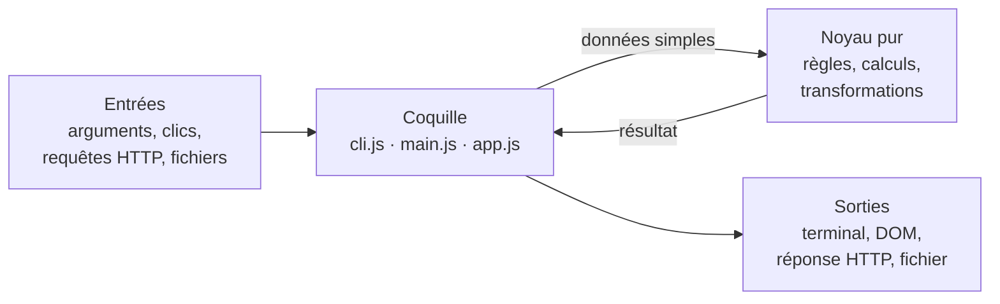
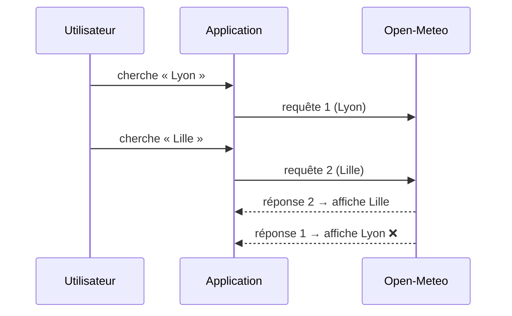

# 32 — Projets guidés

> **Niveau** : Débutant à avancé · **Durée** : ~20 h (6 projets) · **Prérequis** : les chapitres indiqués pour chaque projet

Lire un cours ne suffit pas : c'est en construisant un programme complet qu'on apprend à découper un problème, à choisir ses outils et à traiter les cas qui dérangent. Ce chapitre propose six projets progressifs, du petit outil en ligne de commande à l'API REST. Chacun a un cahier des charges, des étapes guidées, des indices et une solution complète, testée, dans son propre dossier.

## Objectifs

- Découper un programme en un noyau de fonctions pures, testables, et une fine couche d'entrées/sorties (terminal, DOM, réseau, fichiers).
- Écrire des outils en ligne de commande robustes : options, entrée et sortie standard, codes de sortie, lecture en flux.
- Construire une interface web sans framework : DOM, délégation d'événements, formulaires, `localStorage`, modules ES.
- Consommer une API HTTP réelle avec `async`/`await`, une gestion d'erreurs complète et l'annulation des requêtes obsolètes.
- Exposer une API REST avec `node:http` : routage, codes de statut, validation, persistance.
- Tester chaque projet avec `node:test`, sans réseau ni données réelles.

## Sommaire

- [Comment utiliser ce chapitre](#comment-utiliser-ce-chapitre)
- [Projet 1 — Générateur de mots de passe](#projet-1--générateur-de-mots-de-passe)
- [Projet 2 — Carnet de notes](#projet-2--carnet-de-notes)
- [Projet 3 — Liste de tâches dans le navigateur](#projet-3--liste-de-tâches-dans-le-navigateur)
- [Projet 4 — Application météo](#projet-4--application-météo)
- [Projet 5 — Analyseur de texte](#projet-5--analyseur-de-texte)
- [Projet 6 — API REST de tâches](#projet-6--api-rest-de-tâches)
- [Pièges courants](#pièges-courants)
- [Bonnes pratiques](#bonnes-pratiques)
- [Résumé](#résumé)
- [Exercices](#exercices)
- [Pour aller plus loin](#pour-aller-plus-loin)

## Comment utiliser ce chapitre

| #   | Projet                                                    | Type             | Chapitres principaux | Difficulté | Durée |
| --- | --------------------------------------------------------- | ---------------- | -------------------- | ---------- | ----- |
| 1   | [Générateur de mots de passe](01-generateur-mots-de-passe) | CLI Node         | 01 à 08              | ★☆☆        | ~2 h  |
| 2   | [Carnet de notes](02-carnet-de-notes)                     | Module + rapport | 06 à 12              | ★☆☆        | ~3 h  |
| 3   | [Liste de tâches](03-todo-app)                            | Application web  | 23 à 26              | ★★☆        | ~4 h  |
| 4   | [Météo](04-meteo)                                         | Application web  | 17 à 22              | ★★☆        | ~4 h  |
| 5   | [Analyseur de texte](05-analyseur-de-texte)               | CLI Node         | 07, 12, 14, 27       | ★★☆        | ~3 h  |
| 6   | [API REST de tâches](06-api-rest)                         | Serveur Node     | 22, 25, 27, 29       | ★★★        | ~5 h  |

**Méthode conseillée** : lisez le cahier des charges, essayez seul en suivant les étapes, ouvrez un indice seulement quand vous êtes bloqué, puis comparez avec la solution. Votre code n'a pas besoin de lui ressembler : s'il remplit le cahier des charges et que vos tests passent, il est juste. Comparer deux solutions qui fonctionnent est d'ailleurs très instructif.

**Environnement** : Node.js 24 ou 26 (versions LTS en novembre 2026) et un navigateur à jour. Aucun projet ne demande `npm install` : tout repose sur JavaScript, les API du navigateur et les modules intégrés de Node. Pour lancer une solution :

```bash
cd 32-projets/01-generateur-mots-de-passe
npm test          # lance les tests (équivaut à node --test)
npm start         # lance le programme
```

**Démarrer votre propre version** : créez un dossier à côté, puis un `package.json` minimal. `"type": "module"` fait de chaque fichier `.js` un module ES (`import`/`export`) — voir le [chapitre 26](../26-modules/README.md).

```json
{
  "name": "mon-projet",
  "type": "module",
  "scripts": {
    "start": "node index.js",
    "test": "node --test"
  }
}
```

Sans argument, `node --test` exécute les fichiers dont le nom correspond aux motifs par défaut, par exemple `*.test.js` ou tout fichier d'un dossier `test/` (détails au [chapitre 29](../29-tests/README.md)).

### Une architecture commune : un noyau pur, une coquille fine

Les six solutions suivent la même organisation. La **logique** (calculer une moyenne, filtrer des tâches, transformer une réponse d'API, valider une requête) vit dans des fonctions pures : elles reçoivent des données simples et renvoient un résultat, sans rien afficher, lire ni écrire. Autour, une **coquille** aussi mince que possible s'occupe des entrées/sorties : lire les options de la ligne de commande, réagir aux clics, envoyer une requête, répondre en HTTP.



Pourquoi ? Parce que le noyau se teste en quelques lignes, sans navigateur, sans réseau et sans fichier, et qu'il se réutilise : la logique du projet 3 pourrait servir telle quelle dans une application mobile ou derrière l'API du projet 6.

## Projet 1 — Générateur de mots de passe

### Objectif

Écrire une commande `node cli.js` qui génère des mots de passe aléatoires sûrs, configurables par options, et affiche leur robustesse estimée. C'est le premier programme « complet » du cours : des fonctions, des boucles, des chaînes, des nombres, et une vraie interface en ligne de commande.

### Chapitres mobilisés

[Introduction](../01-introduction/README.md) · [Variables](../02-variables/README.md) · [Types et opérateurs](../03-types-et-operateurs/README.md) · [Conditions](../04-conditions/README.md) · [Boucles](../05-boucles/README.md) · [Fonctions](../06-fonctions/README.md) · [Chaînes](../07-chaines/README.md) · [Nombres et Math](../08-nombres-et-math/README.md) ; pour la ligne de commande et les tests : [Node.js](../27-nodejs/README.md) et [Tests](../29-tests/README.md).

### Cahier des charges

- `node cli.js` affiche un mot de passe de 16 caractères ; `-l, --longueur <n>` choisit la longueur (8 à 128).
- Quatre jeux de caractères : minuscules, majuscules, chiffres, symboles. Chacun peut être désactivé (`--sans-chiffres`…) ; au moins un doit rester actif.
- **Règle de composition** : le mot de passe contient au moins un caractère de chaque jeu actif.
- `--sans-ambigus` exclut les caractères faciles à confondre (`0`, `O`, `1`, `l`, `I`).
- `-n, --nombre <n>` génère plusieurs mots de passe, un par ligne ; `-e, --entropie` affiche l'entropie estimée et un niveau de robustesse ; `-h, --aide` affiche l'aide.
- Le hasard vient de `crypto.getRandomValues`, **jamais** de `Math.random`.
- Une option invalide affiche un message clair et l'aide, et le programme se termine avec le code de sortie `2`.
- La logique est testée avec `node:test`.

### Étapes guidées

**1. Séparez la logique de l'interface.** Créez `src/generateur.js` (la logique, exportée) et `cli.js` (lecture des options et affichage). Tout ce qui peut être testé va dans `src/`.

**2. Tirez un entier aléatoire sûr.** `Math.random()` est rapide mais prévisible : quelqu'un qui observe quelques sorties peut deviner les suivantes. Pour un secret, utilisez `crypto.getRandomValues`, qui remplit un tableau typé avec des valeurs imprévisibles ([chapitre 08](../08-nombres-et-math/README.md)).

Il reste un piège : ramener un nombre de 32 bits dans `[0, max[` avec `% max` favorise légèrement les petites valeurs. Le phénomène est plus visible sur un octet :

```js
// Les 256 valeurs possibles d'un octet, ramenées dans [0, 3[ avec le modulo
const compte = [0, 0, 0];
for (let octet = 0; octet < 256; octet++) compte[octet % 3]++;
console.log(compte); // [ 86, 85, 85 ] → 0 sort un peu plus souvent que 1 et 2
```

La parade, appelée **échantillonnage par rejet**, consiste à rejeter les tirages qui tombent au-delà du dernier multiple complet de `max` :

```js
function entierAleatoire(max) {
  const plage = 2 ** 32; // valeurs possibles d'un Uint32
  const limite = plage - (plage % max); // dernier multiple complet de max
  const tampon = new Uint32Array(1);
  do {
    crypto.getRandomValues(tampon);
  } while (tampon[0] >= limite); // rarement plus d'un tour
  return tampon[0] % max;
}

const des = Array.from({ length: 1000 }, () => entierAleatoire(6) + 1);
console.log(des.every((face) => face >= 1 && face <= 6)); // true
```

**3. Construisez l'alphabet.** Déclarez les quatre jeux dans un objet (`{ minuscules: "abc…", … }`), puis écrivez `jeuxActifs(options)` qui renvoie la liste des chaînes retenues, en retirant les caractères ambigus si demandé.

**4. Générez en respectant la composition.** Tirez chaque caractère uniformément dans l'alphabet complet ; si un jeu actif manque, recommencez. Écrivez `respecteComposition(motDePasse, jeux)` à part : elle servira aussi dans les tests. Avec 8 caractères ou plus, il faut rarement plus de deux essais.

**5. Estimez la robustesse.** Pour un mot de passe **tiré au hasard**, l'entropie vaut `longueur × log2(taille de l'alphabet)` bits : chaque bit supplémentaire double le nombre d'essais nécessaires à une attaque par force brute.

```js
const bits = 16 * Math.log2(88); // 16 caractères parmi 26 + 26 + 10 + 26 = 88
console.log(bits.toFixed(1)); // 103.4
```

Retenez comme repères qu'en dessous de 64 bits un mot de passe est très faible, et qu'au-delà de 100 bits il est fort (ordres de grandeur inspirés des recommandations de l'ANSSI ; la CNIL retient un minimum de 80 bits pour un mot de passe utilisé seul). Cette formule ne vaut **que** pour un tirage aléatoire : « Marseille2026! » n'a pas 14 × 6,5 bits d'entropie, car un humain ne choisit pas au hasard.

**6. Lisez les options.** `util.parseArgs` (Node.js 18.3+, stable depuis Node 20) analyse les arguments et refuse les options inconnues ([chapitre 27](../27-nodejs/README.md)). Les valeurs de type `"string"` restent des chaînes : convertissez-les et validez-les vous-même.

```js
import { parseArgs } from "node:util";

const { values } = parseArgs({
  args: ["-l", "24", "--sans-symboles"], // dans le vrai programme : process.argv.slice(2)
  options: {
    longueur: { type: "string", short: "l", default: "16" },
    "sans-symboles": { type: "boolean", default: false },
  },
});
console.log(values); // [Object: null prototype] { longueur: '24', 'sans-symboles': true }
console.log(Number(values.longueur) + 1); // 25
```

**7. Soignez la sortie.** Écrivez les mots de passe sur la sortie standard (`console.log`) et les messages annexes (entropie, erreurs) sur la sortie d'erreur (`console.error`) : `node cli.js -n 10 > mdp.txt` n'enregistre alors que les mots de passe. En cas d'erreur, fixez `process.exitCode = 2` plutôt que d'appeler `process.exit()` brutalement.

**8. Testez.** Le hasard ne se teste pas par une valeur exacte, mais par des **propriétés** : la longueur est respectée, chaque jeu est présent sur 500 tirages, aucun caractère ambigu n'apparaît, 100 mots de passe sont tous différents, les entrées invalides lèvent une erreur. La CLI elle-même se teste en la lançant avec `execFile` et en vérifiant la sortie et le code de sortie.

### Indices

<details>
<summary>Indice : retirer les caractères ambigus d'un jeu</summary>

Une chaîne est itérable : `[...jeu]` donne ses caractères, qu'on filtre puis qu'on recolle.

```js
const AMBIGUS = "0O1lI";
const sansAmbigus = (jeu) => [...jeu].filter((c) => !AMBIGUS.includes(c)).join("");
console.log(sansAmbigus("0123456789")); // 23456789
```

</details>

<details>
<summary>Indice : vérifier la composition</summary>

`every` (tous les jeux…) et `some` (…ont au moins un caractère présent) se combinent naturellement :

```js
const respecteComposition = (mdp, jeux) => jeux.every((jeu) => [...mdp].some((c) => jeu.includes(c)));
console.log(respecteComposition("abc123", ["abc", "0123456789"])); // true
console.log(respecteComposition("abcdef", ["abc", "0123456789"])); // false
```

</details>

<details>
<summary>Indice : une autre façon de garantir la composition</summary>

On peut aussi tirer d'abord un caractère dans chaque jeu actif, compléter avec l'alphabet complet, puis **mélanger** le résultat avec l'algorithme de Fisher-Yates (en utilisant `entierAleatoire`, pas `Math.random`). Sans le mélange, le premier caractère serait toujours une minuscule : une information précieuse pour un attaquant.

</details>

### Pistes d'extension

- **Phrases de passe** : quelques mots tirés dans une grande liste, plus faciles à retenir (voir l'[exercice 1](#exercice-1--phrase-de-passe-)).
- `--exclure <caractères>` pour les sites qui refusent certains symboles, et `--pin` pour un code uniquement numérique.
- Rendre la commande installable : le champ `"bin"` du `package.json` et `npm link` (voir le [chapitre 28](../28-outillage/README.md)).
- Envoyer le résultat dans le presse-papiers avec un tube : `node cli.js | pbcopy` (macOS) ou `node cli.js | clip` (Windows).

### Solution

Dossier [`01-generateur-mots-de-passe/`](01-generateur-mots-de-passe) : `src/generateur.js` (logique), `cli.js` (options et affichage), `test/generateur.test.js` (13 tests, dont 3 sur la CLI).

## Projet 2 — Carnet de notes

### Objectif

Écrire un module de statistiques sur les notes d'une classe : moyennes par matière et générale (pondérée par les coefficients), médiane, écart type, mentions, classement avec ex aequo, regroupements. Puis un petit script qui affiche le bilan de la classe. C'est le terrain idéal pour pratiquer les méthodes de tableaux et les fonctions pures.

### Chapitres mobilisés

[Fonctions](../06-fonctions/README.md) · [Chaînes](../07-chaines/README.md) · [Nombres et Math](../08-nombres-et-math/README.md) · [Tableaux](../09-tableaux/README.md) · [Objets](../10-objets/README.md) · [Syntaxe moderne](../11-syntaxe-moderne/README.md) · [Collections](../12-collections/README.md).

### Cahier des charges

- Les données sont des objets simples : chaque élève a un nom et, pour chaque matière, une liste de notes sur 20 ; chaque matière a un coefficient.

  ```json
  {
    "nom": "Amina Diallo",
    "notes": { "mathematiques": [17, 18.5, 16], "francais": [15, 14], "sport": [] }
  }
  ```

- `moyenne`, `mediane`, `ecartType`, `moyennePonderee` : génériques, elles renvoient `null` pour une liste vide.
- `bulletin(eleve, coefficients)` : moyenne de chaque matière, moyenne générale pondérée, mention. Une matière sans note est ignorée ; une note hors de `[0, 20]` lève une erreur qui cite l'élève et la matière.
- Mentions : « Très bien » (≥ 16), « Bien » (≥ 14), « Assez bien » (≥ 12), « Sans mention » (≥ 10), « Insuffisant ».
- `classement(bulletins)` : par moyenne décroissante, ex aequo au même rang (1, 2, 2, 4), puis par nom dans l'ordre alphabétique français.
- `regrouperParMention`, `statistiquesParMatiere` (moyenne, médiane, écart type, min, max) et `majorsParMatiere` (avec égalités).
- Aucune fonction ne modifie ses entrées. Seul le script final affiche quelque chose, avec deux décimales à la française (« 14,51 »).

### Étapes guidées

**1. Commencez par les statistiques génériques**, dans `src/statistiques.js`. `reduce` donne la somme ; la médiane demande une copie triée. Depuis ES2023, `toSorted` trie **une copie** ; `sort` trierait le tableau de l'appelant ([chapitre 09](../09-tableaux/README.md)).

```js
function mediane(valeurs) {
  if (valeurs.length === 0) return null;
  const triees = valeurs.toSorted((a, b) => a - b); // sans comparateur, 9 > 10 (tri de chaînes)
  const milieu = Math.floor(triees.length / 2);
  return triees.length % 2 === 1 ? triees[milieu] : (triees[milieu - 1] + triees[milieu]) / 2;
}

const notes = [12, 9, 15, 10];
console.log(mediane(notes)); // 11
console.log(notes); // [ 12, 9, 15, 10 ] → l'original est intact
```

**2. Calculez une moyenne pondérée** à partir de paires `{ valeur, poids }`. Elle servira pour la moyenne générale (poids = coefficient).

```js
const somme = (valeurs) => valeurs.reduce((total, v) => total + v, 0);

function moyennePonderee(paires) {
  const poidsTotal = somme(paires.map((p) => p.poids));
  return poidsTotal === 0 ? null : somme(paires.map((p) => p.valeur * p.poids)) / poidsTotal;
}

// Maths 14 (coef 4), français 11 (coef 3), sport 18 (coef 1)
console.log(moyennePonderee([
  { valeur: 14, poids: 4 },
  { valeur: 11, poids: 3 },
  { valeur: 18, poids: 1 },
])); // 13.375
```

**3. Écrivez `bulletin`.** Parcourez `Object.entries(eleve.notes)`, validez chaque note, calculez la moyenne de chaque matière non vide, puis la moyenne générale. Choisissez la mention avec un tableau de seuils trié et `find` plutôt qu'une cascade de `if` ([chapitre 04](../04-conditions/README.md)).

**4. N'arrondissez qu'à l'affichage.** Gardez la pleine précision dans les calculs : arrondir trop tôt fausse les résultats suivants, et l'arrondi « maison » est piégé par la représentation binaire des nombres ([chapitre 08](../08-nombres-et-math/README.md)).

```js
console.log(Math.round(1.005 * 100) / 100); // 1 (et non 1.01 : 1.005 vaut en réalité 1.00499999…)

const format = new Intl.NumberFormat("fr-FR", { minimumFractionDigits: 2, maximumFractionDigits: 2 });
console.log(format.format(14.514705882352942)); // 14,51
console.log(format.format(12)); // 12,00
```

**5. Classez, avec les ex aequo.** Triez une copie (moyenne décroissante, puis `localeCompare(…, "fr")` sur le nom pour départager l'affichage), puis parcourez-la : un élève qui a la même moyenne que le précédent reçoit le même rang, sinon son rang est sa position + 1.

```js
const eleves = [
  { nom: "Zoé", moyenne: 12 },
  { nom: "Émile", moyenne: 15 },
  { nom: "Chloé", moyenne: 15 },
  { nom: "Adam", moyenne: 9 },
];
const tries = eleves.toSorted((a, b) => b.moyenne - a.moyenne || a.nom.localeCompare(b.nom, "fr"));
const classes = [];
for (const [i, eleve] of tries.entries()) {
  const precedent = classes[i - 1];
  const rang = precedent?.moyenne === eleve.moyenne ? precedent.rang : i + 1;
  classes.push({ ...eleve, rang });
}
console.log(classes.map((e) => `${e.rang}. ${e.nom}`).join(" | ")); // 1. Chloé | 1. Émile | 3. Zoé | 4. Adam
```

Remarquez `localeCompare` : avec un simple `<`, « Émile » serait classé après « Zoé », car le code de `É` est supérieur à celui de `Z`.

**6. Regroupez.** `Object.groupBy` (ES2024) range les bulletins par mention en une ligne ; une `Map` accumule les moyennes de chaque matière ([chapitre 12](../12-collections/README.md)).

```js
const bulletins = [
  { nom: "Amina", mention: "Très bien" },
  { nom: "Yanis", mention: "Bien" },
  { nom: "Chloé", mention: "Bien" },
];
const groupes = Object.groupBy(bulletins, (b) => b.mention);
console.log(Object.keys(groupes)); // [ 'Très bien', 'Bien' ]
console.log(groupes.Bien.map((b) => b.nom)); // [ 'Yanis', 'Chloé' ]
```

**7. Affichez le bilan** dans `index.js` avec `console.table`, qui transforme un tableau d'objets en tableau aligné dans le terminal.

**8. Testez chaque fonction** : cas nominal, liste vide, ex aequo, note invalide, et vérifiez qu'aucune entrée n'est modifiée. Pour comparer des flottants, tolérez un petit écart (`Math.abs(a - b) < 1e-9`).

### Indices

<details>
<summary>Indice : l'écart type</summary>

C'est la racine carrée de la moyenne des carrés des écarts à la moyenne. En réutilisant `moyenne` :

```js
const moyenne = (v) => (v.length ? v.reduce((a, b) => a + b, 0) / v.length : null);
const ecartType = (v) => {
  const m = moyenne(v);
  return m === null ? null : Math.sqrt(moyenne(v.map((x) => (x - m) ** 2)));
};
console.log(ecartType([2, 4, 4, 4, 5, 5, 7, 9])); // 2
```

</details>

<details>
<summary>Indice : garder l'ordre des mentions dans le regroupement</summary>

`Object.groupBy` crée les clés dans l'ordre où il les rencontre. Pour obtenir « Très bien » avant « Bien », parcourez la liste des mentions dans l'ordre et ne gardez que celles qui existent dans les groupes.

</details>

<details>
<summary>Indice : les majors avec égalités</summary>

Pour chaque matière, gardez `{ moyenne, noms }`. Une moyenne plus haute remplace l'entrée ; une moyenne égale ajoute le nom à la liste.

</details>

### Pistes d'extension

- Lire la classe depuis un fichier JSON ou CSV passé en argument (`fs/promises`, `JSON.parse`, [chapitre 27](../27-nodejs/README.md)).
- Afficher la répartition des moyennes en histogramme (voir l'[exercice 2](#exercice-2--histogramme-des-moyennes-)).
- Suivre la progression d'un trimestre à l'autre (écart de moyenne, rang gagné ou perdu).
- Documenter les types des données avec JSDoc et `// @ts-check` ([chapitre 30](../30-commentaires-jsdoc/README.md)).

### Solution

Dossier [`02-carnet-de-notes/`](02-carnet-de-notes) : `src/statistiques.js`, `src/carnet.js`, `donnees.js` (une classe d'exemple), `index.js` (bilan) et `test/carnet.test.js` (16 tests).

## Projet 3 — Liste de tâches dans le navigateur

### Objectif

Construire une application web de liste de tâches, sans framework ni outil de build : ajout, case à cocher, suppression, filtres, compteur, persistance entre deux visites. Le point clé : la logique (l'état et ses transformations) vit dans un module pur, testé dans Node ; le DOM n'est qu'une coquille.

### Chapitres mobilisés

[DOM](../23-dom/README.md) · [Événements](../24-evenements/README.md) · [JSON et stockage](../25-json-et-stockage/README.md) · [Modules](../26-modules/README.md) ; en appui : [Tableaux](../09-tableaux/README.md) et [Objets](../10-objets/README.md) (mises à jour immuables).

### Cahier des charges

- Un formulaire ajoute une tâche ; un titre vide (ou fait uniquement d'espaces) est refusé avec un message, un titre trop long aussi (200 caractères maximum).
- Chaque tâche a une case à cocher (terminée ou non) et un bouton de suppression.
- Boutons « Tout cocher / Tout décocher » et « Effacer les terminées » ; compteur « 2 tâches restantes » (au singulier pour 0 et 1).
- Filtres « Toutes », « Actives », « Terminées » sous forme de liens `#/actives`… : l'URL reflète le filtre et le bouton « Précédent » fonctionne.
- Les tâches sont enregistrées dans `localStorage` et retrouvées au rechargement ; des données illisibles ne font pas planter l'application.
- Le titre d'une tâche n'est **jamais** interprété comme du HTML.
- Accessibilité de base : libellés, focus visible, navigation au clavier, message d'erreur annoncé (`role="alert"`).
- `src/taches.js` (logique) et `src/stockage.js` (persistance) sont testés avec `node:test`.

### Étapes guidées

**1. Écrivez la page HTML d'abord** : un `<form>` avec un `<input required maxlength="200">`, une liste `<ul>` vide, et un `<template>` qui décrit le balisage d'une tâche. Chargez le script avec `<script type="module" src="src/main.js">` : un module est différé automatiquement, le DOM est donc prêt quand il s'exécute ([chapitre 23](../23-dom/README.md)).

```html
<template id="modele-tache">
  <li class="tache">
    <input type="checkbox" class="basculer" />
    <label class="titre"></label>
    <button type="button" class="supprimer">×</button>
  </li>
</template>
```

**2. Modélisez l'état dans un module pur**, `src/taches.js`. Une tâche est un objet `{ id, titre, terminee, creeLe }`. Chaque fonction reçoit le tableau de tâches et en renvoie un **nouveau**, sans jamais le modifier :

```js
const basculerTache = (taches, id) => taches.map((t) => (t.id === id ? { ...t, terminee: !t.terminee } : t));
const supprimerTache = (taches, id) => taches.filter((t) => t.id !== id);

const avant = [
  { id: "a", titre: "Acheter du pain", terminee: false },
  { id: "b", titre: "Réviser les promesses", terminee: false },
];
const apres = basculerTache(avant, "b");
console.log(avant[1].terminee, apres[1].terminee); // false true
console.log(apres[0] === avant[0]); // true → les tâches inchangées sont réutilisées
console.log(supprimerTache(apres, "a").length); // 1
```

Cette discipline rend l'application prévisible : l'état n'est remplacé qu'à un seul endroit, puis sauvegardé et réaffiché. Pour l'identifiant, `crypto.randomUUID()` suffit ; dans les tests, passez-le en paramètre pour obtenir des résultats déterministes.

**3. Persistez avec prudence.** `localStorage` ne stocke que des chaînes : passez par `JSON.stringify`/`JSON.parse`. Et ne faites jamais confiance à ce que vous relisez : JSON corrompu, ancienne version du format, données modifiées à la main dans les DevTools ([chapitre 25](../25-json-et-stockage/README.md)).

```js
const CLE = "todo-app:taches:v1"; // la version dans la clé facilite les changements de format

function chargerTaches(stockage) {
  try {
    const donnees = JSON.parse(stockage.getItem(CLE) ?? "[]");
    return Array.isArray(donnees) ? donnees.filter((t) => typeof t?.titre === "string") : [];
  } catch {
    return []; // JSON illisible : on repart d'une liste vide plutôt que de planter
  }
}

// Un faux localStorage suffit pour tester : seule l'interface compte.
const faux = { getItem: () => '[{"titre":"Lire"}, 42, null]' };
console.log(chargerTaches(faux)); // [ { titre: 'Lire' } ]
console.log(chargerTaches({ getItem: () => "{oups" })); // []
```

`setItem` peut lui aussi échouer (quota dépassé, stockage bloqué par le navigateur) : entourez-le d'un `try`/`catch` et prévenez l'utilisateur.

**4. Affichez tout à partir de l'état.** Une seule fonction `afficher()` lit l'état et reconstruit la liste : clonez le `<template>` pour chaque tâche visible, remplissez-le avec `textContent`, puis remplacez le contenu de la liste d'un coup avec `replaceChildren`. Mettez à jour au même endroit le compteur, les boutons et le filtre actif (`aria-current="page"`).

<!-- no-run -->
```js
function creerElement(tache) {
  const element = modele.content.firstElementChild.cloneNode(true);
  element.dataset.id = tache.id; // retrouvé plus tard par la délégation
  element.querySelector(".basculer").checked = tache.terminee;
  element.querySelector(".titre").textContent = tache.titre; // ✅ jamais innerHTML avec une saisie
  return element;
}

liste.replaceChildren(...filtrerTaches(etat.taches, etat.filtre).map(creerElement));
```

Avec `innerHTML`, un titre comme `` exécuterait du code : c'est une faille XSS. `textContent` l'affiche simplement comme du texte.

**5. Branchez les événements par délégation.** Plutôt qu'un écouteur par case à cocher (à recréer à chaque affichage), placez **un seul** écouteur sur la liste et identifiez la cible avec `matches` ou `closest` ([chapitre 24](../24-evenements/README.md)) :

<!-- no-run -->
```js
liste.addEventListener("change", (evenement) => {
  if (!evenement.target.matches(".basculer")) return;
  const { id } = evenement.target.closest(".tache").dataset;
  mettreAJour(basculerTache(etat.taches, id)); // nouvel état → sauvegarde → affichage
});

liste.addEventListener("click", (evenement) => {
  const bouton = evenement.target.closest(".supprimer");
  if (bouton) mettreAJour(supprimerTache(etat.taches, bouton.closest(".tache").dataset.id));
});
```

Pour le formulaire, écoutez `submit` (et non le clic sur le bouton : la touche Entrée doit aussi fonctionner) et appelez `preventDefault()` pour éviter le rechargement de la page.

**6. Ajoutez les filtres** avec de simples liens `<a href="#/actives">`. Lisez le filtre dans `location.hash` au démarrage et à chaque événement `hashchange`. Les liens fonctionnent au clavier, s'ouvrent dans un nouvel onglet et s'ajoutent à l'historique, sans une ligne de code pour cela.

**7. Synchronisez les onglets** : l'événement `storage` est déclenché dans les **autres** onglets de la même origine quand l'un d'eux modifie `localStorage`. Rechargez l'état et réaffichez.

**8. Testez la logique** dans Node : création, normalisation du titre, immutabilité (gelez les données de test avec `Object.freeze` : toute mutation lèverait alors une erreur en mode strict), filtres, compteur, et le stockage avec un faux `localStorage`. Puis testez l'interface à la main, au clavier compris.

> [!NOTE]
> Un navigateur refuse de charger des modules ES depuis une page ouverte directement en `file://`. Servez le dossier avec un serveur local : `npm start` dans le dossier de la solution utilise le petit serveur sans dépendance fourni dans [`serveur-statique.js`](serveur-statique.js) ; l'extension Live Server de VS Code ou `python3 -m http.server` conviennent aussi.

### Indices

<details>
<summary>Indice : refuser un titre fait d'espaces</summary>

L'attribut `required` refuse un champ vide, mais accepte `"   "`. Normalisez dans la logique (et testez-le) : `titre.trim().replace(/\s+/g, " ")`, puis refusez la chaîne vide en levant une erreur ; `main.js` affiche son message.

</details>

<details>
<summary>Indice : « Tout cocher » ou « Tout décocher » ?</summary>

Si **toutes** les tâches sont terminées, le bouton les décoche toutes ; sinon, il les coche toutes : `const toutes = taches.every((t) => t.terminee)` puis `taches.map((t) => ({ ...t, terminee: !toutes }))`.

</details>

<details>
<summary>Indice : le focus après une suppression</summary>

Le bouton qui avait le focus vient de disparaître du DOM : le focus retombe sur `<body>` et un utilisateur au clavier est perdu. Redonnez le focus au champ de saisie (`champ.focus()`).

</details>

### Pistes d'extension

- Modifier une tâche par double-clic (Entrée valide, Échap annule).
- Une date d'échéance avec `<input type="date">`, et un tri par échéance.
- Exporter et importer la liste en JSON (`Blob`, `URL.createObjectURL`, `<input type="file">`).
- Remplacer `localStorage` par IndexedDB, ou par l'API du projet 6 avec `fetch`.
- Tester l'interface avec Vitest et un DOM simulé (happy-dom ou jsdom), voir le [chapitre 29](../29-tests/README.md).

### Solution

Dossier [`03-todo-app/`](03-todo-app) : `index.html`, `style.css`, `src/taches.js`, `src/stockage.js`, `src/main.js` et `test/taches.test.js` (14 tests). Lancement : `npm start`, puis <http://localhost:8080/>.

## Projet 4 — Application météo

### Objectif

Construire une page qui affiche la météo actuelle et les prévisions à 7 jours d'une ville, à partir de l'API gratuite [Open-Meteo](https://open-meteo.com/). Le défi n'est pas l'affichage mais tout ce qui peut mal tourner avec le réseau : lenteur, panne, erreur du serveur, réponse inattendue, et réponses qui arrivent dans le désordre.

### Chapitres mobilisés

[Erreurs](../17-erreurs/README.md) · [Asynchrone](../18-asynchrone/README.md) · [Promesses](../19-promises/README.md) · [async/await](../20-async-await/README.md) · [Timers](../21-timers/README.md) · [Fetch et HTTP](../22-fetch-http/README.md) ; en appui : [Dates](../15-dates/README.md) (`Intl.DateTimeFormat`) et [DOM](../23-dom/README.md).

### Cahier des charges

- Un champ de recherche (au moins deux caractères) ; on cherche d'abord la ville, puis ses prévisions.
- Affichage : nom complet du lieu (« Paris, Île-de-France, France »), température actuelle, ressenti, humidité, vent, description du temps et icône, puis 7 jours avec minimum, maximum et probabilité de pluie.
- S'il existe des homonymes (Paris au Texas, Paris dans le Tennessee…), ils sont proposés en un clic.
- **États** : un message « Chargement… » pendant la requête (l'ancien résultat est estompé), un message clair en cas d'erreur, aucun écran blanc.
- **Erreurs distinguées** : ville introuvable, pas de connexion, délai dépassé (10 s), erreur HTTP du serveur, réponse illisible.
- **Annulation** : une nouvelle recherche annule la requête précédente (`AbortController`) ; une réponse lente ne doit jamais écraser une réponse plus récente.
- La transformation des réponses de l'API est un module pur, testé avec des réponses enregistrées ; le code réseau est testé avec un `fetch` simulé.

### Étapes guidées

**1. Explorez l'API avant de coder.** Open-Meteo ne demande pas de clé. Testez les deux URL dans le navigateur ou avec `curl`, et lisez les réponses.

- Géocodage : `https://geocoding-api.open-meteo.com/v1/search?name=Lyon&count=5&language=fr&format=json`
- Prévisions : `https://api.open-meteo.com/v1/forecast?latitude=45.75&longitude=4.85&current=temperature_2m,weather_code&daily=temperature_2m_max,temperature_2m_min&timezone=auto`

Extrait d'une réponse de prévisions (6 novembre 2026, Lyon) :

```json
{
  "timezone": "Europe/Paris",
  "current_units": { "time": "iso8601", "temperature_2m": "°C", "weather_code": "wmo code" },
  "current": { "time": "2026-11-06T09:15", "temperature_2m": 9.1, "weather_code": 3 },
  "daily": {
    "time": ["2026-11-06", "2026-11-07"],
    "temperature_2m_max": [13.7, 10.1],
    "temperature_2m_min": [6.9, 3.4]
  }
}
```

Trois observations guident la suite : les valeurs quotidiennes sont des **tableaux parallèles** (l'indice `i` de chaque tableau concerne le même jour) ; `weather_code` est un code météo **WMO** (0 = ciel dégagé, 3 = couvert, 61 = pluie faible…) qu'il faut traduire ; quand le géocodage ne trouve rien, la réponse ne contient simplement **pas** de propriété `results`. En cas de paramètre invalide, l'API répond `400` avec `{ "error": true, "reason": "…" }`.

**2. Construisez les URL avec `URL` et `URLSearchParams`**, jamais par concaténation : les accents, espaces et caractères spéciaux sont encodés correctement.

```js
const url = new URL("https://geocoding-api.open-meteo.com/v1/search");
url.search = new URLSearchParams({ name: "Saint-Étienne", count: 5, language: "fr" });
console.log(url.href);
// https://geocoding-api.open-meteo.com/v1/search?name=Saint-%C3%89tienne&count=5&language=fr
```

**3. Transformez les réponses dans un module pur** (`src/meteo.js`) : choisissez vos propres noms de propriétés, traduisez les codes WMO, regroupez les tableaux parallèles en une liste de jours. Le reste de l'application ne dépend plus du format de l'API : s'il change, un seul fichier est à modifier.

```js
const quotidien = {
  time: ["2026-11-06", "2026-11-07"],
  temperature_2m_max: [13.7, 10.1],
  temperature_2m_min: [6.9, 3.4],
};
const jours = quotidien.time.map((date, i) => ({
  date,
  min: Math.round(quotidien.temperature_2m_min[i]),
  max: Math.round(quotidien.temperature_2m_max[i]),
}));
console.log(jours);
// [
//   { date: '2026-11-06', min: 7, max: 14 },
//   { date: '2026-11-07', min: 3, max: 10 }
// ]
```

**4. Écrivez une fonction `obtenirJson` qui gère toutes les erreurs.** `fetch` ne rejette sa promesse qu'en cas de problème **réseau** ; une réponse 404 ou 500 est une réponse comme une autre, à détecter avec `response.ok` ([chapitre 22](../22-fetch-http/README.md)). Enveloppez chaque cas dans une erreur dont le message peut être montré à l'utilisateur :

<!-- no-run -->
```js
export class ErreurMeteo extends Error {}

export async function obtenirJson(url, { signal } = {}) {
  let reponse;
  try {
    reponse = await fetch(url, { signal });
  } catch (erreur) {
    if (erreur.name === "AbortError") throw erreur; // annulation volontaire : on la laisse passer
    throw new ErreurMeteo("Connexion impossible. Vérifiez votre accès à Internet.", { cause: erreur });
  }
  if (!reponse.ok) throw new ErreurMeteo(`Le service météo a répondu ${reponse.status}.`);
  try {
    return await reponse.json();
  } catch (erreur) {
    throw new ErreurMeteo("Réponse illisible du service météo.", { cause: erreur });
  }
}
```

**5. Ajoutez un délai maximal.** `AbortSignal.timeout(10_000)` crée un signal qui s'annule tout seul au bout de 10 s, avec une erreur nommée `TimeoutError`. Pour respecter **aussi** l'annulation venue de l'extérieur, combinez les deux signaux avec `AbortSignal.any([signal, AbortSignal.timeout(10_000)])` (Baseline 2024 ; Node.js 20.3+) ([chapitre 20](../20-async-await/README.md)).

**6. Annulez la requête précédente.** Sans précaution, voici ce qui arrive quand l'utilisateur cherche « Lyon » puis aussitôt « Lille », et que la première réponse arrive en dernier :



L'utilisateur a demandé Lille et voit Lyon. La solution : garder l'`AbortController` de la dernière requête et l'annuler avant d'en lancer une nouvelle. Une petite fonction d'ordre supérieur rend le mécanisme réutilisable et testable :

```js
function derniereSeulement(fonction) {
  let controleur;
  return (...args) => {
    controleur?.abort(); // annule l'appel précédent s'il n'est pas terminé
    controleur = new AbortController();
    return fonction(controleur.signal, ...args);
  };
}

// Démonstration avec une fausse requête qui met 50 ms à répondre
const requete = (signal, ville) =>
  new Promise((resoudre, rejeter) => {
    const minuteur = setTimeout(() => resoudre(`météo de ${ville}`), 50);
    signal.addEventListener("abort", () => {
      clearTimeout(minuteur);
      rejeter(signal.reason); // signal.reason est une DOMException nommée AbortError
    });
  });

const chercher = derniereSeulement(requete);
const resultats = await Promise.allSettled([chercher("Lyon"), chercher("Lille")]);
console.log(resultats.map((r) => r.value ?? r.reason.name)); // [ 'AbortError', 'météo de Lille' ]
```

Dans l'interface, une `AbortError` signifie « remplacée par une demande plus récente » : on l'ignore, sans message d'erreur.

**7. Gérez les états de l'interface** autour de chaque demande : avant, `aria-busy="true"` sur la zone de résultat et « Chargement… » dans une zone `role="status"` (annoncée par les lecteurs d'écran) ; après, le résultat ou le message d'erreur ; dans un `finally`, la fin de l'état « occupé », sauf si la demande a été annulée (c'est alors la suivante qui s'en charge).

**8. Formatez les dates sans décalage.** `new Date("2026-11-06")` désigne minuit **UTC**. Formatée dans un fuseau en retard sur UTC, elle devient la veille ([chapitre 15](../15-dates/README.md)) :

```js
const date = new Date("2026-11-06"); // minuit UTC
const options = { weekday: "long", day: "numeric", month: "long" };
console.log(date.toLocaleDateString("fr-FR", { ...options, timeZone: "America/New_York" })); // jeudi 5 novembre
console.log(date.toLocaleDateString("fr-FR", { ...options, timeZone: "UTC" })); // vendredi 6 novembre
```

Pour l'heure du relevé, inutile de passer par `Date` : avec `timezone=auto`, `"2026-11-06T09:15"` est **déjà** l'heure locale du lieu ; `time.slice(11, 16)` donne `"09:15"`.

**9. Testez sans réseau.** Enregistrez une vraie réponse de chaque API dans `test/donnees/*.json` et importez-la avec `import reponse from "./donnees/previsions-lyon.json" with { type: "json" }` (ES2025). Pour le code réseau, rendez `fetch` injectable (`{ fetch = globalThis.fetch }` en paramètre) et passez une fausse fonction qui renvoie `new Response(...)` : vous testez ainsi l'erreur 400, le JSON illisible, la panne réseau, le délai dépassé et l'annulation, de façon déterministe.

### Indices

<details>
<summary>Indice : traduire les codes WMO</summary>

Un objet qui associe chaque code à une description et une icône, avec une valeur par défaut pour les codes inconnus :

```js
const CODES = { 0: ["Ciel dégagé", "☀️"], 3: ["Couvert", "☁️"], 61: ["Pluie faible", "🌧️"] };
const decrire = (code) => CODES[code] ?? ["Conditions inconnues", "❔"];
console.log(decrire(3)); // [ 'Couvert', '☁️' ]
console.log(decrire(1234)); // [ 'Conditions inconnues', '❔' ]
```

La liste complète des codes figure dans la [documentation d'Open-Meteo](https://open-meteo.com/en/docs) (section « WMO Weather interpretation codes »).

</details>

<details>
<summary>Indice : éviter d'afficher « -0 °C »</summary>

`Math.round(-0.4)` vaut `-0`. Un gabarit de chaîne l'affiche `0` (`String(-0)` vaut `"0"`), mais `Intl.NumberFormat` affiche `-0`. Avec `Intl.NumberFormat`, l'option `signDisplay: "negative"` (ES2023, Baseline 2023) n'affiche le signe que pour les nombres strictement négatifs.

```js
const arrondi = new Intl.NumberFormat("fr-FR", { maximumFractionDigits: 0 });
const sansMoinsZero = new Intl.NumberFormat("fr-FR", { maximumFractionDigits: 0, signDisplay: "negative" });
console.log(`${Math.round(-0.4)}`); // 0
console.log(arrondi.format(-0.4)); // -0
console.log(sansMoinsZero.format(-0.4)); // 0
console.log(sansMoinsZero.format(-2.6)); // -3
```

</details>

<details>
<summary>Indice : lire le message d'erreur de l'API</summary>

Sur une erreur 400, le corps contient `{ "reason": "…" }` ; sur une erreur 502 venue d'un proxy, ce sera peut-être du HTML. Essayez de lire le JSON sans le rendre obligatoire : `const raison = await reponse.json().then((c) => c?.reason, () => undefined)`.

</details>

### Pistes d'extension

- **Recherche au fil de la frappe** : debounce + annulation (voir l'[exercice 3](#exercice-3--recherche-au-fil-de-la-frappe-)).
- Bouton « Ma position » avec `navigator.geolocation.getCurrentPosition` (pensez au refus de l'utilisateur).
- Mémoriser les dernières villes dans `localStorage` (réutilisez le module de stockage du projet 3).
- Courbe des températures heure par heure (`hourly=temperature_2m`) dessinée en SVG ou dans un `<canvas>`.
- Un cache en mémoire (`Map` URL → `{ date, données }`) pour ne pas redemander une ville consultée il y a moins de 10 minutes.

### Solution

Dossier [`04-meteo/`](04-meteo) : `src/meteo.js` (pur), `src/api.js` (réseau, erreurs, délai, annulation), `src/main.js` (interface), `test/meteo.test.js` (16 tests sans réseau, sur des réponses réelles enregistrées). Lancement : `npm start`, puis <http://localhost:8081/>.

> [!IMPORTANT]
> L'usage gratuit d'Open-Meteo est réservé aux projets non commerciaux, avec des quotas par adresse IP (10 000 appels par jour au moment de la rédaction, en novembre 2026). Les données sont sous licence CC BY 4.0 : citez la source dans votre page.

## Projet 5 — Analyseur de texte

### Objectif

Écrire une commande qui lit un fichier texte, même très gros, et produit un rapport : nombre de lignes, de mots, de caractères, mots distincts, longueur moyenne, mot le plus long et mots les plus fréquents, en texte lisible ou en JSON. On y travaille les chaînes, les expressions régulières Unicode, les `Map` et surtout la lecture **en flux**.

### Chapitres mobilisés

[Chaînes](../07-chaines/README.md) · [Collections](../12-collections/README.md) · [Expressions régulières](../14-regex/README.md) · [Node.js](../27-nodejs/README.md) ; en appui : [Itérateurs et générateurs](../13-iterateurs-generateurs/README.md) (`for await…of`).

### Cahier des charges

- `node cli.js fichier.txt` affiche le rapport ; sans fichier (ou avec `-`), le texte est lu sur l'entrée standard : `cat article.txt | node cli.js`.
- Options : `-f, --format <texte|json>`, `-t, --top <n>` (10 par défaut), `-m, --min-longueur <n>`, `-s, --sans-mots-vides` (ignore « le », « de », « et »… dans le classement), `-h, --aide`.
- Les mots sont comptés sans tenir compte de la casse ni de la ponctuation, avec les lettres de tous les alphabets ; « peut-être » et « aujourd'hui » sont des mots, et les élisions sont retirées (« l'été » compte comme « été »).
- Classement par fréquence décroissante, puis par ordre alphabétique.
- Le fichier est lu ligne par ligne : la mémoire utilisée ne dépend pas de sa taille.
- Codes de sortie : `0` succès, `1` fichier illisible (introuvable, dossier…), `2` mauvaise utilisation.
- Tests unitaires et tests de la CLI.

### Étapes guidées

**1. Définissez ce qu'est un mot.** `split(" ")` ne suffit pas : ponctuation, sauts de ligne multiples, apostrophes… Une expression régulière Unicode décrit précisément ce qu'on cherche : des lettres (`\p{L}`) ou des chiffres (`\p{N}`) de n'importe quel alphabet, avec d'éventuels traits d'union ou apostrophes internes ([chapitre 14](../14-regex/README.md)).

```js
const MOT = /[\p{L}\p{N}]+(?:[-'’][\p{L}\p{N}]+)*/gu; // drapeau u obligatoire pour \p{…}
const ELISION = /^(?:[cdjlmnst]|qu|jusqu|lorsqu|puisqu)['’]/u;

const extraireMots = (ligne) =>
  (ligne.match(MOT) ?? []).map((mot) => mot.toLocaleLowerCase("fr").replace(ELISION, ""));

console.log(extraireMots("L'été, c'est peut-être aujourd'hui !"));
// [ 'été', 'est', 'peut-être', "aujourd'hui" ]
console.log(extraireMots("Ελλάδα et 東京 — 2026")); // [ 'ελλάδα', 'et', '東京', '2026' ]
```

Notez `?? []` : `match` renvoie `null`, et non un tableau vide, quand il ne trouve rien.

**2. Comptez les fréquences dans une `Map`** ([chapitre 12](../12-collections/README.md)) : les clés peuvent être n'importe quelle chaîne (même `"constructor"` ou `"__proto__"`, qui poseraient problème avec un objet), et la taille est disponible directement.

```js
const frequences = new Map();
for (const mot of "le vent et le phare et le vent".split(" ")) {
  frequences.set(mot, (frequences.get(mot) ?? 0) + 1);
}
const top = [...frequences]
  .toSorted((a, b) => b[1] - a[1] || a[0].localeCompare(b[0], "fr"))
  .slice(0, 3);
console.log(top); // [ [ 'le', 3 ], [ 'et', 2 ], [ 'vent', 2 ] ]
console.log(frequences.size); // 4
```

**3. Lisez en flux.** `readFile` chargerait tout le fichier en mémoire. `createReadStream` lit par morceaux de 64 Kio et `readline` les découpe en lignes, y compris quand une ligne est coupée entre deux morceaux. `for await…of` parcourt les lignes au fur et à mesure ([chapitre 27](../27-nodejs/README.md)) :

```js
import { createInterface } from "node:readline";
import { Readable } from "node:stream";

// Readable.from simule un fichier arrivant en morceaux (avec une fin de ligne Windows)
const flux = Readable.from(["première li", "gne\r\ndeuxième", " ligne\n"]);
const lignes = createInterface({ input: flux, crlfDelay: Infinity });

for await (const ligne of lignes) console.log(JSON.stringify(ligne));
// "première ligne"
// "deuxième ligne"
```

Dans le programme, remplacez `Readable.from(...)` par `createReadStream(chemin)` ou `process.stdin` : le reste du code ne change pas. C'est l'intérêt d'une fonction `analyserFlux(flux)` qui accepte n'importe quel flux lisible.

**4. Accumulez les statistiques ligne par ligne** dans un objet `{ lignes, lignesVides, caracteres, mots, frequences }`. Pour les caractères, `ligne.length` compte des unités de code UTF-16 (un émoji en vaut souvent 2) ; `[...ligne].length` compte des points de code, comme la commande `wc -m` ([chapitre 07](../07-chaines/README.md)).

**5. Séparez le rapport de sa présentation.** `creerRapport(stats, options)` renvoie un objet simple (trié, filtré, sérialisable) ; `formaterTexte(rapport)` en fait un texte aligné avec `padStart`/`padEnd` et un histogramme (`"█".repeat(n)`). La sortie JSON est alors un simple `JSON.stringify(rapport, null, 2)`.

**6. Traitez les erreurs de fichier.** Avec `readline`, les erreurs du flux (fichier absent, dossier, droits) sont rejetées par la boucle `for await` : un `try`/`catch` autour suffit. Traduisez `erreur.code` (`ENOENT`, `EISDIR`, `EACCES`) en message clair, et choisissez le code de sortie.

**7. Testez à trois niveaux** : les fonctions pures (`extraireMots`, `creerRapport`), la lecture de flux avec `Readable.from` (lignes coupées, `\r\n`, flux vide), et la CLI de bout en bout avec `execFile` (sortie JSON, entrée standard, codes de sortie).

### Indices

<details>
<summary>Indice : lire l'entrée standard</summary>

`process.stdin` est un flux lisible comme un autre. Si l'utilisateur n'a rien redirigé (`process.stdin.isTTY` est vrai), le programme attendrait une saisie au clavier : affichez plutôt l'aide.

</details>

<details>
<summary>Indice : trouver le mot le plus long</summary>

Inutile de trier : un `reduce` sur les clés de la `Map` garde le plus long rencontré.

```js
const mots = ["phare", "inlassablement", "vent"];
console.log(mots.reduce((long, mot) => (mot.length > long.length ? mot : long), "")); // inlassablement
```

</details>

<details>
<summary>Indice : vérifier que la mémoire reste stable</summary>

Fabriquez un gros fichier (en concaténant le texte d'exemple des milliers de fois), puis limitez le tas de V8 : `node --max-old-space-size=32 cli.js gros.txt`. Une version qui lit tout le fichier d'un coup plante ; la version en flux passe.

</details>

### Pistes d'extension

- Analyser plusieurs fichiers passés en arguments, avec un total.
- Compter les **bigrammes** (paires de mots consécutifs) : « le vent », « vent d'ouest »…
- Utiliser `Intl.Segmenter` (granularité `"word"`) pour les langues écrites sans espaces, comme le japonais ou le chinois.
- Afficher une progression sur la sortie d'erreur pour les gros fichiers (taille connue avec `stat`, octets lus avec `flux.bytesRead`).
- Une sortie CSV, et une liste de mots vides lue depuis un fichier.

### Solution

Dossier [`05-analyseur-de-texte/`](05-analyseur-de-texte) : `src/analyseur.js`, `cli.js`, `exemples/phare.txt` et `test/analyseur.test.js` (15 tests). Essai : `node cli.js exemples/phare.txt -t 5 -s`.

## Projet 6 — API REST de tâches

### Objectif

Écrire, avec le seul module `node:http`, une API REST qui gère des tâches : lister, créer, lire, modifier, supprimer. Les données sont validées, les erreurs renvoient les bons codes de statut, les tâches sont enregistrées dans un fichier JSON, et des tests d'intégration démarrent le vrai serveur. C'est le pendant serveur des projets 3 et 4.

### Chapitres mobilisés

[Fetch et HTTP](../22-fetch-http/README.md) (méthodes, statuts, en-têtes) · [JSON et stockage](../25-json-et-stockage/README.md) · [Node.js](../27-nodejs/README.md) · [Tests](../29-tests/README.md) ; en appui : [Erreurs](../17-erreurs/README.md) et [Classes](../16-classes/README.md) (une classe d'erreur personnalisée).

### Cahier des charges

| Route                | Rôle                                   | Succès                          |
| -------------------- | -------------------------------------- | ------------------------------- |
| `GET /taches`        | liste (filtre `?terminee=true/false`)  | 200 + tableau                   |
| `POST /taches`       | création `{ "titre", "terminee"? }`    | 201 + tâche + en-tête `Location` |
| `GET /taches/:id`    | lecture                                | 200 + tâche                     |
| `PATCH /taches/:id`  | modification partielle                 | 200 + tâche                     |
| `DELETE /taches/:id` | suppression                            | 204 sans corps                  |

- Une tâche : `{ id, titre, terminee, creeLe, modifieLe }` ; `id` est un UUID, les dates sont au format ISO 8601.
- **Validation** : `titre` est une chaîne non vide de 200 caractères au plus (espaces de début et de fin retirés), `terminee` un booléen ; tout champ inconnu est refusé.
- **Erreurs** : `400` JSON mal formé ou filtre invalide, `404` tâche ou route inconnue, `405` méthode non prévue (avec l'en-tête `Allow`), `413` corps trop volumineux (100 Kio), `415` corps qui n'est pas du JSON, `422` données invalides, `500` erreur imprévue. Le corps d'erreur a toujours la même forme : `{ "erreur": "…", "details"?: [{ "champ", "message" }] }`.
- **Persistance** dans un fichier JSON : rien n'est perdu au redémarrage, ni lors de requêtes simultanées ; un fichier corrompu n'est jamais écrasé.
- Port et fichier de données configurables (`PORT`, `FICHIER_DONNEES`) ; arrêt propre sur Ctrl+C.
- Tests d'intégration `node:test` qui démarrent le serveur sur un port libre, avec des données temporaires.

### Étapes guidées

**1. Démarrez avec un serveur minimal.** `createServer` reçoit une fonction appelée à chaque requête, avec `req` (méthode, URL, en-têtes, corps en flux) et `res` (statut, en-têtes, corps). Écoutez sur le port `0` : le système choisit un port libre, ce qui sera précieux pour les tests.

```js
import { createServer } from "node:http";

const serveur = createServer((req, res) => {
  const corps = JSON.stringify({ methode: req.method, chemin: req.url });
  res.writeHead(200, {
    "Content-Type": "application/json; charset=utf-8",
    "Content-Length": Buffer.byteLength(corps), // en octets : « é » en occupe 2
  });
  res.end(corps);
});

serveur.listen(0, "127.0.0.1", async () => {
  const { port } = serveur.address();
  const reponse = await fetch(`http://127.0.0.1:${port}/taches?terminee=true`);
  console.log(reponse.status, await reponse.json()); // 200 { methode: 'GET', chemin: '/taches?terminee=true' }
  serveur.close();
});
```

**2. Routez avec une table** plutôt qu'avec une cascade de `if`. Chaque route associe un motif d'URL aux méthodes acceptées. Si le chemin correspond mais pas la méthode, répondez `405` avec l'en-tête `Allow` ; si rien ne correspond, `404`. Analysez `req.url` avec `new URL(req.url, "http://localhost")` pour séparer le chemin (`pathname`) des paramètres (`searchParams`).

<!-- no-run -->
```js
const ROUTES = [
  { motif: /^\/taches\/?$/, methodes: { GET: lister, POST: creer } },
  { motif: /^\/taches\/([\w-]+)$/, methodes: { GET: lire, PATCH: modifier, DELETE: supprimer } },
];
```

**3. Centralisez les erreurs.** Créez une classe `ErreurHttp extends Error` qui porte un statut. Les actions lèvent `new ErreurHttp(404, "Tâche introuvable.")` ; **un seul** `try`/`catch`, dans le gestionnaire de requêtes, transforme ces erreurs en réponses JSON. Toute autre erreur est un bogue : journalisez-la côté serveur et répondez un `500` neutre, sans détails internes (chemins de fichiers, traces de pile) qui aideraient un attaquant.

**4. Lisez le corps avec une limite.** `req` est un flux lisible : `for await (const morceau of req)` récupère les morceaux (des `Buffer`). Vérifiez l'en-tête `Content-Type` (sinon `415`), arrêtez-vous au-delà de 100 Kio (`413`), puis analysez le JSON (sinon `400`). Sans limite de taille, un client malveillant pourrait épuiser la mémoire du serveur.

**5. Validez tout ce qui vient du réseau.** Écrivez `validerTache(corps, { partiel })` qui renvoie `{ valeur, erreurs }` : une liste d'erreurs, pas seulement la première, pour que le client corrige tout d'un coup. Refusez les champs inconnus : sinon, un client pourrait glisser `{ "id": "…" }` ou `{ "creeLe": "…" }` dans un `PATCH`. Répondez `422` avec `details`.

```js
function validerTache(corps, { partiel = false } = {}) {
  const erreurs = [];
  if (typeof corps !== "object" || corps === null || Array.isArray(corps)) {
    return { valeur: {}, erreurs: [{ champ: "(corps)", message: "Un objet JSON est attendu." }] };
  }
  for (const champ of Object.keys(corps)) {
    if (!["titre", "terminee"].includes(champ)) erreurs.push({ champ, message: "Champ inconnu." });
  }
  const valeur = {};
  const titre = typeof corps.titre === "string" ? corps.titre.trim() : "";
  if (titre) valeur.titre = titre;
  else if (corps.titre !== undefined || !partiel) erreurs.push({ champ: "titre", message: "Chaîne non vide attendue." });
  if (typeof corps.terminee === "boolean") valeur.terminee = corps.terminee;
  else if (corps.terminee !== undefined) erreurs.push({ champ: "terminee", message: "Booléen attendu." });
  return { valeur, erreurs };
}

console.log(validerTache({ titre: "  Lire  " })); // { valeur: { titre: 'Lire' }, erreurs: [] }
console.log(validerTache({ terminee: "oui", id: 3 }).erreurs.map((e) => e.champ)); // [ 'id', 'titre', 'terminee' ]
console.log(validerTache({ terminee: true }, { partiel: true }).erreurs); // []
```

**6. Persistez dans un fichier JSON**, dans un module `depot.js` qui expose `lister`, `trouver`, `ajouter`, `modifier`, `supprimer`. Au démarrage, lisez le fichier ; s'il n'existe pas (`ENOENT`), partez d'une liste vide ; s'il est illisible, **refusez de démarrer** plutôt que de l'écraser. À chaque modification, réécrivez le fichier en deux temps : écriture dans un fichier temporaire, puis `rename`, qui est atomique (le fichier n'est jamais à moitié écrit, même si le serveur s'arrête au mauvais moment).

**7. Mettez les écritures en file d'attente.** Deux requêtes simultanées déclenchent deux écritures concurrentes du même fichier : le résultat est imprévisible. Chaînez chaque écriture à la précédente avec une promesse (voir l'[exercice 6](#exercice-6--une-file-décritures-)) : elles s'exécutent une par une, dans l'ordre.

**8. Écrivez les tests d'intégration.** Dans un `before`, créez un dossier temporaire (`mkdtemp`), démarrez le serveur sur le port `0` avec un fichier dans ce dossier, et attendez l'événement `listening` (`await once(serveur, "listening")`). Interrogez-le avec `fetch` ; dans un `after`, fermez le serveur et supprimez le dossier. Testez chaque route, chaque code d'erreur, le redémarrage (les données sont toujours là), 25 créations simultanées (25 tâches dans le fichier) et le fichier corrompu.

**9. Finissez par `serveur.js`** : lecture de `PORT` et `FICHIER_DONNEES` (avec des valeurs par défaut), une ligne de journal par requête (sur l'événement `finish` de la réponse) et un arrêt propre : sur `SIGINT`/`SIGTERM`, `serveur.close()` attend la fin des requêtes en cours avant de quitter.

### Indices

<details>
<summary>Indice : récupérer l'identifiant dans l'URL</summary>

Le groupe capturant du motif contient l'identifiant : `const [, id] = url.pathname.match(route.motif)`. Pour `/taches`, le groupe n'existe pas et `id` vaut `undefined`, ce qui ne gêne pas les actions qui n'en ont pas besoin.

</details>

<details>
<summary>Indice : PATCH sur une tâche absente</summary>

Vérifiez l'existence de la tâche **avant** de lire et valider le corps : un client qui se trompe d'identifiant reçoit un `404` clair, et non une erreur de validation sans rapport.

</details>

<details>
<summary>Indice : attention à l'opérateur in</summary>

Pour valider `?terminee=…`, ne testez pas `valeur in { true: 1, false: 1 }` : `"toString" in {}` vaut `true`, à cause de la chaîne de prototypes ([chapitre 10](../10-objets/README.md)). Comparez directement : `valeur === "true" || valeur === "false"`.

</details>

<details>
<summary>Indice : fermer le serveur dans les tests</summary>

`fetch` garde les connexions ouvertes pour les réutiliser (keep-alive). Depuis Node.js 19, `server.close()` ferme aussi les connexions inactives ; attendez l'événement `close` (`await once(serveur, "close")`) pour que le test suivant parte d'un état propre.

</details>

### Pistes d'extension

- **Pagination** : `?page=2&parPage=20` (voir l'[exercice 4](#exercice-4--pagination-)).
- Un **routeur générique** avec des paramètres nommés `/taches/:id` (voir l'[exercice 5](#exercice-5--un-routeur-avec-paramètres-)).
- **CORS** : les en-têtes `Access-Control-Allow-*` et la réponse aux requêtes `OPTIONS`, pour que l'application du projet 3 utilise cette API depuis un autre port ([chapitre 22](../22-fetch-http/README.md)).
- Authentification par jeton (`Authorization: Bearer …`) et une liste de tâches par utilisateur.
- Remplacer le fichier JSON par une base SQLite avec le module intégré `node:sqlite` ([chapitre 27](../27-nodejs/README.md)).

### Solution

Dossier [`06-api-rest/`](06-api-rest) : `serveur.js` (point d'entrée), `src/app.js` (routage, réponses, erreurs), `src/validation.js`, `src/depot.js` (persistance) et `test/api.test.js` (18 tests). Lancement : `npm start`, puis par exemple `curl http://localhost:3000/taches`.

## Pièges courants

- **`Math.random()` pour un secret** : prévisible. Mots de passe, jetons, identifiants de session : `crypto.getRandomValues` ou `crypto.randomUUID`. Et `% max` sur un tirage introduit un biais.
- **Muter les données reçues** : `sort()`, `push()` ou une affectation sur un objet passé en paramètre modifient les données de l'appelant. Préférez `toSorted`, le spread et `map`/`filter`.
- **Arrondir trop tôt**, ou comparer des flottants avec `===` après des calculs différents. Gardez la précision, arrondissez à l'affichage avec `Intl.NumberFormat`.
- **`innerHTML` avec une saisie utilisateur** : faille XSS. Utilisez `textContent` et des `<template>`.
- **Croire que `fetch` rejette sur une erreur HTTP** : un 404 ou un 500 résout la promesse. Vérifiez `response.ok`.
- **Oublier les réponses dans le désordre** : sans annulation, une réponse lente écrase une réponse plus récente. `AbortController`, et ignorer les `AbortError`.
- **Charger un gros fichier d'un coup** avec `readFile` : la mémoire explose. Lisez en flux (`createReadStream` + `readline`).
- **`Content-Length` en caractères** : il se compte en octets (`Buffer.byteLength`), sinon les réponses avec des accents sont tronquées.
- **Écritures concurrentes d'un même fichier** : deux requêtes simultanées peuvent produire un fichier incohérent. File d'attente + écriture atomique (`rename`).
- **Tests fragiles** : un test qui dépend du réseau, de l'heure, du hasard non maîtrisé ou du port 3000 finit par échouer au mauvais moment. Injectez `fetch`, l'identifiant et la date ; écoutez sur le port `0`.

## Bonnes pratiques

- **Noyau pur, coquille fine** : la logique ne lit ni n'écrit rien ; les entrées/sorties sont regroupées dans `cli.js`, `main.js` ou `app.js`.
- **Valider aux frontières** : arguments de la ligne de commande, saisies, `localStorage`, réponses d'API, corps des requêtes. À l'intérieur, les données sont alors fiables.
- **Deux publics pour les erreurs** : un message clair et sans jargon pour l'utilisateur, le détail technique (`cause`, trace de pile) pour le développeur, dans la console ou le journal.
- **Respecter les conventions de l'environnement** : `stdout` pour les résultats, `stderr` pour le reste, codes de sortie significatifs ; en HTTP, les bons codes de statut et un format d'erreur constant.
- **Injecter les dépendances difficiles à tester** (`fetch`, `localStorage`, horloge, générateur d'identifiants) en paramètres avec une valeur par défaut.
- **Avancer par petites étapes vérifiées** : une fonction, son test, puis la suivante. Un projet qui fonctionne à chaque étape est plus facile à corriger qu'un gros bloc écrit d'une traite.
- **Ne pas ajouter de dépendance pour quelques lignes** : la bibliothèque standard de JavaScript et les modules de Node couvrent l'essentiel de ces six projets.

## Résumé

- Six projets progressifs : deux outils en ligne de commande, un module de calcul, deux applications web et une API REST, tous sans dépendance.
- Partout, la même architecture : une logique pure testée avec `node:test`, entourée d'une fine couche d'entrées/sorties.
- Côté Node : `util.parseArgs`, `process.exitCode`, `stdout`/`stderr`, lecture en flux avec `readline`, `node:http`, fichiers JSON écrits de façon atomique.
- Côté navigateur : `<template>` + `textContent`, délégation d'événements, état unique réaffiché, `localStorage` lu avec méfiance, filtres dans l'URL.
- Côté réseau : `URLSearchParams`, `response.ok`, trois familles d'erreurs, `AbortSignal.timeout` et `AbortSignal.any`, annulation des requêtes obsolètes.
- Les tests ne dépendent ni du réseau, ni du hasard, ni d'un port fixe : réponses enregistrées, `fetch` injecté, propriétés plutôt que valeurs exactes, port `0`.

## Exercices

Ces exercices prolongent les projets. Chaque solution est autonome et s'exécute avec Node.js.

### Exercice 1 — Phrase de passe (★☆☆)

Une phrase de passe (« passphrase ») enchaîne des mots tirés au hasard dans une liste : `girafe-lanterne-cactus-nuage-hibou`. Écrivez `genererPhrase(nombreMots, liste, separateur = "-")` avec un tirage sûr, puis calculez l'entropie d'une phrase de 5 mots tirés dans une liste de 16 mots, et d'une phrase de 6 mots tirés dans la liste Diceware de 7 776 mots. Que concluez-vous ?

<details>
<summary>Solution</summary>

```js
function entierAleatoire(max) {
  const limite = 2 ** 32 - (2 ** 32 % max);
  const tampon = new Uint32Array(1);
  do {
    crypto.getRandomValues(tampon);
  } while (tampon[0] >= limite);
  return tampon[0] % max;
}

function genererPhrase(nombreMots, liste, separateur = "-") {
  return Array.from({ length: nombreMots }, () => liste[entierAleatoire(liste.length)]).join(separateur);
}

const MOTS = [
  "abeille", "bougie", "cactus", "dauphin", "étoile", "falaise", "girafe", "hibou",
  "igloo", "jardin", "kayak", "lanterne", "marmotte", "nuage", "orange", "papillon",
];
const phrase = genererPhrase(5, MOTS);
console.log(phrase.split("-").every((mot) => MOTS.includes(mot))); // true
console.log(5 * Math.log2(MOTS.length)); // 20
console.log((6 * Math.log2(7776)).toFixed(1)); // 77.5
```

L'entropie vaut `nombreMots × log2(taille de la liste)` : la longueur des mots n'y joue aucun rôle, seule compte la taille de la liste. Avec 16 mots, une phrase de 5 mots n'offre que 20 bits (environ un million de possibilités) : beaucoup trop peu. Avec la liste Diceware de 7 776 mots, 6 mots donnent environ 77,5 bits, à peu près autant qu'un mot de passe aléatoire de 12 caractères parmi 88, et bien plus facile à retenir.

</details>

### Exercice 2 — Histogramme des moyennes (★☆☆)

Écrivez `repartition(moyennes, largeur = 4)` qui compte les moyennes par tranche de `largeur` points sur 20 (`[0 ; 4[`, `[4 ; 8[`… jusqu'à `[16 ; 20]`, la dernière incluant 20), puis affichez un histogramme horizontal.

<details>
<summary>Solution</summary>

```js
function repartition(moyennes, largeur = 4) {
  const nombreTranches = Math.ceil(20 / largeur);
  const comptes = new Array(nombreTranches).fill(0);
  for (const moyenne of moyennes) {
    // 20 / 4 donnerait la tranche 5, qui n'existe pas : on la ramène dans la dernière
    comptes[Math.min(Math.floor(moyenne / largeur), nombreTranches - 1)]++;
  }
  return comptes.map((nombre, i) => {
    const derniere = i === nombreTranches - 1;
    const fin = Math.min((i + 1) * largeur, 20);
    return { tranche: `[${i * largeur} ; ${fin}${derniere ? "]" : "["}`, nombre };
  });
}

const moyennes = [16.17, 10.79, 14.51, 15.01, 9.04, 12.41, 14.51, 7.5, 19, 20];
for (const { tranche, nombre } of repartition(moyennes)) {
  console.log(`${tranche.padEnd(10)}${"■".repeat(nombre)} ${nombre}`);
}
// [0 ; 4[    0
// [4 ; 8[   ■ 1
// [8 ; 12[  ■■ 2
// [12 ; 16[ ■■■■ 4
// [16 ; 20] ■■■ 3
```

`Math.floor(moyenne / largeur)` donne directement l'indice de la tranche ; seul le 20 pile demande un traitement particulier, réglé par `Math.min`. `new Array(n).fill(0)` crée les compteurs ; sans `fill`, le tableau serait creux et `++` produirait `NaN`.

</details>

### Exercice 3 — Recherche au fil de la frappe (★★☆)

Pour l'application météo, on veut lancer la recherche pendant la saisie, sans bouton. Écrivez `rechercheAuFil(rechercher, afficher, delai)` qui renvoie une fonction `surSaisie(texte)` :

- elle attend `delai` ms sans nouvelle frappe avant de lancer la recherche (debounce, [chapitre 21](../21-timers/README.md)) ;
- elle annule la recherche précédente si elle n'est pas terminée ;
- elle appelle `afficher` avec le résultat de la **dernière** recherche seulement.

Testez-la dans Node avec une fausse recherche qui met 200 ms à répondre.

<details>
<summary>Solution</summary>

```js
function rechercheAuFil(rechercher, afficher, delai = 300) {
  let minuteur;
  let controleur;
  return (texte) => {
    clearTimeout(minuteur); // debounce : chaque frappe repousse le lancement
    minuteur = setTimeout(async () => {
      controleur?.abort(); // annule la recherche précédente
      controleur = new AbortController();
      try {
        afficher(await rechercher(texte, controleur.signal));
      } catch (erreur) {
        if (erreur.name !== "AbortError") throw erreur;
      }
    }, delai);
  };
}

const journal = [];
function fausseRecherche(texte, signal) {
  journal.push(`requête « ${texte} »`);
  return new Promise((resoudre, rejeter) => {
    const minuteur = setTimeout(() => resoudre(`résultats pour « ${texte} »`), 200);
    signal.addEventListener("abort", () => {
      clearTimeout(minuteur);
      rejeter(signal.reason);
    });
  });
}

const surSaisie = rechercheAuFil(fausseRecherche, (resultat) => journal.push(resultat), 100);
surSaisie("l");
surSaisie("ly");
surSaisie("lyo"); // t = 100 ms : seule « lyo » part
setTimeout(() => surSaisie("lyon"), 150); // t = 250 ms : annule « lyo », lance « lyon »
setTimeout(() => surSaisie("lille"), 500); // t = 600 ms : lance « lille »
setTimeout(() => console.log(journal.join("\n")), 1000);
// requête « lyo »
// requête « lyon »
// résultats pour « lyon »
// requête « lille »
// résultats pour « lille »
```

Les deux mécanismes sont complémentaires : le debounce évite d'envoyer une requête par frappe (« l », « ly » ne partent jamais), l'annulation règle le cas d'une requête déjà partie quand l'utilisateur reprend la saisie (« lyo » est annulée, ses résultats ne s'affichent jamais).

</details>

### Exercice 4 — Pagination (★★☆)

Écrivez `paginer(elements, { page = 1, parPage = 10 })` qui renvoie `{ donnees, page, parPage, total, pages }` et lève une `RangeError` si `page` n'est pas un entier ≥ 1 ou si `parPage` n'est pas un entier entre 1 et 100. Montrez comment lire `page` et `parPage` depuis l'URL d'une requête comme `/taches?page=2&parPage=5`.

<details>
<summary>Solution</summary>

```js
function paginer(elements, { page = 1, parPage = 10 } = {}) {
  if (!Number.isInteger(page) || page < 1) throw new RangeError("page doit être un entier ≥ 1.");
  if (!Number.isInteger(parPage) || parPage < 1 || parPage > 100) {
    throw new RangeError("parPage doit être un entier entre 1 et 100.");
  }
  const debut = (page - 1) * parPage;
  return {
    donnees: elements.slice(debut, debut + parPage),
    page,
    parPage,
    total: elements.length,
    pages: Math.max(1, Math.ceil(elements.length / parPage)),
  };
}

const taches = Array.from({ length: 23 }, (_, i) => ({ id: i + 1 }));
const { donnees, ...infos } = paginer(taches, { page: 3 });
console.log(donnees.map((t) => t.id)); // [ 21, 22, 23 ]
console.log(infos); // { page: 3, parPage: 10, total: 23, pages: 3 }
console.log(paginer(taches, { page: 9 }).donnees); // []

// Dans l'API : les paramètres d'URL sont des chaînes (ou null s'ils sont absents)
const url = new URL("/taches?page=2&parPage=5", "http://localhost");
const page = Number(url.searchParams.get("page") ?? 1);
const parPage = Number(url.searchParams.get("parPage") ?? 10);
console.log(paginer(taches, { page, parPage }).donnees.map((t) => t.id)); // [ 6, 7, 8, 9, 10 ]

try {
  paginer(taches, { page: Number("deux") });
} catch (erreur) {
  console.log(erreur.message); // page doit être un entier ≥ 1.
}
```

`slice` ne lève jamais d'erreur hors limites : une page trop loin donne simplement un tableau vide, ce qui est le comportement attendu d'une API. `Number("deux")` vaut `NaN`, que `Number.isInteger` refuse : dans l'API, transformez cette `RangeError` en réponse `400`. Plafonner `parPage` empêche un client de demander un million d'éléments d'un coup.

</details>

### Exercice 5 — Un routeur avec paramètres (★★★)

Remplacez la table de routage à expressions régulières du projet 6 par un petit routeur : `creerRouteur()` renvoie un objet avec `ajouter(methode, motif, action)`, où `motif` ressemble à `/taches/:id`, et `resoudre(methode, chemin)` qui renvoie `{ action, params }`, ou `{ statut: 405, autorisees }` si le chemin existe avec d'autres méthodes, ou `{ statut: 404 }`.

<details>
<summary>Solution</summary>

```js
/** Compare segment par segment ; renvoie les paramètres, ou null si le chemin ne correspond pas. */
function correspondre(segments, morceaux) {
  if (segments.length !== morceaux.length) return null;
  const params = {};
  for (const [i, segment] of segments.entries()) {
    if (segment.startsWith(":")) params[segment.slice(1)] = decodeURIComponent(morceaux[i]);
    else if (segment !== morceaux[i]) return null;
  }
  return params;
}

function creerRouteur() {
  const routes = [];
  const decouper = (chemin) => chemin.split("/").filter(Boolean); // "/taches/" → ["taches"]
  return {
    ajouter(methode, motif, action) {
      routes.push({ methode, segments: decouper(motif), action });
      return this; // permet d'enchaîner les appels
    },
    resoudre(methode, chemin) {
      const morceaux = decouper(chemin);
      const autorisees = [];
      for (const route of routes) {
        const params = correspondre(route.segments, morceaux);
        if (!params) continue;
        if (route.methode === methode) return { action: route.action, params };
        autorisees.push(route.methode);
      }
      return autorisees.length > 0 ? { statut: 405, autorisees } : { statut: 404 };
    },
  };
}

const routeur = creerRouteur()
  .ajouter("GET", "/taches", () => "liste")
  .ajouter("POST", "/taches", () => "création")
  .ajouter("GET", "/taches/:id", ({ id }) => `lecture de ${id}`)
  .ajouter("DELETE", "/taches/:id", ({ id }) => `suppression de ${id}`);

const { action, params } = routeur.resoudre("GET", "/taches/a1b2");
console.log(params, action(params)); // { id: 'a1b2' } lecture de a1b2
console.log(routeur.resoudre("PUT", "/taches/a1b2")); // { statut: 405, autorisees: [ 'GET', 'DELETE' ] }
console.log(routeur.resoudre("GET", "/utilisateurs")); // { statut: 404 }
console.log(routeur.resoudre("POST", "/taches/").action()); // création
```

Découper en segments évite d'écrire des expressions régulières à la main, et les paramètres nommés rendent les actions plus lisibles (`params.id` plutôt qu'un indice de groupe). `decodeURIComponent` transforme `%C3%A9` en `é` ; il lève une `URIError` sur une séquence invalide, à traduire en `400` dans le serveur. Les routes sont testées dans l'ordre d'ajout : déclarez les plus spécifiques en premier si deux motifs peuvent se recouvrir.

</details>

### Exercice 6 — Une file d'écritures (★★★)

Dans le projet 6, deux requêtes simultanées ne doivent jamais écrire le fichier en même temps. Écrivez `creerFile()` qui renvoie une fonction `enFile(tache)` : `tache` est une fonction asynchrone ; les tâches s'exécutent une par une, dans l'ordre d'arrivée, même si on les ajoute toutes d'un coup ; `enFile` renvoie la promesse du résultat de la tâche ; l'échec d'une tâche ne bloque pas les suivantes.

<details>
<summary>Solution</summary>

```js
function creerFile() {
  let derniere = Promise.resolve();
  return (tache) => {
    const resultat = derniere.then(tache); // démarre quand la précédente est finie
    derniere = resultat.catch(() => {}); // la file elle-même ne rejette jamais
    return resultat; // l'appelant, lui, reçoit bien l'erreur éventuelle
  };
}

const attendre = (ms) => new Promise((resoudre) => setTimeout(resoudre, ms));
const journal = [];
const ecriture = (nom, ms, echoue = false) => async () => {
  journal.push(`début ${nom}`);
  await attendre(ms);
  journal.push(`fin ${nom}`);
  if (echoue) throw new Error(`échec de ${nom}`);
  return nom;
};

const enFile = creerFile();
const resultats = await Promise.allSettled([
  enFile(ecriture("A", 30)),
  enFile(ecriture("B", 10, true)),
  enFile(ecriture("C", 20)),
]);
console.log(journal.join(" → ")); // début A → fin A → début B → fin B → début C → fin C
console.log(resultats.map((r) => r.value ?? r.reason.message)); // [ 'A', 'échec de B', 'C' ]
```

Sans la file, le journal serait « début A → début B → début C → fin B → fin C → fin A » : trois écritures entremêlées. Le point délicat est la séparation entre `resultat` (rendu à l'appelant, qui doit voir l'échec) et `derniere` (la chaîne interne, rendue insensible aux échecs par `catch`) : sans ce `catch`, l'échec de B ferait échouer C sans même l'exécuter. C'est exactement le mécanisme de la fonction `enregistrer` du dépôt du projet 6.

</details>

## Pour aller plus loin

- [MDN — `Crypto.getRandomValues()`](https://developer.mozilla.org/fr/docs/Web/API/Crypto/getRandomValues)
- [MDN — Utiliser les modèles et les emplacements (`<template>`)](https://developer.mozilla.org/fr/docs/Web/API/Web_components/Using_templates_and_slots)
- [MDN — `AbortSignal`](https://developer.mozilla.org/fr/docs/Web/API/AbortSignal) (`timeout`, `any`)
- [MDN — `Window.localStorage`](https://developer.mozilla.org/fr/docs/Web/API/Window/localStorage)
- [Documentation de l'API Open-Meteo](https://open-meteo.com/en/docs) et de son [API de géocodage](https://open-meteo.com/en/docs/geocoding-api)
- [Node.js — `util.parseArgs`](https://nodejs.org/api/util.html#utilparseargsconfig), [`readline`](https://nodejs.org/api/readline.html), [`http`](https://nodejs.org/api/http.html), [`node:test`](https://nodejs.org/api/test.html)
- [MDN — Codes de statut HTTP](https://developer.mozilla.org/fr/docs/Web/HTTP/Reference/Status)
- [CNIL — Recommandations sur les mots de passe](https://www.cnil.fr/fr/mots-de-passe-recommandations-pour-maitriser-sa-securite)

---

[← Chapitre précédent](../31-aide-memoire/README.md) · [Sommaire](../README.md#sommaire)
